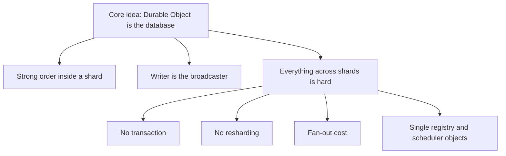
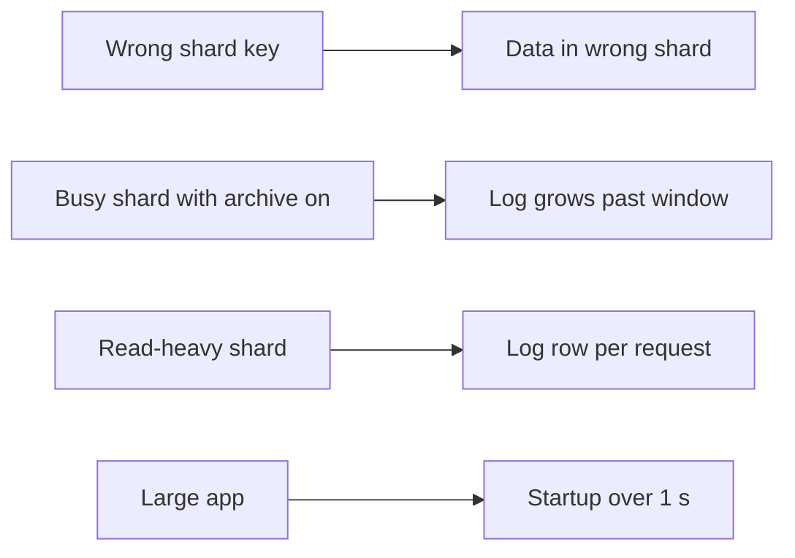

# Critical assessment

This page judges Lunora from the code. Each item has evidence. Items are ranked by impact. Where a point is an inference and not a measurement, the text says so.

## Verdict in short

Lunora has a strong core idea and unusually careful handling of Cloudflare's sharp edges. Its weak points are the parts that sit outside one Durable Object: shard routing, reshaping, fan-out, and single shared objects. It is alpha software with a very large central class.

## Strengths, ranked

### 1. The Durable Object as database and broadcaster

One object runs one event at a time. Commit order is the consistency order. The writer holds the sockets. No lock manager, no broker, no replication stream to tail. Idle shards hibernate and cost storage, not compute. The engine adds the missing parts around that idea (gate, transaction, after-commit chain). Evidence: `cloudflare-host.ts:161-236`, `shard-runner.ts:136`, `architecture.mdx`.

### 2. Platform gotchas are handled and written down

The code shows deep experience with workerd:

- A gate that cannot reject, because a rejection resets the object (`cloudflare-host.ts:161`).
- Original error identity kept across `storage.transaction` (`cloudflare-host.ts:202`).
- No raw `BEGIN` (`shard-do.ts:4160-4185`).
- Native methods wrapped, because a detached call gives "Illegal invocation" (`resolve-shard.ts:96`).
- Attachment size measured against the real runtime: 16,384 bytes (`shard-do.ts:1988`).
- Subrequest, connection and alarm ceilings turned into constants with reasons (`scheduler-do.ts:173,214`).

### 3. A change log that knows how it can lie

Epoch, cursor, floors, payload floor, `CDC_LOG_TRIMMED`, `CDC_PAYLOAD_COMPACTED`, `CDC_TIMELINE_FORKED`. It treats a native restore as a fork that SQLite cannot report, and uses outside witnesses (consumer, replica, archive). The archive follows "archive first, destroy second" with a watermark. See [Change log](06-change-log-cdc.md) and [Storage tiers](08-storage-tiers-and-archive.md).

### 4. Fail-closed security defaults

Default-deny shard access and fan-out, reserved-name refusal, signed internal channels, replica control refused without a secret, jurisdiction never silently dropped, and a registry that refuses all requests without the secret (`create-worker.ts:3157-3224`, `replica.ts:318`, `shard-registry-do.ts:255`).

### 5. Exactly-once effect from at-least-once parts

Idempotency row in the mutation transaction, watermark in the same commit, in-memory claim for actions, a schedule outbox in the transaction, pinned per-message call ids in the queue consumer. The pieces fit (`shard-do.ts:5850`, `ctx-db-schedule-outbox.ts`, `queue/src/dispatch.ts:235`).

### 6. A host-neutral seam that is audited

The capability matrix is honest (`emulated` for what Lunora builds). Conformance suites and a parity rule in `AGENTS.md` keep it so. A Node host and a `celld` host exist (experimental).

### 7. Real-runtime tests

34 workerd test files in the shard package alone, plus conformance suites, coverage floors, application programming interface (API) snapshots and size and startup budgets.

### 8. Efficient reactive delivery

Table gate, range gate, shared runs, per-flush diff cache, coalescing, backpressure, bounded pools. See [Realtime engine](10-realtime-engine.md).

## Weaknesses, ranked

### 1. Shard routing is the caller's job and is not verified

The shard key is a client option (`{ shardKey: channelId }`). I found no check that a row's `.shardBy` field matches the object's name. A bug in client code puts rows in the wrong shard with no error. The access gate (`authorizeShard`) limits who may name a shard, but it does not check data. The docs say routing is by schema. Impact: silent data misplacement, and it stays invisible until a fan-out or export is compared with a direct read. This is the largest gap.

### 2. No resharding, no online migration

Changing the key is stop-writes, export, deploy, import, clear. The export is paginated live reads, not a snapshot, so a write during the window can be lost. The docs say it is not online. A hot key that outgrows one object (10 GB, about 1,000 requests per second) has no split path.

### 3. Hidden write amplification (inference)

By default every dispatch, including each query, inserts a row into `__lunora_reqlog__` (`LUNORA_REQUEST_LOG_SAMPLE` defaults to 1). A mutation also writes the `__idempotency` row when a mutation id is sent, a watermark row for custom mutators, an optional change log row, and index entries for the default sort and every declared index. Durable Object SQLite bills rows written. The code never states the total per request. Please measure before trusting the cost story "an idle app costs nothing". Idle is cheap. Busy read-heavy shards are not obviously cheap.

### 4. Single shared objects

- The `ShardRegistryDO` is one object (`shard-registry-do.ts:73`). Fan-out lists depend on it and on a 30-second cache.
- The `SchedulerDO` is one object per app by default (`do-client.ts:31`). One alarm drains at most 100 index entries and 6 dispatches at once.
- `.global()` tables have one D1 primary for writes.

Each is a shared point of contention, in a design that is otherwise about avoiding them.

### 5. Registry gaps can make exports and backups incomplete

Shards register on their first write after a wake, and only when the registry is bound. A shard written before binding is absent until written again. An export, backup or migration then silently skips it (`concepts/sharding.mdx` warns; `cloudflare.ts:77`). A new shard takes up to 30 seconds to appear in fan-out.

### 6. Archive throughput ceiling

Archiving is one segment of at most 10,000 rows per 60-second sweep, about 166 changes per second. The delete ceiling is the archive watermark. A shard that writes faster grows its log without bound. Nothing warns, because the size warning only covers `__root__`. The code carries a `ponytail:` note about it (`cdc-retention.ts:326`).

### 7. Silent staleness in the connector path

The connector sync ignores a shard's error and may report `hasMore: false`, which reads as "caught up". The cursor holds no epoch. A rollback is partly protected by the watermark proof, but a timeout is invisible (`data-movement-admin-routes.ts:253-310`). The export tap is stricter.

### 8. Cross-shard limits

No cross-shard transaction. A mutation touching a shard table and a global table commits twice. Plan 168 is still an open spike. Fan-out costs one subrequest per shard, and the advisor warns at 500 shards.

### 9. Complexity and maturity

`shard-do.ts` has 18,454 lines. The behaviour is spread over many private methods and shared instance fields that need re-pinning after each await. Alpha version, 46 `ponytail:` notes, a source-available licence (FSL-1.1-Apache-2.0, converting to Apache 2.0 after two years), and the package manifest names one author. These are risk factors, not defects.

### 10. Internal channel authentication is basic

The HMAC covers the body with no nonce or time stamp, so a captured frame can be replayed by anyone who can reach the namespace. The relay channel accepts unsigned frames when no secret is set (`shared/relay-signature.ts:44-58`).

### 11. Replica limits

A fork is permanent for the object's life. Bootstrap is one response capped at 50,000 rows. The archive does not serve replicas.

## Risks

| Risk | Likelihood | Effect | Evidence |
|------|-----------|--------|----------|
| Wrong shard key in client code | Medium | Data in wrong shard | Weakness 1 |
| Hot tenant over one object's capacity | Medium for chat and feed apps | Throttle, no split | `limits.mdx`, `hot_shard` lint only warns |
| Unbounded log growth on busy shard with archive on | Medium | SQLite fills | Weakness 6 |
| Worker startup over 1 s | Medium for large apps | Deploy rejected (error 10021) | `limits.mdx`, lazy registry is opt-in |
| Cost surprise on read-heavy shards | Unknown | Higher bill | Weakness 3 |
| Restore forks the timeline silently | Low | Consumers skip writes | `ctx-db-commit-seq.ts`, `shard-do.ts:5295` |
| Cloudflare limit changes | Medium | Constants out of date | Many numbers copied from docs with a date note (`socket-host.ts:55`) |
| Alpha breaking changes | High | Rework | `AGENTS.md`: no back-compat on alpha branches |

## What we would copy

1. The archive discipline: watermark in the primary store, key by last sequence, epoch in the prefix, never delete before the upload resolves.
2. The epoch plus outside-witness fork detection.
3. The settle-instead-of-reject gate wrapper.
4. The outbox inside the transaction for deferred side effects.
5. The positive "vouch" rule: only claim "nothing changed" for sources you record.
6. Padded string keys when a store sorts as text.
7. Constants that equal the platform ceiling, with the reason in a comment.
8. A capability matrix with an `emulated` level.
9. Fail-closed defaults for anything that names another tenant.
10. The `ponytail:` convention: write down the limit you accept.
11. A per-flush cache for fan-out work, thrown away after the flush.

## What we would avoid

1. Caller-chosen shard keys without a server-side check of the row field.
2. Writing a log row to the primary store on every read by default.
3. A single registry object for shard discovery with a time-based cache. Prefer a registration that the caller can verify, or a listing the platform provides.
4. A single default scheduler instance for the whole app.
5. A connector endpoint with no error channel.
6. Class files of 18,000 lines. Split by role, as the relay and replica collaborators already show.
7. Treating an export of live reads as a migration tool.

## Where to go next

Read the [Glossary](16-glossary.md).
