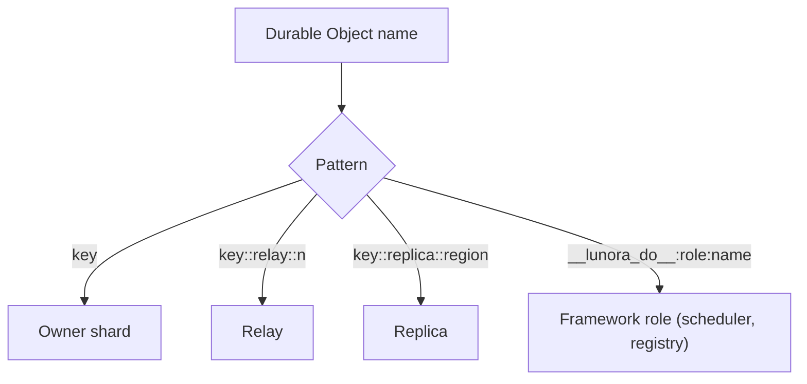
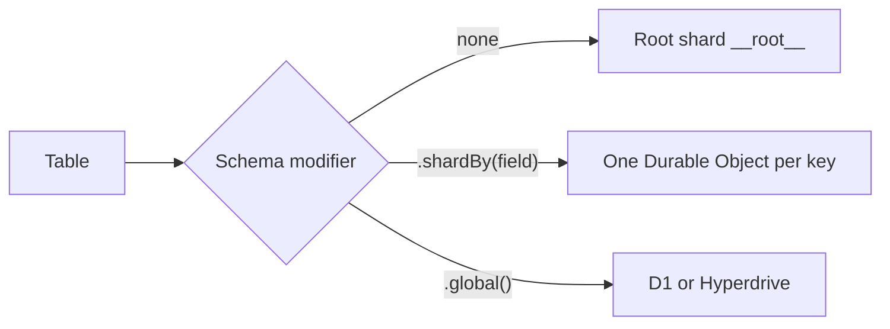

# Glossary

Terms are in alphabetical order. Each entry points to the page that explains it.

| Term | Meaning |
|------|---------|
| Action | A function that may call outside services. The code runs it on the shard without the gate and without a transaction (the architecture page says it runs in the Worker). See [ShardDO](05-shard-durable-object.md) |
| Advisor | A set of lints that warn about schema and runtime problems, such as `hot_shard`. See [Testing and observability](14-testing-observability-deployment.md) |
| Alarm | The single timer slot of a Durable Object. See [Alarms](11-alarms-queues-workflows.md) |
| Archive | Change log segments stored in R2 before rows are deleted. See [Storage tiers](08-storage-tiers-and-archive.md) |
| Attachment | A small value saved with a hibernating WebSocket, at most 16,384 bytes. Holds subscriptions |
| Bookmark (D1) | A token for a position in a D1 session. Sent as the header `x-d1-bookmark`. See [D1](09-d1-global-and-hyperdrive.md) |
| Bookmark (PITR) | A name for a moment in a Durable Object's 30-day history |
| Cell | The word the `celld` daemon uses for a Durable Object instance |
| Change data capture (CDC) | Recording each write in a log. In Lunora the table `__cdc_log`. See [Change log](06-change-log-cdc.md) |
| Codegen | The build step that writes `_generated/*` from the schema and function files |
| Commit cursor | The log high-watermark returned after a mutation (`commitCursor`). Used as a read-your-writes bookmark for replicas |
| `commitOrdered` | A table option that adds the field `_commitSeq` |
| `_commitSeq` | A per-shard commit counter stored inside each row's document |
| Compaction | Setting `doc` to NULL for old log rows while keeping their keys |
| Coordinator | The Worker code that fans a read out to many shards and merges answers. `query-coordinator.ts` |
| Default shard | The Durable Object named `__root__` |
| Dispatch claim | An in-memory mark that an action with a given id is running. See [ShardDO](05-shard-durable-object.md) |
| Drift gate | A deploy check that compares the schema with a committed baseline file |
| Durable Object (DO) | A single-threaded Cloudflare object with its own storage and optional alarm |
| Epoch | A random string in `__cdc_meta`. A change means the log timeline forked |
| Fan-out | A read sent to every shard of a table |
| Floor | The oldest log position that can still be served. Key floor and payload floor |
| Gate | In this document, `blockConcurrencyWhile`, wrapped by `runSerialized` |
| Global table | A table stored in D1 or Hyperdrive, set with `.global()` |
| Hibernation | A Durable Object with only idle WebSockets is removed from memory. Sockets stay open |
| Hyperdrive | Cloudflare connection pooling for Postgres and MySQL |
| Idempotency row | A row in `__idempotency` keyed by identity and mutation id |
| Jurisdiction | A hard data residency rule (`eu`, `fedramp`, `us`) for Durable Objects |
| Location hint | An advisory region for creating a Durable Object |
| Memo | A saved last result per subscription, used to skip duplicate pushes |
| Mutation | A function that writes. It runs inside the gate and a transaction |
| Outbox | `__schedule_outbox`, the durable list of schedule calls not yet accepted |
| Owner | The Durable Object that holds the true data for a shard, as opposed to a relay or replica |
| Payload | The `doc` column of a log row |
| PITR | Point-in-time recovery. Native restore of a Durable Object's SQLite to a past bookmark |
| Poke | A message that carries the membership diff for a shape. `pokeStart`, `pokePart`, `pokeEnd` |
| `ponytail:` | A comment tag for a known limit the authors accept |
| Query | A read-only function. May be cached and subscribed |
| Registry | `ShardRegistryDO`, the list of live shard keys per table |
| Relay | A Durable Object named `key::relay::n` that re-broadcasts frames for a hot owner |
| Replica | A Durable Object named `key::replica::region` that follows an owner's log for reads |
| Reactor | A server-side subscription that runs a handler when its query result changes |
| Role | What a Durable Object does. It is fixed by its name |
| Root shard | See default shard |
| `runSerialized` | The `ShardHost` method that maps to `blockConcurrencyWhile` |
| Segment | One R2 object of the change log archive |
| Seq | The `AUTOINCREMENT` position in `__cdc_log` |
| Shape | A named, parameterised partial replication of a table, with a predicate and optional columns |
| Shard | One Durable Object that owns one slice of state. Its name is the shard key |
| Shard key | The string name of a shard, chosen by the caller |
| Sibling channel | The signed Durable Object to Durable Object control path at `/_lunora/relay` or `/_lunora/replica` |
| Sink | A destination for observability events |
| Tier | Where a table lives: root, sharded, global |
| Watermark (client) | The last mutation sequence applied for a client, in `__client_watermark` |
| Watermark (archive) | The last `seq` known to be in R2, in `__cdc_archive` |
| Wide event | One span with many attributes, per request |
| `waitUntil` | A platform call that keeps work alive after the response |
| Workpool | A named pool in the scheduler with a concurrency limit |
