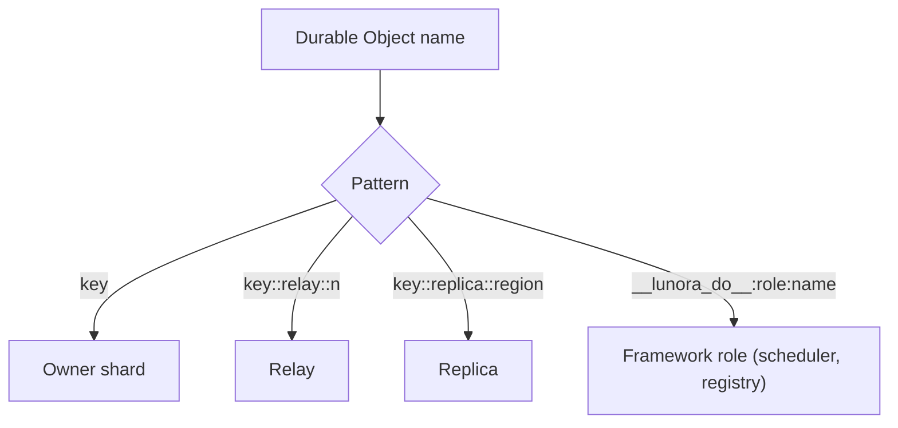
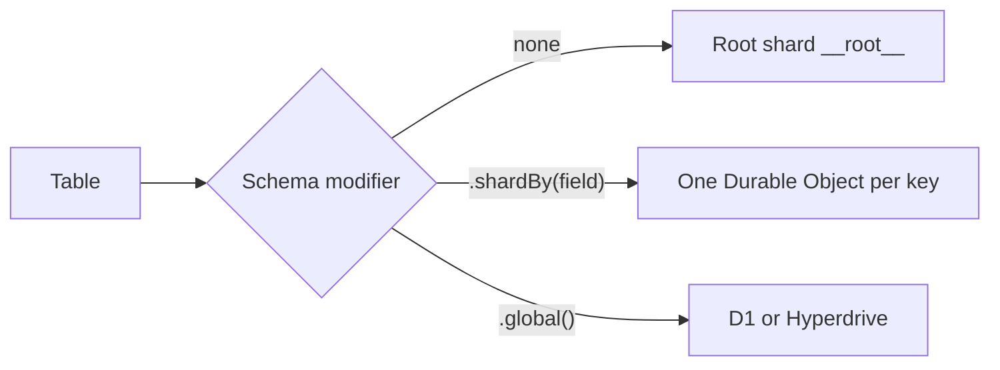

# Glossary

Terms are in alphabetical order. Each entry points to the page that explains it.

| Term | Meaning |
|------|---------|
| Action | A function that may call outside services. The code runs it on the shard without the gate and without a transaction (the architecture page says it runs in the Worker). See [ShardDO](05-shard-durable-object.md) |
| Actor model | A model in which an actor receives messages, runs in its own single thread, uses its own storage and sends messages. A Durable Object is an actor. See [Cloudflare services](02-cloudflare-services.md) |
| Advisor | A set of lints that warn about schema and runtime problems, such as `hot_shard`. See [Testing and observability](14-testing-observability-deployment.md) |
| Alarm | The single timer slot of a Durable Object. Cloudflare retries a failed handler up to 6 times. See [Alarms](11-alarms-queues-workflows.md) and [Cloudflare services](02-cloudflare-services.md) |
| Analytics Engine | Cloudflare service for time-series data points. Writes are non-blocking and reads are sampled. See [Cloudflare services](02-cloudflare-services.md) |
| Archive | Change log segments stored in R2 before rows are deleted. See [Storage tiers](08-storage-tiers-and-archive.md) |
| At-least-once delivery | A message may arrive more than once but is never lost. Queues and alarms work this way. A receiver must be idempotent. See [Cloudflare services](02-cloudflare-services.md) |
| Attachment | A small value saved with a hibernating WebSocket, at most 16,384 bytes. Holds subscriptions |
| Binding | A named link from a Worker to a resource, such as D1, R2 or a Durable Object namespace. It appears on `env`. See [Testing and deployment](14-testing-observability-deployment.md) |
| `blockConcurrencyWhile` | The Durable Object call that holds back all other events until its callback ends. A throw inside resets the object, and a callback has a 30-second timeout. See [Cloudflare services](02-cloudflare-services.md) |
| Bookmark (D1) | A string that names one point in the commit history of a D1 database. The Sessions application programming interface (API) returns it with `getBookmark`. The client sends it back as the header `x-d1-bookmark`, and a replica waits until it has reached that point before it answers. See [D1](09-d1-global-and-hyperdrive.md) |
| Bookmark (PITR) | A string that names a moment in the 30-day history of one Durable Object. It is a different thing from a D1 bookmark. See [Cloudflare services](02-cloudflare-services.md), section "Point-in-time recovery" |
| Cell | The word the `celld` daemon uses for a Durable Object instance |
| Change data capture (CDC) | Recording each write in a log. In Lunora the table `__cdc_log`. See [Change log](06-change-log-cdc.md) |
| Codegen | The build step that writes `_generated/*` from the schema and function files |
| Cold start | The first request after a Worker or object loads from nothing. In-memory state is empty. See [Architecture](01-architecture.md) |
| Commit cursor | The log high-watermark returned after a mutation (`commitCursor`). The client sends it back as `x-lunora-min-seq`, so that a replica read sees its own write. See [Replication](07-replication-and-read-scaling.md) |
| `commitOrdered` | A table option that adds the field `_commitSeq` |
| `_commitSeq` | A per-shard commit counter stored inside each row's document |
| Compaction | Setting `doc` to NULL for old log rows while keeping their keys |
| Compatibility date | A date in the Wrangler configuration that opts a Worker into runtime changes up to that date. See [Testing and deployment](14-testing-observability-deployment.md) |
| Consumer (log) | Any reader of the change log: a subscriber, a replica, a connector or the archive. See [Change log](06-change-log-cdc.md) |
| Coordinator | The Worker code that fans a read out to many shards and merges answers. `query-coordinator.ts` |
| Cron Trigger | A schedule that runs the `scheduled()` handler of a Worker in Coordinated Universal Time (UTC). See [Cloudflare services](02-cloudflare-services.md) |
| Dead letter queue | A queue that receives messages after the retry limit is reached. Without one, Cloudflare deletes the message. See [Cloudflare services](02-cloudflare-services.md) |
| Default shard | The Durable Object named `__root__` |
| Dialect | A small object that tells the shared Structured Query Language (SQL) store how one engine (SQLite, Postgres, MySQL) differs. See [D1 and global tables](09-d1-global-and-hyperdrive.md) |
| Dispatch claim | An in-memory mark that an action with a given id is running. See [ShardDO](05-shard-durable-object.md) |
| Drift gate | A deploy check that compares the schema with a committed baseline file |
| Durable Object (DO) | A single-threaded Cloudflare object with its own storage and optional alarm. Cloudflare runs at most one instance for each name. See [Cloudflare services](02-cloudflare-services.md), section "Durable Objects from first principles" |
| Epoch | A random string in `__cdc_meta`. A change means the log timeline forked. See [Change log](06-change-log-cdc.md) |
| Eventual consistency | After writes stop, all copies will agree. Until then a read may return old data. Workers KV and D1 replicas without a bookmark behave this way. See [Replication](07-replication-and-read-scaling.md) |
| Fan-out | A read sent to every shard of a table. The Worker merges the answers. See [Sharding design](04-sharding-design.md) |
| `first-primary` | A D1 session constraint. The first query goes to the primary database instance. Lunora never uses it. See [D1 and global tables](09-d1-global-and-hyperdrive.md) |
| `first-unconstrained` | A D1 session constraint and the default. The first query may go to any instance. Lunora passes it when there is no bookmark. See [D1 and global tables](09-d1-global-and-hyperdrive.md) |
| Floor | The oldest log position that can still be served. Key floor and payload floor |
| Fork (after restore) | A second history that starts when a restore moves a shard back in time and new writes follow. See [Change log](06-change-log-cdc.md) |
| Gate | In this document, `blockConcurrencyWhile`, wrapped by `runSerialized`. See [Cloudflare services](02-cloudflare-services.md) |
| Global table | A table stored in D1 or Hyperdrive, set with `.global()`. See [D1 and global tables](09-d1-global-and-hyperdrive.md) |
| Hibernation | A Durable Object with only idle WebSockets is removed from memory. Sockets stay open. See [Cloudflare services](02-cloudflare-services.md), section "WebSocket hibernation" |
| Hot shard | A shard that gets far more traffic than its peers. One object can serve about 1,000 requests per second. See [Sharding design](04-sharding-design.md) |
| Hyperdrive | Cloudflare service that pools connections to Postgres and MySQL and can cache read queries. See [Cloudflare services](02-cloudflare-services.md) |
| Hysteresis | Two thresholds, one to switch on and a lower one to switch off, so that a system does not flip near one edge. See [Replication](07-replication-and-read-scaling.md) |
| Idempotency | Doing an action twice has the same effect as doing it once. See [Replication](07-replication-and-read-scaling.md) |
| Idempotency row | A row in `__idempotency` keyed by identity and mutation id. It makes a retried mutation return the saved result |
| Input gate | A Cloudflare rule. While a Durable Object waits for its own storage, no new event is delivered to it. A `fetch` or a D1 call opens the gate. See [Cloudflare services](02-cloudflare-services.md) |
| Isolate | A light sandbox inside the V8 engine in which a Worker runs. A process hosts thousands of them. See [Cloudflare services](02-cloudflare-services.md) |
| Jurisdiction | A hard data residency rule (`eu`, `fedramp`, `us`) for Durable Objects. See [Cloudflare services](02-cloudflare-services.md) |
| Lease | A claim with an expiry time. If the holder dies, the claim ends by itself. See [Alarms](11-alarms-queues-workflows.md) |
| Location hint | An advisory region for creating a Durable Object. Only the first `get()` uses it. See [Cloudflare services](02-cloudflare-services.md) |
| Memo | A saved last result per subscription, used to skip duplicate pushes |
| Monotonic reads | A client never sees data go back in time. See [Replication](07-replication-and-read-scaling.md) |
| Mutation | A function that writes. It runs inside the gate and a transaction |
| Namespace (Durable Object) | The set of all Durable Objects of one class. See [Cloudflare services](02-cloudflare-services.md) |
| Optimistic concurrency control (OCC) | Writers read a version and write only if the version is unchanged. See [D1 and global tables](09-d1-global-and-hyperdrive.md) |
| Outbox | `__schedule_outbox`, the durable list of schedule calls not yet accepted. It is written in the same transaction as the data. See [Alarms](11-alarms-queues-workflows.md) |
| Output gate | A Cloudflare rule. While a storage write is pending, outgoing messages are held back until the write is saved. See [Cloudflare services](02-cloudflare-services.md) |
| Owner | The Durable Object that holds the true data for a shard, as opposed to a relay or replica |
| Payload | The `doc` column of a log row |
| PITR | Point-in-time recovery. Native restore of a Durable Object's SQLite to a past bookmark inside 30 days. See [Cloudflare services](02-cloudflare-services.md) |
| Poke | A message that carries the membership diff for a shape. `pokeStart`, `pokePart`, `pokeEnd` |
| `ponytail:` | A comment tag for a known limit the authors accept |
| Primary database instance | The one D1 database copy that takes writes. Read replicas follow it. See [D1 and global tables](09-d1-global-and-hyperdrive.md) |
| Query | A read-only function. May be cached and subscribed |
| Queue (Cloudflare) | A message buffer with producers and one consumer. Delivery is at least once and not ordered. See [Cloudflare services](02-cloudflare-services.md) |
| R2 | Cloudflare object storage with the S3 protocol, strong consistency and conditional writes. See [Cloudflare services](02-cloudflare-services.md) |
| Reactor | A server-side subscription that runs a handler when its query result changes |
| Read replica (D1) | A read-only copy of a D1 database in another region. It follows the primary with some lag. See [D1 and global tables](09-d1-global-and-hyperdrive.md) |
| Read-your-writes | A client always sees its own earlier writes. See [Replication](07-replication-and-read-scaling.md) |
| Registry | `ShardRegistryDO`, the list of live shard keys per table |
| Relay | A Durable Object named `key::relay::n` that re-broadcasts frames for a hot owner |
| Replica | A Durable Object named `key::replica::region` that follows an owner's log for reads |
| Replication lag | The time between a commit on the primary and its arrival on a replica. See [Replication](07-replication-and-read-scaling.md) |
| Re-seed | Take a fresh full copy of the data and restart the cursor. See [Change log](06-change-log-cdc.md) |
| Role | What a Durable Object does. It is fixed by its name |
| Root shard | The default shard `__root__`. Tables with no shard modifier live here. See [Sharding design](04-sharding-design.md) |
| `runSerialized` | The `ShardHost` method that maps to `blockConcurrencyWhile` |
| Segment | One R2 object of the change log archive |
| Seq | The `AUTOINCREMENT` position in `__cdc_log` |
| Sequential consistency | All clients see operations in one agreed order, and each client sees its own in order. D1 gives this inside a session. See [D1 and global tables](09-d1-global-and-hyperdrive.md) |
| Service binding | A link that lets one Worker call another without a public uniform resource locator (URL). The binding is the permission. See [Cloudflare services](02-cloudflare-services.md) |
| Session (D1) | A series of queries that D1 keeps sequentially consistent. Created with `withSession`. Lunora's session lasts for one request. See [D1 and global tables](09-d1-global-and-hyperdrive.md) |
| Shape | A named, parameterised partial replication of a table, with a predicate and optional columns |
| Shard | One Durable Object that owns one slice of state. Its name is the shard key |
| Shard key | The string name of a shard, chosen by the caller. See [Sharding design](04-sharding-design.md) |
| Sibling channel | The signed Durable Object to Durable Object control path at `/_lunora/relay` or `/_lunora/replica` |
| Sink | A destination for observability events |
| Strong consistency | A read returns the latest committed write. Inside one shard and in R2. See [Replication](07-replication-and-read-scaling.md) |
| Stub | A client handle for a Durable Object. A call on it travels to the object. See [Cloudflare services](02-cloudflare-services.md) |
| Subrequest | A request that a Worker sends to another service. Workers have a cap per request. See [Cloudflare services](02-cloudflare-services.md) |
| Sweep | One cleanup pass over the change log. It archives old rows to R2 and then deletes them. See [Storage tiers](08-storage-tiers-and-archive.md) |
| Tag (WebSocket) | A label on a hibernating WebSocket, used to find sockets. At most 10 tags of 256 characters. See [Cloudflare services](02-cloudflare-services.md) |
| Tier | Where a table lives: root, sharded, global |
| Vectorize | Cloudflare vector database. Writes become visible later. See [Cloudflare services](02-cloudflare-services.md) |
| `waitUntil` | A platform call that keeps work alive after the response |
| Watermark (archive) | The last `seq` known to be in R2, in `__cdc_archive`. See [Replication](07-replication-and-read-scaling.md), section "Three kinds of watermark" |
| Watermark (client) | The last mutation sequence applied for a client, in `__client_watermark`. See [Replication](07-replication-and-read-scaling.md), section "Three kinds of watermark" |
| Wide event | One span with many attributes, per request |
| Witness | A fact from outside the SQLite file that proves a fork, such as a consumer cursor above the log. See [Change log](06-change-log-cdc.md) |
| Workers AI | Cloudflare service that runs machine learning models. AI Gateway adds analytics and cost tracking. See [Cloudflare services](02-cloudflare-services.md) |
| Workers KV | Cloudflare global key-value store. Eventually consistent. Changes can take 60 seconds or more to show in other locations. See [Cloudflare services](02-cloudflare-services.md) |
| Workflow | A multi-step program. Cloudflare saves finished steps and does not repeat them after a failure. See [Cloudflare services](02-cloudflare-services.md) |
| Workpool | A named pool in the scheduler with a concurrency limit |
| Write amplification | One logical write that causes many physical writes. See [Critical assessment](15-critical-assessment.md) |
| `x-d1-bookmark` | The header that carries a D1 bookmark between the client, the Worker and the shard. See [D1 and global tables](09-d1-global-and-hyperdrive.md) |
| `x-lunora-min-seq` | The header that carries the commit cursor of the client's last write, for replica reads. See [Replication](07-replication-and-read-scaling.md) |
