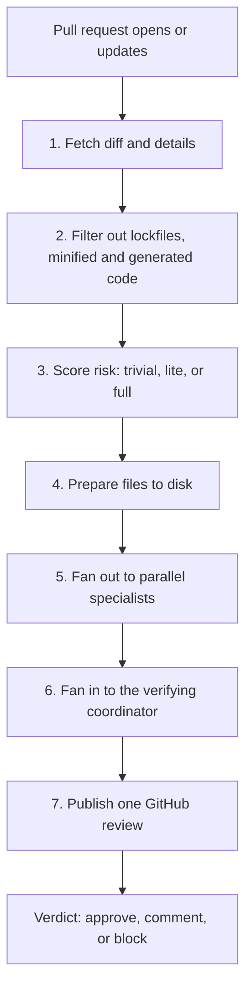
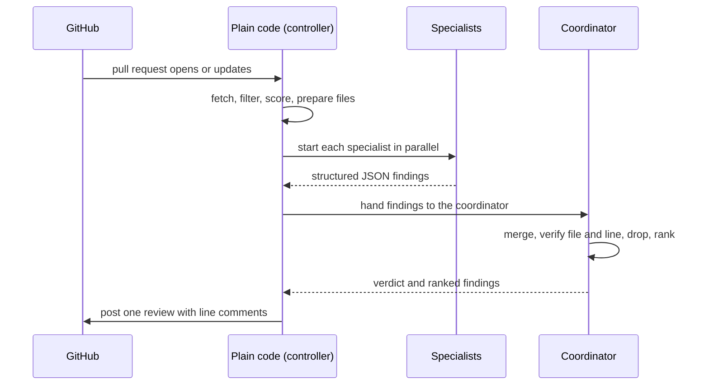

# Project Exploration: agent-swarm-pr-reviewer

## Overview

agent-swarm-pr-reviewer is the distilled design of an automated pull request (PR) reviewer built from several artificial intelligence (AI) agents. The source is a single 226-line guide, in seven parts, written as an interview study aid. The guide describes a system that runs when a pull request opens or updates: it fetches the diff, filters what is not worth reviewing, scores the risk, fans out to parallel specialist agents, fans in to one verifying coordinator, and posts one GitHub review with line comments and a verdict.

The guide carries no code. It states this openly: "you don't need the code to follow it" (`agent-swarm-guide.txt:3`). The system it describes is TypeScript on Bun, orchestrated by GitHub Actions, with the OpenCode software development kit (SDK) as the agent runtime and OpenAI models in three tiers (`agent-swarm-guide.txt:151-159`). The exploration therefore treats the text as the source of truth. Every factual claim traces to a line. Code shown in the documents is marked **illustrative** and reconstructs, in TypeScript, the shape of the design the guide describes.

The guide is also honest about its own status. Its last two tips say to present the system as one "studied from a friend's company, not one you built," and not to quote percentage improvements because the guide gives none (`agent-swarm-guide.txt:221-224`).

## Repository

- **Location:** `/Users/darkvoid/Dev/agent-swarm-guide.txt`
- **Remote:** N/A (not a git repository)
- **Primary Language:** N/A (the described system is TypeScript on Bun)
- **License:** N/A

## Structure of the Source

The guide has seven parts. Each part is a numbered section delimited by a header line.

```
agent-swarm-guide.txt
├── PART 1 OF 7: WHAT THIS IS          ← the problem, the build, the core idea, the word "swarm"
├── PART 2 OF 7: HOW IT WORKS          ← the seven-step pipeline, step by step
├── PART 3 OF 7: A WORKED EXAMPLE      ← one 150-line login-endpoint pull request
├── PART 4 OF 7: THE DESIGN DECISIONS  ← nine decisions, the most useful part for an interview
├── PART 5 OF 7: THE BUG I FIXED       ← the scope bug and its fix
├── PART 6 OF 7: IF YOU HAD TO BUILD ONE ← the stack, the build order, what to test
└── PART 7 OF 7: INTERVIEW PREP        ← the pitch, the question-and-answer set, the terms, the tips
```

## Architecture

### High-Level Diagram



The architecture has two halves. The fan-out half runs specialist agents in parallel. The fan-in half runs one stronger model as a judge. The guide calls this pattern "fan-out / fan-in" (`agent-swarm-guide.txt:14`).

### Component Breakdown

#### The specialists (fan-out)

- **Purpose:** each looks for one type of problem (`agent-swarm-guide.txt:10`).
- **Roles:** code quality, documentation, quality assurance (QA), security, and performance (`agent-swarm-guide.txt:39-43`).
- **Model tier:** mid-tier; documentation uses a cheaper model (`agent-swarm-guide.txt:98`).
- **Controls:** explicit "do not flag" lists (`agent-swarm-guide.txt:95`).

#### The coordinator (fan-in)

- **Purpose:** a stronger model that judges what the specialists raised (`agent-swarm-guide.txt:45`).
- **Duties:** merge duplicates, confirm each problem against the real file and line, drop nitpicks, correct severity, rank, cap the findings, and give a verdict (`agent-swarm-guide.txt:45-53`).
- **Limit:** it can invent no new findings; it only judges (`agent-swarm-guide.txt:54`).

#### The plain-code controller

- **Purpose:** normal code, not an AI, starts every specialist and drives the flow (`agent-swarm-guide.txt:87`).
- **Why:** an AI coordinator that called the specialists itself once took a shortcut and reasoned through the diff alone (`agent-swarm-guide.txt:87`).

## Entry Points

### The pull request event

- **Trigger:** a pull request opens or updates on GitHub (`agent-swarm-guide.txt:7`).
- **Flow:** fetch → filter → score → prepare → fan out → fan in → publish (`agent-swarm-guide.txt:21-58`).

### The re-run event

- **Trigger:** each new push triggers another run (`agent-swarm-guide.txt:118`).
- **Flow:** the coordinator compares new findings with its old comments by meaning, because line numbers shift (`agent-swarm-guide.txt:118-119`).

## Data Flow



## External Dependencies

The guide names the stack in Part 6. The table lists each tool and its role.

| Tool | Purpose |
|------|---------|
| GitHub Actions | triggers the reviewer on each pull request |
| Docker | packages the reviewer so every repo runs the same version |
| TypeScript on Bun | the language and runtime |
| OpenCode SDK | the agent runtime: sessions, file reading, permissions |
| OpenAI models | three tiers, behind a provider-swap layer |
| Octokit | talks to the GitHub API |
| parse-diff | reads the code changes |
| Zod | validates the agents' JSON output |
| msw | fakes GitHub's API in tests |

Source: `agent-swarm-guide.txt:151-159`.

## Configuration

The guide names few configuration knobs. The risk thresholds are fixed numbers: trivial up to 30 changed lines, lite up to 100 lines, full over 100 lines or sensitive paths (`agent-swarm-guide.txt:29-32`). The finding caps are 3, 6, or 10 depending on risk (`agent-swarm-guide.txt:50`). The stuck-agent timeouts are 3 minutes of no activity and 10 minutes total (`agent-swarm-guide.txt:110`).

## Testing

The guide says to keep the logic that needs no AI — parsing, verdict rules, risk scoring — in separate functions with normal unit tests. Use fake agents to test the orchestration. Use evals to cover the quality of the AI's judgment, which unit tests cannot (`agent-swarm-guide.txt:176`).

## Key Insights

- Code controls the flow; AI only judges (`agent-swarm-guide.txt:87`).
- Finding is separated from verifying (`agent-swarm-guide.txt:90`).
- A failed review must never look like a pass (`agent-swarm-guide.txt:103`).
- The cheapest and safest AI call is the one you never make (`agent-swarm-guide.txt:144`).
- A prompt instruction is not a boundary; real limits belong in code (`agent-swarm-guide.txt:143`).

## Open Questions

- The guide gives no measured numbers, and its own tip says not to quote any (`agent-swarm-guide.txt:223`).
- The guide names no specific JSON schema; the illustrative snippets in the documents reconstruct one from the stated duties of the coordinator and specialists.
