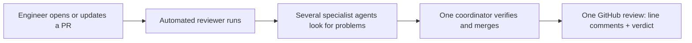
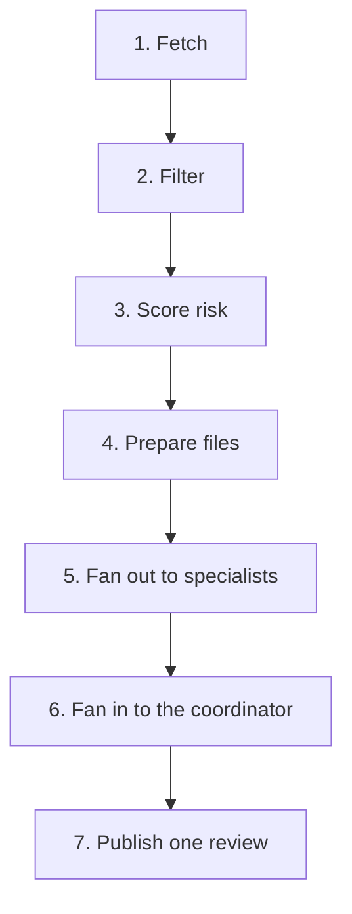

# Overview

This page says what the system is, what problem it solves, and what its core idea is. Every claim cites the source guide at `agent-swarm-guide.txt:NN`.

## The problem in one line

Artificial intelligence (AI) helps engineers write code faster, so more pull requests (PRs) pile up, and human review becomes the bottleneck (`agent-swarm-guide.txt:5`).

The guide is blunt about why a single AI reviewer does not fix this. One AI reviewer "tends to be noisy, shallow and sometimes confidently wrong" (`agent-swarm-guide.txt:5`). A reviewer that is noisy wastes the author's time. A reviewer that is confidently wrong is worse: it looks authoritative while being incorrect.

## What they built

The answer is an automated PR reviewer made of several AI agents (`agent-swarm-guide.txt:7`).

When a person opens or updates a pull request on GitHub, the system runs automatically. It posts one normal GitHub review. The review has two parts: comments on specific lines, and a final verdict (`agent-swarm-guide.txt:7`).

The key word is **one**. The system does not post six separate opinions. It posts one clean review. That is the whole product.

## The core idea

The system works like a good engineering team (`agent-swarm-guide.txt:9`). The guide states the division of labor in three lines:

1. **Specialists** each look for one type of problem (`agent-swarm-guide.txt:10`).
2. **A senior reviewer** checks their claims against the actual code (`agent-swarm-guide.txt:11`).
3. **The author** gets one clean review, not six separate opinions (`agent-swarm-guide.txt:12`).

This is a division between *finding* and *verifying*. The specialists find, widely. The senior reviewer verifies, hard. The guide returns to this split again and again; it is the single idea that holds the design together.

## What the word "swarm" really means

The guide corrects the hype around the word "swarm" (`agent-swarm-guide.txt:14`).

It is really an orchestrated team. The agents do not chat with each other. They do not decide who does what. Normal code controls the flow, and each specialist works alone (`agent-swarm-guide.txt:14`).

The pattern is called **fan-out / fan-in** (`agent-swarm-guide.txt:14`). Work splits out to parallel specialists, then combines back into one result. The guide notes a telling detail: saying this in an interview shows the difference between the hype and the engineering (`agent-swarm-guide.txt:14`).

A public reference with a similar design is Cloudflare's write-up at `https://blog.cloudflare.com/ai-code-review/` (`agent-swarm-guide.txt:16`).

## The shape of the whole system

The full system is a seven-step pipeline. This page only sketches it; [the pipeline](02-the-pipeline.md) explains each step.

The two halves matter. Steps 1 through 4 are plain code. Step 5 is the fan-out. Step 6 is the fan-in. Step 7 is plain code again. The AI appears only in steps 5 and 6, and even there the control stays with code.

## Aha: the product is a refusal, not a capability

The most valuable thing the system does is *not* review. It is to stop a review that would be wrong. The guide returns to this idea many times: drop the nitpick, drop the unproven finding, skip the run that has nothing to do, refuse to approve on failure. The system earns trust by what it refuses to say, not by how much it can say.

The clearest form of this is in the failure rules: a failed review must never look like a pass (`agent-swarm-guide.txt:103`). A tool that stays silent is dangerous. A tool that says "I could not review this" is honest.

## Where to go next

Read [the original guide](01-the-original-guide.md) for the source verbatim. Then read [the pipeline](02-the-pipeline.md) for the seven steps in full.
