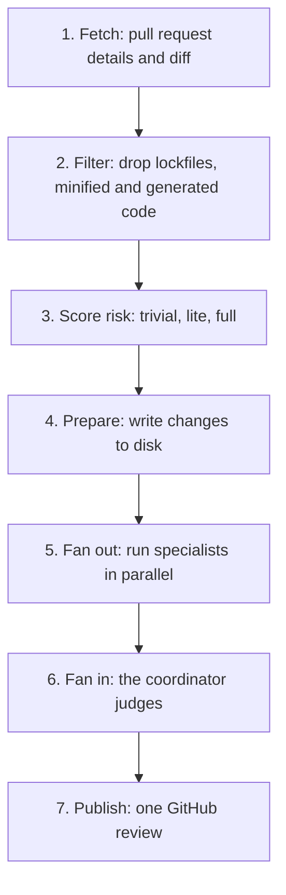
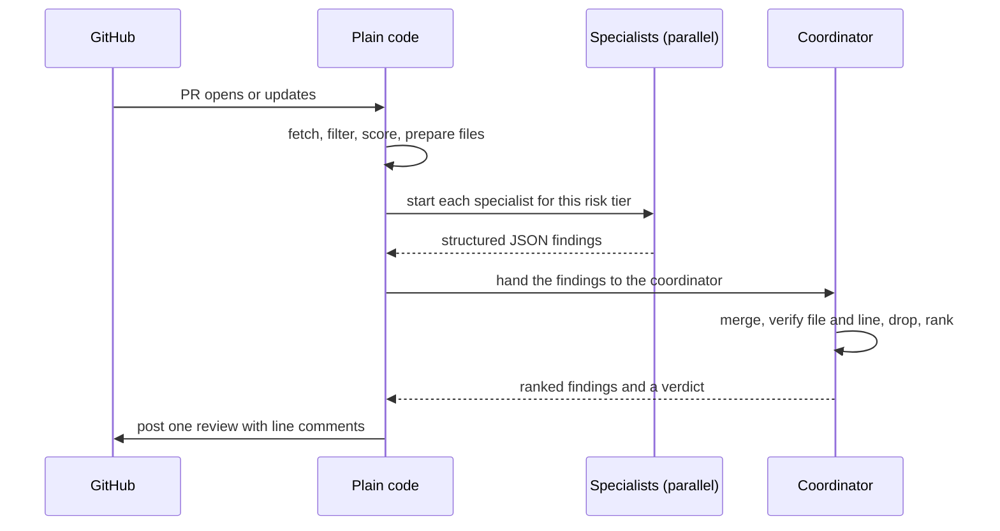

# The pipeline

This page explains the seven-step pipeline that turns a pull request (PR) into one review. Every step cites the guide at `agent-swarm-guide.txt:NN`.

> The guide ships no source code. The code blocks on this page are **illustrative**: they reconstruct the described design in TypeScript to make each step concrete. No illustrative snippet invents a fact the guide does not state.

## The seven steps at a glance

The guide states the steps in order: fetch, filter, score risk, prepare files, fan out, fan in, publish (`agent-swarm-guide.txt:22-57`). The first four steps are plain code. Only the fifth and sixth involve an artificial intelligence (AI) model, and even there the control stays with code.



## Step 1 — Fetch

Fetch gets the PR details and the code changes (the "diff") from GitHub (`agent-swarm-guide.txt:22-23`). The stack names Octokit as the tool that talks to the GitHub application programming interface (API), and parse-diff as the tool that reads the changes (`agent-swarm-guide.txt:158-159`).

```ts
// illustrative reconstruction — not from the guide
import { Octokit } from "octokit";
import parseDiff from "parse-diff";

const octokit = new Octokit({ auth: process.env.GITHUB_TOKEN });

async function fetchPullRequest(owner: string, repo: string, number: number) {
  const { data: pr } = await octokit.rest.pulls.get({ owner, repo, pull_number: number });
  const { data: files } = await octokit.rest.pulls.listFiles({ owner, repo, pull_number: number });
  const diff = files.map((f) => ({ path: f.filename, patch: parseDiff(f.patch ?? "") }));
  return { pr, files: diff };
}
```

## Step 2 — Filter

Filter removes what is not worth reviewing: lockfiles, minified files, and generated code (`agent-swarm-guide.txt:26`). Database migrations stay in, because people write them by hand and they can be risky (`agent-swarm-guide.txt:26`). This step is a first cost cut: the less the agents read, the less they cost and the less they can misread.

```ts
// illustrative reconstruction — not from the guide
const SKIP = /(^|\/)(package-lock\.json|yarn\.lock|pnpm-lock\.yaml|bun\.lock|.*\.min\.js|.*\.generated\..*)$/;

function isWorthReviewing(path: string): boolean {
  if (SKIP.test(path)) return false;                 // lockfiles, minified, generated
  if (path.startsWith("migrations/")) return true;   // migrations stay in
  return true;
}
```

**Aha: the filter is a cost and a safety decision at once.** Skipping a lockfile saves tokens. Skipping generated code saves false positives. But the guide is careful to keep migrations in, because the cheapest path — skipping everything noisy — would silently drop the riskiest hand-written code. The filter is not "drop boring files." It is "drop what no human would review, keep what a human would."

## Step 3 — Score risk

Score the risk with simple rules, with no AI involved (`agent-swarm-guide.txt:29`). The rules are three tiers, decided by two line thresholds and a set of sensitive paths. This step is explained in full in [risk scoring](03-risk-scoring.md).

```ts
// illustrative reconstruction — not from the guide
type Risk = "trivial" | "lite" | "full";

const SENSITIVE = /auth|crypto|secret|security|sso|oauth|key/i;

function scoreRisk(changedLines: number, paths: string[]): Risk {
  if (paths.some((p) => SENSITIVE.test(p)) || changedLines > 100) return "full";
  if (changedLines > 30) return "lite";
  return "trivial";
}
```

## Step 4 — Prepare the files

Prepare writes each file's changes and the PR context to disk (`agent-swarm-guide.txt:37`). The reason is explicit: agents read what they need, instead of receiving one huge prompt (`agent-swarm-guide.txt:37`). This is a memory and cost decision. A single prompt with the whole diff is expensive and overflows context. Files on disk let each agent read only its area.

```ts
// illustrative reconstruction — not from the guide
import { mkdtemp, writeFile } from "node:fs/promises";

async function prepareFiles(pr: PR, files: DiffFile[]) {
  const dir = await mkdtemp("/tmp/review-");
  await writeFile(`${dir}/context.json`, JSON.stringify(pr));
  for (const f of files) {
    await writeFile(`${dir}/${f.path}`, JSON.stringify(f.patch));
  }
  return dir;
}
```

## Step 5 — Fan out to specialists

Fan out runs the specialists in parallel, and the risk score decides who runs (`agent-swarm-guide.txt:40`). The roles are spelled out in [the specialists](04-the-specialists.md):

- **Trivial:** one general reviewer, covering everything at lighter depth (`agent-swarm-guide.txt:41`).
- **Lite:** code quality, documentation, and quality assurance (QA) (`agent-swarm-guide.txt:42`).
- **Full:** those three plus security and performance (`agent-swarm-guide.txt:43`).

```ts
// illustrative reconstruction — not from the guide
const ROLES = {
  trivial: ["general"],
  lite: ["code-quality", "documentation", "qa"],
  full: ["code-quality", "documentation", "qa", "security", "performance"],
} as const;

function rolesFor(risk: Risk): string[] {
  return [...ROLES[risk]];
}
```

## Step 6 — Fan in to the coordinator

The guide calls this "the most important step" (`agent-swarm-guide.txt:46`). A stronger model acts as the judge. It merges duplicate findings, opens the cited file and line to confirm each problem is real, drops nitpicks and anything with no concrete way to fail, corrects wrong severity, ranks what remains, keeps at most 3, 6, or 10 findings, and gives a verdict (`agent-swarm-guide.txt:47-52`). The full rules are in [the coordinator](05-the-coordinator.md).

One hard limit stands out: the coordinator can invent no new findings. It only judges what the specialists raised (`agent-swarm-guide.txt:54`).

## Step 7 — Publish

Publish is normal code. It posts one GitHub review and marks earlier comments as resolved if the issue has been fixed (`agent-swarm-guide.txt:57`). Where a fix is small, the comment includes a suggested edit the author can apply in one click (`agent-swarm-guide.txt:57`).

## The whole flow as a sequence



## Aha: only two steps think, and one of them cannot add anything

The pipeline puts the AI in a narrow cage. Steps 1, 2, 3, 4, and 7 are deterministic code. Step 5 finds. Step 6 judges, and its judgment is subtractive — it can only remove or keep what it was given, never add (`agent-swarm-guide.txt:54`). The design makes the most error-prone component also the least powerful to invent. A reviewer that can only delete findings cannot hallucinate a new one into the report.

## Where to go next

Read [risk scoring](03-risk-scoring.md) for the thresholds in Step 3. Read [the specialists](04-the-specialists.md) for Step 5, and [the coordinator](05-the-coordinator.md) for Step 6.
