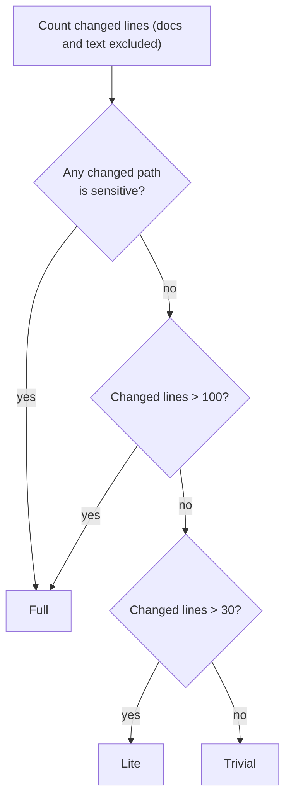
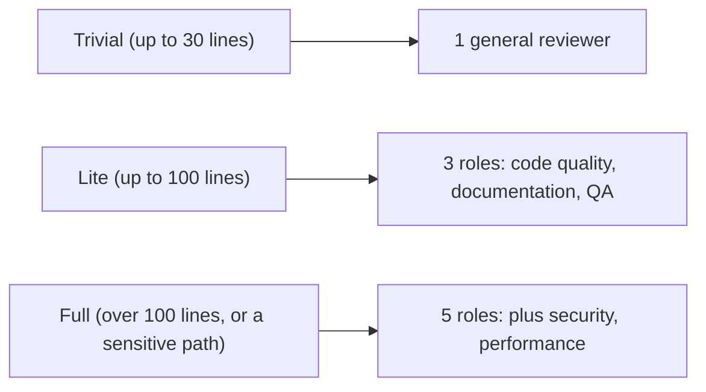

# Risk scoring

This page explains how the system scores the risk of a pull request (PR). Risk scoring decides how many specialists run, so it is the single lever that controls both cost and coverage. Every claim cites the guide at `agent-swarm-guide.txt:NN`.

> The guide ships no source code. Code blocks on this page are **illustrative**: they reconstruct the described design in TypeScript.

## The rule in one line

No artificial intelligence (AI) is involved. Risk scoring is a set of simple rules (`agent-swarm-guide.txt:29`). The rules count changed lines and test the paths of the changed files.

## The three tiers and their thresholds

The guide states the three tiers with exact numbers (`agent-swarm-guide.txt:30-32`):

| Tier | Changed lines | Who runs |
|------|---------------|----------|
| Trivial | up to 30 | one general reviewer, lighter depth |
| Lite | up to 100 | code quality, documentation, quality assurance (QA) |
| Full | over 100, or a sensitive path | those three plus security and performance |

The thresholds are inclusive at the top of each tier: 30 lines is still trivial, 100 lines is still lite, 101 lines is full.

## The sensitive paths

A full score does not need over 100 lines. A single line in a sensitive path forces a full review (`agent-swarm-guide.txt:32`). The guide names the sensitive paths: auth, crypto, secrets, security, single sign-on (SSO), Open Authorization (OAuth), and keys (`agent-swarm-guide.txt:32`).

This is the important asymmetry. Line count is a proxy for size. The sensitive paths are a proxy for blast radius. A one-line change to an auth check can be worse than a 200-line rename, and the rules encode that.



## Documents and text do not count

Docs and text files do not count toward the line total (`agent-swarm-guide.txt:34`). A PR that rewrites a 500-line readme does not trigger a full review, because documentation is not code and carries no code-level risk. The filter and the line count work together: the filter drops what is not worth reviewing, and the line count ignores what does not carry the same risk.

```ts
// illustrative reconstruction — not from the guide
const SENSITIVE = /auth|crypto|secret|security|sso|oauth|key/i;
const TEXT_OR_DOC = /\.(md|txt|rst|adoc)$/i;

function scoreRisk(files: { path: string; changedLines: number }[]) {
  const touchedSensitive = files.some((f) => SENSITIVE.test(f.path));
  if (touchedSensitive) return "full";

  const codeLines = files
    .filter((f) => !TEXT_OR_DOC.test(f.path))  // docs and text do not count
    .reduce((sum, f) => sum + f.changedLines, 0);

  if (codeLines > 100) return "full";
  if (codeLines > 30) return "lite";
  return "trivial";
}
```

## Why risk scoring exists

Risk scoring answers one question: how much review does this PR deserve? The guide's own answer is that a typo fix does not need five agents (`agent-swarm-guide.txt:98`). Spending the same five agents on a one-line typo and on a 150-line auth change wastes money on the first and under-reviews the second.

```ts
// illustrative reconstruction — not from the guide
function rolesFor(risk: "trivial" | "lite" | "full"): string[] {
  switch (risk) {
    case "trivial": return ["general"];
    case "lite": return ["code-quality", "documentation", "qa"];
    case "full": return ["code-quality", "documentation", "qa", "security", "performance"];
  }
}
```



## Aha: one line can outweigh a thousand lines

The tier is a maximum of two tests: a boolean for blast radius, and a number for size. The boolean wins. A single changed line under `auth/` jumps straight to full, past the 30-line and 100-line gates. The design admits that size is a poor proxy for danger, and corrects for it with a path allowlist that a human security reviewer would recognize instantly.

## Where to go next

Read [the specialists](04-the-specialists.md) to see the roles each tier runs. Read [the pipeline](02-the-pipeline.md) for where risk scoring sits in the seven steps.
