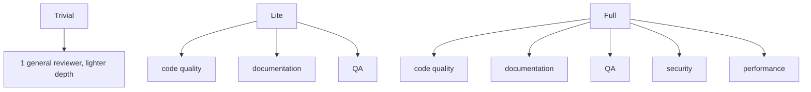
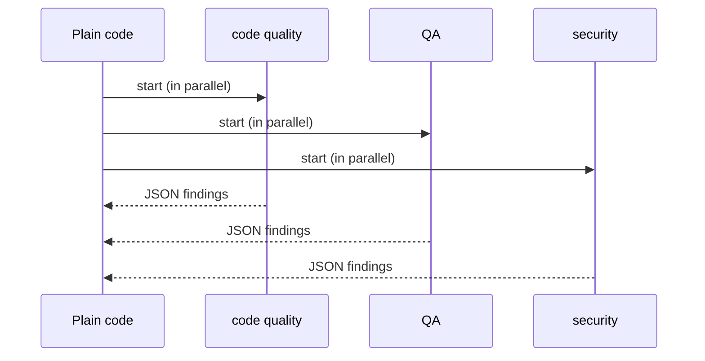

# The specialists

This page explains the fan-out half: the specialist agents that each look for one type of problem. Every claim cites the guide at `agent-swarm-guide.txt:NN`.

> The guide ships no source code. Code blocks on this page are **illustrative**: they reconstruct the described design in TypeScript.

## The division of labor

The core idea states that specialists each look for one type of problem (`agent-swarm-guide.txt:10`). The guide names five roles across the risk tiers: code quality, documentation, quality assurance (QA), security, and performance (`agent-swarm-guide.txt:42-43`).

Which roles run depends on the risk score from [risk scoring](03-risk-scoring.md):



The table shows the same mapping with the source lines:

| Risk | Roles that run | Source |
|------|----------------|--------|
| Trivial | one general reviewer, everything at lighter depth | `agent-swarm-guide.txt:41` |
| Lite | code quality, documentation, QA | `agent-swarm-guide.txt:42` |
| Full | those three plus security and performance | `agent-swarm-guide.txt:43` |

## Each specialist works alone

The guide is careful about the word "swarm": the agents do not chat with each other or decide who does what. Normal code controls the flow, and each specialist works alone (`agent-swarm-guide.txt:14`).

This is a real design choice, not a detail. If the specialists talked, one could steer the others and reduce the value of independent coverage. If they decided who ran, the orchestration would move into an AI, where it can be skipped. Both stay out. Each specialist is an independent reader with one lens.

```ts
// illustrative reconstruction — not from the guide
async function runSpecialists(roles: string[], dir: string) {
  return Promise.all(
    roles.map((role) => runOneSpecialist(role, dir))  // each works alone, in parallel
  );
}

async function runOneSpecialist(role: string, dir: string): Promise<Finding[]> {
  const prompt = buildPrompt(role, dir);  // one lens, one role
  return callModel(prompt);               // returns structured JSON
}
```



## The structured output

Every specialist must return JavaScript Object Notation (JSON) in a fixed format, validated in code (`agent-swarm-guide.txt:100-101`). The guide names Zod as the validator (`agent-swarm-guide.txt:160`).

The guide states a subtle reason for the fixed format. The system adds this format rule itself, so a team customising an agent's prompt cannot break it (`agent-swarm-guide.txt:101`). The contract between the specialist and the rest of the pipeline is enforced outside the prompt, where a prompt edit cannot reach it.

```ts
// illustrative reconstruction — not from the guide
import { z } from "zod";

const Finding = z.object({
  file: z.string(),          // a path
  line: z.number(),          // a line number
  severity: z.enum(["critical", "high", "medium", "low"]),
  summary: z.string(),
  failure: z.string(),       // a concrete way to fail
  suggestion: z.string().optional(),  // a suggested fix, where small
});

const SpecialistOutput = z.object({ findings: z.array(Finding) });
```

## The "do not flag" lists

Specialists carry explicit "do not flag" lists (`agent-swarm-guide.txt:95`). These lists are the front line against noise. The guide ties them to a hard lesson: if a bot cries wolf, people stop reading it (`agent-swarm-guide.txt:95`).

```ts
// illustrative reconstruction — not from the guide
const DO_NOT_FLAG = [
  "naming style preferences",
  "line length or whitespace",
  "existing code not touched by this PR",
  "missing optional documentation",
];
```

## Spend according to risk

The specialists do not all run the same model. Specialists use a mid-tier model, and documentation uses a cheaper one (`agent-swarm-guide.txt:98`). The coordinator gets the strongest model, except on trivial PRs (`agent-swarm-guide.txt:98`). Cost is tracked per agent on each review (`agent-swarm-guide.txt:98`).

```ts
// illustrative reconstruction — not from the guide
const MODEL_BY_ROLE: Record<string, string> = {
  "code-quality": "mid",
  qa: "mid",
  security: "mid",
  performance: "mid",
  documentation: "cheap",   // documentation uses a cheaper model
  coordinator: "strong",    // the coordinator gets the strongest model
};
```

## Aha: coverage is a fan of narrow lenses, not one wide lens

A single "review this code" prompt reads everything with one blurry lens. Five specialists each read the same diff with a different question, and the questions do not overlap: security asks "is this exploitable," performance asks "is this slow," QA asks "is this covered." The same line can produce five findings that a single reviewer would flatten into one vague "this looks risky." The fan-out buys coverage not by reading more, but by asking more precise questions in parallel.

## Where to go next

Read [the coordinator](05-the-coordinator.md) to see what happens to these findings in the fan-in. Read [risk scoring](03-risk-scoring.md) for the tier that decides how many of these roles run.
