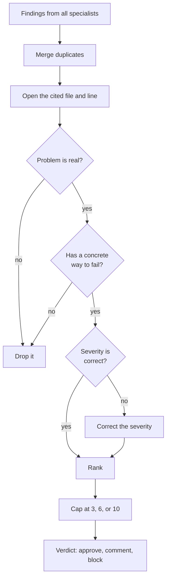
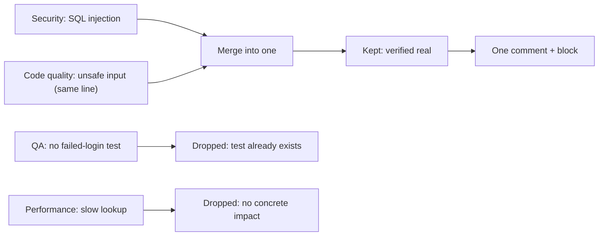

# The coordinator

This page explains the fan-in half: the coordinator that judges what the specialists raised. The guide calls it "the most important step" (`agent-swarm-guide.txt:46`). Every claim cites the guide at `agent-swarm-guide.txt:NN`.

> The guide ships no source code. Code blocks on this page are **illustrative**: they reconstruct the described design in TypeScript.

## The judge, not the finder

A stronger model acts as the judge (`agent-swarm-guide.txt:46`). The specialists find, widely. The coordinator filters, hard (`agent-swarm-guide.txt:92`). This split is a named design decision: separate finding from verifying (`agent-swarm-guide.txt:91`).

The hard limit is stated first and last: the coordinator can invent no new findings. It only judges what the specialists raised (`agent-swarm-guide.txt:54`). Everything the coordinator does is subtractive or corrective. It can never add.



## The six duties

The guide lists the coordinator's duties in order (`agent-swarm-guide.txt:47-52`):

1. **Merge duplicate findings** (`agent-swarm-guide.txt:47`). Two specialists can flag the same line for the same reason. They become one.
2. **Open the cited file and line** to confirm each problem is real (`agent-swarm-guide.txt:48`). This is the verification step. The coordinator reads the actual code, not the specialist's summary.
3. **Drop nitpicks and anything with no concrete way to fail** (`agent-swarm-guide.txt:49`). A finding that cannot describe how it fails is not a finding.
4. **Correct wrong severity ratings** (`agent-swarm-guide.txt:50`). A specialist can over-rate its own finding; the coordinator re-rates it.
5. **Rank what remains, keeping at most 3, 6, or 10 findings** depending on risk (`agent-swarm-guide.txt:51`). The three caps scale with the three tiers from [risk scoring](03-risk-scoring.md). Critical and high findings always get through (`agent-swarm-guide.txt:51`).
6. **Give a verdict: approve, comment, or block** (`agent-swarm-guide.txt:52`).

```ts
// illustrative reconstruction — not from the guide
async function coordinate(findings: Finding[], risk: Risk, dir: string) {
  const merged = mergeDuplicates(findings);                 // 1. merge
  const verified = [];
  for (const f of merged) {
    if (!(await isReal(f, dir))) continue;                  // 2. open file and line
    if (isNitpick(f) || !hasConcreteFailure(f)) continue;   // 3. drop
    verified.push(correctSeverity(f));                      // 4. correct
  }
  const ranked = rank(verified);                            // 5. rank
  const cap = risk === "trivial" ? 3 : risk === "lite" ? 6 : 10;
  const kept = [
    ...ranked.filter((f) => f.severity === "critical" || f.severity === "high"),
    ...ranked.filter((f) => f.severity !== "critical" && f.severity !== "high"),
  ].slice(0, cap);
  const verdict = decideVerdict(kept);                      // 6. approve, comment, block
  return { findings: kept, verdict };
}
```

## The verdict

The verdict has three values: approve, comment, or block (`agent-swarm-guide.txt:52`). The guide does not give a formula for when each fires, but it does give a rule for the hard call: when torn between block and comment, the coordinator chooses comment (`agent-swarm-guide.txt:95`). The tie-break always leans away from blocking, because a bot that cries wolf gets ignored.

## The worked example in one flow

The guide's worked example shows the coordinator in action on a 150-line login-endpoint PR (`agent-swarm-guide.txt:65-79`). Four findings come in: a Structured Query Language (SQL) injection risk from security, the same line flagged as unsafe input by code quality, a missing failed-login test from QA, and a slow lookup from performance. The coordinator merges the two SQL findings into one, confirms the injection is real, finds the test already exists so drops QA's finding, and drops the slow lookup for having no concrete impact (`agent-swarm-guide.txt:74-77`). One verified comment survives, with a suggested fix and a block verdict (`agent-swarm-guide.txt:79`).



## Re-runs: compare by meaning

Each new push triggers another run (`agent-swarm-guide.txt:118-119`). The coordinator must not post the same finding again. It compares new findings with its old comments by meaning, because line numbers shift when code moves (`agent-swarm-guide.txt:119`). It only posts what is new, and it avoids raising fresh comments on code untouched since its last review (`agent-swarm-guide.txt:119`).

```ts
// illustrative reconstruction — not from the guide
function isNew(finding: Finding, oldComments: Comment[]): boolean {
  // match by meaning, not by line number, because lines shift
  return !oldComments.some((c) => sameMeaning(finding, c));
}
```

The matching is semantic, not positional. A comment on a line that moved is still the same finding. A new finding on an untouched line is noise and stays out.

## Aha: the most powerful component is the one that cannot add

Every step of the coordinator is a filter. It merges, verifies, drops, corrects, ranks, and caps — all ways of removing or reordering what already exists. The only power it does not have is the power to invent (`agent-swarm-guide.txt:54`). This is deliberate: the model most likely to hallucinate is given a job where hallucination is structurally impossible, because there is no path from "I think so" to "new finding." A hallucinating specialist is caught by the coordinator; a hallucinating coordinator would be un-catchable, so the design removes its ability to add.

## Where to go next

Read [fail-closed and failure handling](06-fail-closed-and-failure-handling.md) for what happens when the coordinator itself fails. Read [the specialists](04-the-specialists.md) for the findings the coordinator receives.
