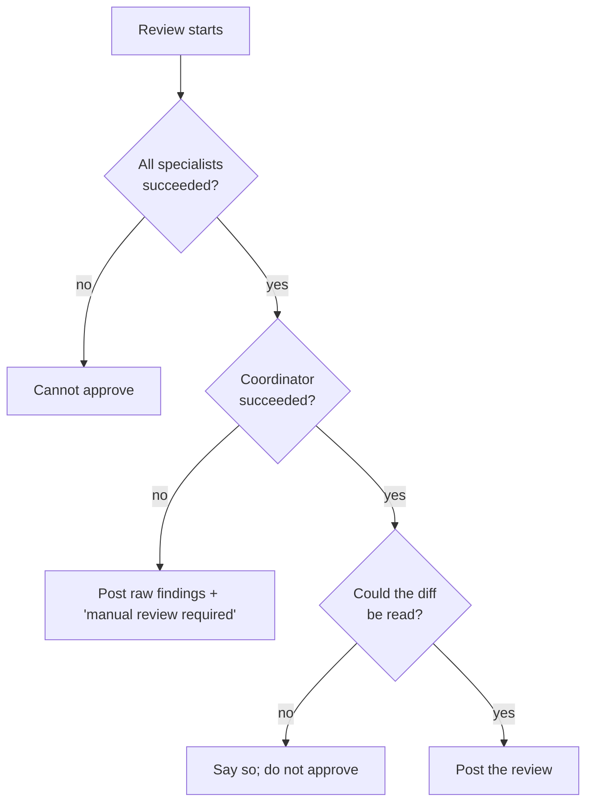
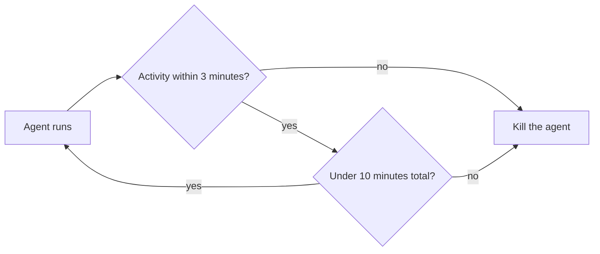

# Fail-closed and failure handling

This page explains how the system handles failure. The governing rule is one sentence: a failed review must never look like a pass (`agent-swarm-guide.txt:103`). Every claim cites the guide at `agent-swarm-guide.txt:NN`.

> The guide ships no source code. Code blocks on this page are **illustrative**: they reconstruct the described design in TypeScript.

## Fail closed, not fail open

The design follows the "fail closed" principle: when unsure, deny (`agent-swarm-guide.txt:219`). A review that did not happen must not read as a review that found nothing. The failure is reported, not hidden.

The opposite — fail open — would approve a PR when the reviewer silently broke. The guide treats that as the one unforgivable outcome. Everything in this section exists to prevent it.

## The five failure rules

The guide lists five concrete rules under the heading "a failed review must never look like a pass" (`agent-swarm-guide.txt:103-108`):

| Failure | What happens | Source |
|---------|--------------|--------|
| A specialist fails | the PR cannot be approved | `agent-swarm-guide.txt:104` |
| The coordinator fails | the raw specialist findings are posted with "manual review required" | `agent-swarm-guide.txt:105` |
| Nothing could be read | the bot says so, rather than approving | `agent-swarm-guide.txt:106` |
| The primary model fails | there is a chain of fallback models | `agent-swarm-guide.txt:107` |
| No review ran | teams can choose to turn the continuous integration (CI) check red | `agent-swarm-guide.txt:108` |



## The fallback chain

If the primary model fails, there is a chain of fallback models (`agent-swarm-guide.txt:107`). The interview section repeats it: use fallback models and timeouts (`agent-swarm-guide.txt:204`). A single provider outage should not turn into a silent pass; it should turn into a retry on a different model, and if that fails, into a reported failure.

```ts
// illustrative reconstruction — not from the guide
const FALLBACK_CHAIN = ["primary", "secondary", "tertiary"];

async function callWithFallback(prompt: string) {
  for (const tier of FALLBACK_CHAIN) {
    try {
      return await callModel(tier, prompt);
    } catch {
      continue;  // try the next model in the chain
    }
  }
  throw new Error("all models failed — report, do not approve");
}
```

## The coordinator failure is a degraded mode

When the coordinator fails, the raw specialist findings are still posted, with the label "manual review required" (`agent-swarm-guide.txt:105`). This is the "degraded mode" the guide defines: a partial service that is openly reported as partial (`agent-swarm-guide.txt:220`).

The value here is that the specialist findings are not thrown away. The fan-out half succeeded; only the judge failed. So the author still gets the raw signal, clearly marked as unverified.

```ts
// illustrative reconstruction — not from the guide
function publishOnCoordinatorFailure(rawFindings: Finding[]) {
  return {
    body: "Manual review required. The coordinator could not verify these findings.",
    findings: rawFindings,          // raw, unverified, clearly labelled
    verdict: "none",
  };
}
```

## Stuck agents are killed

Stuck agents get killed after 3 minutes with no activity, or 10 minutes in total (`agent-swarm-guide.txt:110`). These two timeouts bound both kinds of hang: an agent that stops making progress, and an agent that makes progress forever.

```ts
// illustrative reconstruction — not from the guide
const NO_ACTIVITY_TIMEOUT = 3 * 60 * 1000;  // 3 minutes with no activity
const TOTAL_TIMEOUT = 10 * 60 * 1000;       // 10 minutes in total

async function runWithTimeouts(task: () => Promise<Finding[]>) {
  return await race([
    task(),
    sleep(NO_ACTIVITY_TIMEOUT).then(() => { throw new Error("killed: no activity"); }),
  ]);
}
```



## Aha: the failure mode is the product, not a corner case

Most systems treat failure handling as the last engineering task. This guide makes it a named design decision and puts the boundary on the *positive* side: a pass must be earned, never assumed. The five rules enumerate the ways a review can silently degrade, and each has a stated fallback that reports rather than approves. The reason is the same lesson the guide keeps returning to — a bot that is quietly wrong is worse than a bot that is loudly broken.

## Where to go next

Read [the scope bug](08-the-scope-bug.md) for a failure that looked like success: an agent with nothing to review that invented findings. Read [the coordinator](05-the-coordinator.md) for the step whose failure triggers the "manual review required" path.
