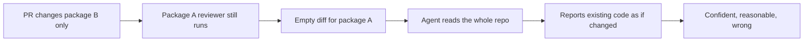
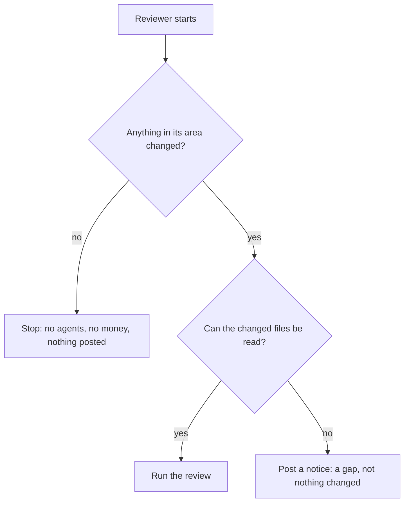

# The scope bug

This page tells the one bug the guide fixes, and why it is the best interview story in the guide. Every claim cites the guide at `agent-swarm-guide.txt:NN`.

> The guide ships no source code. Code blocks on this page are **illustrative**: they reconstruct the described design in TypeScript.

## The setup

A large repository can have several reviewers. One reviewer covers a specific package, and another covers everything else. Both run on every pull request (PR) (`agent-swarm-guide.txt:128`).

This is a normal ownership pattern: a team owns one package and reviews it, while a second reviewer covers the rest. The two reviews have different scopes.

## The bug

A PR changed nothing in the owned package, but that package's reviewer still ran (`agent-swarm-guide.txt:130`). The agents had an empty diff, yet could still read the whole repository. With nothing to review, they went exploring and reported existing code as if the PR had changed it (`agent-swarm-guide.txt:130`).



In one real case, a reviewer criticised another team's code that was already merged (`agent-swarm-guide.txt:132`). The comments could not attach to any line in the PR, so they landed in the summary. The coordinator then said the PR description did not match the code, which made things more confusing (`agent-swarm-guide.txt:132`).

## The root cause

"Scope" was only a hint about where to focus. It was never a real limit on what agents could read (`agent-swarm-guide.txt:134`).

This is the deepest sentence in the guide. The reviewer was *told* to focus on its package. It was never *prevented* from reading elsewhere. A hint changes what an agent wants to do. A limit changes what it can do. The design had a hint and called it a boundary.

## The fix

Before any agent starts, the system checks whether this reviewer has anything to review. If nothing in its area changed, it stops straight away. No agents run, no money is spent, and nothing is posted (`agent-swarm-guide.txt:136`).

```ts
// illustrative reconstruction — not from the guide
async function runScopedReview(reviewer: Reviewer, diff: DiffFile[]) {
  const inScope = diff.filter((f) => reviewer.owns(f.path));
  if (inScope.length === 0) {
    return;  // nothing in this reviewer's area changed — stop, no agents run
  }
  return runAgents(reviewer, inScope);
}
```

The fix moves the boundary from a prompt into code. The prompt used to say "focus on this package." Now the code checks, before any model starts, whether the package changed, and skips the run if it did not.



## Two cases deliberately behave differently

The guide is careful to name two exceptions, because "nothing changed" and "something changed but we could not read it" are different (`agent-swarm-guide.txt:138-140`):

1. **If relevant files changed but could not be read, it still posts a notice**, because that is a gap in the review, not "nothing changed" (`agent-swarm-guide.txt:139`).
2. **Whole-repo reviews still run as before** (`agent-swarm-guide.txt:140`).

```ts
// illustrative reconstruction — not from the guide
async function runScopedReview(reviewer: Reviewer, diff: DiffFile[]) {
  const inScope = diff.filter((f) => reviewer.owns(f.path));
  if (inScope.length === 0) return;                 // truly nothing — skip

  const readable = inScope.filter((f) => canRead(f.path));
  if (readable.length === 0) {
    return postNotice("files in scope changed but could not be read");  // a gap, not nothing
  }
  return runAgents(reviewer, readable);
}
```

## Why it is a good interview story

The guide lists four reasons (`agent-swarm-guide.txt:143-146`):

1. An agent given nothing to do may invent work (`agent-swarm-guide.txt:143`).
2. A prompt instruction is not a boundary, so real limits belong in code (`agent-swarm-guide.txt:144`).
3. The cheapest and safest AI call is the one you never make (`agent-swarm-guide.txt:145`).
4. Agent bugs can look like confident, reasonable output rather than a crash (`agent-swarm-guide.txt:146`).

## Aha: the bug looks like success

The bug never crashed. It produced comments that looked exactly like a good review — specific, confident, reasonable. The failure was invisible precisely because the output was so polished. This is the guide's real lesson about agents in production: "they fail quietly. A crash is easy to spot, but a confident wrong answer isn't" (`agent-swarm-guide.txt:213`). The fix had to catch the *absence* of a reason to run, before the agent could manufacture one.

## Where to go next

Read [fail-closed and failure handling](06-fail-closed-and-failure-handling.md) for the other ways the system reports rather than approves. Read [security and prompt injection](07-security-and-prompt-injection.md) for the same "limits in code, not prompts" principle applied to security.
