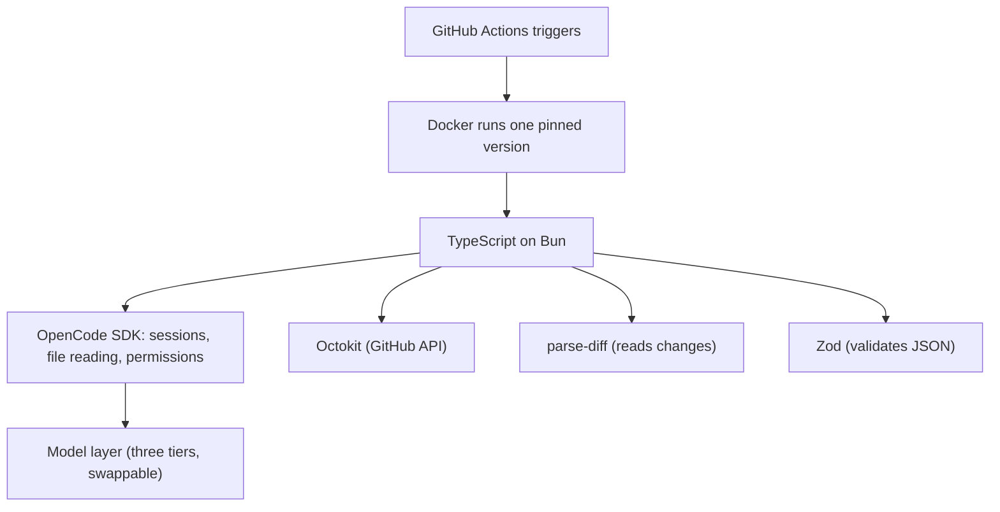
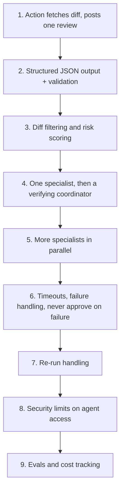

# The stack and build order

This page explains the tools the guide names, and the order in which it says to build the system. Every claim cites the guide at `agent-swarm-guide.txt:NN`.

> The guide ships no source code. Code blocks on this page are **illustrative**: they reconstruct the described design in TypeScript.

## The stack

The guide names the full stack in one list (`agent-swarm-guide.txt:152-161`). Each tool has one job.

| Tool | Job | Source |
|------|-----|--------|
| GitHub Actions | triggers the reviewer on each PR | `agent-swarm-guide.txt:153` |
| Docker | packages it so every repo runs the same version | `agent-swarm-guide.txt:154` |
| TypeScript on Bun | the language and runtime | `agent-swarm-guide.txt:155` |
| OpenCode SDK | the agent runtime: sessions, file reading, permissions | `agent-swarm-guide.txt:156` |
| OpenAI models | three tiers, behind a provider-swap layer | `agent-swarm-guide.txt:157` |
| Octokit | talks to the GitHub application programming interface (API) | `agent-swarm-guide.txt:158` |
| parse-diff | reads the code changes | `agent-swarm-guide.txt:159` |
| Zod | validates the agents' JavaScript Object Notation (JSON) output | `agent-swarm-guide.txt:160` |
| msw | fakes GitHub's API in tests | `agent-swarm-guide.txt:161` |

The stack has three layers: trigger and packaging (GitHub Actions, Docker), language and agents (TypeScript on Bun, OpenCode SDK), and models behind a swap layer (OpenAI models).



## The provider-swap layer

OpenAI models sit behind a layer that lets the team swap provider (`agent-swarm-guide.txt:157`). The three tiers from [the specialists](04-the-specialists.md) — cheap, mid, strong — are configured at this layer, so changing a model is a config change, not a code change.

The guide then widens the point: other agent runtimes could fill the same role, such as the Claude Agent SDK, the OpenAI Agents SDK, or LangGraph. The architecture matters more than the brand (`agent-swarm-guide.txt:163`).

```ts
// illustrative reconstruction — not from the guide
const PROVIDERS = {
  openai: { cheap: "gpt-4o-mini", mid: "gpt-4o", strong: "gpt-4o" },
  // other providers plug in here — the code above does not change
};

async function callModel(tier: "cheap" | "mid" | "strong", prompt: string) {
  const provider = PROVIDERS[process.env.PROVIDER ?? "openai"];
  return providerCall(provider[tier], prompt);
}
```

## The build order

The guide gives a nine-step build order (`agent-swarm-guide.txt:165-174`). The order matters: each step is a working slice, and no step depends on a later one.



The nine steps, in the guide's own words:

1. A GitHub Action that fetches the diff and posts one AI review (`agent-swarm-guide.txt:166`).
2. Structured JSON output with validation (`agent-swarm-guide.txt:167`).
3. Diff filtering and risk scoring (`agent-swarm-guide.txt:168`).
4. One specialist, then a verifying coordinator with access to the code (`agent-swarm-guide.txt:169`).
5. More specialists running in parallel (`agent-swarm-guide.txt:170`).
6. Timeouts, failure handling and "never approve on failure" (`agent-swarm-guide.txt:171`).
7. Handling of re-runs, so old comments are not repeated (`agent-swarm-guide.txt:172`).
8. Security limits on what agents can access (`agent-swarm-guide.txt:173`).
9. Evals and cost tracking (`agent-swarm-guide.txt:174`).

## What to test

The guide separates three kinds of test (`agent-swarm-guide.txt:176`):

1. **The logic that does not need AI** — parsing, verdict rules, risk scoring — lives in separate functions with normal unit tests.
2. **The orchestration** is tested with fake agents.
3. **The quality of the AI's judgment** is covered by evals, which unit tests cannot.

```ts
// illustrative reconstruction — not from the guide
// 1. pure logic, unit tested
expect(scoreRisk([{ path: "src/login.ts", changedLines: 150 }])).toBe("full");

// 2. orchestration, tested with a fake agent
const fake = { run: async () => [{ file: "a.ts", line: 1, severity: "high", summary: "x", failure: "y" }] };
expect(await runSpecialists(["code-quality"], fake)).toHaveLength(1);

// 3. judgment quality — not unit tested; measured by evals
```

The split is the point. Unit tests prove the deterministic code. Fake agents prove the wiring. Only evals can say whether the model's *judgment* got better, and the guide returns to that in [interview preparation](10-interview-prep.md).

## Aha: build the dumbest working slice first, and gate the judgment last

The build order starts with a single AI review and no filtering, no risk scoring, no coordinator. Those come later. The judgment — the coordinator and the evals — comes near the end. The ordering admits that the AI judgment is the hardest part to get right and the easiest to defer, while the plumbing can ship a useful thing on day one. The specialist/coordinator split is introduced at step 4, but the honest single-reviewer slice comes first, and the guide never pretends otherwise.

## Where to go next

Read [interview preparation](10-interview-prep.md) for how to explain the design. Read [critical assessment](11-critical-assessment.md) for what to copy from this stack and what to leave.
