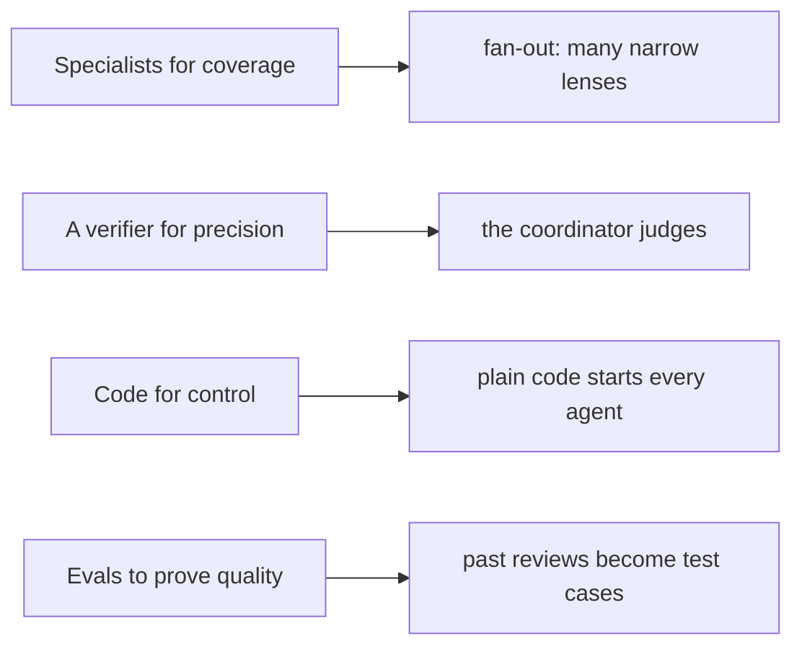
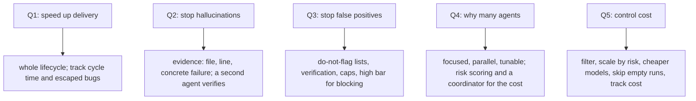

# Interview preparation

This page distills Part 7 of the guide: the pitch, the question-and-answer set, the terms, and the two honest tips. Every claim cites the guide at `agent-swarm-guide.txt:NN`.

## The one-line pitch

The guide gives a one-line pitch verbatim (`agent-swarm-guide.txt:183`):

> "AI makes code faster to write, so the bottleneck moves to review and verification. I'd focus on making AI output trustworthy, using specialists for coverage, a verifier for precision, code for control, and evals to prove quality."

Every word of the pitch maps to a part of the design: "specialists for coverage" is the fan-out, "a verifier for precision" is the coordinator, "code for control" is design decision 1, and "evals to prove quality" is design decision 9. The pitch is not a slogan; it is the architecture compressed into one sentence.

## The question-and-answer set

The guide gives ten questions and answers (`agent-swarm-guide.txt:185-213`). Each answer is distilled here with its source line.

### 1. How does AI speed up production delivery?

Across the whole lifecycle, not just autocomplete. Automated review gives feedback within minutes, and humans can focus on design and business logic. Speed only counts if quality holds, so also track PR cycle time, escaped bugs, and how many AI comments people act on (`agent-swarm-guide.txt:186`).

### 2. How do you stop hallucinations?

Make the AI show evidence. Each finding needs a file, a line, and a concrete way to fail. A second agent checks it against the real code, and anything unproven is dropped (`agent-swarm-guide.txt:189`).

### 3. How do you stop false positives?

Explicit "do not flag" lists, a verification step, capped findings, and a high bar for blocking. Then measure what developers dismiss (`agent-swarm-guide.txt:192`).

### 4. Why multiple agents rather than one big prompt?

Focused agents find more in their own domain, run in parallel, and can be tuned or tested separately. The trade-offs are cost and duplicates, which is why the design needs risk scoring and a coordinator. For a small change, one agent is the right answer (`agent-swarm-guide.txt:195`).

### 5. How do you control cost?

Filter the input, scale agents by risk, use cheaper models where possible, skip runs that have nothing to do, and track cost per agent (`agent-swarm-guide.txt:198`).

### 6. What about security?

PR content is untrusted input. Clean it, make agents read-only by default, and deny permissions unless explicitly allowed. Do not rely on prompts as your security layer (`agent-swarm-guide.txt:201`).

### 7. What if the model provider goes down?

Use fallback models and timeouts. Report clearly that the review did not run, and never approve by default (`agent-swarm-guide.txt:204`).

### 8. How do you know a prompt or model change helped?

Run evals built from real past reviews before rolling it out, and compare the results (`agent-swarm-guide.txt:207`).

### 9. Should AI replace human reviewers?

No. It is a strong first reviewer that clears out mechanical issues. People stay accountable for design, intent, and what ships (`agent-swarm-guide.txt:210`).

### 10. What is hard about agents in production?

They fail quietly. A crash is easy to spot, but a confident wrong answer is not. Then tell the bug story from Part 5 (`agent-swarm-guide.txt:213`).

## The terms

The guide lists five terms to be comfortable with (`agent-swarm-guide.txt:215-220`):

| Term | Meaning | Source |
|------|---------|--------|
| Fan-out / fan-in | split work in parallel, then combine the results | `agent-swarm-guide.txt:216` |
| Prompt injection | hiding instructions in content that an AI reads | `agent-swarm-guide.txt:217` |
| Evals | tests that measure the quality of AI output | `agent-swarm-guide.txt:218` |
| Fail closed | when unsure, deny | `agent-swarm-guide.txt:219` |
| Degraded mode | partial service that is openly reported as partial | `agent-swarm-guide.txt:220` |

## The two honest tips

The guide ends with two tips that are more honest than most interview advice (`agent-swarm-guide.txt:222-224`):

1. **Present this as a system you studied from a friend's company, not one you built.** Interviewers will probe for details, and "here's what I learned and how I'd apply it" holds up well (`agent-swarm-guide.txt:223`).

2. **Do not quote percentage improvements.** The guide gives no measured numbers, so explain what you would measure instead (`agent-swarm-guide.txt:224`).

## Aha: the honest answer is the strongest answer

The two tips are not a caveat; they are the strategy. A candidate who says "I studied this, I did not build it" can answer every follow-up without being caught inventing. A candidate who says "I would measure X" cannot be pressed for a number they do not have. The guide's interview prep is built on the same principle as the system it describes: never let a confident claim stand where a verified one should. In the interview, as in the reviewer, the person who refuses to invent is the one who is believed.

## Where to go next

Read [critical assessment](11-critical-assessment.md) for the strengths and weaknesses to raise honestly. Read [the scope bug](08-the-scope-bug.md) for the story the guide says to tell when asked what is hard.
