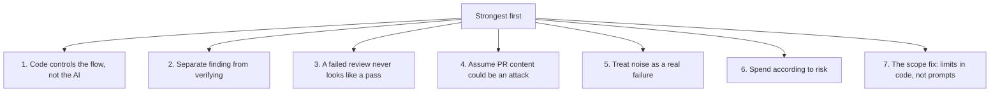
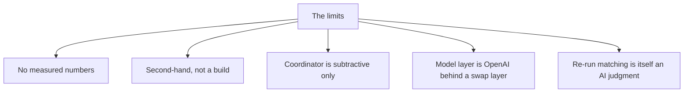

# Critical assessment

This page ranks what the design does right, where it is limited, and what a reader should copy. Every factual claim cites the guide at `agent-swarm-guide.txt:NN`. Observations that are this author's judgment, not a statement in the guide, are marked as such.

## The verdict in one line

The design's real invention is not the artificial intelligence (AI); it is the discipline around it. Specialists find, a stronger model judges, and plain code controls the flow so the judge can never invent a finding and a failed review can never look like a pass.

## Strengths, ranked

1. **Code controls the flow, not the AI.** The guide tried letting the coordinator call the specialists itself, and it took a shortcut and reasoned through the diff alone. Now plain code starts every specialist, so none can be skipped (`agent-swarm-guide.txt:87-88`). This is the single most portable idea in the guide.

2. **Finding is separated from verifying.** Specialists look widely; the coordinator filters hard. Anything unproven is dropped (`agent-swarm-guide.txt:92`). The two jobs use different models and different incentives, and they are never merged.

3. **A failed review must never look like a pass.** The five failure rules cover every silent-degradation path, from a failed specialist to a dead model provider (`agent-swarm-guide.txt:104-108`). The default is to report, not to approve.

4. **Pull request content is assumed hostile.** Cleaning the text, read-only agents, and denying permission requests outside the project folder are the three defenses, and none of them trusts the model to behave (`agent-swarm-guide.txt:114-116`).

5. **Noise is treated as a real failure.** A bot that cries wolf gets ignored, so the coordinator leans to comment over block, caps findings, and gives specialists explicit "do not flag" lists (`agent-swarm-guide.txt:95`).

6. **Spend follows risk.** A typo does not get five agents. Specialists use a mid-tier model, documentation a cheaper one, and the coordinator the strongest, except on trivial PRs (`agent-swarm-guide.txt:98`).

7. **The scope fix turns a hint into a limit.** The bug happened because "scope" was only a hint (`agent-swarm-guide.txt:134`); the fix checks, in code, whether there is anything to review before any agent starts (`agent-swarm-guide.txt:136`).

## Weaknesses and limits

1. **The guide gives no measured numbers.** It says so directly: "I haven't given you any measured numbers" (`agent-swarm-guide.txt:224`). The design is described as working, but its quality is not proven in the guide. A reader cannot tell whether it finds more real bugs or fewer false positives than a plain single review.

2. **It is second-hand, not a build.** The guide's own tip is to present it as a system "studied from a friend's company, not one you built" (`agent-swarm-guide.txt:223`). The guide is a distillation of a design, not a report from the builder. Details that a builder would know — exact prompts, the JSON schema, the thresholds for "concrete way to fail" — are absent.

3. **The coordinator is subtractive only.** It can invent no new findings (`agent-swarm-guide.txt:54`). This is a precision win and a recall limit. *(Author's judgment, not in the guide:)* if a specialist misses a real bug, no later stage can add it. The system's recall is bounded by its least-observant specialist.

4. **The model layer is OpenAI behind a swap layer.** Three tiers of OpenAI models sit behind a provider-swap layer (`agent-swarm-guide.txt:157`). The guide claims the architecture matters more than the brand (`agent-swarm-guide.txt:163`), but the stack it names is still one provider, and the swap layer is a claim, not a demonstrated migration.

5. **Documentation review is the cheapest model.** Documentation uses a cheaper model (`agent-swarm-guide.txt:98`). *(Author's judgment:)* this assumes documentation errors cost least, which is true for style but false for a doc that states the wrong security behavior.

6. **Re-run matching is itself an AI judgment.** The coordinator compares new findings with old comments "by meaning," because line numbers shift (`agent-swarm-guide.txt:119`). Semantic comparison is a place where the coordinator can be wrong, and the guide gives no rule for when "the same finding" is really the same.

## What to copy, what to leave

| Copy | Leave |
|------|-------|
| Code controls the flow; AI only judges | An AI that decides which agents to run |
| Finding separate from verifying | One big prompt that finds and judges at once |
| Fail closed: report, never silently approve | A silent catch-all that approves on error |
| Read-only agents, denied outside the project | Prompt-based security ("do not read secrets") |
| The scope check before any agent starts | "Scope" as a prompt hint only |
| Risk tiers with explicit thresholds | Five specialists on a one-line typo |
| Evals from past reviews | A guess when a prompt change "feels" better |

## How and where a reader should learn

A reader should study four places. First, design decision 1 (`agent-swarm-guide.txt:87`) is the whole philosophy in two sentences: code for control, AI for judgment. Second, the failure rules (`agent-swarm-guide.txt:103-110`) show how to make a system honest about its own gaps. Third, the scope bug (`agent-swarm-guide.txt:126-147`) is the best lesson in the guide: a prompt instruction is not a boundary. Fourth, the build order (`agent-swarm-guide.txt:165-174`) shows how to ship the plumbing before the judgment. Reproduce these four in any system that wraps an AI in code.

## Aha: the design's honesty is its best feature

The guide's two final tips — present it as studied, not built, and quote no percentages — are the same move the system makes about its own reviews: refuse to claim more than is verified (`agent-swarm-guide.txt:223-224`). A reviewer that will not invent a finding, and a candidate who will not invent a number, are trusted for the same reason. The system and its interview prep teach one lesson.

## Where to go next

Read [the pipeline](02-the-pipeline.md) for the seven steps behind the strengths. Read [the scope bug](08-the-scope-bug.md) for the strongest weakness-turned-lesson in full.
