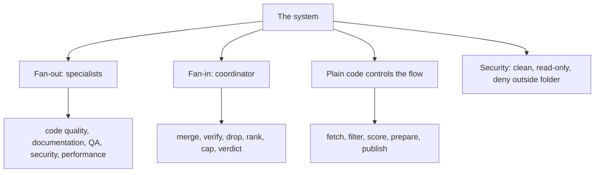
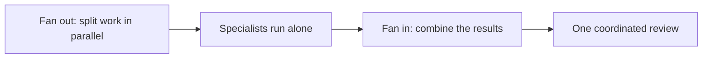

# Glossary

This page defines every term and abbreviation the documentation uses. Each entry gives the full form first, then a definition. The source of truth is the guide at `agent-swarm-guide.txt:NN`.

## The system

- **Automated pull request (PR) reviewer** — a system that runs when a PR opens or updates and posts one review with line comments and a verdict. Source: `agent-swarm-guide.txt:7`.
- **Pull request (PR)** — a request to merge one branch into another, reviewed before it merges. The system reviews each one. Source: `agent-swarm-guide.txt:5`.
- **Diff** — the code changes in a pull request, shown as added and removed lines. Step 1 fetches it; parse-diff reads it. Source: `agent-swarm-guide.txt:23`, `agent-swarm-guide.txt:159`.
- **Specialist** — one agent that looks for one type of problem. The roles are code quality, documentation, quality assurance (QA), security, and performance. Source: `agent-swarm-guide.txt:10`, `agent-swarm-guide.txt:42-43`.
- **Coordinator** — a stronger model that judges the specialists' findings. It merges, verifies, drops, corrects, ranks, caps, and gives a verdict, and can invent nothing. Source: `agent-swarm-guide.txt:46-54`.
- **Verdict** — the coordinator's final call: approve, comment, or block. Source: `agent-swarm-guide.txt:52`.
- **Fan-out / fan-in** — the pattern of splitting work in parallel, then combining the results. Source: `agent-swarm-guide.txt:14`, `agent-swarm-guide.txt:216`.
- **Risk scoring** — the plain-code rules that put a PR into trivial, lite, or full. Source: `agent-swarm-guide.txt:29-32`.
- **Risk tier** — one of trivial, lite, or full, deciding how many specialists run. Source: `agent-swarm-guide.txt:41-43`.
- **Structured output** — a fixed JavaScript Object Notation (JSON) format every agent must return, validated in code. Source: `agent-swarm-guide.txt:100-101`.

## Artificial intelligence (AI) and models

- **Artificial intelligence (AI)** — a machine system that performs tasks that need reasoning. The guide is about making its output trustworthy. Source: `agent-swarm-guide.txt:183`.
- **Model tier** — one of cheap, mid, or strong, chosen per role to match risk. Source: `agent-swarm-guide.txt:98`.
- **Fallback models** — a chain of models tried in order when the primary fails. Source: `agent-swarm-guide.txt:107`.
- **Provider-swap layer** — a layer that lets the team change model provider without changing code. Source: `agent-swarm-guide.txt:157`.
- **Hallucination** — an AI output that looks right but is invented. Each finding needs a file, a line, and a concrete way to fail to stop it. Source: `agent-swarm-guide.txt:189`.
- **Evals** — tests that measure the quality of AI output, built from past reviews. Source: `agent-swarm-guide.txt:218`.

## Security

- **Prompt injection** — hiding instructions in content that an AI reads. Source: `agent-swarm-guide.txt:217`.
- **Untrusted input** — content from a stranger, such as a PR description, treated as hostile. Source: `agent-swarm-guide.txt:201`.
- **Read-only** — an agent that can read but not write, delete, or exfiltrate. Source: `agent-swarm-guide.txt:115`.
- **Do not flag list** — a list of findings a specialist must skip. Source: `agent-swarm-guide.txt:95`.
- **Fail closed** — when unsure, deny. Source: `agent-swarm-guide.txt:219`.
- **Degraded mode** — a partial service that is openly reported as partial. Source: `agent-swarm-guide.txt:220`.

## The scope bug

- **Scope** — the area a reviewer is meant to cover. As a hint it fails; as a code check it works. Source: `agent-swarm-guide.txt:134`.
- **Empty diff** — a reviewer with no changed files in its area. It may still read the whole repo and invent work. Source: `agent-swarm-guide.txt:130`.

## Abbreviations

- **AI** — artificial intelligence.
- **PR** — pull request.
- **QA** — quality assurance, the specialist that checks test coverage.
- **SSO** — single sign-on, one sensitive path that forces a full review. Source: `agent-swarm-guide.txt:32`.
- **OAuth** — Open Authorization, one sensitive path that forces a full review. Source: `agent-swarm-guide.txt:32`.
- **JSON** — JavaScript Object Notation, the fixed output format.
- **API** — application programming interface, what Octokit talks to on GitHub.
- **SDK** — software development kit, such as the OpenCode SDK.
- **CI** — continuous integration, the check that can turn red when no review ran.
- **SQL** — Structured Query Language, the injection risk in the worked example.

## The stack

- **GitHub Actions** — the trigger that runs the reviewer on each PR. Source: `agent-swarm-guide.txt:153`.
- **Docker** — packages the reviewer so every repo runs the same version. Source: `agent-swarm-guide.txt:154`.
- **TypeScript** — the language, running on the Bun runtime. Source: `agent-swarm-guide.txt:155`.
- **Bun** — the runtime for the TypeScript code. Source: `agent-swarm-guide.txt:155`.
- **OpenCode SDK** — the open-source agent runtime for sessions, file reading, and permissions. Source: `agent-swarm-guide.txt:156`.
- **OpenAI models** — the models in three tiers behind the swap layer. Source: `agent-swarm-guide.txt:157`.
- **Octokit** — the client that talks to the GitHub API. Source: `agent-swarm-guide.txt:158`.
- **parse-diff** — the library that reads the code changes. Source: `agent-swarm-guide.txt:159`.
- **Zod** — the validator for the agents' JSON output. Source: `agent-swarm-guide.txt:160`.
- **msw** — the library that fakes GitHub's API in tests. Source: `agent-swarm-guide.txt:161`.

## The filter

- **Lockfile** — a file that pins dependency versions, such as a package lock file. It is filtered out. Source: `agent-swarm-guide.txt:26`.
- **Minified file** — a file compressed for size, filtered out because it is not readable. Source: `agent-swarm-guide.txt:26`.
- **Generated code** — code produced by a tool, filtered out. Source: `agent-swarm-guide.txt:26`.
- **Migration** — a hand-written database schema change that stays in the review because it can be risky. Source: `agent-swarm-guide.txt:26`.
- **Sensitive path** — a path that forces a full review: auth, crypto, secrets, security, single sign-on, OAuth, or keys. Source: `agent-swarm-guide.txt:32`.

## Aha: the glossary is the architecture in disguise

The terms sort into exactly the layers of the design: the system, the AI and models, security, the bug, the stack, and the filter. A reader who can define every term here can draw the whole system from memory, because the vocabulary and the architecture were built from the same seven parts.

## Where to go next

Read [overview](00-overview.md) for the system in one page. Read [critical assessment](11-critical-assessment.md) for the ranked verdict on the same design.
