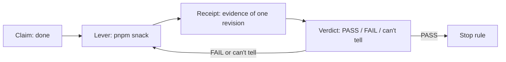
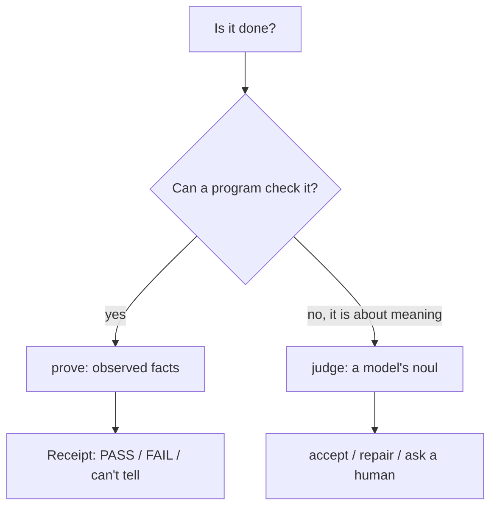

# Project Exploration: Beyond "Done", a verification loop for agents

## Overview

Beyond "Done" is a 60-minute hands-on workshop by Nick Nisi and Zack Proser (WorkOS). It teaches one loop — **observe → fix → prove** — and one rule: an agent saying "done" is a claim that must come with a receipt. A receipt is saved evidence bound to one code revision by a SHA-256 hash of the served HTML.

The lever is `pnpm snack`, a small command-line interface that drives a browser-local waitlist over the Chrome DevTools Protocol (CDP). Its proof returns three states: PASS (exit 0), FAIL (exit 1), and "can't tell" (exit 2). A semantic judge (Jev) handles meaning questions that exact assertions cannot. See [The concept](markdown/01-the-concept.md).

## The loop in one minute

The deck's three verbs are Observe, Fix, and Prove. Observe drives the app like a user with `snack join` and `snack storage`. Fix edits the app. Prove runs `prove()`, a fresh repeatable check that writes a receipt and a screenshot. The loop is bounded by a stop rule; the judge adds a probability-of-yes for meaning questions that code cannot assert. See [The concept](markdown/01-the-concept.md) and [The proof and receipt](markdown/03-the-proof-and-receipt.md).

## The hour

| Minutes | Lesson | What happens |
|---------|--------|--------------|
| 0–7 | Incident | The PocketOS case: "It took 9 seconds." |
| 7–10 | What would you check | Lever versus paragraph |
| 10–18 | Meet `snack` | Reproduce the reload bug |
| 18–30 | Write `prove()` | The four checks and the receipt |
| 30–44 | Hand to your agent | The three-sentence prompt, the judge, the stop rule |
| 44–55 | Break it quietly | The game that finds the proof's blind spots |
| 55–60 | Transfer | The portable pattern and worksheet |

See [The lessons](markdown/06-lessons.md).

## The two tools

The product statement splits verification into two tools by what each can settle (`PRODUCT.md`):

- `prove` runs exact assertions in a real browser. It checks values a program can read, and returns a receipt.
- `judge` asks the Jev model for a `noul()` — a probability of "yes" — about meaning. It accepts at 0.9, repairs at 0.2, and asks a human in between.

See [Semantic judgment](markdown/04-semantic-judgment-jev.md).

## Concepts explained for a reader who does not know the stack

| Concept | Where |
|---------|-------|
| The three-state verdict, revision-bound receipts, the proof/judge split, the stop rule | [The concept](markdown/01-the-concept.md) |
| CDP, the session and pid ownership, `withPage`, the event log, `up.lock`, `doctor`, the `next` field | [The lever](markdown/02-the-lever-snack-cli.md) |
| The proof kit, the receipt, exit codes, the revision before/after check, the screenshot rule | [The proof and receipt](markdown/03-the-proof-and-receipt.md) |
| The Jev judge, the `noul()` probability, thresholds 0.9/0.2, prompt-injection defense | [Semantic judgment](markdown/04-semantic-judgment-jev.md) |
| The five injected bugs, asymmetric scoring, the reveal, the final boss | [Break it quietly](markdown/05-break-it-quietly.md) |
| The broken exercise app versus the fixed solution app | [The lab app](markdown/07-the-lab-app.md) |
| The companion site, glossary, chat, rate limit, grounding | [Site, glossary, chat](markdown/08-site-glossary-chat.md) |
| The Slidev deck, the fourteen components, deck validation | [Slides and deck](markdown/09-slides-and-deck.md) |
| Generation, build, deploy, dry-runs, limits, chat key | [Scripts, build, deploy](markdown/10-scripts-build-deploy.md) |

## Document map

| Topic | Document |
|-------|----------|
| Overview | [00](markdown/00-overview.md) |
| The concept | [01](markdown/01-the-concept.md) |
| The lever (`pnpm snack`) | [02](markdown/02-the-lever-snack-cli.md) |
| The proof and receipt | [03](markdown/03-the-proof-and-receipt.md) |
| Semantic judgment (Jev) | [04](markdown/04-semantic-judgment-jev.md) |
| Break it quietly | [05](markdown/05-break-it-quietly.md) |
| The lessons | [06](markdown/06-lessons.md) |
| The lab app | [07](markdown/07-the-lab-app.md) |
| Site, glossary, chat | [08](markdown/08-site-glossary-chat.md) |
| Slides and deck | [09](markdown/09-slides-and-deck.md) |
| Scripts, build, deploy | [10](markdown/10-scripts-build-deploy.md) |
| Facilitation docs | [11](markdown/11-facilitation-docs.md) |
| Critical assessment | [12](markdown/12-critical-assessment.md) |
| Glossary | [13](markdown/13-glossary.md) |

## The five most important ideas

1. **"Can't tell" is a third state.** Exit 2 is never a pass and never a reason to change the app. Missing evidence, a stale revision, or a judge outage all land here.
2. **A receipt names one revision.** The SHA-256 of the served HTML (first 12 hex) binds evidence to exact bytes, and `runProof` compares the revision before and after so a receipt never covers a moving target.
3. **Proof and judgment split on checkability.** Exact assertions stay in code; a model answers meaning questions with a probability and a human band in the middle.
4. **The tool carries a `next` field.** Every error names the concrete command to run next, so the agent prompt stays three sentences.
5. **The game finds the proof's blind spots.** `overpromise` and `console-error` both pass `prove` — one is a meaning bug caught only by the judge, the other an error caught only by reading the screenshot.

## Verdict

A strong, honest teaching artifact. The three reusable ideas — the three-state verdict, the revision-bound receipt, and the proof/judge split — are genuinely portable. The rest is scaffolding to teach them in 60 minutes, and the repository is careful to say so: "one app and five bugs is not production reliability." **Aha: the project's honesty is its best feature — a PASS receipt says "these checks cover nothing else", and a stale receipt says STALE instead of green.** See [Critical assessment](markdown/12-critical-assessment.md).

## Grandfather review

Each `file:line` citation in chapters 00 to 13 was checked against the source clone at commit `51a1e36`. Numbers (thresholds 0.9/0.2, rate limit 300 per hour, exit codes 0/1/2, scoring +2/+2/−3/−1/0, the three revision hashes, the 60-minute split) were cross-checked with grep. The five bug names and their find/replace strings were read from `lab/server.ts`. Mermaid count is at least two in every chapter. Abbreviations are spelled out at their site of use.

Not verified: nothing was executed; the clone was treated as untrusted. The judge recording (`jev-recording.json`) was read as shipped, not replayed against a live Jev model.
