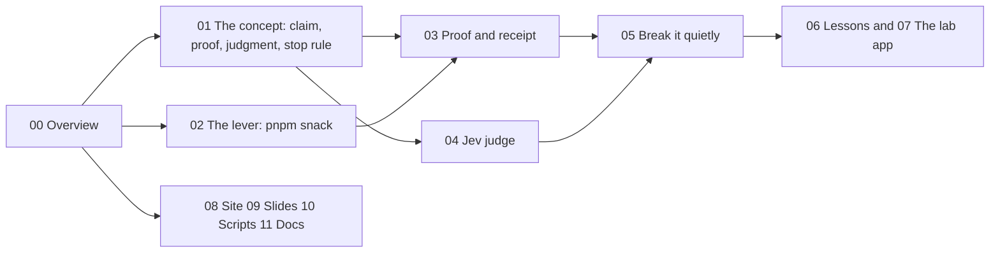
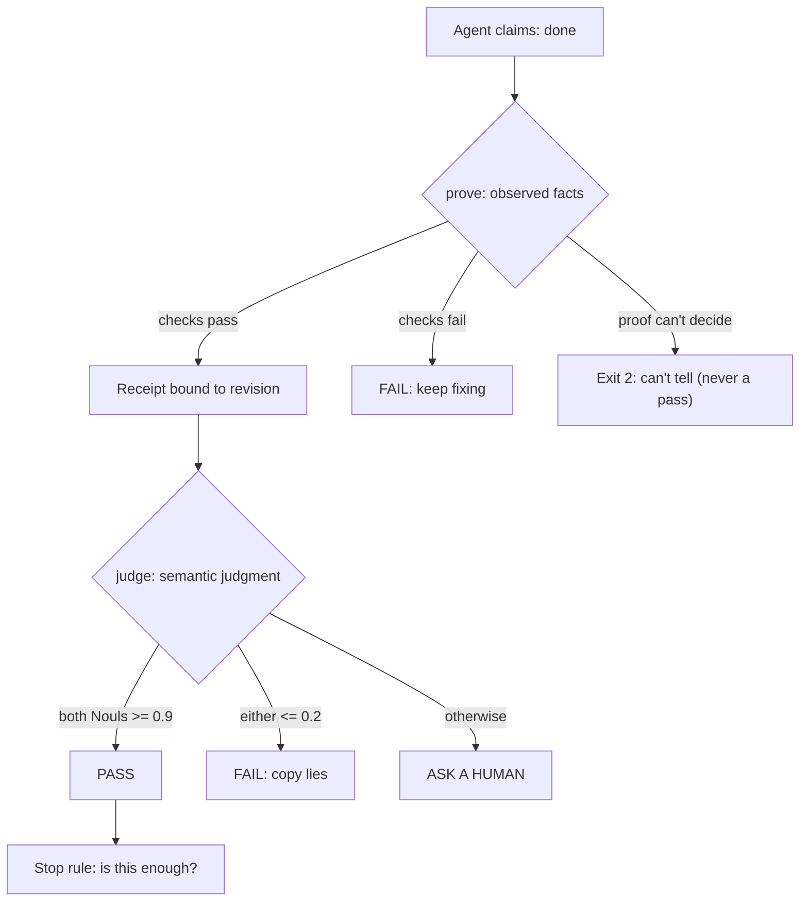

# Beyond Done Overview: an agent says done; give it a way to show the receipt

Beyond Done is a 60-minute workshop by Nick Nisi and Zack Proser (WorkOS). It teaches JavaScript and TypeScript developers to build a verification loop for an artificial intelligence (AI) coding agent. The one idea is the title: an agent says "done"; give it a way to show the receipt.

## How to read these docs

You do not need to know Chrome DevTools or the TypeSafe application programming interface (API) first. Each idea has one page that explains it from the beginning. Other pages point to that page.

| If you need to understand | Read |
|---------------------------|------|
| The mental model: a completion claim, observed facts, semantic judgment, and the stop rule | [The concept](01-the-concept.md) |
| What the `pnpm snack` command-line interface (CLI) does, every command and flag | [The lever](02-the-lever-snack-cli.md) |
| The proof, the receipt, and the three exit codes (0, 1, 2) | [Proof and receipt](03-the-proof-and-receipt.md) |
| The Jev judge, the Noul question type, and the 0.9 / 0.2 thresholds | [Semantic judgment](04-semantic-judgment-jev.md) |
| The five injected bugs and the solo "break it quietly" game | [Break it quietly](05-break-it-quietly.md) |
| What each of the seven lessons teaches | [The lessons](06-lessons.md) |
| The waitlist app and why it is deliberately broken | [The lab app](07-the-lab-app.md) |
| The Astro site, React glossary, and OpenRouter chat | [Site, glossary, chat](08-site-glossary-chat.md) |
| The Slidev deck and its design system | [Slides and deck](09-slides-and-deck.md) |
| Every script and the Alto deploy | [Scripts, build, deploy](10-scripts-build-deploy.md) |
| The facilitator guide and the other workshop documents | [Facilitation and docs](11-facilitation-docs.md) |
| Any single term, in alphabetical order | [Glossary](13-glossary.md) |

## Words you meet first

These words appear before their own page explains them.

| Word | Meaning | Where it is explained |
|------|---------|-----------------------|
| Receipt | A saved proof that one code revision passed the checks. It names the revision and the result | [Proof and receipt](03-the-proof-and-receipt.md) |
| Lever | A small tool that does the repeatable, verifiable work. Here it is the `pnpm snack` CLI | [The concept](01-the-concept.md) |
| Revision hash | A hash of the HyperText Markup Language (HTML) served to the browser. A receipt is valid only for the revision it was made against | [Proof and receipt](03-the-proof-and-receipt.md) |
| Chrome DevTools Protocol (CDP) | The protocol that lets a program drive a real Chrome browser | [The lever](02-the-lever-snack-cli.md) |
| Noul | A TypeSafe question type that returns the model's probability of "yes", not free text | [Semantic judgment](04-semantic-judgment-jev.md) |
| Jev | The TypeSafe model that answers the judge's Noul questions | [Semantic judgment](04-semantic-judgment-jev.md) |
| Stale receipt | A receipt whose revision no longer matches the source. It proves nothing | [Break it quietly](05-break-it-quietly.md) |
| Feature map | A list of the app's features and how to check each one. The agent and the proof both read it | [The concept](01-the-concept.md) |

## What Beyond Done is

The workshop has one shared task for the whole hour: a browser-local waitlist for the fictional, sold-out "Midnight Snack Lab". The waitlist app is `lab/app/index.html`. It must keep the same email and status after a reload, and it must say "waitlist only, no guaranteed seat, email if a place opens". The copy in the repository does neither (`README.md:9`).

Attendees do not build an agent framework. They use and extend one lever: `pnpm snack`, a small CLI that drives the one app in a real Chrome over the Chrome DevTools Protocol (CDP). It prints JavaScript Object Notation (JSON), and every error says what to run next (`README.md:11`).

The workshop moves through four steps (`README.md:13-16`):

1. **Drive it** like an agent would: `join`, `reload`, `storage`, `snapshot`, `console`.
2. **Write the proof**: `lab/exercises/prove.ts` is the one coding exercise. `pnpm snack prove` runs it on a fresh visitor and writes a receipt bound to the exact code revision.
3. **Hand it to your agent**: add gotchas to the feature map, then give your own agent `lab/verify/SKILL.md` and one prompt — "repro it, fix it, show me proof". `pnpm snack judge` asks Jev whether the copy is honest.
4. **Break it quietly**: everyone plays solo. `--bug random` starts the app with a hidden bug (or none), and you find it with `snack` alone. Every miss becomes a new check. A stale receipt is the final boss.

This is a browser-local prototype. It is not real organizer registration, email delivery, or payment (`README.md:18`).

## The hour

The workshop is timed to 60 minutes. The table comes from `README.md:47-58`.

| Minutes | Activity | Result |
| --- | --- | --- |
| 0–7 | Real incident, intros, repo quick response (QR) code, vote, live app failure, why verification pays off | A completion claim needs evidence |
| 7–10 | What would *you* check? Paragraph versus lever | The agent needs tools, not instructions |
| 10–18 | Meet `snack`; everyone reproduces the bug | The bug, named with JSON evidence |
| 18–30 | Write `prove()`; read the receipt | A proof that fails broken apps and passes a correct one |
| 30–44 | Feature map, then your agent repros, fixes and proves; the copy that still lies; when to stop | An agent that shows proof instead of saying "done" |
| 44–55 | Break it quietly: one solo round, the reveal, the stale-receipt boss | Know what your proof misses, and what to add |
| 55–60 | Transfer exercise | A plan for the lever in your own app |

## The mental model in one minute

"Done" is a claim. "Verified done" is a claim plus a receipt. The workshop separates three things (`PRODUCT.md:25-30`):

1. **Observed facts** — `prove` runs checks and records what it saw.
2. **Semantic judgment** — `judge` asks a model whether the copy is honest, because some claims are not assertions.
3. **The stop rule** — a decision about when to stop fixing, which the workshop teaches but does not automate.

One rule holds them together: **evidence belongs to one revision**. After any edit, the old receipt proves nothing. "Can't tell" is a real third state and is never a pass.

Source: `PRODUCT.md:25-30`, `README.md:96-98,101-107`.

## The lever: `pnpm snack`

The CLI groups its commands into four groups (`README.md:88-93`).

| Group | Commands |
| --- | --- |
| Health | `up [--bug NAME\|random] [--solution] [--headless]`, `doctor`, `down` |
| Drive | `join <email>`, `reload`, `reset [--dry-run]` |
| Look | `snapshot`, `storage`, `console [--errors]`, `network`, `screenshot [path]`, `eval <expression>` |
| Prove | `prove [--solution]`, `judge` |

`up` serves `lab/app/index.html` (re-read on every request, so edits show on reload) and launches Chromium with a remote-debugging port. The other commands attach over CDP, do one thing, and detach (`README.md:95`). See [The lever](02-the-lever-snack-cli.md).

## The three exit codes

`prove` writes a receipt and returns one of three exit codes (`README.md:97`):

| Code | Meaning |
|------|---------|
| 0 | PASS |
| 1 | FAIL |
| 2 | Can't tell — no session, the proof threw, or the source changed mid-run |

Exit code 2 is the honest third state. It never becomes a pass. See [Proof and receipt](03-the-proof-and-receipt.md).

## Aha moments

**Aha: a receipt is bound to one revision.** A hash of the served HTML is the revision. A receipt names that revision. After any edit, the old receipt proves nothing, and `doctor` reports a stale receipt. The final boss of the game is exactly this: a receipt that looks good but is for old code. See [Proof and receipt](03-the-proof-and-receipt.md).

**Aha: prove and judge are different because not every claim is an assertion.** `prove` checks that the email and status survive a reload — things a program can observe. `judge` asks Jev whether the words "Your seat is confirmed" are honest — a semantic judgment a program cannot assert. The screenshot and the judge exist because some claims are not assertions (`README.md:126`).

**Aha: the lever teaches the principle by making it concrete.** The 7–10 minute segment is titled "The agent needs tools, not instructions". A paragraph of instructions cannot be re-run; a lever can. The whole workshop is one small, repeatable lever rather than a framework.

**Aha: "break it quietly" is a test of the proof, not the app.** The injected bugs exist to show what a given proof misses. Every miss becomes a new check, so the proof grows from its own failures.

## Keep the claims honest

The README lists the limits of the approach (`README.md:123-131`). The proof covers only what it checks. A Noul is the model's probability of yes, not proof. The revision hash is local provenance, not isolation from an agent with a shell. Five bugs and one app do not establish anything about production reliability.

## Where to go next

Read [The concept](01-the-concept.md) for the full mental model. Read [The lever](02-the-lever-snack-cli.md) for every command. Read [Critical assessment](12-critical-assessment.md) for the verdict.
