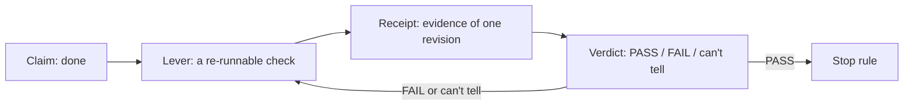
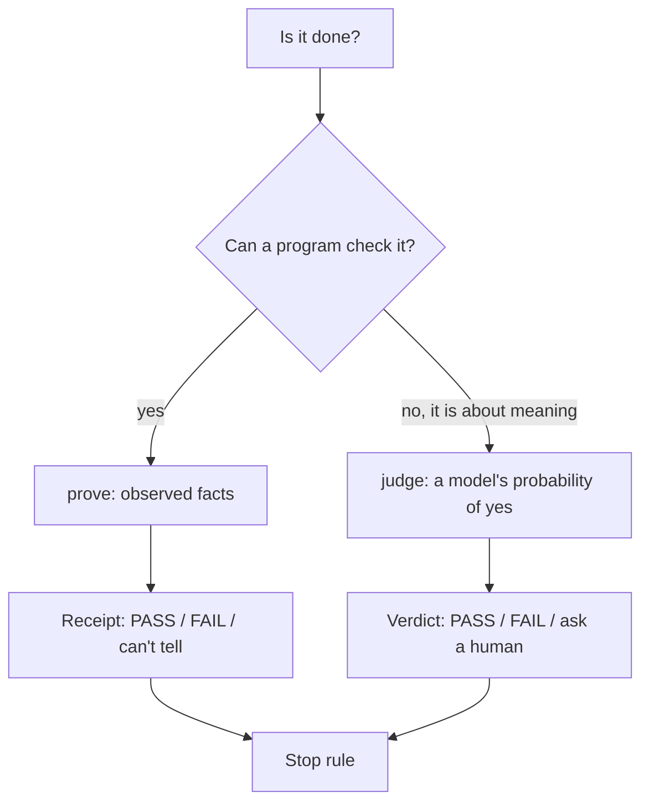

# The concept: a claim, a proof, a judgment, and a stop rule

Beyond Done teaches one mental model. "Done" is a claim. "Verified done" is a claim plus a receipt. The workshop separates four things and gives each a different tool, then loops them into a cycle: observe, fix, prove.

## Words on this page

| Word | Meaning |
|------|---------|
| Claim | A statement that work is finished. It is not evidence |
| Receipt | Saved proof that one code revision passed the checks. It names the revision and the result |
| Observed fact | A value a program reads from the real app, for example "the email survived a reload" |
| Semantic judgment | A model's decision about meaning, for example "is this copy honest" |
| Stop rule | A decision about when to stop fixing |
| Feature map | A list of the app's features and how to check each one |

## Done is a claim; evidence is separate

The workshop's title slide shows a fake agent log whose claim line reads `evidence: none` (`slides/slides.md`, title slide). The whole hour is about filling in that field. The opening uses a real incident, the PocketOS case, to make the cost concrete: an agent with the keys ran one destructive application programming interface (API) call, and "It took 9 seconds." (`docs/opening.md`, `slides/components/IncidentOpener.vue`).

The fix is not to write a better instruction paragraph. The 7–10 minute segment is titled "What would *you* check? Paragraph versus lever". The answer the workshop teaches: the agent needs tools, not instructions (`README.md:49`). A paragraph cannot be re-run. A lever can.



## The loop: observe, fix, prove

The deck's three verbs are Observe, Fix, and Prove (`slides/slides.md`). Lesson 07 names the portable pattern the same way (`src/content/lessons/07-transfer-debrief.md`).

1. **Observe** — drive the app like a user and read what it actually did. In this repo, `pnpm snack join` and `pnpm snack storage` are the eyes.
2. **Fix** — change the app so it behaves correctly.
3. **Prove** — run a fresh, repeatable check and keep the receipt.

The loop is bounded. Lesson 05 teaches "when to stop" with a table. A stop rule prevents the infinite "one more fix" loop.

## Four separate things, four separate tools

The product statement separates the pieces (`PRODUCT.md:25-30`):

| Piece | Tool in this repo | Why separate |
|-------|-------------------|--------------|
| Observed fact | `pnpm snack prove` (deterministic assertions) | A fact is a value, not an opinion |
| Semantic judgment | `pnpm snack judge` (the Jev model) | Some claims are about meaning, not values |
| Stop rule | A table in lesson 05, not a tool | A decision a human makes |
| Evidence belongs to one revision | The revision hash | A receipt about old code proves nothing |



Source: `PRODUCT.md:25-30`, `lab/proof.ts:17-27` (the `Receipt` type), `lab/judge.ts:20-26` (the `Judgment` type).

## Evidence belongs to one revision

The strongest rule is that a receipt is bound to exactly one set of bytes. The app server computes `revisionOf` as the secure hash algorithm 256 (SHA-256) of the served HyperText Markup Language (HTML), first 12 hex characters (`lab/server.ts:46`), and injects it into a meta tag (`lab/server.ts:53`).

```ts
// lab/server.ts:46
export const revisionOf = (html: string) => createHash("sha256").update(html).digest("hex").slice(0, 12);
```

After any edit, the source revision changes, the old receipt no longer matches, and `doctor` reports STALE. The "final boss" of the bug game is exactly this: a receipt that looks good but is for code that no longer exists (`README.md:16`). See [Proof and receipt](03-the-proof-and-receipt.md).

## "Can't tell" is a third state

Most tools have two outcomes: pass and fail. Beyond Done adds a third. The proof returns exit code 2 for "can't tell" — no session, the proof threw, or the source changed mid-run (`README.md:97`). The transfer worksheet states it as a rule: "can't tell" is never a pass, and never a reason to change the app (`public/materials/transfer-worksheet.md`).

This matters because an agent that cannot distinguish "broken" from "I don't know" will either ship a broken change or thrash. The tool makes the three states different signals with different next actions. See [The lever](02-the-lever-snack-cli.md).

## The knowledge lives in the files, not the prompt

The agent prompt is three sentences. The facilitator guide gives it verbatim (`docs/facilitator.md`):

> Read `lab/verify/SKILL.md`. Reproduce the reload bug in the waitlist with `snack`. If it reproduces, fix it, and show me the receipt and the screenshot as proof.

Everything the agent needs is in the files: the skill (`lab/verify/SKILL.md`), the feature map (`lab/verify/features/waitlist.md`), and the proof (`lab/exercises/prove.ts`). The prompt stays short because the verification knowledge is already in the harness.

This is the portable pattern the workshop leaves behind. You hand the agent the harness, not a long prompt.

## Aha moments

**Aha: the tool has a vocabulary, not just a result.** Every `snack` error carries a `next` field that names the exact command to run next (`lab/snack.ts:42-44`, `SnackError`). The agent's loop is driven by the tool's own output. The prompt stays short because the tool tells the agent what to do next.

**Aha: "can't tell" protects honesty.** The three-state design means the system can say "I don't know" without lying. A judge outage, a stale revision, or a missing screenshot all land in "can't tell", never in PASS. The claim "done" degrades to "unproven" instead of silently upgrading to "done".

**Aha: proof and judgment split on what a program can assert.** `prove` checks values a program can read. `judge` asks a model for a probability of "yes" about meaning. The screenshot and the judge exist because some claims are not assertions (`README.md:126`).

## Where to go next

Read [The lever](02-the-lever-snack-cli.md) for the concrete tool. Read [Proof and receipt](03-the-proof-and-receipt.md) for how a receipt is made and checked.
