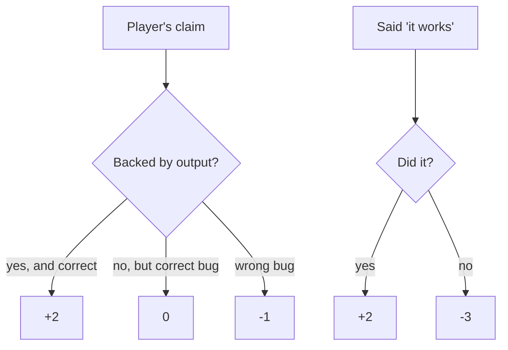

# "Break it quietly": the game that finds what your proof misses

The game is the emotional peak of the hour. After attendees hand the work to an agent and get a PASS receipt, the facilitator quietly breaks the app again and the room plays the part of the verifier — naming the bug, backing it with evidence, and learning what a PASS receipt can still miss.

## Words on this page

| Word | Meaning |
|------|---------|
| Bug | One hidden fault injected into the reference app when `up` serves it |
| Reveal | The name of the bug, printed only when the game session stops |
| Final boss | A one-character edit the facilitator makes after the game, so the last receipt goes stale |
| Stale | A receipt whose revision no longer matches the source on disk |
| Scorecard | The paper card that grades a player's claim against their evidence |

## The five hidden bugs

The bugs live in one object, each a find-and-replace string applied to the reference app (`lab/server.ts:7-28`):

| Bug | What it changes | What `prove` catches |
|-----|-----------------|----------------------|
| `memory-only` | Replaces the save with `void record;` — nothing is stored | The reload checks fail |
| `wrong-email` | Stores the email as the field's placeholder text | The email check fails |
| `lost-confirmation` | Clears the confirmation text after showing it | The confirmation check fails |
| `overpromise` | Swaps honest copy for *"Your seat is confirmed."* | **Nothing** — `prove` only compares text, it does not judge meaning |
| `console-error` | Calls `track('waitlist_join', ...)`, an undefined function | **Nothing** — the checks pass; only the page-error log or the screenshot shows it |

```ts
// lab/server.ts:20-23
overpromise: {
  find: `const message = "You're on the waitlist, not guaranteed a seat. We'll email you if a place opens up.";`,
  replace: `const message = "You're in! Your seat is confirmed. We'll email your ticket shortly.";`,
},
```

**Aha: the bugs are injected at serve time, not stored in a file.** `render` reads the *solution* app and applies the bug transform when a `--bug` name is given (`lab/server.ts:50-51`). No bug exists in any file a player can open, and `--bug` always serves the reference app, never the attendee's edited `lab/app/index.html`. Everyone plays the same game, and reading the source gives nothing away.

## Exactly one match, or refuse

`applyBug` is strict (`lab/server.ts:40-44`): the `find` string must appear exactly once in the reference app, or the server refuses to start.

```ts
// lab/server.ts:42
if (html.split(find).length !== 2) throw new Error(`Bug "${bug}" no longer matches lab/solution/app/index.html exactly once`);
```

This is a contract test that runs at startup, not in a test file. If the reference app changes and a bug's anchor moves, `up --bug` fails loudly instead of silently serving a half-applied bug.

## The game list

`GAME_BUGS` is `"none"` plus the five names (`lab/server.ts:30`). `up --bug NAME` picks one; `up --bug random` picks from the list; a game session is the one where the reveal is printed at the end.

```ts
// lab/server.ts:30
export const GAME_BUGS = ["none", ...Object.keys(BUGS)] as ("none" | Bug)[];
```

The reveal is bound to the session, not a file: it prints only when `up` stops with SIGINT or SIGTERM (`lab/snack.ts:188-189`). A player cannot peek at the answer by reading anything on disk.

## The asymmetric scorecard

The room scores claims, not just correctness (`public/materials/game-scorecard.md`):

| Move | Points |
|------|--------|
| Named the bug with output as evidence | +2 |
| Said "it works", and it did | +2 |
| Said "it works", and it did not | −3 |
| Blamed a bug that is not there | −1 |
| Named the right bug with no evidence | 0 |



**Aha: confidence is punished harder than it is rewarded.** A false "it works" costs −3 while a correct "it works" earns +2, and an evidence-free correct bug name earns 0. The scoring teaches that a correct answer without evidence is worth nothing, and a confident wrong answer is worse than silence.

## The reveal table: what your proof misses

The reveal is the lesson's payoff. Two bugs pass `prove` (`src/content/lessons/06-break-it-quietly.md`):

| Bug | `prove` verdict | Who catches it |
|-----|-----------------|----------------|
| `overpromise` | PASS | Only `judge` — it is a meaning bug |
| `console-error` | PASS | Only reading the console or the screenshot |

This is why the receipt's `next` field on a PASS says "read the screenshot for anything the checks missed" — and why the `next` field for a FAIL says to re-run. A PASS is a claim about the checks, never a claim about the app.

## The final boss

After the game, the facilitator makes a one-character edit to the app source. The last receipt no longer matches the source revision, and `doctor` reports STALE. The room sees the strongest rule of the workshop land on a real receipt: evidence is about one revision, and after any edit it is old evidence (`README.md:16`).

## Aha moments

**Aha: two blind spots, two different fixes.** `overpromise` and `console-error` both pass `prove` for different reasons — one because meaning is not a value, one because the check never asked. The game teaches the fix for each: add a semantic judge for meaning, and read the screenshot for the errors the checks did not name. Neither fix is "write more checks".

**Aha: the game is the proof of the proof's limits.** The workshop does not assert that proofs are complete. It demonstrates the limit with a game where the room's own PASS receipt is wrong twice. The transfer worksheet states the conclusion: "one app and five bugs is not production reliability."

## Where to go next

Read [Lessons](06-lessons.md) for the full 60-minute run of show. Read [The lab app](07-the-lab-app.md) for the broken app the bugs are injected into.
