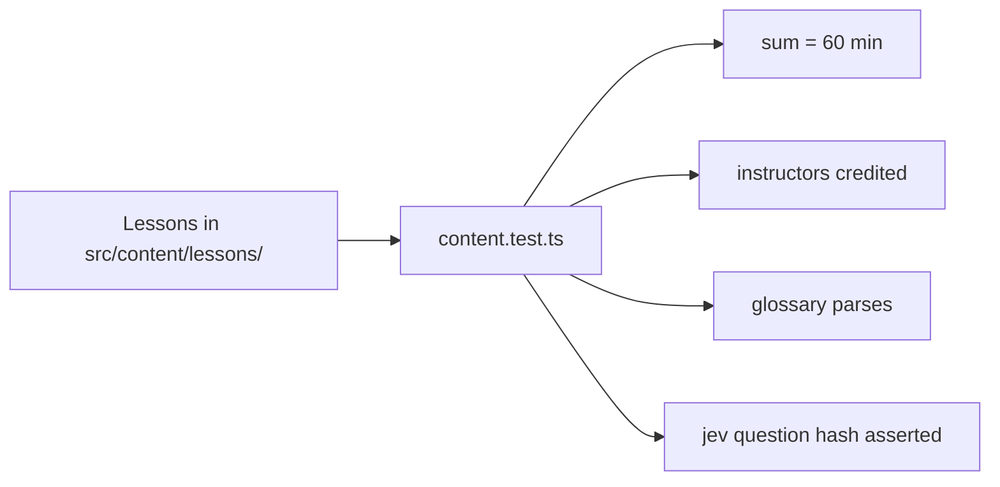

# The seven lessons: a 60-minute run of show

The class is seven Markdown lessons in `src/content/lessons/`. One is prework; six fill the hour exactly. A test asserts the sum, so the run of show cannot drift from the advertised 60 minutes.

## Words on this page

| Word | Meaning |
|------|---------|
| Prework | Work done before the class, not counted in the 60 minutes |
| Frontmatter | The metadata block at the top of a Markdown file, in YAML |
| Run of show | The minute-by-minute schedule a facilitator follows |
| Acceptance criteria | The conditions that must hold for a task to count as done |
| Transfer | Taking a skill learned in one place and using it in another |

## The collection

`content.config.ts` defines the lesson schema: a title, a description, an order, an optional duration, and a prework flag. Each lesson file carries the matching frontmatter.

| Order | Lesson | Duration | Clock | Purpose |
|-------|--------|----------|-------|---------|
| 1 | `01-preflight.md` | before class | — | Install, start two local servers |
| 2 | `02-misleading-success.md` | 10 min | 0:00–10:00 | Why "done" is a claim; lever versus paragraph |
| 3 | `03-drive-the-app.md` | 8 min | 10:00–18:00 | Reproduce the bug with `snack` |
| 4 | `04-build-the-proof.md` | 12 min | 18:00–30:00 | Write `prove()` and the receipt |
| 5 | `05-hand-it-to-your-agent.md` | 14 min | 30:00–44:00 | Hand the harness to an agent; judge; stop rule |
| 6 | `06-break-it-quietly.md` | 11 min | 44:00–55:00 | The game; find what the proof misses |
| 7 | `07-transfer-debrief.md` | 5 min | 55:00–60:00 | The portable pattern; the worksheet |

```mermaid
gantt
    title The 60-minute clock
    dateFormat  mm
    axisFormat  %M min
    section Class
    02 Misleading success     :a1, 0, 10min
    03 Drive the app          :a2, after a1, 8min
    04 Build the proof        :a3, after a2, 12min
    05 Hand to your agent     :a4, after a3, 14min
    06 Break it quietly       :a5, after a4, 11min
    07 Transfer and debrief   :a6, after a5, 5min
```

The minutes 10 + 8 + 12 + 14 + 11 + 5 equal 60. `content.test.ts` asserts this so the site's total-time line and the facilitator's schedule always agree (`lab/content.test.ts`).

## Lesson by lesson

### 01 — Preflight

`prework: true`, and the frontmatter says *"About 15 minutes before class · not part of the 60"*. It lists install steps, success criteria, and the two local servers to start. Attendees arrive with a working harness, so the hour starts on the concept, not on setup.

### 02 — Misleading success

The first 10 minutes make the cost concrete with the PocketOS incident, then ask the room: what would you check? Three acceptance criteria, a staged vote, and the "lever versus paragraph" split. See [The concept](01-the-concept.md).

### 03 — Drive the app

Eight minutes to reproduce the bug by hand. A snack command-groups table, then a five-command reproduction ending in the observed `"localStorage": {}` and `"status": "none"`. This is the "observe" verb. See [The lever](02-the-lever-snack-cli.md).

### 04 — Build the proof

Twelve minutes to write `prove()`. The kit fields table, the four checks to write, a proof bar of four items, the receipt fields, and the exit codes. See [The proof and receipt](03-the-proof-and-receipt.md).

### 05 — Hand it to your agent

Fourteen minutes. Feature-map questions, then the agent prompt verbatim, then the "open receipt" four steps **bind → observe → decide → append**, the judge thresholds 0.9 and 0.2, and a stop-rule table. See [Semantic judgment](04-semantic-judgment-jev.md).

### 06 — Break it quietly

Eleven minutes of play. Solo roles, a two-minute round, the score table, the reveal table (where `overpromise` and `console-error` pass `prove`), and the final-boss one-character edit. See [Break it quietly](05-break-it-quietly.md).

### 07 — Transfer and debrief

Five minutes to leave with the pattern. The observe→fix→prove loop, a seven-question transfer worksheet, a first-30-minutes plan, three verifier blueprints (web app, native client, API/background job), the receipt fields again, and a five-step improvement loop.

## What the test enforces

`content.test.ts` asserts four things beyond the sum (`lab/content.test.ts`):

1. The six class lessons sum to 60 minutes.
2. The instructors (Nick Nisi and Zack Proser) are credited.
3. The glossary parses.
4. The Jev recording's question hashes match the asserted value.

**Aha: the schedule is a tested artifact.** The 60-minute promise is enforced by a test, so the deck, the facilitator notes, and the site cannot drift apart. The workshop applies its own lesson — encode the rule in structure — to itself.

## Aha moments

**Aha: prework is explicitly not part of the hour.** The frontmatter says so in words, not just by omitting a duration. A class that burns the first 15 minutes on installs loses the audience before the concept lands; this one moves setup out of the clock.

**Aha: the lessons teach the loop in order, once per verb.** Lesson 03 is observe, 04 is prove, 05 is fix plus judge plus stop, and 06 tests the whole loop against itself. The three verbs are not a slogan; they are the actual sequence of the hour.

## Where to go next

Read [The lab app](07-the-lab-app.md) for the app the lessons drive. Read [Facilitation docs](11-facilitation-docs.md) for the facilitator's run of show.
