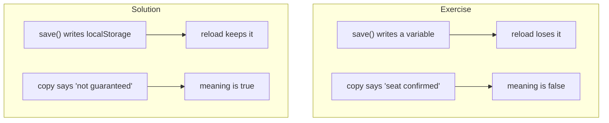

# The lab app: one HTML file, deliberately broken

The whole workshop runs on a single-file browser-local waitlist. There is no build step and no backend state. The exercise copy ships broken in two ways; the solution copy is the fixed version the bugs are injected into.

## Words on this page

| Word | Meaning |
|------|---------|
| Test id | A `data-testid` attribute the harness can find without CSS selectors |
| Accessible rich internet applications (ARIA) live region | A screen-reader announcement area, also used here for the confirmation text |
| Local storage | The browser's per-origin key–value store, `localStorage` |
| Reference app | The fixed `solution/app/index.html` the bugs are injected into |

## What the app is

`lab/app/index.html` and `lab/solution/app/index.html` are the same page with three differences. The page is a form, a status section, and a short script (`lab/app/index.html:22-75`).

The three visible slots are found by `data-testid`, not by CSS (`lab/app/index.html:33`):

```html
<!-- lab/app/index.html:33 -->
<dl><dt>Request status</dt><dd data-testid="status">none</dd>
    <dt>Saved email</dt><dd data-testid="email">—</dd></dl>
<p role="status" aria-live="polite"></p>
```

The confirmation line is both an ARIA live region (so screen readers announce it) and the text the semantic judge reads. The harness finds it with `[role=status]`.

## The three functions

The app is `load` / `save` / `show` (`lab/app/index.html:45-60`):

- `show(record)` writes the status, email, and confirmation into the slots.
- `load()` returns the saved record.
- `save(record)` stores the record.

The submit handler builds a record with a fixed status and the entered email, saves it, and shows it (`lab/app/index.html:64-74`). A failed save shows *"Unable to save in this browser"* and stops, so the app never pretends a broken save worked.

## The exercise app ships broken twice

The exercise copy differs from the solution in exactly two places.

First, the save is a plain variable, not storage (`lab/app/index.html:51-60`):

```js
// lab/app/index.html:51-60  (exercise: the memory-only bug)
// Keep the record handy so the confirmation can show it.
let saved = null;

function load() {
  return saved;
}

function save(record) {
  saved = record;
}
```

A reload loses the record. This is the `memory-only` bug the attendee must find and fix.

Second, the copy overpromises (`lab/app/index.html:39`):

```js
// lab/app/index.html:39  (exercise: the overpromise bug)
const message = "You're in! Your seat is confirmed. We'll email your ticket shortly.";
```

The solution fixes both (`lab/solution/app/index.html:39,51-57`):

```js
// lab/solution/app/index.html:39
const message = "You're on the waitlist, not guaranteed a seat. We'll email you if a place opens up.";

// lab/solution/app/index.html:51-57
function load() {
  try { return JSON.parse(localStorage.getItem(key)); } catch { return null; }
}

function save(record) {
  localStorage.setItem(key, JSON.stringify(record));
}
```

The key is `midnight-snack-waitlist` (`lab/solution/app/index.html:38`).



**Aha: the exercise app has two bugs, but the written proof only targets one.** The four checks in the reference proof all cover reload behavior — the `memory-only` bug. The `overpromise` bug is a meaning bug the checks cannot see, so an attendee who fixes only the storage bug still earns a PASS from `prove` and misses the overpromise. The exercise is quietly shaped so the first bug is obvious and the second is invisible to the proof.

## The bugs are injected into the reference app

The game bugs are applied to the *solution* app, never to the attendee's edited exercise file (`lab/server.ts:50-51`):

```ts
// lab/server.ts:50-51
const source = await readFile(bug ? files.solution : files[app], "utf8");
const html = bug ? applyBug(source, bug) : source;
```

So the exercise copy and the game baseline are the same fixed app plus different single bugs. The exercise teaches the fix; the game re-injects a *different* bug into the same fixed baseline so everyone plays identically.

## Every request reads from disk

`render` reads the file on every request, with a comment stating the point (`lab/server.ts:48`):

```ts
// lab/server.ts:48
// Read from disk on every request: an edit shows up on the next reload, like a dev server.
```

The attendee edits `lab/app/index.html`, runs `pnpm snack reload`, and the change is live — no rebuild. This is what makes the "final boss" one-character edit work: the source on disk and the served page share the same revision hash immediately.

## Aha moments

**Aha: `data-testid` is the harness's contract.** The page exposes its three state slots by test id and its confirmation by ARIA role, so `snack` and `prove()` can read state without brittle CSS. The app is written to be verified, not just to be used.

**Aha: the app is honest about being a practice app.** The footer says *"Training only. No email is sent, no seat is booked, and no payment is taken"* (`lab/app/index.html:36`). The overpromise bug lives only in the confirmation copy, so the exercise's dishonesty is contained to the one string the judge checks — not to a page that claims to be a real signup.

## Where to go next

Read [Site, glossary, chat](08-site-glossary-chat.md) for the companion site that presents the lessons. Read [Slides and deck](09-slides-and-deck.md) for the presenter deck.
