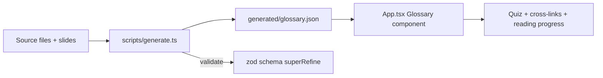
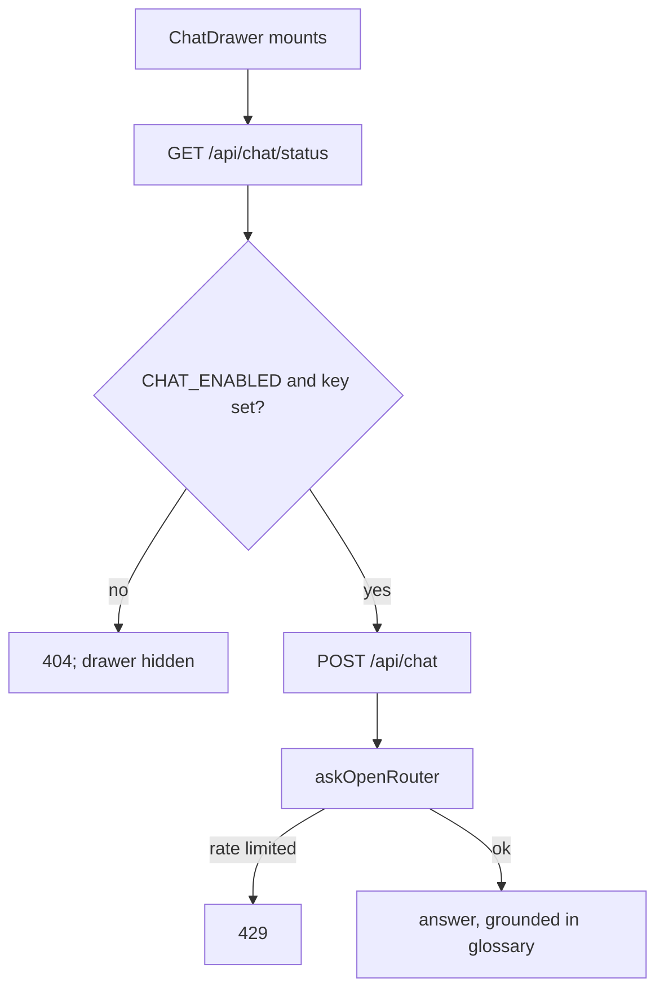

# The companion site: glossary, lessons, and a rate-limited chat

The workshop ships a companion web site built with Astro and React, plus a Cloudflare Worker chat. The site presents the lessons and an interactive glossary; the chat answers questions with a grounding prompt and a 300-per-hour limit.

## Words on this page

| Word | Meaning |
|------|---------|
| Companion site | The generated web site that presents the lessons and glossary |
| Glossary | A list of terms with definitions, cross-links, and quizzes |
| Grounding | Giving a model the source text it must answer from |
| Rate limit | A cap on requests per hour, so one user cannot run up the bill |
| Worker | A Cloudflare Workers function that answers HyperText Transfer Protocol (HTTP) requests at the edge |
| D1 | Cloudflare's serverless structured query language (SQL) database |

## The glossary is data, not prose

The glossary is a single JSON file generated from source, not hand-written per page. `generated/glossary.json` has top-level keys for title, subtitle, event, credit, sections, resources, quiz, schema version, slug, updated, slides URL, and theme.

Seven sections hold the terms:

| Section | Terms | Idea |
|---------|-------|------|
| `ai-basics` | 10 | The shared vocabulary: model, token, prompt, agent, tool use |
| `why-done-isnt-evidence` | 6 | Done as a claim |
| `giving-the-agent-eyes` | 7 | Driving and observing the app |
| `defining-done-in-a-proof` | 5 | The proof and the receipt |
| `receipts-and-revisions` | 6 | Revision hashes and stale receipts |
| `handing-it-to-your-agent` | 8 | The skill, the feature map, the judge |
| `testing-the-tester` | 8 | What the proof misses |

Every term carries more than a definition (`generated/glossary.json`): `id`, `term`, `definition`, `whyItMatters`, `hear` (the audience's likely question), `aliases`, `relatedTermIds`, `demo`, `sourcePath`, and `slide`. The `sourcePath` and `slide` tie each term back to the file and slide it came from — the glossary is a traceable index, not a summary.

## The glossary component

`src/App.tsx` defines the `Glossary` React component and its helpers: `CrossLinkedText` (turns `relatedTermIds` into links), `useStoredSet` (remembers which terms a viewer marked), `useReadingProgress` and `useActiveSection` (a scroll progress bar and section tracking), `Quiz`, `TermEntry`, and `accentContrast`. The site is a reading tool, not a static list.

## Publish and redact are separated

The glossary has two forms: a starter set and a class set. `prepareClassGlossary` strips slide links, source paths, and slide numbers when the slides are unpublished, using a deep clone so the reviewed data is never mutated (`src/class-glossary.ts`).

**Aha: you can publish without leaking the private deck.** The build test asserts that speaker notes and the deck sentinel never appear in a no-slides build (`scripts/build-workshop.test.ts`). The public site can live at a public URL while the full deck and source map stay private.

## The chat and its availability gate

The chat drawer ("Ask anything") first fetches `/api/chat/status`, then `/api/chat`, and caps input at 500 characters (`src/ChatDrawer.tsx`). Chat is enabled only when the feature flag is on *and* the key is configured; otherwise the endpoint returns 404 even if credentials exist. The client also hides the chat button until runtime availability is confirmed.

## The Worker and the model

The companion Worker exposes `/api/chat/status` and `/api/chat`, with a rate limit of 300 requests per hour and an environment of `ASSETS`, `OPENROUTER_API_KEY`, `OPENROUTER_MODEL`, and `CHAT_ENABLED` (`src/worker.ts`).

`askOpenRouter` sets the defaults (`src/openrouter.ts`): model `anthropic/claude-haiku-4.5`, temperature `0.2`, `max_tokens` `500`, and a referer header. The cheap, low-temperature model is a deliberate choice — the chat is a grounded helper, not a reasoning engine. `validateMessages` enforces 1 to 20 messages, each at most 2000 characters, and `buildSystemPrompt` grounds the model in the glossary text so it answers from the class, not from general knowledge.

## The talks Worker and the CSV defense

A second Worker, `talks-worker.ts`, serves the signed-in `/chat-log` from a D1 table (`chat_questions`) and exports the log as CSV. `logQuestion` records a turn number, question, answer, and error for every call.

`toCsv` escapes quotes and prefixes spreadsheet formulas (for example `=HYPERLINK("x")`) with an apostrophe (`src/talks-worker.ts`). A question that starts with `=` cannot run as a formula when the log is opened in a spreadsheet.

## Aha moments

**Aha: the glossary carries `sourcePath` and `slide`.** Every term is traceable to the exact file and slide that produced it. The class's own teaching material is verifiable against source — the same discipline the workshop teaches for code.

**Aha: the chat answers from the glossary, not from the internet.** `buildSystemPrompt` grounds the model in the class text, and the rate limit plus the 500-character cap keep the cost bounded. The chat is the class's "paragraph" in action, but only after the class has built the "lever" — help is a supplement, never the verification.

## Where to go next

Read [Slides and deck](09-slides-and-deck.md) for the presenter deck the site links to. Read [Scripts, build, deploy](10-scripts-build-deploy.md) for how the site and glossary are generated and deployed.
