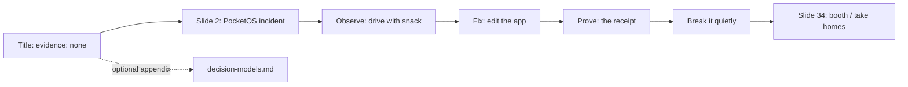
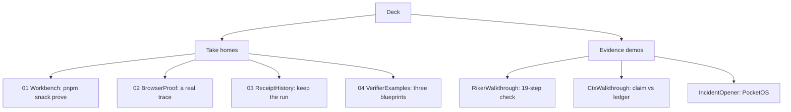

# The slide deck: a tested presentation with interactive demos

The deck is built with Slidev and validated by Playwright as part of the build. It carries the three verbs Observe / Fix / Prove, opens with the PocketOS incident, and embeds fourteen Vue components that demonstrate each "take home" live.

## Words on this page

| Word | Meaning |
|------|---------|
| Slidev | The Markdown-driven slide framework the deck uses |
| Presenter notes | Speaker-only text on each slide, with timing and click counts |
| Appendix | Optional extra slides, imported only if needed |
| Take home | A numbered reusable pattern the deck gives attendees |
| Playwright | The browser automation library that validates the deck |

## The deck structure

`slides/slides.md` is 1134 lines: a title slide, about 34 content slides, presenter notes on each, and an optional appendix import (`src: ./decision-models.md`). The title slide shows a fake agent log whose claim line reads `evidence: none` — the exact gap the hour fills.

The three verbs run through the whole deck: **Observe** (drive the app), **Fix** (change the code), **Prove** (keep the receipt). The facilitator guide maps slide 2 (the incident) through slide 34 (the booth), with hard stops at minutes 18, 30, 44, and 55.

## The palette and typography

`slides/style.css` fixes the design tokens (`slides/style.css:4-10`):

| Token | Value | Use |
|-------|-------|-----|
| `--snack-ink` | `#242238` | Body text on light slides |
| `--snack-indigo` | `#6363f1` | The WorkOS brand accent |
| `--snack-paper` | `#f8f8ff` | Near-white background |
| `--snack-lime` | `#d9ff82` | Accepted work, passes |
| `--snack-coral` | `#ff967f` | Failures |

The same tokens appear in `DESIGN.md`. Typography: Bricolage Grotesque for display, system sans-serif for teaching copy, JetBrains Mono for commands only.

## The appendix: System 1 and System 2

`slides/decision-models.md` holds five `DecisionAppendix` slides: roles, example, models, loop, and evaluate. It uses the System 1 / System 2 analogy to place the two tools — the deterministic proof is the fast, reliable check; the semantic judge is the slower reader of meaning. The vendor map names Jev, Clef, and OpenAI Decisions, and the verifier architecture is observe → check → decide → keep.

## The fourteen components

Each "take home" is a live Vue component, not a bullet list:

| Component | Take home |
|-----------|-----------|
| `VerificationWorkbench.vue` | 01 · make the user journey executable |
| `BrowserProof.vue` | 02 · make the invisible inspectable (a performance trace) |
| `ReceiptHistory.vue` | 03 · receipts accumulate (record → evaluate → improve) |
| `VerifierExamples.vue` | 04 · start with one feature (three blueprints) |
| `IncidentOpener.vue` | The PocketOS incident, "It took 9 seconds." |
| `RepairReceipt.vue` | Walk the FAIL receipt `d14af25cd65a` to the PASS receipt `4e8c43d6bc1e` |
| `ReloadReveal.vue` | The memory-only reload in two toggled states |
| `RikerWalkthrough.vue` | A real worker whose own 19-step check decides status |
| `CtxWalkthrough.vue` | Riker versus a bare claim kept in the ledger |
| `VerificationContrast.vue` | Blind lane (guess, edit, repeat) versus verified lane |
| `DecisionAppendix.vue` | The five appendix topics and the Jev recording |
| `RoundTimer.vue` | A 90-second countdown that pauses when hidden |
| `ResourceQr.vue` | QR codes for the repo and glossary |
| `FriendsReveal.vue` | A decorative host slide reveal |

`RikerWalkthrough.vue` makes the workshop's thesis concrete. A worker says "ready for Nick to run" while admitting the full suite was not rerun; its own 19-step check replays in about 1.5 seconds; the proof record shows exit 0, a commit, a tree hash, and a log hash. The signing step rewrites the commits, but the tree hash stays the same — proof binds to content, not to commit identity.

## The deck is a tested artifact

`scripts/check-deck.ts` runs Playwright over the deck and asserts every slide in its initial and revealed states, builds a click-state map, checks overflow, and settles reduced-motion animations. `pnpm slides:check` runs it, and `docs/verification.md` records that all 34 slides passed.

**Aha: the presentation is validated, not hand-checked.** The same "prove it against the real artifact" principle applies to the authors' own deck. A slide that overflows, a click that does not advance, or a broken animation fails the build instead of being discovered mid-talk.

## Aha moments

**Aha: each take home is a component, not a slide of text.** The patterns are demonstrated live — the browser trace, the accumulating receipts, the blueprints — so an attendee leaves with something they saw run, not something they read about.

**Aha: the title slide names the enemy as `evidence: none`.** The whole hour is framed as filling in one field on a fake agent log. Every later slide answers "here is how you stop shipping that line."

## Where to go next

Read [Scripts, build, deploy](10-scripts-build-deploy.md) for how the deck and site are built and validated. Read [Facilitation docs](11-facilitation-docs.md) for the run of show that uses this deck.
