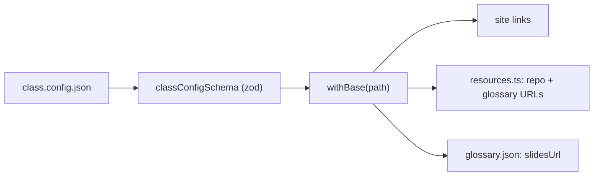
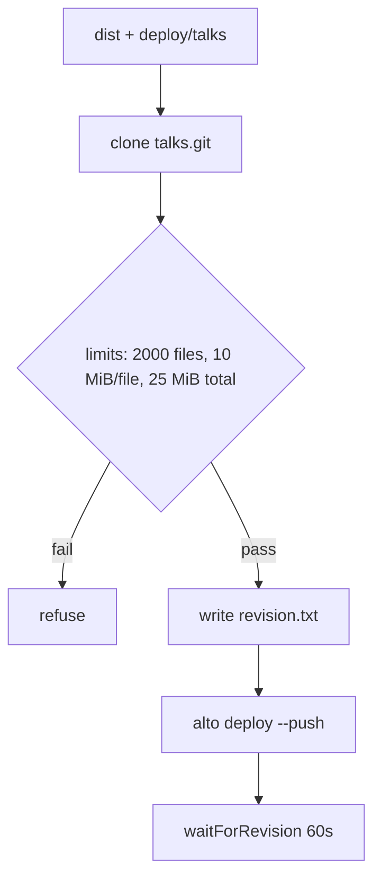

# Build, generate, and deploy: the class's own verification pipeline

The authors use the same loop to ship the workshop itself. Scripts generate the glossary from source, build the site, validate the deck with Playwright, and deploy to two Cloudflare Workers — with limits, revision hashes, and dry-runs at every step.

## Words on this page

| Word | Meaning |
|------|---------|
| Build | Turning source and slides into a static site bundle |
| Generate | Producing the glossary JSON from reviewed source via a model |
| Dry-run | A run that stages everything but deploys nothing |
| Atomic write | Writing to a temp file and renaming, so a crash never leaves a half file |
| Worker | A Cloudflare Workers function |
| Alto | WorkOS's deploy tool for talks (`alto deploy`) |

## The command surface

`package.json` names every task the authors run:

| Script | What it runs |
|--------|--------------|
| `dev` | The Astro dev server with the glossary and chat |
| `slides` | `pnpm slides:qr && slidev slides/slides.md` |
| `slides:check` | The Playwright deck validation |
| `glossary` | `tsx scripts/class.ts generate` |
| `build` | `pnpm typecheck && tsx scripts/class.ts build` |
| `build:workshop` | The standalone companion build |
| `snack` | `tsx lab/snack.ts` (the lever) |
| `test` | `tsx --test scripts/*.test.ts` |
| `deploy:talks` / `deploy:talks:dry-run` | Stage and push the talks Worker |
| `chat-key` / `chat:setup` / `estimate-chat` | Provision and cost the chat |
| `lab:exercise` / `lab:test` | The exercise checker and the lab tests |

## The config contract

`class.config.json` holds the slug `beyond-done`, hostname `talks.workos.cloud`, base path `/beyond-done`, the theme preset `clean` with accent `#6363f1`, and the feature flags (`quiz`, `demos`, `progress`, `chat`). `class-config.ts` validates the hostname and base path strictly, and `withBase` prefixes paths — a single source of truth for every URL.

## Generation: source in, glossary out

`generate.ts` produces the glossary in three guarded steps. `source.ts` collects the workshop source and annotates each slide as `[SLIDE N]`, capped at `MAX_SOURCE_CHARS = 600000`. `pi-rpc.ts` speaks JSON Lines remote procedure call (RPC) to `pi --mode rpc --no-session --no-tools`. Then `generate.ts` validates the result against the JSON schema, tries one repair, and writes atomically.

The generation test asserts cross-reference validation, slide annotation, invented-source rejection, and the single JSON repair. The glossary is generated from the reviewed source, not hallucinated — the same "no self-report" rule applied to documentation.

## Build and validate

`build` runs typecheck first, then `class.ts build`. The build produces `dist`, and `check-deck.ts` validates the slides. `build-workshop.ts` does a standalone Vite build for the companion, and its test asserts a no-slides build strips slide links, filenames, and local-only resources without mutating the source.

## Deploy: the talks Worker

`deploy-talks.ts` stages the talks Worker into a separate repository:

1. Clone `git.workos.cloud/talks.git`.
2. Stage `deploy/talks` plus `dist` into it.
3. Enforce limits: 2000 files, 10 mebibytes (MiB) per file, 25 MiB total.
4. Write `revision.txt` naming the source commit.
5. Run `alto deploy --push`.
6. `waitForRevision` for 60 seconds.

`--dry-run` stages into `.talks-build/app` instead, so a run can be inspected before it is pushed. The deploy refuses a dirty git tree (`README.md`) — you cannot ship a revision you have not committed, so the revision hash on the deploy always names real source.

## The deployed shape

`deploy/talks/` is the template the deploy fills: `alto.json` (name `Talks`, a signed-in surface at `/` and a public surface at `/beyond-done`, a D1 binding `DB`, and the `OPENROUTER_API_KEY` secret), a `wrangler.jsonc` (name `talks`, assets `./public`, `not_found_handling 404-page`), a `package.json`, `src/worker.ts`, a `public/index.html` that meta-refreshes to `/beyond-done/`, and the D1 migration `0001_chat_questions.sql` creating the `chat_questions` table (`id`, `created_at`, `turn`, `question`, `answer`, `error`).

The companion Worker (`wrangler.jsonc` in the root) is a separate deployment: name `workshop-companion`, main `src/worker.ts`, assets `./dist`, `not_found_handling: "single-page-application"`, and `run_worker_first: ["/api/*"]` so the chat API is handled by the Worker, not the static assets.

## Provisioning the chat

`chat-key.ts` provisions and revokes chat keys, returning a `ChatKeyReceipt { version, name, hash, limitUsd, expiresAt, createdAt, revokedAt }` and writing the file with mode `0600` (owner read/write only). `setup-chat.ts` wires the key into the talks app with live verification, and `estimate-chat.ts` computes cost from OpenRouter pricing and the 500-token cap. The mise task test asserts a failed install revokes the new key — the chat key cannot be left dangling.

## Aha moments

**Aha: the deploy refuses a dirty tree.** A revision hash is only meaningful if it names committed source. By refusing uncommitted deploys, the authors guarantee the `revision.txt` on every deploy is real — the same revision discipline the workshop teaches attendees.

**Aha: the glossary generator rejects invented sources.** `generate.test.ts` asserts that a term citing a file that does not exist is rejected. Documentation for the class is verified against the source it claims to come from, not just checked for shape.

**Aha: limits and dry-runs make the deploy safe.** A 2000-file / 25 MiB ceiling and a `--dry-run` mode mean a bad stage fails before it reaches production. The build pipeline practices the "can't tell" honesty: stage, check, then push.

## Where to go next

Read [Facilitation docs](11-facilitation-docs.md) for the docs that run the class. Read [Critical assessment](12-critical-assessment.md) for the verdict.
