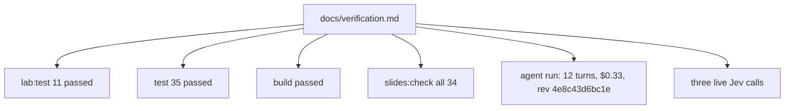

# The facilitation docs: run of show, contract, and verification

Beyond the code, the repository ships the documents that make the class repeatable: a minute-by-minute run of show, an implementation contract, a rehearsal checklist, a take-home, and a dated verification record of the authors' own run.

## Words on this page

| Word | Meaning |
|------|---------|
| Facilitator | The person who runs the class |
| Run of show | The minute-by-minute schedule |
| Hard stop | A clock time where the facilitator must move on |
| Contract | A written agreement on what a deliverable must do |
| Rehearsal | A practice run before the real class |

## The run of show

`docs/facilitator.md` is the facilitator's script. It maps each slide to a clock time and sets hard stops at 18, 30, 44, and 55 minutes. A hard stop means the room moves on even if some attendees are not done — the lesson at minute 55 (transfer) is worth more than finishing the proof at minute 56.

The agent prompt is given verbatim:

> Read `lab/verify/SKILL.md`. Reproduce the reload bug in the waitlist with `snack`. If it reproduces, fix it, and show me the receipt and the screenshot as proof.

The facilitator's secret move is the "final boss": after the game, edit one character of the app source so the last receipt goes stale. The room then sees `doctor` report STALE and learns that evidence belongs to one revision.

```mermaid
gantt
    title Run of show with hard stops
    dateFormat  mm
    axisFormat  %M min
    section Class
    Opening / incident    :a1, 0, 7min
    What would you check  :a2, after a1, 3min
    Meet snack            :a3, after a2, 8min
    Hard stop 18          :milestone, m1, after a3, 0min
    Write prove()         :a4, after a3, 12min
    Hard stop 30          :milestone, m2, after a4, 0min
    Hand to agent         :a5, after a4, 14min
    Hard stop 44          :milestone, m3, after a5, 0min
    Break it quietly      :a6, after a5, 11min
    Hard stop 55          :milestone, m4, after a6, 0min
    Transfer              :a7, after a6, 5min
```

## The contract

`docs/lab-contract.md` is the implementation contract for anyone building the lab: the task, the lever, the bugs, the exit codes, and the 60-minute split. It is the spec that `lab:test` and `content.test.ts` enforce. The workshop authors wrote the contract first, then built the harness to it — the same "define done in a proof" rule taught at minute 18.

## The opening and the rehearsal

`docs/opening.md` holds the incident that opens the class: the PocketOS case where an agent with the keys ran one destructive application programming interface (API) call, "It took 9 seconds.", and the Railway recovery story. It also credits Lauren Tan's pstack Part 1 and Part 2 as the source of the method.

`docs/preflight.md` is the rehearsal checklist: the commands to run before class and a failure-plans table for each thing that could break. A class that rehearses its failure modes is itself applying "can't tell" — know what to do when a server does not start, a slide does not advance, or the judge key is missing.

## The take-home

`docs/take-home.md` distills the portable pattern: precise claims, a commands table, and "preserve the run." The last phrase means keep the receipts, the screenshots, and the failed runs — today's failure is tomorrow's evaluation case, which is exactly the `ReceiptHistory.vue` take home.

## The verification record

`docs/verification.md` is dated 2026-10-12 and records the authors' own proof:

| Check | Result |
|-------|--------|
| `lab:test` | 11 passed |
| `test` | 35 passed |
| Build | Passed |
| `slides:check` | All 34 slides |
| One real agent run | 12 turns, about 50 seconds, $0.33, revision `4e8c43d6bc1e` |

It also lists three live Jev calls with their verdicts. The authors ran the class against its own harness and kept the receipt — the workshop practices what it teaches, in the repository.

## Aha moments

**Aha: the facilitator is scripted down to hard stops.** The run of show treats the class like the app — a thing with a bounded loop and a stop rule. At 55 minutes the facilitator stops even if the proof is unfinished, because transfer is the point.

**Aha: the authors ship their own receipt.** `verification.md` is a receipt for the workshop itself, with the same shape the class teaches: what was checked, on which revision, with what result, and how much it cost.

## Where to go next

Read [Critical assessment](12-critical-assessment.md) for the strengths, weaknesses, and risks. Read [Glossary](13-glossary.md) for every term in one place.
