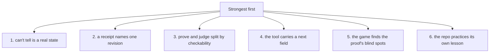
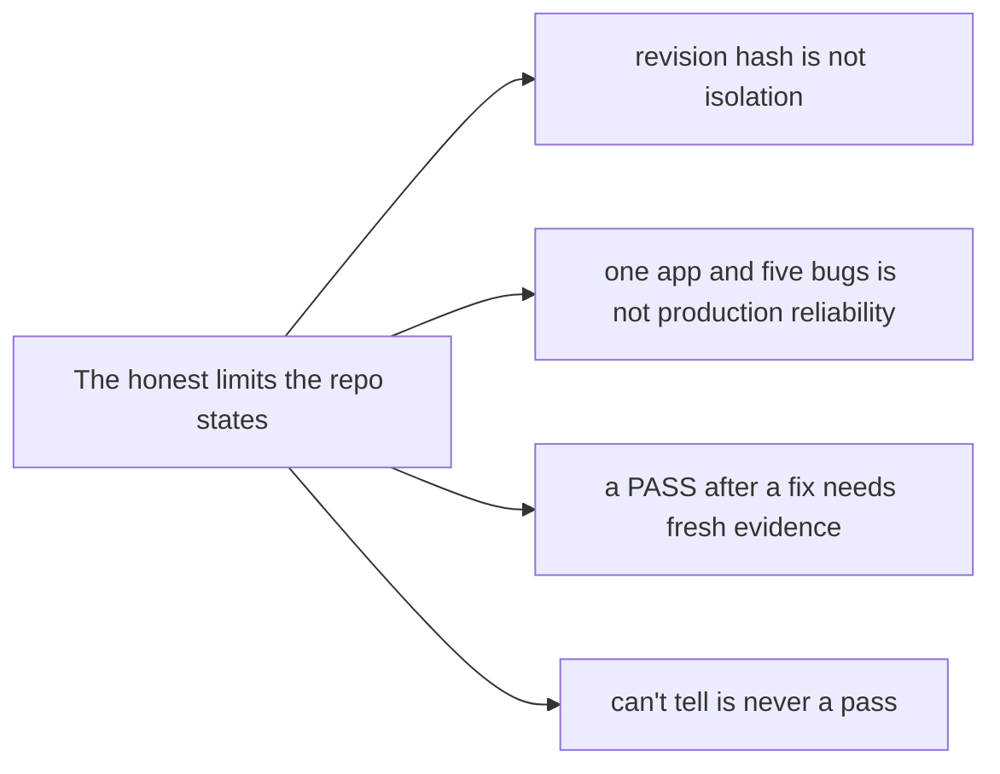

# Critical assessment: what beyond-done gets right, and its honest limits

Beyond Done is a teaching artifact, not a production verifier, and it is careful to say so. This page ranks the ideas by strength, names the weaknesses, and lists the risks — using the workshop's own "precise claims" rule.

## The verdict in one line

The three ideas worth carrying out of the room — the three-state verdict, the revision-bound receipt, and the split between proof and judgment — are strong and directly reusable. The rest is scaffolding to teach those ideas in 60 minutes, and it does not pretend to be more.

## Strengths, ranked

1. **"Can't tell" is a real state.** PASS = 0, FAIL = 1, ERROR = 2. Missing evidence, a stale revision, a judge outage, and a missing screenshot all land in exit 2, never in PASS (`README.md:97`). Most harnesses collapse "I don't know" into "failed" or "passed"; this one keeps them separate and gives each a different next action. This is the idea that generalizes beyond the workshop.

2. **A receipt names one revision.** The SHA-256 of the served HTML, first 12 hex characters, binds every receipt to exact bytes (`lab/server.ts:46`). The before/after comparison in `runProof` means a receipt can never cover a moving target (`lab/proof.ts:69-71`). This is the fix for the most common way agents lie: a green check against code that no longer exists.

3. **Prove and judge split by checkability.** Exact assertions stay in code; a model answers meaning questions with a probability (`PRODUCT.md`, `lab/judge.ts`). The split is clean and the threshold band (accept at 0.9, fail at 0.2) leaves a middle that asks a human. Few teams separate these; most over-trust one side.

4. **The tool carries a `next` field.** Every `snack` error names the concrete command to run next (`lab/snack.ts:42-44`). The agent prompt is three sentences because the tool's output drives the loop. This is a real, portable design for agent-facing command-line interfaces.

5. **The game finds the proof's blind spots.** `overpromise` and `console-error` both pass `prove`, for different reasons, and the room discovers both. The lesson is demonstrated, not asserted: a proof covers only what it checks.

6. **The repo practices its own lesson.** The schedule is a tested 60 minutes, the deck is validated by Playwright, the deploy refuses a dirty tree, and the authors ship a dated `verification.md` receipt. The workshop is its own best example.

## Weaknesses

1. **The scope is deliberately tiny.** One browser-local HTML file, five string-transform bugs, and a single local server. The transfer worksheet states the limit in its own words: "one app and five bugs is not production reliability." Attendees must not mistake the lab for the real thing.

2. **The judge is a single external dependency.** The overpromise lesson needs a live Jev call with a `TYPESAFE_API_KEY`, a 15-second timeout, and no retry (`lab/judge.ts`). A missing key turns the meaning-bug lesson into "can't tell" and quietly removes the one demonstration that a proof can pass a lie.

3. **The chat is a cost, not a core.** It is grounded, rate-limited to 300 per hour, and capped at 500 tokens (`src/worker.ts`, `src/openrouter.ts`). It is a nice supplement, but the class does not depend on it, and a facilitator should not spend setup time on it.

4. **Sixty minutes is compressed.** The proof, the receipt, the judge, the game, and the transfer are a lot. The hard stops force the pacing, but an attendee who falls behind at minute 18 stays behind.

## Risks

1. **A model's probability is not ground truth.** The 0.9/0.2 thresholds give a clean interface, but `noul()` is still a model output. A team that copies the thresholds without the boundary question inherits both the value and the failure mode.

2. **The revision hash is not isolation.** The transfer worksheet says it plainly. The hash covers the served HTML, not the dependencies, the judge model version, or the environment. A receipt that pins HTML alone can still drift if the runtime under it changes.

3. **Exit 2 requires a wise agent.** "Can't tell" only works if the agent acts on it — re-runs, or asks — rather than treating a non-zero exit as a bug in its own code. The tool provides the signal; the agent must know what to do with it.

4. **The overpromise lesson degrades silently.** If the judge key is absent or the model changes behavior, the reveal table's most important row (overpromise passes `prove`) has no evidence behind it that day. A facilitator should verify the judge works during preflight, which the rehearsal checklist covers.

## What to copy, what to leave

| Copy | Leave |
|------|-------|
| Three-state verdicts and a `next` field on every error | The single HTML app and string-transform bugs |
| Revision-hashed receipts with a before/after check | The 60-minute lesson pacing |
| The proof/judge split with a human band | The chat and glossary site |
| A game or exercise that shows what your checks miss | The single-vendor judge key as a hard dependency |

## Aha moments

**Aha: the project's honesty is its best feature.** The strongest "feature" is not a tool but a rule — a PASS receipt says "these checks cover nothing else", and a stale receipt says STALE instead of green. The workshop earns its claim by refusing to make bigger ones.

**Aha: teaching artifacts are still good engineering.** The repo validates its own deck, tests its own schedule, and ships its own receipt. A workshop that asks attendees to prove things is itself provable — that is why it is credible.

## Where to go next

Read [Glossary](13-glossary.md) for every term defined in one place. Return to [The concept](01-the-concept.md) for the mental model in full.
