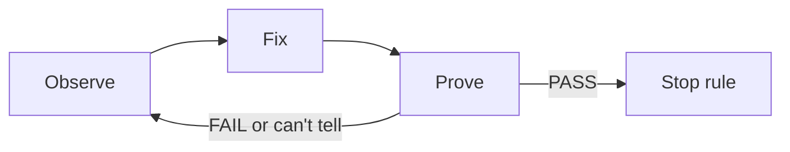
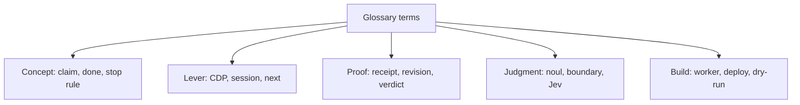

# Glossary

Every term used in this exploration, in alphabetical order. Each term links to the page that explains it in full.

## The concept and the loop

| Term | Meaning | Page |
|------|---------|------|
| Claim | A statement that work is finished. It is not evidence | [The concept](01-the-concept.md) |
| Done | A claim, unless a receipt backs it | [The concept](01-the-concept.md) |
| Evidence | Saved output that supports a claim, bound to a revision | [The concept](01-the-concept.md) |
| Observe → fix → prove | The three-verb loop the workshop teaches | [The concept](01-the-concept.md) |
| Precise claim | A claim that says what was checked, on which revision, with what result | [Facilitation docs](11-facilitation-docs.md) |
| Stop rule | A decision about when to stop fixing | [The concept](01-the-concept.md) |
| Take home | A numbered reusable pattern the deck gives attendees | [Slides and deck](09-slides-and-deck.md) |

## The lever (`pnpm snack`)

| Term | Meaning | Page |
|------|---------|------|
| Chrome DevTools Protocol (CDP) | The protocol that lets a program attach to and control a running Chrome | [The lever](02-the-lever-snack-cli.md) |
| Event log | A JSON-lines file where `up` records console, page errors, loads, and responses | [The lever](02-the-lever-snack-cli.md) |
| Fresh visitor | A new browser context with no storage and no cookies | [The proof and receipt](03-the-proof-and-receipt.md) |
| Next field | The concrete command each error tells the agent to run next | [The lever](02-the-lever-snack-cli.md) |
| Reveal | The name of the hidden bug, printed when the game session stops | [Break it quietly](05-break-it-quietly.md) |
| Session | A saved record of the running app and browser, owned by `up` | [The lever](02-the-lever-snack-cli.md) |

## The proof and receipt

| Term | Meaning | Page |
|------|---------|------|
| Check | One recorded fact: a name, a pass flag, an expected value, and an actual value | [The proof and receipt](03-the-proof-and-receipt.md) |
| FAIL | Verdict and exit code 1: a check failed | [The proof and receipt](03-the-proof-and-receipt.md) |
| PASS | Verdict and exit code 0: the checks passed on this revision | [The proof and receipt](03-the-proof-and-receipt.md) |
| Proof | A repeatable check that writes a receipt | [The proof and receipt](03-the-proof-and-receipt.md) |
| Proof kit | The object passed to `prove()`: page, email, check, storage | [The proof and receipt](03-the-proof-and-receipt.md) |
| Receipt | The JSON file recording verdict, revision, checks, page errors, and screenshot | [The proof and receipt](03-the-proof-and-receipt.md) |
| Revision | The SHA-256 hash of the served HTML, first 12 hex characters | [The proof and receipt](03-the-proof-and-receipt.md) |
| Secure hash algorithm 256 (SHA-256) | The hash function used to compute a revision | [The proof and receipt](03-the-proof-and-receipt.md) |
| Screenshot | The image bound to a run, part of the evidence bundle | [The proof and receipt](03-the-proof-and-receipt.md) |
| Stale | A receipt whose revision no longer matches the source | [Break it quietly](05-break-it-quietly.md) |
| Verdict | PASS, FAIL, or ERROR (can't tell) | [The proof and receipt](03-the-proof-and-receipt.md) |

## Semantic judgment

| Term | Meaning | Page |
|------|---------|------|
| Boundary | The question of whether the text tries to command the judge | [Semantic judgment](04-semantic-judgment-jev.md) |
| Jev | The judge model from TypeSafe AI | [Semantic judgment](04-semantic-judgment-jev.md) |
| Noul | The model's probability of "yes", from 0 to 1 | [Semantic judgment](04-semantic-judgment-jev.md) |
| Question hash | A fixed hash naming one set of judge questions | [Semantic judgment](04-semantic-judgment-jev.md) |
| Semantic judgment | A model's decision about meaning, not a value a program can compare | [Semantic judgment](04-semantic-judgment-jev.md) |
| TypeSafe AI (TypeSafe) | The vendor that runs the Jev model | [Semantic judgment](04-semantic-judgment-jev.md) |

## The app and the game

| Term | Meaning | Page |
|------|---------|------|
| Bug | One hidden fault injected into the reference app at serve time | [Break it quietly](05-break-it-quietly.md) |
| Final boss | A one-character edit that makes the last receipt stale | [Break it quietly](05-break-it-quietly.md) |
| Local storage | The browser's per-origin key–value store, `localStorage` | [The lab app](07-the-lab-app.md) |
| Reference app | The fixed solution app the bugs are injected into | [The lab app](07-the-lab-app.md) |
| Scorecard | The paper card grading a claim against its evidence | [Break it quietly](05-break-it-quietly.md) |
| Test id | A `data-testid` attribute the harness finds without CSS | [The lab app](07-the-lab-app.md) |

## The site, deck, and build

| Term | Meaning | Page |
|------|---------|------|
| Alto | WorkOS's deploy tool for talks | [Scripts, build, deploy](10-scripts-build-deploy.md) |
| Appendix | Optional extra slides, imported only if needed | [Slides and deck](09-slides-and-deck.md) |
| Atomic write | Writing to a temp file and renaming | [Scripts, build, deploy](10-scripts-build-deploy.md) |
| Build | Turning source and slides into a static bundle | [Scripts, build, deploy](10-scripts-build-deploy.md) |
| Cloudflare D1 | Cloudflare's serverless SQL database | [Site, glossary, chat](08-site-glossary-chat.md) |
| Companion site | The generated web site for lessons and glossary | [Site, glossary, chat](08-site-glossary-chat.md) |
| Dry-run | A run that stages everything but deploys nothing | [Scripts, build, deploy](10-scripts-build-deploy.md) |
| Facilitator | The person who runs the class | [Facilitation docs](11-facilitation-docs.md) |
| Glossary | A list of terms with definitions, cross-links, and quizzes | [Site, glossary, chat](08-site-glossary-chat.md) |
| Grounding | Giving a model the source text it must answer from | [Site, glossary, chat](08-site-glossary-chat.md) |
| Hard stop | A clock time where the facilitator moves on | [Facilitation docs](11-facilitation-docs.md) |
| Playwright | The browser automation library that validates the deck | [Slides and deck](09-slides-and-deck.md) |
| Prework | Work done before class, not counted in the 60 minutes | [The lessons](06-lessons.md) |
| Presenter notes | Speaker-only text on each slide | [Slides and deck](09-slides-and-deck.md) |
| Rate limit | A cap on requests per hour | [Site, glossary, chat](08-site-glossary-chat.md) |
| Rehearsal | A practice run before the real class | [Facilitation docs](11-facilitation-docs.md) |
| Run of show | The minute-by-minute schedule | [Facilitation docs](11-facilitation-docs.md) |
| Slidev | The Markdown-driven slide framework | [Slides and deck](09-slides-and-deck.md) |
| Worker | A Cloudflare Workers function answering HTTP requests | [Site, glossary, chat](08-site-glossary-chat.md) |
| Transfer | Taking a skill learned here and using it elsewhere | [The lessons](06-lessons.md) |
| zod | The schema library that validates the glossary and config | [Site, glossary, chat](08-site-glossary-chat.md) |

## Where to go next

Return to [Critical assessment](12-critical-assessment.md) for the verdict, or [The concept](01-the-concept.md) for the mental model in full.
