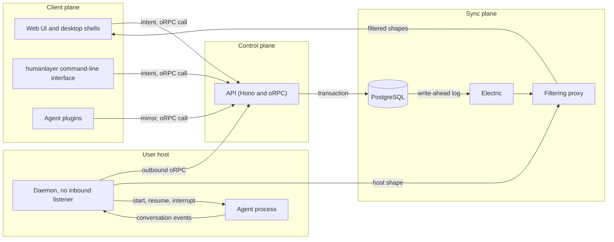
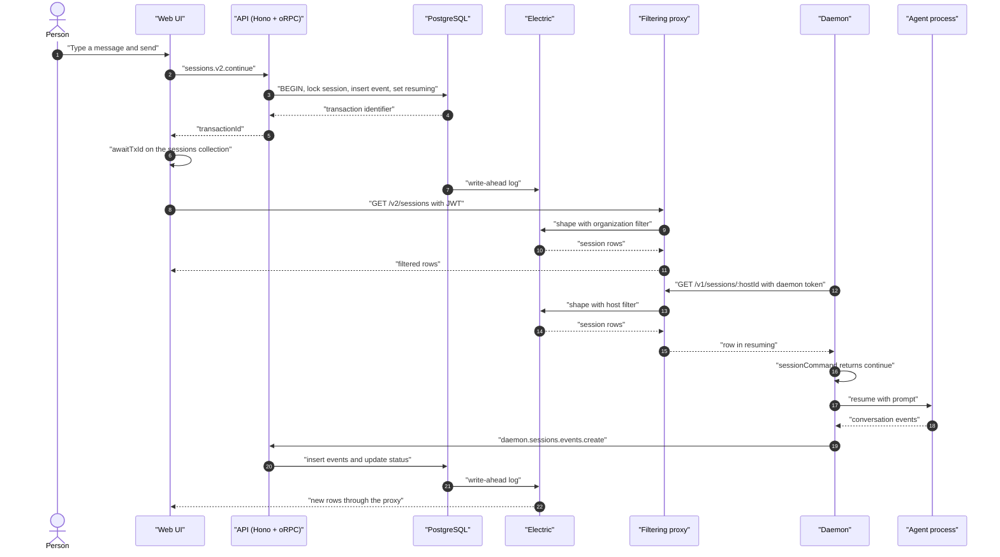

# Overview: three planes, one session row

HumanLayer is a control surface for coding agents. A person starts, watches, and steers an agent from a browser, while the agent runs on a machine that the person controls. `README.md:3` states that product goal in one sentence.

The design works because it does not make the user host a server. Riptide is the internal code name for the platform, so folder names such as `riptide-api` and `riptide-daemon` name HumanLayer components, not a separate product. A session is a row in PostgreSQL. A task is the work item that groups sessions. A workspace is a prepared checkout on a user host: one Git worktree for each repository in the task, plus copied configuration files and an optional setup command. A host is one registered machine for one user in one organization. The daemon on that host is the remote hand that acts on the session row. Electric (ElectricSQL, a sync engine) sits behind a filtering proxy and is the shared eye that shows the row to every client. The API contract package, built with oRPC (a typed Remote Procedure Call (RPC) library), is the type spine. It keeps the daemon, the Application Programming Interface (API), and the user interface (UI) in agreement about the shape of the row.

This document explains the three planes, the actors, the lifecycle of one session, and the reason the daemon has no inbound listener. It also traces one human instruction from the browser to an agent process and back. Later documents add the detail for each part.

## The three planes

The repository divides work by the direction in which data moves. The control plane carries intent. The sync plane carries state. The client plane turns state into a screen and turns a person's action into intent.



| Plane | What it moves | Main processes | Direction |
|-------|---------------|----------------|-----------|
| Control plane | Create, continue, interrupt, status reports | API, daemon | Writes and outbound RPC calls |
| Sync plane | PostgreSQL rows as read-only shapes | PostgreSQL, Electric, proxy | One direction, from the database to readers |
| Client plane | Screens, local commands, plugin mirrors | Web UI, desktop shells, command-line interface (CLI), plugins | Reads shapes, writes through the API |

The control plane is the set of processes that accept intent or report state through the API. The API is a Hono (web framework) server with oRPC procedures. A person calls an API procedure. The daemon calls another API procedure to report a status change or a conversation event. All client-originated writes pass through the API. A person calls it directly. A daemon calls it on behalf of an agent process. Background jobs are the exception: the stale-daemon sweeper and the migration Lambda open a database connection and write rows without the API (`apps/stale-daemon-sweeper/stale-daemons.ts:92-115`, `apps/riptide-migrator`).

The sync plane is a copy path. PostgreSQL publishes its write-ahead log. Electric (ElectricSQL, a sync engine) turns that log into a shape: a live query result that a client can follow. The proxy sits in front of Electric. It validates a token, adds a filter, and forwards the request. The client never talks to Electric directly, and it never receives a row that the filter did not allow.

The client plane has several forms. The same React application runs as a web page and inside an Electron or Tauri desktop shell. Electron and Tauri are two frameworks that wrap a web page in a native desktop window. The command-line interface (CLI) starts a managed daemon in its own process (`apps/cli/src/commands/daemon-launch.ts:119-120`). A managed daemon is a daemon that the CLI starts, owns, and stops, instead of one that an operating-system service manager starts. The mirroring plugins copy sessions from Claude Code, OpenCode, and Pi into HumanLayer. A schema comment also names Codex as mirror-only, but no plugin in this snapshot sends the `codex` value (`packages/schemas/coding-agent/coding-agent.ts:25-28`). They write through the session Software Development Kit (SDK) packages. A mirrored session is a copy of a session that the agent itself owns; the daemon does not run that agent. CodeLayer and Fold are agents that the daemon can launch itself. The cloud application handles organizations, invitations, and billing. These forms do not all read the same shapes. The web UI, the cloud application, the shells, and the daemon read shapes through the proxy. The mirroring plugins also read the host shape to learn the task and the approvals. The CLI and the plugins write through API procedures.

**Aha:** The three planes are not three products. They are three answers to one question: who may write, who may read, and who may display. The separation lets each answer change alone. A new UI does not change the daemon. A new agent does not change the API. A new access rule changes the proxy and the API fallback, which is the API-side copy of the read rule that serves a client when Electric fails. That duplication is the main cost of the design.

## The actors

Eight actors appear in almost every flow. Each actor has one job and one credential.

| Actor | Job | Credential or identity | Failure behavior |
|-------|-----|------------------------|------------------|
| Person | States intent and reads progress | WorkOS session, then a JSON Web Token (JWT) | Sees an error and can retry |
| Web or desktop UI | Shows rows and sends intent | JWT from the auth provider | Falls back to the query path (an API read that replaces Electric) |
| API | Validates, writes, and reports | Server secret and database role | Returns a typed error |
| Electric proxy | Authenticates readers and adds filters | JWT or daemon token | Returns 401, 403, or 404 |
| Electric | Streams PostgreSQL shapes | Internal connection to PostgreSQL | Client retries with backoff |
| PostgreSQL | Stores the session row and the event log | Database role | Transaction rolls back |
| Daemon | Runs agent sessions on a host | Daemon token tied to one user and one host | Stops with a non-zero exit code |
| Agent process | Does the coding work | Provider credential or local binary | Session moves to `failed` |

The person signs in through WorkOS, a hosted identity provider, and its AuthKit library gives the browser an access token function that the API client calls (`apps/riptide-ui/src/orpc/client.ts:168-176`). A JSON Web Token (JWT) is a signed token that carries claims about the user. The CLI uses a device login or a personal access token (PAT) and receives a daemon token (`packages/session-sdk-auth/src/client.ts:35-46`). A device login asks the person to approve the CLI in a browser and then hands the credential back to the CLI. A PAT is a long-lived token that a user creates for a tool. The API extracts the organization identifier and the user identifier from the JWT, and it uses those values in every query. The proxy does the same extraction and writes the values into the shape filter. The daemon token carries the same pair plus a host identifier. That third value is why the proxy can reject a request for another host.

The agent process is outside the trust boundary of HumanLayer. It receives a prompt and a working directory. It writes files and prints events. The daemon translates those events into API calls. The API stores them. The UI reads them through Electric.

## The lifecycle in one paragraph

A person creates a session from the UI. The create procedure accepts a status, so a session starts in `draft` or in `ready_for_launch`. A draft moves to `ready_for_launch` when the person launches it (`apps/riptide-api/src/orpc/api/sessions/launch.ts:133-140`). The daemon starts session dispatch only after it registers a heartbeat. It sees a launchable row, claims it with `launching`, starts the agent, and reports `running`. When the agent stops, the daemon reports `ready_for_input`. The row, not the running process, is the source of truth between turns. A person then sends a message. The API locks the row (`apps/riptide-api/src/orpc/api/sessions/continue.ts:50`), rejects a status that is not ready for input (`apps/riptide-api/src/orpc/api/sessions/continue.ts:56-60`), and inserts the message as a conversation event (`apps/riptide-api/src/orpc/api/sessions/continue.ts:116-128`). It also sets `resuming` and stores the text in the `prompt` column for the daemon to deliver. The event is the durable log; the column is the pending instruction. The daemon sees the change, resumes the agent, and reports `running` again. A person may interrupt, and the row moves through `interrupt_requested` to `interrupted`. An agent may need approval, and the row moves to `needs_approval`. A provider limit may pause the run in `waiting_for_usage_limit`. A workspace whose setup has not finished holds the row in `waiting_for_workspace` (`apps/riptide-daemon/src/handlers/workspace/on-workspace-setup.ts:72-78`). An error moves the row to `failed`. Two different sweeps handle host silence, and the section on failure explains them. The schema declares thirteen statuses in `packages/schemas/src/effect/session/session-status.ts:7-21`.

The human state machine document `golden/session_state_machine.md:7-19` lists eleven of those statuses. The `golden` folder holds the project's written engineering rules. The document does not list `waiting_for_workspace` and `lost`. The schema is the source of truth, and the document lists fewer statuses than the schema. This gap is small, but it shows why the code must be the source of truth for every claim. Document 03 covers the full state machine and the handlers that move each edge.

## Why the daemon has no inbound listener

A daemon on a laptop is usually behind a router that performs Network Address Translation (NAT). An inbound listener would need a port forward, a certificate, and a firewall rule. Many corporate networks forbid all three. HumanLayer avoids the problem by giving the daemon no listener at all. The daemon opens only outbound connections.

The first outbound connection is a typed API client. `apps/riptide-daemon/src/orpc/client.ts:27-33` builds the client from a base URL and a token. The full block is below.

```ts
// apps/riptide-daemon/src/orpc/client.ts:27-33
export function createDaemonORPCClient(apiOrigin: string, token: string): ORPCClient {
	const rpcBaseUrl = `${apiOrigin}/rpc/daemon/v1`
	const link = new OpenAPILink(RiptideDaemonApiContract, {
		url: rpcBaseUrl,
		headers: () => ({
			'x-daemon-authorization': token,
		}),
```

The client has five retries with a two second delay (`apps/riptide-daemon/src/orpc/client.ts:14` and `apps/riptide-daemon/src/orpc/client.ts:93`). A 401 or 403 response is not retried. The client sets a non-zero exit code and sends a termination signal to the daemon process (`apps/riptide-daemon/src/orpc/client.ts:46-69`). This rule prevents a revoked token from causing an endless retry loop.

The second outbound connection is a read shape. `apps/riptide-daemon/src/collections/electric/sessions.ts:19-29` creates a collection for the sessions of one host. The Uniform Resource Locator (URL) includes the host identifier, and the header carries the daemon token.

```ts
// apps/riptide-daemon/src/collections/electric/sessions.ts:19-29
export function createSessionsCollection(syncOrigin: string, token: string, hostId: string) {
	logger.debug('Initializing sessions electric collection')
	const sessionsElectricCollection = createCollection(
		electricCollectionOptions({
			schema: sessionSelectSchema,
			shapeOptions: {
				url: `${syncOrigin}/v1/sessions/${hostId}`,
				subsetMethod: 'POST',
				headers: {
					'x-daemon-authorization': token,
				},
```

The third outbound connection is a heartbeat. `apps/riptide-daemon/src/lib/heartbeat.ts:14-16` explains the two time values. The daemon sends a beat every fifteen seconds. The API treats a host as stale after one hundred and twenty seconds, or eight missed beats.

```ts
// apps/riptide-daemon/src/lib/heartbeat.ts:14-16
// Keep well under the API's HOST_STALE_AFTER_MS (120s): a host is swept — running
// sessions failed, approvals rejected — after missing 8 consecutive beats.
const HEARTBEAT_INTERVAL = Duration.seconds(15)
```

**Aha:** The command channel and the state channel are the same channel. A person does not send a command to a machine. The person changes a row. The machine reads the row. This choice removes the need for a public host name, an inbound port, a certificate, or a tunnel. It also makes every command a durable, auditable database record. The cost is that a command waits for the sync path, and the daemon must keep a shape connection open.

The heartbeat is also a registration. The daemon sends the first beat before it starts session dispatch. The comment at `apps/riptide-daemon/src/lib/heartbeat.ts:121-123` states that the first beat registers the host as online. A host that has not registered has no online record, so a person cannot select it for a launch. The launch procedure checks that the host belongs to the caller and is online (`apps/riptide-api/src/db/host-auth.ts:22-27`). The API never pushes work to a host; the host must be registered and must read its own shape.

## One instruction, end to end

The next diagram shows one message from a person to a running agent and the return path of the rows. It uses the same order as the code walkthrough that follows. The diagram names `sessions.v2.continue`, the procedure that the web UI calls. The walkthrough quotes the version 1 procedure, because both versions write the same core row; version 2 adds the queue and interrupt-and-send intents around that write.



The row is the center of the flow. `packages/db/src/tables/sessions.ts:47-56` defines its identity and its two foreign keys. The identifier is a Universally Unique Identifier, version 7 (UUIDv7), so it sorts by creation time. The table links each session to a task and to an organization.

```ts
// packages/db/src/tables/sessions.ts:47-56
export const sessions = pgTable(
	'sessions',
	{
		id: uuid()
			.primaryKey()
			.default(sql`uuidv7()`)
			.$defaultFn(() => uuidv7()),

		task_id: uuid().references(() => tasks.id, { onDelete: 'set null' }),
		organization_id: uuid().references(() => organizations.id, { onDelete: 'cascade' }),
```

The first write is an ordinary transaction in the API. The block below comes from the classic version 1 procedure (`apps/riptide-api/src/orpc/api/sessions/continue.ts:96-114`). "Classic version 1" means the first continue procedure; version 2 is the newer procedure that adds queueing. It sets `resuming`, stores the text in the `prompt` column, and increments the event count. The same procedure locks the row with a no-key-update lock (`FOR NO KEY UPDATE`) and accepts only `ready_for_input`, `interrupted`, `failed`, or `lost` (`apps/riptide-api/src/orpc/api/sessions/continue.ts:50-60`). A no-key-update lock is a PostgreSQL row lock that blocks writers of the same row but does not block foreign-key checks that read the row. Version 2 adds three intents: send, queue, and interrupt-and-send. For an idle session, version 2 drains queued messages into one prompt (`apps/riptide-api/src/orpc/api/sessions/v2/continue.ts:141-247`).

```ts
// apps/riptide-api/src/orpc/api/sessions/continue.ts:96-114
				// Update session
				// Also unarchive the session when continuing (user interaction should unarchive)
				await tx
					.update(sessions)
					.set({
						status: 'resuming',
						error_message: null,
						error_reason: null,
						model: effectiveModel,
						effort: effectiveEffort ?? null,
						fast_mode: effectiveFastMode ?? false,
						permissions_mode: permissionsMode,
						archived: false,
						// provider and coding_agent remain unchanged from session creation
						last_activity_at: BigInt(nowMillis),
						num_events: sql`${sessions.num_events} + 1`,
						prompt: text,
					})
					.where(eq(sessions.id, sessionId))
```

The API returns a transaction identifier instead of a row. `apps/riptide-api/src/db/get-tx-id.ts:5-8` reads the current PostgreSQL transaction identifier. Electric includes this value in its change stream, so the client can wait for it.

```ts
// apps/riptide-api/src/db/get-tx-id.ts:5-8
export async function getTxId(tx: Pick<PgDatabase<PostgresJsQueryResultHKT>, 'execute'>): Promise<string> {
	const result = await tx.execute(sql`SELECT pg_current_xact_id()::text as txid`)
	return (result[0] as { txid: string }).txid
}
```

The UI waits for its own write to come back. `apps/riptide-ui/src/components/providers/SyncProvider.tsx:922-935` shows both modes. Query mode is the fallback path: the collection polls the API instead of following a shape. In query mode, `confirmTx` refetches the collection. In Electric mode, it waits for the transaction identifier on the sessions collection. This wait is how an optimistic screen avoids a flicker between the local row and the confirmed row.

```ts
// apps/riptide-ui/src/components/providers/SyncProvider.tsx:922-935
	// ---- confirmTx: per-collection post-write sync confirmation ----
	// Electric mode: wait for the transaction to sync back via awaitTxId
	// Query mode: trigger an immediate refetch so the collection reflects the latest state
	// Refs are read at call time (not at closure creation time), so they always reflect current state.

	const confirmTx = useMemo(
		() => ({
			sessions: async (txId: string | number): Promise<void> => {
				if (modes.sessions === 'query' && sessionsQueryRef.current) {
					await sessionsQueryRef.current.utils.refetch()
				} else {
					await sessionsElectric.utils.awaitTxId(Number(txId), AWAIT_TX_TIMEOUT)
				}
			},
```

The daemon follows the host shape. `apps/riptide-daemon/src/subscriptions.ts:360-373` connects three domain streams to handlers. The session stream maps every change to `processSessionChange`. The task stream and the workspace stream run at the same time.

```ts
// apps/riptide-daemon/src/subscriptions.ts:360-373
/** Consume DaemonCollections domain streams. Collection ownership stays in the scoped service. */
export function initializeSubscriptions(services: DaemonServices) {
	const lifecycle = makeTaskDiffCollectionLifecycle({
		collections: services.collections,
		runtime: services.daemonRuntime,
	})
	const program = superviseDaemonSubscriptionConsumer((markHealthy) =>
		Effect.gen(function* () {
			const collections = yield* DaemonCollections
			const sessions = collections.sessionChanges.pipe(
				Stream.mapEffect((change) => processSessionChange(change, services, lifecycle)),
				Stream.tap(() => markHealthy),
				Stream.runDrain,
			)
```

The change becomes a command through one pure function. `packages/session-sdk-sessions/src/commands.ts:33-44` examines the row and the prior row. A move into `resuming` produces a continue command. A move into `interrupt_requested` produces an interrupt command. A row that is already in that status is not a new command. If the prior status was `lost`, the command carries `resume: 'lost-resume'`, and the daemon treats the run as a retry after a stale session.

```ts
// packages/session-sdk-sessions/src/commands.ts:33-44
export function sessionCommand(change: SessionRowChange): SessionCommand | undefined {
	if (change.type === 'delete') return undefined
	const { value, previousValue } = change
	const moved = change.type === 'insert' || previousValue?.status !== value.status
	if (!moved) return undefined
	if (value.status === 'resuming') {
		const resume = change.type === 'update' && previousValue?.status === 'lost' ? 'lost-resume' : 'ordinary'
		return { kind: 'continue', sessionId: value.id, prompt: value.prompt ?? null, resume }
	}
	if (value.status === 'interrupt_requested') return { kind: 'interrupt', sessionId: value.id }
	return undefined
}
```

The daemon handler then checks the agent and the saved agent session identifier. `apps/riptide-daemon/src/handlers/sessions/on-session-continue.ts:43-66` rejects an agent that the daemon cannot run, and it rejects a Claude session with no provider identifier. Both failures write `failed` back to the row, so the person sees the reason.

The return path is a set of daemon procedures on the same API. The daemon reports events through the daemon contract. `apps/riptide-api/src/orpc/daemon/sessions/update.ts:78-87` checks that the daemon owns the session. It compares the host identifier and the creator, and then it checks write access on the task.

```ts
// apps/riptide-api/src/orpc/daemon/sessions/update.ts:78-87
				// 2. Verify daemon is running this session (host_id check)
				if (session.host_id !== hostId || session.created_by !== userId) {
					throw errors.FORBIDDEN()
				}

				// 3. Use task auth helper for permission check
				const canWrite = await canWriteTaskForSession(tx, session, userId, organizationId)
				if (!canWrite) {
					throw errors.FORBIDDEN()
				}
```

The proxy is the only reader of Electric that a client or a daemon may reach. `apps/riptide-electric-proxy/src/routes/v1.ts:225-246` validates the host identifier, rejects a mismatch, and adds the host filter. For a daemon token, it also adds the creator filter. This second filter matters when a task is shared with another person. The share gives visibility of the task. It does not give a daemon permission to follow work on another operating system user's host.

```ts
// apps/riptide-electric-proxy/src/routes/v1.ts:225-246
	app.all('/sessions/:hostId', async (c) => {
		const hostId = c.req.param('hostId')
		if (!isUuid(hostId)) {
			return c.json({ error: 'Invalid hostId format' }, StatusCodes.BAD_REQUEST)
		}

		const { userId, organizationId, hostId: authHostId } = c.var.authContext

		if (authHostId && authHostId !== hostId) {
			return c.json(
				{ error: 'hostId mismatch: URL parameter does not match daemon token' },
				StatusCodes.FORBIDDEN,
			)
		}

		c.var.electricOriginUrl.searchParams.set('table', getTableName(sessions))
		const additionalConditions: Array<{
			column: typeof sessions.host_id | typeof sessions.created_by
			value: string
		}> = [{ column: sessions.host_id, value: hostId }]
		// Sharing grants visibility, not permission to watch another OS user's session paths.
		if (authHostId) additionalConditions.push({ column: sessions.created_by, value: userId })
```

The browser and the daemon use one core collection builder, but different routes. `packages/sync/src/electric-collection.ts:31-54` accepts a sync origin, a route version, and a path. It builds the URL with `buildElectricSyncUrl`, sets `subsetMethod` to `POST`, and attaches an error handler and a backoff policy.

```ts
// packages/sync/src/electric-collection.ts:31-54
export function createElectricCollection<TSchema extends StandardSchema<object>>(
	options: ElectricCollectionOptions<TSchema>,
): Collection<InferSchemaOutput<TSchema>, string | number> {
	const getKey = options.getKey ?? defaultCollectionKey
	const shapeOptions: {
		url: string
		subsetMethod: 'POST'
		headers: ElectricCollectionOptions<TSchema>['headers']
		onError: ReturnType<typeof createElectricSyncErrorHandler>
		backoffOptions: typeof DEFAULT_BACKOFF_OPTIONS
		fetchClient?: typeof fetch
	} = {
		url: buildElectricSyncUrl(options.syncOrigin, options.syncVersion, options.routePath),
		subsetMethod: 'POST',
		headers: options.headers,
		onError: createElectricSyncErrorHandler({
			collectionName: options.collectionName,
			shouldRetryOnFailure: options.shouldRetryOnFailure,
			logger: options.logger,
			captureException: options.captureException,
			isAuthUnavailableError: options.isAuthUnavailableError,
		}),
		backoffOptions: DEFAULT_BACKOFF_OPTIONS,
	}
```

The version 1 access rule is written twice. The proxy writes it as Structured Query Language (SQL) in `apps/riptide-electric-proxy/src/lib/where-builder.ts:63-101`. The API writes it as Drizzle (a database access library) conditions in `apps/riptide-api/src/db/sync-auth.ts:70-104`. The comments in both files name the other file. No shared generator and no parity test keep the two copies equal. A change to one rule can leave the fallback path with different visibility.

## Two readers, one row

The same physical row reaches two readers through two versions of the sync route. The web UI sets `syncVersion` to 2 (`apps/riptide-ui/src/components/providers/SyncProvider.tsx:237`) and builds a browser collection with route path `/sessions` (`apps/riptide-ui/src/collections/electric/sessions.ts:9-12`). The proxy mounts the version 2 app at `/v2`, so the UI follows `/v2/sessions` (`apps/riptide-electric-proxy/src/server.ts:65` and `apps/riptide-electric-proxy/src/routes/v2.ts:56-60`). The daemon builds a server collection with route path `/v1/sessions/{hostId}` (`apps/riptide-daemon/src/collections/electric/sessions.ts:19-29`), and the proxy serves that route from the version 1 app (`apps/riptide-electric-proxy/src/routes/v1.ts:225-246`).

A version number selects a filter rule, not a data format. Version 1 applies an access-list rule. Version 2 applies an organization rule. The difference is deliberate. A person needs every session in the organization that version 2 shows. A daemon needs only the sessions that run on its host. One shape for both would give every host the sessions of every other host. A host identifier cannot express an organization-wide row set.

| Reader | Proxy route | Filter | Row set |
|--------|-------------|--------|---------|
| Web UI and desktop shells | `/v2/sessions` | Organization only | Every session in the organization |
| Daemon | `/v1/sessions/:hostId` | Host identifier, plus creator for a daemon token | Sessions on one host |
| API fallback for version 2 | No proxy route | The same organization rule, written in Drizzle | The same set as the web UI |
| API fallback for version 1 | No proxy route | Owner, user access list, and organization access list | Intended to match the version 1 proxy route; the two implementations can drift |

The version 2 rule is organization-wide by design (`apps/riptide-electric-proxy/src/lib/v2-where-builder.ts:37-44`). Every row still carries `organization_id`, so a row cannot cross a tenant. Within one organization, a member reads another member's session with no access-list entry. Document 06 explains the product reason and the test that proves it.

The fallback path repeats each rule. `buildSessionsSyncWhereV2` at `apps/riptide-api/src/db/sync-auth.ts:106` delegates to `buildOrgScopedWhere`, which returns one equality condition. The version 1 builder at `apps/riptide-api/src/db/sync-auth.ts:70-96` combines owner, user access list, and organization access list in one `or` expression. This is the second copy of the version 1 proxy rule. The version 2 copy is small, but it is still a second copy.

## The type spine

The contract package is the only place where the API procedure shape is declared. It exports two routers. `contracts/riptide-api-contract/src/contract-router.ts:643` starts the daemon router. The router starts with host heartbeat and shutdown, comments, and diff comments. It continues with session events, commits, usage, pull requests, repositories, and the session update call.

```ts
// contracts/riptide-api-contract/src/contract-router.ts:643-657
export const RiptideDaemonApiContract = {
	hosts: {
		heartbeat: heartbeatContract,
		shutdown: shutdownContract,
	},
	comments: {
		get: getCommentsContract,
		update: updateCommentContract,
		reply: replyCommentContract,
	},
	diffComments: {
		get: getDiffCommentsContract,
		update: updateDiffCommentsContract,
		reply: replyToDiffCommentContract,
	},
```

The same file exports `RiptideApiContract` for the person-facing procedures at `contracts/riptide-api-contract/src/contract-router.ts:285`. The daemon client, the UI client, and the API server all import these routers. A change to an input schema breaks the build in every consumer. This is the type spine: one declaration, many callers, no handwritten client types.

The contract does not carry the sync shape. Electric returns table rows, and the row schemas come from `packages/db` and `packages/schemas`. Document 07 covers the contract and the middleware. Document 08 covers the schema pairs.

## What can fail

The design has four visible failure modes.

First, a daemon can lose its token, or it can hold a token for another host. The client treats 401 and 403 as fatal and stops the process. A person must sign in again. This rule is safe, but it means a clock skew or a key rotation can stop many hosts at once. The proxy also returns 403 when a token and a host identifier disagree (`apps/riptide-electric-proxy/src/routes/v1.ts:233-238`).

Second, a host can go silent. Two sweeps divide the work. The stale-daemon sweep runs first (`apps/stale-daemon-sweeper/index.ts:116`). At 120 seconds without a beat, it marks the host offline. It fails sessions in `launching`, `running`, `needs_approval`, `waiting_for_usage_limit`, or `resuming`. It moves `interrupt_requested` to `interrupted`, and it denies pending approvals (`apps/stale-daemon-sweeper/stale-daemons.ts:7` and `apps/stale-daemon-sweeper/stale-daemons.ts:92-115`). The lost-session sweep then looks at sessions that are still active but have no recent activity. It uses 10 minutes for `running`, 2 minutes for `launching`, 1 minute for `resuming`, and 30 seconds for `interrupt_requested` (`apps/stale-daemon-sweeper/lost-sessions.ts:22-47`). It marks them `lost` unless an open tool call protects them. A `lost` row and a `failed` row are different outcomes. A `lost` row stopped moving while the host may still be online. A `failed` row carries a launch or run error; the host going away is one cause of such an error, and a rejected launch, an unsupported agent, or a missing fork identifier are other causes.

Third, Electric can fail. The `CollectionHealthTracker` in `packages/sync/src/health-tracker.ts:26-37` swaps a collection to the query path after three consecutive errors. It returns to Electric after three consecutive successes (`packages/sync/src/constants.ts:5-12`). The UI's `confirmTx` uses the query refetch branch when the collection is in query mode (`apps/riptide-ui/src/components/providers/SyncProvider.tsx:929-933`).

Fourth, the two copies can disagree. On version 1, the proxy is the main read path and the API is the fallback. If the proxy rule is narrower, a person sees fewer rows during normal sync. If the API rule is narrower, a person sees fewer rows during a fallback. Neither case leaks a row, but the same person can see different screens on the two paths.

**Aha:** The transaction identifier is the join between the write path and the read path. The API returns a PostgreSQL transaction identifier, not a row. The UI waits for Electric to pass that identifier. This avoids a read-after-write race without a second API read. It also makes the database transaction the unit of truth for the screen.

## What the design trades away

The plane split buys reachability and shared visibility. Four limits are the price, and a reader should know them before reading the detail.

First, the status set is a list, not a table. `SESSION_STATUSES` enumerates thirteen values (`packages/schemas/src/effect/session/session-status.ts:7-21`). Nothing in the schema declares which status may follow which. The edges are code in the API handlers and in the daemon. A test cannot compare a declared table to the code, because no table exists.

Second, the access rule is written twice, once as the proxy filter and once as the API fallback. No shared generator and no parity test compare the two copies.

Third, only three agents have an execution path. `LAUNCHABLE_CODING_AGENT_VALUES` is `claude`, `codelayer`, and `fold` (`packages/schemas/coding-agent/coding-agent.ts:23`). The other agents are mirrored from a terminal. The comment at `packages/schemas/coding-agent/coding-agent.ts:25-28` states that a mirrored session never reads model, effort, or fast mode changes made in the app.

Fourth, the human state machine document lists fewer statuses than the schema. It lists eleven, and the schema lists thirteen.

None of these limits stops the main path. Each one costs a maintenance step or a test that the repository does not have. Documents 03, 06, 15, and 17 take each limit in turn.

## How this set is organized

The next document maps every application, package, contract, and support folder. It also records the toolchain and the workspace rules.

- [Repository map](01-repository-map.md) lists all 20 applications and 22 packages.
- [Daemon and session runtime](02-daemon-and-session-runtime.md) explains the process, the heartbeat, and the outbound control plane.
- [Session lifecycle and state machine](03-session-lifecycle-and-state-machine.md) explains all thirteen statuses and the handlers that move them.
- [The session SDK and the durable stream](04-session-sdk-and-durable-streams.md) explains the command vocabulary that both the daemon and the plugins use.
- [The sync engine](05-sync-engine.md) explains collections, the health tracker, and the query fallback.
- [The Electric proxy](06-electric-proxy.md) explains token validation and every filter version.
- [The API and the contracts](07-api-and-contracts.md) explains Hono, oRPC, and the middleware.
- [The database and the schema pair](08-database-and-schemas.md) explains the tables and the Effect and Zod twins.
- [Write paths and idempotency](09-write-paths-and-idempotency.md) explains event creation and optimistic writes.
- [The user interface](10-ui-application.md) explains the React application and its live queries.
- [Desktop shells](11-desktop-shells.md) explains Electron, Tauri, and the bridge to native code.
- [The command-line interface and the agent plugins](12-cli-and-agent-plugins.md) explains how a person starts a daemon and how a session is mirrored.
- [Cloud, billing, and administration](13-cloud-billing-and-admin.md) explains the administrative application and the billing gate.
- [Infrastructure, the local stack, and the background jobs](14-infrastructure-and-devstack.md) explains the functions and the development stack.
- [Agent integration and model access](15-agent-integration-and-ai.md) explains the executors and what each agent adapter mirrors.
- [Observability](16-observability-and-attribution.md) explains errors, metrics, and commit attribution.
- [Invariants](17-invariants-and-golden-documents.md) explains the rules that the project writes down for itself.
- [Security and self-hosting](18-security-and-self-hosting.md) explains the trust boundaries and what an operator must supply.
- [Comparisons and critical assessment](19-comparisons-and-critical-assessment.md) places the design against other tools and names its risks.
- [Glossary](20-glossary.md) spells out every term and every abbreviation.

## Next

Read [Repository map: every application and package](01-repository-map.md) to see how the repository is arranged and which package each application consumes.
