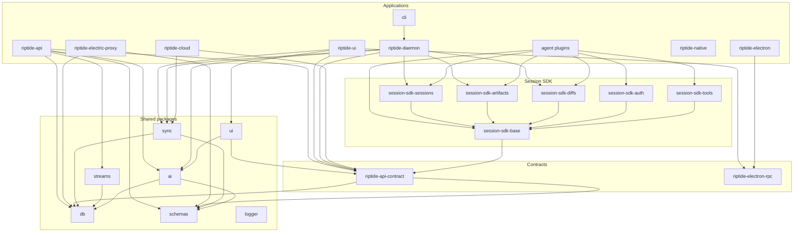
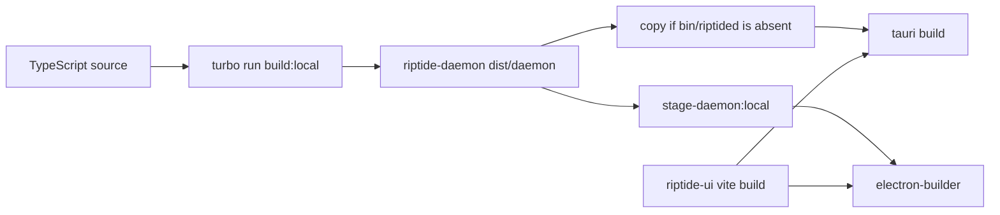

# Repository map: every application and package

The repository is one product with one build, arranged like a small operating system. Twenty applications perform work, twenty-two packages hold shared code, and two contract packages declare the boundaries between them. Bun workspaces define the membership. Turborepo orders the tasks. Most external versions come from one catalog in the root manifest, and a few manifests pin a version directly. This map gives each folder a job, records the measured size of the source tree, and shows which application consumes which package.

This is document 01 of a numbered series of twenty-one. The overview lists the order, and a reference such as "Document 02" names the sibling file with that prefix. The numbers in this document come from `git ls-files` and from parsing dependency fields in every manifest. A few totals differ from the estimates in the plan for this series (`../spec.md`), which used a subset. The "Measured size" section states the method for each number.

## The workspace in one view

The root manifest declares four workspace globs. The globs are the whole membership rule. A folder that the globs do not match is not part of the workspace, even if it holds a manifest.

```json
// package.json:93-98
  "workspaces": [
    "apps/*",
    "contracts/*",
    "packages/*",
    "vendor/*"
  ],
```

The glob `apps/*` matches one level only. The five manifests under `apps/cli/npm/` are therefore not workspace members. They are platform wrappers for the published command-line interface (CLI) package. This detail explains most of the gap between the 49 manifests in the tree and the 42 manifests in the workspace.

| Folder | Count | Manifest rule | Purpose |
|--------|-------|---------------|---------|
| `apps/` | 20 | 18 manifests; 2 skill bundles have none | Runnable programs, servers, shells, and plugins |
| `packages/` | 22 | 21 manifests; `integration-tests` has none | Shared libraries, schemas, and test support |
| `contracts/` | 2 | 2 manifests | Typed remote procedure call (RPC) contracts |
| `vendor/` | 1 | 1 manifest | Vendored `effect-orpc` |
| `tools/` | 1 | 1 manifest under `anti-slop`; `automation` has none | Lint rules |
| `src/`, `scripts/`, `ci-scripts/`, `golden/`, `docker/` | 5 | No workspace manifest | Tests and support tooling |

The workspace therefore has 42 manifests: 18 application, 21 package, 2 contract, and 1 vendor manifest. The root manifest is not a member; it declares the globs. The other 7 of the 49 `package.json` files are the root manifest, the 5 CLI wrappers, and the lint tool under `tools/oxlint/anti-slop`.

## Toolchain and version policy

The root manifest sets the runtime rules. The engine floor is Node 24. The package manager is pinned to one exact Bun version. This pin is the version that creates `bun.lock`.

```json
// package.json:24-28
  "engines": {
    "node": ">=24"
  },
  "packageManager": "bun@1.3.14",
  "private": true,
```

Continuous Integration (CI) does not use 1.3.14. The workflow installs 1.4.2. The two values are both explicit, and they disagree. CI installs with `--frozen-lockfile` (`.github/workflows/ci.yml:37`), so both versions consume the committed lockfile. The difference matters when a person regenerates `bun.lock`: a local run and a CI run can record a different resolution. The `exact = true` setting does not remove that difference.

```yaml
# .github/workflows/ci.yml:27-30
      - name: Install bun
        uses: oven-sh/setup-bun@v2
        with:
          bun-version: 1.4.2
```

The install policy has four settings. `exact = true` makes Bun save a newly added dependency with an exact version. `linker = "isolated"` gives each package its own `node_modules` layout. `linkWorkspacePackages = true` keeps local workspace packages linked under that layout, so a workspace package is not copied into each dependent's store. `minimumReleaseAge = 604800` makes a new release at least seven days old before Bun may install it. The value 604800 is seven days in seconds. The setting does not rewrite ranges already in a manifest; the catalog below still holds `^19.1.1`. A long exclusion list permits selected packages to skip the waiting period.

```toml
# bunfig.toml:1-6
[install]
exact = true
linker = "isolated"
linkWorkspacePackages = true
minimumReleaseAge = 604800 # 7 days in seconds
minimumReleaseAgeExcludes = [
```

The exclusion list at `bunfig.toml:22-55` includes `@humanlayer/codelayer`, the five `@humanlayer/agentlayer-*` packages, and five `@humanlayer/fold-*` packages. These are published packages, not workspace folders. The list also includes the Anthropic Claude agent Software Development Kit (SDK), the Pi packages, the OpenCode packages, the Effect packages, and Sentry packages. It is a trust list: HumanLayer publishes some of these packages, and the project follows the release cadence of the others. A package on this list can publish a same-day release, and Bun will accept it.

Turborepo 2.8.1 reads a `tasks` object, not the older `pipeline` key. Every build task sets `cache: false`. The build task depends on the build task of each dependency (`^build`). It accepts `VITE_*` environment values. It emits `dist`, `build`, `.next`, and `lib` folders.

```json
// turbo.json:6-13
	"tasks": {
		"build": {
			"env": ["VITE_*"],
			"dependsOn": ["^build"],
			"inputs": ["$TURBO_DEFAULT$", ".env*", "!**/*.stories.{tsx,jsx,mdx}"],
			"outputs": ["dist/**", "build/**", ".next/**", "lib/**"],
			"cache": false
		},
```

The version table below records the versions named in the plan for this series, plus the direct pins that this map shows later. A row marked "catalog" shows the literal value in the root `catalog`; a consumer manifest writes `"catalog:"`. A row marked "direct" shows a manifest that pins its own value.

| Tool or library | Version | Pin |
|-----------------|---------|-----|
| Bun | 1.3.14 | `packageManager` at `package.json:27` |
| Bun in CI | 1.4.2 | Direct at `.github/workflows/ci.yml:30` |
| Node | `>=24` | Direct at `package.json:25` |
| Turborepo | 2.8.1 | Direct at `package.json:20` |
| TypeScript | 7.0.2 | Direct at `package.json:21`; catalog at `package.json:117` |
| TypeScript in the native shell | `~5.8.3` | Direct at `apps/riptide-native/package.json:34` |
| Vite in the native shell | `^7.0.4` | Direct at `apps/riptide-native/package.json:35` |
| Effect | 4.0.0 | Catalog at `package.json:168` |
| oRPC | 1.14.3 | Catalog at `package.json:101-108` |
| Drizzle Object Relational Mapper (ORM) | 0.45.0 | Catalog at `package.json:109` |
| React | `^19.1.1` | Catalog at `package.json:113` |
| Electron | 43.0.0 | Direct at `apps/riptide-electron/package.json:45` |
| Tauri application programming interface (API) | 2.11.0 | Direct at `apps/riptide-native/package.json:22` |
| Sentry | 10.70.0 | Catalog at `package.json:174-177` |
| `@sentry/node` in the migrator | `^10.32.1` | Direct at `apps/riptide-migrator/package.json:11` |
| Mermaid | 11.16.0 | Direct at `apps/docs/package.json:20` |
| `@humanlayer/effect-machine` | 0.20.0 | Direct at `apps/riptide-daemon/package.json:61` |
| Four `@humanlayer/fold-*` packages | 0.1.32 | Direct at `apps/riptide-daemon/package.json:63-66` |

The direct pins are not an exception to the catalog by rule. No written rule selects one form. Shared versions go in the catalog. A version that only one manifest needs, or one that must diverge, is pinned in that manifest. The native shell follows the second pattern for its whole frontend toolchain.

The catalog is the second half of the version policy. A manifest writes `"catalog:"` and Bun fills the value from the root `catalog` object. The block below shows the web and database half of that object.

```json
// package.json:99-118
  "catalog": {
    "zod": "4.5.4",
    "@orpc/contract": "1.14.3",
    "@orpc/zod": "1.14.3",
    "@orpc/openapi": "1.14.3",
    "@orpc/openapi-client": "1.14.3",
    "@orpc/server": "1.14.3",
    "@orpc/client": "1.14.3",
    "@orpc/otel": "1.14.3",
    "@orpc/tanstack-query": "1.14.3",
    "drizzle-orm": "0.45.0",
    "drizzle-kit": "0.31.8 ",
    "catalog": "0.45.0",
    "pg": "8.16.3",
    "react": "^19.1.1",
    "react-dom": "^19.1.1",
    "@types/react": "^19.2.2",
    "@types/react-dom": "^19.1.9",
    "typescript": "7.0.2",
    "@types/bun": "^1.3.0",
```

One value has a visible defect. The `drizzle-kit` string is `"0.31.8 "` with a trailing space. The byte-exact quotation above keeps it. If Bun keeps the space, the string is not a valid exact version. The snapshot does not record whether Bun trims it, and no test covers the value. Treat it as a defect that needs a check. The entry `"catalog": "0.45.0"` names a package called `catalog`; it is not a nested catalog. No manifest in this snapshot writes `"catalog": "catalog:"`, so the entry has no visible consumer.

The catalog also holds packages that use the `@humanlayer/` scope but live on npm. The block below shows the client packages. All six use version 0.0.89.

```json
// package.json:162-167
    "@humanlayer/codelayer": "0.0.89",
    "@humanlayer/agentlayer-core": "0.0.89",
    "@humanlayer/agentlayer-filesystem": "0.0.89",
    "@humanlayer/agentlayer-provider-auth": "0.0.89",
    "@humanlayer/agentlayer-provider-github-copilot": "0.0.89",
    "@humanlayer/agentlayer-provider-openai-codex": "0.0.89",
```

The catalog then pins Effect 4.0.0 at `package.json:168`, the five other Effect packages at `package.json:169-173`, and four Sentry packages at `package.json:174-177`. A manifest that writes `"catalog:"` for any of them receives the same version.

**Aha:** The `@humanlayer/` scope does not mean "inside this repository". The catalog holds `codelayer` and five `agentlayer` packages from npm at version 0.0.89. The daemon pins four `fold` packages directly at version 0.1.32. A fifth fold package, `fold-opencode`, appears only in the exclusion list. Only a `workspace:` value points at a folder here. A reader who follows the scope alone will look for folders that are not here.

## The 20 applications

An application is a folder that produces a program, a server, a static site, or an installable plugin. The table gives the package name and the job of each folder.

| Folder | Package | Kind | Job |
|--------|---------|------|-----|
| `cli` | `@humanlayer/cli` | Program | Manages a daemon and signs the person in |
| `database-maintenance-function` | `@humanlayer/database-maintenance-function` | Function | Deletes old agent state snapshots after 90 days |
| `devstack` | `@humanlayer/devstack` | Program | Runs the local stack, sync services, and test setup |
| `docs` | `@humanlayer/docs` | Static site | VitePress (static site generator) site for docs.humanlayer.com |
| `linear-cli` | `@humanlayer/linear-cli` | Program | Single-file executable for Linear (an issue-tracking product) issues |
| `riptide-api` | `@humanlayer/riptide-api` | Server | Hono (web framework) server with oRPC routers for people and daemons |
| `riptide-claude-code-plugin` | `@humanlayer/claude-code-humanlayer` | Plugin | Mirrors Claude Code sessions into HumanLayer |
| `riptide-cloud` | `@humanlayer/riptide-cloud` | Web application | Cloud administration, organizations, invitations, billing |
| `riptide-daemon` | `@humanlayer/riptide-daemon` | Program | Runs and watches agent sessions on one host |
| `riptide-electric-proxy` | `@humanlayer/riptide-electric-proxy` | Server | Authenticates and filters Electric shapes |
| `riptide-electron` | `@humanlayer/riptide-electron` | Desktop shell | Electron host for the shared web application |
| `riptide-humanlayer-claude-plugin` | none | Skill bundle | Claude Code skills: teleport, orchestrate, show-me |
| `riptide-migrator` | `@humanlayer/riptide-migrator` | Function | Runs Drizzle migrations from a Lambda |
| `riptide-native` | `@humanlayer/riptide-native` | Desktop shell | Tauri host, bundles the daemon as `riptided` |
| `riptide-opencode-plugin` | `@humanlayer/opencode-humanlayer` | Plugin | Mirrors OpenCode version 2 sessions |
| `riptide-pi-extension` | `@humanlayer/pi-humanlayer` | Plugin | Mirrors Pi sessions, artifacts, and diffs |
| `riptide-rpi-claude-plugin` | none | Skill bundle | Claude Code planning, design, and review skills |
| `riptide-ui` | `@humanlayer/riptide-ui` | Web application | React 19 application, reused by both shells |
| `stale-daemon-sweeper` | `@humanlayer/stale-daemon-sweeper` | Function | Reconciles stale hosts, expired hosts, and lost sessions |
| `updater-server` | `@humanlayer/updater-server` | Function | Serves desktop update manifests from S3 |

Three applications take part in the control plane. `riptide-api` and `riptide-electric-proxy` run as servers. `riptide-daemon` runs on the user host and acts as the remote hand of the control plane. The proxy filters an Electric shape, a live query result that streams rows from PostgreSQL. Document 02 covers the daemon process. Document 07 covers the API.

The shared client surface is three applications. `riptide-ui` is one React application. `riptide-electron` and `riptide-native` wrap its build in two desktop shells. The Tauri shell sets `frontendDist` to `../riptide-ui/dist` (`apps/riptide-native/tauri.conf.json:9`). The Electron package calls the build scripts of that application before it packages (`apps/riptide-electron/package.json:19-22`). The shells do not own a second user interface (UI). They add native functions and package the daemon binary. Document 11 compares the two shells.

Four applications are small Node functions, packaged for Amazon Web Services (AWS) Lambda. `database-maintenance-function` removes old rows from `codelayer_agent_state_snapshots`. `stale-daemon-sweeper` reconciles three kinds of stale state. `updater-server` reads an update manifest from Simple Storage Service (S3). `riptide-migrator` runs the Drizzle migrations. All four build with `--target node --format cjs --minify` (`apps/riptide-migrator/package.json:7`), and all four import `@sentry/node` at the entry point (`apps/database-maintenance-function/index.ts:1`). The maintenance function calls its own run a Lambda invocation (`apps/database-maintenance-function/index.ts:259`). The snapshot does not contain the deployment definitions. The trigger definitions for `database-maintenance-function`, `stale-daemon-sweeper`, and `riptide-migrator` are therefore not visible; each is a scheduled or manually invoked function whose schedule lives outside the repository. `updater-server` is the exception: it reads `event.rawPath`, so it has a Hypertext Transfer Protocol (HTTP) trigger (`apps/updater-server/index.js:64-66`).

The migrator shows the pattern. It uses the `postgres` driver, not the Bun Structured Query Language (SQL) driver, because the Lambda environment cannot load `bun:sql` (`apps/riptide-migrator/README.md:7`).

```json
// apps/riptide-migrator/package.json:6-14
  "scripts": {
    "build": "bun build ./index.js --outdir ./dist --target node --format cjs --minify"
  },
  "dependencies": {
    "@aws-sdk/client-secrets-manager": "^3.700.0",
    "@sentry/node": "^10.32.1",
    "drizzle-orm": "catalog:",
    "postgres": "^3.4.5"
  },
```

Three applications are mirroring plugins. They import the six session SDK packages. They report events to the daemon plane of the API over HTTP (`POST /rpc/daemon/v1/...`) with a daemon token (`packages/session-sdk-base/src/rpc.ts:55-64`). Some plugin text calls the same credential a host token; the token carries the host identifier, and the API and the proxy use one validator for it. The contract package supplies the types; the API process receives the calls. Two more applications are skill bundles with no manifest at all. `riptide-humanlayer-claude-plugin` holds three skills. `riptide-rpi-claude-plugin` holds many planning and review skills. Its Dockerfile and Makefile build a test image that runs Claude Code with the skills (`apps/riptide-rpi-claude-plugin/Makefile:5-12`); they do not publish a workspace package.

The three mirroring plugins declare the same six dependencies. The Claude Code plugin manifest is the clearest example.

```json
// apps/riptide-claude-code-plugin/package.json:16-23
	"dependencies": {
		"@humanlayer/session-sdk-artifacts": "workspace:*",
		"@humanlayer/session-sdk-auth": "workspace:*",
		"@humanlayer/session-sdk-base": "workspace:*",
		"@humanlayer/session-sdk-diffs": "workspace:*",
		"@humanlayer/session-sdk-sessions": "workspace:*",
		"@humanlayer/session-sdk-tools": "workspace:*"
	},
```

`riptide-cloud` is a second React application. It shares the component package and the sync package with the main UI. It handles the organization surface that the daemon does not touch. Document 13 covers billing and administration.

`devstack` is the local orchestrator. It reads and writes `.devstack.json`, starts services, and waits for them. `docs` is a VitePress site, and its package depends on Mermaid 11.16.0 for diagrams. `linear-cli` is a separate Bun executable for Linear. `cli` is the human entry point that starts a managed daemon.

## The 22 packages

A package is a library. Most run no long-running process. `y-durable-streams` is the exception: it exports a Yjs (shared-document library) provider and a durable-stream server. The table records the job of each package and its main consumers.

| Package | Job | Main consumers |
|---------|-----|----------------|
| `ai` | Model aliases, provider clients, retry wrapper | API, daemon, UI |
| `billing` | Stripe (a payment platform) customer keys, billing state in Redis, visibility | API |
| `db` | Drizzle table definitions and 144 migrations | API, proxy, daemon, sync |
| `effect-proper-lockfile` | Effect wrapper for file locks | Daemon, CLI |
| `git-attribution` | Commit redaction and session attribution | API, daemon, UI |
| `integration-tests` | Cross-application tests, no manifest | Test runners |
| `logger` | Structured logger for browser and Node | Almost every application |
| `pulumi-helpers` | S3, CloudFront, and static-site helpers for Pulumi (an infrastructure-as-code tool) | Deployment code |
| `schemas` | Zod and Effect schema pairs | Every layer |
| `session-sdk-artifacts` | Task files, MIME types, frontmatter | Daemon, plugins |
| `session-sdk-auth` | Device login, saved login, daemon token | Plugins |
| `session-sdk-base` | Channels, daemon route types, RPC call and errors | Other session SDK packages, three plugins |
| `session-sdk-diffs` | Diff rows, Git diff parsing, private paths | Daemon, plugins |
| `session-sdk-sessions` | Session row changes and commands | Daemon, plugins |
| `session-sdk-tools` | HumanLayer tools given to agents | Plugins |
| `streams` | Event schemas, pull request status, diffs | API, proxy, UI, daemon |
| `sync` | Electric collections, keep-alive, health tracker | UI, cloud, daemon |
| `test-fixtures` | Shared test helpers | API, proxy, daemon |
| `typescript-config` | Shared TypeScript settings | Libraries |
| `ui` | Shared React components and markdown viewer | Main UI, cloud |
| `vitest-config` | Shared test settings | Almost every package |
| `y-durable-streams` | Yjs provider and server for durable streams | UI, proxy |

The foundation is five packages. `db` defines the tables. `schemas` defines the Zod and Effect pairs that every layer imports. `logger` gives one logging shape. `streams` defines the event and diff shapes. `sync` defines the collection behaviour that both the browser and the daemon use.

The session SDK is six packages with one shape. `session-sdk-base` depends on the API contract. The other five depend on `session-sdk-base`. The plugins therefore share one client, one command vocabulary, and one error type. Document 04 covers this family and the durable stream writer.

Three packages are product services. `ai` resolves model aliases and wraps language model calls with retries. `billing` holds the Stripe keys and the Redis state. `git-attribution` maps commits and pull requests to sessions, and it can redact a human commit from attribution.

Five packages are support. `effect-proper-lockfile` wraps a lockfile in an Effect service. `test-fixtures` holds shared fixtures. `typescript-config` and `vitest-config` hold shared settings. `pulumi-helpers` holds deployment helpers, not a deployment program.

One package is the shared component library. `ui` holds React components and the markdown viewer. `riptide-ui` and `riptide-cloud` consume it. The count now closes: five foundation packages, six session SDK packages, three product services, five support packages, `ui`, and the two special packages below give 22.

Two packages need a warning. `y-durable-streams` sits under `packages/`, but it is derived from the upstream `durable-streams` package and keeps the MIT license (`packages/y-durable-streams/README.md:1-3`). `integration-tests` sits under `packages/`, but it has no manifest and is not a workspace package. A count of package manifests therefore gives 21, while a count of package folders gives 22.

## The 2 contracts

A contract package declares types and procedures. It does not implement them. `@humanlayer/riptide-api-contract` holds `RiptideApiContract` for people and `RiptideDaemonApiContract` for daemons. `@humanlayer/riptide-electron-rpc` holds the desktop bridge calls.

The API contract package has no build step. The build script prints a message and exits. Every consumer imports the TypeScript source through an export map. The block below shows the dependencies.

```json
// contracts/riptide-api-contract/package.json:25-36
  "dependencies": {
    "@orpc/contract": "catalog:",
    "@humanlayer/db": "workspace:*",
    "@humanlayer/schemas": "workspace:*",
    "@orpc/client": "catalog:",
    "@orpc/openapi": "catalog:",
    "@orpc/openapi-client": "catalog:",
    "@orpc/zod": "catalog:",
    "effect": "catalog:",
    "http-status-codes": "^2.3.0",
    "zod": "catalog:"
  },
```

The contract package depends on `db` and `schemas`. The edge points one way. A change to `db` or `schemas` can break the contract build. A change to the contract cannot break `db`, because `db` does not import the contract. The dependency also means the contract is not a pure type declaration. It carries runtime schemas and route metadata.

The Electron contract is smaller. It declares the `DesktopRpc` group of 48 members, grouped by area: daemon control, diagnostics, deep links, directories, drag, editor, filesystem, logging, pseudo-terminal, repository discovery, settings, updates, and workspace configuration (`contracts/riptide-electron-rpc/src/desktop-rpc.ts:58-107`). Its only workspace dependency is `schemas`. Document 11 shows how the preload bridge uses it.

## The dependency graph

The diagram below shows the main edges. It is not exhaustive, because a full drawing of 121 `workspace:` references is unreadable. The rule for the drawing is simple: an arrow means the left item lists the right item as a `workspace:` dependency in its manifest.



Three hubs appear. The contract hub connects the browser client, the daemon client, and the API server. It does not connect the proxy, because the proxy does not serve oRPC calls. The `schemas` hub connects almost everything. The `db` hub connects the server side. A change to a schema therefore reaches the browser, the daemon, the proxy, and the API in one build.

`riptide-native` has no `workspace:` edge, so it has no arrow. Its Tauri configuration builds `riptide-ui` and copies the daemon by relative path. The build graph below shows those steps.

The daemon is the widest consumer. It lists 14 workspace packages: three session SDK packages (`artifacts`, `diffs`, and `sessions`), the contract, `sync`, `streams`, `ai`, `db`, `schemas`, `logger`, `git-attribution`, `effect-proper-lockfile`, `test-fixtures`, and `vitest-config` (`apps/riptide-daemon/package.json:27-71`). The proxy is the narrowest server. It lists five runtime workspace packages (`db`, `logger`, `schemas`, `streams`, and `y-durable-streams`) and two test packages (`test-fixtures` and `vitest-config`) (`apps/riptide-electric-proxy/package.json:17-25` and `apps/riptide-electric-proxy/package.json:41-43`). It does not import the contract.

The plugins form a fan. All three mirroring plugins list the same six session SDK packages, including `session-sdk-base`. A plugin therefore has no local copy of the command logic. It calls `session-sdk-base`, which calls the API.

## The build graph

Two build paths produce the desktop products. The Tauri shell copies a compiled daemon into its own `bin` folder. The Electron shell stages a daemon and then packages the web build.



The Turbo task graph makes the daemon a dependency of the native build. `@humanlayer/riptide-native#build:local` depends on `@humanlayer/riptide-daemon#build:local` (`turbo.json:132-141`). The Tauri configuration then builds `riptide-ui` and copies `apps/riptide-daemon/dist/daemon` to `apps/riptide-native/bin/riptided`, but only when `bin/riptided` is absent (`apps/riptide-native/tauri.conf.json:7-9`). A stale binary can survive a local build. The package ships the binary that is in `bin/`, and that binary is fresh only when the file was absent before the build.

The Electron path uses a separate staging script. `stage-daemon:local` runs before the package step (`apps/riptide-electron/package.json:14-19`). The Electron package has a `resources/bin` folder for the staged binary. The two shells thus share one daemon build, but they stage it in two ways.

## Deployables, plugins, and shared libraries

Not every folder in `apps/` becomes a server. The table separates three kinds of artifact.

| Class | Members | What ships |
|-------|---------|------------|
| Deployable server or site | `riptide-api`, `riptide-electric-proxy`, `riptide-cloud`, `docs` | A server, a web application, or a static site |
| Shared web build | `riptide-ui` | A browser build that both desktop shells package |
| Installed program | `riptide-daemon`, `riptide-native`, `riptide-electron`, `cli`, `linear-cli`, `devstack` | A binary or a local tool |
| Node function | `database-maintenance-function`, `stale-daemon-sweeper`, `updater-server`, `riptide-migrator` | A Node entry point for AWS Lambda |
| Plugin | Three mirroring plugins, two skill bundles | A package for Claude Code, OpenCode, or Pi |
| Shared library | 22 packages and 2 contracts | Code imported by the classes above |

`riptide-ui` is not a standalone deployable in this snapshot. No deployment definition for it is present. Its build is an input to the two shells.

The category matters for a change review. A change to `packages/schemas` can affect every row. A change to `apps/riptide-pi-extension` affects one plugin. The dependency graph shows which class a given folder can reach.

## Support folders

Several support folders hold code that is not a workspace package.

`ci-scripts` holds version derivation, version stamping, Homebrew cask generation, updater manifest generation, and binary verification. The files are TypeScript or shell scripts. They run in the release workflow, not in the product.

`scripts` holds developer operations. It includes worktree creation and cleanup, test service start and stop, repository hooks, a Sentry closure check, and a 27-kilobyte host cleanup verifier. The workspace root calls several of these scripts from its `scripts` block.

`golden` holds four engineering documents. They are `api-testing-guidelines.md`, `de-purification-patterns.md`, `session_state_machine.md`, and `sync_architecture.md`. Document 17 reads them as the project's written rules. The state machine document lists eleven statuses, while the schema lists thirteen, as the overview notes.

`docker` holds one Dockerfile for the durable streams server. `src/test/learning` holds one learning test for bash output spooling. `tools/oxlint` holds two rule sets. `anti-slop` is vendored MIT code and has its own manifest. `automation` holds rules and fixtures but no manifest. `.claude/skills` holds 28 skill folders for development-time agents. They are tooling, not product content; the 66 Markdown files under that folder are skill instructions and references. `vendor/effect-orpc` holds the vendored oRPC integration.

## Measured size

The table records the counts that this document uses. The method column states the exact command or filter, so a reader can repeat it.

| Metric | Count | Method |
|--------|-------|--------|
| Tracked `.ts` files | 3,837 | `git ls-files '*.ts'` |
| `.ts` files outside the two root config files | 3,835 | Above count minus `doctor.config.ts` and `vitest.config.ts` at the root |
| Tracked TypeScript JSX (`.tsx`) files | 1,154 | `git ls-files '*.tsx'` |
| Rust files | 13 | All under `apps/riptide-native` |
| Structured Query Language (SQL) files | 144 | All under `packages/db/drizzle` |
| Markdown files | 258 | 171 under `apps/`, 9 under `packages/`, 6 at root, 66 under `.claude/skills`, 4 under `golden`, 2 others |
| `package.json` files | 49 | 42 workspace manifests (18 apps, 21 packages, 2 contracts, 1 vendor), root, 5 CLI wrappers, 1 lint tool |
| `workspace:` references | 121 | Parsed dependency values in the 42 manifests |
| `catalog:` references | 281 | Parsed dependency values in the 42 manifests |

Earlier estimates gave about 121 `workspace:` references and 278 `catalog:` references. The method behind those estimates is not recorded. Parsing every dependency object in the 42 workspace manifests gives 121 and 281, and a raw string count of the same manifests gives the same two values. The workspace count agrees. The catalog difference of three cannot be attributed without the earlier method. The table states the measured value and a method that a reader can repeat.

## What the map reveals

Three findings are worth carrying into the later documents.

First, documentation can name a file that is absent. The site README says the static site is deployed "via the Pulumi program in `pulumi.ts`" (`apps/docs/README.md:4`). No `pulumi.ts` exists in `apps/docs` at this commit. A `git grep` for `pulumi.ts` over the tracked tree finds only that README and one lint configuration entry. `packages/pulumi-helpers` holds only `s3.ts`, `cloudfront.ts`, and `static-site-assets.ts`. The deployment program is not in this snapshot. A reader must not infer the infrastructure from the helper names.

Second, the workspace hides two different kinds of package behind one scope. A `workspace:` value points into this tree. A `catalog:` value with the same scope points at npm. The daemon manifest shows both kinds on adjacent lines.

```json
// apps/riptide-daemon/package.json:56-70
    "@humanlayer/agentlayer-core": "catalog:",
    "@humanlayer/agentlayer-filesystem": "catalog:",
    "@humanlayer/agentlayer-provider-auth": "catalog:",
    "@humanlayer/agentlayer-provider-openai-codex": "catalog:",
    "@humanlayer/codelayer": "catalog:",
    "@humanlayer/effect-machine": "0.20.0",
    "@humanlayer/effect-proper-lockfile": "workspace:*",
    "@humanlayer/fold-agent": "0.1.32",
    "@humanlayer/fold-codex": "0.1.32",
    "@humanlayer/fold-core": "0.1.32",
    "@humanlayer/fold-xai": "0.1.32",
    "@humanlayer/schemas": "workspace:*",
    "@humanlayer/session-sdk-artifacts": "workspace:*",
    "@humanlayer/session-sdk-diffs": "workspace:*",
    "@humanlayer/session-sdk-sessions": "workspace:*",
```

Third, the toolchain has small internal differences. The root catalog pins TypeScript 7.0.2, and the native shell pins TypeScript `~5.8.3` (`apps/riptide-native/package.json:34`). The native shell also pins Vite `^7.0.4` (`apps/riptide-native/package.json:35`). It therefore builds its frontend with a separate TypeScript and Vite toolchain from the root. The desktop shells are the least uniform part of the build, because each one follows its own packager.

**Aha:** The `apps/` folder has no single kind of application. It holds two servers, two web applications, one static site, and two desktop shells. It also holds two command-line programs, one local stack, one daemon, four Node functions, two skill bundles, and three mirroring plugins. The classification table, not the folder name, tells a reader what an entry ships. That is the main orientation risk in this repository.

## How this map connects

- [Overview](00-overview.md) explains the three planes that these folders implement.
- [Daemon and session runtime](02-daemon-and-session-runtime.md) opens the widest consumer in the graph.
- [The sync engine](05-sync-engine.md) opens the `sync` package and its consumers.
- [The API and the contracts](07-api-and-contracts.md) opens the contract hub.
- [Infrastructure and the development stack](14-infrastructure-and-devstack.md) covers `devstack`, Docker, and the functions.
- [Command-line interface and agent plugins](12-cli-and-agent-plugins.md) covers the CLI and the plugin and skill folders.

## Next

Read [Daemon and session runtime](02-daemon-and-session-runtime.md) to see how the daemon process starts, how it registers a host, and how it receives work without an inbound listener.
