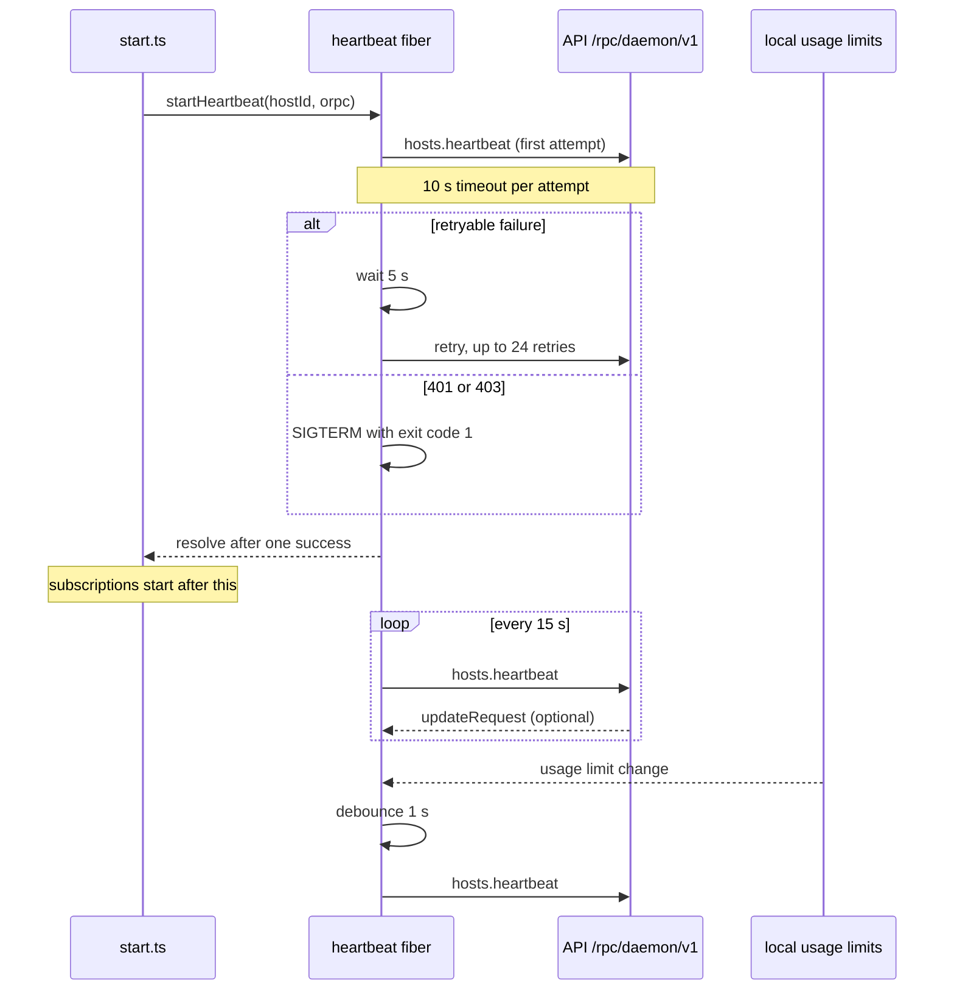
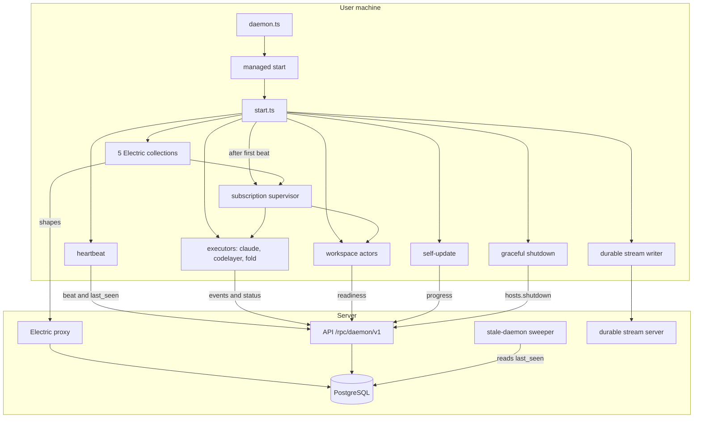

# The daemon and the session runtime

The daemon is a long-lived process on the user's machine. It has no inbound network port, and it learns what to do by asking and by watching. This document explains the process layout, outbound control plane, heartbeat, shutdown, executors, workspace gate, and the read, write, and live-update paths.

A **host** is one registered daemon identity: a user, an organization, and a machine identifier (`packages/schemas/src/effect/daemon/identity.ts:5-9`). The server keeps one registration row per host, with a `last_seen` time.

The design rests on three required channels. The write channel is an outbound OpenAPI Remote Procedure Call (oRPC) call. The read channel is an Electric shape subscription, where a shape is a server-defined subset of a PostgreSQL table sent as ordered changes. The liveness channel is a heartbeat. A fourth channel, a durable stream of conversation events, is optional and serves live viewers. Remove a required channel, and the daemon cannot learn work or cannot report it.

The concurrency comes from Effect, a TypeScript library for effectful programs. A fiber is a lightweight thread, a Layer is a dependency graph, and a Ref is mutable state.

## The process layout

The binary entry point is `apps/riptide-daemon/src/daemon.ts`. It imports the Sentry instrumentation module first, validates two origins, and hands control to `startManagedDaemon` (`apps/riptide-daemon/src/daemon.ts:1-3`, `apps/riptide-daemon/src/daemon.ts:14-22`, `apps/riptide-daemon/src/daemon.ts:39-48`). The two origins are the API origin, from `RIPTIDE_DAEMON_API_ORIGIN`, and the sync origin, from `RIPTIDE_DAEMON_SYNC_ORIGIN`. A missing origin is a hard startup error, not a warning (`apps/riptide-daemon/src/daemon.ts:15-21`, `apps/riptide-daemon/src/lib/macros/index.ts:26-28`).

The daemon token comes from the `DAEMON_IDENTITY` environment variable (`apps/riptide-daemon/src/daemon.ts:34`). A launcher can also set `RIPTIDE_DAEMON_EXPECTED_IDENTITY`, a JSON value with `userId`, `organizationId`, and `hostId` (`apps/riptide-daemon/src/daemon.ts:23-27`, `packages/schemas/src/effect/daemon/identity.ts:5-9`). The Tauri and Electron shells set both values together. When `RIPTIDE_DAEMON_LOAD_CREDS` is set and no expected identity exists, a present `DAEMON_IDENTITY` is treated as inherited from a parent process, such as a tmux server or a spawned agent shell, and is discarded (`apps/riptide-daemon/src/daemon.ts:28-37`). The daemon then signs its own token from three development variables: `RIPTIDE_DAEMON_USER_ID`, `RIPTIDE_DAEMON_ORGANIZATION_ID`, and `RIPTIDE_DAEMON_TOKEN_PRIVATE_KEY` (`apps/riptide-daemon/src/lib/auth.ts:147-176`).

The source tree has ten top-level areas, each with one job.

| Path | Job | Key entry |
|------|-----|-----------|
| `apps/riptide-daemon/src/daemon.ts` | Process entry and fatal error handler | `main` |
| `apps/riptide-daemon/src/start.ts` | Build the runtime and start every service | `startManagedDaemon` |
| `apps/riptide-daemon/src/managed-daemon-start.ts` | Define the managed launch contract and resolve it | `loadResolvedManagedDaemonLaunchRequestAtHostBoundary` |
| `apps/riptide-daemon/src/orpc` | Outbound control plane client and retry rules | `createDaemonORPCClient` |
| `apps/riptide-daemon/src/lib` | Heartbeat, usage limits, sync service, orphan detection | `startHeartbeat` |
| `apps/riptide-daemon/src/collections` | Electric shapes on TanStack DB collections | `createSessionsCollection` |
| `apps/riptide-daemon/src/subscriptions.ts` | Turn collection changes into session actions | `initializeSubscriptions` |
| `apps/riptide-daemon/src/agents` | The three executors and their shared wrapper | `runSession` |
| `apps/riptide-daemon/src/effects` | Effect services, including the durable stream writer | `DurableStreamWriterLive` |
| `apps/riptide-daemon/src/lifecycle` | Startup shutdown path and graceful shutdown path | `createGracefulShutdown` |

The start order matters. The runtime is built, the collections load, the model catalog probe starts, and the first heartbeat registers the host (`apps/riptide-daemon/src/start.ts:190-240`). The probe scans local models, and the daemon waits up to 10 seconds for its first result (`apps/riptide-daemon/src/start.ts:230-232`). Only after `startHeartbeat` returns do subscriptions start (`apps/riptide-daemon/src/start.ts:433`). A host that cannot register must not take work.

For an authenticated identity, a local file lock enforces one daemon. The lock key hashes user, organization, host, and stage, where the stage is the release channel: `local`, `dev`, `beta`, or `prod` (`apps/riptide-daemon/src/effects/services/daemon-instance-lock/daemon-instance-lock.layer.ts:34`, `packages/schemas/src/effect/daemon/stage.ts:3`). A second daemon for the same key returns `daemon_already_running`, and the process exits with code zero, because the host is already served (`apps/riptide-daemon/src/daemon.ts:51`).

## No inbound listener, and why that is the point

Production source opens no listening socket. A search for `Bun.serve`, `createServer`, and `.listen(` finds matches only in test files.

The cost is that the daemon must ask for its own instructions. The benefit is that the machine needs no reachable address, so a laptop behind Network Address Translation (NAT) needs only outbound HyperText Transfer Protocol (HTTP) access. Every daemon channel uses HTTP: the control plane posts to the API, Electric serves long-poll requests, the heartbeat posts, and the durable stream appends with HTTP POST.

**Aha:** The daemon is a client with a mirror. A "command" is a row that changed in a database the daemon can read. The write path back is a separate outbound call. This inversion explains the subscriptions, the reconnect logic, and the sweeper.

## The outbound control plane

The control plane is one typed oRPC client. `createDaemonORPCClient(apiOrigin, token)` builds it from the API (Application Programming Interface) origin and the daemon identity token. All daemon procedures live under one base path.

```ts
// apps/riptide-daemon/src/orpc/client.ts:27-33
export function createDaemonORPCClient(apiOrigin: string, token: string): ORPCClient {
	const rpcBaseUrl = `${apiOrigin}/rpc/daemon/v1`
	const link = new OpenAPILink(RiptideDaemonApiContract, {
		url: rpcBaseUrl,
		headers: () => ({
			'x-daemon-authorization': token,
		}),
```

The server reads exactly the `x-daemon-authorization` header in `getDaemonAuthContext` and returns null when it is absent or invalid (`apps/riptide-api/src/auth/context.ts:56-60`). There is no cookie, bearer token, or query parameter. The token is the whole credential.

### Authentication failure stops the process

A 401 or 403 response is not retried. It is a terminal identity failure. The interceptor sets exit code 1, prints a structured process event, and sends SIGTERM to its own process identifier (`apps/riptide-daemon/src/orpc/client.ts:44-70`). The daemon then closes through the user-signal shutdown path. The module-level flag `authFailureTriggered` (`apps/riptide-daemon/src/orpc/client.ts:18`) stops the shutdown call, which also receives 401, from starting a second shutdown.

The choice of SIGTERM is deliberate. The code comment says it lets `daemon.ts` handle "session cleanup, API notification, and Sentry flush" (`apps/riptide-daemon/src/orpc/client.ts:67-68`). A direct `process.exit(1)` would skip all three.

### The retry policy

The client retries a failed call up to five times after the first attempt, with a fixed two-second delay (`apps/riptide-daemon/src/orpc/client.ts:14`, `apps/riptide-daemon/src/orpc/client.ts:93`). The retry policy therefore allows six attempts and ten seconds of delay. A heartbeat wraps the whole call, including that retry sequence, in a 10-second timeout (`apps/riptide-daemon/src/lib/heartbeat.ts:18`, `apps/riptide-daemon/src/lib/heartbeat.ts:102-105`). In the heartbeat path the timeout usually stops the sequence first, because six attempts plus ten seconds of delay cannot fit inside ten seconds. Other daemon calls that set no timeout can use the full retry budget. That wrapper sits inside each registration retry. One pure function decides whether a request is retried.

```ts
// apps/riptide-daemon/src/orpc/retry-policy.ts:31-35
export function shouldRetryORPCRequest(error: unknown): boolean {
	const status = getHttpStatus(error)
	if (status === undefined) return true
	return TRANSIENT_HTTP_STATUSES.has(status) || status >= 500
}
```

`TRANSIENT_HTTP_STATUSES` holds 408, 425, and 429 (`apps/riptide-daemon/src/orpc/retry-policy.ts:4`). The function walks the error envelope, the nested response, and the cause to find a status (`apps/riptide-daemon/src/orpc/retry-policy.ts:17-22`). An error with no status is retried, because a network failure carries none.

| Response | Retried? | Reason |
|----------|----------|--------|
| No status (network failure) | Yes | The request may never have arrived |
| 408, 425, 429 | Yes | Explicit transient signals |
| 500 and above | Yes | Server-side fault |
| 400, 404, 409 | No | The request is wrong and will stay wrong |
| 401, 403 | No | Identity failure; shutdown starts instead |

The 404 rule applies to oRPC calls; a 404 on the durable stream has its own recovery path below. Exhausted retries reach Sentry only when the error is not a defined contract error (`apps/riptide-daemon/src/orpc/client.ts:123-127`). A defined error is an expected answer, not an incident.

## The heartbeat

`startHeartbeat` has one job before it returns: send one beat that succeeds. Session dispatch waits behind that promise. The doc comment states the contract: "Rejects when the registering beat fails for good, so the daemon does not dispatch sessions for an unregistered host" (`apps/riptide-daemon/src/lib/heartbeat.ts:126`).

The constants carry the design.

```ts
// apps/riptide-daemon/src/lib/heartbeat.ts:14-23
// Keep well under the API's HOST_STALE_AFTER_MS (120s): a host is swept — running
// sessions failed, approvals rejected — after missing 8 consecutive beats.
const HEARTBEAT_INTERVAL = Duration.seconds(15)
// A connection that died while the machine slept never settles; abort the beat so the next one runs.
export const HEARTBEAT_TIMEOUT = Duration.seconds(10)
const REGISTERING_BEAT_RETRY_INTERVAL = Duration.seconds(5)
const REGISTERING_BEAT_RETRIES = 24
// A rate-limit change is pushed after this quiet window so the UI reacts before the regular
// interval, while a burst of events still costs one request.
const USAGE_LIMITS_PUSH_DELAY = Duration.seconds(1)
```

A sleeping machine leaves a Transmission Control Protocol (TCP) connection half-open. Without the timeout, the beat would hang and the interval would never fire again. The code applies `Effect.timeout(HEARTBEAT_TIMEOUT)` and converts it to a `HeartbeatError` (`apps/riptide-daemon/src/lib/heartbeat.ts:102-105`).

### The first beat and its retry window

```ts
// apps/riptide-daemon/src/lib/heartbeat.ts:137-148
	await runtime.runPromise(
		sendHeartbeat(target).pipe(
			Effect.tapError((error) =>
				Effect.logWarning('Registering heartbeat failed').pipe(Effect.annotateLogs({ hostId, error })),
			),
			Effect.retry({
				schedule: Schedule.spaced(REGISTERING_BEAT_RETRY_INTERVAL),
				times: REGISTERING_BEAT_RETRIES,
				while: (error) => shouldRetryORPCRequest(error.cause),
			}),
		),
	)
```

The retry condition reuses the oRPC predicate, so a 401 on the first beat stops the loop at once. The spacing alone is 120 seconds: 24 retries, each 5 seconds apart. Each registration retry is one `sendHeartbeat` call with its own 10-second timeout. The window is therefore at least the stale threshold, and possibly longer. A host that spends the full window re-registering can be swept while it still retries, because the sweep sees only the old `last_seen`.

### The steady state

After the first beat succeeds, two fibers run together. One beats every 15 seconds. The other waits for a change from the local `HostUsageLimits` service and debounces it for one second. Claude rate-limit events and usage snapshots feed that service, not an API push (`apps/riptide-daemon/src/lib/usage-limits/host-usage-limits.ts:209-217`). A burst of limit events costs one request, and the user interface learns of a change before the next tick.

```ts
// apps/riptide-daemon/src/lib/heartbeat.ts:150-160
	const beat = sendHeartbeatLoggingFailure(target)
	const onInterval = Effect.sleep(HEARTBEAT_INTERVAL).pipe(Effect.andThen(beat), Effect.forever)
	const onUsageLimitChange = HostUsageLimits.pipe(
		Effect.flatMap((usageLimits) =>
			usageLimits.changes.pipe(
				Stream.debounce(USAGE_LIMITS_PUSH_DELAY),
				Stream.runForEach(() => beat),
			),
		),
	)
	const fiber = runtime.runFork(Effect.all([onInterval, onUsageLimitChange], { concurrency: 'unbounded' }))
```

Each beat carries more than liveness: the host name, build version, capabilities, supported model catalog, distribution, self-update flag, ephemeral flag, usage limits, and machine statistics (`apps/riptide-daemon/src/lib/heartbeat.ts:84-97`). The response may contain an `updateRequest`, whose version goes to a queue (`apps/riptide-daemon/src/lib/heartbeat.ts:107-109`). The self-update section covers it.



### What the server does with a missing beat

The sweep is not in the API. It is an Amazon Web Services (AWS) Lambda job, `apps/stale-daemon-sweeper` (`README.md:16`); its invocation schedule is deployment configuration, not repository code. The heartbeat writes `last_seen` (`apps/riptide-api/src/orpc/daemon/hosts/heartbeat.effect.ts:72-73`). The sweep compares that column with `STALE_DAEMON_AFTER_MS`, which equals 120,000 milliseconds (`apps/stale-daemon-sweeper/stale-daemons.ts:7`). The daemon comment calls the same threshold `HOST_STALE_AFTER_MS` (`apps/riptide-daemon/src/lib/heartbeat.ts:14`). The names differ, the value does not.

The sweep marks the registration offline, fails every active session, moves every `interrupt_requested` session to `interrupted`, and denies pending approvals (`apps/stale-daemon-sweeper/stale-daemons.ts:92-115`). A deliberate shutdown skips the sweep: `hosts.shutdown` performs the same writes at once and marks the host offline (`apps/riptide-api/src/orpc/daemon/hosts/shutdown.effect.ts:28-85`).

```ts
// apps/stale-daemon-sweeper/stale-daemons.ts:92-106
		const failedSessions = await tx
			.update(sessions)
			.set({
				status: 'failed',
				error_message: 'Session failed because the daemon timed out',
				updated_at: now,
			})
			.where(and(sessionFilter, inArray(sessions.status, DAEMON_ACTIVE_SESSION_STATUSES)))
			.returning({ id: sessions.id })

		const interruptedSessions = await tx
			.update(sessions)
			.set({ status: 'interrupted', updated_at: now })
			.where(and(sessionFilter, eq(sessions.status, 'interrupt_requested')))
			.returning({ id: sessions.id })
```

**Aha:** The daemon does not decide that it is dead. Another process decides that for it, from the absence of a heartbeat. A crashed daemon therefore cannot leave a session stuck in `running`. The price is that a machine that sleeps for two minutes loses its running sessions. The daemon is not told directly; it sees the failed row through the same shape, and a run may still be executing when the server declares it failed.

## Shutdown, and the five-second deadline

Shutdown has two layers: an ordered best-effort drain, and a hard deadline that kills the process if the drain does not finish.

The deadline is 5,000 milliseconds (`apps/riptide-daemon/src/lifecycle/shutdown-deadline.ts:1`). The first signal starts the timer. A second signal, or the timer itself, calls `process.exit` at once through the configured force function (`apps/riptide-daemon/src/start.ts:145-150`).

```ts
// apps/riptide-daemon/src/lifecycle/shutdown-deadline.ts:23-36
	return {
		begin(signal: string): boolean {
			if (initialSignal !== undefined) {
				force('repeated_request', signal)
				return false
			}

			initialSignal = signal
			timeout = setTimeout(
				() => force('deadline_exceeded', initialSignal ?? signal),
				options.timeoutMs ?? GRACEFUL_SHUTDOWN_TIMEOUT_MS,
			)
			return true
		},
```

The drain order is fixed (`apps/riptide-daemon/src/lifecycle/graceful-shutdown.ts:51-84`). It stops orphan detection and the heartbeat first, so no new work arrives and no false liveness is reported. Orphan detection is optional: it checks the parent process identifier every 5 seconds and shuts down when the parent dies (`apps/riptide-daemon/src/lib/orphan-detection.ts:3-27`). The drain then stops self-update, interrupts live Claude and Fold sessions, stops subscriptions, drains capture sources, stops the sync service, sends the shutdown notification, and disposes the runtime.

Capture sources are the commit watcher, the repository observer, and the pending task-diff work (`apps/riptide-daemon/src/start.ts:291-305`). The sync service keeps per-task data current (`apps/riptide-daemon/src/lib/sync-service.ts:183-200`). A CodeLayer run has no service handle in this list; the forced exit or the process end stops it.

```ts
// apps/riptide-daemon/src/lifecycle/graceful-shutdown.ts:61-76
			await attempt('self_update', () => options.stopSelfUpdate?.())
			await attempt('sessions', async () => {
				await options.runtime.runPromise(
					Effect.gen(function* () {
						const claudeSessions = yield* ClaudeSessions
						const foldSessions = yield* FoldSessionRunner
						yield* Effect.all(
							[claudeSessions.shutdownActiveClaudeSessions, foldSessions.shutdownActiveSessions],
							{ concurrency: 'unbounded', discard: true },
						)
					}),
				)
				await shutdownAllSessions()
				logger.info('Session shutdown complete')
			})
			await attempt('subscriptions', options.stopSubscriptions)
```

Every step is wrapped in `attempt`: one failed step is logged and reported, and the next still runs. The notification is `hosts.shutdown`, which marks the host offline and fails its active sessions at once (`apps/riptide-api/src/orpc/daemon/hosts/shutdown.effect.ts:28-85`), with a 2,000-millisecond timeout (`apps/riptide-daemon/src/lifecycle/graceful-shutdown.ts:13`).

The shutdown promise is memoized. A second call returns the first promise instead of running the sequence twice (`apps/riptide-daemon/src/lifecycle/graceful-shutdown.ts:45-47`). The deadline, a signal, and an authentication failure can all request shutdown together.

The budget does not add up by design. The 2-second notification, 2-second stream flush, 1-second detach, and Sentry flushes can exceed 5 seconds together. The deadline is a hard ceiling, not a sum, and it kills a slow process.

## Self-update

The daemon advertises `canSelfUpdate` in each heartbeat. If the API answers with `updateRequest`, the version enters a sliding queue of size one, so a newer request replaces a pending one (`apps/riptide-daemon/src/start.ts:217`). A consumer asks the updater to install each version (`apps/riptide-daemon/src/effects/services/self-update/self-update-requests.ts:6`).

The updater refuses work when that version already runs or another update holds the semaphore (`apps/riptide-daemon/src/effects/services/self-update/self-update.layer.ts:107-110`). It installs with `npm install -g <package>@<version>`, bounded at 5 minutes, and reports progress through the heartbeat with three retries two seconds apart (`apps/riptide-daemon/src/effects/services/self-update/self-update-processes.layer.ts:44-76`, `apps/riptide-daemon/src/effects/services/self-update/self-update.layer.ts:11-12`).

The capability names the supervisor: `systemd`, `shim`, or `none` (`apps/riptide-daemon/src/managed-daemon-start.ts:35-40`). With a supervisor, the daemon drains, then exits with 75, because systemd `Restart=on-failure` ignores a clean exit. Without one, the updater spawns the replacement command first, then exits with zero (`apps/riptide-daemon/src/effects/services/self-update/self-update.layer.ts:14-16`, `apps/riptide-daemon/src/effects/services/self-update/self-update.layer.ts:78-82`). The replacement waits on the instance lock, so two daemons cannot overlap.

## The executor set

A launchable agent is one of three: `claude`, `codelayer`, or `fold` (`packages/schemas/coding-agent/coding-agent.ts:23`). An executor is a function that runs one session and returns when the run ends. Its type is `SessionExecutor`, which takes a session context, an optional resume identifier, and optional fork metadata, and returns a promise (`apps/riptide-daemon/src/agents/shared/run-session.ts:60`). The daemon selects one with an exhaustive match.

```ts
// apps/riptide-daemon/src/handlers/sessions/on-session-launch.ts:32-41
const executorForLaunchableAgent = (
	agent: LaunchableCodingAgent,
	executors: DaemonServices['executors'],
): SessionExecutor =>
	Match.value(agent).pipe(
		Match.when('claude', () => executors.claude),
		Match.when('codelayer', () => executors.codelayer),
		Match.when('fold', () => executors.fold),
		Match.exhaustive,
	)
```

The comment above the function explains the value: if a value joins `LAUNCHABLE_CODING_AGENT_VALUES` without a branch, type checking stops (`apps/riptide-daemon/src/handlers/sessions/on-session-launch.ts:27-31`). The compiler guards against silent fallthrough to Claude.

All three executors share one wrapper, `runSession`. It registers the session for shutdown coordination, creates an interrupt state, calls the executor, and on failure writes `failed` unless the session was interrupted (`apps/riptide-daemon/src/agents/shared/run-session.ts:122-149`). The post-run hook observes the repository, and a failure there never fails the run (`apps/riptide-daemon/src/agents/shared/run-session.ts:150-160`).

## The mirror-only adapters

Three coding agents have no executor: `opencode`, `pi`, and `codex` (`packages/schemas/coding-agent/coding-agent.ts:25-28`). "Mirror-only" means the daemon mirrors their session rows but does not run them. The agent runs in the user's own terminal, outside daemon control.

The channel is the same Electric shape. The plugin or extension reads the host's session rows with the daemon token, which the launcher supplies. `packages/session-sdk-sessions/src/inbox.ts:1-11` describes the contract. The API writes the `prompt` and moves the row to `resuming`. A stop moves it to `interrupt_requested`. An approval answer moves an approval row from `pending` to `approved` or `denied`. The plugin acts on those rows.

If a mirror-only agent reaches a launch handler, the handler rejects it and writes `failed` with a clear message (`apps/riptide-daemon/src/handlers/sessions/on-session-launch.ts:127-137`).

## The workspace preparation path

A workspace is a set of repositories that the daemon prepares for a task: a worktree for each repository, copied configuration files, and an optional setup command. A task can name a workspace instead of a directory, and the launch is gated on readiness.

Two models coexist. A task with `workspace_id` uses the V2 launch actor. A task with `workspace_spec` uses the legacy path, where the preparation service runs four operations (`apps/riptide-daemon/src/effects/services/workspace-setup-executor/workspace-setup-executor.service.ts:27-38`):

| Operation | What it does | Failure type |
|-----------|--------------|--------------|
| `preflightRepo` | Resolve the source directory and the source commit | `WorkspacePreflightError` |
| `createOrAdoptWorktree` | Create a git worktree, or adopt an existing one | `WorkspaceWorktreeError` |
| `copyConfiguredFiles` | Copy the configured globs into the target | `WorkspaceCopyError` |
| `runSetupCommand` | Run the repository setup command in the target | `WorkspaceSetupCommandError` |

The worktree step disables terminal prompts and has a 5-minute timeout (`apps/riptide-daemon/src/effects/services/workspace-setup-executor/create-or-adopt-worktree.ts:48-53`). An empty setup command returns exit code zero at once (`apps/riptide-daemon/src/effects/services/workspace-setup-executor/run-setup-command.ts:26-27`).

The legacy gate reads a preparation ledger. The ledger is the `workspace_setup_state` JSON column of the `task_workspace_setup_for_host` table, one row for each task and host pair (`packages/db/src/tables/task-workspace-setup-for-host.ts:25`, `:40`). The daemon writes each stage through `workspaceSetup.update`; the API procedure applies the change and returns a transaction identifier (`apps/riptide-daemon/src/effects/services/daemon-api/daemon-api.layer.ts:76`, `apps/riptide-api/src/orpc/daemon/workspace-setup/update.ts:9-39`). The daemon reads the row back from the `/daemon/workspace-setup` shape. The ledger has six stages: `setup_requested`, `preflight`, `worktree`, `copy_globs`, `setup_command`, and `done` (`apps/riptide-daemon/src/lib/workspace/ledger.ts:3`). When the workspace spec sets `setupBlocksFirstSession`, every repository must reach `done`. Otherwise each repository must pass `worktree` (`apps/riptide-daemon/src/lib/workspace/ledger.ts:24-33`). That rule lets the agent start while the setup command still runs.

For a V2 workspace session, the daemon spawns one actor per session, and a synced change is only a hint. The actor reloads authoritative readiness from the API, marks the row `waiting_for_workspace` once, and hands the session to the runner once (`apps/riptide-daemon/src/effects/services/workspace-session-launch/workspace-session-launch.machine.ts:15-21`, `apps/riptide-daemon/src/effects/services/workspace-session-launch/workspace-session-launch.machine.ts:84-115`). It rechecks every 2 seconds by default and doubles that delay after consecutive failures up to a 30-second ceiling, which is a delay cap, not a deadline (`apps/riptide-daemon/src/effects/services/workspace-session-launch/workspace-session-launch-actors.layer.ts:78-85`).

The final states are `Launched`, `NotLaunchable`, and `Failed` (`apps/riptide-daemon/src/effects/services/workspace-session-launch/workspace-session-launch.machine.ts:259-261`). `NotLaunchable` means the session is no longer awaiting launch, or another runner took it. `Failed` means the handoff itself broke. A later hint starts a fresh actor.

## Electric subscriptions inside the daemon

The daemon holds five TanStack DB collections: in-memory reactive tables fed by Electric shapes. Each shape authenticates with the daemon token (`apps/riptide-daemon/src/effects/services/daemon-collections/daemon-collections.layer.ts:180-186`).

| Collection | Shape path | Scope |
|------------|------------|-------|
| Sessions | `/v1/sessions/${hostId}` | One host |
| Tasks | `/v1/tasks` | On-demand subset for this host |
| Approvals | `/v1/daemon/approvals` | Rows for this host's sessions |
| Workspace setup | `/daemon/workspace-setup` | Rows for this host |
| Provider login requests | `/daemon/provider-login-requests` | Rows for this host |

The subscription supervisor consumes exactly three streams: session changes, task changes, and workspace setup sessions (`apps/riptide-daemon/src/subscriptions.ts:366-391`). The other two feed the approval and provider login flows, not the launch flow.

Three paths carry no host identifier in their address, and the proxy scopes each one from the token. `/v1/sessions/:hostId` compares the path value with the `hostId` claim and rejects a mismatch with 403 (`apps/riptide-electric-proxy/src/routes/v1.ts:225-236`). `/v1/daemon/approvals` and `/daemon/workspace-setup` add a `host_id` predicate from the claim (`apps/riptide-electric-proxy/src/routes/v1.ts:267-281`, `apps/riptide-electric-proxy/src/routes/v2.ts:206-215`). `/v1/tasks` is not host-filtered at the proxy. The daemon instead loads only the task identifiers that its own session and workspace-setup rows name (`apps/riptide-daemon/src/collections/electric/tasks.ts:71-92`).

A session change becomes a launch when the row enters `ready_for_launch` or `waiting_for_workspace`. It becomes a continue when a resting row moves to `resuming` (`apps/riptide-daemon/src/subscriptions.ts:176-205`). A missing task row is not fatal: the task stream revisits waiting sessions when the task arrives (`apps/riptide-daemon/src/subscriptions.ts:235-249`).

```ts
// apps/riptide-daemon/src/subscriptions.ts:366-391
	const program = superviseDaemonSubscriptionConsumer((markHealthy) =>
		Effect.gen(function* () {
			const collections = yield* DaemonCollections
			const sessions = collections.sessionChanges.pipe(
				Stream.mapEffect((change) => processSessionChange(change, services, lifecycle)),
				Stream.tap(() => markHealthy),
				Stream.runDrain,
			)
			const tasks = collections.taskChanges.pipe(
				Stream.mapEffect((change) => processTaskChange(change, services, lifecycle)),
				Stream.tap(() => markHealthy),
				Stream.runDrain,
			)
			const workspaceLaunches = collections.workspaceSetupSessions.pipe(
				Stream.mapEffect((row) => processWorkspaceSessionChange(row, services)),
				Stream.tap(() => markHealthy),
				Stream.runDrain,
			)
			// Both generations recover through initial-state replay and subsequent synced changes.
			// Task changes revisit waiting sessions when the task arrives after the session.
			yield* Effect.all([sessions, tasks, workspaceLaunches], {
				concurrency: 'unbounded',
				discard: true,
			})
		}).pipe(Effect.withSpan('daemon_subscriptions.run_once')),
	)
```

If any one of the three streams stops, the supervisor restarts the whole group. The delay doubles from 1 second and is capped at 30 seconds: `Math.min(1_000 * 2 ** attempt, 30_000)` (`apps/riptide-daemon/src/subscriptions.ts:327`).

A successful change resets the attempt counter, because each stream calls `markHealthy` after it processes a change (`apps/riptide-daemon/src/subscriptions.ts:361-372`). A stream that fails before it handles one change keeps its delay, and the supervisor restarts the whole group.

A failed change is isolated: the error is logged and reported, and the stream continues (`apps/riptide-daemon/src/subscriptions.ts:203-205`). The block comment states the recovery guarantee for both daemon generations: initial-state replay plus later synced changes.

The Electric client has its own retry ladder, separate from the supervisor. `DEFAULT_BACKOFF_OPTIONS` sets an initial delay of 500 milliseconds, a multiplier of 1.3, a maximum delay of 10 seconds, and an infinite retry count (`apps/riptide-daemon/src/collections/types.ts:56-61`).

**Aha:** There are two backoff ladders, and they cover different failures. The Electric ladder covers a failed shape request inside a live consumer. The supervisor ladder covers a dead consumer stream. Confusing the two would give a 30-second recovery time for a single dropped request, or a 10-second cap for a stream that is fully down.

A change that holds the stream for more than 5 seconds produces a head-of-line warning in the log and in Sentry (`apps/riptide-daemon/src/subscriptions.ts:42` and `apps/riptide-daemon/src/subscriptions.ts:211-219`). The stream is ordered, so one slow change delays every later change for that stream.

## The durable stream producer

Conversation events also travel on an optional durable stream per session, an append-only log that live viewers follow. `createSessionStreamUrl` removes a trailing slash from the sync origin, then appends `/streams/sessions/${sessionId}` (`apps/riptide-daemon/src/effects/services/stream-producer/durable-stream-writer.ts:64-65`).

The writer calls `ensureConversationStream` first, with a 3-second timeout. If it fails, the writer returns a no-op writer with empty `append` and `flush` functions (`apps/riptide-daemon/src/effects/services/stream-producer/durable-stream-writer.ts:93-110`). Streaming is optional: callers still persist events through oRPC, but live viewers lose the push path for that run.

The producer itself is an `IdempotentProducer` with a per-run identifier, epoch 0, one in-flight batch, and a 50-millisecond linger.

```ts
// apps/riptide-daemon/src/effects/services/stream-producer/durable-stream-writer.ts:125-142
			const producerId = `riptide-daemon:${input.sessionId}:${uuidv7()}`
			// SDK adapter: cancellation belongs to the producer lifetime, not one Effect
			// promise wait. Abort explicitly between the graceful drain and SDK detach.
			// oxlint-disable-next-line effecttsgo/abort-controller-in-effect
			const producerAbort = new AbortController()
			const producer = new IdempotentProducer(stream, producerId, {
				epoch: 0,
				maxInFlight: 1,
				lingerMs: 50,
				signal: producerAbort.signal,
				fetch: Object.assign(
					async (...args: Parameters<typeof fetch>) => {
						// The SDK can dequeue another batch after an aborted request settles.
						producerAbort.signal.throwIfAborted()
						return durableStreamFetch.fetch(...args)
					},
					{ preconnect: durableStreamFetch.fetch.preconnect },
				),
```

`maxInFlight: 1` keeps the append order strict. With two batches in flight, a retried batch could land after a later batch and reorder the conversation. The 50-millisecond linger makes a burst of small deltas into one request. The identifier is unique per run, and the epoch lets the server fence an older producer.

The append path checks one invariant before it enqueues: the event's `session_id` must match the destination stream. A mismatch is logged and dropped, not thrown (`apps/riptide-daemon/src/effects/services/stream-producer/durable-stream-writer.ts:321-335`). One session cannot pollute another session's stream.

Stream loss is handled by a stream-producer supervisor, not by the producer. A 404 increments a streak. The planner returns one of four actions (`apps/riptide-daemon/src/effects/services/stream-producer/stream-producer-recovery.ts:11-19`, `:53-59`):

| Action | Condition | Effect |
|--------|-----------|--------|
| `reset` | The offset advanced despite the 404 | Adopt the advanced offset and clear the streak, attempt, and backoff counters |
| `wait` | Fewer than three 404s, or a heal is running or in backoff | Send nothing on this tick |
| `heal` | Three or more 404s and fewer than five failed attempts | Re-run the ensure call with jittered backoff |
| `halt` | Five failed heal attempts | Set the halted flag and report to Sentry |

A heal uses jittered backoff from 500 milliseconds to 10 seconds, and the supervisor ticks once per second (`apps/riptide-daemon/src/effects/services/stream-producer/stream-producer-recovery.ts:21-30`). A halt sets the halted flag and reports the condition to Sentry. Later appends return without sending (`apps/riptide-daemon/src/effects/services/stream-producer/durable-stream-writer.ts:179-190`, `:337-338`). The supervisor aborts the producer when a heal attempt fails, and the finalizer aborts it at the end (`:205-208`, `:305`).

Shutdown uses the writer's finalizer. The flush is limited to 2 seconds, and the detach is limited to 1 second. A flush timeout reports a classification: `slow_drain` when the offset moved, `stalled` when it did not (`apps/riptide-daemon/src/effects/services/stream-producer/durable-stream-writer.ts:244-264`). Detach asks the stream server to release the producer (`apps/riptide-daemon/src/effects/services/stream-producer/durable-stream-writer.ts:273-278`). The classification tells an operator whether the network was slow or the producer was stuck.

## Timers and limits

| Timer or limit | Value | Where | Effect |
|----------------|-------|-------|--------|
| Heartbeat interval | 15 seconds | `apps/riptide-daemon/src/lib/heartbeat.ts:16` | Steady-state liveness |
| Heartbeat request timeout | 10 seconds | `apps/riptide-daemon/src/lib/heartbeat.ts:18` | Abort a half-open connection |
| Registration retry interval | 5 seconds | `apps/riptide-daemon/src/lib/heartbeat.ts:19` | Space between first-beat attempts |
| Registration retries | 24 retries, 25 attempts | `apps/riptide-daemon/src/lib/heartbeat.ts:20` | 120 seconds of spacing, plus per-attempt timeouts |
| Host stale threshold | 120,000 milliseconds | `apps/stale-daemon-sweeper/stale-daemons.ts:7` | Sweep fails active sessions |
| Graceful shutdown deadline | 5,000 milliseconds | `apps/riptide-daemon/src/lifecycle/shutdown-deadline.ts:1` | Forced exit |
| Shutdown notification timeout | 2,000 milliseconds | `apps/riptide-daemon/src/lifecycle/graceful-shutdown.ts:13` | Bounds the last API call |
| oRPC retries | 5 retries, 6 attempts | `apps/riptide-daemon/src/orpc/client.ts:14` | Retry budget per call |
| oRPC retry delay | 2 seconds | `apps/riptide-daemon/src/orpc/client.ts:93` | Fixed, not exponential |
| Electric backoff maximum | 10 seconds | `apps/riptide-daemon/src/collections/types.ts:58` | Per-shape-request retry |
| Subscription restart cap | 30 seconds | `apps/riptide-daemon/src/subscriptions.ts:327` | Whole-consumer restart |
| Session change warning | 5 seconds | `apps/riptide-daemon/src/subscriptions.ts:42` | Head-of-line report |
| Workspace recheck | 2 seconds | `apps/riptide-daemon/src/effects/services/workspace-session-launch/workspace-session-launch-actors.layer.ts:80` | Default poll |
| Workspace failure ceiling | 30 seconds | `apps/riptide-daemon/src/effects/services/workspace-session-launch/workspace-session-launch-actors.layer.ts:83` | Maximum recheck delay, not a deadline |
| Stream ensure timeout | 3 seconds | `apps/riptide-daemon/src/effects/services/stream-producer/durable-stream-writer.ts:93` | Fall back to no-op writer |
| Stream flush timeout | 2 seconds | `apps/riptide-daemon/src/effects/services/stream-producer/durable-stream-writer.ts:244` | Bound the finalizer |
| Stream detach timeout | 1 second | `apps/riptide-daemon/src/effects/services/stream-producer/durable-stream-writer.ts:274` | Bound the finalizer |



## What this design costs

Three costs are real.

First, the daemon depends on outbound connectivity for liveness. A machine that is online but cannot reach the API looks like a machine that is off. The user sees a failed session after the sweep, not a connection error.

Second, the write path is retried, but it is not transactional with the read path. The daemon can read a row, write a status, and crash before the row arrives back through Electric. Idempotency keys keep that safe, as [write paths and idempotency](09-write-paths-and-idempotency.md) explains.

Third, the timers are coupled. The 15-second beat and the 120-second threshold leave room for eight missed beats, and the 24 registration retries can consume the whole stale window.

For the process-level view, read [the repository map](01-repository-map.md). For the sync plane, read [the sync engine](05-sync-engine.md) and [the Electric proxy](06-electric-proxy.md). For the client contract, read [the API and the contracts](07-api-and-contracts.md).

## Next

The daemon turns a row into a run. The next document follows that row through all thirteen statuses, and shows the launch path step by step. Read [the session lifecycle and state machine](03-session-lifecycle-and-state-machine.md).
