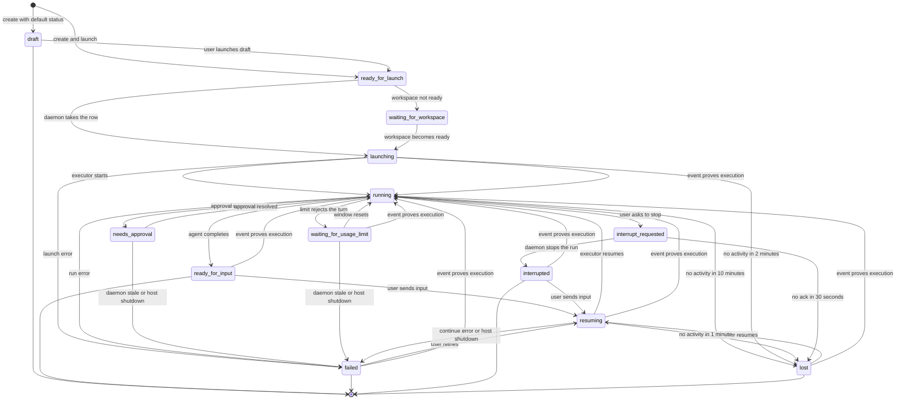
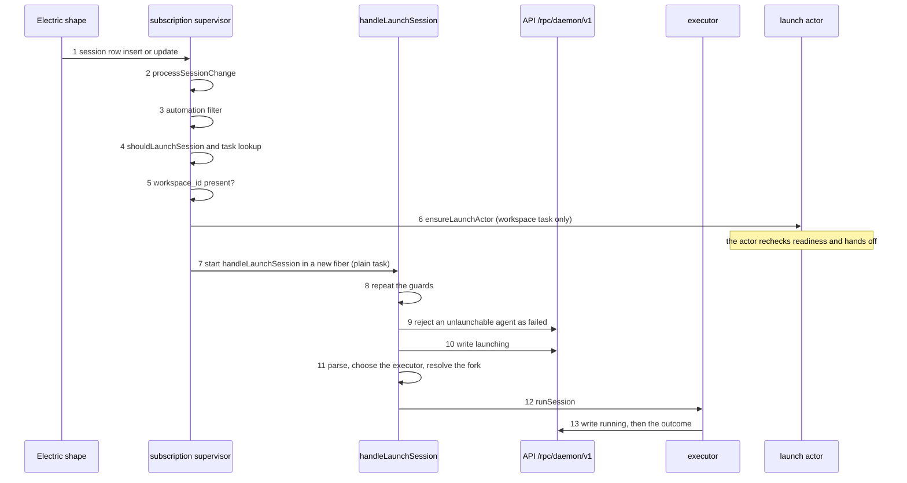

# The session lifecycle: 13 statuses without a transition table

A session row carries one of thirteen status values. One schema file declares the list, and a parity test keeps a second copy equal to it. No file declares which status may follow which. The transitions live in the code that writes them: daemon handlers, Application Programming Interface (API) procedures, a Structured Query Language (SQL) repair expression, and a sweeper. This document follows the row from creation to rest, and it is honest about where the rules really live.

The thesis is that the state machine is real but implicit. The thirteen names are enforced by a schema. The edges are enforced by the order of operations in about a dozen procedures. A reader who wants to know whether a transition is legal must read those procedures, not a table.

The row is a PostgreSQL record. It carries `task_id`, `coding_agent`, `host_id`, `status`, `last_activity_at`, and `error_message` (`packages/db/src/tables/sessions.ts:55`, `packages/db/src/tables/sessions.ts:70`, `packages/db/src/tables/sessions.ts:74`, `packages/db/src/tables/sessions.ts:100`, `packages/db/src/tables/sessions.ts:119`, `packages/db/src/tables/sessions.ts:160`). A host is one registered daemon identity: a user, an organization, and a machine identifier (`packages/schemas/src/effect/daemon/identity.ts:5-9`). The API writes the row through oRPC, an OpenAPI Remote Procedure Call. The daemon reads it through an Electric shape, a server-defined subset of the table sent as ordered changes. The daemon reports back through oRPC. A separate Amazon Web Services (AWS) Lambda sweeper reads the table on a schedule. Claude Code, CodeLayer, and Fold are the three coding agents with executors.

## The thirteen names and the claim of one source

`SESSION_STATUSES` is an ordered list of thirteen string literals. The doc comment makes a strong claim: "This is the single source of truth; the Zod twin in `zod/session/session-status.ts` mirrors it for oRPC contracts and Drizzle schemas" (`packages/schemas/src/effect/session/session-status.ts:4-5`).

```ts
// packages/schemas/src/effect/session/session-status.ts:3-23
/**
 * Every lifecycle status a session row can carry. This is the single source of truth; the Zod
 * twin in `zod/session/session-status.ts` mirrors it for oRPC contracts and Drizzle schemas.
 */
export const SESSION_STATUSES = [
	'ready_for_launch',
	'waiting_for_workspace',
	'draft',
	'launching',
	'running',
	'failed',
	'ready_for_input',
	'needs_approval',
	'waiting_for_usage_limit',
	'interrupt_requested',
	'interrupted',
	'resuming',
	'lost',
] as const
export const SessionStatus = Schema.Literals(SESSION_STATUSES)
export type SessionStatus = typeof SessionStatus.Type
```

The order is not alphabetical, and it is not chronological. It starts with the two launch-queue statuses, then the draft, then the two in-flight statuses `launching` and `running`, then the outcome `failed`, then the outcome `ready_for_input`, then the two waiting statuses `needs_approval` and `waiting_for_usage_limit`, then the interrupt pair, then the two recovery statuses `resuming` and `lost`. The order matters because the parity test compares the arrays element by element.

The file also derives one useful subset. A session "still owes a launch" when its status is `ready_for_launch` or `waiting_for_workspace`.

```ts
// packages/schemas/src/effect/session/session-status.ts:25-35
/**
 * Statuses of a session that the daemon still owes a launch: it was queued by the API and no
 * runner has taken it yet. `waiting_for_workspace` is the same queue position after the daemon
 * has told the user that workspace setup is holding the launch.
 */
export const SESSION_STATUSES_AWAITING_LAUNCH = [
	'ready_for_launch',
	'waiting_for_workspace',
] as const satisfies readonly SessionStatus[]
export const SessionStatusAwaitingLaunch = Schema.Literals(SESSION_STATUSES_AWAITING_LAUNCH)
export type SessionStatusAwaitingLaunch = typeof SessionStatusAwaitingLaunch.Type
```

The subset gives the daemon one predicate, `isSessionStatusAwaitingLaunch` (`packages/schemas/src/effect/session/session-status.ts:37-38`). The launch actor uses it to decide that a session is no longer worth a launch attempt.

### How real is "single source of truth"?

It is true for the names, and the parity test enforces it. The Zod twin repeats the list, and `packages/schemas/test/session-status-parity.test.ts` asserts that both arrays are equal in order and that both schemas accept and reject the same values. The table column does not use the Zod enum: `status` is plain `text().notNull().$type<SessionStatus>()`, so PostgreSQL stores any string (`packages/db/src/tables/sessions.ts:100`). The select schema does validate it on read, with `status: SessionStatusSchema` (`packages/db/src/tables/sessions.ts:204-206`). The daemon update contract also validates it and excludes `lost` (`contracts/riptide-api-contract/src/daemon/sessions/update.ts:24`). So one edit to the Effect file fails the parity test until the twin is edited.

It is not true for the behaviour. Five other lists encode knowledge about statuses, and none of them reads a transition table.

| List | Members | Owner | Purpose |
|------|---------|-------|---------|
| `SESSION_STATUSES` | All 13 | `packages/schemas/src/effect/session/session-status.ts:7-21` | The full vocabulary |
| `SESSION_STATUSES_AWAITING_LAUNCH` | 2 | `packages/schemas/src/effect/session/session-status.ts:30-33` | The daemon still owes a launch |
| `DAEMON_ACTIVE_SESSION_STATUSES` | 5 | `packages/db/src/tables/sessions.ts:31-37` | A live daemon may still own the row |
| `ACTIVE_SESSION_STATUSES` | 5 | `apps/riptide-api/src/db/session-statuses.ts:7` | A copy of the database list for API procedures; it is not a second declaration |
| `EVENT_REPAIRABLE_SESSION_STATUSES` | 7 | `apps/riptide-api/src/orpc/daemon/sessions/events/create.ts:96-104` | A new event may prove the row is running |
| `LOST_SESSION_RULES` | 4 source statuses | `apps/stale-daemon-sweeper/lost-sessions.ts:22-47` | A row that stopped making progress |

The six lists overlap, but none is a superset of the truth. That is the first sign that the state machine has more than one author. `ACTIVE_SESSION_STATUSES` is the one exact duplicate: it copies `DAEMON_ACTIVE_SESSION_STATUSES` into a new array at import time (`apps/riptide-api/src/db/session-statuses.ts:1-9`). The copy means an API procedure reads a value that cannot drift from the database list, but it also means the name changes at the package boundary, which makes a search for one name miss the other.

The database list is the most consequential one. It contains `launching`, `running`, `needs_approval`, `waiting_for_usage_limit`, and `resuming`.

```ts
// packages/db/src/tables/sessions.ts:31-37
export const DAEMON_ACTIVE_SESSION_STATUSES = [
	'launching',
	'running',
	'needs_approval',
	'waiting_for_usage_limit',
	'resuming',
] as const satisfies readonly SessionStatus[]
```

Notice what is missing: `interrupt_requested`. The stale-daemon sweep treats an interrupt request as a separate case, so it can write `interrupted` instead of `failed` (`apps/stale-daemon-sweeper/stale-daemons.ts:102-106`). The active list and the sweeper's interrupt case together define "a daemon owns this row", and no single list does.

**Aha:** The strongest guarantee in this system is not a transition table. It is the daemon update contract, which excludes `lost` outright (`contracts/riptide-api-contract/src/daemon/sessions/update.ts:24`). So the value that means "the daemon vanished" can only be written by the process that noticed the absence. The vocabulary is shared, but the authority is split on purpose.

## The shape of the graph



The diagram shows two entry points and five resting statuses: `draft`, `ready_for_input`, `failed`, `interrupted`, and `lost`. The `--> [*]` arrows mark the end of the automatic graph. They do not mean that the row is deleted: a person can still resume a failed, interrupted, or lost row, and a new event can still repair four of the five. The diagram also shows one asymmetry that holds in the code: there is no arrow from `running` back to `ready_for_launch`. The project's golden document, `golden/session_state_machine.md`, lists that as invariant one (`golden/session_state_machine.md:73`). The seven repair edges to `running` match the repair table in "Status repair in the event write path".

`draft` and `failed` deserve a note. A `draft` is a session with no host and no launch. A `failed` row can be retried with a new user message, and the retry moves it to `resuming`, not to `ready_for_launch`. A `failed` row that is not retried simply stays failed.

## Each status and the code that writes it

This table maps each status to its meaning and its writer. The right-hand column is the authority.

| Status | Meaning | Written by |
|--------|---------|-----------|
| `draft` | Created, not queued for a host | `apps/riptide-api/src/orpc/api/sessions/create.ts:66` with the default from `contracts/riptide-api-contract/src/api/sessions/create.ts:19-21` |
| `ready_for_launch` | Queued, and a daemon may take it | `apps/riptide-api/src/orpc/api/sessions/launch.ts:139` |
| `waiting_for_workspace` | Queued, but workspace setup holds it | `apps/riptide-daemon/src/subscriptions.ts:118`, `apps/riptide-daemon/src/handlers/workspace/on-workspace-setup.ts:75`, and `apps/riptide-daemon/src/effects/services/workspace-session-launch/workspace-session-launch.machine.ts:105-115` |
| `launching` | A daemon has taken the row | `apps/riptide-daemon/src/handlers/sessions/on-session-launch.ts:141-144` |
| `running` | An executor is streaming events | `apps/riptide-daemon/src/effects/services/claude-sessions/claude-sessions.live.ts:267`, `apps/riptide-daemon/src/agents/codelayer/execute-codelayer.ts:582`, `apps/riptide-daemon/src/effects/services/fold-sessions/fold-session-runner.layer.ts:319`, and the repair rule at `apps/riptide-api/src/orpc/daemon/sessions/events/create.ts:284-290` |
| `failed` | The run or the launch failed | `apps/riptide-daemon/src/agents/shared/run-session.ts:143-147`; `apps/riptide-daemon/src/handlers/sessions/on-session-launch.ts:132-181`; `apps/riptide-daemon/src/handlers/sessions/on-session-continue.ts:50-135`; `apps/riptide-daemon/src/subscriptions.ts:95`; the CodeLayer and Fold executors (`apps/riptide-daemon/src/agents/codelayer/execute-codelayer.ts:742-844`); `apps/stale-daemon-sweeper/stale-daemons.ts:95`; and `apps/riptide-api/src/orpc/daemon/hosts/shutdown.effect.ts:35` |
| `ready_for_input` | The agent finished a turn | `apps/riptide-daemon/src/effects/services/claude-sessions/workflows/process-events.ts:715-720`, `apps/riptide-daemon/src/agents/codelayer/execute-codelayer.ts:792` |
| `needs_approval` | A tool call waits for a person | `apps/riptide-api/src/orpc/daemon/approvals/create.ts:85-92` |
| `waiting_for_usage_limit` | The provider rejected the turn | `apps/riptide-daemon/src/effects/services/claude-sessions/workflows/process-events.ts:674-679` |
| `interrupt_requested` | A person asked to stop the run | `apps/riptide-api/src/orpc/api/sessions/interrupt.ts:110-115` |
| `interrupted` | The run stopped on request | `apps/riptide-daemon/src/agents/claudecode/interrupts.ts:108-113` and `apps/riptide-daemon/src/effects/services/claude-sessions/complete-interrupted-run.ts:22` |
| `resuming` | A person sent input to a resting row | `apps/riptide-api/src/orpc/api/sessions/continue.ts:98-101` |
| `lost` | The row stopped making progress | `apps/stale-daemon-sweeper/lost-sessions.ts:308-315` |

Two entries in that table are worth reading in full, because they show the style of the whole system.

```ts
// apps/riptide-api/src/orpc/api/sessions/interrupt.ts:107-116
				yield* tx.query(
					tx.client
						.update(sessions)
						.set({
							status: 'interrupt_requested',
							archived: false,
							last_activity_at: BigInt(nowMillis),
						})
						.where(eq(sessions.id, sessionId)),
				)
```

The interrupt procedure does not check the current status in this statement. It checks it earlier against `ACTIVE_SESSION_STATUSES`, which is the five-status daemon list: `launching`, `running`, `needs_approval`, `waiting_for_usage_limit`, and `resuming` (`apps/riptide-api/src/orpc/api/sessions/interrupt.ts:66`, `apps/riptide-api/src/db/session-statuses.ts:7`). That name is a package-local copy of `DAEMON_ACTIVE_SESSION_STATUSES`; it is not a different list. The doc comment above the procedure lists only four (`running`, `needs_approval`, `launching`, and `resuming`) and omits `waiting_for_usage_limit` (`apps/riptide-api/src/orpc/api/sessions/interrupt.ts:27-29`); the code is the authority. That is a common pattern here: validate first, then write without a conditional.

The continue procedure does more work in the same write. It clears the error fields, restores the model settings, and unarchives the row.

```ts
// apps/riptide-api/src/orpc/api/sessions/continue.ts:96-113
				// Update session
				// Also unarchive the session when continuing (user interaction should unarchive)
				await tx
					.update(sessions)
					.set({
						status: 'resuming',
						error_message: null,
						error_reason: null,
						model: effectiveModel,
						effort: effectiveEffort ?? null,
						fast_mode: effectiveFastMode ?? false,
						permissions_mode: permissionsMode,
						archived: false,
						// provider and coding_agent remain unchanged from session creation
						last_activity_at: BigInt(nowMillis),
						num_events: sql`${sessions.num_events} + 1`,
						prompt: text,
					})
```

Before this write, the procedure checks that the row is in one of four statuses: `ready_for_input`, `interrupted`, `failed`, or `lost` (`apps/riptide-api/src/orpc/api/sessions/continue.ts:57-58`). That check is the real transition rule for "user resumes a session". It is an `if` in a procedure, not a table row.

## The launch path, step by step

The launch path is the longest single flow in the system. It runs inside the daemon, and it begins with a synced row change.

The trigger is a pure predicate. It accepts only an insert or an update, and only for a row in the launch queue.

```ts
// apps/riptide-daemon/src/handlers/sessions/on-session-launch.ts:79-85
export function shouldLaunchSession(change: SessionLaunchChange): boolean {
	const session = change.value
	return (
		(change.type === 'update' || change.type === 'insert') &&
		(session.status === 'ready_for_launch' || session.status === 'waiting_for_workspace')
	)
}
```

Note what the predicate does not check: a host, a task, a workspace, or an agent. Those checks happen later, and each one has a different failure behaviour.

The handler applies five guards before it writes any status. In order: the change must be a launch; the session must match the automation target when the daemon is managed; the task row must be present; a legacy task with `workspace_spec` must wait for the workspace path to supply a gate; and a supplied gate must allow the launch. Each guard returns silently, with no status write.

Automation mode is the bounded run that the command-line `automation` command starts (`apps/cli/src/commands/automation-run.ts:68-124`). The API prepares one task and one session, and the daemon starts with `automation.targetSessionId` set to that session (`apps/cli/src/commands/automation-run.ts:109-115`). The filter in both the supervisor and the handler makes that daemon ignore every other row the host can see.

```ts
// apps/riptide-daemon/src/handlers/sessions/on-session-launch.ts:96-108
export async function handleLaunchSession(
	change: SessionLaunchChange,
	services: DaemonServices,
	workspaceLaunchGate?: WorkspaceLaunchGate,
) {
	const session = change.value
	if (!shouldLaunchSession(change)) return
	if (services.automationTargetSessionId !== undefined && session.id !== services.automationTargetSessionId) return
	if (session.task_id !== null) {
		const task = services.collections.tasks.toArray.find((candidate) => candidate.id === session.task_id)
		if (task === undefined) return
		if (workspaceLaunchGate === undefined && task.workspace_spec != null) return
	}
```

The guard order matters. The first guard rejects a change that is not a launch. The automation filter runs next, so a managed daemon never touches another session. The task lookup follows, and a missing task is a silent return, because the task row may arrive later through the same Electric shape. The fourth guard defers a legacy `workspace_spec` task until the workspace setup path supplies a readiness gate. The fifth applies that gate and returns when it is blocked (`apps/riptide-daemon/src/handlers/sessions/on-session-launch.ts:110-122`). The subscription supervisor repeats most of these checks before it calls the handler (`apps/riptide-daemon/src/subscriptions.ts:172-197`).

The agent check is the first branch that writes a terminal status. An unlaunchable agent becomes `failed` with a message that names the agent.

```ts
// apps/riptide-daemon/src/handlers/sessions/on-session-launch.ts:127-145
	const launchableAgent = LaunchableCodingAgentZodSchema.safeParse(session.coding_agent)
	if (!launchableAgent.success) {
		logger.error(
			`Coding agent ${session.coding_agent} is not supported for launching sessions yet (session ${session.id})`,
		)
		await services.orpc.sessions.update({
			sessionId: session.id,
			status: 'failed',
			errorMessage: `The ${session.coding_agent} coding agent is not currently supported.`,
		})
		return
	}

	// Update status to launching before starting
	await services.orpc.sessions.update({
		sessionId: session.id,
		status: 'launching',
	})
	logger.info(`Marked session ${session.id} as launching`)
```

The `launching` write is an optimistic marker. It tells every reader that a daemon has claimed the row. It happens before the session is validated for execution and before the executor is chosen. If the row is malformed, the next step writes `failed`, so the marker is short-lived.

After `launching`, the handler parses the row for execution. A row that fails that parse becomes `failed`. The handler then chooses the executor and resolves fork metadata.

```ts
// apps/riptide-daemon/src/handlers/sessions/on-session-launch.ts:159-173
	const execute = executorForLaunchableAgent(launchableAgent.data, services.executors)

	// Detect fork: if forked_from_session_id is set, read fork metadata from fork_data
	if (session.forked_from_session_id) {
		const forkData = z.object({ fork: z.unknown() }).safeParse(session.fork_data)
		const rawForkMeta = forkData.success ? forkData.data.fork : null
		if (!rawForkMeta) {
			logger.error({ sessionId: session.id }, 'Forked session missing fork metadata in fork_data')
			await services.orpc.sessions.update({
				sessionId: session.id,
				status: 'failed',
				errorMessage: 'Forked session missing fork metadata',
			})
			return
		}
```

The last step calls the shared wrapper, with fork metadata when the row is a fork and without it otherwise.

```ts
// apps/riptide-daemon/src/handlers/sessions/on-session-launch.ts:186-195
		await runSession({
			session: typedSession,
			forkMeta,
			services,
			execute,
		})
	} else {
		// Run the session (no resumeSessionId = new session)
		await runSession({ session: typedSession, services, execute })
	}
```

`runSession` does not write `running`. The executor does, once it has a live process or a live session. That split is deliberate: a launch that fails before the process starts should not show a running session for a moment.

The full path is thirteen steps.



Step six deserves attention. When a task has a workspace identifier, the subscription supervisor does not call the handler. It asks the launch-actor service for one actor per session, then returns (`apps/riptide-daemon/src/subscriptions.ts:191-195`). For a plain task, the supervisor starts the handler inside a new fiber, through `forkSessionRun`, so one slow launch does not block the change stream (`apps/riptide-daemon/src/subscriptions.ts:197-202`). A launch actor is a per-session state machine that rechecks workspace readiness and then hands the row to the runner. The actor later re-reads readiness from the API. The comment says the synced row is "only a hint" (`apps/riptide-daemon/src/subscriptions.ts:192`). That is the strongest statement in the codebase about the difference between what the daemon sees and what is true.

## The workspace gate

The gate converts `ready_for_launch` into `waiting_for_workspace` at most once, and only for a fresh row. That restriction is explicit.

```ts
// apps/riptide-daemon/src/effects/services/workspace-session-launch/workspace-session-launch.machine.ts:86-97
		const shouldMarkWaiting =
			!setup.ready &&
			!state.markedWaiting &&
			// Legacy parity: only a freshly created session is moved to waiting; later statuses
			// already tell the user what is happening.
			setup.sessionStatus === 'ready_for_launch'
		if (!shouldMarkWaiting) {
			return WorkspaceSessionLaunchEvent.ReadinessObserved({
				ready: setup.ready,
				sessionStatus: setup.sessionStatus,
				markedWaiting: state.markedWaiting,
			})
```

The `markedWaiting` flag is part of the actor state, so it survives a recheck. The status check protects a different case: a session that a person already moved, or that another daemon owns. Writing `waiting_for_workspace` over `resuming` would lose information.

The readiness decision itself is a ledger rule. If the workspace spec blocks the first session, every repository must be `done`. Otherwise every repository must be past the worktree stage (`apps/riptide-daemon/src/lib/workspace/ledger.ts:24-33`). The second branch is the normal one: the agent can start while a setup command still runs.

`waiting_for_workspace` has no safety net. It is not one of the five active statuses (`packages/db/src/tables/sessions.ts:31-37`), and the lost rules do not include it (`apps/stale-daemon-sweeper/lost-sessions.ts:22-47`). The stale-daemon sweeper therefore never moves it, and neither the interrupt nor the continue procedure accepts it (`apps/riptide-api/src/orpc/api/sessions/interrupt.ts:66-68`, `apps/riptide-api/src/orpc/api/sessions/continue.ts:56-58`). Its automatic exits are a ready workspace, which the actor turns into a launch, or a new daemon that creates a fresh actor when it sees the row. If no daemon runs and the workspace never becomes ready, the row stays in `waiting_for_workspace` until a person archives it. Archiving stops the subscription supervisor from launching it (`apps/riptide-daemon/src/subscriptions.ts:178-180`). This is a possible stuck state, not a designed one.

## Continue, interrupt, approval, and the usage limit

Four shorter flows complete the graph.

**Continue.** The API writes `resuming`, and the daemon sees the change. `shouldContinueSession` asks a shared command parser whether this change is a continue command (`apps/riptide-daemon/src/handlers/sessions/on-session-continue.ts:15-21`). The daemon then either delivers the message to a live Claude process or resumes a persisted session. The parser picks the resume kind from the previous status, not from a user choice (`packages/session-sdk-sessions/src/commands.ts:39`). A continue from `lost` is tagged `lost-resume`, so the executor knows the database already declared the old work stale. The tag is a `SessionContinuationKind` value (`apps/riptide-daemon/src/agents/shared/run-session.ts:44-50`).

**Interrupt.** The API writes `interrupt_requested`, and the daemon observes it. For Claude, an in-process watcher sees the status and stops the run, then writes `interrupted` (`apps/riptide-daemon/src/agents/claudecode/interrupts.ts:108-113`). For CodeLayer, the executor subscribes to interrupt events for its session, aborts the agent through an `AbortController`, and calls `handleInterruptOutcome` to resume with a new prompt or mark the session interrupted (`apps/riptide-daemon/src/agents/codelayer/execute-codelayer.ts:652-658`, `:853-856`). For Fold, the runner uses a forced-stop policy and writes `interrupted` from the same policy (`apps/riptide-daemon/src/effects/services/fold-sessions/fold-session-runner.layer.ts:438-440`).

**Approval.** The approval row is created by the daemon, and the API writes `needs_approval` in the same transaction (`apps/riptide-api/src/orpc/daemon/approvals/create.ts:85-92`). A resolved approval moves the row back to `running` by a direct write, but only when no pending approval remains (`apps/riptide-api/src/orpc/api/approvals/resolve.effect.ts:114-125`). The event repair path cannot do it, because `needs_approval` is not in the repairable list.

**Usage limit.** The Claude event processor writes `waiting_for_usage_limit` when a rate-limit event is rejected and no overage applies (`apps/riptide-daemon/src/effects/services/claude-sessions/workflows/process-events.ts:676-679`). When the window resets and the agent streams again, a later event repair moves the row to `running`.

## When progress stops: the lost status

`lost` is the only status that a daemon cannot write. It is produced by the sweeper, from a table of rules with four thresholds.

```ts
// apps/stale-daemon-sweeper/lost-sessions.ts:22-47
export const LOST_SESSION_RULES: readonly LostSessionRule[] = [
	{
		status: 'running',
		thresholdMs: 10 * 60 * 1_000,
		warning:
			'This session is marked as running but has not sent an event in over 10 minutes. You can try resuming it by sending another message.',
	},
	{
		status: 'launching',
		thresholdMs: 2 * 60 * 1_000,
		warning:
			'This session has been launching without progress for over 2 minutes. You can try resuming it by sending another message.',
	},
	{
		status: 'resuming',
		thresholdMs: 60 * 1_000,
		warning:
			'This session has been resuming without progress for over 1 minute. You can try resuming it by sending another message.',
	},
	{
		status: 'interrupt_requested',
		thresholdMs: 30 * 1_000,
		warning:
			'This session has not acknowledged the interrupt request in over 30 seconds. You can try resuming it by sending another message.',
	},
]
```

The test uses `last_activity_at`, which every conversation event updates (`apps/riptide-api/src/orpc/daemon/sessions/events/create.ts:279-281`). The thresholds are not arbitrary. `interrupt_requested` gets the shortest window, because a person is waiting for an answer to a stop request. `running` gets the longest, because a long tool call is normal. A `launching` or `resuming` row has no long tool call to justify a long silence. Two exemptions protect `running` work: an open `bash` call whose parsed timeout is still in the future, and an `mcp__` call less than 20 minutes old (`apps/stale-daemon-sweeper/lost-sessions.ts:145-156`). An `mcp__` call is a tool whose name starts with the Model Context Protocol (MCP) prefix; MCP is the protocol that connects an agent to an external tool server. The parsed timeout is the timeout value that the sweeper reads from the tool call's input JSON; when that value is in the future, the call can still return. The rule's warning text becomes the row's `error_message` (`apps/stale-daemon-sweeper/lost-sessions.ts:308-315`).

**Aha:** the sweep does not check the host registration before it acts. Candidate eligibility uses only two tests: the row has the rule status, and `last_activity_at` is older than the rule threshold (`apps/stale-daemon-sweeper/lost-sessions.ts:158-164`). Open tool exemptions are removed after that (`apps/stale-daemon-sweeper/lost-sessions.ts:296-305`). The sweep adds the host registration status to each transition, and logs it for diagnosis (`apps/stale-daemon-sweeper/lost-sessions.ts:336-344`, `apps/stale-daemon-sweeper/lost-sessions.ts:356-358`). A host that is online can still lose its session when the activity test fails.

## Status repair in the event write path

Every conversation event passes through `daemonBase.sessions.events.create`. That procedure has a second job: it repairs a status that disagrees with the evidence. It also refreshes `last_activity_at` and `num_events` in the same update (`apps/riptide-api/src/orpc/daemon/sessions/events/create.ts:279-282`).

```ts
// apps/riptide-api/src/orpc/daemon/sessions/events/create.ts:96-113
const EVENT_REPAIRABLE_SESSION_STATUSES: SessionStatus[] = [
	'lost',
	'waiting_for_usage_limit',
	'failed',
	'interrupted',
	'ready_for_input',
	'launching',
	'resuming',
]

function provesActiveExecution(eventType: string, role: string): boolean {
	return (
		(eventType === 'message' && role === 'assistant') ||
		(eventType === 'thinking' && role === 'assistant') ||
		(eventType === 'tool_call' && role === 'assistant') ||
		(eventType === 'tool_result' && role === 'user')
	)
}
```

The repair is a conditional SQL update inside the insert transaction. It is one statement, so it cannot race with a concurrent status write in a confusing way.

```ts
// apps/riptide-api/src/orpc/daemon/sessions/events/create.ts:283-298
				if (provesActiveExecution(input.eventType, input.role)) {
					sessionUpdateFields.status = sql<SessionStatus>`CASE
						WHEN ${sessions.status} IN (${sql.join(
							EVENT_REPAIRABLE_SESSION_STATUSES.map((status) => sql`${status}`),
							sql`, `,
						)}) THEN 'running'
						ELSE ${sessions.status}
					END`
					sessionUpdateFields.error_message = sql<string | null>`CASE
						WHEN ${sessions.status} IN (${sql.join(
							EVENT_REPAIRABLE_SESSION_STATUSES.map((status) => sql`${status}`),
							sql`, `,
						)}) THEN NULL
						ELSE ${sessions.error_message}
					END`
				}
```

This is the real repair table. Seven statuses may be corrected to `running`, and only when the event proves active execution. A `message` from the assistant, a `thinking` block, a `tool_call`, or a `tool_result` counts. A system event, a user prompt, or a result frame does not.

| Current status | A new assistant event proves the run is alive? | Result |
|----------------|-----------------------------------------------|--------|
| `lost` | Yes | `running`, error cleared |
| `waiting_for_usage_limit` | Yes | `running`, error cleared |
| `failed` | Yes | `running`, error cleared |
| `interrupted` | Yes | `running`, error cleared |
| `ready_for_input` | Yes | `running`, error cleared |
| `launching` | Yes | `running`, error cleared |
| `resuming` | Yes | `running`, error cleared |
| `running` | Yes | Stays `running` |
| `draft`, `needs_approval`, `interrupt_requested` | Yes | Unchanged |
| Any status | No | Unchanged |

**Aha:** This one CASE expression is the closest thing in the repository to a declared transition rule. It is a single edge, `X -> running`, for seven source statuses, guarded by event evidence. It is not in a state machine file. It is in the write path that records the event, because the event is the proof.

The exclusion list is as interesting as the inclusion list. `draft` cannot be repaired, because a draft has no run. `needs_approval` cannot be repaired, because a pending approval must be answered even if events keep arriving. `interrupt_requested` cannot be repaired, because a person asked for a stop and the stop must be honoured.

## The golden document, and its gap

`golden/session_state_machine.md` is the project's own description of the machine. It is useful, and it is incomplete.

It lists eleven statuses. It omits `waiting_for_workspace` and `lost`. Its diagram has no repair edge. It also cites the type definition in the database package, at lines 7 to 18 of that file (`golden/session_state_machine.md:79`). That is no longer where the type lives; the real definition is in the schemas package (`packages/schemas/src/effect/session/session-status.ts:7-21`). A reader who trusts the golden document will miss the workspace gate and the sweeper entirely.

The document is still valuable for two things. First, it states the invariants in plain words. Second, its transition tables separate user-initiated edges from daemon-initiated edges, which is the correct axis for this design.

| Claim in the golden document | Verified? |
|------------------------------|-----------|
| `ready_for_launch` is for initial launch only | Partly; four creation paths write it, and no guard forbids a later write (`apps/riptide-api/src/orpc/api/sessions/launch.ts:134-140`, `apps/riptide-api/src/db/create-session-for-launch.ts:43`, `apps/riptide-api/src/effects/project-workspace/create-session-v2.ts:193`, `apps/riptide-api/src/effects/project-workspace/create-task-v2.ts:376`) |
| Resumption requires `coding_agent_session_id` | Partly; Claude needs it, while CodeLayer and Fold resume from state that Riptide owns. Riptide is the internal code name for the HumanLayer platform (`apps/riptide-daemon/src/handlers/sessions/on-session-continue.ts:56-66`) |
| Multiple entry points to `resuming` | Partly; the code accepts four, and the golden document lists three (`apps/riptide-api/src/orpc/api/sessions/continue.ts:57-58`) |
| Eleven statuses | No; there are thirteen |
| Type location, as cited in the golden document | No; the file moved to `packages/schemas/src/effect/session/session-status.ts` |

## The honest statement about transitions

There is no declarative transition table, no state machine library on the session row, and no single function that answers "is this transition legal?". A search of the repository finds transition-like rules in at least six places:

1. The `continue` precondition list in the API.
2. The `interrupt` precondition list in the API.
3. The launch predicate in the daemon.
4. The launch-actor state machine, which is a real machine but only for the workspace gate.
5. The repair CASE expression in the event write path.
6. The sweeper thresholds and the open tool exemptions.

The launch-actor machine is the exception that proves the rule. It is a declarative machine with states `Checking`, `Waiting`, `Launching`, `Launched`, `NotLaunchable`, and `Failed` (`apps/riptide-daemon/src/effects/services/workspace-session-launch/workspace-session-launch.machine.ts:21-37`). It governs one sub-flow, and it does not know about most session statuses.

The consequence is a specific class of risk. A new status added to `SESSION_STATUSES` passes the parity test after the twin is edited. But no compiler error tells the author to update the repair list, the sweeper rules, the active list, or the continue precondition. Each of those lists fails silently, in a different way.

| Enforcement point | Failure if it is not updated | Detected by |
|-------------------|-----------------------------|-------------|
| Parity test | Build fails | Test suite |
| Daemon update contract | The call is rejected | Immediate rejection |
| Repair list | A live session stays `failed` or `lost` | User report |
| Active list | The sweep ignores the row | A stuck session |
| Sweeper rules | The row never becomes `lost` | A stuck session |
| Continue precondition | The retry is rejected with a 4xx | User report |
| Interrupt precondition | The stop is rejected | User report |

That table is the practical answer to "where is the state machine?". It is spread across seven enforcement points with three detection mechanisms: the build, the contract, and a person noticing. The database column itself enforces nothing.

## What the design gets right

The split between the vocabulary and the edges has one strong benefit. The vocabulary is cheap to hold constant, and the edges can change per flow without a central registry. The daemon can add a branch for a new coding agent without editing a registry that every flow shares.

The second benefit is that each write is close to its evidence. The repair rule sits next to the event that proves it. The interrupt rule sits next to the stop request. The sweeper rule sits next to the activity data. A central table would move all of that knowledge away from the proof.

The cost is that no single review can see the whole graph. This document reconstructs it from the status lists, the procedures, and the golden document. That reconstruction is the value it adds.

For the daemon that executes these transitions, read [the daemon and the session runtime](02-daemon-and-session-runtime.md). For the event contract and the write path in full, read [write paths and idempotency](09-write-paths-and-idempotency.md) and [the API and the contracts](07-api-and-contracts.md). For the schema and migration side of the same table, read [database and schemas](08-database-and-schemas.md). For the project's own rules, read [invariants and golden documents](17-invariants-and-golden-documents.md).

## Next

The session row is the control plane. The conversation inside it is a stream of typed events. The next document explains the six session packages, the event schemas, and the producer that writes them. Read [the session Software Development Kit and durable streams](04-session-sdk-and-durable-streams.md).
