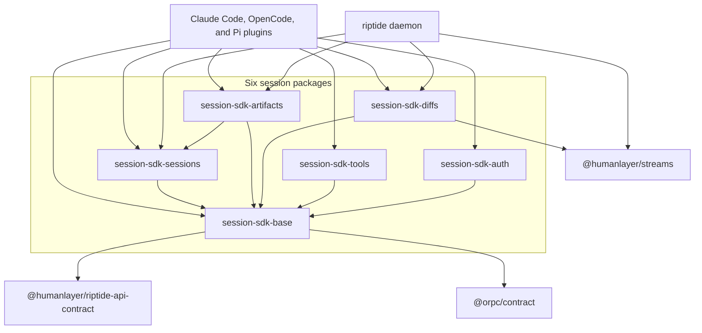
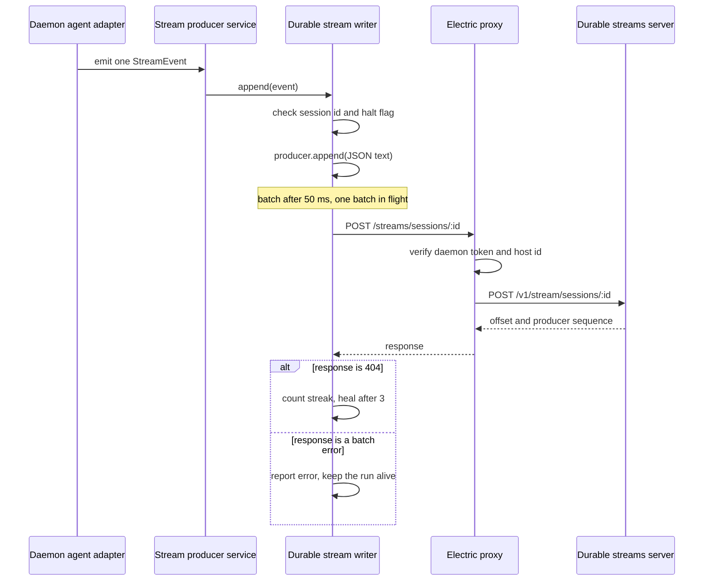

# The session SDK and the durable stream

A coding agent is an external program that runs in a process HumanLayer does not own. HumanLayer coordinates those agents through a cloud API, a database, a sync service named Electric, a browser application, and a daemon on each developer machine. The daemon is the local process that launches agents and receives commands through outbound calls only. Each agent still needs a login, a typed Remote Procedure Call (RPC) client, a queue that survives network failure, and a way to publish its work to a shared log. Six private packages provide those needs. They compose around one base package, and three agent plugins plus the daemon consume them. This document explains each package, their dependencies, and how their events reach the append-only stream server. It also explains the Yjs document stream; Yjs is a Conflict-free Replicated Data Type (CRDT) library. Citations give a path and line; each code block starts with a comment naming its range.

## Six packages, one floor

The six packages form one Software Development Kit (SDK). In this document, workspace means the monorepo's linked package set; the prepared checkout that an agent session receives is a different thing and is not discussed here. Each package is private and never published alone. Each package exports one entry point through its `src/index.ts`. The base package holds no workspace dependency except the shared type package, `@humanlayer/riptide-api-contract`. Every other package depends on the base package, directly or through a sibling. No package imports a React component, a database client, or a daemon service.



The edges come from the package manifests. The base package lists only `@humanlayer/riptide-api-contract` and `@orpc/contract`. The sessions, tools, and auth packages list only `@humanlayer/session-sdk-base`. Artifacts adds sessions. Diffs adds `@humanlayer/streams`. The plugins list all six packages, and the daemon lists sessions, artifacts, diffs, and streams (`apps/riptide-daemon/package.json:68-71`). Table 2 adds the API, browser, and proxy, which import only the stream packages.

**Table 1. What each package owns.**

| Package | Owns | Depends on | Representative exports |
|---------|------|------------|-----------------------|
| `session-sdk-base` | Channels, file locks, a durable outbox, typed routes, the RPC call, UTF-8 safe string cuts | `riptide-api-contract` | `rpcCall`, `Outbox`, `withFileLock`, `DaemonPath`, `cutUtf8` |
| `session-sdk-sessions` | Session commands, event limits, the event identifier, Electric followers, shape reads, prepare bodies, task choice | base | `sessionCommand`, `eventUuid`, `followSessions`, `ShapeReader`, `prepareBody` |
| `session-sdk-artifacts` | Task file rules, a frontmatter reader, task file upload | base, sessions | `isSyncableSubpath`, `frontmatter`, `ArtifactSync` |
| `session-sdk-diffs` | Git difference reads, path filters, diff rows, stream messages, publication | base, streams | `buildDiff`, `patchFits`, `DiffSync`, `isEnvironmentPath` |
| `session-sdk-tools` | Seven agent tools for comments and research, with conversion to JavaScript Object Notation (JSON) Schema | base | `TOOLS`, `toJsonSchema`, `runTool`, `settledTarget` |
| `session-sdk-auth` | Login, token refresh, host identity, the prepared session client | base | `createSessionClient`, `createDeviceLogin`, `withDaemonToken` |

## The base package is the floor

The base package has six modules, all exported from `src/index.ts`: `channels`, `files`, `outbox`, `routes`, `rpc`, and `text` (`packages/session-sdk-base/src/index.ts:1-6`).

`channels.ts` defines four channels, `prod`, `beta`, `dev`, and `local` (`packages/session-sdk-base/src/channels.ts:8-10`). A channel is one deployment target with an API address, a sync address, a web address, and a WorkOS login client identifier. The local channel defaults to localhost ports 8700, 8888, and 3000 for the API, the Electric sync service, and the web application (`packages/session-sdk-base/src/channels.ts:26-32`). `getChannelConfig` lets environment variables override each address and throws on a missing one (`packages/session-sdk-base/src/channels.ts:74-99`).

```ts
// packages/session-sdk-base/src/channels.ts:26-32
const SOURCE_DEFAULTS: BuiltChannels = {
	local: {
		api: 'http://localhost:8700',
		sync: 'http://localhost:8888',
		app: 'http://localhost:3000',
	},
}
```

The built-in local channel is one constant object. A deployment adds channels by parsing the `HUMANLAYER_CHANNELS` environment variable. An environment variable overrides each field of the selected channel.

`files.ts` supplies `withFileLock`, an exclusive lock with mode `0600`, a 30,000 millisecond stale limit, and a 100 millisecond poll (`packages/session-sdk-base/src/files.ts:43-66`).

`outbox.ts` is the queue that gives the SDK its failure behavior. Its retry delay starts at 500 milliseconds, doubles, and caps at 30,000 milliseconds (`packages/session-sdk-base/src/outbox.ts:23-27`). The queue holds at most 5,000 items or 50 mebibytes (MiB) and drops the oldest item at either cap (`packages/session-sdk-base/src/outbox.ts:140-146`). The failure class decides the fate of the item and of the other outboxes (`packages/session-sdk-base/src/outbox.ts:183-224`). A login failure **pauses** every live outbox: the queue keeps its items, the loop stops, and a later `resumeAll` clears the pause and restarts the loop (`packages/session-sdk-base/src/outbox.ts:55-58`, `:116-121`). A payment-required response **stops** every outbox: the outbox clears its queue and leaves the live set, so its items are discarded (`packages/session-sdk-base/src/outbox.ts:230-237`). A forbidden or missing binding stops only the outbox that met it. A binding is the association between one local sender and one cloud session. A skipped item leaves the queue. A limited retry stops after its limit and is skipped.

`routes.ts` is type-only and erased at build time. It derives `DaemonPath` and `ApiPath` from the two oRPC contracts and maps each path to its request and response types (`packages/session-sdk-base/src/routes.ts:13-39`). oRPC is the typed RPC framework that both sides share.

`rpc.ts` performs the call. It sends a POST request to `${api}/rpc/${plane}/v1/${path}`, with a bearer token on the API plane and an `x-daemon-authorization` header on the daemon plane (`packages/session-sdk-base/src/rpc.ts:56-78`). A plane is one oRPC surface: the API plane for browser and plugin calls, the daemon plane for daemon calls. These two planes live inside the control plane; they are request surfaces, not the control, sync, and client planes of the [overview](00-overview.md). The default timeout is 15,000 milliseconds. The classifier is the retry policy for these calls:

```ts
// packages/session-sdk-base/src/rpc.ts:99-111
export function classifyRpcError(err: unknown, plane: Plane): RpcErrorAction {
	if (err instanceof LoginRequiredError) return { kind: 'login-required' }
	if (!(err instanceof RpcError)) return { kind: 'retry-forever' } // network failure, no response
	const { status } = err
	if (status === 408 || status === 425 || status === 429 || status === 502 || status === 503 || status === 504) {
		return { kind: 'retry-forever' }
	}
	if (status === 500) return { kind: 'retry-limited', maxAttempts: 5 }
	if (plane === 'daemon' && isTokenRefused(err)) return { kind: 'login-required' }
	if (status === 402) return { kind: 'stop-all' } // any 402, not only BILLING_REQUIRED
	if (status === 403 || status === 404) return { kind: 'stop-binding' }
	return { kind: 'skip' } // 400, 413, 422 and anything else
}
```

The classifier separates six outcomes. A failure that is not an `RpcError` retries forever; there is no response to interpret. Status 408, 425, 429, 502, 503, and 504 retry forever. Status 500 retries five times. A refused daemon token asks for a login. Status 402 stops every outbox. Status 403 or 404 stops the outbox that met it. Every other status is skipped; a retry cannot repair a malformed body.

The login branch applies only to the daemon plane, because `isTokenRefused` is guarded by `plane === 'daemon'` (`packages/session-sdk-base/src/rpc.ts:107`). An API-plane 401 is not refused there, so it falls through to `skip` and the item leaves the outbox. The caller must refresh a browser or plugin access token before the send, or the item is lost. A 401 reaches the login pause only when the request path itself raises `LoginRequiredError`. `text.ts` adds `sha256Hex`, which returns a Secure Hash Algorithm 2, 256-bit (SHA-256) digest. It also adds `cutUtf8`, which cuts a string at a byte boundary without splitting a character (`packages/session-sdk-base/src/text.ts:3-8`).

## The sessions package

The sessions package turns database rows into commands and events. A row is one record in one database table, and a row identity is its primary key. `claims.ts` writes a 24-hour claim file for each row identity and prunes old files (`packages/session-sdk-sessions/src/claims.ts:9-24`). A claim stops two local processes from acting on the same resumed session. `commands.ts` maps a change in a session row to one of two commands:

```ts
// packages/session-sdk-sessions/src/commands.ts:33-44
export function sessionCommand(change: SessionRowChange): SessionCommand | undefined {
	if (change.type === 'delete') return undefined
	const { value, previousValue } = change
	const moved = change.type === 'insert' || previousValue?.status !== value.status
	if (!moved) return undefined
	if (value.status === 'resuming') {
		const resume = change.type === 'update' && previousValue?.status === 'lost' ? 'lost-resume' : 'ordinary'
		return { kind: 'continue', sessionId: value.id, prompt: value.prompt ?? null, resume }
	}
	if (value.status === 'interrupt_requested') return { kind: 'interrupt', sessionId: value.id }
	return undefined
}
```

A row that moves into `resuming` produces a continue command. A row that moves into `interrupt_requested` produces an interrupt command. A delete produces nothing.

`events.ts` defines the shape of an event that the agent wants to save. `SessionEvent` is the body of the daemon create request without the session identifier (`packages/session-sdk-sessions/src/events.ts:9`, `contracts/riptide-api-contract/src/daemon/events/create.ts:13-43`). The limits are 1 MiB of content, 256 kibibytes of hidden JSON, and 256 characters for tool identifiers (`packages/session-sdk-sessions/src/events.ts:14-20`). `fitEvent` applies those limits. `systemFields` builds a system event that the interface shows. `hiddenFields` builds a system event that the interface hides, with the JSON cut to the hidden size limit (`packages/session-sdk-sessions/src/events.ts:29-40`).

The event identifier is the key export for duplicate control.

```ts
// packages/session-sdk-sessions/src/events.ts:54-66
/**
 * A UUIDv5-shaped id from a name (sha1, not for security), such as `${agentSessionId}:${entryId}:0`.
 * The same event sent twice gets the same eventId, so the API keeps one copy.
 */
export function eventUuid(name: string): string {
	const hash = createHash('sha1')
		.update(Buffer.concat([NAME_UUID_NAMESPACE, Buffer.from(name, 'utf8')]))
		.digest()
	const bytes = hash.subarray(0, 16)
	bytes[6] = ((bytes[6] ?? 0) & 0x0f) | 0x50 // version 5
	bytes[8] = ((bytes[8] ?? 0) & 0x3f) | 0x80 // variant RFC 4122
	const hex = Buffer.from(bytes).toString('hex')
	return `${hex.slice(0, 8)}-${hex.slice(8, 12)}-${hex.slice(12, 16)}-${hex.slice(16, 20)}-${hex.slice(20)}`
```

`eventUuid` hashes a name with Secure Hash Algorithm 1 (SHA-1) and forces the version 5 and Request for Comments (RFC) 4122 variant bits. The name combines the agent session and entry identifiers plus a block index. The same logical event sent twice produces the same identifier, so the API can keep one database row. The identifier is deterministic, not secret (`packages/session-sdk-sessions/src/events.ts:54-56`).

`inbox.ts` gives the plugin its read loop. `followSessions` reads the Electric shape at `/v1/sessions/:hostId`, and `followApprovals` reads `/v1/daemon/approvals` (`packages/session-sdk-sessions/src/inbox.ts:130-170`). A shape is a filtered, ordered view of one database table. `hostId` is the identifier of the machine that runs the daemon. `ShapeReader` makes a plain `fetch` request with an offset, a handle, and a live flag (`packages/session-sdk-sessions/src/shape.ts:32-64`). After the first up-to-date response, it sets `live` and waits for changes. A status 409 means Electric rotated the shape, so the reader refetches the whole shape and marks existing rows as updates (`packages/session-sdk-sessions/src/shape.ts:70-73`, `packages/session-sdk-sessions/src/shape.ts:102-116`).

`prepare.ts` builds the request that starts a session. It reads the Git branch and commit, strips user information from repository addresses, and builds the prepare body and repository report (`packages/session-sdk-sessions/src/prepare.ts:41-72`, `packages/session-sdk-sessions/src/prepare.ts:89-120`). A task is the work item that groups sessions. `task-pick.ts` takes a Universally Unique Identifier (UUID), picks or creates a task, and records the session-to-task link (`packages/session-sdk-sessions/src/task-pick.ts:34-80`).

## The artifacts package

An artifact is a file that belongs to a task, not a conversation event. `rules.ts` allows text files ending in `md`, `mdx`, `txt`, `json`, or `jsonl`, plus a Multipurpose Internet Mail Extensions (MIME) type map for documents, images, style sheets, and scripts (`packages/session-sdk-artifacts/src/rules.ts:4-22`). Text is capped at 10 MiB, and the `.trash` path is reserved (`packages/session-sdk-artifacts/src/rules.ts:23-51`). `isSyncableSubpath` applies the final filter (`packages/session-sdk-artifacts/src/rules.ts:70`).

`frontmatter.ts` reads the header block of a Markdown file. It rejects control characters (`packages/session-sdk-artifacts/src/frontmatter.ts:40`). A malformed date does not reject the file: the timestamp helper returns `undefined` and the raw string stays (`packages/session-sdk-artifacts/src/frontmatter.ts:120-132`).

`sync.ts` is the worker. `ArtifactSync` holds an `Outbox` and a refused set (`packages/session-sdk-artifacts/src/sync.ts:205-214`). The on-disk ledger of hashes and sizes comes from the host, and the host saves it (`packages/session-sdk-artifacts/src/sync.ts:49-51`). The directory scan detects a change by modification time and size (`:294-295`), and a hash then decides whether to send the file (`:324`). Text is upserted through the API, and a binary is uploaded in two steps: ask for an upload target, then send the bytes. A file that disappears is ignored, because the sync has no delete operation (`packages/session-sdk-artifacts/src/sync.ts:313-338`). An empty binary or oversize text file is refused and recorded, so it is not retried forever.

## The diffs package

The diffs package publishes what changed in the Git worktree. `buildDiff` validates the target and checks that the base is a real commit. The target names a repository root, a base commit, a task, a repository, and a session; the base is the commit that the diff measures against. The build rejects a repository identifier that contains a colon, because the web application splits file row identifiers on that character (`packages/session-sdk-diffs/src/sync.ts:154-167`).

The build runs Git against a temporary copy of the index, the Git staging area, so the user's index is not moved. It filters two path classes before it reads anything (`packages/session-sdk-diffs/src/paths.ts:3-12`). An environment path is any path with a segment that starts with `.env`, or a file name that ends with `.env`, because such files hold secrets. A private path is an environment path or any path under a `.humanlayer/` folder, because that folder holds task files and their links. The build reads name-status data and line count statistics, and builds file rows and patch rows. Patches are published before files, because a file row points at its patch (`packages/session-sdk-diffs/src/sync.ts:435-448`). A patch must fit in 8 mebibytes (MiB) (`packages/session-sdk-diffs/src/rows.ts:8`, `packages/session-sdk-diffs/src/rows.ts:49`). The sync POST body is capped at 10,000,000 bytes, below the proxy limit of 10 MiB, which is 10,485,760 bytes (`packages/session-sdk-diffs/src/sync.ts:85`, `apps/riptide-electric-proxy/src/server.ts:32-35`). `DiffSync` publishes the `diff-patches` and `diff-files` streams (`packages/session-sdk-diffs/src/sync.ts:306`). It records what it sent at `:449` and reports it through `onPublished` at `:455`. The writer name on every diff stream message is the literal `pi-humanlayer` (`packages/session-sdk-diffs/src/sync.ts:96`, `:440-444`). The constant does not name the running agent; the daemon and every plugin send the same value. It becomes the `from` header of each stream message (`packages/session-sdk-diffs/src/stream-messages.ts:10-24`). It is a protocol label, not an attribution field, and no code in the package derives an identity from it.

## The tools and auth packages

`tools.ts` defines seven tools: three for artifact comments, three for diff comments, and one `library_researcher` tool that asks a research service about a library (`packages/session-sdk-tools/src/tools.ts:209-358`). Each tool declares parameters, and `toJsonSchema` converts those parameters to JSON Schema for the agent runtime (`packages/session-sdk-tools/src/tools.ts:169-188`). `settledTarget` waits up to 15,000 milliseconds for the session to bind to a task (`packages/session-sdk-tools/src/tools.ts:377-392`). `runTool` resolves the target, calls the daemon route, and wraps a failure in a named error:

```ts
// packages/session-sdk-tools/src/tools.ts:394-414
export async function runTool(
	name: ToolName,
	params: unknown,
	target: () => ToolTarget,
	daemonCall: <P extends DaemonPath>(
		channel: Channel,
		path: P,
		body: DaemonRequest<P>,
		signal?: AbortSignal,
	) => Promise<DaemonResponse<P>>,
	signal?: AbortSignal,
): Promise<string> {
	const t = await settledTarget(target, signal)
	if ('reason' in t) throw new Error(t.reason)
	const call: Call = (path, body) => daemonCall(t.channel, path, body, signal)
	try {
		return await TOOLS[name].run(params, t.taskId, call)
	} catch (err) {
		throw toolFailure(name, err)
	}
}
```

The auth package holds the login code and the identity provider client. `createSessionClient` returns a client with credential, daemon-token, prepare, RPC, and identity functions (`packages/session-sdk-auth/src/client.ts:341-359`). Device login and logout come from a different factory (`packages/session-sdk-auth/src/login.ts:213`, `:357`). A host identifier names one machine, and it is created once under a file lock (`packages/session-sdk-auth/src/client.ts:132-143`). A personal access token (PAT) in `HUMANLAYER_PAT` is read once, then deleted from `process.env` so child processes do not inherit it (`packages/session-sdk-auth/src/client.ts:157-164`). An access token refreshes within 60,000 milliseconds of expiry, under the same credentials lock (`packages/session-sdk-auth/src/client.ts:191-233`). A daemon token is obtained per call and reminted once after a refusal:

```ts
// packages/session-sdk-auth/src/client.ts:311-322
	async function withDaemonToken<T>(
		channel: Channel,
		signal: AbortSignal | undefined,
		request: (token: string) => Promise<T>,
	): Promise<T> {
		try {
			return await request(await daemonToken(channel, signal))
		} catch (err) {
			if (!isTokenRefused(err)) throw err
			return request(await remintDaemonToken(channel, signal))
		}
	}
```

`login.ts` implements the WorkOS device code flow. It shows a code, polls for approval, lets the user pick an organization when there are several, and saves the credentials (`packages/session-sdk-auth/src/login.ts:213-273`). Every poll timer is unref'd, which detaches it from the Node.js event loop. A pending login therefore does not keep a print-mode process alive; that mode prints one result and exits (`packages/session-sdk-auth/src/login.ts:32-34`). Logout removes the credentials under the credentials lock, so it either stops a pending write or undoes it (`packages/session-sdk-auth/src/login.ts:240`).

## Who consumes the six packages

The Claude Code, OpenCode, and Pi plugins each list all six packages (`apps/riptide-claude-code-plugin/package.json:17-22`, `apps/riptide-opencode-plugin/package.json:25-30`, `apps/riptide-pi-extension/package.json:23-28`). All three share the login, event limits, artifact rules, and outbox, so a base fix reaches all at the next build.

The daemon imports sessions for `sessionCommand`, artifacts for MIME and trash helpers, and diffs for environment path checks. It imports streams for the event schemas that its writer publishes (`apps/riptide-daemon/package.json:68-71`). The daemon never logs in. It uses a daemon token that the API signs for one user, one organization, and one host (`apps/riptide-api/src/auth/daemon-token-core.ts:68-79`). It does not use a personal access token.

Table 2 lists every consumer, including the applications that import only the stream packages.

**Table 2. Consumers and their imports.**

| Consumer | Packages | Use |
|----------|----------|-----|
| Claude Code plugin | All six | Session mirroring, file and diff sync, tools |
| OpenCode plugin | All six | The same surface for another agent |
| Pi extension | All six | The same surface in Pi |
| `riptide-daemon` | sessions, artifacts, diffs, streams | Commands, file type checks, path filters, stream schemas |
| `riptide-api` | streams | Stream schemas, hydration |
| `riptide-ui` | streams, y-durable-streams | Stream reads, response editor |
| `riptide-electric-proxy` | streams, y-durable-streams | Stream routes, Yjs gateway |

## The stream layer: one log, two record families

The conversation stream is an append-only log of JSON records that every reader can replay from an offset. The stream package defines them with Zod, a TypeScript schema library that every producer and consumer shares. The base record carries four fields: an identifier, a session identifier, a message sequence number, and a timestamp (`packages/streams/src/events.ts:3-8`).

The first record family is the saved conversation event, which mirrors a database row. It carries the row identifier, the coding agent identifiers, the task, organization, event type, role, content, tool, token, and timestamp fields (`packages/streams/src/events.ts:10-37`). The second family is the stream envelope union, which has nine variants (`packages/streams/src/events.ts:82-92`). The saved conversation event is one of the nine. The other eight are live output variants: message start and stop, text block start, delta, and stop, and thinking block start, delta, and stop.

```ts
// packages/streams/src/events.ts:82-92
export const StreamEventSchema = z.discriminatedUnion('type', [
	ConversationEventStreamSchema,
	MessageStartSchema,
	MessageStopSchema,
	TextBlockStartSchema,
	TextDeltaSchema,
	TextBlockStopSchema,
	ThinkingBlockStartSchema,
	ThinkingDeltaSchema,
	ThinkingBlockStopSchema,
])
```

The live variants exist because a delta has no database row yet. A text block start names the `conversation_event_id` that the block will use when it persists (`packages/streams/src/events.ts:41-46`). Each delta carries a block sequence and a delta sequence, so a reader can order fragments that arrive close together (`packages/streams/src/events.ts:48-54`). The `type` discriminator lets a reader reject an unknown record.

The stream settings are one object:

```ts
// packages/streams/src/config.ts:1-10
export const STREAM_CONFIG = {
	contentType: 'application/json',
	ttlSeconds: 3600,
} as const

/**
 * Largest JSON-encoded file body the daemon will publish. The sync proxy rejects bodies over 10 MB
 * and a batch can carry up to 1 MB of other bodies alongside the largest one.
 */
export const MAX_TASK_DIFF_BODY_BYTES = 8 * 1024 * 1024
```

The content type is `application/json`, and the Time To Live (TTL) is 3,600 seconds. The TTL is a server-side lifetime, not a delivery guarantee, and the code does not show whether a write resets it. The diff body limit is 8 MiB. Reads start with a 250 millisecond delay and double to 20,000 milliseconds, with no retry limit (`packages/streams/src/config.ts:13-18`). A missing stream is created again with a delay from 500 to 60,000 milliseconds (`packages/streams/src/config.ts:21-26`).

The stream server does not accept a raw event. It accepts a durable state envelope, which wraps the event with its key and operation. The daemon and the API both wrap an event as `{type, key, value, headers}`, where `key` is the event identifier and `headers.operation` is `insert` (`apps/riptide-daemon/src/effects/services/stream-producer/stream-producer.service.ts:84-93`, `apps/riptide-api/src/effects/services/durable-streams/streams.ts:105-113`). The key gives the log a stable identity per event. The operation tells a replaying reader to add the record or to remove it. The conversation envelope always uses `insert` (`apps/riptide-daemon/src/effects/services/stream-producer/stream-producer.service.ts:84-93`, `apps/riptide-api/src/effects/services/durable-streams/streams.ts:105-113`). The diff streams use `upsert` and `delete`, so a replay can remove a file row that a later scan no longer sees (`packages/session-sdk-diffs/src/sync.ts:440-444`).

## One event through the daemon writer

The daemon writer owns one producer for one session. The daemon's agent adapter calls producer methods such as `writeTextDelta` as it reads the agent's stream (`apps/riptide-daemon/src/agents/claudecode/stream-event-handler.ts:14-22`). The plugin never writes this stream directly. The writer builds the address from `RIPTIDE_SYNC_ORIGIN` and the session identifier, as `/streams/sessions/:id` (`apps/riptide-daemon/src/effects/services/stream-producer/durable-stream-writer.ts:64-65`). Before it starts, it asks the API to ensure the stream, which creates or hydrates it, with a 3 second timeout (`apps/riptide-daemon/src/effects/services/stream-producer/durable-stream-writer.ts:89-102`). Streaming is optional. If that call fails, the writer returns a no-op append function, and the daemon still saves events through the API (`apps/riptide-daemon/src/effects/services/stream-producer/durable-stream-writer.ts:104-111`).

The producer configuration is deliberately conservative:

```ts
// apps/riptide-daemon/src/effects/services/stream-producer/durable-stream-writer.ts:130-142
			const producer = new IdempotentProducer(stream, producerId, {
				epoch: 0,
				maxInFlight: 1,
				lingerMs: 50,
				signal: producerAbort.signal,
				fetch: Object.assign(
					async (...args: Parameters<typeof fetch>) => {
						// The SDK can dequeue another batch after an aborted request settles.
						producerAbort.signal.throwIfAborted()
						return durableStreamFetch.fetch(...args)
					},
					{ preconnect: durableStreamFetch.fetch.preconnect },
				),
```

The block is an excerpt; the call continues past the shown lines. A producer epoch fences off an older writer with the same producer identifier. `epoch: 0` claims the first epoch. `maxInFlight: 1` allows one batch in flight. `lingerMs: 50` batches events for 50 milliseconds. The wrapped `fetch` throws if the signal is aborted, because the client can dequeue a batch after an abort. The producer identifier is `riptide-daemon:<sessionId>:<uuidv7>`, so a restart gets a new one (`apps/riptide-daemon/src/effects/services/stream-producer/durable-stream-writer.ts:125`). The stream key is the event identifier, so that restart is safe.

The writer drops an event for another session, which can happen when a producer outlives its binding (`apps/riptide-daemon/src/effects/services/stream-producer/durable-stream-writer.ts:321-334`). It also halts. After 3 consecutive 404 responses, a recovery policy recreates the stream (`apps/riptide-daemon/src/effects/services/stream-producer/stream-producer-recovery.ts:15-19`). It makes at most 5 attempts, with a delay from 500 to 10,000 milliseconds (`apps/riptide-daemon/src/effects/services/stream-producer/stream-producer-recovery.ts:15-25`). After the last attempt, the writer sets `halted` (`apps/riptide-daemon/src/effects/services/stream-producer/durable-stream-writer.ts:179-190`), and a later append returns without sending (`:337-338`).



The browser is a spectator; Electric sends the same events through a shape. The offset is the record position; the producer sequence orders one writer's batches.

Six identifiers appear in this path, and they answer different questions.

| Field | Question it answers | Written by |
|-------|--------------------|------------|
| `id` | Which stream record is this? It is the durable state key, so a replay with the same key replaces the same record | The daemon, as a UUID for each emitted message |
| `conversation_event_id` | Which saved database row does this belong to? For a live block, the row does not exist yet | The daemon, from the `eventUuid` name |
| `message_seq` | Which message in this session is this? | The daemon, monotonic per session |
| `block_seq` | Which block inside the message is this? | The daemon, an index from zero |
| `delta_seq` | Which fragment inside the block is this? | The daemon, monotonic per block |
| Stream offset | Where is this record in the server log? | The durable streams server |

The stream key in the envelope is `event.id`, not `conversation_event_id` (`apps/riptide-daemon/src/effects/services/stream-producer/stream-producer.service.ts:84-93`). The epoch is a generation number that the producer supplies with its identity; it lets the server fence an older producer that uses the same identity (`apps/riptide-daemon/src/effects/services/stream-producer/durable-stream-writer.ts:130`).

The finalizer bounds a flush at 2 seconds and a detach at 1 second (`apps/riptide-daemon/src/effects/services/stream-producer/durable-stream-writer.ts:235-276`). A failed flush is reported to Sentry but does not change the API write that saved the row.

## Hydration repairs a missing stream

`getOrHydrateOne` returns when the stream exists; otherwise it creates it, checks for a concurrent creator, and publishes the saved events (`apps/riptide-api/src/effects/services/durable-streams/streams.ts:391-412`). The publish uses a stable producer identifier, `riptide-api:hydrate:<sessionId>` (`apps/riptide-api/src/effects/services/durable-streams/streams.ts:127`). A retry continues the same producer identity, and the event keys make a replay land on the same stream key. The flush and detach each have a 5 second bound (`apps/riptide-api/src/effects/services/durable-streams/streams.ts:244-289`).

The stream is a display copy with a one-hour TTL; the ensure call rebuilds it.

## The second stream: Yjs document state

The collaborative response editor uses a second stream type that carries Yjs updates, not conversation events. A Yjs update is binary, so this stream uses `application/octet-stream` (`packages/y-durable-streams/src/server/types.ts:4-5`). The document has two paths: `.updates` for document state and `.awareness/default` for cursor and presence state (`packages/y-durable-streams/src/server/types.ts:36-40`). Both are created with a TTL of 3,600 seconds, and reads and writes renew that lifetime (`packages/y-durable-streams/README.md:40`). The package is a local copy derived from `durable-streams/durable-streams` at a pinned revision (`packages/y-durable-streams/README.md:1-4`).

The web application routes the document through `/v2/collaboration/organizations/:organizationId/sessions/:sessionId/response/docs/response-v1` (`packages/streams/src/response-editor-collaboration.ts:1-16`). The proxy handles that path before its version 2 wildcard middleware (`apps/riptide-electric-proxy/src/server.ts:59-68`). The gateway then forwards to the durable-streams server path `.../v1/stream/yjs/<service>/docs/<document>/.updates`, or to `.awareness/default` for an awareness request (`packages/y-durable-streams/src/server/yjs-server.ts:44-46`, `:64-67`; `packages/y-durable-streams/src/server/types.ts:37-39`). The gateway accepts only GET, HEAD, PUT, and POST. It forwards producer headers only on POST, because a PUT creates a stream and must not carry a producer sequence (`packages/y-durable-streams/src/server/yjs-server.ts:53-55`, `packages/y-durable-streams/src/server/yjs-server.ts:74-78`).

The provider on the client is the writer. It creates an `IdempotentProducer` only when the document access is `read-write`:

```ts
// packages/y-durable-streams/src/yjs-provider.ts:232-243
			if (this.contentAccess === 'read-write')
				ctx.producer = new IdempotentProducer(
					this.stream(ctx),
					`${this.options.docId}-${crypto.randomUUID()}`,
					{
						autoClaim: true,
						maxInFlight: 1,
						signal: ctx.controller.signal,
						fetch: this.authenticatedFetch,
						onError: (error) => this.failConnection(ctx, error),
					},
				)
```

The provider is the browser-side writer. With `autoClaim: true`, the client takes a producer identity on request and keeps one request in flight. It sends an awareness update every 15,000 milliseconds (`packages/y-durable-streams/src/yjs-provider.ts:42`, `packages/y-durable-streams/src/yjs-provider.ts:247`). A `read-only` viewer skips document creation, producer creation, and the final writes when it closes (`packages/y-durable-streams/README.md:26`). A 403 on a document PUT or POST downgrades the session to `read-only`. A 401, or a 403 on a read or presence request, reports `access-lost` (`packages/y-durable-streams/src/yjs-provider.ts:142-149`; `packages/y-durable-streams/README.md:40`).

The `synced` event means replay plus an acknowledged full-state publication for a writer. It does not mean a durable acknowledgement of every later local edit (`packages/y-durable-streams/README.md:35`). The server acknowledges batches, not every keystroke before a crash. The provider offers `flush()` for code that needs to drain the queue.

**Table 4. The two streams are not the same protocol.**

| Property | Conversation event stream | Yjs document stream |
|----------|---------------------------|---------------------|
| Payload | JSON text | Binary CRDT updates |
| Public route | `/streams/sessions/:id` | `/v2/collaboration/organizations/:organizationId/sessions/:sessionId/response/docs/response-v1` |
| Gateway route | none | `/v1/yjs/response-editor/docs/:organizationId/:sessionId/response-v1` |
| Durable stream path | `/v1/stream/sessions/:id` | `/v1/stream/yjs/response-editor/docs/:organizationId/:sessionId/response-v1/.updates`, or `.../.awareness/default` for presence |
| Schema | Zod union in `packages/streams` | Binary Yjs update frames, no JSON schema |
| TTL | 3,600 seconds | 3,600 seconds, renewed by use |
| Producer | Daemon or API hydration | Browser provider |
| Delivery promise | None stated | `synced` is not a durable edit acknowledgement |

The three routes are layers of one rewrite. The public route is the path the browser uses. The proxy rewrites it to the gateway route and keeps the query string (`apps/riptide-electric-proxy/src/routes/response-editor-collaboration.ts:38-42`). The gateway reads the query and rewrites the gateway route to a durable stream path: an awareness request becomes `.awareness/default`, and every other request becomes `.updates` (`packages/y-durable-streams/src/server/types.ts:36-40`).

## The stream server image

The server is not a HumanLayer service. It is a Rust binary built from a pinned external commit; the image copies the source, verifies the checkout, and builds the server package:

```dockerfile
# docker/durable-streams-server/Dockerfile:1-11
FROM docker.io/rust:1.89-bookworm AS builder

ARG DURABLE_STREAMS_SOURCE_REPOSITORY=https://github.com/thesampaton/durable-streams-rust.git
ARG DURABLE_STREAMS_SOURCE_COMMIT=cebb50e49c62c534dd714ef84a8a4572e66724b2

RUN git clone "${DURABLE_STREAMS_SOURCE_REPOSITORY}" /src \
    && git -C /src checkout --detach "${DURABLE_STREAMS_SOURCE_COMMIT}" \
    && test "$(git -C /src rev-parse HEAD)" = "${DURABLE_STREAMS_SOURCE_COMMIT}"

WORKDIR /src
RUN cargo build --locked --release -p durable-streams-server
```

The runtime image is Debian slim. It creates a system user with identifier 10001, copies the release binary, and exposes port 4437 (`docker/durable-streams-server/Dockerfile:13-23`). The entry point fixes the ownership of the data directory and then drops to the unprivileged user with `gosu`, a small user-switch tool (`docker/durable-streams-server/Dockerfile:24-26`).

The development stack runs the image with tag `0.3.0-cebb50e` on host port 8642 to container port 4437, with `file-fast` storage on a Docker named volume (`docker-compose.yaml:72-90`). The maximum stream size is 104,857,600 bytes (`docker-compose.yaml:86`). The 8 MiB diff cap is well below the 100 MiB stream cap.

## What the code does not promise

The stream code controls duplicates but makes no delivery guarantee. At-least-once means every event arrives one or more times. Exactly-once means every event arrives once. A search of the stream packages, the daemon producer, and the server image finds no claim for either property. The producer has one request in flight and a fixed epoch, so the server can reject a repeated sequence. It does not promise that every event arrives. The writer halts after repeated 404 responses and drops later events. A process crash can lose the in-memory batch.

The event identifier adds a second control. A re-sent event with the same identifier is a duplicate at the database, and the API returns the existing row (see [09](09-write-paths-and-idempotency.md)). That control protects the saved copy, not the stream copy. A transactional outbox would write the row and the stream record in one transaction; this code does not. The stream is a display projection with a one-hour life. The database is the record of truth.

**Aha:** The product uses two duplicate controls and no loss control. The deterministic event identifier makes a retry safe at the database. The producer identifier and sequence make a retry safe at the stream. Nothing claims that an event cannot be missing. A reader must treat the stream as a replayable cache, not as the authoritative log.

The same honesty applies to the Yjs side. The gateway scrubs hop-by-hop headers, which apply to one connection and not to the forwarded request, and sets `cache-control: no-store` on every response (`packages/y-durable-streams/src/server/yjs-server.ts:106-121`). Those steps do not add a delivery guarantee.

## Next

Document [09](09-write-paths-and-idempotency.md) follows one event from the daemon to a committed row and back to the optimistic interface. Document [05](05-sync-engine.md) explains the Electric shapes that feed the session follower. Document [06](06-electric-proxy.md) explains how the proxy authorizes the stream routes and the Yjs gateway. Document [03](03-session-lifecycle-and-state-machine.md) explains the statuses that `sessionCommand` reads. Document [12](12-cli-and-agent-plugins.md) shows how the plugins assemble these packages.
