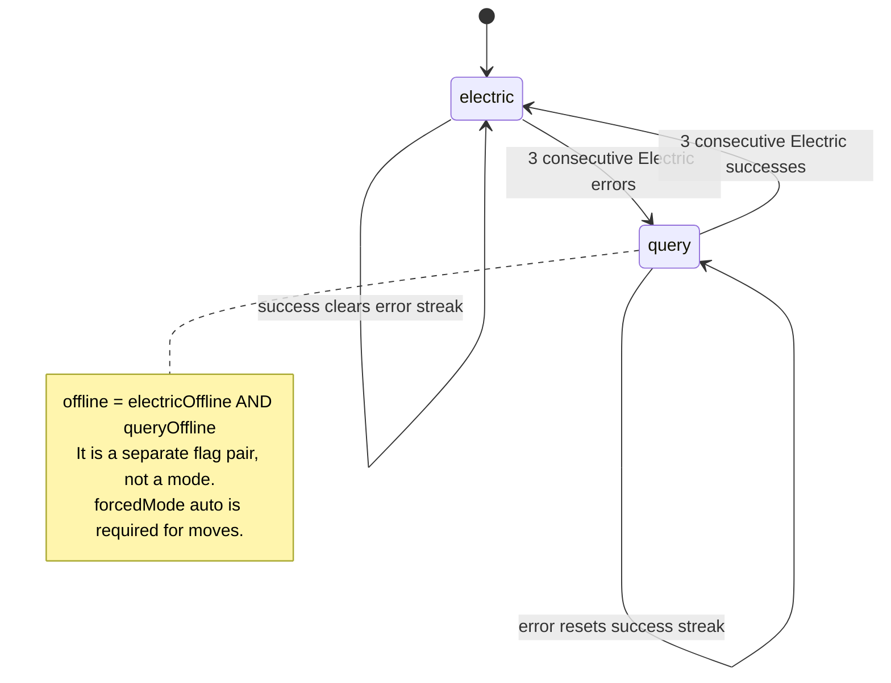
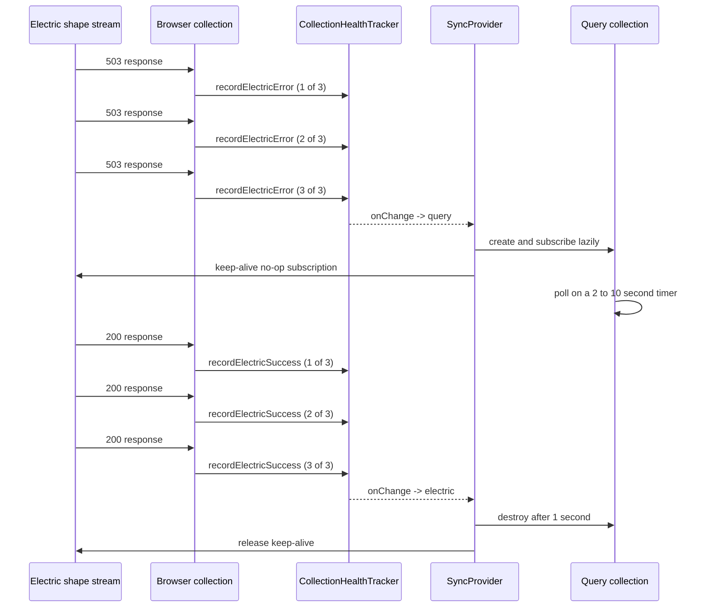

# The sync engine: Electric, the health tracker, and the query fallback

The sync engine gives the browser two ways to read the same rows: a live Electric stream and a polling query fallback. One per-collection state machine decides which transport the user interface (UI) reads at any moment. This document explains both transports, the numbers that govern the switch, and the way the React provider wires them together. Every claim cites the source snapshot at commit `2f66a45b186d88488fa356862be0117db1ccae9f`.

## What the sync engine must do

The database is the only source of truth. The browser cannot open a Structured Query Language (SQL) connection to Postgres. It must receive rows over the HyperText Transfer Protocol (HTTP). Electric pushes shape changes over a long-poll connection. A second path polls an Application Programming Interface (API) with a normal query.

Electric is a read-sync service. A shape is one filtered table stream. A TanStack DB collection is the client-side store that applies shape changes to rows. A TanStack Query collection fills the same store from a polling request.

Each table needs both paths. Electric is fast and incremental. It can also stop: a proxy restart, a bad token, a network change, or an upstream error ends the stream. When Electric fails, the UI must keep working with stale-but-refreshable data. The query path supplies that data on a timer.

**Aha:** The two paths are not equal partners. Electric is the normal path, and the query path is a controlled fallback. The user interface reads from only one collection at a time. It creates the query collection only after Electric fails, and it schedules the query collection for destruction after Electric recovers. This keeps one clear rendering owner of each table. It does **not** keep one copy of the rows: in query mode the Electric collection still receives and stores rows, because the keep-alive subscription keeps its shape stream open. That duplicate in-memory copy is the price of observability. Without the no-op listener, `syncMode: 'on-demand'` would stop the shape stream when the last real subscriber leaves, no success could reach the tracker, and the engine could never prove that Electric recovered.

The package files have one job each.

| File | Main export | Job |
|------|-------------|-----|
| `packages/sync/src/electric-collection.ts` | `createElectricCollection` | Build a TanStack DB collection over an Electric shape. |
| `packages/sync/src/sync-config.ts` | `buildElectricSyncUrl`, `DEFAULT_BACKOFF_OPTIONS` | Build the shape Uniform Resource Locator (URL) and hold retry values. |
| `packages/sync/src/browser-electric-collection.ts` | `createBrowserElectricCollection` | Add async authorization, caching, cleanup, and keep-alive. |
| `packages/sync/src/health-tracker.ts` | `CollectionHealthTracker` | Run the per-collection state machine. |
| `packages/sync/src/tracked-fetch.ts` | `createTrackedFetchClient` | Classify each fetch result for the tracker. |
| `packages/sync/src/sync-error-handler.ts` | `createElectricSyncErrorHandler` | Map status codes to retry or stop decisions. |
| `packages/sync/src/query-collection.ts` | `createQueryCollection` | Build a TanStack Query-backed collection. |
| `packages/sync/src/sync-query-helpers.ts` | `createSyncQueryFn` | Convert filters, sorts, bigint values, and pages. |
| `packages/sync/src/collection-cache.ts` | `createCollectionCache` | Deduplicate collections and evict on cleanup. |
| `packages/sync/src/collection-key.ts` | `defaultCollectionKey` | Use the `id` column as the key, or fail clearly. |
| `packages/sync/src/constants.ts` | thresholds and intervals | Hold every tunable number. |
| `packages/sync/src/electric-keep-alive.ts` | `attachElectricKeepAlive` | Keep a degraded Electric stream alive so it can recover. |

## The Uniform Resource Locator and the backoff

`buildElectricSyncUrl(syncOrigin, syncVersion, routePath)` returns the full shape URL. The body is `${syncOrigin}/v${syncVersion}${routePath}`, passed through `new URL(...)`. The function is at `packages/sync/src/sync-config.ts:35-38`. `syncOrigin` is the scheme, host, and port of the proxy service. `routePath` is the route for one table, such as `/sessions`. `syncVersion` selects the proxy route group.

`SyncRouteVersion` is `SyncPathVersion | 3` (`packages/sync/src/sync-config.ts:11`). `SyncPathVersion` is the organization setting type, either 1 or 2. The organization setting stores version 1 or 2. A single collection can pin version 3. For example, online hosts use route version 3 while the organization-wide value stays 2 (`apps/riptide-ui/src/collections/electric/online-hosts.ts:12-13`). This lets a new shape contract ship without a global migration. Version 1 applies an owner rule, a user access-list rule, and an organization access-list rule. Version 2 scopes rows by organization. Version 3 changes the columns for two shapes, online hosts and agent slash commands. The [proxy document](06-electric-proxy.md) gives the rule sets.

The retry values are a constant object.

```ts
// packages/sync/src/sync-config.ts:13-18
export const DEFAULT_BACKOFF_OPTIONS = {
	initialDelay: 500,
	maxDelay: 10_000,
	multiplier: 1.3,
	maxRetries: Infinity,
} as const
```

The first retry waits 500 milliseconds. Each later delay multiplies by 1.3. The delay stops growing at 10,000 milliseconds. `maxRetries: Infinity` means the retry loop never exhausts its own retry budget. This design treats a dropped long poll as routine. A request that fails once is retried for as long as the page stays open. The error handler can still stop the stream on a 404 or when retry is disabled. The tracker counts responses, not retry attempts. Each failed response records one error before the delay starts. Three failed responses in a row therefore reach the threshold, although the stream keeps retrying.

`AccessTokenUnavailableError` is defined in the same file (`packages/sync/src/sync-config.ts:20-25`). The async authorization header throws it when the token fetcher fails. The error handler uses the type to separate auth lifecycle from real sync faults.

## The Electric collection adapter

`createElectricCollection` is the shared adapter for every app. It accepts a schema, a collection name, the sync origin, the route version, and the route path. It also accepts an optional tracker, headers, the retry policy, a logger, an optional error reporter, an auth-unavailable predicate, and an optional key function (`packages/sync/src/electric-collection.ts:16-29`).

The adapter builds `shapeOptions`. The URL comes from `buildElectricSyncUrl`. A subset is an additional filter and row window that a live query asks the collection to load beyond the shape's own filter. The browser cannot put that request in the shape Uniform Resource Locator (URL), because the live query chooses it at run time. Subsets therefore use `subsetMethod: 'POST'`: the collection sends the filter, its parameters, the sort, and the limit in a JSON body, and the proxy merges them into the upstream shape request (`apps/riptide-electric-proxy/src/lib/effect/electric-proxy.service.ts:33-69`). The adapter installs the error handler. It also installs the default backoff. When a tracker is present, the adapter wraps the global `fetch` in `createTrackedFetchClient`.

```ts
// packages/sync/src/electric-collection.ts:31-57
export function createElectricCollection<TSchema extends StandardSchema<object>>(
	options: ElectricCollectionOptions<TSchema>,
): Collection<InferSchemaOutput<TSchema>, string | number> {
	const getKey = options.getKey ?? defaultCollectionKey
	const shapeOptions: {
		url: string
		subsetMethod: 'POST'
		headers: ElectricCollectionOptions<TSchema>['headers']
		onError: ReturnType<typeof createElectricSyncErrorHandler>
		backoffOptions: typeof DEFAULT_BACKOFF_OPTIONS
		fetchClient?: typeof fetch
	} = {
		url: buildElectricSyncUrl(options.syncOrigin, options.syncVersion, options.routePath),
		subsetMethod: 'POST',
		headers: options.headers,
		onError: createElectricSyncErrorHandler({
			collectionName: options.collectionName,
			shouldRetryOnFailure: options.shouldRetryOnFailure,
			logger: options.logger,
			captureException: options.captureException,
			isAuthUnavailableError: options.isAuthUnavailableError,
		}),
		backoffOptions: DEFAULT_BACKOFF_OPTIONS,
	}
	if (options.tracker !== undefined) {
		shapeOptions.fetchClient = createTrackedFetchClient(options.tracker, options.collectionName) as typeof fetch
	}
```

The final call sets `autoIndex: 'eager'`, `defaultIndexType: BasicIndex`, `getKey`, and `syncMode: 'on-demand'` (`packages/sync/src/electric-collection.ts:62-70`). Two matter here. `getKey` defaults to `defaultCollectionKey`, which parses the row with a Zod object that requires a string `id`. A row without a string `id` throws `TypeError('Collection rows without a string id must provide getKey')` (`packages/sync/src/collection-key.ts:11-19`). `syncMode: 'on-demand'` means the collection syncs only while a subscriber exists. A mounted live query is the subscriber. When the last subscriber unmounts, the stream stops, which creates the recovery problem described below.

Two `as never` casts follow the excerpt at the collection construction call. A comment explains that `electricCollectionOptions` loses the caller's Standard Schema type through its invariant callback. The casts keep the precise row type inside the adapter and return it to consumers (`packages/sync/src/electric-collection.ts:59-71`).

## The browser layer: token, cache, and identity

`createBrowserElectricCollection` is the browser-specific shell. Its configuration adds an optional `routeVersion`, row indexes, and a key function (`packages/sync/src/collection-builder-types.ts:18-25`). Its dependencies carry the sync origin, a token fetcher, the retry flag, the tracker, the version, a logger, and an error reporter (`packages/sync/src/collection-builder-types.ts:27-35`).

The authorization header is an async function, not a string, so each request calls the token fetcher again.

```ts
// packages/sync/src/browser-electric-collection.ts:12-34
	const create = (deps: BrowserCollectionDeps) => {
		const collection = createElectricCollection({
			schema: config.schema,
			collectionName: config.collectionName,
			syncOrigin: deps.syncOrigin,
			syncVersion: config.routeVersion ?? deps.syncVersion,
			routePath: config.routePath,
			tracker: deps.tracker,
			headers: {
				Authorization: async () => {
					try {
						return `Bearer ${await deps.tokenFetcher()}`
					} catch (e) {
						throw new AccessTokenUnavailableError('Failed to fetch access token', { cause: e })
					}
				},
			},
			shouldRetryOnFailure: deps.shouldRetryOnFailure,
			logger: deps.logger,
			captureException: deps.captureException,
			isAuthUnavailableError: (e) => e instanceof AccessTokenUnavailableError,
			getKey: config.getKey,
		})
```

The header returns `Bearer <token>`. If the token fetcher throws, the header throws `AccessTokenUnavailableError` and keeps the original cause. The adapter passes `isAuthUnavailableError` as a predicate on that class. A token refresh can therefore recover a request without a reload.

After creation, the builder adds any declared indexes. It then calls `attachElectricKeepAlive`. That call connects the collection to the tracker, so a collection that degrades keeps a no-op subscriber. The reason is in the comment. An on-demand collection stops syncing when the UI swaps away from it. No Electric success would then arrive to trigger recovery (`packages/sync/src/browser-electric-collection.ts:40-42` and `packages/sync/src/electric-keep-alive.ts:26-39`).

The returned `get` function takes the user identifier, the organization identifier, a dependencies object, and the loading flag. It owns cache identity and cleanup.

```ts
// packages/sync/src/browser-electric-collection.ts:64-88
			const collection = cache.get(`${userId}:${organizationId}:v${deps.syncVersion}`, deps, {
				skipCache: isLoading,
			})

			// Cleanup all previous collections that aren't the one we're returning
			for (const prev of activeCollections) {
				if (prev !== collection) {
					deps.logger.info(`Cleaning up previous ${config.collectionName} collection`)
					prev.cleanup()
					activeCollections.delete(prev)
				}
			}

			// Track and log if this is a new collection
			if (!activeCollections.has(collection)) {
				deps.logger.info(`Collection ${config.collectionName} started syncing`, {
					userId,
					organizationId,
					isLoading,
					shouldRetryOnFailure: deps.shouldRetryOnFailure,
				})
				activeCollections.add(collection)
			}

			return collection
```

The cache key is `${userId}:${organizationId}:v${deps.syncVersion}`. Each builder creates its own cache, so the key does not need the collection name. A change of user, organization, or organization-wide sync version therefore creates a new collection. `skipCache` does not bypass an existing key: `get` returns an existing entry first (`packages/sync/src/collection-cache.ts:35-36`). On a miss it creates the collection but does not store it, so an unauthenticated instance is never reused (`packages/sync/src/collection-cache.ts:47-49`). A pinned route version is static, so it does not need to appear in the key. `activeCollections` is a set held by this builder. It holds every instance that the builder has returned. The code then walks every instance in that set and cleans up each one that is not the returned collection. This is the guard against showing one organization's rows to another organization. When `isLoading` is true, the cache write is skipped; an existing key is still returned. A token-less collection is not stored under the real key.

The cache itself holds a `Map`, creates on a miss, and listens for `status:change`. A collection that reports `cleaned-up` deletes its own key (`packages/sync/src/collection-cache.ts:35-52`). The listener closes over the cache key, so it can delete the right entry. `destroy` calls `cleanup()` and lets that listener evict the entry (`packages/sync/src/collection-cache.ts:59-64`).

Each builder fixes the route path, the collection name, and the indexes. The provider supplies the identity and the version.

| Collection name | Route path | Route version |
|-----------------|------------|---------------|
| `approvals` | `/approvals` | Organization version |
| `artifactComments` | `/artifact-comments` | Organization version |
| `artifacts` | `/artifacts` | Organization version |
| `artifactsMetadata` | `/artifacts/metadata` | Organization version |
| `conversationEvents` | `/events` | Organization version |
| `diffComments` | `/diff-comments` | Organization version |
| `onlineHosts` | `/hosts` | 3 |
| `providerLoginRequests` | `/provider-login-requests` | Organization version |
| `queuedMessages` | `/queued-messages` | Organization version |
| `sessions` | `/sessions` | Organization version |
| `taskOrganizationAcls` | `/task-organization-acls` | Organization version |
| `taskUserAcls` | `/task-user-acls` | Organization version |
| `taskUserSettings` | `/task-user-settings` | Organization version |
| `workspaceSetup` | `/task-workspace-setup-for-host` | Organization version |
| `tasks` | `/tasks` | Organization version |
| `agentSlashCommands` | `/agent-slash-commands` | 3 |

Two builders use an explicit key function because their rows have no single `id` column. `onlineHosts` keys on the host, organization, and user tuple (`apps/riptide-ui/src/collections/online-host-key.ts:3-5`). `agentSlashCommands` keys on the organization, user, host, agent, and workspace path tuple (`apps/riptide-ui/src/collections/agent-slash-commands-key.ts:3-7`). Every other builder accepts the default `id` key.

## The health tracker state machine

`CollectionHealthTracker` is a per-collection state machine. Each entry holds a mode, a success counter, an error counter, a forced mode, and two offline flags (`packages/sync/src/health-tracker.ts:14-21`). The constructor registers each collection name in electric mode. The thresholds default to `RECOVERY_SUCCESS_THRESHOLD` and `DEGRADE_ERROR_THRESHOLD` (`packages/sync/src/health-tracker.ts:48-71`).

The default degrade threshold is 3. One transient long-poll drop must not flip the UI to slow polling. A comment records this reason and the tracking identifier CORE-1326 (`packages/sync/src/constants.ts:7-12`). The recovery threshold is also 3 (`packages/sync/src/constants.ts:1-5`).

An Electric error advances the error streak and clears recovery progress.

```ts
// packages/sync/src/health-tracker.ts:110-132
	recordElectricError(name: string): void {
		const state = this.getState(name)
		// Any error resets recovery progress and advances the error streak.
		state.consecutiveSuccesses = 0
		state.consecutiveErrors += 1

		// Tolerate transient errors below the threshold — stay in the current mode.
		if (state.consecutiveErrors < this.errorThreshold) {
			return
		}

		const wasOffline = this.isOffline(name)
		state.electricOffline = true

		if (state.forcedMode === 'auto') {
			this.setMode(name, 'query')
		}

		const isNowOffline = this.isOffline(name)
		if (wasOffline !== isNowOffline) {
			this.emitOfflineChange(name, isNowOffline)
		}
	}
```

Below the threshold, the method returns and the mode does not change. At the threshold, the method marks Electric offline. If the collection is in automatic mode, it moves to query. It emits an offline change only when the combined offline state changes. A forced mode blocks the automatic move, but the offline flag still updates.

A success clears the error streak and can count toward recovery.

```ts
// packages/sync/src/health-tracker.ts:147-163
		if (state.forcedMode === 'auto' && state.mode === 'query') {
			state.consecutiveSuccesses += 1
			this.logger.debug(
				{
					collection: name,
					consecutiveSuccesses: state.consecutiveSuccesses,
					threshold: this.recoveryThreshold,
				},
				'Electric recovery progress',
			)
			if (state.consecutiveSuccesses >= this.recoveryThreshold) {
				state.consecutiveSuccesses = 0
				this.setMode(name, 'electric')
			}
		} else {
			state.consecutiveSuccesses = 0
		}
```

`recordElectricSuccess(name)` first reads the previous offline state. It then sets `electricOffline` to false and clears `consecutiveErrors` (`packages/sync/src/health-tracker.ts:138-145`). When the collection is in query mode and automatic, it increments the success counter. At three successes it resets the counter and moves to electric. If the collection is already in electric mode, or is forced, it resets the counter instead. Any error during recovery resets the success streak, because `recordElectricError` sets `consecutiveSuccesses` to zero. One success clears `electricOffline` while the mode stays query until three successes. The offline banner can therefore disappear before the user interface leaves the polling fallback. That is intended: the banner reports transport availability, not the active mode.

The query path has its own two methods. `recordQueryError` sets `queryOffline`. `recordQuerySuccess` clears it. Both emit an offline change only when the combined result changes (`packages/sync/src/health-tracker.ts:174-195`). The query side has no threshold. One query error marks that transport offline, and one success clears it. A long-poll connection drops routinely, so Electric needs a threshold. A poll either returns a complete answer or an error, so one result is enough.

A collection is offline only when both transports fail. `isOffline` returns `state.electricOffline && state.queryOffline` (`packages/sync/src/health-tracker.ts:224-227`).

This conjunction is the key rule. Neither failure alone is offline, because the other path may still work. Only the loss of both paths produces the banner.

`getMode` returns the forced mode when the forced mode is not `auto`, else the automatic mode (`packages/sync/src/health-tracker.ts:200-206`). A forced mode is `electric`, `query`, or `auto`. Forcing changes the mode that `getMode` returns. It does not change either offline flag, so the banner still reports real transport health. `forceMode` and `forceAllMode` set or clear that override (`packages/sync/src/health-tracker.ts:251-270`). `addCollection` registers a collection created later, such as a per-task artifact collection (`packages/sync/src/health-tracker.ts:277-289`). `onChange` and `onOfflineChange` return unsubscribe functions (`packages/sync/src/health-tracker.ts:295-311`).



The tracker caches `getAllModes()` and the offline name list. A mode change clears the cached modes, and an offline change recomputes the cached list (`packages/sync/src/health-tracker.ts:81-91`). The getter and the compute helper keep referential stability, because `useSyncExternalStore` requires it (`packages/sync/src/health-tracker.ts:229-245`). Without the cache, every render would receive a new array and could loop.

## Degradation and recovery, step by step

The cycle crosses four components: the browser collection, the tracked fetch, the tracker, and the provider.



`attachElectricKeepAlive` takes the collection, the tracker, and the collection name. It reads the current mode, then subscribes to `onChange`. It returns a teardown function, and the no-op `subscribeChanges` takes a listener that ignores every change. When the provider swaps to the query collection, nothing else subscribes to the Electric collection. In `on-demand` mode, that stops the shape stream. If the stream stops, no success can reach the tracker, and the recovery threshold can never be met. The collection would stay on stale data until a reload. `attachElectricKeepAlive` holds a no-op `subscribeChanges` while the mode is query, then releases it on recovery. The tracker observes responses, not timer ticks. The no-op subscription keeps requests flowing, so a recovered upstream produces the three successes the threshold requires. The function also tears down on `status:change` with `cleaned-up`, so it cannot outlive the collection (`packages/sync/src/electric-keep-alive.ts:75-119`).

## What counts as an Electric failure

`createTrackedFetchClient` wraps the global fetch. It records an error for a response at or above 500. It records a success for any `response.ok` result. It ignores every other status. It also records an error only for a thrown `TypeError`, which is what the fetch standard uses for a network failure. Other thrown values, including `AbortError`, are rethrown without a tracker event.

```ts
// packages/sync/src/tracked-fetch.ts:35-58
	return async (input: Request | string | URL, init?: RequestInit): Promise<Response> => {
		try {
			const response = await fetch(input, init)

			if (response.status >= 500) {
				logger?.warn({ status: response.status, collectionName }, 'Electric fetch 5XX')
				tracker.recordElectricError(collectionName)
			} else if (response.ok) {
				tracker.recordElectricSuccess(collectionName)
			}

			return response
		} catch (err) {
			// Only treat real network errors as Electric failures. fetch() throws
			// TypeError for genuine network issues (DNS failure, connection refused).
			// Everything else — AbortError, raw strings thrown by Electric's internal
			// fetch wrappers during abort/reconnection cycles — should be ignored.
			if (err instanceof TypeError) {
				logger?.warn({ collectionName, error: (err as Error).message }, 'Electric fetch network error')
				tracker.recordElectricError(collectionName)
			}

			throw err
		}
```

A 1XX, 3XX, or 4XX response is not an Electric outage. A 401 or 403 is an auth lifecycle event, and the error handler manages it. Counting those statuses as failures would degrade the UI during a normal token refresh. The comment also explains the retry environment: Electric wraps the fetch in an infinite-backoff loop, so individual attempts fail and recover constantly (`packages/sync/src/tracked-fetch.ts:17-21`).

| Fetch outcome | Tracker action | Reason |
|---------------|----------------|--------|
| 5XX response | `recordElectricError` | The upstream service is failing. |
| 2XX response | `recordElectricSuccess` | The stream is healthy. |
| 1XX, 3XX, 4XX response | none | These are not Electric outages; auth is handled elsewhere. |
| Thrown `TypeError` | `recordElectricError` | The network failed. |
| Any other thrown value | none | Aborts and internal wrapper errors are expected churn. |

## The error handler: status by status

The Electric error handler returns a value to Electric. `{}` tells Electric to retry or re-sync. `undefined` tells Electric to stop the shape stream. Most branches retry; the 404 and retry-denied branches stop on purpose. The handler's `tags` object carries `sync.mode` and `sync.collection`.

```ts
// packages/sync/src/sync-error-handler.ts:147-174
		// Electric's FetchError carries the shape URL on `.url` even when the message
		// is a bare network string like "Load failed" / "Failed to fetch".
		const url = isFetchError(error) ? error.url : undefined

		if (isFetchError(error)) {
			if (error.status === 401 || error.status === 403) {
				opts.logger.info(`Auth error (${error.status}) syncing ${opts.collectionName}; retrying after delay`)
				await new Promise((resolve) =>
					setTimeout(resolve, opts.authErrorRetryDelayMs ?? AUTH_ERROR_RETRY_DELAY_MS),
				)
				return {}
			}
			if (error.status === 404) {
				opts.logger.error(`Sync endpoint not found for ${opts.collectionName} (url: ${url}); stopping sync.`)
				opts.captureException?.(error, { tags })
				return
			}
			if (error.status === 409) {
				return {}
			}
		}

		opts.logger.error(`Error syncing ${opts.collectionName} (url: ${url ?? 'unknown'}):`, error)
		opts.captureException?.(error, { tags })
		if (opts.shouldRetryOnFailure) {
			return {}
		}
	}
```

The handler reads the shape URL from the error when the error is a duck-typed `FetchError`. It cannot use `instanceof`, because Vite may bundle a separate copy of the Electric client. The duck-type check uses an Effect schema (`packages/sync/src/sync-error-handler.ts:19-21`). `authErrorRetryDelayMs` is an optional override for the 2,000 millisecond wait.

The auth-unavailable branch runs before the status branches. After initial load, it writes a warning on every occurrence and a console error only once. It then waits 2,000 milliseconds and returns `{}`. During initial load it logs and returns `undefined`. The handler uses `shouldRetryOnFailure` as the after-load switch. The provider sets it to `!isLoading`. The constant is `AUTH_ERROR_RETRY_DELAY_MS = 2_000` (`packages/sync/src/sync-error-handler.ts:75`). The reason for the split is that a collection created during load is recreated when `isLoading` becomes false. That new collection gets a fresh header and a fresh token fetch.

| Condition | Delay | Return | Effect |
|-----------|-------|--------|--------|
| Auth token unavailable, after load | 2,000 ms | `{}` | Retry with a fresh token fetch. |
| Auth token unavailable, during load | none | `undefined` | Stop; the provider recreates the collection after load. |
| 401 or 403 | 2,000 ms | `{}` | Retry after a likely refresh. |
| 404 | none | `undefined` | Stop; the route is wrong. |
| 409 | none | `{}` | Electric control flow; re-sync now. |
| Unknown error, retry allowed | none | `{}` | Retry. |
| Unknown error, retry denied | none | `undefined` | Stop. |

The 404 branch reports to the error reporter, which is Sentry. The 401 and 403 branches do not report, because they are expected auth churn. The unknown branch reports and then obeys `shouldRetryOnFailure`. The query error handler, `createQuerySyncErrorHandler`, uses the same auth-lifecycle filter and tags every other error with `sync.mode` and `sync.collection` (`packages/sync/src/sync-error-handler.ts:56-73`).

## The query fallback

`createQueryCollection` builds a TanStack DB collection over a TanStack Query cache. The options include the API procedure call, the row schema, the tracker, the query client, bigint fields, indexes, a refetch interval, and optional pagination (`packages/sync/src/query-collection.ts:18-33`). The builder also supplies any extra procedure input and an error callback.

```ts
// packages/sync/src/query-collection.ts:48-75
	const collection = createCollection(
		queryCollectionOptions({
			id: options.id,
			queryKey: options.queryKey,
			queryFn: createSyncQueryFn(
				options.procedure,
				options.input,
				options.tracker,
				options.collectionName,
				onError,
				options.pagination,
			),
			select: (data): Row[] => {
				const rows = QueryResultRowsSchema.parse(data.rows)
				const coercedRows = options.bigIntFields?.length
					? coerceBigIntFields(rows, options.bigIntFields.map(String))
					: rows
				return options.rowSchema.array().parse(coercedRows)
			},
			queryClient: options.queryClient,
			autoIndex: 'eager',
			defaultIndexType: BasicIndex,
			getKey,
			syncMode: 'on-demand',
			refetchInterval: options.refetchInterval,
			retry: false,
		}),
	)
```

The `select` function runs three steps. It parses `data.rows` with a generic record array schema. It converts configured bigint fields. It parses the result with the precise row schema. The collection sets `retry: false`, because the tracker records every failure and the polling interval supplies the retry. `refetchInterval` comes from the caller and defaults to the per-collection table in `constants.ts`.

A live query is a TanStack DB query that runs in the browser and declares the row subset it needs: a filter, a sort, and a limit. `loadSubsetOptions` is the object that carries those three demands to the collection. `Standard Schema` is a common validation interface that schema libraries such as Zod implement; the adapter's generic constraint uses it so any such library can supply the row schema (`packages/sync/src/electric-collection.ts:31-33`).

The filter wire format is `SyncWhereExpression`. It has four node types: comparison, and, or, and not. `loadSubsetOptions` is the TanStack DB description of the rows a live query needs: filter, sort, and limit. A comparison node carries a field, an operator, and a value. The group nodes carry child expressions. `intermediateRepresentationToWhereExpression` converts the TanStack DB intermediate representation into that format (`packages/sync/src/sync-query-helpers.ts:37-132`). It handles `eq`, `gt`, `gte`, `lt`, `lte`, `in`, `like`, `ilike`, `isNull`, and `isUndefined`. It collapses an `and` or `or` with one child, drops null children, and returns null for an empty group. A `not` around a comparison becomes a `not_<operator>` comparison. An unknown operator returns null and is silently dropped. The resulting filter is wider than the live query asked for, because the missing condition is not replaced. `irToSorts` converts order clauses to field, direction, and null ordering (`packages/sync/src/sync-query-helpers.ts:137-147`).

Bigint values need explicit repair. The API process installs `BigInt.prototype.toJSON = () => this.toString()`, so a bigint column arrives as a string such as `"1771621345994"`. Electric handles this itself. The query path does not.

```ts
// packages/sync/src/sync-query-helpers.ts:188-199
export function coerceBigIntFields<T extends Record<string, unknown>>(rows: T[], fields: (keyof T)[]): T[] {
	return rows.map((row) => {
		const coerced = { ...row }
		for (const field of fields) {
			const val = coerced[field]
			if (typeof val === 'string' && val !== '') {
				;(coerced as Record<string, unknown>)[field as string] = BigInt(val)
			}
		}
		return coerced
	})
}
```

The coercion copies each row and replaces non-empty strings with `BigInt` values. The row schema then validates the result. The Drizzle schema declares those columns as bigint, so the browser row must hold a `BigInt` and not a string.

Paging is the last helper. A server caps one response at 10,000 rows. The artifact metadata collection requests that page size and declares a stable sort by `id` (`apps/riptide-ui/src/collections/query/artifacts-metadata.ts:9` and `apps/riptide-ui/src/collections/query/artifacts-metadata.ts:20-23`). The helper fetches additional pages while the last page is full.

```ts
// packages/sync/src/sync-query-helpers.ts:220-236
async function fetchAllPages<T extends { rows: unknown[] }>(
	apiFn: (input: Record<string, unknown>) => Promise<T>,
	input: Record<string, unknown>,
	pagination: SyncQueryPagination,
): Promise<T> {
	if (!Number.isSafeInteger(pagination.pageSize) || pagination.pageSize <= 0) {
		throw new Error('Sync query pagination pageSize must be a positive safe integer')
	}

	const rows: unknown[] = []
	for (let offset = 0; ; ) {
		const page = await apiFn({ ...input, limit: pagination.pageSize, offset })
		rows.push(...page.rows)
		if (page.rows.length < pagination.pageSize) return { ...page, rows }
		offset += page.rows.length
	}
}
```

`fetchAllPages` rejects a page size that is not a positive safe integer. It then loops with `limit` and `offset`, appends each page, and stops when a page is shorter than the page size. The loop trusts the procedure to honor `offset`. A procedure that ignored `offset` and always returned a full page would loop forever. The helper has no page-count guard. The test at `packages/sync/test/sync-query-helpers.test.ts:417-449` proves the behavior with 10,001 rows in two calls.

`createSyncQueryFn` is the wrapper around every poll (`packages/sync/src/sync-query-helpers.ts:238-269`). It reads `ctx.meta.loadSubsetOptions`, converts the filter and sorts, and adds the configured stable sorts, such as `id`, when the live query did not supply them, and calls the procedure. It records a query success or a query error on the tracker. It calls the error handler and rethrows. `onError` receives the thrown value after the tracker records the failure. The function then rethrows, so the query client sees the error. Paging runs only when pagination is configured and the caller did not ask for a limit. A caller limit is passed through unchanged.

## Constants: thresholds and intervals

All tunable values live in one file.

```ts
// packages/sync/src/constants.ts:43-58
export const REFETCH_INTERVALS: Record<CollectionName, number> = {
	conversationEvents: 4_000,
	approvals: 10_000,
	artifactComments: 10_000,
	diffComments: 10_000,
	sessions: 10_000,
	artifacts: 10_000,
	artifactsMetadata: 10_000,
	tasks: 10_000,
	onlineHosts: 10_000,
	providerLoginRequests: 2_000,
	queuedMessages: 10_000,
	taskOrganizationAcls: 10_000,
	taskUserAcls: 10_000,
	taskUserSettings: 10_000,
	workspaceSetup: 10_000,
```

The intervals express urgency. Conversation events change quickly, so they poll every 4 seconds. Provider login requests are short-lived, so they poll every 2 seconds. Every other collection polls every 10 seconds. There is no entry for `agentSlashCommands`; the provider builds no query collection for it.

| Constant | Value | Meaning |
|----------|-------|---------|
| `DEGRADE_ERROR_THRESHOLD` | 3 | Consecutive Electric errors before query mode. |
| `RECOVERY_SUCCESS_THRESHOLD` | 3 | Consecutive Electric successes before electric mode. |
| `AWAIT_TX_TIMEOUT` | 10,000 ms | Maximum wait for a transaction identifier after a write. |
| `conversationEvents` refetch | 4,000 ms | Query-mode poll interval. |
| `providerLoginRequests` refetch | 2,000 ms | Query-mode poll interval. |
| All other collections | 10,000 ms | Query-mode poll interval. |
| Electric initial backoff | 500 ms | First retry delay. |
| Electric backoff multiplier | 1.3 | Growth factor per retry. |
| Electric maximum backoff | 10,000 ms | Delay cap. |
| Electric maximum retries | infinite | The stream never gives up. |

`AWAIT_TX_TIMEOUT` is used by `confirmTx`. The write procedure returns `pg_current_xact_id()::text`, the identifier of the PostgreSQL transaction that wrote the row (`apps/riptide-api/src/db/get-tx-id.ts:4-7`). Electric includes that identifier in each shape message. `utils.awaitTxId` resolves when the collection has applied a message whose transaction identifier is at or past the given value. In query mode there is no such message, so the provider triggers a refetch instead. If the identifier never arrives, the wait rejects after 10 seconds, and the caller rolls back its optimistic row and restores the draft (`apps/riptide-ui/src/actions/sessions.ts:878-884`).

## The React integration

`SyncProvider` is the place where all the pieces meet. The organization-wide sync version is hardcoded to 2 at `apps/riptide-ui/src/components/providers/SyncProvider.tsx:237`. Individual collections can still pin route version 3.

The token fetcher gates on WorkOS auth state and organization membership. WorkOS is the identity provider, and `getAuthKitAccessToken` returns its access token.

```ts
// apps/riptide-ui/src/components/providers/SyncProvider.tsx:236-243
	const syncForceMode = useSettingsStore((s) => s.syncForceMode)
	const syncVersion: SyncVersion = 2
	const getAccessToken = useCallback(() => {
		if (isLoading || !user || !organizationId) {
			return Promise.reject(new AccessTokenUnavailableError('Authentication is not ready'))
		}
		return getAuthKitAccessToken()
	}, [getAuthKitAccessToken, isLoading, organizationId, user])
```

If auth is still loading, or the user is absent, or the organization is absent, the callback rejects with `AccessTokenUnavailableError`. Otherwise it calls the WorkOS access token function. This rejection is the expected first state, not a bug. The provider installs an `unhandledrejection` listener that suppresses only this error class (`apps/riptide-ui/src/components/providers/SyncProvider.tsx:250-261`).

Each Electric collection is built inside `useMemo`. The dependency list includes the user identifier, the organization identifier, the token fetcher, the loading flag, and the sync version. For example, the sessions collection is built at `apps/riptide-ui/src/components/providers/SyncProvider.tsx:282-284`. The `isLoading` argument reaches the builder twice. The collection module maps it to `shouldRetryOnFailure: !isLoading`, and the builder's `get` function uses it as the `skipCache` argument. Both uses have the same purpose. Do not retry or cache a collection that cannot authenticate yet.

The provider subscribes to tracker mode changes with `useSyncExternalStore` (`apps/riptide-ui/src/components/providers/SyncProvider.tsx:274-278`). The snapshot is `tracker.getAllModes()`. The cached object in the tracker keeps the snapshot stable between real changes. The provider also reads `syncForceMode` from the settings store and applies it with `tracker.forceAllMode(...)` (`apps/riptide-ui/src/components/providers/SyncProvider.tsx:265-266`).

Query collections are lazy. An effect watches the tracker. It creates a query collection when a name enters query mode. It destroys one when the name leaves query mode. The effect first creates any collection that is already degraded, because the switch may have happened before the effect ran (`apps/riptide-ui/src/components/providers/SyncProvider.tsx:447-451` and `apps/riptide-ui/src/components/providers/SyncProvider.tsx:760-776`). Creation is guarded by `syncAuthReady`.

`useSyncAuthReady` runs a TanStack Query request that asks for a token. It is enabled only when auth is not loading and both identifiers exist. It retries with a delay of `min(250 * 2 ** attempt, 2000)` and caches the readiness result forever (`apps/riptide-ui/src/hooks/use-sync-auth-ready.ts:15-29`). This flag separates "the token is not ready" from "the table is empty". Without the flag, the UI cannot tell those two states apart after a failed shape request.

The swap is a per-name ternary. When the mode is query, the provider uses the query ref if it exists, else it falls back to the Electric collection for that render (`apps/riptide-ui/src/components/providers/SyncProvider.tsx:874-884`).

The effect usually creates the query collection before the next render. If a render happens first, the UI still has a valid collection and may show stale data for one frame.

`confirmTx` abstracts the post-write wait.

```ts
// apps/riptide-ui/src/components/providers/SyncProvider.tsx:927-942
	const confirmTx = useMemo(
		() => ({
			sessions: async (txId: string | number): Promise<void> => {
				if (modes.sessions === 'query' && sessionsQueryRef.current) {
					await sessionsQueryRef.current.utils.refetch()
				} else {
					await sessionsElectric.utils.awaitTxId(Number(txId), AWAIT_TX_TIMEOUT)
				}
			},
			tasks: async (txId: string | number): Promise<void> => {
				if (modes.tasks === 'query' && tasksQueryRef.current) {
					await tasksQueryRef.current.utils.refetch()
				} else {
					await tasksElectric.utils.awaitTxId(Number(txId), AWAIT_TX_TIMEOUT)
				}
			},
```

In query mode the function calls `utils.refetch()` on the active query collection. In electric mode it calls `utils.awaitTxId(Number(txId), AWAIT_TX_TIMEOUT)`. Electric reports progress with transaction identifiers, and `awaitTxId` resolves when the stream has applied the given identifier. The 10-second timeout bounds the wait. The same pattern repeats for every collection in the object. Callers receive `txId` from the write that created the row. The dependency list includes every mode and every Electric collection, so the closures always see the current objects.

`deferredDestroyQueryCollection` delays destruction by 1,000 milliseconds (`apps/riptide-ui/src/components/providers/SyncProvider.tsx:119-137`). It also cancels and removes the matching `['sync', collectionName]` queries. The delay prevents a fast degrade-recover cycle from destroying a collection that a component is still reading.

### The tracker singleton and the offline banner

The application creates one tracker at module scope. Its collection list comes from the keys of `REFETCH_INTERVALS`, plus `agentSlashCommands` (`apps/riptide-ui/src/services/tracker.ts:11-13`). The fifteen interval names each have a query collection in the provider. `agentSlashCommands` is added separately and has no query collection, so its tracker mode has no consumer in this provider. If its Electric stream fails, no polling path replaces it: the rows stay stale, and the offline banner shows the collection only when its query path also reports failure, which it never does without a query collection.

`SyncOfflineBanner` subscribes to the tracker offline state. It uses `useSyncExternalStore` with `onOfflineChange` and returns `getOfflineCollections()` as the snapshot (`apps/riptide-ui/src/components/SyncOfflineBanner.tsx:23-30`).

When the list is empty, the component renders nothing. Otherwise it renders an alert. The text names the single collection or gives the count. The action "View diagnostics" navigates to the sync settings route. Because the list changes only when the conjunction of both failures changes, the banner does not flicker during a single transport outage.

## Next

Read [The Electric proxy](06-electric-proxy.md) to see the server side of every shape request. The proxy adds the tenant filter that makes these collections safe. Read [Write paths and idempotency](09-write-paths-and-idempotency.md) for the write half of `confirmTx`. Read [The user interface application](10-ui-application.md) for the React application that hosts this provider.
