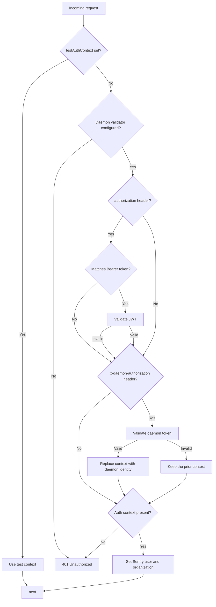
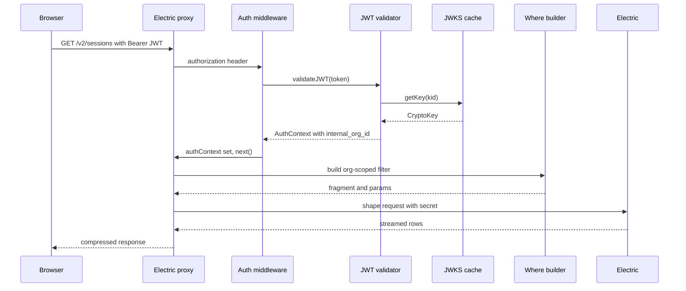

# The Electric proxy: authentication, tenancy, and access filters

The Electric proxy is the only component that may talk to the Electric service. It validates a user or daemon identity, computes a tenant filter, appends the upstream secret, and forwards a shape request. Clients never hold the Electric secret and never choose their own filter. This document explains the server, the two authentication paths, the version 1, version 2, and version 3 access filters, and the failure behavior. Every claim cites the source snapshot at commit `2f66a45b186d88488fa356862be0117db1ccae9f`.

## Why the proxy exists

Electric exposes a shape endpoint that accepts a table name, a filter, and a secret. If a browser called Electric directly, the filter would be client-controlled. Any user could request another organization's rows by editing a query parameter. The proxy removes that option. It accepts a narrow route instead of a general query. It builds the filter on the server from the authenticated context.

The proxy also owns the upstream credential. The browser sends a WorkOS access token, which is a JavaScript Object Notation (JSON) Web Token (JWT). WorkOS is the identity provider. The proxy sends the Electric secret. The two credentials never mix. A stolen browser token cannot be replayed against Electric, because Electric does not accept it.

The application is a Hono server on Node.js. It has five route files and six mounts, because the stream module is mounted twice. One shared proxy service forwards every shape request.

| Path | Mount | Purpose |
|------|-------|---------|
| `routes/response-editor-collaboration.ts` | `/` | Session collaboration before the versioned route groups. |
| `routes/v1.ts` | `/v1` | Legacy access rule with ownership and Access Control List (ACL) subqueries. |
| `routes/v2.ts` | `/v2` | Organization-scoped access plus daemon routes. |
| `routes/v3.ts` | `/v3` | New column contracts for hosts and agent slash commands. |
| `routes/streams.ts` | `/streams` | Durable Streams proxy for session events and diffs. |
| `routes/streams.ts` | `/v2/streams` | Durable Streams proxy without the session route. |

## The entry point and the mandatory secret

`index.ts` reads three values from the environment. `ELECTRIC_SHAPE_URL` and `DURABLE_STREAMS_ORIGIN` are required. `ELECTRIC_SECRET` is optional in development and mandatory in production.

```ts
// apps/riptide-electric-proxy/src/index.ts:30-37
if (ELECTRIC_SECRET) {
	logger.info('Successfully loaded ELECTRIC_SECRET from environment')
} else if (process.env.NODE_ENV === 'production') {
	logger.error('ELECTRIC_SECRET not found in process environment in production!')
	throw new Error('ELECTRIC_SECRET not found in process environment in production mode.')
} else {
	logger.warn('ELECTRIC_SECRET not found in process environment, this is ok in non-production.')
}
```

The production check throws, so the process does not start without the secret. A development start logs a warning and continues. This split lets a local stack run an unauthenticated Electric instance. When the secret is absent, the proxy appends no `secret` parameter, so the upstream Electric instance must accept requests without one. The `resolveProxyRuntimeEnvironment` function enforces the two required values and throws when either is absent (`apps/riptide-electric-proxy/src/runtime-environment.ts:7-17`).

The port resolves from `RIPTIDE_ELECTRIC_PROXY_PORT`, then `PORT`, then 8888 (`apps/riptide-electric-proxy/src/server-port.ts:1-5`). The expression `Number(...) || 8888` also sends an empty, non-numeric, or zero value to 8888. The server sets `keepAliveTimeout = 0` after start (`apps/riptide-electric-proxy/src/index.ts:56-60`). This disables the Node.js idle timeout for long-lived shape responses. A long poll must not be cut by a server-side keep-alive limit.

The process installs an `uncaughtException` handler. It ignores known socket teardown codes such as `ECONNRESET` and `UND_ERR_SOCKET`, and exits on anything else after flushing Sentry (`apps/riptide-electric-proxy/src/index.ts:62-85`). An upstream socket close is normal for a proxy that streams. It must not kill the task.

## The Hono server

`createApp` has no side effects. It receives the application configuration, including the Effect runtime, and builds the middleware chain. The body limit comes first, before any route or parser.

```ts
// apps/riptide-electric-proxy/src/server.ts:29-54
	// Body size limit - prevents OOM from large payloads
	app.use(
		'*',
		bodyLimit({
			maxSize: 10 * 1024 * 1024, // 10 MB
			onError: (c) => c.json({ error: 'Request body too large', maxSize: '10MB' }, 413),
		}),
	)

	attachGlobalErrorHandler(app)
	app.use(cors())
	app.use('*', async (_c, next) => {
		return config.effectRuntime.runPromise(
			Effect.gen(function* () {
				const metrics = yield* ConnectionMetrics
				return yield* metrics.trackRequest(Effect.promise(() => next()))
			}),
		)
	})
	app.get('/', async (c) => c.json({ status: 'online' }))

	// Electric serves everything uncompressed by design and expects the proxy in
	// front of it to negotiate encoding, so gzip all responses here. Streaming
	// routes opt out automatically by declaring `Cache-Control: no-transform`
	// (see routes/streams.ts) — compress honors it, as do compliant intermediaries.
	app.use('*', compress())
```

The limit is 10 mebibytes. A larger body receives status 413 with a JSON message. The global error handler and Cross-Origin Resource Sharing (CORS) follow. A metrics middleware wraps every request in the Effect runtime and records it through `ConnectionMetrics`. `ConnectionMetrics` is the Effect service that counts upstream connections and request outcomes. The health route returns `{ status: 'online' }`. The compression middleware is registered after the health route, so it applies to every route mounted later. The health response itself is not compressed.

Compression matters because Electric serves uncompressed data by design. The proxy negotiates the encoding. Streaming routes opt out by declaring `Cache-Control: no-transform`, and the compression middleware honors that value (`apps/riptide-electric-proxy/src/server.ts:50-54`). A buffering transform would hold back incremental stream chunks.

The mounts are ordered (`apps/riptide-electric-proxy/src/server.ts:56-70`).

The collaboration application is mounted at `/` before the versioned groups. Its comment says this order matters: it must run before the version 2 wildcard middleware (`apps/riptide-electric-proxy/src/server.ts:62-63`). The version 2 app registers its auth middleware with `app.use`, so that middleware matches every path under `/v2`, including `/v2/collaboration/...` (`apps/riptide-electric-proxy/src/routes/v2.ts:53-54`). The collaboration app applies its own rule: it rejects daemon tokens and a user from another organization (`apps/riptide-electric-proxy/src/routes/response-editor-collaboration.ts:30-33`). If the version 2 app matched first, the request would be authenticated as a shape request and would never reach that handler. The two stream mounts pass different options. `/streams` disables task diffs and pull-request status. `/v2/streams` disables the session route (`apps/riptide-electric-proxy/src/server.ts:59-60`). The version 2 group holds fifteen table routes, including `/sessions`, `/tasks`, `/artifacts`, `/artifacts/metadata`, and `/provider-login-requests`, four daemon routes, and a separate task artifact route (`apps/riptide-electric-proxy/src/routes/v2.ts:56-230`).

## The authentication decision

`createAuthMiddleware` accepts an `AppConfig`. When `config.testAuthContext` is set, it stores that context and calls `next()` without any validation. This branch exists for tests only. A production configuration never sets the field.

The real path reads two headers.

```ts
// apps/riptide-electric-proxy/src/middleware.ts:80-106
			// User authorization path
			if (authHeader) {
				const match = authHeader.match(/^Bearer (.+)$/)
				// Extract Bearer token
				if (!match || !match[1]) {
					logger.error('Unable to locate token in authorization header')
					authContext = null
				} else {
					// Validate JWT and extract auth context
					const token = match[1]
					authContext = await validateJWT(token)
				}
			}

			if (daemonAuthHeader) {
				try {
					const ctx = await config.validateDaemonToken(daemonAuthHeader)
					if (ctx)
						authContext = {
							organizationId: ctx.organizationId,
							userId: ctx.userId,
							hostId: ctx.hostId,
						}
				} catch (error) {
					logger.error('Daemon token validation failed', error)
				}
			}
```

The `authorization` header must match `Bearer <token>`. A header without that form logs an error and leaves the context null. A valid Bearer token goes to the JWT validator. The validator wrapper runs the Effect and converts any typed failure to `null`, so the middleware receives a plain value or null (`apps/riptide-electric-proxy/src/auth/jwt-validator.ts:8-23`). The `x-daemon-authorization` header is validated by the injected daemon validator. When that validator returns claims, the middleware replaces the context with the daemon identity.

**Aha:** The daemon block runs after the Bearer block, so the daemon identity wins. The order is the precedence rule. A request that carries both headers is treated as the daemon, not as the user. This is safe. The daemon token is scoped to one host and one user. A daemon request also needs the `hostId` claim that a user token does not have. If daemon validation throws, the catch logs the error and leaves any valid user context in place. A `null` result leaves the prior context in place.

The rest of the method handles failure and success (`apps/riptide-electric-proxy/src/middleware.ts:108-125`).

Only token validation failures produce the auth-failure report and the 401. The configuration check above returns a bare 401 without a report. The `next()` call is deliberately outside the `try` block. A downstream handler error therefore propagates to the global handler and is not mislabeled as an authentication failure. On success, the middleware sets the Sentry user identifier and organization tag, then stores a normalized three-field context (`organizationId`, `userId`, optional `hostId`) for the route with `c.set('authContext', ...)` (`apps/riptide-electric-proxy/src/middleware.ts:118-124`).

The middleware returns 401 in three places: when no daemon validator is configured (`apps/riptide-electric-proxy/src/middleware.ts:70-73`), when token validation throws (`:107-114`), and when no auth context survives both header checks (`:116`). The first case is a startup misconfiguration, not a per-request decision. The production entry point always injects `config.validateDaemonToken` (`apps/riptide-electric-proxy/src/index.ts:52`), so the branch fails closed when the proxy is assembled without auth services. Because the guard runs before the header checks, a valid user token also receives 401 in that state: a proxy with no daemon validator is treated as a proxy that cannot authenticate anything.

| 401 case | Trigger | Sentry report | Response body |
|----------|---------|---------------|---------------|
| No daemon validator | Missing configuration | No | None |
| Validation throws | Unexpected exception inside the outer `try` | Yes, tagged `auth_failure` | None |
| No context survives | Bad Bearer form, invalid JWT, invalid or absent daemon token, or no headers | No | None |



| Header | Credential | Resulting context |
|--------|------------|-------------------|
| `authorization: Bearer ...` | WorkOS access JWT | User and internal organization; no host. |
| `x-daemon-authorization: ...` | Daemon RS256 JWT | User, organization, and host; overrides a Bearer context. |
| Neither | none | 401 Unauthorized. |
| Both | both | Daemon identity wins because its block runs last. |

## JWT validation

The JWT validator is an Effect service. `validateJWT` returns an `AuthContext` or a typed validation error (`apps/riptide-electric-proxy/src/auth/effect/jwt-validator.service.ts:19-44`). The context carries the user identifier, the internal organization identifier, the WorkOS organization identifier, roles, permissions, entitlements, the session identifier, and an optional acting user.

```ts
// apps/riptide-electric-proxy/src/auth/effect/jwt-validator.service.ts:91-119
			validateJWT: (token: string) =>
				Effect.gen(function* () {
					const kid = yield* parseProtectedKid(token)
					const issuer = yield* parseIssuer(token)

					// Try to get key, if not found force refresh and retry once
					const key = yield* jwksCache.getKey(kid).pipe(
						Effect.catchTag('JWKSKeyNotFoundError', () =>
							jwksCache.forceRefresh.pipe(
								Effect.catch(() => Effect.void), // Ignore refresh errors, will retry getKey anyway
								Effect.flatMap(() => jwksCache.getKey(kid)),
							),
						),
					)

					const { payload } = yield* Effect.tryPromise({
						try: () => jwtVerify(token, key, { issuer }),
						catch: (error) => new JWTVerificationError({ cause: String(error) }),
					})

					const claims = yield* Effect.try({
						try: () => parseWorkOsAccessTokenClaims(payload),
						catch: (error) =>
							new JWTVerificationError({
								cause: error instanceof Error ? error.message : 'JWT claims schema validation failed',
							}),
					})

					return yield* claimsToAuthContext(claims)
```

The method performs six steps. It decodes the protected header and requires a Key Identifier (kid). It decodes the payload and requires an issuer (`iss`). It looks up the key in the JSON Web Key Set (JWKS) cache. It verifies the signature with `jose` and the issuer. The call passes no explicit algorithm list, so `jose` selects one that the key supports. It parses the claims and converts them to the auth context. `parseProtectedKid` raises the malformed and missing-key errors. `parseIssuer` raises the missing-issuer error. `jwtVerify` and the claims parse raise `JWTVerificationError`. `claimsToAuthContext` raises the missing internal organization error.

When the key is absent, the code forces one refresh and tries again. A refresh failure is ignored, because the second `getKey` call will report the real reason. This handles key rotation without a restart: a token signed by a new key triggers a fetch on first use.

The claims conversion requires `internal_org_id` (`apps/riptide-electric-proxy/src/auth/effect/jwt-validator.service.ts:68-83`).

If `internal_org_id` is absent, validation fails with `JWTMissingInternalOrgIdError`. The WorkOS organization identifier alone is not enough. Every filter in this proxy uses the internal organization identifier. A token without it cannot be scoped, so the request is rejected instead of being given a wider filter.

| Validation failure | Cause |
|--------------------|-------|
| `JWTMalformedError` | The header or payload cannot be decoded. |
| `JWTMissingKidError` | The protected header has no `kid`. |
| `JWTMissingIssuerError` | The payload has no `iss`. |
| `JWTVerificationError` | The signature or issuer check fails, or the claims schema fails. |
| `JWTMissingInternalOrgIdError` | The claims lack `internal_org_id`. |
| `JWKSNotReadyError` | Declared in the error union, but the current cache never raises it; startup waits for the first fetch. |
| `JWKSKeyNotFoundError` | The cache has no key for this `kid` after a forced refresh. |

## The JSON Web Key Set cache

`JWKSCacheLive` is an Effect layer, a managed component with startup and shutdown. It starts with an empty map and `ready: false`. The first fetch blocks layer startup and retries within one refresh window. If it cannot succeed, the layer fails to start. A background loop then refreshes the set on a fixed interval (`apps/riptide-electric-proxy/src/auth/effect/jwks-cache.service.ts:42-157`).

The fetch has a 10,000 millisecond timeout. The refresh interval is 300,000 milliseconds, or five minutes (`apps/riptide-electric-proxy/src/auth/effect/jwks-cache-config.service.ts:31-41`). A failed fetch retries on an exponential schedule that starts at 250 milliseconds and doubles. The retry window is bounded by the refresh interval, so each background cycle owns its own retries (`apps/riptide-electric-proxy/src/auth/effect/jwks-cache.service.ts:97-106`).

`getKey` is the public lookup (`apps/riptide-electric-proxy/src/auth/effect/jwks-cache.service.ts:159-180`).

A missing key logs an error, sends a Sentry message with `error_type: jwks_key_not_found`, and fails with `JWKSKeyNotFoundError`. The validator catches that tag and forces a refresh. `forceRefresh` is the same `refreshJwksOnce` effect used by the background loop. `isReady` reports the state flag. `getKey` does not check that flag; it reports a missing key whether or not the cache has loaded. The validator never calls `isReady`. An import failure returns `JWKSKeyImportError`, which fails the whole import effect, so the refresh fails and later keys are not imported (`apps/riptide-electric-proxy/src/auth/effect/jwks-cache.service.ts:72-95`).

The WorkOS client supplies the JWKS Uniform Resource Locator (URL). It is `workos.userManagement.getJwksUrl(workosClientId)` (`apps/riptide-electric-proxy/src/auth/effect/workos.service.ts:23-39`). The configuration service also requires `WORKOS_CLIENT_ID`, `WORKOS_REDIRECT_URI`, and `WORKOS_API_KEY`. The redirect address and the API key belong to the WorkOS client setup; the client identifier builds the JWKS URL. The WorkOS configuration layer reads all three at startup, so a missing value stops the proxy before it serves a request.

## Daemon tokens: verify only

The daemon path uses asymmetric cryptography. Tokens are signed with the RS256 algorithm. The proxy holds only the public key. It cannot create a token.

```ts
// apps/riptide-electric-proxy/src/auth/daemon-tokens.ts:28-41
/**
 * Validate a daemon token using env-configured public key.
 * Key is imported once and cached for subsequent calls.
 * Note: This module intentionally does NOT export a sign function.
 */
export async function validateDaemonToken(token: string): Promise<DaemonTokenClaims | null> {
	try {
		const key = await getPublicKey()
		const { payload } = await jwtVerify(token, key)
		return parseDaemonTokenClaims(payload)
	} catch {
		return null
	}
}
```

The key loads lazily. `RIPTIDE_DAEMON_TOKEN_PUBLIC_KEY` may hold a base64-encoded Privacy-Enhanced Mail (PEM) block or a file path. A path may start with `./`, `/`, or `~/` (`apps/riptide-electric-proxy/src/auth/daemon-token-core.ts:27-46`). The imported `CryptoKey` is cached forever. A verification failure returns `null`, and the middleware treats that as no daemon context.

The module has no sign function, and a comment states the reason: the proxy must be able to validate tokens, not create them (`apps/riptide-electric-proxy/src/auth/daemon-token-core.ts:67-74`). The claims schema requires `userId`, `organizationId`, `hostId`, and `createdAt` (`apps/riptide-electric-proxy/src/auth/daemon-token-core.ts:55-65`). The `hostId` is what unlocks the host-scoped routes. The signing system uses RS256. The verification call passes no explicit algorithm list, but the public key is imported with the fixed RS256 algorithm, and the signing code also uses RS256 (`apps/riptide-electric-proxy/src/auth/daemon-tokens.ts:6`, `:23`, `:37`; `apps/riptide-api/src/auth/daemon-token-core.ts:8`, `:76-77`). The module checks no issuer, audience, or revocation list. `jwtVerify` checks `exp` only when the token carries it, and the claims schema does not require an expiry claim. A leaked daemon token therefore stays valid until its expiry passes, or indefinitely when it carries none. The repository has no revocation endpoint and no deny list for daemon tokens. Key rotation is the only mass invalidation, and it is slow: the imported `CryptoKey` is cached for the life of the process, so every proxy process must restart to accept a new public key (`apps/riptide-electric-proxy/src/auth/daemon-token-core.ts:27-46`). `index.ts` injects this function as `config.validateDaemonToken` (`apps/riptide-electric-proxy/src/index.ts:52`).

## The origin URL and the secret

Every route starts from `buildElectricOriginUrl`.

```ts
// apps/riptide-electric-proxy/src/routes/electric-origin.ts:6-18
export function buildElectricOriginUrl(config: AppConfig, requestUrl: URL) {
	const electricOriginUrl = new URL(config.electricShapeUrl)
	ELECTRIC_PROTOCOL_QUERY_PARAMS.forEach((param) => {
		const value = requestUrl.searchParams.get(param)
		if (value) {
			electricOriginUrl.searchParams.set(param, value)
		}
	})

	if (config.electricSecret) electricOriginUrl.searchParams.append('secret', config.electricSecret)

	return electricOriginUrl
}
```

The function copies only the parameters in `ELECTRIC_PROTOCOL_QUERY_PARAMS`, imported from the Electric client. It does not copy arbitrary query parameters. This blocks parameter injection. The list is the Electric client's own allow-list of protocol fields; the proxy does not add names to it. If the set includes `where`, `params`, or `table`, the route later replaces each of those values with its own server-side filter. Then the function appends the Electric secret.

The secret is appended, not set. `append` keeps any existing value and adds a second `secret` parameter. In the expected configuration the base URL has no secret, so the appended value is the only one. A client cannot supply its own value, because `secret` is not in the allowed parameter list.

## The version 1 access filter

The version 1 rule protects rows by organization, owner, and task ACL. It governs these table routes: `/sessions`, `/tasks`, `/events`, `/approvals`, `/artifact-comments`, `/artifacts`, `/artifacts/metadata`, `/task-organization-acls`, `/task-user-acls`, `/task-user-settings`, `/queued-messages`, `/tasks/:taskId/artifacts`, and `/hosts` (`apps/riptide-electric-proxy/src/routes/v1.ts:98-223`). It is built with Drizzle's `QueryBuilder`. Column names use `sql.identifier`, and values become bound parameters. The final Structured Query Language (SQL) text and the parameter array are separated, then the parameter array is placed in `params[1]`, `params[2]`, and so on. Electric numbers its parameters from 1, so the code offsets each array index by one. The query builder emits a full `SELECT` statement. The regex removes the leading `SELECT ... FROM ... WHERE` text. The tests confirm that the ACL subqueries remain in the fragment (`apps/riptide-electric-proxy/test/where-builder.test.ts:17-37`).

```ts
// apps/riptide-electric-proxy/src/lib/where-builder.ts:73-86
	const orgCondition = sql`${sql.identifier('organization_id')} = ${auth.organizationId}`

	const ownershipOrAcl = sql`(
		${sql.identifier('resource_owner_user_id')} = ${auth.userId}
		OR (${sql.identifier(taskIdCol)} IS NOT NULL AND ${sql.identifier(taskIdCol)} IN (
			SELECT ${sql.identifier('task_id')} FROM ${sql.identifier('task_user_acl')}
			WHERE ${sql.identifier('subject_user_id')} = ${auth.userId}
			AND ${sql.identifier('organization_id')} = ${auth.organizationId}
		))
		OR (${sql.identifier(taskIdCol)} IS NOT NULL AND ${sql.identifier(taskIdCol)} IN (
			SELECT ${sql.identifier('task_id')} FROM ${sql.identifier('task_organization_acl')}
			WHERE ${sql.identifier('organization_id')} = ${auth.organizationId}
		))
	)`
```

The rule is an AND of two parts, plus any additional conditions. The first part requires `organization_id = org`. The second part is a group. A row passes the group when `resource_owner_user_id = user`, or when its `task_id` is in the user's `task_user_acl`, or when its `task_id` is in the `task_organization_acl` for the organization. The task ACL subqueries also check the organization, so a cross-tenant ACL row cannot grant access.

The `tasks` table needs a different column.

```ts
// apps/riptide-electric-proxy/src/lib/where-builder.ts:106-130
export function buildWhereFragmentForTasks(auth: { organizationId: string; userId: string }): {
	fragment: string
	params: unknown[]
} {
	const orgCondition = sql`${sql.identifier('organization_id')} = ${auth.organizationId}`

	const ownershipOrAcl = sql`(
		${sql.identifier('resource_owner_user_id')} = ${auth.userId}
		OR ${sql.identifier('id')} IN (
			SELECT ${sql.identifier('task_id')} FROM ${sql.identifier('task_user_acl')}
			WHERE ${sql.identifier('subject_user_id')} = ${auth.userId}
			AND ${sql.identifier('organization_id')} = ${auth.organizationId}
		)
		OR ${sql.identifier('id')} IN (
			SELECT ${sql.identifier('task_id')} FROM ${sql.identifier('task_organization_acl')}
			WHERE ${sql.identifier('organization_id')} = ${auth.organizationId}
		)
	)`

	const queryBuilder = new QueryBuilder()
	const { sql: query, params } = queryBuilder.select().from(tasks).where(and(orgCondition, ownershipOrAcl)).toSQL()

	const fragment = query.replace(/^SELECT .* FROM .* WHERE\s+/i, '')
	return { fragment, params }
}
```

On every other table the ACL lookup compares the row's `task_id`. The `tasks` table is the task, so its own primary key is `id`. The special function uses `id` in both subqueries. A shared builder with a `taskIdColumn` option exists, but the tasks case is separate so the column is never misnamed.

`buildWhereFragment` takes a table and a list of column-value pairs, then joins them with AND. `buildWhereFragmentWithAcl` handles the full rule with optional extra conditions (`apps/riptide-electric-proxy/src/lib/where-builder.ts:25-42` and `apps/riptide-electric-proxy/src/lib/where-builder.ts:63-101`). `applyWhereToUrl` writes the fragment to `where` and each parameter to a numbered slot (`apps/riptide-electric-proxy/src/lib/where-builder.ts:51-56`). It uses `set`, so it replaces any client-supplied `where` and parameter slots.

### Shared artifacts before authentication

Two version 1 routes are public. They appear before `app.use(createAuthMiddleware(config))` (`apps/riptide-electric-proxy/src/routes/v1.ts:51-96`). Their only credential is the `x-share-key` header. A missing share key returns 401, an invalid artifact identifier returns 400, and a failed capability check returns 404. The 404 does not confirm whether the artifact exists.

The artifact route validates the artifact identifier as a Universally Unique Identifier (UUID). It then calls `isSharedArtifactAccessible` with the database, the artifact identifier, and the share key (`apps/riptide-electric-proxy/src/routes/v1.ts:51-71`). The query filters only on `id` and `share_key` (`apps/riptide-electric-proxy/src/lib/queries.ts:115-123`). It selects `share_enabled`, and `effectivePublicPermission` applies the `share_enabled` rule later (`:137`; `packages/db/src/artifact-public-permission.ts:27`). It also checks the organization's public-link policy through `effectivePublicPermission` (`apps/riptide-electric-proxy/src/lib/queries.ts:113-146`).

The comment route requires a stronger capability. `isSharedArtifactCommentAccessible` returns true only when the effective public permission is `comment` (`apps/riptide-electric-proxy/src/lib/queries.ts:148-164`). `effectivePublicPermission` returns `off` when the organization forbids public links or the row is not shared. Otherwise a `comment` row stays `comment`, and every other shared row becomes `view`. A read-only public link cannot stream the comment table.

The filter for a shared artifact is capability-based (`apps/riptide-electric-proxy/src/lib/where-builder.ts:136-155`).

The rule is `id = artifactId AND share_key = shareKey AND share_enabled = true`. There is no user or organization condition, because the share key is the capability. The comment filter is the artifact identifier alone (`apps/riptide-electric-proxy/src/lib/where-builder.ts:157-163`). The capability check runs before the stream. The filter then limits rows to the artifact identifier, because the key already proved access. The public column lists hide private columns before the request reaches Electric (`apps/riptide-electric-proxy/src/routes/v1.ts:284-292`). Each list is every table column except a fixed hidden set. For an artifact, the hidden set is `task_id`, `task_slug`, `resource_owner_user_id`, `organization_id`, `content_hash`, `frontmatter`, `created_by`, `share_key`, `shared_by`, `share_enabled`, `public_permission`, and `is_deleted` (`packages/db/src/tables/artifacts.ts:91-107`). Those columns identify the tenant, the task, the owner, and the sharing state. A public viewer receives none of them.

## Host-scoped and daemon routes

The `/sessions/:hostId` route has a check that is easy to miss.

```ts
// apps/riptide-electric-proxy/src/routes/v1.ts:225-253
	app.all('/sessions/:hostId', async (c) => {
		const hostId = c.req.param('hostId')
		if (!isUuid(hostId)) {
			return c.json({ error: 'Invalid hostId format' }, StatusCodes.BAD_REQUEST)
		}

		const { userId, organizationId, hostId: authHostId } = c.var.authContext

		if (authHostId && authHostId !== hostId) {
			return c.json(
				{ error: 'hostId mismatch: URL parameter does not match daemon token' },
				StatusCodes.FORBIDDEN,
			)
		}

		c.var.electricOriginUrl.searchParams.set('table', getTableName(sessions))
		const additionalConditions: Array<{
			column: typeof sessions.host_id | typeof sessions.created_by
			value: string
		}> = [{ column: sessions.host_id, value: hostId }]
		// Sharing grants visibility, not permission to watch another OS user's session paths.
		if (authHostId) additionalConditions.push({ column: sessions.created_by, value: userId })
		const { fragment, params } = buildWhereFragmentWithAcl(
			sessions,
			{ organizationId, userId },
			{ additionalConditions },
		)
		applyWhereToUrl(c.var.electricOriginUrl, fragment, params)
		return proxyElectricResponseWithRuntime(config, c.var.electricOriginUrl, undefined, c.req)
```

The route first validates the host identifier as a UUID. When the caller is a daemon, `authHostId` is present. If the URL host differs from the token host, the route returns 403. This stops a daemon from reading another host's sessions by changing the path.

The filter then requires `sessions.host_id = hostId`. When the caller is a daemon, it also requires `sessions.created_by = userId`. The comment explains the reason: a share grant gives visibility, not permission to watch another operating-system user's session paths. Without the second condition, a daemon could read sessions that belong to a different local user on the same host. `getTableName` is the Drizzle helper that returns the SQL table name. `c.var.electricOriginUrl` is set by `createElectricOriginMiddleware` before the route runs (`apps/riptide-electric-proxy/src/routes/electric-origin.ts:20-25`). The third argument to `proxyElectricResponseWithRuntime` is the optional error-reporting context; `undefined` means no extra tags. The fourth argument is the incoming request, which the proxy reads for a POST body.

`/daemon/approvals` requires the `hostId` claim. Without it the route returns 400. The filter is the normal ACL rule plus `approvals.host_id = hostId` (`apps/riptide-electric-proxy/src/routes/v1.ts:267-279`). The daemon therefore sees only approvals addressed to its host.

The version 2 daemon routes follow the same pattern. Each one requires `hostId` and adds an equality condition on the relevant host column (`apps/riptide-electric-proxy/src/routes/v2.ts:166-217`).

## Version 2 and version 3 filters

Version 2 removes the per-user owner and ACL checks. The shared builder scopes every row by organization only, and a route adds any narrower condition itself.

```ts
// apps/riptide-electric-proxy/src/lib/v2-where-builder.ts:33-44
function organizationCondition(organizationId: string): SQL {
	return sql`${sql.identifier('organization_id')} = ${organizationId}`
}

export function buildWhereFragmentForOrgScopedRows(
	table: PgTable,
	auth: { organizationId: string },
	options?: { additionalConditions?: WhereCondition[] },
): { fragment: string; params: unknown[] } {
	const additionalConditions = options?.additionalConditions ?? []
	return buildWhereFragment(table, [organizationCondition(auth.organizationId), ...additionalConditions])
}
```

`buildWhereFragmentForOrgScopedRows` takes a table, an auth object with `organizationId`, and optional extra conditions. It always adds `organization_id = org`. The task variant adds the same condition to the `tasks` table. The task artifact variant adds `artifacts.task_id = taskId` (`apps/riptide-electric-proxy/src/lib/v2-where-builder.ts:46-55`). The `/provider-login-requests` route scopes by organization and user. Its daemon variant scopes by organization and host (`apps/riptide-electric-proxy/src/routes/v2.ts:155-190`).

The artifact metadata route excludes the `content` column. `buildArtifactMetadataColumns` derives the column list from a `SELECT` statement and removes `"content"` (`apps/riptide-electric-proxy/src/lib/v2-where-builder.ts:57-73`). The full artifact route keeps `content`. This split lets a list view sync without moving large payloads.

Version 3 exists for two shapes whose contract changed. The version 2 routes stay untouched so released clients keep their expected columns. `/v3/hosts` sets an explicit column list and uses the organization-scoped filter. `/v3/agent-slash-commands` sets a column list, sets `replica=full`, and adds `user_id = user` to the organization filter (`apps/riptide-electric-proxy/src/routes/v3.ts:45-62`). `replica` selects an Electric replica mode. The repository sets only one value, `full`, which asks the stream to send the complete row on update instead of only the changed columns. The default and the other modes belong to Electric's protocol; no source comment in this snapshot explains why the agent slash command shape needs complete rows.

| Aspect | Version 1 | Version 2 | Version 3 |
|--------|-----------|-----------|-----------|
| Primary scope | Organization | Organization | Organization |
| Owner and ACL rule | Yes, plus task ACL subqueries | No | No |
| Tasks table column | `tasks.id` | `tasks.id` via the org task builder | Not used |
| Extra user condition | On owner, ACL, and several routes | On provider-login routes and some daemon routes | On agent slash commands |
| Artifact metadata | Hides `content` | Hides `content` | Not used |
| Shared artifact route | Yes, before auth | No | No |
| Main use | Legacy browser clients | Browser and daemon default | New host and command shapes |

## The proxy service

The shared service accepts a URL, an optional request context, and an optional incoming request. It builds an `HttpClientRequest`, which is the Effect request value. It executes the request through a pooled client, the `ElectricProxyHttpClient` service (`apps/riptide-electric-proxy/src/lib/effect/electric-http-client.service.ts:8-22`). The pool allows 5,000 connections, a 300,000 millisecond header timeout, no body timeout, and a 10,000 millisecond connect timeout (`apps/riptide-electric-proxy/src/lib/effect/undici-pool-options.ts:5-14`). The service converts the result to a web `Response`. The service is wrapped by connection metrics.

Subset request bodies receive validation. A subset is an additional filter and row window that a live query asks the collection to load. Electric 1.7.12 treats flat fields as subset parameters, but merges all top-level fields over the URL when `subset` is an object. The proxy normalizes both forms and never forwards arbitrary shape or auth fields (`apps/riptide-electric-proxy/src/lib/effect/electric-proxy.service.ts:32-56`).

| Client body | Body the proxy sends upstream | Meaning of `offset` |
|-------------|--------------------------------|---------------------|
| `{"where":"...","offset":0}` | `{"subset":{"where":"...","offset":0}}` | Subset pagination |
| `{"subset":{"where":"...","offset":0},"offset":123}` | `{"offset":123,"subset":{"where":"...","offset":0}}` | Root value is the shape-log cursor; the value inside `subset` is pagination |

An empty body becomes `{}`, and the proxy sends no `subset` field. The allowed names are `where`, `params`, `order_by`, `limit`, `offset`, `where_expr`, and `order_by_expr`. The full body may also carry `handle`, `live`, `live_sse`, `experimental_live_sse`, and `log`. Schema decoding drops any other top-level field, so an unknown field is not forwarded and does not produce an error.

A malformed body does not reach Electric.

```ts
// apps/riptide-electric-proxy/src/lib/effect/electric-proxy.service.ts:114-129
					}).pipe(
						Effect.catchTag('SchemaError', () =>
							Effect.succeed(
								new Response(
									JSON.stringify({ error: 'Expected a JSON object with an optional subset object' }),
									{ status: 400, headers: { 'Content-Type': 'application/json' } },
								),
							),
						),
						Effect.catch((cause) =>
							Effect.sync(() => {
								logger.error(`Fetch error from upstream electric at ${redactUrl(url)}:`, cause)
								return makeBadGatewayResponse()
							}),
						),
					),
```

A `SchemaError` produces status 400 with a fixed message. Any other failure produces status 502 from `makeBadGatewayResponse` and logs the redacted URL (`apps/riptide-electric-proxy/src/lib/effect/electric-proxy.service.ts:24-30`). The route never leaks an internal exception message to the client. The two paths differ. On a successful response, the service returns the original `Response` and reads no body, so a live stream is not buffered. On a capturable error response, it clones the response, sends the original to the client, and reads the clone for the error report (`apps/riptide-electric-proxy/src/lib/effect/electric-proxy.service.ts:80-96`).

The body builder also preserves a subtle distinction. A flat `offset` is subset pagination. With an explicit `subset` object, a root `offset` is the shape-log cursor. The code sets one or the other, never both (`apps/riptide-electric-proxy/src/lib/effect/electric-proxy.service.ts:58-77`).

## Response headers

The proxy copies response headers with a filter. It removes hop-by-hop headers and adds a `Vary` header.

```ts
// apps/riptide-electric-proxy/src/lib/effect/proxy-headers.ts:24-40
export function copyProxyHeaders(headers: WebHeadersInit) {
	const copied = new Headers(headers)
	for (const header of hopByHopHeaders) copied.delete(header)
	// Accept-Encoding: shape responses are gzipped per-request by the compress
	// middleware, and v1 GETs are publicly cacheable — caches must key on encoding.
	copied.set('Vary', 'Authorization, Cookie, Accept-Encoding')
	return copied
}

export function copyProxyRequestHeaders(headers: WebHeadersInit) {
	const copied = new Headers(headers)
	for (const header of hopByHopHeaders) copied.delete(header)
	copied.delete('host')
	copied.delete('authorization')
	copied.delete('content-length')
	return copied
}
```

The `Vary` value is `Authorization, Cookie, Accept-Encoding`. The authorization and cookie parts keep a shared cache from serving one user's rows to another. `Cookie` is included because a cookie-authenticated response must not be reused for a different cookie. The encoding part is required because shape responses are compressed per request, and version 1 GET responses are publicly cacheable (`apps/riptide-electric-proxy/src/lib/effect/proxy-headers.ts:31-34`). The call is `set`, not `append`, so an upstream `Vary` value is replaced.

The request copy removes the same hop-by-hop set and three more headers: `host`, `authorization`, and `content-length`. Removing `authorization` is the critical rule. The browser token must not reach Electric. Removing `host` lets the upstream client set the correct authority. Removing `content-length` lets the client recompute it after the body is normalized.

| Header | Response copy | Request copy |
|--------|---------------|--------------|
| `connection`, `keep-alive`, `transfer-encoding`, `upgrade` | Removed | Removed |
| `proxy-authenticate`, `proxy-authorization`, `te`, `trailer` | Removed | Removed |
| `host` | Kept | Removed |
| `authorization` | Kept from Electric (not used) | Removed |
| `content-length` | Kept | Removed |
| `Vary` | Set | Not set |

## Error reporting: redaction and sampling

The proxy logs every captured Electric error and reports a sample to Sentry. The log call runs before the sample check, so every captured error is logged. It does not report every error, because a failing upstream can produce a flood.

```ts
// apps/riptide-electric-proxy/src/lib/electric-error-handler.ts:74-90
	logger.error('Electric proxy error response', errorContext)

	// Capture to Sentry with user/org context
	// Sample 5% of Electric errors — CloudWatch alarms cover spike detection
	if (Math.random() >= 0.05) {
		return
	}

	Sentry.withScope((scope) => {
		scope.setUser({
			id: context.authContext.userId,
		})

		scope.setTag('organization_id', context.authContext.organizationId)
		scope.setTag('electric_status', String(status))
		scope.setTag('route_path', context.routePath)
		scope.setTag('table_name', context.tableName)
```

The sample check is `Math.random() >= 0.05`, so about 5 percent of errors reach Sentry. The comment states that CloudWatch alarms cover spike detection, so Sentry does not need every event.

The URL is redacted before any log or report. `redactUrl` clones the URL and replaces the `secret` parameter with `[REDACTED]` (`apps/riptide-electric-proxy/src/lib/electric-error-handler.ts:35-41`). The capture includes the status, route, table, filter, parameters, response body, and the user, organization, and host identifiers.

Only some responses are captured. `headerIndicatesCapturableError` returns true for 4XX except 409, and for 5XX (`apps/riptide-electric-proxy/src/lib/electric-error-handler.ts:26-30`). The proxy service calls it when it receives the upstream response, before reading the body (`apps/riptide-electric-proxy/src/lib/effect/electric-proxy.service.ts:80-81`). A 401 that the middleware itself returns never reaches this check. Status 409 is Electric control flow for a shape change. A shape change means the shape handle that the client holds no longer matches the shape definition on the server, for example after the shape is recreated. Electric answers 409, the client discards its handle and refetches the shape from the start, and the proxy reports no error (`packages/session-sdk-sessions/src/shape.ts:70-73`). A 2XX or 3XX response is not an error.

## Access computation and the duplication comment

The proxy also computes session access for the collaboration and stream routes. `getSessionCapabilities` loads the session, the organization settings, and the effective task permission. It then calls `calculateSessionAccessControlLevel` (`apps/riptide-electric-proxy/src/lib/queries.ts:170-218`).

`prompt` is the right to send a prompt into the session, not only to read it. `owner` is the session creator. A **standalone session** is a session with no task, so ownership alone supplies access; there is no task access control list to consult. **Multiplayer prompting** is the organization feature that grants named users a time window in which they may prompt a session they do not own; the grant is active only between the stored start and expiry values (`apps/riptide-api/src/lib/session-multiplayer-prompting-auth.ts:57-80`).

The rank order is `no_access`, `view`, `prompt`, `owner` (`apps/riptide-electric-proxy/src/lib/queries.ts:17-24`). The effective task permission is an ACL level of `read`, `comment`, or `edit`. `sessionResourceOwnerUserId` is the row's resource owner, and `nowMillis` is the current time in milliseconds. The checks run in order: owner, then prompt, then view. The function gives owner access to the session creator when that user has task edit permission or owns a standalone session. It gives prompt access to an enabled multiplayer user with an active time grant, when that user also has task edit permission or owns a standalone session (`apps/riptide-electric-proxy/src/lib/queries.ts:108`). The grant is active when the current time in milliseconds is at or after the stored bigint start value and before the stored bigint expiry value. It gives view access when the user has task view permission or owns a standalone session. Otherwise it returns no access.

**Aha:** This logic is a copy. The comment above the function says it duplicates the canonical authorization rules in `apps/riptide-api/src/lib/session-multiplayer-prompting-auth.ts`, and asks maintainers to keep both implementations synchronized (`apps/riptide-electric-proxy/src/lib/queries.ts:74-78`).

```ts
// apps/riptide-electric-proxy/src/lib/queries.ts:74-90
/**
 * Duplicates the canonical authorization rules in
 * apps/riptide-api/src/lib/session-multiplayer-prompting-auth.ts.
 * Keep both implementations synchronized when session access rules change.
 */
function calculateSessionAccessControlLevel(input: {
	actorUserId: string
	sessionCreatedBy: string
	sessionResourceOwnerUserId: string
	sessionTaskId: string | null
	multiplayerPromptingEnabledForOrganization: boolean
	multiplayerPromptingUserIds: string[]
	multiplayerPromptingStartedAt: bigint | null
	multiplayerPromptingExpiresAt: bigint | null
	effectiveTaskPermission: AclPermissionLevel | null
	nowMillis: number
}): SessionAccessControlLevel {
```

The duplication is a design debt with a security consequence. If the Application Programming Interface (API) adds a new access rule and the proxy does not, the proxy may grant a stream that the API would deny. The two places must change together. The version 1 shape filters have the same property: they encode access in SQL, while the API encodes it in TypeScript. Read [Security and self-hosting](18-security-and-self-hosting.md) for the trust-boundary analysis of this split.

## A request, end to end

The following sequence shows the normal shape path.



The request never carries the Electric secret from the browser. The filter is never taken from the browser. The organization identifier comes from the verified token claims. Those three properties are the whole security model of the proxy. A failed validation ends the sequence at the middleware with a 401, before the proxy or Electric is called. On the return path, the compression middleware and the header filter process the response.

## Next

Read [The sync engine](05-sync-engine.md) for the client that consumes these shapes. Read [The API and the contracts](07-api-and-contracts.md) for the other server surface and the typed procedures. Read [Security and self-hosting](18-security-and-self-hosting.md) for the trust boundaries and the required secrets.
