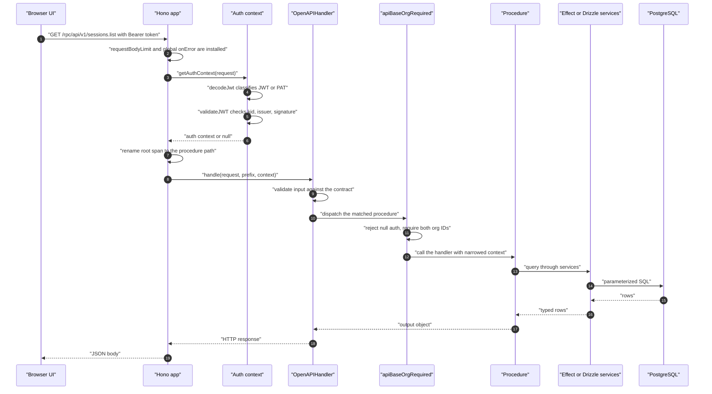
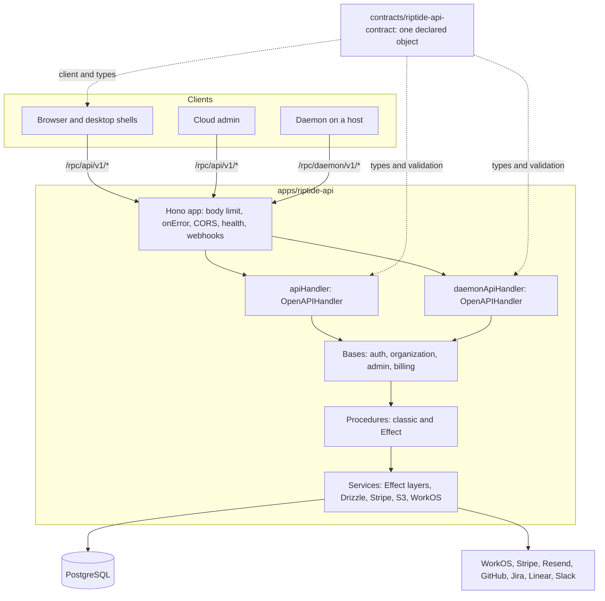

# The API and the contracts: one type spine for every client

The riptide Application Programming Interface (API) is a thin outer shell. Every route is declared once in the contract package. The server implementer and the browser client import that same declaration. The compiler then checks both sides against one type spine. This document follows that spine from the Hypertext Transfer Protocol (HTTP) listener to the browser call site.

## The surface in one table

The API exposes two oRPC prefixes. oRPC is a contract-first Remote Procedure Call (RPC) framework. Effect is a typed effect and service library for TypeScript. WorkOS is the identity provider. Sentry is the error reporting service. Each prefix has its own handler and its own contract. Both handlers run in the same Hono application, an HTTP framework.

| Prefix | Contract | Credential | Main caller |
|--------|----------|------------|-------------|
| `/rpc/api/v1/*` | `RiptideApiContract` | WorkOS JavaScript Object Notation (JSON) Web Token (JWT) or Personal Access Token (PAT) in `Authorization` | Browser, desktop shells, cloud admin |
| `/rpc/daemon/v1/*` | `RiptideDaemonApiContract` | Daemon token in `x-daemon-authorization` | Daemon on a user host |

The default port is 8700. The process reads `RIPTIDE_API_PORT` first and `PORT` second. The request body limit is 10 megabytes by default. One route, `codelayerState/upsert`, gets 50 megabytes. These numbers come from `apps/riptide-api/src/index.ts:10` and `apps/riptide-api/src/lib/request-body-limit.ts:15-16`.

The limit middleware chooses per request, not per route registration. It compares `c.req.path` with the one exact path string `/rpc/daemon/v1/codelayerState/upsert` and runs one of two prebuilt Hono `bodyLimit` middleware values (`apps/riptide-api/src/lib/request-body-limit.ts:18-21`). The comparison is exact, so a trailing slash or a different procedure name receives the 10-megabyte limit. The selected middleware then reads the body and returns 413 with the limit label when the body is larger.

## Startup: the listener and the runtime

The entry point does four things in order. It imports instrumentation, then it starts the Effect runtime, then it imports the application, and then it serves it. The dynamic import ensures the runtime exists before service singletons read the environment.

```ts
// apps/riptide-api/src/index.ts:10-27
const PORT = Number(process.env.RIPTIDE_API_PORT ?? process.env.PORT) || 8700

async function main(): Promise<void> {
	try {
		await appRuntime.context()
	} catch (error) {
		Sentry.captureException(error, { tags: { error_type: 'riptide_api_runtime_startup' } })
		await appRuntime.dispose()
		throw error
	}

	const { app } = await import('./app')
	const server = serve({ fetch: app.fetch, port: PORT })
	if (!(server instanceof Server)) {
		await appRuntime.dispose()
		throw new Error(`Expected http.Server but got ${server.constructor.name}`)
	}
	server.keepAliveTimeout = 0
```

The `serve` call returns either a Node `Server` or a platform-specific value. The code rejects anything that is not a Node `Server` (`apps/riptide-api/src/index.ts:23-26`), so the next line can set `keepAliveTimeout = 0`. That zero disables the idle keep-alive timer, so a proxy can hold an idle connection without the API closing it first.

The shutdown path is idempotent: a `shuttingDown` flag prevents a second run, `server.close` stops new connections, and `appRuntime.dispose()` releases resources. A close error sets `process.exitCode = 1` and does not throw (`apps/riptide-api/src/index.ts:29-48`). `SIGTERM` and `SIGINT` share the path.

## The middleware order is the security contract

`app.ts` installs middleware in a deliberate order. The order is part of the design, not an accident of editing.

```ts
// apps/riptide-api/src/app.ts:43-56
const app = new Hono()

// Body size limit - MUST be before other middleware to prevent OOM from large payloads
app.use('*', requestBodyLimit)

// Global error handler - catches unhandled errors before returning 500
app.onError((err, c) => {
	Sentry.captureException(err)
	logger.error(err, 'Unhandled error in request')
	return c.json({ error: 'Internal Server Error' }, 500)
})

// Start JWKS cache refresh loop
void jwksCache.start()
```

The body limit is first; the comment on line 45 says a large payload must not exhaust memory. The global error handler is second. It sends every uncaught error to Sentry. The client gets only `{"error":"Internal Server Error"}` and status 500, so internal details never cross the boundary.

The JSON Web Key Set (JWKS) refresh loop starts at module load (`apps/riptide-api/src/app.ts:56`). The loop is not awaited. It refreshes the key cache, waits 300,000 milliseconds, and repeats (`apps/riptide-api/src/auth/jwks-cache.ts:12-18`). A failed refresh keeps the old keys and reports the error to Sentry (`apps/riptide-api/src/auth/jwks-cache.ts:52-58`).

Cross-Origin Resource Sharing (CORS) is enabled for all paths at `apps/riptide-api/src/app.ts:99`. The oRPC handlers add a second CORS plugin. That plugin reflects any origin and allows `GET`, `HEAD`, `PUT`, `POST`, `DELETE`, and `PATCH` (`apps/riptide-api/src/orpc/index.ts:25-28`). The browser sends a bearer header, not a cookie, so a reflected origin cannot borrow a session.

Two health routes run a `limit(20)` query against `sessions` and `tasks`. A database failure returns status 503 with `status: "unhealthy"`. A success returns `status: "ok"` and a timestamp string (`apps/riptide-api/src/app.ts:101-121`).

### Webhooks come before oRPC

The application registers every webhook before it mounts oRPC (`apps/riptide-api/src/app.ts:123-137`). The list covers Stripe, WorkOS, Resend, GitHub, Jira, Linear, and Slack. These routes have their own signature checks. They must see the raw request before a generic handler consumes it.

### The API mount

The `/rpc/api/v1/*` middleware builds the auth context first (`apps/riptide-api/src/app.ts:139-161`).

```ts
// apps/riptide-api/src/app.ts:139-161
// mount oRPC handler
app.use('/rpc/api/v1/*', async (c, next) => {
	// Get the auth context
	// Extract Authorization header
	let authContext
	try {
		authContext = await getAuthContext(c.req.raw, appRuntime)
	} catch {
		return c.json({ error: 'Authentication unavailable' }, 503)
	}

	if (authContext) {
		Sentry.setUser({ id: authContext.userId })
		Sentry.setTag('organization_id', authContext.organizationId)
	}

	// Rename transaction from generic "POST /rpc/api/v1/*" to the oRPC procedure path
	const procedurePath = new URL(c.req.url).pathname.replace('/rpc/api/v1/', '')
	const activeSpan = Sentry.getActiveSpan()
	const rootSpan = activeSpan ? Sentry.getRootSpan(activeSpan) : undefined
	if (rootSpan && procedurePath) {
		rootSpan.updateName(`${c.req.method} /rpc/api/v1/${procedurePath}`)
	}
```

1. `getAuthContext` can throw. A throw returns status 503 with `{"error":"Authentication unavailable"}`, and reports to Sentry as `auth_failure`. A `null` context is allowed to continue, and the base middleware later decides whether to reject the call.
   - It returns `null` when the header is absent, the header does not match `Bearer <token>`, the JWT validator rejects the token, or the personal access token is invalid, has a non-user owner, or names an organization that is absent from this database (`apps/riptide-api/src/auth/context.ts:32-47`, `apps/riptide-api/src/auth/personal-access-tokens.ts:89-112`).
   - It throws when WorkOS cannot validate the token or the personal access token, or when the database query fails. Those failures are typed `WorkosError` or `PostgresDbQueryError`, and any other exception also escapes (`apps/riptide-api/src/auth/personal-access-tokens.ts:92`). The daemon path never throws: `getDaemonAuthContext` catches every fault, reports it, and returns `null` (`apps/riptide-api/src/auth/context.ts:55-81`).
2. Sentry receives the user Identifier (ID) and the organization ID as tags. Every later error carries the tenant.
3. The root span is renamed from the generic route pattern to the concrete procedure path, such as `POST /rpc/api/v1/sessions.update`. Traces become readable without a custom span per route.

The mounted handler receives a context object. It contains the auth context, headers, the request Internet Protocol (IP), and a service bag. The bag holds WorkOS, Amazon S3 object storage, Jira, Linear, Stripe, two Drizzle database handles (Drizzle is the Structured Query Language (SQL) query builder), and the Effect runtime (`apps/riptide-api/src/app.ts:163-180`). The read replica is separate from the primary handle. Two metrics operations use it: the usage trend procedure and the person spend analytics service (`apps/riptide-api/src/orpc/api/metrics/usageTrend.effect.ts:15`, `apps/riptide-api/src/effects/services/metrics/person-spend-analytics.service.ts:118`, `:177`). No write path reads it after a write; these are read-only aggregates, and the service reports a replica failure as a retryable error instead of falling back to the primary. The audience check deliberately reads the primary, so a permission change takes effect at once (`apps/riptide-api/src/effects/services/metrics/metrics-audience.ts:33-34`).

The daemon mount follows the same shape (`apps/riptide-api/src/app.ts:189-229`). It differs in three ways. It calls `getDaemonAuthContext` without a try/catch, because that helper catches its own faults and returns `null`. It passes no `headers` and no `requestIp`. The daemon context carries a host ID that the API mount does not have.

## Who is calling: two credentials, one header parser

The user path accepts two credential kinds on one header. `resolveUserAuthContext` matches `^Bearer (.+)$` and takes the captured value (`apps/riptide-api/src/auth/context.ts:14`).

```ts
// apps/riptide-api/src/auth/context.ts:11-21
export const resolveUserAuthContext = Effect.fn('auth.resolve_user_auth_context')(function* (input: {
	authorizationHeader: string | null
}) {
	const match = input.authorizationHeader?.match(/^Bearer (.+)$/)
	if (!match?.[1]) return null
	const credential = match[1]
	if (isJwtCredential(credential)) {
		return yield* Effect.promise(() => validateJWT(credential))
	}
	return yield* authenticatePersonalAccessToken({ value: credential })
})
```

The `isJwtCredential` helper calls `decodeJwt` from the `jose` library inside a try/catch (`apps/riptide-api/src/auth/context.ts:23-30`). That call only decodes the structure. It does not verify a signature. Any string that `decodeJwt` can parse is classified as a JWT. A string that it cannot parse returns `false` and goes to `authenticatePersonalAccessToken`, where WorkOS rejects it. The split happens before any network call.

`authenticatePersonalAccessToken` sends the value to WorkOS `validateApiKey` (`apps/riptide-api/src/auth/personal-access-tokens.ts:95-96`). The owner must be a user, not an organization. The code then finds the local organization row by `workos_organization_id` and returns role `member` (`apps/riptide-api/src/auth/personal-access-tokens.ts:99-119`). A token that fails any step returns `null`.

The daemon path uses a different header and a different validator (`apps/riptide-api/src/auth/context.ts:55-81`).

```ts
// apps/riptide-api/src/auth/context.ts:49-73
export type DaemonAuthContext = {
	userId: string
	organizationId: string
	hostId: string
}

export async function getDaemonAuthContext(req: Request): Promise<DaemonAuthContext | null> {
	const daemonAuthHeader = req.headers.get('x-daemon-authorization')
	if (!daemonAuthHeader) {
		logger.warn('Missing daemon authorization header')
		return null
	}

	try {
		const validated = await validateDaemonToken(daemonAuthHeader)
		if (!validated) {
			logger.warn('Invalid daemon token')
			return null
		}

		return {
			userId: validated.userId,
			organizationId: validated.organizationId,
			hostId: validated.hostId,
		}
```

`validateDaemonToken` returns `userId`, `organizationId`, and `hostId`. If the token is missing or invalid, the function returns `null`. If validation throws, the catch reports the error and returns `null` (`apps/riptide-api/src/auth/context.ts:74-80`). The daemon base then turns `null` into `UNAUTHORIZED`. This differs from the user path, where an infrastructure throw becomes 503. The client cannot tell whether the fault is in the token or in the key infrastructure. The log holds the real reason.

## JWT validation: key by `kid`, issuer from the token

`validateJWT` treats the token as three base64url parts. It rejects any other count (`apps/riptide-api/src/auth/jwt-validator.ts:36-40`). It parses the header and requires a `kid` claim.

```ts
// apps/riptide-api/src/auth/jwt-validator.ts:51-66
		if (!kid) {
			logger.warn('JWT missing kid header')
			return null
		}

		// Get imported key from cache, force refresh once if not found
		let key = jwksCache.getKey(kid)
		if (!key) {
			logger.info({ kid }, 'Key not found for kid, forcing refresh')
			await jwksCache.forceRefresh()
			key = jwksCache.getKey(kid)
			if (!key) {
				logger.warn({ kid }, 'Key not found for kid after refresh')
				return null
			}
		}
```

A miss triggers one forced refresh; a second miss returns `null`. A forged `kid` can cause one refresh per request, but not a loop. The refresh has a 10-second timeout (`apps/riptide-api/src/auth/jwks-cache.ts:27-29`).

The issuer is read from the unverified payload and then passed to `jwtVerify` as the expected issuer (`apps/riptide-api/src/auth/jwt-validator.ts:68-80`). That check compares the token with itself, so it adds no security. The trust anchor is the signature check against the cached WorkOS key.

The verified claims become the auth context.

```ts
// apps/riptide-api/src/auth/jwt-validator.ts:84-95
		// Convert to auth context - org fields now optional
		return {
			userId: claims.sub,
			organizationId: claims.internal_org_id || undefined, // undefined if empty/missing
			workosOrganizationId: claims.org_id || undefined, // undefined if empty/missing
			role: claims.role ?? '',
			roles: claims.roles ?? [],
			permissions: claims.permissions ?? [],
			entitlements: claims.entitlements ?? [],
			sessionId: claims.sid,
			actingUser: claims.act?.sub,
		}
```

The two organization fields are not interchangeable.

| Claim | Meaning | Used for |
|-------|---------|----------|
| `internal_org_id` | Local organization row ID | Database filters, tenant scoping, billing |
| `org_id` | WorkOS organization ID | WorkOS calls, identity lookup |

The code maps `internal_org_id` to `organizationId` and `org_id` to `workosOrganizationId` (`apps/riptide-api/src/auth/jwt-validator.ts:87-88`). The base middleware requires both to be non-empty before it treats the context as an organization context (`apps/riptide-api/src/orpc/base.ts:68-76`). A token with only the WorkOS ID is authenticated but not organization-scoped.

An expired token follows a quiet path. `isExpiredJwtError` suppresses Sentry capture (`apps/riptide-api/src/auth/jwt-validator.ts:96-104`). The log line is a warning and the function returns `null`. Clients re-authenticate, so expiry is an expected event, not a server fault.

## The oRPC handler: one validation enrichment

Both handlers are `OpenAPIHandler` instances. Each is built from a router, a CORS plugin, and one error interceptor.

```ts
// apps/riptide-api/src/orpc/index.ts:10-21
/** Enriches contract validation failures without changing unrelated errors. */
const enrichValidationError = (error: unknown) => {
	if (error instanceof ORPCError && error.code === 'BAD_REQUEST' && error.cause instanceof ValidationError) {
		const zodError = new z.ZodError(error.cause.issues as z.core.$ZodIssue[])
		throw new ORPCError('INPUT_VALIDATION_FAILED', {
			status: StatusCodes.BAD_REQUEST,
			message: z.prettifyError(zodError),
			data: z.flattenError(zodError),
			cause: error.cause,
		})
	}
}
```

The interceptor changes only contract validation failures. The condition is an `ORPCError` with code `BAD_REQUEST` and a `ValidationError` cause. The code then builds a fresh `ZodError`, a human-readable message from `z.prettifyError`, and structured details from `z.flattenError`. The new error code is `INPUT_VALIDATION_FAILED` with status 400 (`apps/riptide-api/src/orpc/index.ts:12-19`). Every other error passes unchanged.

## The bases: where policy lives

A "base" is an oRPC implementer plus middleware. Procedures attach to a base. The base decides who may call the procedure and what context the handler receives.

| Base | Auth | Organization | Admin | Billing | Typical use |
|------|------|--------------|-------|---------|-------------|
| `apiBaseOrgRequired` | required | required | no | optional | Most tenant routes |
| `apiBaseNoOrg` | required | optional | no | no | Bootstrap and invitations |
| `apiBasePublic` | optional | optional | no | no | Shared artifact pages |
| `apiBaseSyncV2` | required | required | no | no | Version 2 sync routes |
| `apiBaseForOrganizationAdmin` | required | required | required | no | Admin console |
| `apiBaseForAdvancedMetrics` | required | required | no | organization entitlement plus page audience | Cost and usage pages |

A **page audience** is the set of people allowed to see per-member cost and output aggregates after the plan entitles the organization: an organization admin always qualifies, and a member qualifies only after an admin has opened the page to the whole organization (`apps/riptide-api/src/effects/services/metrics/metrics-audience.ts:17-30`).
| `apiBaseLaunchToken` | launch token | token claim | no | optional | Daemon token exchange |

`apiBaseOrgRequired` is three middleware steps (`apps/riptide-api/src/orpc/base.ts:140-156`). The first step rejects a `null` auth. The second calls `requireOrganization`. That middleware checks both organization IDs and throws `ORGANIZATION_REQUIRED` if either is missing (`apps/riptide-api/src/orpc/base.ts:82-90`). The third step wraps the handler, captures unexpected errors to Sentry, and rethrows.

```ts
// apps/riptide-api/src/orpc/base.ts:140-156
export const apiBaseOrgRequired = os
	// First: Check auth exists, narrow from null
	.use(async ({ context, next, errors }) => {
		if (!context.auth) throw errors.UNAUTHORIZED()
		return next({ context: { auth: context.auth, services: context.services } })
	})
	// Second: Require organization, narrow to AuthContext
	.use(requireOrganization)
	// Third: Sentry error capture
	.use(async ({ context, next, path }) => {
		try {
			return await next({ context })
		} catch (error) {
			captureUnexpected(error, path)
			throw error
		}
	})
```

`apiBaseNoOrg` keeps auth but does not narrow the organization (`apps/riptide-api/src/orpc/base.ts:162-179`). `apiBasePublic` has no auth gate at all (`apps/riptide-api/src/orpc/base.ts:181-188`). The public base still captures server faults. `apiBaseSyncV2` repeats the organization-required stack, with one difference. Its Sentry capture call omits the procedure path (`apps/riptide-api/src/orpc/base.ts:205-221`).

`requireAdmin` accepts either the singular `role` claim or the plural `roles` claim (`apps/riptide-api/src/orpc/base.ts:194-202`). It throws `FORBIDDEN` when neither contains `admin`. It reads no `permissions` entry, so a permission string alone is ignored.

### Billing is a gate with a written failure policy

The billing middleware is at `apps/riptide-api/src/orpc/base.ts:99-134`. It first checks whether enforcement is enabled. If not, it calls `next` immediately. Otherwise it asks `decideBillingAccess` with `{ organizationId, operation }`. That Effect service returns one of three decisions: `allowed`, `blocked`, or `fail_open` (`apps/riptide-api/src/effects/services/billing/billing-access.service.ts:6-19`).

```ts
// apps/riptide-api/src/orpc/base.ts:110-131
			if (decision === 'fail_open') {
				logger.warn({ procedureName }, 'Billing enforcement failed open for billing-required operation')
				Sentry.captureMessage('Billing enforcement failed open for billing-required operation', {
					level: 'warning',
					tags: { error_type: 'billing_enforcement_fail_open', procedure: procedureName },
				})
				return next({ context: billingContext })
			}

			if (decision === 'blocked') {
				logger.info({ procedureName }, 'Billing enforcement blocked billing-required operation')
				throw errors.BILLING_REQUIRED()
			}

			return next({ context: billingContext })
		} catch (error) {
			if (error instanceof ORPCError) throw error
			logger.error({ error, procedureName }, 'Billing middleware failed unexpectedly')
			Sentry.captureException(error, {
				tags: { error_type: 'billing_middleware_failure', procedure: procedureName },
			})
			throw errors.SERVICE_UNAVAILABLE()
```

- `fail_open`: the middleware logs a warning, sends a Sentry message, and continues. The design prefers an available product over a hard stop when the billing service cannot answer.
- `blocked`: the middleware throws `BILLING_REQUIRED`, which is status 402.
- An unexpected exception: the middleware rethrows a declared `ORPCError`. Any other exception becomes `SERVICE_UNAVAILABLE`, status 503 (`apps/riptide-api/src/orpc/base.ts:125-132`).

The fail-open branch is a deliberate availability choice. It is visible in the code and in Sentry, so operators can count it.

Daemon and launch-token variants repeat the same policy with a different organization source (`apps/riptide-api/src/orpc/base.ts:348-386` and `apps/riptide-api/src/orpc/base.ts:395-436`). Daemon tokens are long-lived, so the daemon base evaluates billing on every write. The comment at `apps/riptide-api/src/orpc/base.ts:342-347` states that reason.

## Effect procedures on the same contract

Some procedures use the Effect library instead of plain promises. `effect-base.ts` builds a second implementer from the same two contracts (`apps/riptide-api/src/orpc/effect-base.ts:120`). The Effect context deliberately hides `services` and keeps only auth, headers, and request IP (`apps/riptide-api/src/orpc/effect-base.ts:113-118`). Dependencies come from Effect layers in `appRuntime`. This rule prevents a new Effect procedure from reaching into the legacy service bag.

```ts
// apps/riptide-api/src/orpc/effect-base.ts:146-160
export const effectOrpcBaseOrganizationRequired = effectImplementer // First: Check auth exists, narrow from null
	.use(async ({ context, next, errors }) => {
		if (!context.auth) throw errors.UNAUTHORIZED()
		return next({ context: { requestId: context.requestIp, headers: context.headers, auth: context.auth } })
	})
	// Second: Require organization, narrow to AuthContext
	.use(organizationRequired)
	.annotateSpan(({ context, path }) => ({
		operation: path.join('.'),
		route_group: path[0],
		auth_type: isAuthContextWithOrg(context.auth) ? 'user' : 'anonymous',
		user_id: context.auth?.userId,
		organization_id: isAuthContextWithOrg(context.auth) ? context.auth.organizationId : undefined,
		workos_organization_id: isAuthContextWithOrg(context.auth) ? context.auth.workosOrganizationId : undefined,
	}))
```

The Effect base adds two things. It uses `annotateSpan` to set operation, route group, auth type, user ID, and both organization IDs (`apps/riptide-api/src/orpc/effect-base.ts:153-160`). It also uses a different error filter. The filter treats any 4xx as an expected client error, even when the error is not marked `defined`. The comment at `apps/riptide-api/src/orpc/effect-base.ts:88-94` explains that the Effect bridge does not seed its error map from the contract. Status is the reliable classifier.

Effect has mirrors for the public, admin, advanced-metrics, and daemon bases (`apps/riptide-api/src/orpc/effect-base.ts:179`, `:205`, `:271`, `:348`). Billing policy is duplicated for Effect procedures (`apps/riptide-api/src/orpc/effect-base.ts:276-320`).

## The routers

`apiRouter` is an `os.router` object (`apps/riptide-api/src/orpc/router.ts:281`). It closes at line 641. `daemonRouter` is a `daemonBase.router` object (`apps/riptide-api/src/orpc/router.ts:643`) and closes at line 749.

```ts
// apps/riptide-api/src/orpc/router.ts:281-295
export const apiRouter = os.router({
	public: {
		accessRequests: {
			create: createAccessRequestProcedure,
		},
		artifacts: {
			info: artifactInfoProcedure,
			downloadUrl: sharedArtifactDownloadUrlProcedure,
			resolve: resolveSharedArtifactProcedure,
			commentAuthors: sharedArtifactCommentAuthorsProcedure,
			createComment: createPublicArtifactCommentProcedure,
			undoComment: undoPublicArtifactCommentProcedure,
		},
	},
	metrics: {
```

The API router groups routes by domain. The top-level keys are `public`, `metrics`, `automation`, `auth`, `sessions`, `tasks`, `projects`, `projectWorkspaces`, `organization`, `sharing`, `approvals`, `durableStreams`, `comments`, `diffComments`, `billing`, `artifacts`, and `taskUserSettings`. The remaining groups are `contextShards`, `workspaceSetup`, `providerLogin`, `agentCommands`, `ai`, `sync`, `uploads`, `integrations`, and `hosts`.

The daemon router groups are smaller: `workspaceSetup`, `providerLogin`, `hosts`, `comments`, `diffComments`, `sessions`, `commits`, `pullRequests`, `projectWorkspaces`, `users`, `approvals`, `agents`, `agentCommands`, `codelayerState`, `foldSessionEvents`, `artifacts`, `settings`, `contextShards`, `sync`, and `integrations` (`apps/riptide-api/src/orpc/router.ts:643-749`).

The contract file uses the same grouping at almost the same line numbers (`contracts/riptide-api-contract/src/contract-router.ts:285` and `:643`).

oRPC maps router keys to HTTP paths: dots become slashes, so `auth.daemon.token.create` serves at `POST /rpc/api/v1/auth/daemon/token/create` (`apps/riptide-pi-extension/test/helpers/mock-cloud.ts:986-990`). The sessions list uses `limit` and `offset`, not a cursor. It caps `limit` at 100 and defaults it to 50 (`contracts/riptide-api-contract/src/api/sessions/list.ts:9-10`).

## The contract package: declared errors

`contractBuilder` is a shared error map built with `oc.errors` (`contracts/riptide-api-contract/src/contract-builder.ts:11`). Every contract created from this builder can throw these codes.

```ts
// contracts/riptide-api-contract/src/contract-builder.ts:11-20
export const contractBuilder = oc.errors({
	UNAUTHORIZED: {
		status: StatusCodes.UNAUTHORIZED,
	},
	FORBIDDEN: {
		status: StatusCodes.FORBIDDEN,
	},
	BILLING_REQUIRED: {
		status: StatusCodes.PAYMENT_REQUIRED,
	},
```

The map continues with `UPGRADE_REQUIRED`, `SYNC_SETTINGS_ORG_POLICY_VIOLATION`, `ORGANIZATION_REQUIRED`, `NOT_FOUND`, `BAD_REQUEST`, `INPUT_VALIDATION_FAILED`, `INTERNAL_SERVER_ERROR`, and `SERVICE_UNAVAILABLE` (`contracts/riptide-api-contract/src/contract-builder.ts:19-74`).

### Every error code

| Code | HTTP status | Data schema | Where it is raised |
|------|-------------|-------------|--------------------|
| `UNAUTHORIZED` | 401 | none | Auth bases, daemon base, launch-token base |
| `FORBIDDEN` | 403 | none | Admin gate, advanced-metrics gates, resource ownership checks |
| `BILLING_REQUIRED` | 402 | none | Billing middleware, all five variants |
| `UPGRADE_REQUIRED` | 402 | message, seat counts, action label | Invitation creation when seats are full |
| `SYNC_SETTINGS_ORG_POLICY_VIOLATION` | 403 | message | User settings update when organization policy forbids the change |
| `ORGANIZATION_REQUIRED` | 403 | optional message | `requireOrganization` middleware |
| `NOT_FOUND` | 404 | optional message and resolution hint | Lookup procedures |
| `BAD_REQUEST` | 400 | optional message | Sync filter errors and business validation |
| `INPUT_VALIDATION_FAILED` | 400 | flattened Zod error | oRPC validation interceptor |
| `INTERNAL_SERVER_ERROR` | 500 | none | Declared server failures |
| `SERVICE_UNAVAILABLE` | 503 | none | Billing middleware infrastructure failure |

Two status codes in the table need a note.

First, the builder gives `SYNC_SETTINGS_ORG_POLICY_VIOLATION` status 403 (`contracts/riptide-api-contract/src/contract-builder.ts:31-36`). The settings route overrides it to 400 in its own `.errors({...})` call (`contracts/riptide-api-contract/src/api/auth/user/settings-update.ts:88-91`). The builder supplies defaults. A route can replace a default.

Second, `UPGRADE_REQUIRED` and `BILLING_REQUIRED` both use 402. They mean different things. `BILLING_REQUIRED` means the organization cannot use the feature at all. `UPGRADE_REQUIRED` means a seat limit blocks one action. The data shape tells the client which message to show.

The contract also permits a handful of feature-specific codes. Examples are `FEATURE_DISABLED_BY_ORG` and `TASK_SLUG_CONFLICT`. Those codes are declared at the route level, not in the shared builder.

### The assembled router and inferred types

`RiptideApiContract` is a plain object of nested contract objects (`contracts/riptide-api-contract/src/contract-router.ts:285`). `RiptideDaemonApiContract` is the second object (`contracts/riptide-api-contract/src/contract-router.ts:643`).

```ts
// contracts/riptide-api-contract/src/contract-router.ts:643-652
export const RiptideDaemonApiContract = {
	hosts: {
		heartbeat: heartbeatContract,
		shutdown: shutdownContract,
	},
	comments: {
		get: getCommentsContract,
		update: updateCommentContract,
		reply: replyCommentContract,
	},
```

The file exports four type helpers: `RiptideApiInputs`, `RiptideApiOutputs`, `RiptideDaemonApiInputs`, and `RiptideDaemonApiOutputs` (`contracts/riptide-api-contract/src/contract-router.ts:756-760`). One detail is worth flagging. `RiptideDaemonApiOutputs` is inferred from `typeof RiptideApiContract`, not from the daemon contract (`contracts/riptide-api-contract/src/contract-router.ts:760`). A daemon output type therefore describes the user API. This is a small type-level defect. It does not change runtime behavior, because the handler uses the contract object directly.

## The sync wire format

The sync routes accept a recursive filter tree. The tree has four node kinds: `comparison`, `and`, `or`, and `not` (`contracts/riptide-api-contract/src/api/sync/shared-schemas.ts:12-16`). Each node maps to a Drizzle SQL builder on the server.

```ts
// contracts/riptide-api-contract/src/api/sync/shared-schemas.ts:25-32
export const WhereExpressionSchema: z.ZodType<WhereExpression> = z.lazy(() =>
	z.discriminatedUnion('type', [
		WhereComparisonSchema,
		z.object({ type: z.literal('and'), conditions: z.array(WhereExpressionSchema) }),
		z.object({ type: z.literal('or'), conditions: z.array(WhereExpressionSchema) }),
		z.object({ type: z.literal('not'), condition: WhereExpressionSchema }),
	]),
)
```

The `z.lazy` call allows a node to contain itself. The discrimination key is `type`. A comparison node carries a field path, an operator string, and an optional value (`contracts/riptide-api-contract/src/api/sync/shared-schemas.ts:18-23`).

The standard sync input is shared by every sync route.

```ts
// contracts/riptide-api-contract/src/api/sync/shared-schemas.ts:50-55
export const SyncInputSchema = z.object({
	where: WhereExpressionSchema.optional(),
	sorts: z.array(SyncSortSchema).default([]),
	limit: z.number().int().positive().max(10000).optional(),
	offset: z.number().int().nonnegative().optional(),
})
```

Three limits shape the query. The limit is a positive integer with a maximum of 10,000. The offset is a non-negative integer. Sorts default to an empty array. If the client sends no limit, the handler uses 10,000 (`apps/riptide-api/src/orpc/api/sync/sessions.ts:34`). The server therefore never returns an unbounded result through this path.

The routes have two versions. Version 1 applies the user and organization access-list subqueries in SQL (`apps/riptide-api/src/db/sync-auth.ts:70-104`). Version 2 applies only an organization scope (`apps/riptide-api/src/db/sync-auth.ts:106`).

The output factory wraps a row schema in `{ rows: [...] }` (`contracts/riptide-api-contract/src/api/sync/shared-schemas.ts:64-66`). The row schema is the Drizzle select schema. The next document follows that link.

## The daemon event contract caps tool IDs

The daemon event input has a special transform. Two tool Identifier fields share one rule.

```ts
// contracts/riptide-api-contract/src/daemon/events/create.ts:5-11
// Coding-agent tool ids are short (`call_…`, `toolu_…`). Some providers append a large
// reasoning/thought-continuity blob that can exceed Postgres's ~2704-byte btree limit and break
// conversation_events_tool_correlation_idx. Cap the length at the write boundary: truncate (not
// .max/reject, which would drop the event) so the write still succeeds, and cap both id columns
// identically so the tool_call ↔ tool_result correlation the index serves is preserved.
const TOOL_ID_MAX = 256
const toolId = z.string().transform((s) => s.slice(0, TOOL_ID_MAX))
```

`TOOL_ID_MAX` is 256. The transform truncates a longer string. The comment at `contracts/riptide-api-contract/src/daemon/events/create.ts:5-9` gives the reason. Some providers append a large reasoning blob to a tool ID. That value can exceed the PostgreSQL btree index limit and break `conversation_events_tool_correlation_idx`. The code truncates instead of rejecting, because a rejected event would be lost. Both `toolCallId` and `toolResultForId` use the same transform (`contracts/riptide-api-contract/src/daemon/events/create.ts:25` and `:31`). The correlation index stays usable. One risk remains: two different IDs that share the first 256 characters become one.

**Aha:** This is a write-boundary design choice. The contract does not merely validate. It repairs one known bad input so the write succeeds and the index stays valid.

## The UI client is built from the same object

The User Interface (UI) does not use a generated client. It imports `RiptideApiContract` and passes it to `OpenAPILink`.

```ts
// apps/riptide-ui/src/orpc/client.ts:167-185
	const { client, queryClient } = useMemo(() => {
		const link = new OpenAPILink(RiptideApiContract, {
			url: `${riptideApiOrigin}/rpc/api/v1`,
			headers: async () => {
				if (!user) return {}
				const accessToken = await getAccessToken()
				return accessToken ? { Authorization: `Bearer ${accessToken}` } : {}
			},
			interceptors: [createRiptideApiErrorInterceptor({ navigate, isOnOrgPages, roles })],
		})

		// Raw client for direct API calls
		const client: JsonifiedClient<ContractRouterClient<typeof RiptideApiContract>> = createORPCClient(link)

		// TanStack Query wrapped client for hooks
		const queryClient = createTanstackQueryUtils(client)

		return { client, queryClient }
	}, [getAccessToken, user, user?.id, organizationId, isOnOrgPages, roles])
```

The link target is `${riptideApiOrigin}/rpc/api/v1` (`apps/riptide-ui/src/orpc/client.ts:169`). The origin comes from `VITE_PUBLIC_RIPTIDE_API_ORIGIN` and defaults to `http://localhost:8700` (`apps/riptide-ui/src/orpc/client.ts:23-25`). The `headers` function is asynchronous. It calls `getAccessToken()` from AuthKit on each request and sends `Authorization: Bearer <token>`. If there is no user, it sends no header.

The client type is `JsonifiedClient<ContractRouterClient<typeof RiptideApiContract>>` (`apps/riptide-ui/src/orpc/client.ts:18`). This type turns bigint fields into strings for the wire. The raw client is wrapped with `createTanstackQueryUtils` for query hooks (`apps/riptide-ui/src/orpc/client.ts:182`).

The interceptor checks three conditions before it maps anything (`apps/riptide-ui/src/orpc/client.ts:134-136`). The call must not be silent, the error must be an `ORPCError`, and the error must be declared. A **silent** call is one made with `context: { silent: true }` in its oRPC call options; the client skips the toast and the Sentry report for that call, and the caller handles the error itself (`apps/riptide-ui/src/orpc/client.ts:36`, `:50`). If any condition fails, the interceptor rethrows the error with no toast. A declared error enters the switch at `apps/riptide-ui/src/orpc/client.ts:55-120`, which handles `UNAUTHORIZED`, `ORGANIZATION_REQUIRED`, `BILLING_REQUIRED`, `FORBIDDEN`, `INPUT_VALIDATION_FAILED`, and several feature codes. `INPUT_VALIDATION_FAILED` also goes to Sentry with the flattened data (`apps/riptide-ui/src/orpc/client.ts:84-92`). An undeclared error never reaches the default branch, because the interceptor rethrows it first.

**Aha:** The contract object is the only shared artifact. If a server procedure renames an output field, the UI type check fails at build time. There is no separate client schema to regenerate and drift.

## One authenticated call, end to end



The sequence shows two independent gates: Hono builds the identity, and the base decides whether it is sufficient.

## The layering



The contract feeds both handlers and the UI.

## Where this design is strong, and where it is thin

The strong point is the single declaration. One object holds a route's input, output, and errors. The compiler checks both sides against it. The thin points are concrete.

- The error map is a default, not a guarantee. The settings route overrides a status, so a reader must check both places.
- Billing policy is duplicated in five middleware functions. A change can miss the other four.
- The daemon output type alias points at the wrong contract. The defect is type-only, but it weakens the "one spine" claim.
- Authentication has two failure conventions: the user mount returns 503 on an infrastructure throw, and the daemon mount returns 401 for every failure.


## Next

Read [08-database-and-schemas.md](08-database-and-schemas.md) to see where the select schemas in this contract come from. Read [05-sync-engine.md](05-sync-engine.md) for the client that consumes the sync routes. Read [06-electric-proxy.md](06-electric-proxy.md) for the read path that runs beside this API.
