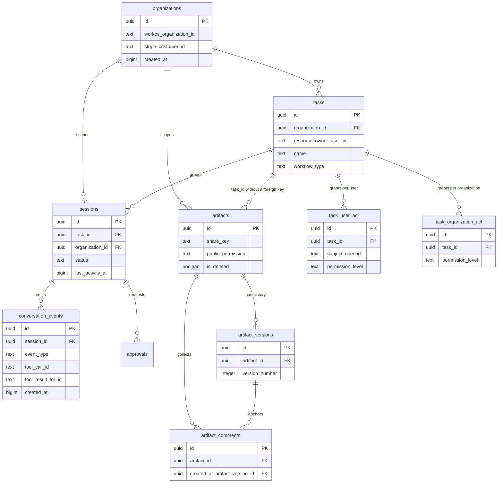

# The database and the schema pair

The repository keeps two schema systems on purpose. The database package holds the physical truth: Drizzle table definitions and 144 Structured Query Language (SQL) migrations. Drizzle is a TypeScript query builder and migration tool. The schemas package holds the wire truth for Application Programming Interface (API) payloads: Effect schemas with Zod mirrors. Effect is a typed effect and schema library for TypeScript. Zod is a TypeScript schema validator. Parity tests keep each Effect pair equal. A third family sits at the database boundary: select schemas generated from the tables, which describe the row shape that Electric sends to the browser. This document explains both halves, the table model, and the path from one select schema to the browser collection.

## The database package

`packages/db` has four moving parts.

| Part | Path | Role |
|------|------|------|
| Tables | `packages/db/src/tables/*.ts` | 56 Drizzle table modules |
| Aggregator | `packages/db/src/schema.ts` | Imports, re-exports, and lists application tables |
| Configuration | `packages/db/drizzle.config.ts` | Dialect, schema path, output path, connection URL |
| Migrations | `packages/db/drizzle/*.sql` | 144 ordered SQL files and a journal |

The configuration is small and explicit. It uses PostgreSQL. The schema entry point is `./src/schema.ts`. Migration output goes to `./drizzle`.

```ts
// packages/db/drizzle.config.ts:16-26
export const DATABASE_URL = process.env.DATABASE_URL ?? rootDatabaseUrl()
if (!DATABASE_URL) throw new Error('Missing DATABASE_URL')
export default defineConfig({
	dialect: 'postgresql',
	schema: './src/schema.ts',
	out: './drizzle',

	dbCredentials: {
		url: DATABASE_URL,
	},
})
```

`DATABASE_URL` comes from the process environment. If it is absent, `rootDatabaseUrl` reads `../../.env` from the package directory and parses it with `node:util` `parseEnv` (`packages/db/drizzle.config.ts:7-14`). A missing value throws at import time (`packages/db/drizzle.config.ts:17`). The tool therefore fails fast instead of opening an empty connection.

## The aggregator and the application table list

`schema.ts` imports every table module, re-exports it, and then names the tables the application owns. The import block occupies lines 1 to 55. The re-export block occupies lines 57 to 111. There are 56 table files, and the list has 56 entries.

```ts
// packages/db/src/schema.ts:113-135
export const applicationTables = [
	organizations,
	organizationSettings,
	accessRequests,
	teams,
	projects,
	repositoryLocationsForUserForHost,
	workspaces,
	workspaceLocationsForUserForHost,
	workspaceRepositoryStatusForUserForHost,
	tasks,
	sessions,
	foldSessionEvents,
	conversationEvents,
	diffComments,
	approvals,
	artifacts,
	artifactVersions,
	artifactComments,
	anonymousArtifactCommenters,
	publicCommentUndoAuthorizations,
	artifactOperationsLog,
	aclOperationsLog,
```

The excerpt stops at line 135; the array closes with `] as const` at line 170 (`packages/db/src/schema.ts:170`). The suffix preserves the tuple type, so tooling can derive a union of table objects. The list includes tenant tables, session tables, artifact tables, integration tables, and host tables.

The list also reveals the shape of the product. Organizations own tasks. Tasks group sessions; a session can exist without a task. Sessions own events and approvals. Artifacts hang off tasks. Access Control List (ACL) rows connect tasks to users and to organizations.

## The migrations and the journal

The `drizzle` directory holds 144 `.sql` files. They are numbered `0000` through `0143`. The journal at `packages/db/drizzle/meta/_journal.json:4` has a matching `entries` array with 144 records.

| Position | Tag | Journal line |
|----------|-----|--------------|
| First | `0000_last_northstar` | `packages/db/drizzle/meta/_journal.json:9` |
| Last | `0143_certain_rawhide_kid` | `packages/db/drizzle/meta/_journal.json:1010` |

The first migration creates the original table set, including `approvals`, `conversation_events`, and `online_hosts` (`packages/db/drizzle/0000_last_northstar.sql:1-38`). The last migration is one statement. It drops `commit_session_trailers_allowed` from `organization_settings` (`packages/db/drizzle/0143_certain_rawhide_kid.sql:1`). The journal's last `when` value is 1792011854887 milliseconds, which is 2026-10-14 21:04:14 Coordinated Universal Time (UTC).

The journal is the migration ledger. Each entry has an index, a format version, a millisecond timestamp, a tag, and a breakpoint flag. Drizzle compares the journal with the migration table in the database. A file without a journal entry is not applied. A journal entry without a file is an error. The `--> statement-breakpoint` marker inside each SQL file separates statements. Drizzle sends the statements one at a time so a failure stops at the exact statement that failed.

A migration pair is append-only. The pair is one ordered `.sql` file and one `meta/NNNN_snapshot.json` file. One journal entry registers the pair (`packages/db/drizzle/meta/_journal.json:5-11`). For example, `0143_certain_rawhide_kid.sql` pairs with `packages/db/drizzle/meta/0143_snapshot.json`, and journal entry 143 names the tag (`packages/db/drizzle/meta/_journal.json:1006-1011`). The table definition in TypeScript is the current state. The SQL files are the history that produced it. A reader who wants the current shape reads `src/tables`. A reader who wants the change history reads `drizzle`.

## Identifier and timestamp conventions

The repository is consistent about two things: primary keys and time.

| Concern | Convention | Evidence |
|---------|------------|----------|
| Primary key type | Universally Unique Identifier version 7 (UUIDv7) in a `uuid` column | `packages/db/src/tables/sessions.ts:50-53` |
| Key generation | SQL `uuidv7()` default plus a JavaScript `$defaultFn` | `packages/db/src/tables/sessions.ts:52-53` |
| User references | `text` columns, not foreign keys | `packages/db/src/tables/sessions.ts:66-68` |
| Organization scope | `uuid` foreign key to `organizations.id` | `packages/db/src/tables/sessions.ts:56` |
| Timestamps | `bigint` milliseconds since the Unix epoch | `packages/db/src/tables/sessions.ts:102-105` |
| Default time | SQL `(extract(epoch from now()) * 1000)::bigint` plus `BigInt(Date.now())` | `packages/db/src/tables/sessions.ts:102-105` |
| Update time | `$onUpdateFn(() => BigInt(Date.now()))` | `packages/db/src/tables/sessions.ts:109-113` |

The two defaults are not redundant. A row inserted through Drizzle can use the JavaScript default. A row inserted by raw SQL, a migration, or an external job can use the database default. Both produce a UUIDv7. The database supplies the function: the development stack runs `docker.io/postgres:18` (`docker-compose.yaml:10`), and PostgreSQL 18 has a native `uuidv7()`.

UUIDv7 values sort by creation time. That property gives B-tree indexes good locality without a separate sequence. The cost is that an Identifier (ID) reveals a rough creation time. The repository accepts that cost.

The millisecond bigint choice avoids time zone ambiguity. A `timestamptz` column would also work. The bigint form is simple to serialize and simple to compare. It also matches JavaScript's `Date.now()` directly.

## The `sessions` table

`sessions` is the center of the product. It stores one coding-agent run.

```ts
// packages/db/src/tables/sessions.ts:47-57
export const sessions = pgTable(
	'sessions',
	{
		id: uuid()
			.primaryKey()
			.default(sql`uuidv7()`)
			.$defaultFn(() => uuidv7()),

		task_id: uuid().references(() => tasks.id, { onDelete: 'set null' }),
		organization_id: uuid().references(() => organizations.id, { onDelete: 'cascade' }),

```

The table has four foreign-key columns and two deletion rules. `task_id` and `organization_id` point at the task and the organization; `forked_from_session_id` and `handoff_source_session_id` point at other sessions. Deleting an organization cascades. Deleting a task sets `task_id` to null. Deleting a parent session sets both session self-references to null (`packages/db/src/tables/sessions.ts:55-64`).

- `task_id` uses `ON DELETE SET NULL` (`packages/db/src/tables/sessions.ts:55`). Deleting a task keeps the session, but the session loses its task link.
- `organization_id` uses `ON DELETE CASCADE` (`packages/db/src/tables/sessions.ts:56`). Deleting an organization removes its sessions.
- `forked_from_session_id` and `handoff_source_session_id` point back to `sessions` with `ON DELETE SET NULL` (`packages/db/src/tables/sessions.ts:58-64`). A fork or a handoff survives the deletion of its source.

The table has 30 or more columns. The important groups are identity, execution, state, cost, and presentation.

- Identity: `created_by`, `resource_owner_user_id`, `host_id`, `coding_agent`, `coding_agent_session_id`.
- Execution: `working_directory`, `model`, `resolved_model`, `provider`, `effort`, `fast_mode`, `permissions_mode`.
- State: `status`, `error_message`, `error_reason`, `archived`, `is_compacting`.
- Cost: `total_cost_usd`, `model_usage`, `context_window_tokens`, `context_window_limit`, `applied_usage_report_keys`.
- Presentation: `title`, `summary`, `labels`, `next_step_suggestions`, `structured_summary`.

The `status` column is typed as `SessionStatus` from the schemas package (`packages/db/src/tables/sessions.ts:100`). The database does not enforce the list with a check constraint. The TypeScript type and the Zod select schema enforce it at the boundary.

The boundary has no repair or default path for an unknown value. The sync output schema is `{ rows: Array<sessionSelectSchema> }`, so the server rejects a row with an unknown status during output validation (`contracts/riptide-api-contract/src/api/sync/shared-schemas.ts:64-65`; `contracts/riptide-api-contract/src/api/sync/sessions.ts:8`). In query mode, the collection parses the same schema again, and `.parse` throws on the whole array (`packages/sync/src/query-collection.ts:60-66`). In Electric mode, the same schema is the collection schema (`packages/sync/src/electric-collection.ts:63-69`). The repository defines no fallback that maps an unknown status to a known one and no per-row error display. The row is therefore rejected. The failure appears as a request or sync error, not as a session row with a placeholder status. The parity test lists the rejected examples: `idle`, the empty string, `1`, `null`, and `undefined` (`packages/schemas/test/session-status-parity.test.ts:28-32`).

The index set matches the query patterns.

- `sessions_org_owner_host_idx` serves a user's sessions on one host.
- `sessions_org_creator_host_idx` serves sessions created by a user.
- `sessions_org_task_idx` serves task drill-down.
- `sessions_lost_candidates_idx` is partial. It covers only `running`, `launching`, `resuming`, and `interrupt_requested` rows (`packages/db/src/tables/sessions.ts:198-200`).

The partial index is small. It supports the recovery scanner that looks for sessions that stopped reporting.

### The select schema

The table definition is not the row contract on its own. `createSelectSchema` from `drizzle-zod` builds the row contract from the table (`packages/db/src/tables/sessions.ts:204`). The code overrides several columns.

```ts
// packages/db/src/tables/sessions.ts:204-216
export const sessionSelectSchema = createSelectSchema(sessions, {
	coding_agent: CodingAgentZodSchema,
	status: SessionStatusSchema,
	error_reason: SessionErrorReasonSchema.nullable(),
	permissions_mode: permissionsModeSchema,
	// Electric sends JSONB as strings over the wire, so we need to parse them
	next_step_suggestions: jsonbParser(z.array(NextStepSuggestionSchema).nullable()),
	structured_summary: jsonbParser(SessionSummarySchema.nullable()),
	labels: jsonbParser(z.array(z.object({ name: z.string(), title: z.string() })).nullable()),
	multiplayer_prompting_user_ids: jsonbParser(multiplayerPromptingUserIdsSchema),
	multiplayer_prompting_started_at: z.bigint().nullable().default(null),
	multiplayer_prompting_expires_at: z.bigint().nullable().default(null),
})
```

The `jsonbParser` wrapper is the key helper. Electric, the read-path sync service, sends JavaScript Object Notation Binary (JSONB) values as strings. The parser tries `JSON.parse` on a string and passes other values through (`packages/db/src/utils/jsonb-parser.ts:9-19`). One schema therefore works for a direct PostgreSQL read and for an Electric row.

The `bigint` columns need care, and the two transports differ. `created_at` stays a bigint in the database schema. On the oRPC path, the API serializes a bigint as a string. A global patch sets `BigInt.prototype.toJSON` to return `this.toString()` (`packages/logger/src/logger/json-stringification-patches.ts:6-8`). `JsonifiedClient` is the type of the oRPC client; it is not the Electric transport (`apps/riptide-ui/src/orpc/client.ts:4`, `:18`). The query collection receives the strings and converts the listed fields with `BigInt(value)` before it validates the rows (`packages/sync/src/query-collection.ts:60-66`; `packages/sync/src/sync-query-helpers.ts:177-199`). On the Electric path, `createElectricCollection` passes `sessionSelectSchema` as the collection schema and has no bigint field list (`packages/sync/src/electric-collection.ts:63-69`). The code comment states that Electric handles the conversion internally (`packages/sync/src/sync-query-helpers.ts:181-183`). The `bigIntFields` list therefore serves the query fallback. The query-mode configuration declares the list (`apps/riptide-ui/src/collections/query/sessions.ts:16-21`; `packages/sync/src/collection-builder-types.ts:43`). The browser wrapper passes the list to the query collection (`packages/sync/src/browser-query-collection.ts:24`). The Electric builder for the same logical collection has no such list (`apps/riptide-ui/src/collections/electric/sessions.ts:9-23`).

## The `conversation_events` table

One row is one message, tool call, tool result, thinking block, or system note.

```ts
// packages/db/src/tables/conversation-events.ts:13-29
export const conversationEvents = pgTable(
	'conversation_events',
	{
		id: uuid()
			.primaryKey()
			.default(sql`uuidv7()`)
			.$defaultFn(() => uuidv7()),

		coding_agent_event_id: text(),

		session_id: uuid()
			.references(() => sessions.id, { onDelete: 'cascade' })
			.notNull(),

		organization_id: uuid()
			.references(() => organizations.id, { onDelete: 'cascade' })
			.notNull(),
```

Both `session_id` and `organization_id` cascade (`packages/db/src/tables/conversation-events.ts:23-29`). `task_id` is `SET NULL` (`packages/db/src/tables/conversation-events.ts:33`). The event keeps its organization and session even if the task disappears.

Tool data is inline. `tool_call_id`, `tool_name`, `tool_input_json`, `parent_tool_use_id`, `tool_result_for_id`, and `tool_result_content` are columns on the same row. Approval state is also inline: `approval_status` and `approval_id` (`packages/db/src/tables/conversation-events.ts:43-57`). This design makes one event a complete unit for the reader. It avoids a join for the common timeline query.

The indexes are built for correlation.

```ts
// packages/db/src/tables/conversation-events.ts:91-104
	(t) => [
		index('conversation_events_org_owner_session_idx').on(
			t.organization_id,
			t.resource_owner_user_id,
			t.session_id,
		),
		index('conversation_events_org_task_session_idx').on(t.organization_id, t.task_id, t.session_id),
		index('conversation_events_session_id_idx').on(t.session_id),
		index('conversation_events_tool_correlation_idx')
			.on(t.session_id, t.event_type, t.tool_result_for_id, t.tool_call_id, t.created_at)
			.where(
				sql`(${t.event_type} = 'tool_call' AND ${t.tool_call_id} IS NOT NULL) OR ${t.tool_result_for_id} IS NOT NULL`,
			),
	],
```

`conversation_events_tool_correlation_idx` is partial. It covers rows where the event is a tool call with an ID, or a row that points at a tool result. The index columns place `session_id` first, then `event_type`, then the two tool IDs, then `created_at`. A lookup for the partner of one tool call stays inside one session and one event type.

The matching contract transform caps tool IDs at 256 characters (`contracts/riptide-api-contract/src/daemon/events/create.ts:10-11`). That cap protects this index from oversized values.

## The `tasks` table

A task groups sessions under one unit of work. It can also carry a ticket from Linear, Jira, or GitHub.

```ts
// packages/db/src/tables/tasks.ts:28-49
export const tasks = pgTable(
	'tasks',
	{
		id: uuid()
			.primaryKey()
			.default(sql`uuidv7()`)
			.$defaultFn(() => uuidv7()),
		team_id: uuid().references(() => teams.id, { onDelete: 'cascade' }),
		project_id: uuid().references(() => projects.id, { onDelete: 'cascade' }),
		workspace_id: uuid().references(() => workspaces.id, { onDelete: 'cascade' }),
		organization_id: uuid()
			.references(() => organizations.id, { onDelete: 'cascade' })
			.notNull(),

		created_at: bigint('created_at', { mode: 'bigint' })
			.notNull()
			.default(sql`(extract(epoch from now()) * 1000)::bigint`)
			.$defaultFn(() => BigInt(Date.now())),

		created_by: text('created_by').notNull(),

		resource_owner_user_id: text('resource_owner_user_id').notNull(),
```

The table has three optional parents: `team_id`, `project_id`, and `workspace_id`. Each uses `ON DELETE CASCADE` (`packages/db/src/tables/tasks.ts:35-37`). The organization link is mandatory and also cascades (`packages/db/src/tables/tasks.ts:38-40`).

The ticket fields are a small embedded integration model. `ticket_id`, `ticket_url`, `ticket_description`, `ticket_provider`, `github_connection_id`, `ticket_repository_id`, and `ticket_repository_full_name` hold the external reference (`packages/db/src/tables/tasks.ts:71-77`). The provider type is `linear`, `jira`, or `github` (`packages/db/src/tables/tasks.ts:27`).

The workflow fields control automatic stage movement. Five boolean columns decide whether the task advances from questions to research, research to design, design to worktree, worktree to implementation, and implementation to pull request (`packages/db/src/tables/tasks.ts:92-98`).

The index set mirrors three access paths. `tasks_org_resource_owner_idx` serves a user's task list. `tasks_org_project_workspace_idx` serves project and workspace drill-down. The composite unique key supports tenant-safe child references. All three include `organization_id` first, so a query that starts with the tenant can use them.

The unique key `tasks_organization_id_id_unique` on `(organization_id, id)` looks redundant. The `id` is already a primary key. The pair is still useful. One table uses it. `task_workspace_setup_for_host` has a composite foreign key from `(organization_id, task_id)` to `(organization_id, id)` (`packages/db/src/tables/task-workspace-setup-for-host.ts:55-60`). That pattern prevents a cross-tenant reference at the database level.

## The `organizations` table

An organization is the tenant. It has two external identities.

```ts
// packages/db/src/tables/organizations.ts:7-28
export const organizations = pgTable(
	'organizations',
	{
		id: uuid()
			.primaryKey()
			.default(sql`uuidv7()`)
			.$defaultFn(() => uuidv7()),
		created_at: bigint('created_at', { mode: 'bigint' })
			.notNull()
			.default(sql`(extract(epoch from now()) * 1000)::bigint`)
			.$defaultFn(() => BigInt(Date.now())),
		/**
		 * Track the time the session was last updated
		 */
		updated_at: bigint('updated_at', { mode: 'bigint' })
			.notNull()
			.default(sql`(extract(epoch from now()) * 1000)::bigint`)
			.$defaultFn(() => BigInt(Date.now()))
			.$onUpdateFn(() => BigInt(Date.now())),
		name: text().notNull(),
		workos_organization_id: text().notNull(),
		stripe_customer_id: text('stripe_customer_id'),
```

The internal `id` is UUIDv7. `workos_organization_id` is the WorkOS identity. `stripe_customer_id` is the billing identity. Both external columns have indexes (`packages/db/src/tables/organizations.ts:36-39`). The Stripe value has a format check: it must start with `cus_` (`packages/db/src/tables/organizations.ts:42`). The select schema applies that check (`packages/db/src/tables/organizations.ts:44-46`).

The `has_received_trial` flag prevents a second trial after a re-subscription (`packages/db/src/tables/organizations.ts:29-32`). The `eula_accepted_by` and `eula_accepted_at` columns record acceptance.

Why keep three identities? WorkOS owns authentication. Stripe owns payment. The local row owns everything else. A single external ID would couple two vendors. The join key is local, and each external system maps to it.

## The two ACL tables

Task sharing has two targets: one user or one whole organization.

```ts
// packages/db/src/tables/task-user-acl.ts:9-31
export type AclPermissionLevel = 'read' | 'edit' | 'comment'

export const taskUserAcl = pgTable(
	'task_user_acl',
	{
		id: uuid()
			.primaryKey()
			.default(sql`uuidv7()`)
			.$defaultFn(() => uuidv7()),

		task_id: uuid('task_id')
			.references(() => tasks.id, { onDelete: 'cascade' })
			.notNull(),

		subject_user_id: text('subject_user_id').notNull(),

		organization_id: uuid('organization_id')
			.references(() => organizations.id, { onDelete: 'cascade' })
			.notNull(),

		resource_owner_user_id: text('resource_owner_user_id').notNull(),

		permission_level: text('permission_level').notNull().$type<AclPermissionLevel>(),
```

`AclPermissionLevel` is `read`, `edit`, or `comment` (`packages/db/src/tables/task-user-acl.ts:9`). The unique key is `(organization_id, subject_user_id, task_id)` (`packages/db/src/tables/task-user-acl.ts:41`). A user can hold only one permission level on one task. The table also stores `resource_owner_user_id` and `granted_by` (`packages/db/src/tables/task-user-acl.ts:29-33`).

The organization grant has a different unique key.

```ts
// packages/db/src/tables/task-organization-acl.ts:10-28
export const taskOrganizationAcl = pgTable(
	'task_organization_acl',
	{
		id: uuid()
			.primaryKey()
			.default(sql`uuidv7()`)
			.$defaultFn(() => uuidv7()),

		task_id: uuid('task_id')
			.references(() => tasks.id, { onDelete: 'cascade' })
			.notNull(),

		organization_id: uuid('organization_id')
			.references(() => organizations.id, { onDelete: 'cascade' })
			.notNull(),

		resource_owner_user_id: text('resource_owner_user_id').notNull(),

		permission_level: text('permission_level').notNull().$type<AclPermissionLevel>(),
```

Here the unique key is `(organization_id, task_id)` (`packages/db/src/tables/task-organization-acl.ts:38`). One organization can share one task once. There is no `subject_user_id`, because the subject is the organization.

Both tables cascade from `task_id` and `organization_id`. Deleting a task removes its grants. Deleting an organization removes every grant in that tenant.

The permission level is stored as text, not a PostgreSQL enum. The TypeScript type narrows it. A migration is not needed to add a level. The trade-off is that the database will accept an unknown string from a hand-written query.

## The `approvals` table

An approval is a permission question from an agent to a person. The daemon writes the row when the agent wants to run a tool. A user resolves it, and the Application Programming Interface (API) records the decision.

The table stores the question and the answer on one row. `session_id` cascades, and `organization_id`, `user_id`, and `host_id` support sync filters (`packages/db/src/tables/approvals.ts:18-33`). `status` is `pending`, `approved`, or `denied` and defaults to `pending` (`packages/db/src/tables/approvals.ts:37`). `approved_by_user_id` and `responded_at` record the resolution (`packages/db/src/tables/approvals.ts:39-42`). `tool_name` and `tool_input` hold the requested action (`packages/db/src/tables/approvals.ts:53-55`).

`approvals_org_owner_idx` and `approvals_org_task_idx` match the two list queries (`packages/db/src/tables/approvals.ts:68-70`). The conversation event also points at the approval by `approval_id`. The two tables therefore describe one interaction from two views: the event timeline and the approval inbox.

## Artifacts, versions, and share keys

An artifact is a file that a session produced. It can be a Markdown document, a plan, or any text output. The `artifacts` row does not store the session identifier (`packages/db/src/tables/artifacts.ts:13-74`). The producing session is recorded on the `artifact_operations_log` row. Its `session_id` column points at `sessions` and uses `ON DELETE SET NULL` (`packages/db/src/tables/artifact-operations-log.ts:24`). The daemon upsert writes the log row when the input has an operation type and operation contents. It copies `sessionId` into the column, or writes null when the input has no session identifier (`apps/riptide-api/src/orpc/daemon/artifacts/upsert.ts:144-157`). A row without an operation log entry has no session link.

```ts
// packages/db/src/tables/artifacts.ts:55-73
		// Shareable link fields
		share_key: text('share_key').unique(),
		shared_by: text('shared_by'),
		share_enabled: boolean('share_enabled').default(false).notNull(),
		public_permission: artifactPublicPermission('public_permission').default('off').notNull(),

		// Soft-delete tombstone — true means artifact is "deleted" but row is preserved
		is_deleted: boolean('is_deleted').notNull().default(false),

		// S3 storage support
		storage_type: text('storage_type').notNull().default('postgres'),
		s3_key: text('s3_key'),
		content_type: text('content_type'),
		file_size_bytes: bigint('file_size_bytes', { mode: 'bigint' }),
	},
	(t) => [
		unique('artifacts_task_file_unique').on(t.task_id, t.file_name),
		index('artifacts_org_owner_idx').on(t.organization_id, t.resource_owner_user_id),
	],
```

The share model is four columns. `share_key` is a unique text value. `shared_by` records the actor. `share_enabled` is a boolean. `public_permission` is an enum with values `off`, `view`, and `comment` (`packages/db/src/tables/artifacts.ts:56-59`). A public link is therefore a capability, not a separate table.

`task_id` has no foreign key. The comment says this preserves artifacts when a task is deleted (`packages/db/src/tables/artifacts.ts:21-22`). `task_slug` remains as a readable link. This is a deliberate exception to the cascade pattern.

Storage is dual-mode. `storage_type` defaults to `postgres`. The alternative is object storage, with `s3_key`, `content_type`, and `file_size_bytes` (`packages/db/src/tables/artifacts.ts:64-68`). The row stays the index in both modes.

`is_deleted` is a soft-delete tombstone (`packages/db/src/tables/artifacts.ts:61-62`). The row and its share key survive.

Versions form an append-only history.

```ts
// packages/db/src/tables/artifact-versions.ts:9-25
export const artifactVersions = pgTable(
	'artifact_versions',
	{
		id: uuid()
			.primaryKey()
			.default(sql`uuidv7()`)
			.$defaultFn(() => uuidv7()),

		artifact_id: uuid('artifact_id')
			.references(() => artifacts.id, { onDelete: 'cascade' })
			.notNull(),

		// UUID without FK - preserves version history if task is deleted
		task_id: uuid('task_id'),

		task_slug: text('task_slug'),

```

The unique key is `(artifact_id, version_number)` (`packages/db/src/tables/artifact-versions.ts:45`). Each version stores the full content and a hash. The version row cascades from the artifact. It also keeps `task_id` without a foreign key, so history survives a task deletion.

Comments attach to an artifact and to a version. `artifact_comments` has `artifact_id`, `created_at_artifact_version_id`, and three legacy anchor text columns (`packages/db/src/tables/artifact-comments.ts:78-92`). A newer `anchor_json` column holds a version 2 anchor envelope (`packages/db/src/tables/artifact-comments.ts:94-104`). The comment block explains that a root row with `anchor_json` uses the new format. A root row without it uses the legacy format. Replies follow their root. A check constraint enforces exactly one author kind per row: a user ID, or an anonymous author ID plus a guest name (`packages/db/src/tables/artifact-comments.ts:128-131`). A `created_by_agent` flag marks comments written by an agent through a tool call (`packages/db/src/tables/artifact-comments.ts:120`).

## The schemas package: Effect first, Zod second

`packages/schemas` mirrors shape definitions. The Effect version is the source of truth. The Zod version exists because oRPC contracts and Drizzle select schemas use Zod. oRPC is a contract-first Remote Procedure Call (RPC) framework.

```ts
// packages/schemas/src/effect/session/session-status.ts:7-23
export const SESSION_STATUSES = [
	'ready_for_launch',
	'waiting_for_workspace',
	'draft',
	'launching',
	'running',
	'failed',
	'ready_for_input',
	'needs_approval',
	'waiting_for_usage_limit',
	'interrupt_requested',
	'interrupted',
	'resuming',
	'lost',
] as const
export const SessionStatus = Schema.Literals(SESSION_STATUSES)
export type SessionStatus = typeof SessionStatus.Type
```

The Zod file repeats the list.

```ts
// packages/schemas/src/zod/session/session-status.ts:5-20
export const SESSION_STATUSES = [
	'ready_for_launch',
	'waiting_for_workspace',
	'draft',
	'launching',
	'running',
	'failed',
	'ready_for_input',
	'needs_approval',
	'waiting_for_usage_limit',
	'interrupt_requested',
	'interrupted',
	'resuming',
	'lost',
] as const
export const SessionStatusSchema = z.enum(SESSION_STATUSES)
```

The Zod file's header comment names the parity test that keeps the lists equal (`packages/schemas/src/zod/session/session-status.ts:4`). The test checks three things: same values in the same order, both sides accept every value, and both sides reject unknown values (`packages/schemas/test/session-status-parity.test.ts:17-32`).

```ts
// packages/schemas/test/session-status-parity.test.ts:17-32
describe('session status schema parity', () => {
	test('Effect and Zod declare the same statuses in the same order', () => {
		expect([...ZOD_SESSION_STATUSES]).toEqual([...EFFECT_SESSION_STATUSES])
		expect([...ZOD_SESSION_STATUSES_AWAITING_LAUNCH]).toEqual([...EFFECT_SESSION_STATUSES_AWAITING_LAUNCH])
	})

	test('both sides accept every status and reject unknown values', () => {
		for (const status of EFFECT_SESSION_STATUSES) {
			expect(Exit.isSuccess(Schema.decodeUnknownExit(SessionStatus)(status))).toBe(true)
			expect(SessionStatusSchema.safeParse(status).success).toBe(true)
		}
		for (const value of ['idle', '', 1, null, undefined]) {
			expect(Exit.isSuccess(Schema.decodeUnknownExit(SessionStatus)(value))).toBe(false)
			expect(SessionStatusSchema.safeParse(value).success).toBe(false)
		}
	})
```

`SESSION_STATUSES_AWAITING_LAUNCH` is a narrower list of two statuses: `ready_for_launch` and `waiting_for_workspace` (`packages/schemas/src/effect/session/session-status.ts:25-33`; `packages/schemas/src/zod/session/session-status.ts:22-23`). Both mean that the daemon still owes a launch. The API queued the session, and no runner has taken it. `waiting_for_workspace` is the same queue position after the daemon tells the user that workspace setup holds the launch (`packages/schemas/src/effect/session/session-status.ts:25-29`). The second form exists so a caller can ask whether a session still waits to start without listing every other status. The parity test checks that the two copies of the narrower list stay equal (`packages/schemas/test/session-status-parity.test.ts:20`).

| Parity test | Pair | What it asserts |
|-------------|------|-----------------|
| `session-status-parity.test.ts` | 13 session statuses | Same order, same accept set, same reject set |
| `session-error-reason-parity.test.ts` | `auth_required`, `start_failed` | Same order and same accept set |
| `workspace-schema-parity.test.ts` | Workspace spec, setup state, setup error | Same acceptance for full and partial values |
| `project-workspace-schema-parity.test.ts` | Repository recipes and status results | Same credential policy, same identity rules, same stage results |

The workspace parity is more than an enum check. It feeds a full workspace specification and a full setup state into both decoders (`packages/schemas/test/workspace-schema-parity.test.ts:12-69`). The project test checks that credentials in a repository Uniform Resource Locator (URL) are rejected on both sides, and that the error text never echoes the secret (`packages/schemas/test/project-workspace-schema-parity.test.ts:44-65`).

Parity tests prove that two schemas agree on a fixed set of examples. They cannot prove that both schemas are complete. A new field added to the Effect schema but not to the Zod mirror can pass every existing test if no test value exercises that field. The tests are a strong guard against drift in the values they cover, not a proof of equality. The package has 15 test files; four are parity tests.

## The WorkOS access token schema

The JSON Web Token (JWT) claims have one Effect schema.

```ts
// packages/schemas/src/effect/workos-access-token.ts:3-15
export const WorkOsAccessTokenClaims = Schema.Struct({
	iss: Schema.NonEmptyString,
	sub: Schema.NonEmptyString,
	sid: Schema.NonEmptyString,
	act: Schema.optionalKey(Schema.Struct({ sub: Schema.NonEmptyString })),
	org_id: Schema.optionalKey(Schema.String),
	internal_org_id: Schema.optionalKey(Schema.String),
	role: Schema.optionalKey(Schema.String),
	roles: Schema.optionalKey(Schema.mutable(Schema.Array(Schema.String))),
	permissions: Schema.optionalKey(Schema.mutable(Schema.Array(Schema.String))),
	entitlements: Schema.optionalKey(Schema.mutable(Schema.Array(Schema.String))),
	feature_flags: Schema.optionalKey(Schema.mutable(Schema.Array(Schema.String))),
})
```

`sub` is the user. `sid` is the session. `act.sub` is the acting user when one user impersonates another. `org_id` is the WorkOS organization. `internal_org_id` is the local organization. `role`, `roles`, `permissions`, `entitlements`, and `feature_flags` are optional arrays or strings.

`parseWorkOsAccessTokenClaims` decodes with the schema at `packages/schemas/src/effect/workos-access-token.ts:18-22`. A decode failure becomes an authentication failure in the JWT validator.

## The Electric fetch error schema

Some errors are detected by shape, not by class. `ElectricFetchError` is one example.

```ts
// packages/schemas/src/effect/electric/fetch-error.ts:1-7
import * as Schema from 'effect/Schema'

export const ElectricFetchError = Schema.Struct({
	name: Schema.Literal('FetchError'),
	status: Schema.Number,
	url: Schema.String,
})
```

The schema has three required fields: `name` equal to `FetchError`, a numeric `status`, and a string `url`. A value that matches is an Electric fetch failure. A value that does not match is some other error. This is duck typing. It works across a package boundary where the original error class is not available. The trade-off is that a plain object with the same three fields also matches.

## One select schema, three consumers

The following diagram traces the `sessions` row from the table to the browser. The transport is the Hypertext Transfer Protocol (HTTP). The body is JavaScript Object Notation (JSON).

```mermaid
flowchart LR
    A["Drizzle table: packages/db/src/tables/sessions.ts"] --> B["createSelectSchema with column overrides"]
    B --> C["sessionSelectSchema"]
    C --> D["Contract: createSyncOutputSchema(sessionSelectSchema)"]
    D --> E["Router key: sync.sessions and sync.v2.sessions"]
    E --> F["Procedure: db.select().from(sessions)"]
    F --> G["HTTP response: JSON rows"]
    G --> H["UI: createBrowserQueryCollection rowSchema"]
    H --> I["TanStack DB collection and indexes"]
```



The contract side is two lines. `contracts/riptide-api-contract/src/daemon/sync/sessions.ts` extends the shared sync input with a required `hostId` and wraps `sessionSelectSchema` in the output factory. The user sync contract does the same without `hostId` (`contracts/riptide-api-contract/src/api/sync/sessions.ts:6-8`).

The procedure side is a Drizzle query with an authorization filter. The version 1 route calls `buildSessionsSyncWhere`, which adds the organization scope and an ACL constraint: resource owner, user ACL, or organization ACL (`apps/riptide-api/src/db/sync-auth.ts:70-104`). The version 2 route calls `buildSessionsSyncWhereV2`, which adds only the organization scope (`apps/riptide-api/src/db/sync-auth.ts:51-53`, `:106`; `apps/riptide-api/src/orpc/api/sync/v2/sessions.ts:19`). `buildDrizzleWhereFromExpression` adds the client filter. The result limit defaults to 10,000 in both versions (`apps/riptide-api/src/orpc/api/sync/sessions.ts:27-37`; `apps/riptide-api/src/orpc/api/sync/v2/sessions.ts:19-29`).

The User Interface (UI) side names the same schema.

```ts
// apps/riptide-ui/src/collections/query/sessions.ts:9-29
const querySessionsCollectionBuilder = createBrowserQueryCollection({
	collectionName: 'sessions',
	rowSchema: sessionSelectSchema,
	procedure: (apiClient, syncVersion) => {
		const client = apiClient as RiptideApiClient
		return syncVersion === 2 ? client.sync.v2.sessions : client.sync.sessions
	},
	bigIntFields: [
		'created_at',
		'updated_at',
		'last_activity_at',
		'multiplayer_prompting_started_at',
		'multiplayer_prompting_expires_at',
	],
	indexes: [
		{ field: (row) => row.task_id, name: 'task_id', indexType: BasicIndex },
		{ field: (row) => row.resource_owner_user_id, name: 'resource_owner_user_id', indexType: BasicIndex },
		{ field: (row) => row.last_activity_at, name: 'last_activity_at', indexType: BTreeIndex },
		{ field: (row) => row.updated_at, name: 'updated_at', indexType: BTreeIndex },
	],
})
```

The collection passes `sessionSelectSchema` as `rowSchema`. It lists the bigint fields so the sync layer can convert them. It also declares indexes for `task_id`, `resource_owner_user_id`, `last_activity_at`, and `updated_at`. The `last_activity_at` and `updated_at` indexes are B-tree indexes because the UI sorts on them.

**Aha:** The same Zod object is used for three different jobs. The server uses it to build the contract output. The procedure returns a plain Drizzle row that is compatible with it. The browser uses it to validate each synced row. A change to the table's select schema changes all three at once.

## The entity model



The dotted relation is intentional. `artifacts.task_id` is a UUID without a foreign key constraint (`packages/db/src/tables/artifacts.ts:21-22`). The entity diagram shows the logical link and preserves the physical exception.

## Where the conventions hold, and where they bend

The conventions are strong but not universal.

- Most primary keys are UUIDv7 with both defaults. `anonymous_artifact_commenters` uses a plain `uuid('id').primaryKey()` with no default (`packages/db/src/tables/artifact-comments.ts:30`). The caller must supply the value.
- Most timestamps are bigint milliseconds. `anonymous_artifact_commenters` uses `timestamp with time zone` with `defaultNow()` (`packages/db/src/tables/artifact-comments.ts:36-37`). This is a local exception for a small table.
- Most tenant references are UUID foreign keys. `sessions.created_by` and `sessions.resource_owner_user_id` are text, because the user identity comes from WorkOS and is not a local row (`packages/db/src/tables/sessions.ts:66-68`).
- Most deletions cascade. `sessions.task_id` and `conversation_events.task_id` use `SET NULL`. `artifacts.task_id` has no constraint at all.
- Most shared types live in `packages/schemas`. `AclPermissionLevel` is declared in the table file instead (`packages/db/src/tables/task-user-acl.ts:9`).

These bends are deliberate. Each one matches how the data arrives. The risk is that a reader assumes one rule everywhere. The table comments and the migration history are the place to check.

The schema pair has one more cost. A new status value must be added in two files, and the parity test must still pass. The duplication is real. The test is the guard that makes the duplication safe.

## Next

Read [07-api-and-contracts.md](07-api-and-contracts.md) for the contract layer that consumes these select schemas. Read [03-session-lifecycle-and-state-machine.md](03-session-lifecycle-and-state-machine.md) for the meaning of each session status. Read [09-write-paths-and-idempotency.md](09-write-paths-and-idempotency.md) for the write path that creates these rows.
