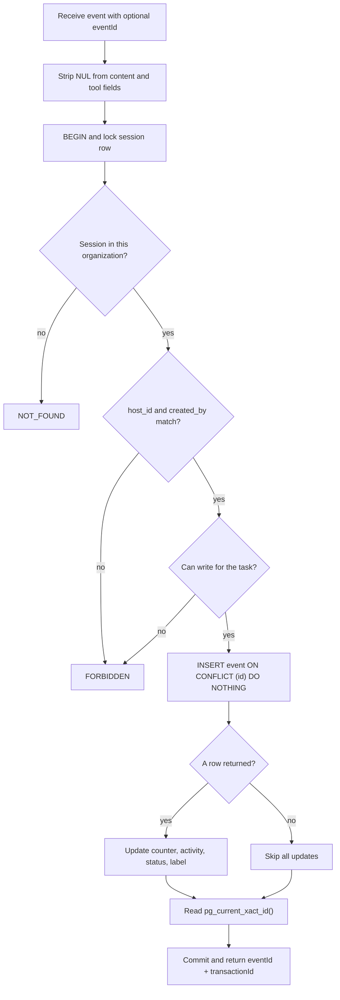
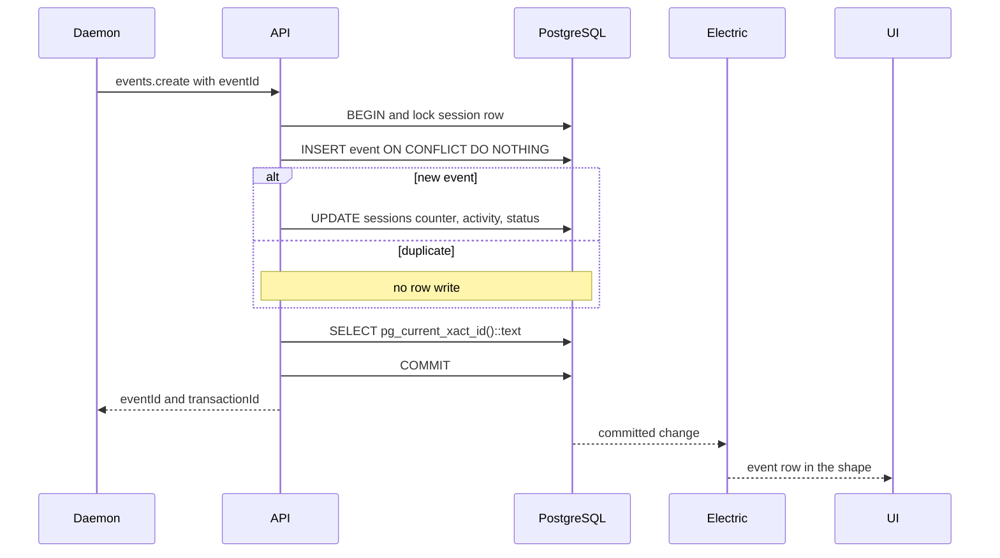
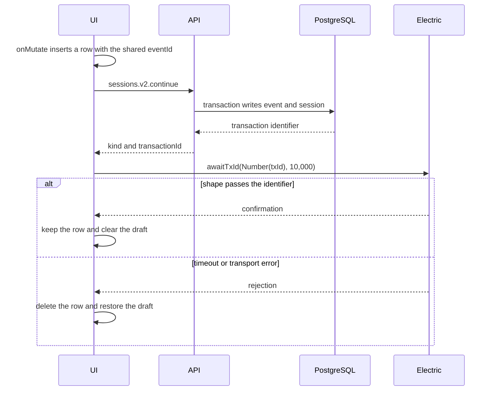

# Write paths, transaction identifiers, and optimistic updates

A write looks simple from the outside. A user types a message, the browser shows it at once, and a database row appears. HumanLayer has two routes for this path. A daemon, the local process that runs coding agents, sends agent output to `daemonBase.sessions.events.create`. The browser sends user messages to `sessions.v2.continue`. Both routes write the `conversation_events` table through oRPC, an open-source Remote Procedure Call (RPC) framework. A session is the row for one agent run, a task groups related sessions, and an event is one saved message, tool call, or tool result.

The browser learns about committed rows through Electric, a sync service. Electric sends each client a shape: a filtered, ordered view of one database table. A collection is the client-side copy of that shape. The daemon route is idempotent on the event identifier. The Application Programming Interface (API) returns the identifier of the PostgreSQL transaction that committed the row. The browser holds an optimistic row until the shape that the server touched passes that identifier. This document follows each step, then lists the failure modes that the design accepts. Citations give a path and line; each code block starts with a comment naming its range. A code block is an excerpt unless its range shows a complete construct.

## The daemon event route

`daemonBase` is the oRPC router for daemon calls. The route `daemonBase.sessions.events.create` uses the daemon billing middleware, so a blocked account cannot write an event even with a valid host token, which the API signs for one user, organization, and host (`apps/riptide-api/src/orpc/daemon/sessions/events/create.ts:153-155`). The input schema makes three facts clear. The event identifier is optional. The session identifier and the coding agent session identifier are required; the second names the agent program's own session. The public output has two fields: the event identifier and the transaction identifier (`contracts/riptide-api-contract/src/daemon/events/create.ts:39-43`). The transaction callback inside the handler returns five fields, and the handler maps them to the two public fields after the transaction commits (`apps/riptide-api/src/orpc/daemon/sessions/events/create.ts:386-389`).

The handler parses a skill name before the transaction, and the label effects reuse it. A skill name is the identifier of an agent skill: a packaged instruction folder that the agent loads for one workflow step. A label effect writes a task label, which marks the workflow stage that the event belongs to. The handler removes null bytes before it opens the transaction.

```ts
// apps/riptide-api/src/orpc/daemon/sessions/events/create.ts:153-167
export const createEventProcedure = daemonBase.sessions.events.create
	.use(requiresDaemonBillingMiddleware)
	.handler(async ({ input, context, errors }) => {
		// Parse the skill name ONCE before the transaction - parsing errors won't poison it.
		// Both the RPI label append and the Linear status-advance lookup reuse it.
		const skillName = extractSkillName(input.toolName, input.toolInputJson)
		const rpiLabel = skillName ? skillToLabel[skillName] : undefined
		const advanceStatus = skillName ? SKILL_TO_STATUS[skillName] : undefined
		const { userId, organizationId, hostId } = context.auth
		// Postgres rejects U+0000 in text and jsonb. Agents emit it when they read or write
		// code that mentions null bytes (see lib/strip-null-bytes.ts). Without this the insert
		// fails with 22P05, the daemon gets a 500, and the session dies (RIPTIDE-API-NE).
		const content = stripNullBytes(input.content)
		const toolInputJson = stripNullBytes(input.toolInputJson)
		const toolResultContent = stripNullBytes(input.toolResultContent)
```

The NUL character, code point U+0000, is legal in a JavaScript string and illegal in a PostgreSQL text or JavaScript Object Notation Binary (JSONB) value. A coding agent can produce it when it reads code that discusses null bytes. SQLSTATE is the five-character error code that PostgreSQL returns. The request then fails with SQLSTATE 22P05, the daemon receives a 500 response, and the session can die. The strip happens on values, not on serialized text, because a text-level replace would corrupt the six characters `\u0000` when they are meant as source text (`apps/riptide-api/src/lib/strip-null-bytes.ts:1-20`). The deep function walks arrays, objects, values, and keys, and it returns the same reference when nothing changed (`apps/riptide-api/src/lib/strip-null-bytes.ts:40-64`).

Three tests protect this behavior. One stores a tool call whose nested input holds real NUL characters. One keeps the literal six-character escape intact. One stores a message and a tool result with NUL characters and checks the exact output (`apps/riptide-api/test/procedures/events-create-null-bytes.test.ts:98-211`). The second is the important one; a naive replace would pass the other two.

## One transaction, one locked session row

The handler opens one database transaction. Its first statement reads the session and locks the row:

```ts
// apps/riptide-api/src/orpc/daemon/sessions/events/create.ts:172-185
			const txResult = await db.transaction(async (tx) => {
				// 1. Fetch session with auth-relevant fields
				const [session] = await tx
					.select({
						id: sessions.id,
						task_id: sessions.task_id,
						created_by: sessions.created_by,
						resource_owner_user_id: sessions.resource_owner_user_id,
						host_id: sessions.host_id,
					})
					.from(sessions)
					.where(and(eq(sessions.id, input.sessionId), eq(sessions.organization_id, organizationId)))
					.limit(1)
					.for('no key update')
```

The `WHERE` clause contains the session identifier and the organization identifier. A session in another organization is not found, so the route does not reveal that the row exists. The `.for('no key update')` clause takes a row lock that blocks a concurrent update or delete of the same session. A key-share lock is a weak row lock that a foreign-key check can take; it does not conflict with this lock. The lock is the reason the counter update is safe. Two events for one session cannot both read the same `num_events` value and write the same next value. The second writer waits for the first transaction to commit, then reads the new value.

The select reads five columns: the session identifier, the task identifier, the creator, the resource owner, and the host. The session identifier feeds the later re-read. The other four are the authority fields that the checks need. The transaction also spans the insert, the session update, and the label append. If any statement throws, PostgreSQL rolls back all of them, and the API rethrows the error (`apps/riptide-api/src/orpc/daemon/sessions/events/create.ts:390-393`).

## Two checks and five conditions

The route applies two checks after the organization scope, and the first check has two conditions. The organization check is part of the select. The host and creator check compares the session row to the daemon identity. The task check asks whether the user may write for the session's task. Table 1 lists five conditions; the host and creator rows are one `if` statement, and the last two rows are the two branches of one helper call.

**Table 1. Authorization checks in the daemon event write.**

| Gate | Rule | Failure |
|------|------|---------|
| Organization | `sessions.organization_id` equals the token organization | Not found |
| Host | `sessions.host_id` equals the daemon host identifier | Forbidden |
| Creator | `sessions.created_by` equals the token user | Forbidden |
| Task permission | If the session has a task, the user has `edit` permission on it | Forbidden |
| Session ownership | If the session has no task, the user is the resource owner | Forbidden |

The host and creator conditions are one `if` statement:

```ts
// apps/riptide-api/src/orpc/daemon/sessions/events/create.ts:192-200
				if (session.host_id !== hostId || session.created_by !== userId) {
					throw errors.FORBIDDEN()
				}

				// 3. Use task auth helper for permission check
				const canWrite = await canWriteTaskForSession(tx, session, userId, organizationId)
				if (!canWrite) {
					throw errors.FORBIDDEN()
				}
```

The creator condition is stricter than it first looks. A teammate can have `edit` permission on the task, but that teammate still fails this check when the session belongs to another creator. The daemon token belongs to one user on one host. The task check is therefore a second limit on the creator's own authority, not a way for a teammate to write through another user's daemon. If access is revoked after a session starts, the task check stops the creator from writing new events.

The task check has two branches:

```ts
// apps/riptide-api/src/db/task-auth.ts:231-242
export async function canWriteTaskForSession(
	tx: PgDatabase<PostgresJsQueryResultHKT>,
	session: { task_id: string | null; resource_owner_user_id: string },
	userId: string,
	organizationId: string,
): Promise<boolean> {
	if (session.task_id) {
		const task = await getTaskWithEffectivePermissions(tx, session.task_id, userId, organizationId)
		return task?.effectivePermission === 'edit'
	}
	return session.resource_owner_user_id === userId
}
```

Effective permission is the stronger of the user's own task access and the organization-wide access; the resource owner always has `edit` permission (`apps/riptide-api/src/db/task-auth.ts:122-187`). The order is `edit` above `comment` above `read` (`apps/riptide-api/src/db/task-auth.ts:28-38`). The resource owner receives `edit` before any Access Control List (ACL) lookup (`apps/riptide-api/src/db/task-auth.ts:153-157`). The organization-wide access is a `task_organization_acl` row with its own `permission_level`. The helper takes the higher of that row and the user ACL row (`apps/riptide-api/src/db/task-auth.ts:172-187`). A session with a task requires that permission through the helper. A session without a task requires resource ownership: the user must be the `resource_owner_user_id` recorded on the session. The helper's own comment says daemon callers are already gated by the host identifier (`apps/riptide-api/src/db/task-auth.ts:223-229`). The route still calls the helper, because host identity and task authority are different questions.

## The insert that tolerates a replay

The insert is the center of the route. It uses the event identifier as the conflict target:

```ts
// apps/riptide-api/src/orpc/daemon/sessions/events/create.ts:216-240
				const [event] = await tx
					.insert(conversationEvents)
					.values({
						id: input.eventId,
						session_id: input.sessionId,
						organization_id: context.auth.organizationId,
						resource_owner_user_id: session.resource_owner_user_id,
						task_id: session.task_id,
						coding_agent_session_id: input.codingAgentSessionId,
						coding_agent_event_id: input.codingAgentEventId,
						event_type: input.eventType,
						role: input.role,
						content,
						tool_call_id: input.toolCallId,
						tool_name: input.toolName,
						tool_input_json: toolInputJson,
						parent_tool_use_id: input.parentToolUseId,
						tool_result_for_id: input.toolResultForId,
						tool_result_content: toolResultContent,
						// Add token fields
						input_tokens: input.inputTokens,
						output_tokens: input.outputTokens,
					})
					.onConflictDoNothing({ target: conversationEvents.id })
					.returning()
```

The identifier comes from the daemon. A Universally Unique Identifier (UUID) version 7 value is a 128-bit identifier with a time-ordered prefix and a random tail. When `input.eventId` is absent, two defaults can supply a new version 7 value: the database default `uuidv7()` and the Drizzle client-side `$defaultFn(() => uuidv7())` (`packages/db/src/tables/conversation-events.ts:16-19`). Drizzle applies the client-side function before it sends the insert, so the application path uses that value; a raw SQL insert uses the database default. A row without a supplied identifier cannot conflict, because each default value is new. A row with a supplied identifier can conflict, because the daemon may send the same logical event twice.

The comment above the insert names the two real cases (`apps/riptide-api/src/orpc/daemon/sessions/events/create.ts:202-215`). A recovered thinking block can be replayed with the same identifier; a thinking block is a reasoning segment that the agent streams before its answer, and a reconnect can replay it. The oRPC client retry plugin can resend a write that already committed. The comment states that, before this change, both cases raised a duplicate-key error, the daemon received a 500 response, and the daemon could mark the session as failed. The conflict clause turns a duplicate into a no-op.

The no-op branch still returns a useful answer:

```ts
// apps/riptide-api/src/orpc/daemon/sessions/events/create.ts:247-264
				if (!event) {
					const eventId = input.eventId
					if (!eventId) {
						throw new Error('duplicate conversation event has no eventId')
					}
					logger.info(
						{ sessionId: input.sessionId, eventId: input.eventId },
						'Duplicate conversation event id — idempotent no-op (CORE-1634)',
					)
					const txid = await getTxId(tx)
					return {
						eventId,
						txid,
						taskId: session.task_id,
						resourceOwnerUserId: session.resource_owner_user_id,
						duplicate: true,
					}
				}
```

The branch reads the current transaction identifier and returns the existing event identifier, the task identifier, the resource owner, and `duplicate: true`. It skips every write below it. The counter does not increase. The activity time does not move. A label is not appended twice. The transaction callback returns the same internal five-field shape as a new insert, so the code below the callback needs no separate error path. The handler then reduces that shape to the two public fields, as the next section shows.

The regression test proves the important effects. It inserts an event, changes the session to `lost` with a sentinel activity time, sends the same identifier again, and checks four results. The call does not throw. The identifier is the same. One row exists with the original content. The event counter stays at 1, and the activity time stays at the sentinel value (`apps/riptide-api/test/procedures/events-create-idempotency.test.ts:102-148`). A second test proves that two events without an identifier produce two rows (`apps/riptide-api/test/procedures/events-create-idempotency.test.ts:150-166`).



The duplicate transaction does write one thing: it takes the row lock and executes the select. That matters for correctness, because the lock serializes it with a concurrent new event. It does not matter for visibility, as the last section explains.

## What the transaction writes after a new row

After a new row, the transaction rebuilds the session update fields. It re-reads the event counter first:

```ts
// apps/riptide-api/src/orpc/daemon/sessions/events/create.ts:266-282
				// Build session update fields. Re-read num_events inside the tx so the increment uses the
				// freshest value; a missing row (e.g. a concurrent delete) is a real error, not a silent crash.
				let nextNumEvents = 1
				if (session.id) {
					const [currentSession] = await tx
						.select({ num_events: sessions.num_events })
						.from(sessions)
						.where(eq(sessions.id, input.sessionId))
					if (!currentSession) {
						throw new Error(`Session ${input.sessionId} not found while incrementing num_events`)
					}
					nextNumEvents = currentSession.num_events + 1
				}
				const sessionUpdateFields: PgUpdateSetSource<typeof sessions> = {
					last_activity_at: BigInt(Date.now()),
					num_events: nextNumEvents,
				}
```

The re-read happens inside the lock. The code does not use a SQL `+ 1` expression here, because it needs the value for a typed update object. A missing row is a hard error, not a silent zero. The update sets `last_activity_at` to the current time in milliseconds and `num_events` to the old value plus one (`packages/db/src/tables/sessions.ts:119-124`).

The status update is conditional. It runs only when the event proves that the agent is executing.

```ts
// apps/riptide-api/src/orpc/daemon/sessions/events/create.ts:283-298
				if (provesActiveExecution(input.eventType, input.role)) {
					sessionUpdateFields.status = sql<SessionStatus>`CASE
						WHEN ${sessions.status} IN (${sql.join(
							EVENT_REPAIRABLE_SESSION_STATUSES.map((status) => sql`${status}`),
							sql`, `,
						)}) THEN 'running'
						ELSE ${sessions.status}
					END`
					sessionUpdateFields.error_message = sql<string | null>`CASE
						WHEN ${sessions.status} IN (${sql.join(
							EVENT_REPAIRABLE_SESSION_STATUSES.map((status) => sql`${status}`),
							sql`, `,
						)}) THEN NULL
						ELSE ${sessions.error_message}
					END`
				}
```

`provesActiveExecution` accepts four cases: an assistant message, assistant thinking, an assistant tool call, or a user tool result (`apps/riptide-api/src/orpc/daemon/sessions/events/create.ts:106-113`). The status repair list is `lost`, `waiting_for_usage_limit`, `failed`, `interrupted`, `ready_for_input`, `launching`, and `resuming` (`apps/riptide-api/src/orpc/daemon/sessions/events/create.ts:96-104`). A status outside the list is left alone. The update also clears `error_message` for a repaired status. The result is a one-way repair. Proof of execution moves a repairable status to `running`. A status outside the repair list, such as `needs_approval` or `interrupt_requested`, is left unchanged (`apps/riptide-api/src/orpc/daemon/sessions/events/create.ts:96-104`). No status named `completed` exists in `SESSION_STATUSES` (`packages/schemas/src/effect/session/session-status.ts:7-21`).

Two more effects are conditional. The context window value is written only when both token counts are present and the event has no parent tool use identifier (`apps/riptide-api/src/orpc/daemon/sessions/events/create.ts:300-305`). A sub-agent message has its own smaller context, so it must not overwrite the parent value. A recognized research-planning skill appends a label with raw SQL, because the label column can hold a JSON string instead of a JSON array (`apps/riptide-api/src/orpc/daemon/sessions/events/create.ts:309-332`).

Two effects run after the commit. An implementation label records an onboarding milestone, and a recognized skill advances the linked Linear issue (`apps/riptide-api/src/orpc/daemon/sessions/events/create.ts:345-384`). Both are best effort. A failure is captured in Sentry and never changes the event result. The Linear service applies a monotonic guard, so an out-of-order skill cannot move an issue backward (`apps/riptide-api/src/orpc/daemon/sessions/events/create.ts:396-430`).

**Table 2. Writes and their conditions.**

| Write | Condition | Value |
|-------|-----------|-------|
| Conversation event | Always, unless the identifier conflicts | Input fields, NUL removed |
| Event counter | New row only | Previous value plus one |
| Activity time | New row only | Current time in milliseconds |
| Status repair | New row and proof of execution and repairable status | `running` |
| Error message | Same condition as status repair | Null |
| Context window | Both token counts and no parent tool use | Input plus output tokens |
| Session label | Recognized planning skill | Label name and title |
| Onboarding milestone | Implementation label and new row | Local service call |
| Linear status | Recognized skill with a mapped status and a task | Remote issue update |

## The transaction identifier

The route reads the identifier from PostgreSQL itself:

```ts
// apps/riptide-api/src/db/get-tx-id.ts:1-8
import { sql } from 'drizzle-orm'
import type { PgDatabase } from 'drizzle-orm/pg-core'
import type { PostgresJsQueryResultHKT } from 'drizzle-orm/postgres-js'

export async function getTxId(tx: Pick<PgDatabase<PostgresJsQueryResultHKT>, 'execute'>): Promise<string> {
	const result = await tx.execute(sql`SELECT pg_current_xact_id()::text as txid`)
	return (result[0] as { txid: string }).txid
}
```

`pg_current_xact_id()` returns the identifier of the current transaction as a 64-bit value. The cast to text preserves every digit for transport. The result is not an Electric offset. It is not a logical clock. It is not a sequence that the application assigns. It is the identifier that PostgreSQL writes into the write-ahead log for the transaction, and Electric can compare it with the transactions that it has processed.

The route reads the identifier at the end of the transaction and returns it with the event identifier:

```ts
// apps/riptide-api/src/orpc/daemon/sessions/events/create.ts:334-342
				const txid = await getTxId(tx)

				return {
					eventId: event.id,
					txid,
					taskId: session.task_id,
					resourceOwnerUserId: session.resource_owner_user_id,
					duplicate: false,
				}
```

The handler maps the five-field transaction result to the two public fields (`apps/riptide-api/src/orpc/daemon/sessions/events/create.ts:386-389`). The output contract declares those two fields (`contracts/riptide-api-contract/src/daemon/events/create.ts:39-43`). The API sends the response after the transaction commits, so a successful response means the row is visible in PostgreSQL. The identifier gives the client a second fact: the exact transaction that made the row.

The version 2 continue route returns the same kind of identifier. A queued message returns `{kind: 'queued', transactionId}` (`apps/riptide-api/src/orpc/api/sessions/v2/continue.ts:134-138`). A continued session returns `{kind: 'continued', transactionId}` (`apps/riptide-api/src/orpc/api/sessions/v2/continue.ts:251-260`). The contract types the value as a string (`contracts/riptide-api-contract/src/api/sessions/v2/continue.ts:12-20`). The browser converts it to a number only at the Electric call.

## The optimistic write in the browser

The browser does not wait for the server to draw the message. It uses a TanStack DB optimistic action. The action has one rule that shapes the code. `onMutate` must write to at least one collection. Without a collection write, the library short-circuits and never calls `mutationFn` (`apps/riptide-ui/src/actions/sessions.ts:818-820`).

The queue path inserts a queued message row:

```ts
// apps/riptide-ui/src/actions/sessions.ts:821-839
			if (intent === 'queue') {
				const session = sessionsCollection.state.get(sessionId)
				queuedMessagesCollection.insert({
					id: messageId,
					session_id: sessionId,
					content: text,
					status: 'pending',
					deliver_on_interrupt: false,
					task_id: session?.task_id ?? null,
					organization_id: organizationId,
					resource_owner_user_id: session?.resource_owner_user_id ?? userId,
					user_id: userId,
					author_display_name: null,
					multiplayer_prompting_active: false,
					created_at: BigInt(Date.now()),
					updated_at: BigInt(Date.now()),
				})
				return
			}
```

The send path inserts a conversation event row:

```ts
// apps/riptide-ui/src/actions/sessions.ts:843-857
			const session = sessionsCollection.state.get(sessionId)
			eventsCollection.insert({
				...EVENT_INSERT_DEFAULTS,
				id: eventId,
				session_id: sessionId,
				organization_id: organizationId,
				resource_owner_user_id: session?.resource_owner_user_id ?? userId,
				task_id: session?.task_id ?? null,
				event_type: 'message',
				role: 'user',
				content: text,
				user_id: userId,
				created_at: BigInt(Date.now()),
				updated_at: BigInt(Date.now()),
			})
```

The send path is the important one. The optimistic row uses `id: eventId`, the same identifier that the request sends to the server. When the server writes its row and Electric delivers it, the collection sees the same primary key and reconciles the row instead of adding a second copy. The optimistic row has the user role, the message type, and the draft text. It sets `created_at` and `updated_at` to the client clock with `BigInt(Date.now())` (`apps/riptide-ui/src/actions/sessions.ts:855-856`). These are provisional values, not server values. When Electric delivers the confirmed row with the same `id`, the collection replaces the optimistic row, including both timestamps. The optimistic row does not set the token counts. Those fields stay null until the confirmed row arrives.

`requestResponseContinuation` is the small wrapper between the action and the API. It throws on a `rejected` response and calls `sharedSubmission.accepted()` on any accepted response (`apps/riptide-ui/src/actions/sessions.ts:34-49`). The comment above it states the rule: API acceptance comes before Electric confirmation, so a later sync failure must not restore submitted text into a collaborative document (`apps/riptide-ui/src/actions/sessions.ts:34-35`). The editor already accepted the submission, and a second restore would duplicate the text.

The mutation function handles each response kind:

- A `rejected` response throws, so the catch block runs.
- A `continued` response after a queue intent deletes the optimistic queued row, because the server drained the queue and wrote an event instead.
- A `queued` response waits on the queued messages collection.
- Any other accepted response waits on the sessions collection.

On any error, the catch block deletes the optimistic row, restores the saved draft, shows a toast, and reports the error (`apps/riptide-ui/src/actions/sessions.ts:881-896`). When a collaborative submission owns the text, the code does not restore the draft, because the editor owns that state.

## The confirmation wait

The confirmation function is one object with one entry for each collection. The sessions and conversation event entries show the pattern:

```ts
// apps/riptide-ui/src/components/providers/SyncProvider.tsx:922-949
	// ---- confirmTx: per-collection post-write sync confirmation ----
	// Electric mode: wait for the transaction to sync back via awaitTxId
	// Query mode: trigger an immediate refetch so the collection reflects the latest state
	// Refs are read at call time (not at closure creation time), so they always reflect current state.

	const confirmTx = useMemo(
		() => ({
			sessions: async (txId: string | number): Promise<void> => {
				if (modes.sessions === 'query' && sessionsQueryRef.current) {
					await sessionsQueryRef.current.utils.refetch()
				} else {
					await sessionsElectric.utils.awaitTxId(Number(txId), AWAIT_TX_TIMEOUT)
				}
			},
			tasks: async (txId: string | number): Promise<void> => {
				if (modes.tasks === 'query' && tasksQueryRef.current) {
					await tasksQueryRef.current.utils.refetch()
				} else {
					await tasksElectric.utils.awaitTxId(Number(txId), AWAIT_TX_TIMEOUT)
				}
			},
			conversationEvents: async (txId: string | number): Promise<void> => {
				if (modes.conversationEvents === 'query' && eventsQueryRef.current) {
					await eventsQueryRef.current.utils.refetch()
				} else {
					await eventsElectric.utils.awaitTxId(Number(txId), AWAIT_TX_TIMEOUT)
				}
			},
```

The logic is the same for every collection. In query mode, the function calls `utils.refetch()` and waits for the read endpoint. In Electric mode, it calls `utils.awaitTxId(Number(txId), AWAIT_TX_TIMEOUT)`. The timeout constant is 10,000 milliseconds (`packages/sync/src/constants.ts:14-17`). The call converts the text identifier to a number, because the Electric client compares transaction identifiers as numbers.

The repository does not define a numeric range for the identifier, and it does not check the value against the JavaScript safe-integer limit of 9,007,199,254,740,991 (`apps/riptide-api/src/db/get-tx-id.ts:1-8`; `apps/riptide-ui/src/components/providers/SyncProvider.tsx:933`). The text cast keeps every digit up to the client (`apps/riptide-api/src/db/get-tx-id.ts:6`). `Number(txId)` then converts the text to a double before `awaitTxId` compares it. The code guarantees an exact text value and an exact PostgreSQL value. It does not guarantee an exact JavaScript number. If the identifier were above the safe-integer limit, the conversion would round it, and the wait could match a different transaction or never match. The repository contains no guard for this case, so the design relies on the identifier remaining below the limit.

`awaitTxId` waits until the shape reports that it has caught up to the given transaction identifier. It proves that the shape reached the transaction. It does not prove that other shapes reached it, and it does not prove that the stream layer delivered the event. Each shape has its own position in the Electric stream.

The server branch determines which shape the client waits on. A queue write inserts only a queued message row, so the client waits on the queued messages collection. A continued write inserts conversation events and updates the session row, so the client waits on the sessions collection. The optimistic conversation event still uses the shared event identifier and reconciles when its own shape arrives. The wait is on the shape that the transaction definitely changed.

**Aha:** The client does not wait on the collection that holds the optimistic row. It waits on the collection that the server branch wrote. A send creates an optimistic conversation event, but it waits on the sessions shape, because the continue transaction updates the session row. A queue creates an optimistic queued message and waits on the queued messages shape, because that branch writes no session row. The response kind tells the client which table the transaction touched.



The second sequence shows the optimistic path, where the browser uses the identifier as a confirmation signal:



## Failure modes

The path accepts several failures. Table 3 lists them and the result that a user sees.

One term in Table 3 needs a definition. The stream writer is the daemon's durable stream writer. It publishes each event to the session stream at `/streams/sessions/:sessionId` (`apps/riptide-daemon/src/effects/services/stream-producer/durable-stream-writer.ts:64-65`). The stream is a separate path from the Electric shape. If the preflight call fails, the writer returns a no-op, and the daemon still saves the row through the API (`apps/riptide-daemon/src/effects/services/stream-producer/durable-stream-writer.ts:89-111`). A writer failure therefore changes the live stream only. The shape still delivers the row.

**Table 3. Failure modes in the write and confirmation path.**

| Failure | Server behavior | Client behavior |
|---------|-----------------|-----------------|
| Wrong organization | Not found before any write | Optimistic row removed, draft restored |
| Wrong host or creator | Forbidden before any write | Optimistic row removed, draft restored |
| No task edit permission | Forbidden before any write | Optimistic row removed, draft restored |
| Duplicate event identifier | No-op, returns `duplicate: true` and a transaction identifier | Daemon receives a normal response; one row remains |
| NUL in content or tool input | Stripped before the insert | Write succeeds with cleaned text |
| Database error | Transaction rolls back and the error is rethrown | Optimistic row removed, draft restored |
| Electric does not pass the identifier within 10,000 milliseconds | Row is committed | Optimistic row removed, draft restored; a later read shows the row |
| Query refetch fails | Row is committed | Optimistic row removed, draft restored |
| Stream writer fails | Database row is unaffected | The row appears through the shape, not the stream |

The Electric timeout case deserves attention. The server may commit the row and the client may still roll back the optimistic display. The user can see the message disappear, and the restored draft can invite a second send. The event identifier limits the damage. A second send with the same identifier is a no-op, but a new send with a new identifier creates a second event. The 10,000 millisecond timeout is therefore a user-experience tradeoff, not a correctness boundary.

Reuse is specific to one request. On the daemon path, the oRPC client installs `ClientRetryPlugin`. It resends the same request body up to five times, 2,000 milliseconds apart, so a retry carries the same `eventId` (`apps/riptide-daemon/src/orpc/client.ts:14`, `:79-93`). The event route also names a recovered thinking-block replay that reuses an identifier (`apps/riptide-api/src/orpc/daemon/sessions/events/create.ts:202-210`). The User Interface generates a new `uuidv7()` identifier for each send (`apps/riptide-ui/src/hooks/session-detail/useSessionSendControls.ts:157-158`). A retry of the same optimistic transaction keeps the identifier from its input. A new send after the timeout is a new transaction with a new identifier.

## What the path does not prove

The design uses one key for duplicate control and one key for visibility. The event identifier answers "is this the same event". The transaction identifier answers "did this shape process the transaction". Neither answers "will every reader receive the event". The stream layer is a separate path with its own producer and its own time to live, as document [04](04-session-sdk-and-durable-streams.md) explains. The database row is the record of truth.

One limit is visible in the duplicate branch. That transaction writes no row, but it still returns a transaction identifier. Electric advances a shape on row changes, so a wait on that identifier has no change to observe. The daemon does not wait on it, and the regression test checks only that the identifier is truthy (`apps/riptide-api/test/procedures/events-create-idempotency.test.ts:132-134`). A future caller that treats the duplicate identifier as a visibility marker would wait for a transaction that left no trace in the shape.

A second limit is in query mode. A refetch proves that the read endpoint answered, not that the endpoint read the same database state as the write. The code treats a successful refetch as confirmation. It does not compare the returned row with the optimistic row. The event identifier still reconciles the collection if the row arrives later.

**Aha:** The transaction identifier is a PostgreSQL fact, and the wait is an Electric fact. The API can return a real identifier for a transaction that wrote nothing, and the browser can wait on a shape that never changes. The system is correct because the normal write always changes the shape that the client waits on. It is not correct because every returned identifier is observable.

## Next

Document [04](04-session-sdk-and-durable-streams.md) explains the stream that carries the same events to the browser and why it makes no delivery claim. Document [05](05-sync-engine.md) explains the shape, the health tracker, and the query fallback behind `awaitTxId` and `refetch`. Document [06](06-electric-proxy.md) explains how the proxy filters the rows that the shape can see. Document [08](08-database-and-schemas.md) explains the table model and the UUID version 7 default. Document [10](10-ui-application.md) explains how the collections and optimistic actions fit into the React application.
