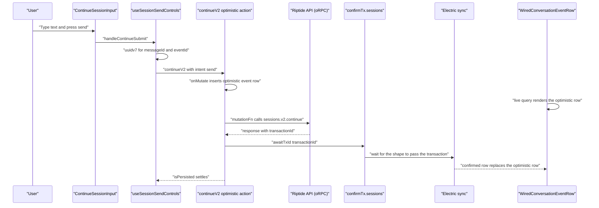
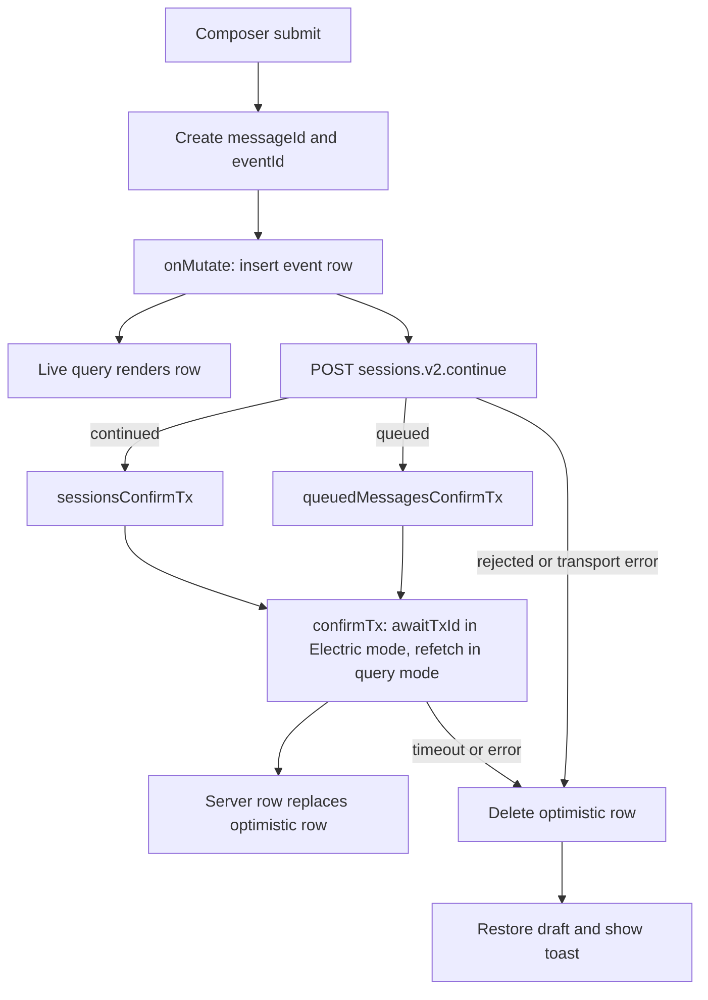
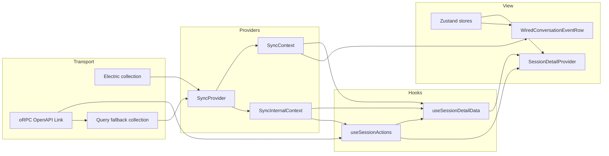

# The user interface: React, live queries, and interface-only state

The Riptide user interface keeps two kinds of state apart. Server rows arrive through one sync provider and are read through live queries. A live query is a reactive question over a local row set, and it updates when the row set changes. Interface state — open panels, drafts, selection, and layout — lives in Zustand stores. Zustand is a small state library for React. This document explains the stack, the routing shell, the data layer, the Application Programming Interface (API) client, and one message send from the composer to a confirmed row. The composer is the text input at the bottom of a session.

## The stack at a glance

The application is `apps/riptide-ui`. It is one React application. The web application, the Electron shell, and the Tauri shell load the same code. React is version 19.2, and Vite is version 7.1 (`apps/riptide-ui/package.json`). TanStack Router supplies file-based routing. TanStack DB supplies collections and live queries. Zustand supplies interface-only stores.

| Layer | Library or tool | Version | Role |
|-------|-----------------|---------|------|
| View | React and React DOM | 19.2 | Rendering and component model |
| Build | Vite | 7.1 | Development server and production bundle |
| Routing | TanStack Router | catalog pin | File-based routes and typed navigation |
| Server cache | TanStack Query | catalog pin | Request cache for the API client |
| Live rows | TanStack DB | catalog pin | Collections and live queries |
| Row transport | TanStack Electric DB collection | catalog pin | Electric stream into a collection |
| Interface state | Zustand | 5.0 | Panels, drafts, selection, and layout |
| API transport | oRPC OpenAPI Link | catalog pin | Typed HTTP calls to the API |

A catalog pin is one version that the root workspace catalog defines. TanStack Query caches request and response pairs from the API. TanStack DB holds row sets that sync from the server.

The application also contains 37 modules under `apps/riptide-ui/src/hooks/live-queries` before test files. The folder has 39 files: the 37 modules and 2 test files. The 16 Electric collection modules are under `apps/riptide-ui/src/collections/electric`. The 15 query-fallback collection modules are under `apps/riptide-ui/src/collections/query`. The folders are separate and do not nest. No file belongs to two folders. The two collection folders cover 15 tables in common. The Electric folder adds `agent-slash-commands.ts`, and the query folder has no counterpart for that table (`apps/riptide-ui/src/components/providers/SyncProvider.tsx:297-304`, `apps/riptide-ui/src/components/providers/SyncProvider.tsx:1078`). The live-query hooks read collections or the API; they do not define collections. The query fallback builds the same collection interface from ordinary API requests. In query mode, the fallback collection refetches on a fixed interval. The interval is 4 seconds for conversation events, 2 seconds for provider login requests, and 10 seconds for the other tables (`packages/sync/src/constants.ts:43-59`). The state folder, `apps/riptide-ui/src/hooks/stores`, holds 46 TypeScript modules before test files. Nineteen use the Zustand `persist` middleware, which writes selected fields to browser storage.

## The application shell and routing

The browser entry point creates one router and one query client. Before React renders, it calls one local migration, `migrateArtifactViewMode` (`apps/riptide-ui/src/main.tsx:50-51`). The migration reads the browser storage area `localStorage`. It rewrites the removed `minimal` value of the key `riptide-artifact-view-mode` to `rendered` (`apps/riptide-ui/src/lib/preferences.ts:93-106`). It is not a general schema migration. The call has no error handler. If a storage access throws, the rest of `main.tsx` does not run, `root.render` is not reached, and the code defines no fallback message (`apps/riptide-ui/src/main.tsx:50-51`, `apps/riptide-ui/src/main.tsx:99-111`). The Zustand stores also run their own `persist` migrations when each store hydrates. Hydration loads the saved values from browser storage into the store at startup. For example, the settings store declares version 40 and calls `migrateSettingsState` (`apps/riptide-ui/src/hooks/stores/settingsStore.ts:895-897`). The entry point starts the Electron client runtime when the page is inside the Electron shell, and it blocks the browser from opening a dropped file. It then builds the router. The history function is a hash history for `file:` pages and a browser history for web pages (`apps/riptide-ui/src/main.tsx:70`). A desktop build can therefore load the application from a packaged file without a web server.

```ts
// apps/riptide-ui/src/main.tsx:64-87
// Create a new router instance
const queryClient = new QueryClient({
	defaultOptions: {
		queries: { retry: shouldRetryQuery },
	},
})
const baseHistory = window.location.protocol === 'file:' ? createHashHistory() : createBrowserHistory()
const history = createHorizontalTabHistory(baseHistory, () => {
	if (!isDesktop() || window.innerWidth < 768) return null
	return useHorizontalTabsStore.getState().selectedTabId
})
const router = createRouter({
	routeTree,
	history,
	context: {
		queryClient,
		preloadService: null,
	},
	defaultPreload: 'intent',
	scrollRestoration: true,
	defaultStructuralSharing: true,
	defaultPreloadStaleTime: 0,
	defaultErrorComponent: RouterErrorComponent,
})
```

The history wrapper adds a tab identifier to every navigation entry. Horizontal tabs are browser-like tabs inside a desktop window. The store allows up to nine tabs and persists them (`apps/riptide-ui/src/hooks/stores/horizontalTabsStore.ts:5-8`). It asks the tab store for the selected tab. It adds nothing when no tab is selected, when the window is not a desktop shell, or when the window is narrower than 768 pixels (`apps/riptide-ui/src/main.tsx:68-74`).

The router context holds a preload service slot. `PreloadServiceProvider` calls `router.update` after mount to replace the null slot with a real service, and route loaders use it to load session or task detail before navigation (`apps/riptide-ui/src/components/providers/PreloadServiceProvider.tsx:21-33`).

The router has three settings. `defaultPreload: 'intent'` starts a route load when the pointer approaches a link. `defaultStructuralSharing: true` keeps unchanged object references stable. `defaultPreloadStaleTime: 0` marks a preload stale at once. The next navigation runs the route loader again instead of trusting old data.

The route tree is generated. The TanStack Router Vite plugin writes `src/routeTree.gen.ts` and the file says not to edit it (`apps/riptide-ui/src/routeTree.gen.ts:7-8`). The plugin is configured in `apps/riptide-ui/vite.config.ts:74-79` with `autoCodeSplitting: true`. Code splitting gives each route its own script bundle. `src/routes` holds 46 route modules and one test file. A route group with a leading underscore is pathless. It adds a layout without adding a part to the URL. The tree has an `_app` layout, `settings`, `shared`, and `callback`, plus top-level `hosts` and `billing` routes.

| Route group | Examples | Purpose |
|-------------|----------|---------|
| `_app` | `sessions/$sessionId`, `tasks/$taskId`, `board`, `artifacts` | The signed-in application |
| `settings` | `general`, `daemons`, `projects`, `billing`, `sync` | Account and device settings |
| `shared` | `shared/artifacts/$artifactId` | Public artifact views without the full shell |
| Top level | `hosts`, `callback`, `billing/return` | Host list, sign-in callback, billing return |
| Presentation layers | `src/minimalist`, `src/mobile` | Not routes: compact and small-screen components |

The root route supplies global providers. It mounts a tooltip provider, `CodeLayerToaster`, fake window controls when forced, and `ProviderProvider`. It then chooses between the shared-artifact outlet and the normal application frame (`apps/riptide-ui/src/routes/__root.tsx:51-74`).

```tsx
// apps/riptide-ui/src/routes/__root.tsx:51-74
export const Route = createRootRouteWithContext<MyRouterContext>()({
	component: function RootLayout() {
		const initializeDefaultEditorFromEnv = useSettingsStore((s) => s.initializeDefaultEditorFromEnv)
		const roundedCornersEnabled = useSettingsStore((s) => s.roundedCornersEnabled)
		const pathname = useRouterState({ select: (state) => state.location.pathname })
		useMountEffect(() => {
			void initializeDefaultEditorFromEnv()
		})

		return (
			<TooltipProvider>
				<CodeLayerToaster />
				{showsFakeWindowControls() && <FakeMacTrafficLights />}
				<ProviderProvider>
					{isSharedArtifactRoute(pathname) ? (
						<Outlet />
					) : (
						<AppFrame roundedCornersEnabled={roundedCornersEnabled} />
					)}
				</ProviderProvider>
			</TooltipProvider>
		)
	},
})
```

`ProviderProvider` is a component that selects a provider tree. The name does not mean a generic React context provider. It chooses one of two trees from the path (`apps/riptide-ui/src/components/ProviderProvider.tsx:38-57`). Shared artifact routes get a small tree. Authenticated routes get the full set: authentication, theme, sync, tabs, preloads, update checks, hotkeys, and diagnostics. Authentication uses WorkOS, the identity provider. The sync provider is inside this authenticated tree (`apps/riptide-ui/src/components/ProviderProvider.tsx:71`).

A shared artifact page has no organization sync provider. This page is the one exception to the provider rule. It resolves access through the API and creates one small Electric collection for the artifact with the share key (`apps/riptide-ui/src/components/shared-artifact/SharedArtifactRoute.tsx:31-39`, `apps/riptide-ui/src/hooks/shared-artifact/useSharedArtifactCollection.ts:22-49`). The share key is a secret that the public endpoint checks without an organization token.

The `_app` layout adds the application shell. It renders banners, an optional billing rail, the sidebar, and the page outlet. On small screens it renders a smaller tree (`apps/riptide-ui/src/routes/_app/route.tsx:88-118`). The sidebar is either the project sidebar or the task tree, and a settings store chooses which (`apps/riptide-ui/src/routes/_app/route.tsx:121-124`). A minimalist layout replaces the whole frame through a lazy import (`apps/riptide-ui/src/routes/__root.tsx:31-49`). `AppFrame` calls `useMinimalistLayout`, and the lazy import loads the replacement when the hook returns true. The import also keeps that code out of the main bundle.

## The data layer: one source of collections

A collection is a client-side row set with an identifier for each row. A live query reads a collection and re-renders when the collection changes. Electric is the sync service that streams PostgreSQL rows into a collection. A shape is one filtered stream on the Electric server. An authentication proxy decides which rows each shape contains.

`SyncProvider` is the one source of collections for authenticated pages. It creates a collection for each table, then publishes the active collection through `SyncContext` (`apps/riptide-ui/src/components/providers/SyncProvider.tsx:1061-1084`). Components call `useSync()` and never learn whether Electric or the query fallback supplies the rows. The provider keeps two contexts on purpose.

```tsx
// apps/riptide-ui/src/components/providers/SyncProvider.tsx:139-157
// ============================================================================
// Context value types
//
// Two separate contexts exist to separate public from internal concerns:
//
// SyncContext (outer) — the public API for UI components.
//   Exposes the active collection for each table (electric or query-backed).
//   Components use `useSync()` to read/query data without caring which sync
//   engine is currently active.
//
// SyncInternalContext (inner) — plumbing for the sync infrastructure.
//   Exposes the CollectionHealthTracker (controls electric↔query failover),
//   per-collection mode map, and `confirmTx` helpers (await electric txId or
//   trigger a query refetch after writes). Only consumed by write-path code
//   (actions, mutations) and sync-status UI (settings, footer indicators).
//
// Splitting them avoids re-rendering every collection consumer when only the
// internal mode/tracker state changes, and keeps the public API surface small.
// ============================================================================
```

The outer context exposes 16 collections. They are sessions, tasks, events, online hosts, approvals, artifact comments, diff comments, artifacts, and artifact metadata. The rest are two access-control lists, task user settings, workspace setup, queued messages, provider login requests, and agent slash commands (`apps/riptide-ui/src/components/providers/SyncProvider.tsx:159-194`). The inner context exposes the health tracker, the mode map, the sync-auth flag, and 14 `confirmTx` functions (`apps/riptide-ui/src/components/providers/SyncProvider.tsx:196-226`). Online hosts and agent slash commands have no confirmation function here.

The health tracker watches each Electric shape. It swaps a table to `query` after 3 consecutive Electric errors (`packages/sync/src/constants.ts:12`). It returns to Electric after 3 consecutive successes (`packages/sync/src/constants.ts:5`). A 5XX response or a network `TypeError` counts as one error. A failed `fetch` rejects with `TypeError` (`packages/sync/src/tracked-fetch.ts:47-55`). A 2XX response counts as one success. Other response classes do not change the counters (`packages/sync/src/tracked-fetch.ts:12-15`, `packages/sync/src/tracked-fetch.ts:39-55`). All other 4XX responses, such as 400 or 404, change no counter. A 401 or 403 response is not a health error. The Electric error handler waits 2 seconds and then returns a retry signal. It has no attempt limit (`packages/sync/src/sync-error-handler.ts:152-158`). No independent timer checks health. Each Electric fetch attempt is one sample. Electric also applies its own backoff to each retry: 500 milliseconds at first, a 1.3 multiplier, and a 10-second cap (`packages/sync/src/sync-config.ts:13-18`). A long-poll request stays open until the server has an update. While a table is in query mode, a keep-alive subscription holds the shape open. Electric long-poll requests therefore continue, and they can record the recovery successes (`packages/sync/src/electric-keep-alive.ts:26-34`, `packages/sync/src/electric-keep-alive.ts:75-84`). The mode map records `electric` or `query` for each table. The switch is per table, not global, so one failed shape does not stop the others. A settings value `syncForceMode` overrides both transitions. The value is `auto`, `electric`, or `query`, and `auto` removes the override (`apps/riptide-ui/src/hooks/stores/settingsStore.ts:30`, `apps/riptide-ui/src/components/providers/SyncProvider.tsx:236-266`).

The provider fixes sync version 2 (`apps/riptide-ui/src/components/providers/SyncProvider.tsx:237`). Version 1 used task access lists. Version 2 scopes rows by organization (`apps/riptide-electric-proxy/src/lib/v2-where-builder.ts:37-55`). It creates the access-token function and rejects with `AccessTokenUnavailableError` until authentication and organization selection are ready (`apps/riptide-ui/src/components/providers/SyncProvider.tsx:238-243`).

```tsx
// apps/riptide-ui/src/components/providers/SyncProvider.tsx:232-243
export const SyncProvider = ({ children }: { children: ReactNode }) => {
	const { getAccessToken: getAuthKitAccessToken, user, organizationId, isLoading } = useAuth()
	const queryClient = useQueryClient()
	const { client: apiClient } = useRiptideApi()
	const syncForceMode = useSettingsStore((s) => s.syncForceMode)
	const syncVersion: SyncVersion = 2
	const getAccessToken = useCallback(() => {
		if (isLoading || !user || !organizationId) {
			return Promise.reject(new AccessTokenUnavailableError('Authentication is not ready'))
		}
		return getAuthKitAccessToken()
	}, [getAuthKitAccessToken, isLoading, organizationId, user])
```

Each Electric collection is built from a schema and a route path. The sessions collection is an example. It registers four indexes: two basic indexes and two B-tree indexes (`apps/riptide-ui/src/collections/electric/sessions.ts:9-19`).

```ts
// apps/riptide-ui/src/collections/electric/sessions.ts:9-19
const sessionsCollectionBuilder = createBrowserElectricCollection({
	schema: sessionSelectSchema,
	routePath: '/sessions',
	collectionName: 'sessions',
	indexes: [
		{ field: (row) => row.task_id, name: 'task_id', indexType: BasicIndex },
		{ field: (row) => row.resource_owner_user_id, name: 'resource_owner_user_id', indexType: BasicIndex },
		{ field: (row) => row.last_activity_at, name: 'last_activity_at', indexType: BTreeIndex },
		{ field: (row) => row.updated_at, name: 'updated_at', indexType: BTreeIndex },
	],
})
```

The index types follow the query style. A basic index answers equality tests. A B-tree index keeps values in order and answers range and sort tests. The two timestamp columns use B-tree indexes because session lists sort by recent activity and update time.

`useSessionDetailData` reads the session row, its events, its approvals, and its queued messages. It then passes those rows to `useSessionEvents`, which turns raw rows into the ordered conversation that the stream renders (`apps/riptide-ui/src/hooks/session-detail/useSessionDetailData.ts:28-97`).

```ts
// apps/riptide-ui/src/hooks/session-detail/useSessionDetailData.ts:28-41
	// Query session data for working_directory, title, status
	const {
		data: sessionData,
		isReady: isSessionQueryReady,
		isLoading: isSessionLoading,
	} = useLiveQuery(
		(q) => q.from({ sessions: sessionsCollection }).where(({ sessions }) => eq(sessions.id, sessionId)),
		[sessionsCollection, sessionId],
	)
	const session = sessionData?.[0]
	// Electric marks a shape ready on any error, the missing access token included, so a
	// collection that never authenticated reports ready with zero rows. Callers use this
	// flag to decide "the session does not exist", so hold it until sync can authenticate.
	const isSessionReady = isSessionQueryReady && syncAuthReady
```

**Aha:** Electric marks a shape ready even when a request fails, including a missing access token. The TanStack DB collection becomes ready when its first sync attempt ends, and a failed attempt also ends it (`apps/riptide-ui/src/components/providers/SyncProvider.tsx:204-207`). A collection can therefore be ready and empty at the same time. The path that stops the shape is the auth-token-unavailable branch. The flag is the collection's `shouldRetryOnFailure` option. It is `!isLoading`, so it is false during the initial authentication load (`apps/riptide-ui/src/collections/electric/sessions.ts:39`). The error handler logs a warning and returns `undefined`. A return value of `undefined` tells Electric not to retry, so the shape stops (`packages/sync/src/sync-error-handler.ts:129-145`). The provider builds a new collection when `isLoading` becomes false, because `isLoading` is a dependency of the collection memo (`apps/riptide-ui/src/components/providers/SyncProvider.tsx:282-284`). The cache does not keep the initial-load collection (`packages/sync/src/collection-cache.ts:33-49`). The hook does not trust `isReady` alone. It reads `syncAuthReady` from the inner sync context. `useSyncAuthReady` builds that flag from a TanStack Query that calls `getAccessToken` (`apps/riptide-ui/src/hooks/use-sync-auth-ready.ts:4-30`). The query is enabled only after authentication resolves and a user and organization exist. It retries with a capped delay and returns true only after it receives a token. The query key includes the user and organization, so a new identity starts it again (`apps/riptide-ui/src/hooks/use-sync-auth-ready.ts:15-29`). The hook waits for the flag before it reports that a session does not exist (`apps/riptide-ui/src/hooks/session-detail/useSessionDetailData.ts:38-41`). Without this guard, a slow sign-in would show a false "not found" page.

The conversation view uses many small live queries. The virtualized parent renders only the rows near the viewport, so it must stay cheap. `WiredConversationEventRow` is a wired component: it reads its own data through live queries instead of props. It takes stable identifiers from the parent, then queries one event, its tool result, and its approval. The parent does not pass large objects (`apps/riptide-ui/src/components/conversation-stream/WiredConversationEventRow.tsx:34-37`). The row queries the first tool result and approval by the most selective column.

```tsx
// apps/riptide-ui/src/components/conversation-stream/WiredConversationEventRow.tsx:67-90
		const { data: eventRows } = useLiveQuery(
			(q) =>
				q
					.from({ event: eventsCollection })
					.where(({ event }) => and(eq(event.id, eventId), eq(event.session_id, sessionId))),
			[eventsCollection, eventId, sessionId],
		)
		const eventRow = eventRows[0]
		const toolId = eventRow?.tool_call_id ?? undefined

		const { data: toolResultRows } = useLiveQuery(
			(q) =>
				q
					.from({ event: eventsCollection })
					// Most selective predicate first: TanStack DB's index intersection seeds from
					// the first conjunct's key set, so leading with session_id copies the whole
					// session's key set (10k+ rows) per evaluation; tool_result_for_id matches ≤1.
					.where(({ event }) =>
						and(
							eq(event.tool_result_for_id, toolId ?? '__no_tool_result__'),
							eq(event.session_id, sessionId),
						),
					),
			[eventsCollection, toolId, sessionId],
```

**Aha:** Predicate order changes cost. The code comment explains the order: TanStack DB starts an index intersection from the first condition. If `session_id` comes first, each evaluation copies the key set of the whole session. The code puts `tool_result_for_id` first because it expects at most one match (`apps/riptide-ui/src/components/conversation-stream/WiredConversationEventRow.tsx:81-83`). The events collection declares indexes on `session_id` and `task_id` only (`apps/riptide-ui/src/collections/electric/conversation-events.ts:14-17`). Treat the comment as the author's intent, not a proven query plan. The same order appears in the approval query.

## The state split: server rows versus interface state

The application makes a hard split. Any fact that another person can see is a server row. Any fact that only describes this window is a Zustand value. This split keeps the sync stream free of layout noise.

| State | Source | Examples | Where it lives or how long it lasts | Shared with others |
|-------|--------|----------|----------|--------------------|
| Session row | Electric collection | title, status, model, host | Until the row changes | Yes |
| Conversation event | Electric collection | user message, tool call, result | Durable event log | Yes |
| Approval | Electric collection | status, suggestions | Until resolved | Yes |
| Queued message | Electric collection | pending prompt text | Until sent or deleted | Yes |
| Task access | Electric collection | user and organization access lists | Until changed | Yes |
| Panel open state | Zustand store | model selector, terminal | Session tab | No |
| Draft text | Zustand store with persist | unfinished prompt per session | Browser storage | No |
| Sidebar layout | Zustand store with persist | collapsed flag, expanded task identifiers | Browser storage | No |
| Focus and hover | Zustand store | focused event, hover card | Current interaction | No |
| Navigation history | Zustand store | back and forward stacks | Tab | No |

The drafts store is the clearest example. It stores editor content by session identifier and persists only the `drafts` field (`apps/riptide-ui/src/hooks/stores/draftsStore.ts:14-31`).

```ts
// apps/riptide-ui/src/hooks/stores/draftsStore.ts:14-31
export const useDraftsStore = create<DraftsState>()(
	persist(
		(set) => ({
			drafts: {},
			setDraft: (sessionId, content) => set((s) => ({ drafts: { ...s.drafts, [sessionId]: content } })),
			clearDraft: (sessionId) =>
				set((s) => {
					const { [sessionId]: _, ...rest } = s.drafts
					return { drafts: rest }
				}),
			restoreDraft: (sessionId, content) => set((s) => ({ drafts: { ...s.drafts, [sessionId]: content } })),
		}),
		{
			name: DRAFTS_STORAGE_KEY,
			partialize: (state) => ({ drafts: state.drafts }),
		},
	),
)
```

Some stores are deliberately transient. `createSessionUiStore` has no persistence and holds only the model-selector flag and the terminal flag (`apps/riptide-ui/src/hooks/stores/sessionUiStore.ts:15-33`). It uses a vanilla store and a React context, so each session page can own one instance. A vanilla store is a Zustand store with no React hook binding.

The state folder holds 46 modules. They cover panels, focus, drafts, terminal sessions, notifications, task filters, diff review marks, billing banners, and settings. Nineteen use `persist`, and the rest are memory-only. No store holds a copy of a server row. A store may hold an identifier that points at a row, such as a selected event or an expanded task.

## The API client

Writes and non-synced reads use the client in `apps/riptide-ui/src/orpc/client.ts`. oRPC is a contract-first Remote Procedure Call (RPC) library. A contract describes each procedure, its input, and its output. The hook `useRiptideApi` builds one OpenAPI Link for the API. The link sends each call to an OpenAPI path. It adds the WorkOS access token as a Bearer token, and WorkOS is the identity provider. It installs one error interceptor (`apps/riptide-ui/src/orpc/client.ts:167-185`).

```ts
// apps/riptide-ui/src/orpc/client.ts:167-185
	const { client, queryClient } = useMemo(() => {
		const link = new OpenAPILink(RiptideApiContract, {
			url: `${riptideApiOrigin}/rpc/api/v1`,
			headers: async () => {
				if (!user) return {}
				const accessToken = await getAccessToken()
				return accessToken ? { Authorization: `Bearer ${accessToken}` } : {}
			},
			interceptors: [createRiptideApiErrorInterceptor({ navigate, isOnOrgPages, roles })],
		})

		// Raw client for direct API calls
		const client: JsonifiedClient<ContractRouterClient<typeof RiptideApiContract>> = createORPCClient(link)

		// TanStack Query wrapped client for hooks
		const queryClient = createTanstackQueryUtils(client)

		return { client, queryClient }
	}, [getAccessToken, user, user?.id, organizationId, isOnOrgPages, roles])
```

The hook returns three values. `client` is the raw typed client. `JsonifiedClient` converts the contract client to the JSON shape that crosses HTTP. `queryClient` wraps the same client in TanStack Query helpers. This `queryClient` is not the TanStack Query cache from the router. It is a helper object for hooks. `authScope` carries both identifiers for cache keys, because two accounts must not share cached responses (`apps/riptide-ui/src/orpc/client.ts:187-189`).

The interceptor maps API error codes to user actions (`apps/riptide-ui/src/orpc/client.ts:45-159`). `UNAUTHORIZED` does nothing, because a 401 also answers requests sent before sign-in finishes. `ORGANIZATION_REQUIRED` routes to organization selection. `BILLING_REQUIRED` shows a billing notice. `TASK_SLUG_CONFLICT` and `TASK_LAUNCH_CONFLICT` do nothing here, because the task composers show their own messages. `FORBIDDEN` shows a permission message. `INPUT_VALIDATION_FAILED` sends the error to Sentry, the error reporting service, and shows a validation message. `INVALID_PROMO_CODE` shows an invalid-code message. `NETWORK_ERROR` shows a connection message. `SERVER_ERROR` and `INTERNAL_SERVER_ERROR` show a generic retry message. Unknown codes go to Sentry and show the error message, except `NETWORK_ERROR`, `FORBIDDEN`, and `UNAUTHORIZED`, which never reach the default branch. The interceptor rethrows every error, so the caller still sees the failure.

## Walkthrough: from composer submit to confirmed row

The send path connects the stores, the API client, the sync provider, and the live query. The sequence has eight steps.



**Step 1.** The user submits the composer. `handleContinueSubmit` returns early if no session exists. It sets a submitting flag and creates two version 7 universally unique identifiers (UUIDs), one for the message and one for the event (`apps/riptide-ui/src/hooks/session-detail/useSessionSendControls.ts:153-158`). In a normal send only the event identifier reaches the row. The message identifier names a queued row.

**Step 2.** It calls `sessionActions.continueV2` with `intent: 'send'` (`apps/riptide-ui/src/hooks/session-detail/useSessionSendControls.ts:160-167`).

```ts
// apps/riptide-ui/src/hooks/session-detail/useSessionSendControls.ts:155-180
			startSendScrollDiagnostic(session.id)
			setIsSubmittingContinue(true)
			const messageId = uuidv7()
			const eventId = uuidv7()
			recordSendScrollDiagnostic('before_optimistic_mutation')
			const transaction = sessionActions.continueV2({
				sessionId: session.id,
				messageId,
				eventId,
				text: params.text,
				intent: 'send',
				sharedSubmission: params.sharedSubmission,
			})
			recordSendScrollDiagnostic('after_optimistic_mutation')

			// Snap to the optimistically-inserted user message at the new tail. The optimistic row
			// is already in rootEvents (synchronous onMutate), so jumpToBottom's rAF retries land
			// on the just-inserted row.
			jumpToBottom()
			recordSendScrollDiagnostic('direct_jump_returned')

			void transaction.isPersisted.promise.finally(() => {
				recordSendScrollDiagnostic('optimistic_transaction_settled')
				setIsSubmittingContinue(false)
			})
		},
```

**Step 3.** `onMutate` runs before the network call. For a send, it inserts a conversation event with the same `eventId` that the request carries and the server will write. The comment states the reason: Electric can then reconcile the row instead of creating a duplicate (`apps/riptide-ui/src/actions/sessions.ts:840-857`).

```ts
// apps/riptide-ui/src/actions/sessions.ts:840-857
			// 'send' / 'interrupt_and_send' — the server will drain queued messages and write
			// a user conversation_events row. Optimistically insert the same row using the
			// shared eventId so Electric's eventual sync reconciles instead of duplicating.
			const session = sessionsCollection.state.get(sessionId)
			eventsCollection.insert({
				...EVENT_INSERT_DEFAULTS,
				id: eventId,
				session_id: sessionId,
				organization_id: organizationId,
				resource_owner_user_id: session?.resource_owner_user_id ?? userId,
				task_id: session?.task_id ?? null,
				event_type: 'message',
				role: 'user',
				content: text,
				user_id: userId,
				created_at: BigInt(Date.now()),
				updated_at: BigInt(Date.now()),
			})
```

For a queued message, `onMutate` inserts a queued-message row instead (`apps/riptide-ui/src/actions/sessions.ts:821-838`). A mutation must write at least one collection row, because TanStack DB skips the mutation function when the mutation list is empty (`apps/riptide-ui/src/actions/sessions.ts:819-820`).

`EVENT_INSERT_DEFAULTS` fills the nullable event fields, such as tool call and token counts (`apps/riptide-ui/src/actions/sessions.ts:170-185`). Timestamps are `BigInt` because the database column is a 64-bit integer that holds epoch milliseconds (`packages/db/src/tables/conversation-events.ts:81-87`).

**Step 4.** `useSessionDetailData` reads all events for the session (`apps/riptide-ui/src/hooks/session-detail/useSessionDetailData.ts:71-74`). The new row appears before the server answers. The composer also calls `jumpToBottom()`, which scrolls to the last row at once, then repeats the scroll on the next two animation frames. A wheel or touch scroll cancels the two retries, so a user can scroll away while output continues to arrive (`apps/riptide-ui/src/components/conversation-stream/hooks/useConversationNavigation.ts:349-404`).

**Step 5.** The intents are `send`, `queue`, and `interrupt_and_send` (`contracts/riptide-api-contract/src/api/sessions/v2/continue.ts:9`). The server answers with one of three kinds: `continued`, `queued`, or `rejected` (`contracts/riptide-api-contract/src/api/sessions/v2/continue.ts:14-23`). `mutationFn` calls `requestResponseContinuation`, which calls the API and throws when the response kind is `rejected` (`apps/riptide-ui/src/actions/sessions.ts:36-49`). `sharedSubmission` is an optional handle for text from a shared editor. The helper marks it accepted before it returns. On success the action clears the saved draft (`apps/riptide-ui/src/actions/sessions.ts:871`).

**Step 6.** The action chooses one confirmation function. It uses `queuedMessagesConfirmTx` for a queued response and `sessionsConfirmTx` for a continued response (`apps/riptide-ui/src/actions/sessions.ts:872-879`).

```ts
// apps/riptide-ui/src/actions/sessions.ts:867-879
				if (response.kind === 'continued' && intent === 'queue') {
					// server fell through from queue to continue — drop the optimistic queued row
					queuedMessagesCollection.delete(messageId)
				}
				if (!sharedSubmission) useDraftsStore.getState().clearDraft(sessionId)
				// Pick the confirmTx matching what the server actually wrote. Awaiting both would
				// hang the unwritten stream for AWAIT_TX_TIMEOUT and trigger a false-positive
				// rollback that hides the just-sent message.
				if (response.kind === 'queued') {
					await queuedMessagesConfirmTx(response.transactionId)
				} else {
					await sessionsConfirmTx(response.transactionId)
				}
```

A queue request can reach an idle session, and the server then continues the message. The client deletes the optimistic queued row in that case (`apps/riptide-ui/src/actions/sessions.ts:867-870`).

**Aha:** The code awaits exactly one confirmation. Awaiting both would wait for a stream that the server never wrote. That wait would last until `AWAIT_TX_TIMEOUT` and would roll back a message that did arrive. The comment states this failure mode directly (`apps/riptide-ui/src/actions/sessions.ts:872-874`).

**Step 7.** `sessionsConfirmTx` waits for Electric to pass the transaction identifier. Electric attaches a transaction identifier to each shape update, and `awaitTxId` resolves when the shape reaches that identifier. `AWAIT_TX_TIMEOUT` is 10,000 milliseconds (`packages/sync/src/constants.ts:17`). In query mode the function refetches the collection instead (`apps/riptide-ui/src/components/providers/SyncProvider.tsx:927-935`). The API response follows the database commit, so the refetch expects the committed row.

```tsx
// apps/riptide-ui/src/components/providers/SyncProvider.tsx:927-935
	const confirmTx = useMemo(
		() => ({
			sessions: async (txId: string | number): Promise<void> => {
				if (modes.sessions === 'query' && sessionsQueryRef.current) {
					await sessionsQueryRef.current.utils.refetch()
				} else {
					await sessionsElectric.utils.awaitTxId(Number(txId), AWAIT_TX_TIMEOUT)
				}
			},
```

**Step 8.** Sync delivers the committed row. In Electric mode the collection replaces the optimistic row with the server row that has the same identifier. In query mode the refetch returns it. The live query re-renders, and `transaction.isPersisted.promise` settles when the mutation and its confirmation finish. The submitting flag clears.

If any step fails, `mutationFn` deletes the optimistic row and shows a toast (`apps/riptide-ui/src/actions/sessions.ts:881-896`). An API rejection throws inside the helper. A sync failure throws in `confirmTx` after the helper returned. Both reach the same catch, but the helper has already marked a shared submission as accepted (`apps/riptide-ui/src/actions/sessions.ts:37-49`). A later sync failure must not put submitted text back into a collaborative document. `mutationFn` captures the previous draft before the request, so the value survives the clear (`apps/riptide-ui/src/actions/sessions.ts:859-860`). The catch restores that draft, or the submitted text when no previous draft exists.



The component and data-flow view is simpler. The route renders `SessionDetailProvider`. The provider calls `useSessionDetailData` and `useSessionActions`. The data hook reads collections from `useSync` and `syncAuthReady` from `useSyncInternal`. The provider passes the send controls to the composer. Wired components render rows from live queries. The API client is a sibling transport to the Electric collections. A write goes through the action to the API, and the confirmed row returns through Electric. In Electric mode, neither transport calls the other. In query mode, the fallback collection fetches through the API client, so the two paths meet there.



## Why this split holds

The split gives three practical results. First, every authorized client sees the same rows. A second browser, a desktop shell, and a teammate each read the session through the proxy, and each shape contains the rows that the access rule permits for that user. Second, interface state never conflicts. A draft or a panel flag cannot overwrite another user's row. Third, the write path uses one row identifier and one transaction identifier with different jobs. The client-generated identifier `eventId` is the row identity. The request carries this identifier to the server (`apps/riptide-ui/src/hooks/session-detail/useSessionSendControls.ts:160-167`). The optimistic row and the server row use the same value, so Electric reconciles them into one row (`apps/riptide-ui/src/actions/sessions.ts:840-857`). The server transaction identifier is not a row key. It marks a position in the shape stream for the committed write. `awaitTxId` waits until the shape reaches that position (`apps/riptide-ui/src/components/providers/SyncProvider.tsx:923-935`).

The cost is that the client must know which state belongs where. A new feature that puts a server fact into a Zustand store breaks the model. A new feature that puts a panel flag into a collection adds sync traffic for no reason. The two-context split in `SyncProvider` also means a component can read rows without access to write confirmation. Write code must use `useSyncInternal` and the actions layer.

Read [The sync engine](05-sync-engine.md) for the collection factory and the health tracker. Read [The Electric proxy](06-electric-proxy.md) for the access rule that filters each shape. Read [The API and the contracts](07-api-and-contracts.md) for the oRPC contract behind the client. Read [Write paths and idempotency](09-write-paths-and-idempotency.md) for the server side of the optimistic write. Read [Desktop shells](11-desktop-shells.md) for the two native containers that load this application.

## Next

The shared application runs inside a browser and inside two desktop shells. The next document explains how Electron and Tauri expose native functions to this same React code, and where their capabilities differ.
