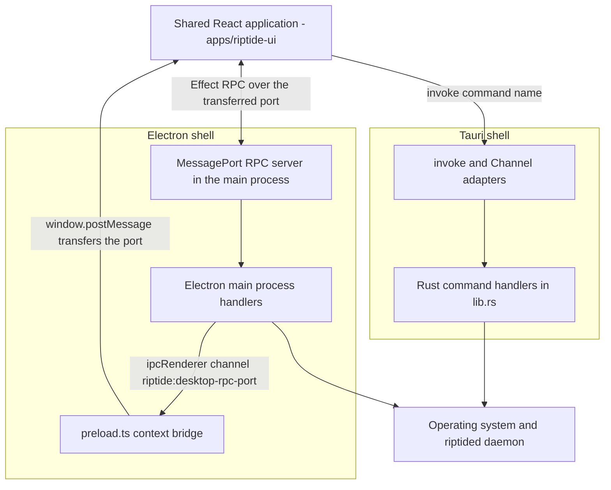
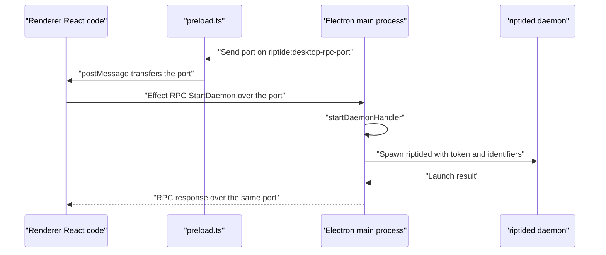
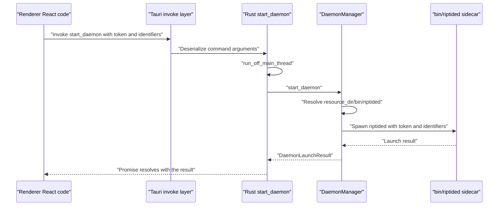

# Desktop shells: Electron, Tauri, and the bridge to native

HumanLayer builds one React application for two native containers. The application is `apps/riptide-ui`. The Electron shell and the Tauri shell load it. Each shell adds native functions through a different bridge. A bridge is the small layer that carries a call from the web page to a privileged process. The bundled daemon is `riptided`. It starts and supervises agent sessions, has no inbound listener, and calls the API outbound. An agent session is one conversation with a coding agent. Riptide is the internal code name, and every package and binary uses it. This document explains both bridges, the native command sets, the bundled daemon, and the places where the shells differ in capability.

In this document, native means code or a function outside the web page. A renderer is the web page process. Electron uses a Chromium renderer, and Tauri uses the system web view. The word channel has three meanings here. An Electron Inter-Process Communication (IPC) channel is a named message path. A Tauri `Channel` is a typed stream object. A release channel is a build track such as development, beta, or production.

## One user interface, two containers

The user interface is `apps/riptide-ui`. Nothing in the application folder belongs to a single shell. Two small predicates decide the runtime. `isTauri()` checks for `__TAURI__` on the window, and `isElectron()` checks for `__RIPTIDE_ELECTRON__` (`apps/riptide-ui/src/lib/utils.ts:12-22`). `isDesktop()` returns true when either check passes (`apps/riptide-ui/src/lib/utils.ts:20-22`).

```ts
// apps/riptide-ui/src/lib/utils.ts:12-22
export function isTauri(): boolean {
	return typeof window !== 'undefined' && '__TAURI__' in window
}

export function isElectron(): boolean {
	return typeof window !== 'undefined' && '__RIPTIDE_ELECTRON__' in window
}

export function isDesktop(): boolean {
	return isTauri() || isElectron()
}
```

Higher layers do not test the shell in every component. A dispatch module chooses the implementation. `integrations/desktop/daemon.ts` sends a daemon command to the Electron module or the Tauri module (`apps/riptide-ui/src/integrations/desktop/daemon.ts:14-33`).

```ts
// apps/riptide-ui/src/integrations/desktop/daemon.ts:14-33
export function shouldStartManagedDaemon(): boolean {
	if (isTauri()) return !import.meta.env.DEV || Boolean(import.meta.env.VITE_FORCE_DAEMON_IN_DEV)
	if (!isElectron()) return false
	if (!import.meta.env.DEV) return true
	const bridge = (window as Window & { __RIPTIDE_ELECTRON__?: { readonly daemonMode?: unknown } })
		.__RIPTIDE_ELECTRON__
	return bridge?.daemonMode === 'staged'
}

export async function startDaemon(
	token: string,
	userId: string,
	organizationId: string,
	syncMode: DaemonSyncMode,
	verifiedClaudePath: string | null,
): Promise<DaemonLaunchResult | null> {
	if (isElectron()) return electronDaemon.startDaemon(token, userId, organizationId, syncMode, verifiedClaudePath)
	if (isTauri()) return tauriDaemon.startDaemon(token, userId, organizationId, syncMode, verifiedClaudePath)
	return null
}
```

`shouldStartManagedDaemon` decides whether this window owns a daemon. In Tauri it returns true in production, or in development when `VITE_FORCE_DAEMON_IN_DEV` is set. In Electron it returns false outside the shell, true in production, and true in development only in `staged` mode. `startDaemon` takes a token, a user identifier, an organization identifier, a sync mode, and an optional verified Claude path. It returns a launch result, or null in a browser. `DaemonSyncMode` has three values: `auto`, `electric`, and `query`. A verified Claude path is an executable that device setup has checked.

**Aha:** The shared interface does not abstract the two bridges into one method surface. It abstracts each capability family, such as daemon control, terminals, files, and updates. Each family has a dispatch module with one implementation for each shell. The daemon family is the example here. The interface therefore mostly stays free of shell names. The two predicates and the dispatch modules are the places that name a shell. A browser call returns null.

The architecture has three layers. The React application is the top layer. A bridge adapter is the middle layer. The native process is the bottom layer. The middle layer is very different in each shell. Electron uses a transferred `MessagePort` with Effect Remote Procedure Call (RPC). A `MessagePort` is one end of a two-way message pipe. Effect is a TypeScript library for typed effects, dependency layers, and schema codecs. Tauri uses the `invoke` function and `Channel` objects. `invoke` sends a named command and arguments to Rust and returns a promise. A `Channel` is a typed stream from Rust to the page. PTY means pseudo-terminal, a terminal device that a program controls.



## The Electron shell

The Electron application is `apps/riptide-electron`. Its package version is 0.1.12, and it pins Electron 43.0.0 (`apps/riptide-electron/package.json`). Its bundle identifier is `com.humanlayer.electron` (`apps/riptide-electron/electron-builder.prod.yml:2`). The shell is security-first. Every window is sandboxed, has context isolation, and has Node integration turned off (`apps/riptide-electron/src/window/window-service.layer.ts:86-95`).

```ts
// apps/riptide-electron/src/window/window-service.layer.ts:86-95
						webPreferences: {
							sandbox: true,
							contextIsolation: true,
							nodeIntegration: false,
							additionalArguments: [
								`--riptide-renderer-url=${rendererUrl}`,
								`--riptide-daemon-mode=${config.daemonMode}`,
								`--riptide-window-role=${windowRole}`,
							],
						},
```

The three settings limit the damage that a compromised page can do. The sandbox denies the page direct operating system access. Context isolation keeps preload variables separate from page variables. Disabled Node integration keeps Node.js out of the page.

The main process passes three values on the command line of the renderer. The renderer URL lets the preload script verify the page origin. The daemon mode tells the bridge whether this window owns a daemon. The window role separates the main window from additional windows.

The preload script is the only renderer-side code with direct access to Electron Inter-Process Communication (IPC). It first verifies the renderer. `isTrustedRenderer` compares the current location with the URL from the command line (`apps/riptide-electron/src/preload-trust.ts:3-18`). For a `file:` page it compares protocol and path. For every non-file page, including a private-scheme page, it compares protocol and host.

The two comparisons are the two branches of `isTrustedRenderer`, and each branch guards a different trust boundary. A normal `file:` address has an empty host, so the exact file path is the only stable identity. The `file:` branch applies when the renderer runs from a local file, such as an unpackaged build with `RIPTIDE_ELECTRON_RENDERER_PATH` (`apps/riptide-electron/src/config/electron-config.ts:59-62`). The packaged renderer serves its entry file, and the application uses hash history for `file:` pages. Hash history keeps the route in the fragment after `#`, so a client-side route change does not change the path (`apps/riptide-ui/src/main.tsx:70`). A different local page file has a different path and fails the check. For an `http(s)` page, protocol and host form the origin, and host includes the port. For a private-scheme page, the scheme is custom and the address parser reports its origin as `null`. The preload therefore compares protocol and host rather than origin (`apps/riptide-electron/src/preload-trust.ts:3-18`). The navigation and permission code uses the same rule and names it `isSameSite` (`apps/riptide-electron/src/window/window-security.ts:23-29`). The path must not be compared, because the protocol handler serves every client-side route from one host and maps an unknown path to `index.html` (`apps/riptide-electron/src/renderer-protocol.ts:28-44`). The packaged address is `<scheme>://app/`, so `app` is the host (`apps/riptide-electron/src/renderer-protocol-config.ts:9-14`). The check stops another local page file, or another host with the same scheme, from receiving the preload bridge and the transferred port.

```ts
// apps/riptide-electron/src/preload.ts:16-33
if (isTrustedRenderer({ location: window.location, rendererUrl: rendererArgument('riptide-renderer-url') })) {
	contextBridge.exposeInMainWorld(
		'__RIPTIDE_ELECTRON__',
		Object.freeze({
			version: 1,
			// Passed by the window service so the bridge reports the mode the main
			// process actually resolved, instead of re-deriving it from env.
			daemonMode: rendererArgument('riptide-daemon-mode') ?? 'external',
			windowRole: rendererWindowRole(),
		}),
	)

	ipcRenderer.on(electronRpcPortChannel, (event) => {
		const port = event.ports[0]
		if (port === undefined) return
		window.postMessage(electronRpcPortMessage, '*', [port])
	})
}
```

The preload exposes a frozen object with three values. It does not expose methods. The method surface arrives as a `MessagePort`. The main process sends the port on `riptide:desktop-rpc-port`, and the preload reposts it to the page as `riptide:desktop-rpc-port-ready` (`contracts/riptide-electron-rpc/src/protocol.ts:1-2`). The second name is a `window.postMessage` message, not an Electron channel.

| Channel or message | Sender | Receiver | Payload |
|--------------------|--------|----------|---------|
| `riptide:desktop-rpc-port` | Electron main process | Preload script | A `MessagePort` in `event.ports[0]` |
| `riptide:desktop-rpc-port-ready` | Preload script | Renderer window | The same port, transferred |

The server side creates one channel for each attached window. `connect()` closes the previous connection, creates a channel, starts the RPC server on `port1`, and posts `port2` to the window (`apps/riptide-electron/src/rpc/message-port-server.ts:64-74`). A `MessageChannel` creates two entangled ports. A message sent on one port arrives on the other. The server calls `connect()` once when it attaches to the window, and again on each `did-finish-load` event. `did-finish-load` means the page finished its first load. A window close closes the connection.

The server implements the Effect RPC protocol directly on the port. It returns a connection description with ten fields. `disconnects` is a stream of disconnect events. `send` posts a response on the port. `end` closes the port. `clientIds` is a set with the one client identifier. `initialMessage` is `Option.none()`, because the client sends no opening message. `codecFor` supplies `Schema.toCodecJson` as the JSON codec. It disables acknowledgement, transferables, span propagation, and notifications (`apps/riptide-electron/src/rpc/message-port-server.ts:121-132`). Acknowledgement confirms delivery. Transferables move object ownership inside a message. Span propagation carries tracing metadata. Notifications let the server push unsolicited messages. With notifications off, the server sends a message only in answer to a call. Streaming RPC still works, because the stream answers one call.

```ts
// apps/riptide-electron/src/rpc/message-port-server.ts:121-132
			return {
				disconnects,
				send: (_id, response) => Effect.sync(() => port.postMessage(response)),
				end: () => Effect.sync(() => port.close()),
				clientIds: Effect.succeed(new Set([clientId])),
				initialMessage: Effect.succeed(Option.none()),
				supportsAck: false,
				supportsTransferables: false,
				supportsSpanPropagation: false,
				supportsNotifications: false,
				codecFor: Schema.toCodecJson,
			}
```

The contract is one shared package, `contracts/riptide-electron-rpc`. `DesktopRpc` is an Effect `RpcGroup` with 48 members (`contracts/riptide-electron-rpc/src/desktop-rpc.ts:58-107`). The first members cover host identity, external URLs, application version, window theme, zoom, logs, command-line updates, diagnostics, daemon control, new windows, dragging, and terminals.

```ts
// contracts/riptide-electron-rpc/src/desktop-rpc.ts:58-81
export class DesktopRpc extends RpcGroup.make(
	GetHostId,
	OpenInEditor,
	OpenExternalUrl,
	GetAppVersion,
	SetWindowTheme,
	SetZoom,
	WriteHostLog,
	GetLogDirectory,
	GetCurrentLogFiles,
	UpdateCli,
	CheckClaudeInstalled,
	ProbeCodingAgent,
	UpdateClaudeCode,
	StartDaemon,
	StopDaemon,
	IsDaemonRunning,
	SetDaemonManagement,
	DaemonLifecycleEvents,
	OpenNewWindow,
	DragWindow,
	CreatePty,
	AttachPty,
	DetachPty,
```

The snippet shows the first 23 members. The other 25 continue in the same class body (`contracts/riptide-electron-rpc/src/desktop-rpc.ts:82-106`). Each of the 48 members belongs to exactly one family in the table (`contracts/riptide-electron-rpc/src/desktop-rpc.ts:58-107`).

| Command family | Members | Role | Count |
|----------------|---------|------|-------|
| Host and application identity | `GetHostId`, `GetAppVersion`, `SetSentryIdentity`, `SetWindowTheme`, `SetZoom`, `OpenNewWindow`, `DragWindow` | Host identifier, application version, error-reporting identity, window theme, zoom, new windows, and window drag | 7 |
| External links | `OpenExternalUrl`, `TakePendingDeepLink`, `DeepLinkEvents` | Open a web address in the system browser, read a launch link, and stream deep-link events | 3 |
| Editor and workspace configuration | `OpenInEditor`, `GetEditorEnvironment`, `ReadWorkspaceConfig`, `WriteWorkspaceConfig`, `EnsureWorkspaceConfigIgnored`, `OpenWorkspaceConfig`, `DiscoverGitRepositories` | Open an editor, read its environment, read or write workspace configuration, keep the ignore file, and find Git repositories | 7 |
| Diagnostics and logs | `WriteHostLog`, `GetLogDirectory`, `GetCurrentLogFiles`, `UpdateCli`, `CheckClaudeInstalled`, `ProbeCodingAgent`, `UpdateClaudeCode` | Write and locate logs, update the command-line tool, and detect or update coding agents | 7 |
| Daemon lifecycle | `StartDaemon`, `StopDaemon`, `IsDaemonRunning`, `SetDaemonManagement`, `DaemonLifecycleEvents` | Start, stop, and observe the daemon; open or close the management gate; stream lifecycle events | 5 |
| Terminal | `CreatePty`, `AttachPty`, `DetachPty`, `WritePty`, `ResizePty`, `KillPty`, `ListPtys` | Create, attach, detach, write, resize, kill, and list pseudo-terminals | 7 |
| Filesystem and directory selection | `GetHomeDirectory`, `StatPath`, `ReadTextFile`, `ReadFile`, `BrowseDirectories`, `ListDirectory`, `FuzzySearchFiles`, `PickDirectory` | Read the home directory, stat and read files, browse and list directories, search files, and pick a directory | 8 |
| Updater | `CheckForUpdate`, `DownloadUpdate`, `UpdateDownloadProgress`, `QuitAndInstall` | Check, download, stream progress for, and install an update | 4 |
| **Total** | | | **48** |

The families follow the handler modules under `contracts/riptide-electron-rpc/src/rpcs`. Two small modules are grouped by purpose. `PickDirectory` joins filesystem because it selects a path, and `SetSentryIdentity` joins host and application identity because it sets the error-reporting identity (`contracts/riptide-electron-rpc/src/desktop-rpc.ts:6-29`).

The main process binds one handler to each member. `DesktopRpcHandlers` omits `DragWindow` and binds the rest with `toLayer` (`apps/riptide-electron/src/rpc/desktop-rpc-handlers.ts:56-104`).

```ts
// apps/riptide-electron/src/rpc/desktop-rpc-handlers.ts:56-70
export const DesktopRpcHandlers = DesktopRpc.omit('DragWindow').toLayer({
	GetHostId: getHostIdHandler,
	OpenInEditor: openInEditorHandler,
	OpenExternalUrl: openExternalUrlHandler,
	GetAppVersion: getAppVersionHandler,
	SetWindowTheme: setWindowThemeHandler,
	SetZoom: setZoomHandler,
	WriteHostLog: writeHostLogHandler,
	GetLogDirectory: getLogDirectoryHandler,
	GetCurrentLogFiles: getCurrentLogFilesHandler,
	UpdateCli: updateCliHandler,
	CheckClaudeInstalled: checkClaudeInstalledHandler,
	ProbeCodingAgent: probeCodingAgentHandler,
	UpdateClaudeCode: updateClaudeCodeHandler,
	StartDaemon: startDaemonHandler,
```

`DragWindow` is separate because it needs the window handle of the caller. The server binds it for each attached window (`apps/riptide-electron/src/rpc/message-port-server.ts:44-49`). `toLayer` turns the handler map into an Effect layer, a dependency bundle that the RPC server provides.

On the renderer side, the application listens for the ready message. It rejects any message that does not come from the same window, does not carry the expected name, or does not carry exactly one port (`apps/riptide-ui/src/effects/electron-rpc/electron-rpc-client.layer.ts:28-39`). When a new port arrives, the renderer replaces the protocol client with one built on that port, so it does not restart. When the port closes and no new port arrives, every native call fails until the main process sends a replacement.

The renderer then creates a normal typed client from `DesktopRpc` (`apps/riptide-ui/src/effects/electron-rpc/electron-rpc-client.layer.ts:119-121`). `ElectronRpcClient.use((client) => client.StartDaemon(...))` looks like a local function call, but every call crosses the port (`apps/riptide-ui/src/integrations/electron/daemon.ts:21-33`).



The Electron window also controls navigation. `will-navigate` checks every target URL against the renderer URL. An allowed target loads. An external target opens in the system browser. Every other target is denied (`apps/riptide-electron/src/platform/electron-platform.layer.ts:71-80`). The session also has explicit permission handlers. A permission request is granted only for a fixed set: clipboard read, clipboard sanitized write, notifications, media, fullscreen, external open, and persistent storage. The request must also come from the same site as the renderer (`apps/riptide-electron/src/window/window-security.ts:39-49`).

A packaged build does not use a `file:` URL. It registers a private scheme, a custom URL protocol that Electron serves from disk. `rendererFileForRequest` normalizes the path, rejects traversal outside the renderer directory, and falls back to `index.html` for client-side routes (`apps/riptide-electron/src/renderer-protocol.ts:28-44`). The scheme names differ by release channel, such as `humanlayer-electron` for production (`apps/riptide-electron/src/config/electron-channel.ts:5-10`). The same scheme also handles operating system deep links.

The Electron shell also owns a daemon. In packaged mode it looks for `bin/riptided` under the resources path (`apps/riptide-electron/src/daemon/daemon-resource.ts:21-29`).

```ts
// apps/riptide-electron/src/daemon/daemon-resource.ts:21-29
	const executablePath =
		daemonMode === 'packaged'
			? pathService.join(platform.resourcesPath, 'bin', 'riptided')
			: input.config.stagedDaemonPath
	if (executablePath === undefined) {
		return yield* Effect.fail(
			new DaemonUnavailableError({ message: 'RIPTIDE_ELECTRON_STAGED_DAEMON_PATH is required in staged mode' }),
		)
	}
```

The three daemon modes are `external`, `staged`, and `packaged` (`apps/riptide-electron/src/config/electron-config.ts:36`). The default is `packaged` when the application is packaged and `external` when it runs from source (`apps/riptide-electron/src/config/electron-config.ts:71-73`). In `external` mode the shell expects a daemon that another process started, such as the command-line interface. In `staged` mode it runs the path from `RIPTIDE_ELECTRON_STAGED_DAEMON_PATH`. In `packaged` mode it runs the bundled binary.

The shell stops only a daemon that it started. A generation is one record of a daemon process that the shell spawned, keyed by the user and organization pair (`apps/riptide-electron/src/daemon/daemon-supervisor.layer.ts:50-69`, `apps/riptide-electron/src/daemon/daemon-supervisor.layer.ts:86`). `stopDaemonHandler` obtains the `DaemonSupervisor` service from the Effect context (`apps/riptide-electron/src/rpc/handlers/stop-daemon.ts:5-9`). `stopOwnedGeneration` looks up a generation for the user and organization pair (`apps/riptide-electron/src/daemon/daemon-supervisor.layer.ts:547-568`). If it finds one, `terminateDaemonGeneration` sends `SIGTERM` and waits ten seconds. If the process still runs, it sends `SIGKILL` (`apps/riptide-electron/src/daemon/daemon-generation.ts:16-35`).

| Mode | Start behavior | Stop behavior |
|------|----------------|---------------|
| `external` | A managed start is a start that the shell performs. The renderer usually skips it in Electron development, because `shouldStartManagedDaemon` returns true only for `staged` in that case (`apps/riptide-ui/src/integrations/desktop/daemon.ts:14-21`). A renderer start call fails with `DaemonUnavailableError`, because `resolveDaemonExecutable` refuses every `external` start (`apps/riptide-electron/src/daemon/daemon-resource.ts:9-16`). The shell has no attach path in this mode. A packaged build can also select `external`, and its start call fails in the same way (`apps/riptide-electron/src/config/electron-config.ts:71-73`). | The generation map has no entry, so `stopOwnedGeneration` returns without a signal (`apps/riptide-electron/src/daemon/daemon-supervisor.layer.ts:547-555`). `StopDaemon` resolves with no value, and the separately started process keeps running. |
| `staged` | The shell spawns the path in `RIPTIDE_ELECTRON_STAGED_DAEMON_PATH`. A missing value or a missing file fails with `DaemonUnavailableError` (`apps/riptide-electron/src/daemon/daemon-resource.ts:18-34`). | The shell sends `SIGTERM`, waits ten seconds, then sends `SIGKILL`, and closes the generation scope (`apps/riptide-electron/src/daemon/daemon-generation.ts:16-35`). |
| `packaged` | The shell spawns `resources/bin/riptided` (`apps/riptide-electron/src/daemon/daemon-resource.ts:21-29`). | The stop path is the same as `staged`. |

In `external` mode the shell owns no process. A stop call therefore does not stop the daemon that another process started. `IsDaemonRunning` also reports false in this mode, because it reads only the shell generation map (`apps/riptide-electron/src/daemon/daemon-supervisor.layer.ts:630-637`). The interface cannot see the external process through this call. A signal reaches only a daemon that the shell owns. The application does not connect to the daemon directly. The daemon calls the API outbound. The daemon keeps no inbound listener.

The update path uses `electron-updater` 6.8.9. Each channel has a product name, an update URL, and a cache folder (`apps/riptide-electron/src/config/updater-channels.json`). Production uses product name `HumanLayerElectron` and the URL `https://update.humanlayer.com/stable`. The main process exposes check, download, progress, and quit-and-install operations through the RPC group.

## The Tauri shell

The Tauri application is `apps/riptide-native`. The Rust dependency is Tauri 2.11.0, and the JavaScript package is `@tauri-apps/api` 2.11.0 (`apps/riptide-native/Cargo.toml:25`, `apps/riptide-native/package.json`). The package version is 0.200.0. The product name is `HumanLayer`, and the bundle identifier is `com.humanlayer.riptide` (`apps/riptide-native/tauri.conf.json:1-10`).

The build step compiles the user interface and the daemon before it builds the bundle. `beforeBuildCommand` builds `riptide-ui`, then builds `riptide-daemon` and copies the result to `bin/riptided` when the file is absent (`apps/riptide-native/tauri.conf.json:8`). The bundle declares that file as a resource, so the daemon travels inside the application (`apps/riptide-native/tauri.conf.json:37-50`).

```json
// apps/riptide-native/tauri.conf.json:37-50
  "bundle": {
    "active": true,
    "targets": "all",
    "createUpdaterArtifacts": true,
    "icon": [
      "icons/32x32.png",
      "icons/128x128.png",
      "icons/128x128@2x.png",
      "icons/icon.icns",
      "icons/icon.ico"
    ],
    "resources": [
      "bin/riptided"
    ],
```

The Rust side exposes commands with the `#[tauri::command]` attribute. The `invoke_handler` call registers them. Its `tauri::generate_handler!` macro lists 37 commands (`apps/riptide-native/src/lib.rs:594-637`).

```rust
// apps/riptide-native/src/lib.rs:594-610
        .invoke_handler(tauri::generate_handler![
            greet,
            get_host_id,
            get_process_cwd,
            take_pending_deep_link,
            start_daemon,
            stop_daemon,
            is_daemon_running,
            set_daemon_management,
            get_log_directory,
            get_current_log_files,
            get_editor_env,
            open_in_editor,
            save_window_state,
            set_window_theme,
            terminal_cli_self_update,
            artifact_trace::save_artifact_trace,
```

The 37 commands group into eight families.

| Command family | Tauri commands | Purpose |
|----------------|----------------|---------|
| Window and application | `greet`, `get_process_cwd`, `save_window_state`, `set_window_theme`, `terminal_cli_self_update` | Basic window state and shell actions; `greet` is the unchanged template command |
| Artifact tracing | `artifact_trace::save_artifact_trace` | Write an artifact trace file |
| Deep links | `take_pending_deep_link` | Read a URL that launched the app |
| Daemon | `get_host_id`, `start_daemon`, `stop_daemon`, `is_daemon_running`, `set_daemon_management` | Start, stop, and observe the daemon; `set_daemon_management` calls `set_management_enabled` |
| Diagnostics | `check_claude_installed`, `probe_coding_agent`, `update_claude_code`, `get_editor_env`, `open_in_editor` | Agent detection and editor launch |
| Workspace | `workspace_config_read`, `workspace_config_write`, `workspace_config_ensure_gitignore`, `workspace_config_open_in_editor`, `discover_git_repositories`, `workspace_preflight`, `workspace_create`, `workspace_copy_globs`, `workspace_run_setup`, `workspace_remove_all` | Repository setup and worktree creation |
| Terminal and files | `pty_create`, `pty_attach`, `pty_detach`, `pty_write`, `pty_resize`, `pty_kill`, `pty_list`, `fuzzy_search_files` | Pseudo-terminal (PTY) sessions and file search |
| Logs | `get_log_directory`, `get_current_log_files` | Log file discovery |

The daemon command resolves the sidecar from the resource directory. A sidecar is a separate executable that ships inside the application bundle and runs as a child process. `get_daemon_path` is a helper, not a command. It joins the resource directory with `bin` and `riptided` (`apps/riptide-native/src/daemon.rs:1240-1247`).

```rust
// apps/riptide-native/src/daemon.rs:1240-1247
    fn get_daemon_path(&self, app_handle: &AppHandle) -> Result<PathBuf, String> {
        let resource_dir = app_handle
            .path()
            .resource_dir()
            .map_err(|e| format!("Failed to get resource directory: {}", e))?;

        Ok(resource_dir.join("bin").join("riptided"))
    }
```

`start_daemon` receives a token, a user identifier, an organization identifier, a sync mode, and an optional verified Claude path. It clones the manager, runs the blocking start on a worker thread, and returns the launch result or an error string (`apps/riptide-native/src/lib.rs:126-148`).

```rust
// apps/riptide-native/src/lib.rs:126-148
#[tauri::command]
async fn start_daemon(
    app_handle: tauri::AppHandle,
    daemon_manager: tauri::State<'_, DaemonManager>,
    token: String,
    user_id: String,
    organization_id: String,
    sync_mode: String,
    verified_claude_path: Option<String>,
) -> Result<daemon::DaemonLaunchResult, String> {
    let daemon_manager = daemon_manager.inner().clone();
    run_off_main_thread(move || {
        daemon_manager.start_daemon(
            &app_handle,
            &token,
            &user_id,
            &organization_id,
            &sync_mode,
            verified_claude_path.as_deref(),
        )
    })
    .await?
}
```

The helper `run_off_main_thread` exists because a blocked main thread freezes the whole window on macOS (`apps/riptide-native/src/lib.rs:114-116`). It runs the closure on a blocking worker thread and awaits the result. Every command that spawns, waits, or sleeps uses it.

The renderer calls these commands through `invoke`. `startDaemon` sends the five fields as one object, and Tauri converts camelCase JavaScript keys to snake_case Rust parameter names (`apps/riptide-ui/src/integrations/tauri/daemon.ts:73-79`).

```ts
// apps/riptide-ui/src/integrations/tauri/daemon.ts:73-79
		return await invoke<DaemonLaunchResult>('start_daemon', {
			token,
			userId,
			organizationId,
			syncMode,
			verifiedClaudePath,
		})
```

Terminal output uses a different transport. A Tauri `Channel` streams output events to the renderer. Each event has an `event` tag and a `data` field (`apps/riptide-ui/src/integrations/tauri/pty.ts:9`). An output event serializes as `{"event":"output","data":{"data":[...]}}`, because the Rust enum tags the variant and wraps its payload. `pty_create` receives the working directory and the channel and returns a terminal identifier (`apps/riptide-ui/src/integrations/tauri/pty.ts:22-34`). A failed call rejects with a string from Rust.

A detached terminal is a PTY with no attached channel. Each terminal has its own 64 kilobyte ring buffer for output produced while no channel is attached (`apps/riptide-native/src/pty.rs:22-33`). When the buffer is full, it drops the oldest bytes. A single write larger than the buffer keeps only its tail. A detached terminal therefore keeps the most recent 64 kilobytes of output, and a reattach replays the buffer.

```rust
// apps/riptide-native/src/pty.rs:22-33
/// Maximum bytes to buffer while the Channel is detached (64 KB).
const RING_BUFFER_CAP: usize = 64 * 1024;

/// Event sent to the webview via Channel
#[derive(Clone, Serialize)]
#[serde(rename_all = "camelCase", tag = "event", content = "data")]
pub enum PtyEvent {
    /// Raw output data from the PTY
    Output { data: Vec<u8> },
    /// PTY process exited
    Exit { code: Option<u32> },
}
```

Tauri permissions are declarative. A capability is a named permission set. Tauri checks the window name and the requested permission against the capability before a plugin action runs. `capabilities/default.json` grants the main window and a second window named `quick-launcher` a named set of permissions. They are opener, notification, zoom, file read and stat, clipboard write, shell spawn and execute, store, log, global shortcut, window actions, deep link, updater, and process (`apps/riptide-native/capabilities/default.json:1-52`). No code in this snapshot creates a window with the label `quick-launcher`. The label is a prepared slot. A separate capability grants folder selection to the main composer, which is the session text input (`apps/riptide-native/capabilities/main-dialog.json:1-7`). The capability lists plugin and core permissions only. The 37 application commands need no entry, because `generate_handler!` registers them for every window that loads the application.



The Tauri update path uses `tauri-plugin-updater`. `tauri.conf.json` sets a public key and an update endpoint. The endpoint serves a JSON manifest that carries a signature. The public key lets the application verify that signature before it installs an update. The production endpoint is `https://update.humanlayer.com/stable/{{target}}-{{arch}}/{{current_version}}` (`apps/riptide-native/tauri.conf.json:77-82`). The bundle creates updater artifacts (`apps/riptide-native/tauri.conf.json:40`).

The Tauri shell supports more platforms in configuration than the Electron build. It sets bundle targets to `all`, a macOS minimum version of 11.0, and Linux Debian and Red Hat package templates (`apps/riptide-native/tauri.conf.json:37-64`). The single-instance plugin is a Linux and Windows feature (`apps/riptide-native/src/lib.rs:528-548`, `apps/riptide-native/Cargo.toml:61-62`). On those systems a deep link starts a second process, and the plugin forwards the call to the running application. Without the plugin, every `riptide://` link would start another copy of the application. The Electron production configuration in this repository builds only a macOS arm64 disk image and zip (`apps/riptide-electron/electron-builder.prod.yml`).

## The two shells compared

| Property | Electron shell | Tauri shell |
|----------|----------------|-------------|
| Application folder | `apps/riptide-electron` | `apps/riptide-native` |
| Package version | 0.1.12 | 0.200.0 |
| Runtime version | Electron 43.0.0 | Tauri 2.11.0 |
| Renderer model | Chromium renderer with `sandbox`, `contextIsolation`, and no Node integration | System web view with declarative capabilities |
| Renderer entry | Packaged files through a private scheme, or the development server URL | Built assets through `frontendDist`, or the development server through `devUrl` |
| Bridge technology | Preload context bridge plus a transferred `MessagePort` with Effect RPC | `invoke` commands and `Channel` streams |
| Contract source | Shared `contracts/riptide-electron-rpc` package | Rust commands are defined in Rust; the renderer imports shared result types from the contract package |
| Native command set | 48 typed RPC members | 37 Rust commands |
| Daemon sidecar | `resources/bin/riptided` in packaged mode | `bin/riptided` resource from the bundle |
| Update path | `electron-updater` with per-channel product names and URLs | `tauri-plugin-updater` with a signed endpoint |
| Platform support in this snapshot | macOS arm64 build configuration | macOS, Linux, and Windows configuration |
| Bundle identity | `com.humanlayer.electron`, product `HumanLayerElectron` | `com.humanlayer.riptide`, product `HumanLayer` |
| Custom scheme | `humanlayer-electron` serves the packaged renderer and OS deep links | `riptide` handles OS deep links |

The commands overlap but are not identical. Both shells can control the daemon, run a terminal, read logs, detect coding agents, manage workspace configuration, and check for updates. This table uses the contract names for Electron. `ReadFile` is the binary read, `ReadTextFile` is the text read, `StatPath` is the path stat, `PickDirectory` is the directory picker, and `DownloadUpdate` is one updater operation.

Electron exposes a few extra operations as first-class RPC members, such as binary file read, directory browse, directory picker, window drag, Sentry identity, and update progress as a stream. Tauri exposes workspace worktree creation as one Rust command per step, such as `workspace_preflight`, `workspace_create`, and `workspace_run_setup`. A git worktree is a second working directory on its own branch.

| Capability | Electron | Tauri | Difference that matters |
|------------|----------|-------|-------------------------|
| Daemon start and stop | `StartDaemon`, `StopDaemon` | `start_daemon`, `stop_daemon` | The same success payload crosses both bridges; errors differ |
| Terminal | `CreatePty` and related RPCs | `pty_create` and related commands with `Channel` output | Both stream output: Electron uses a streaming RPC (`AttachPty` has `stream: true`) on the port, and Tauri uses a `Channel` |
| File read | `ReadFile`, `ReadTextFile`, `StatPath` | Capability-scoped `fs` plugin plus `fuzzy_search_files` | Electron exposes three typed read members; Tauri grants the wider `fs` plugin scope under a capability |
| Folder picker | `PickDirectory` RPC | `dialog:allow-open` capability | Electron opens its own dialog from the main process; Tauri asks the dialog plugin under a capability |
| Workspace setup | `ReadWorkspaceConfig`, `WriteWorkspaceConfig` | Ten workspace commands including worktree creation | Tauri owns more of the worktree workflow in Rust |
| Update progress | `DownloadUpdate` plus an update progress stream | `updater` plugin events | Electron streams progress through `UpdateDownloadProgress`; Tauri emits plugin events |
| Window chrome | Custom application menu and traffic lights | Overlay title bar with a drag region | Electron draws the three colored window buttons; Tauri uses an overlay bar; a browser preview draws fake controls |

The user interface already handles the difference. `hasTauriChrome()` returns true for Tauri and Electron, because both shells use the same custom title bar (`apps/riptide-ui/src/lib/tauri-chrome.ts:47-49`). The name is historical. It does not mean the Tauri shell only. The title bar layout is shared. The shell supplies the native window buttons, and `hasMacWindowControls()` decides whether macOS traffic lights sit in the top-left corner (`apps/riptide-ui/src/lib/tauri-chrome.ts:56-61`). A development browser preview can force this chrome, and `showsFakeWindowControls()` then draws stand-in traffic lights for screenshots (`apps/riptide-ui/src/lib/tauri-chrome.ts:63-66`).

## Which shell is primary

The source does not contain one sentence that names a primary shell. The evidence points to the Tauri shell as the shipping HumanLayer application.

Three facts support this reading. First, the Tauri product name is `HumanLayer`, and the bundle identifier is `com.humanlayer.riptide` (`apps/riptide-native/tauri.conf.json:3-5`). The Electron product name is `HumanLayerElectron`, and its identifier is `com.humanlayer.electron`. Second, the user documentation refers to `open /Applications/HumanLayer.app` (`apps/docs/guide/bedrock.md:99`). That path matches the Tauri product name. Third, the root development script `riptide:native` targets the Tauri application, and it appears before the Electron scripts in the manifest (`package.json:75-82`). Position is weak evidence, because the manifest does not execute scripts in order. The name and the documentation carry more weight.

This is an inference from names and scripts, not a declared policy. Electron remains a full shell with a larger native command surface and its own update channel. Both shells load the same interface, and both can run the daemon. A reader should not remove either shell without checking the release process.

**Aha:** The Tauri renderer imports result types from `@humanlayer/riptide-electron-rpc` even though it never uses the Electron bridge (`apps/riptide-ui/src/integrations/tauri/daemon.ts:1`). The shared contract package therefore does two jobs. It defines the Electron RPC group, and it supplies the common TypeScript shapes for native results. The transport differs, but the data shape stays aligned.

**Aha:** Electron never gives the renderer a native method. It gives the renderer a port. The preload script has almost no logic: verify the origin, expose three values, and forward one port. All typed operations live in the shared RPC group, and all privileged work happens in the main process. This design keeps the privileged surface small, but it also means a lost port stops every native call until a replacement arrives.

The two shells also fail differently. A failed Electron RPC call returns a typed Effect error over the port. A Tauri command fails with a rejected promise that carries a string from Rust. The dispatch modules in `apps/riptide-ui/src/integrations/desktop` are the intended conversion point for both failures. Read [Security and self-hosting](18-security-and-self-hosting.md) for the trust boundaries around the native bridges. Read [The user interface application](10-ui-application.md) for the React layer that both shells load. Read [The daemon and session runtime](02-daemon-and-session-runtime.md) for the process that the sidecar starts. Read [Infrastructure and the development stack](14-infrastructure-and-devstack.md) for the build scripts around both shells.

## Next

The same desktop surface also has a command-line path. The next document explains the `humanlayer` command-line interface and the plugin families that copy agent session events into the product.
