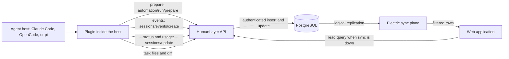
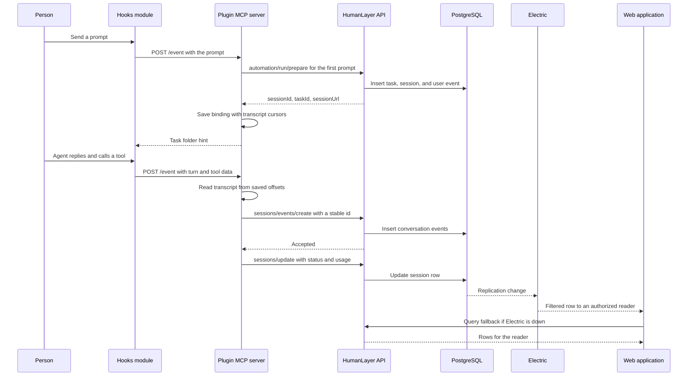

# The command-line interface and the agent plugins

HumanLayer ships one Riptide command-line interface (CLI) and five agent plugins. Riptide is the product family name for this command, the daemon, the API, and the user interface. The `humanlayer` command is not a launcher for a second program. It imports the daemon library and calls `startManagedDaemon` in its own process. The plugins let a coding agent that a person starts by hand send its work to HumanLayer. Two of the five plugins add only skills. A sixth tool, `linear`, drives a ticket system and has no daemon role. This document explains the command surface, the process model, and the exact path that each plugin uses to mirror one session event to the database.

## The command, its package, and its environments

The published package is `@humanlayer/cli`, version `0.40.0`. Its binary name is `humanlayer`. The package declares five optional platform packages that cover the supported operating system and architecture pairs. Those packages hold the compiled runtime. The JavaScript entry point is small and delegates to the command tree.

```json
// apps/cli/package.json:1-9
{
  "name": "@humanlayer/cli",
  "license": "Apache-2.0",
  "version": "0.40.0",
  "description": "HumanLayer CLI — daemon management and authentication",
  "type": "module",
  "bin": {
    "humanlayer": "bin/humanlayer"
  },
```

The root command is a Commander program with one version flag and three environment flags: `--beta`, `--dev`, and `--local`. The function `getEnv` maps the flags to an `EnvironmentName`. The precedence is local, then dev, then beta, then prod. The last case is the default.

```ts
// apps/cli/src/index.ts:16-30
const program = new Command()
	.name('humanlayer')
	.description('HumanLayer CLI — manage daemons and authentication')
	.version(BUILD_VERSION, '-v, --version', 'Display CLI version')
	.option('--beta', 'Use the beta environment (default until prod is available)')
	.option('--dev', 'Use the dev environment')
	.option('--local', 'Use local environment (localhost services)')

function getEnv(): EnvironmentName {
	const opts = program.opts<{ beta?: boolean; dev?: boolean; local?: boolean }>()
	if (opts.local) return 'local'
	if (opts.dev) return 'dev'
	if (opts.beta) return 'beta'
	return 'prod'
}
```

A command that needs network origins calls `resolveEnvironmentConfig(envName)` before it acts. That function returns the Application Programming Interface (API) origin, the sync origin, the cloud origin, and the application origin for the selected stage. One binary can therefore serve several environments. This is important for the daemon, because the daemon reads the origins from its process environment.

## How the CLI starts a daemon without a second binary

The daemon subcommand is `humanlayer daemon launch`. It accepts a raw token, a launch token, and a no-self-update switch. The action resolves the environment and calls `daemonLaunchCommand`.

```ts
// apps/cli/src/index.ts:50-62
const daemon = program.command('daemon').description('Manage riptide daemons')

daemon
	.command('launch')
	.description('Launch the daemon in the foreground')
	.option('--token <token>', 'Daemon auth token (skip auth flow)')
	.option('--launch-token <token>', 'Launch token for non-interactive environments')
	.option('--no-self-update', 'Refuse in-app updates (also HUMANLAYER_DISABLE_SELF_UPDATE=1)')
	.action((options: { token?: string; launchToken?: string; selfUpdate?: boolean }) => {
		const envName = getEnv()
		const envConfig = resolveEnvironmentConfig(envName)
		return daemonLaunchCommand(envName, envConfig, options)
	})
```

`daemonLaunchCommand` first obtains a daemon token. It has three sources, in priority order. The first source is an explicit token from `--token` or from `RIPTIDE_DAEMON_TOKEN`. The second source is a launch token, which the CLI exchanges for a daemon token. The third source is a stored session from WorkOS, the identity provider, which the CLI exchanges for a daemon token and a host identifier.

A launch token is a signed credential for one person and one organization. It expires after 24 hours and carries no host identifier (`apps/riptide-api/src/auth/daemon-token-core.ts:110-121`). The host identifier is a random Universally Unique Identifier (UUID). The CLI saves it in `~/.humanlayer/riptide/host_id`. A devstack uses `host_id_<stack>` (`apps/cli/src/lib/host-id.ts:5-35`). The supervisor is the mechanism that restarts the daemon after an update. It is `systemd` when `INVOCATION_ID` is set. It is `shim` when a restart helper sets `HUMANLAYER_SHIM_RESTART_EXIT_CODE` to `75`. Otherwise it is `none` (`apps/cli/src/commands/self-update-capability.ts:21-22`, `:42-56`).

```ts
// apps/cli/src/commands/daemon-launch.ts:56-77
		// Resolve the daemon token
		let daemonToken: string
		let credentialSource: DaemonCredentialSource

		const explicitToken = options.token ?? process.env.RIPTIDE_DAEMON_TOKEN
		if (explicitToken) {
			// Direct token passthrough — skip all auth
			daemonToken = explicitToken
			credentialSource = 'explicit-token'
			console.log('Using provided daemon token.')
		} else if (options.launchToken) {
			// Launch token → exchange for daemon token
			const hostId = await getHostId()
			console.log('Exchanging launch token for daemon credentials...')
			const unauthClient = createUnauthenticatedApiORPCClient(envConfig.apiOrigin)
			const { token } = await unauthClient.auth.daemon.token.exchange({
				launchToken: options.launchToken,
				hostId,
			})
			daemonToken = token
			credentialSource = 'launch-token'
			console.log('Daemon token obtained via launch token exchange.')
```

The function then sets two origin variables in `process.env`. `RIPTIDE_CLOUD_ORIGIN` serves artifact hooks. `RIPTIDE_APP_ORIGIN` builds session deep links for commit attribution. The function also computes the self-update capability. The capability tells the daemon how to update itself: which package to install, which command to run, and which supervisor to notify. If self-update is off, the capability is null and the operator must replace the CLI to update the daemon.

The decisive step is a dynamic import of `@humanlayer/riptide-daemon/start`. The package export maps that subpath to `src/start.ts`. The CLI passes the API and sync origins as arguments to `startManagedDaemon`, together with the token, the stage, and the self-update capability. No child process starts. The daemon runs in the CLI process and keeps that process alive through its heartbeat and subscriptions.

```ts
// apps/cli/src/commands/daemon-launch.ts:94-129
		// Import and start the daemon in-process
		// When launched via CLI, always log to stdout so operators can see daemon output.
		// The daemon logger only adds a stdout transport when LOG_LEVEL is set.
		if (!process.env.LOG_LEVEL) {
			process.env.LOG_LEVEL = 'info'
		}
		// The CLI supports several environments from one binary. Set the selected origins before
		// loading the embedded daemon: artifact hooks link through the cloud origin, and commit
		// attribution mints session deep links from the app origin.
		process.env.RIPTIDE_CLOUD_ORIGIN = envConfig.cloudOrigin
		process.env.RIPTIDE_APP_ORIGIN = envConfig.appOrigin
		const selfUpdateDisabled = isSelfUpdateDisabled(options.selfUpdate === false, process.env)
		if (selfUpdateDisabled) {
			console.log('Self-update is off. Update this daemon by replacing the CLI on the host.')
		}
		const selfUpdate = resolveSelfUpdateCapability({
			platform: process.platform,
			execPath: process.execPath,
			env: process.env,
			credentialSource,
			environmentFlag: environmentFlagForEnvironment(envName),
			npmGlobalPrefix: selfUpdateDisabled ? null : await resolveNpmGlobalPrefix(),
			disabled: selfUpdateDisabled,
		})

		console.log('Starting daemon...')
		const { startManagedDaemon } = await import('@humanlayer/riptide-daemon/start')
		const result = await startManagedDaemon({
			token: daemonToken,
			apiOrigin: envConfig.apiOrigin,
			syncOrigin: envConfig.syncOrigin,
			stage: envName,
			generationId: null,
			expectedIdentity: null,
			selfUpdate,
		})
```

**Aha:** The command name is `daemon launch`, but no daemon executable exists to launch. The command imports the daemon source at run time and becomes the daemon. This choice removes a version skew between a wrapper and a daemon. It also means that a crash in the daemon ends the CLI process, and a terminal signal reaches the daemon directly.

### How the launch fails

`startManagedDaemon` validates its input with an Effect schema at the host boundary. It then loads the daemon identity from the token. If the caller supplies an expected identity, the function compares the user identifier and the host identifier. It does not compare the organization identifier, because the launcher knows the WorkOS `org_…` identifier while the token claim holds an internal identifier. The CLI passes null, so this check is dormant on the normal launch path. The organization still keys the instance lock that detects an already-running daemon. A mismatch raises `ManagedDaemonIdentityError`.

The start function returns a discriminated result. The value `daemon_ready` means the daemon started. The value `daemon_already_running` means an instance lock is held for the same user, organization, host, and stage. The CLI prints the message for that case and continues without an error. The value `automation_complete` is not valid for `daemon launch`, so the command treats it as an error. That value belongs to the automation lifecycle. The automation lifecycle coordinator is the service that watches an automation session. It returns `automation_complete` with one of four completion reasons: `ready_for_input` when the agent asks for input, `inactivity` when the idle window expires, `failed` when the session fails, or `interrupted` when an interrupt arrives (`apps/riptide-daemon/src/lifecycle/automation-lifecycle.ts:6-12`, `:40-75`). Only `automation run` supplies that lifecycle block (`apps/riptide-daemon/src/managed-daemon-start.ts:49`, `:95-98`). A launch without the block cannot return the value, so the error catches a wiring fault (`apps/cli/src/commands/daemon-launch.ts:131-133`). Any thrown error goes to `formatDaemonLaunchError`. An `ORGANIZATION_REQUIRED` error produces a specific instruction to run the login command. Every other error produces a general failure line. The process then exits with code 1.

## The command inventory

The program registers eight top-level commands. Some have subcommands. The `api` command is generated from the remote API contract, so it carries many routes below one name.

| Command | What it does | Main source |
|---------|--------------|-------------|
| `login` (alias `auth`) | Runs device authorization, lists organizations, and saves an organization-scoped session | `apps/cli/src/commands/login.ts:6-77` |
| `logout` | Clears the stored session for the selected environment | `apps/cli/src/commands/logout.ts:4-7` |
| `daemon launch` | Exchanges a credential for a daemon token and starts the daemon in this process | `apps/cli/src/commands/daemon-launch.ts:50-141` |
| `automation run` | Prepares one cloud-visible session and runs it with bounded shutdown rules | `apps/cli/src/commands/automation-run.ts:68` |
| `api` | Exposes the API routes through a generated Commander tree with sync filter flags | `apps/cli/src/api/index.ts:108-125` |
| `agents auth codex\|xai` | Logs in, shows status, or logs out for a coding-agent provider | `apps/cli/src/commands/agents-auth.ts:186-190` |
| `fold auth codex\|xai` | The same provider commands under the Fold group | `apps/cli/src/commands/agents-auth.ts:192-197` |
| `codelayer` | The command that the `@humanlayer/codelayer` package exports | `apps/cli/src/index.ts:5` and `:97` |

The top-level `codelayer` command comes from the CodeLayer package and manages that runtime. It is a command name, not the `codelayer` coding-agent value.

The `automation run` command is the largest option set. It covers one cloud-visible session and stops by a shutdown rule. It requires a personal access token (PAT) and a session name. It accepts a task to ensure or use, a prompt or prompt file, a coding agent, a provider, a model, a thinking effort, a shutdown mode, an inactivity window, and a failure mode. The command requires `--task-name` when it must create a task. The default coding agent is `codelayer`. The default provider is `anthropic`. The command writes an optional metadata file with the task identifier and the session identifier.

```ts
// apps/cli/src/index.ts:64-83
const automation = program.command('automation').description('Run bounded task automation')

automation
	.command('run')
	.description('Prepare and run one Cloud-visible session in the current checkout')
	.requiredOption('--pat <value>', 'HumanLayer personal access token')
	.option('--ensure-task <slug>', 'Use an active task by slug, creating it when absent')
	.option('--use-task <id-or-slug>', 'Use an existing task by ID or slug')
	.option('--task-name <name>', 'Task name required when ensuring a task')
	.requiredOption('--session-name <name>', 'Name for the new session')
	.option('--prompt <text>', 'Initial prompt text')
	.option('--prompt-file <path>', 'Path to a file containing the initial prompt')
	.option('--coding-agent <agent>', 'Coding agent: claude or codelayer', 'codelayer')
	.option('-p, --provider <provider>', 'Provider: anthropic, openai, codex, copilot, firepass', 'anthropic')
	.option('-m, --model <model>', 'Model ID (defaults per provider)')
	.option('--thinking <value>', 'Reasoning/thinking effort: low, medium, high, xhigh, max')
	.option('--metadata-file <path>', 'Write the prepared task and session IDs as JSON')
	.option('--shutdown-on <mode>', 'Shutdown mode: inactivity or stop', 'inactivity')
	.option('--inactivity <duration>', 'Inactivity window, for example 2m', '2m')
	.option('--on-failure <mode>', 'Failure mode: inactivity or stop', 'inactivity')
```

The `api` command uses the `trpc-cli` package to turn the proxy router into Commander commands. It adds two convenience filters, `--session-id` and `--task-id`, to six sync subcommands: `conversation-events`, `sessions`, `approvals`, `artifacts`, `artifacts-metadata`, and `artifact-comments` (`apps/cli/src/api/index.ts:8-31`). `--session-id` maps to the `session_id` column, and `--task-id` maps to the `task_id` column. The task filter applies to all six subcommands. The session filter applies only to `conversation-events` and `approvals`. A `preAction` hook builds a comparison filter from these flags, or an `in` filter for a comma-separated list. The hook writes the result into `--where`, the filter option that every sync route accepts. A cleanup pass then removes JavaScript Object Notation (JSON) schema noise from the generated help text.

```ts
// apps/cli/src/api/index.ts:108-125
export function registerApiCommand(program: Command, getEnv: () => EnvironmentName) {
	const getClient = createLazyClient(getEnv)
	const router = createProxyRouter(getClient)

	const cli = createCli({
		// eslint-disable-next-line @typescript-eslint/no-explicit-any
		router: router as any,
		name: 'api',
		description: 'Call HumanLayer API endpoints',
	})

	// trpc-cli exposes a deliberately narrow CommanderProgramLike return type. Its
	// implementation constructs a Commander Command and documents this escape hatch.
	const apiProgram = cli.buildProgram() as Command
	addSyncConvenienceFlags(apiProgram)
	cleanupOptionHelp(apiProgram)
	program.addCommand(apiProgram)
}
```

The `agents auth` and `fold auth` groups share one implementation. AgentLayer is the provider and core runtime under CodeLayer. Fold is the second executor. [Agent integration: executors, model access, and what is mirrored](15-agent-integration-and-ai.md) defines both. The Codex login writes the same credential to two stores: the AgentLayer provider store and the Fold Codex store. The xAI login writes only to the Fold xAI store. This difference matches the providers that each product path can use. The status command reports both stores for Codex. The logout command clears both.

## The five plugin families

All the mirroring plugins share one set of private packages: `@humanlayer/session-sdk-base`, `session-sdk-auth`, `session-sdk-sessions`, `session-sdk-artifacts`, `session-sdk-diffs`, and `session-sdk-tools`. The shared base provides the channel configuration, the Remote Procedure Call (RPC) helper, the error classification rules, and the ordered outbox. The outbox retries with backoff, pauses on a login failure, and stops all queues on a payment failure.

The plugins do not talk to the database. They call the HumanLayer API over Hypertext Transfer Protocol (HTTP). The API writes PostgreSQL rows. Electric reads those rows and sends them to the web application. The API has two client planes. The daemon plane uses a daemon token in the `x-daemon-authorization` header. The user plane uses a bearer token in the `authorization` header.

The next five subsections describe the five plugins. The last subsection describes the separate Linear tool.

### The Claude Code plugin

`apps/riptide-claude-code-plugin` publishes the private package `@humanlayer/claude-code-humanlayer`, version `0.1.0`. It has two halves, and Claude Code starts and stops both. The first half is a hooks module in `hooks/mod.ts`. The second half is a Model Context Protocol (MCP) server in `src/server.ts`. `plugin.json` registers the server as the `mirror` MCP server.

```json
// apps/riptide-claude-code-plugin/.claude-plugin/plugin.json:7-12
	"mcpServers": {
		"mirror": {
			"command": "node",
			"args": ["${CLAUDE_PLUGIN_ROOT}/src/server.ts"]
		}
	}
```

The two halves speak over a Unix socket. The mod reads the parent process identifier (PID) through `/bin/sh` and builds the path `<home>/claude-code/run/<pid>.sock`. `<home>` is the value of `HUMANLAYER_RIPTIDE_HOME`, or `${HOME}/.humanlayer/riptide` when that variable is unset (`apps/riptide-claude-code-plugin/hooks/mod.ts:61-63`). It tries the socket 40 times with 250 milliseconds between tries, and counts a completed HTTP response as an answer. If the server does not answer, the mod turns mirroring off and writes one debug line. The session keeps running locally.

```ts
// apps/riptide-claude-code-plugin/hooks/mod.ts:41-51
async function call<T>($: EngineInterface, path: string, payload?: unknown): Promise<T> {
	if (!socket) throw new Error('the HumanLayer server is not connected')
	const res = await $.http.fetch(`http://hl${path}`, {
		method: payload === undefined ? 'GET' : 'POST',
		headers: { 'content-type': 'application/json' },
		body: payload === undefined ? undefined : JSON.stringify(payload),
		socketPath: socket,
	})
	if (!res.ok) throw new Error(`${path}: ${res.status} ${res.text.slice(0, 200)}`)
	return JSON.parse(res.text) as T
}
```

The socket carries Hypertext Transfer Protocol requests to routes such as `/event`. The server also speaks JSON Remote Procedure Call (JSON-RPC) on standard output for the MCP half. These are two protocols on two channels.

**Aha:** The plugin's MCP server offers the model no tools. The `initialize` answer lists tool capability, but `tools/list` returns an empty array. The mod itself registers the seven `mcp__humanlayer__*` tools that the daemon gives its own agents: six artifact and diff comment tools plus `library_researcher`. [Agent integration: executors, model access, and what is mirrored](15-agent-integration-and-ai.md) names the six comment tools. The plugin server executes a tool call after the mod posts it to `/tool`. The server is an MCP server only because Claude Code starts and keeps a server process, not because the model calls it directly.

```ts
// apps/riptide-claude-code-plugin/src/server.ts:46-62
	switch (msg.method) {
		case 'initialize':
			return reply({
				protocolVersion: msg.params?.protocolVersion ?? '2025-06-18',
				capabilities: { tools: {} },
				serverInfo: { name: 'humanlayer-mirror', version: '0.1.0' },
				instructions: 'Mirrors this session to HumanLayer. It has no tools of its own.',
			})
		case 'tools/list':
			return reply({ tools: [] })
		case 'ping':
			return reply({})
		default:
			process.stdout.write(
				`${JSON.stringify({ jsonrpc: '2.0', id: msg.id, error: { code: -32601, message: `no method ${msg.method}` } })}\n`,
			)
	}
```

The hook event is `session.start`. The mod calls the server `/hello` route and reads the `tools` field of the reply (`apps/riptide-claude-code-plugin/hooks/mod.ts:175-188`). Each item in that field has a name, a description, and a JSON Schema input shape (`apps/riptide-claude-code-plugin/src/protocol.ts:27-32`). The mod calls `$.tool.register` for each item, so the hook engine owns the tool list. The server fills the field from `HUMANLAYER_TOOLS` (`apps/riptide-claude-code-plugin/src/host.ts:147-153`). The `tool.call` hook intercepts every name with the `mcp__humanlayer__` prefix. It removes the prefix and posts the call to `/tool` on the Unix socket (`apps/riptide-claude-code-plugin/hooks/mod.ts:300-306`).

The server signs in as a mirror-only host. Its coding-agent value is `claude-code`, and it is not launchable. The web application therefore shows the host online and enables the composer, but it never offers fork or continue. The host beats every 15 seconds. The web application calls a host stale after 30 seconds.

```ts
// apps/riptide-claude-code-plugin/src/config.ts:84-88
/** How often the host heartbeat beats. riptide-daemon beats every 15 s; the web app calls a host stale after 30 s. */
export const HEARTBEAT_MS = 15_000

/** The coding agent HumanLayer files these sessions under: not launchable, so the web never offers fork or continue. */
export const CODING_AGENT = 'claude-code' as const
```

The first prompt binds the session. The server calls `automation/run/prepare` with the prompt text, the working directory, the Git facts, and the task choice. The Git facts are the repository root, the HEAD commit, the branch, and the `origin` Uniform Resource Locator (URL) with any user and password removed (`packages/session-sdk-sessions/src/prepare.ts:23-31`, `:41-61`). The task choice is `ensure` with a slug, or `use` with a task identifier or slug (`prepare.ts:66-68`). After the bind, the server reads the transcript file from saved byte offsets. The binding records the starting offset when it is created, so the first sweep begins after the bound prompt. The mapper converts transcript lines into `sessions/events/create` bodies. A binding file stores the cursor for each transcript file. A resumed session therefore sends what the cloud did not confirm. A duplicate is possible at the sender, but the API skips it by identifier.

### The OpenCode plugin

`apps/riptide-opencode-plugin` publishes the private package `@humanlayer/opencode-humanlayer`, version `0.1.0`. It is a plugin for OpenCode version 2. The server half runs in the OpenCode background server. The Text User Interface (TUI) half reaches the server through a typed RPC in `rpc.ts`. The plugin mirrors top-level sessions, syncs task artifacts and the task diff, and gives the agent the HumanLayer tools.

OpenCode 2 runs one shared background server. The plugin server half loads in that server and uses the server environment (`apps/riptide-opencode-plugin/README.md:18`). The TUI half calls the server half through a typed Remote Procedure Call (RPC); the RPC carries methods and events (`apps/riptide-opencode-plugin/README.md:98-101`). The plugin creates one `Mirror` for each OpenCode session. The mirror binds the first prompt, queues events, syncs task files and the diff, and accepts web messages and approvals (`apps/riptide-opencode-plugin/README.md:101`). Login, host identifier, and session links live in `~/.humanlayer/riptide/opencode/`, a directory separate from the pi extension's directory (`apps/riptide-opencode-plugin/README.md:94`). A stop appears in the footer as `HumanLayer: ⚠ <reason>` (`apps/riptide-opencode-plugin/README.md:64`). The outbox rules are the shared rules in `packages/session-sdk-base`. [Session SDK and durable streams](04-session-sdk-and-durable-streams.md) explains the binding and outbox implementation.

```ts
// apps/riptide-opencode-plugin/src/config.ts:40-48
/**
 * HumanLayer's skills for agents other than Claude Code: the rpi skills and show-me. The pi
 * extension keeps them; the built package carries a copy in skills/ beside its index.js, and a
 * checkout reads the pi extension's folder.
 */
export function bundledSkillsDir(): string {
	const built = fileURLToPath(new URL('./skills/', import.meta.url))
	return existsSync(built) ? built : fileURLToPath(new URL('../../riptide-pi-extension/skills/', import.meta.url))
}
```

At run time, the plugin uses its own `skills/` folder when that folder exists. A source checkout has no such folder, so the plugin reads the pi extension's folder instead (`apps/riptide-opencode-plugin/src/config.ts:40-48`).

### The Pi extension

`apps/riptide-pi-extension` publishes the private package `@humanlayer/pi-humanlayer`, version `0.1.0`. pi is a terminal coding agent. The package is a pi extension, declared in the `pi.extensions` field of its manifest. It runs inside pi with no daemon. It creates or joins a task at the first prompt, then sends each saved session entry, the task files, and the repository diff. It also ships a copy of the Research-Plan-Implement (RPI) skills and the `show-me` skill. Both the OpenCode plugin and the pi extension use the same binding and outbox rules as the Claude Code plugin.

The extension runs inside pi and starts no daemon (`apps/riptide-pi-extension/README.md:3`). It keeps its login, host identifier, bindings, task links, and log in `~/.humanlayer/riptide/pi/` (`apps/riptide-pi-extension/README.md:72`). One binding file exists for each mirrored session. The file holds the cloud identifiers, the last acknowledged entry, and the task-file and diff rows that went up (`apps/riptide-pi-extension/README.md:79`). Login, the outbox, the prepare body, task picking, task-folder sync, the diff, and the tools come from the shared `@humanlayer/session-sdk-*` packages (`apps/riptide-pi-extension/README.md:220`). A stop appears in the footer as `HumanLayer: ⚠ <reason>`, and `/humanlayer status` gives the full reason (`apps/riptide-pi-extension/README.md:99`). [Session SDK and durable streams](04-session-sdk-and-durable-streams.md) explains the shared binding and outbox implementation.

```ts
// apps/riptide-pi-extension/src/skills.ts:1-9
// Offers the skills in this package's `skills/` folder to pi, so `/skill:create-research` and friends
// work in pi as they do in HumanLayer sessions, with no HumanLayer app installed. The folder is pi's
// own copy of the rpi and humanlayer plugin skills, with a few left out or renamed.

import { fileURLToPath } from 'node:url'

export function bundledSkillPaths(): string[] {
	return [fileURLToPath(new URL('../skills/', import.meta.url))]
}
```

### The `hl` skills-only plugin

`apps/riptide-humanlayer-claude-plugin` has no Node package. It is a Claude Code plugin with only a manifest and a skills folder. Its name is `hl`, and its version is `0.2.0`. It adds three skills: `orchestrate`, `teleport`, and `show-me`. The `orchestrate` skill drives the `humanlayer` CLI to log in, find a host, launch a task, launch a session, list tasks, and manage artifacts. Those actions run through the generated `api` command tree, not through separate top-level commands.

```json
// apps/riptide-humanlayer-claude-plugin/.claude-plugin/plugin.json:1-10
{
  "name": "hl",
  "description": "Built-in HumanLayer skills.",
  "version": "0.2.0",
  "author": {
    "name": "HumanLayer",
    "email": "support@humanlayer.dev"
  },
  "license": "Apache-2.0"
}
```

### The `rpi` skills-only plugin

`apps/riptide-rpi-claude-plugin` is the other skills-only Claude Code plugin. Its name is `rpi`, and its version is `0.50.0`. It carries 22 skill folders. The names follow a workflow: `create-research`, `create-plan`, `create-prd`, `create-tdd`, `implement-plan`, `describe-pr`, and iterate variants for each step. The plugin also has a marketplace manifest and a container file for distribution.

```json
// apps/riptide-rpi-claude-plugin/.claude-plugin/plugin.json:1-10
{
	"name": "rpi",
	"description": "Research-Plan-Implement workflow for Linear and Jira tickets.",
	"version": "0.50.0",
	"author": {
		"name": "HumanLayer",
		"email": "support@humanlayer.dev"
	},
	"repository": "https://github.com/humanlayer/riptide-rpi",
	"license": "Apache-2.0",
```

The daemon gives the `rpi` plugin to its own Claude Code sessions. A person can install the same plugin in a terminal. The Claude Code plugin README notes one consequence. A daemon session also loads the plugins that the person installed. With `rpi` installed in both places, the session lists its skills twice. The daemon already supplies its own copy, so the installed copy does nothing in that session.

### The Linear CLI

`apps/linear-cli` publishes `@humanlayer/linear-cli`, version `0.8.0`, with the binary name `linear`. It is a separate tool. It does not mirror a session and it does not start a daemon. It is a Commander program with 18 registered subcommands: 17 work commands plus the shell-completion generator. It talks to the Linear Software Development Kit (SDK). It supports OAuth login and a `LINEAR_API_KEY` for Continuous Integration (CI) use.

```ts
// apps/linear-cli/src/cli.ts:55-61
	program
		.name('linear')
		.description('Command line interface for Linear')
		.version(`${buildVersion} (${COMMIT_HASH})`)
		.option('--ci', 'CI mode: require LINEAR_API_KEY, disable OAuth and stored tokens')
		.enablePositionalOptions()
		.showHelpAfterError()
```

The command set is: `login`, `logout`, `my-issues`, `get-issue`, `get-issue-v2`, `add-comment`, `delete-comment`, `fetch-images`, `update-status`, `add-link`, `ensure-link`, `upload-attachment`, `list-issues`, `list-workflow-states`, `completion`, `ensure-columns`, `glass`, and `create-issue`. Several commands detect the issue identifier from the git branch. `ensure-link` is idempotent. `ensure-columns` can create the 18 workflow states that the RPI workflow expects.

## One table for every plugin family

The table gives the host version floor where the plugin README states one.

| Package or plugin | Version | Host target | Mechanism | What it mirrors or adds |
|-------------------|---------|-------------|-----------|--------------------------|
| `@humanlayer/claude-code-humanlayer` | 0.1.0 | Claude Code 2.1.287 or later | Hooks module plus MCP server over a Unix socket | Mirrors sessions, task files, diffs, approvals, and status. Adds the seven HumanLayer tools and `/humanlayer` commands |
| `@humanlayer/opencode-humanlayer` | 0.1.0 | OpenCode 2 | Plugin with a server half and a TUI half | Mirrors sessions, task files, and diffs. Adds tools and skills |
| `@humanlayer/pi-humanlayer` | 0.1.0 | pi 0.87 or later | pi extension | Mirrors sessions, task files, and diffs. Ships RPI and `show-me` skills |
| `hl` | 0.2.0 | Claude Code | Skills-only plugin | Adds `orchestrate`, `teleport`, and `show-me` skills |
| `rpi` | 0.50.0 | Claude Code | Skills-only plugin plus marketplace | Adds the 22 RPI workflow skills |
| `@humanlayer/linear-cli` | 0.8.0 | A shell, or an agent with a shell | Command-line program | Adds 17 Linear commands plus shell completion. No mirroring |

## The mirroring path from an agent host to the database

The path has these parties. The agent host is the program that a person started. The plugin is the code inside that host. The application also calls a registered machine a host; context shows which meaning applies. The API is the cloud service. PostgreSQL is the store. Electric is the read path. The plugin sends writes to the API. The API writes rows with an idempotency key. Electric sends the changed rows to every authorized reader.



The first call is `automation/run/prepare`. It creates or finds the task, creates the session row, and writes the first prompt as a user event. It returns the cloud session identifier, the task identifier, the session Uniform Resource Locator (URL), and the owning user and organization identifiers. The plugin saves these values in its binding file. Subsequent calls use the daemon plane and the daemon token. The plugin obtains that token from its saved login. Device login calls `auth/daemon/token/create` with the host identifier and saves the result as `daemonToken` (`packages/session-sdk-auth/src/login.ts:327-347`). With a personal access token (PAT), `daemonToken` mints and caches one on first use (`packages/session-sdk-auth/src/client.ts:261-280`). The token belongs to the host, not the session, so every mirror session on that host uses the same credential. The API sets no expiry on a daemon token (`apps/riptide-api/src/auth/daemon-tokens.ts:56-64`). The session was created by a user, not by a daemon, but the API accepts the daemon token for the mirror writes.

The event call is `sessions/events/create`. The body carries an event identifier, a coding-agent session identifier, a coding-agent event identifier, a type, and the payload. The identifier rule makes a re-send harmless. The mapper derives the event identifier from stable inputs, such as the transcript file name and the byte offset, or the pi entry identifier and the index inside the entry. The outbox retries a failed send with the same identifier. The API can therefore skip a duplicate.

## A mirrored session event, step by step

The sequence below uses the Claude Code plugin. The other two mirroring plugins follow the same order with different local sources.



The pi mapping step is pure. It takes one session entry and returns event bodies and an optional usage update. It does not read the clock and performs no input or output. The same entry and state always give the same result, so a repeated sweep is harmless. The Claude Code mapper instead reads transcript lines and keeps a cursor per file. The OpenCode mapper converts OpenCode message parts. The task folder hint in the diagram points the agent at the folder for the task.

The status call is separate. It uses `sessions/update` with a status value, the current context window tokens, the context window limit, the total cost in United States Dollars (USD), and a per-model usage map. A long turn with no new event repeats `running` every four minutes so that the session never looks stuck.

## How the mirror path fails, and what it does next

The outbox classifies every error before it acts. Each class has one rule. The rules are in `packages/session-sdk-base/src/rpc.ts` and `packages/session-sdk-base/src/outbox.ts`. The classifier tests the rows in order, so a status code that matches an earlier row does not reach a later row. A `403` with code `UNAUTHORIZED` is a token refusal, not a binding refusal (`packages/session-sdk-base/src/rpc.ts:91-111`).

| Error class | What the outbox does next |
|-------------|---------------------------|
| Login required | Pauses every open outbox in the process; the login command resumes them |
| Refused daemon token | The caller mints one new token and repeats the call once. `withDaemonToken` calls `remintDaemonToken`, which posts `auth/daemon/token/create` with the saved `daemonHostId` (`packages/session-sdk-auth/src/client.ts:293-322`; `packages/session-sdk-auth/src/login.ts:327-347`). A second refusal reaches the classifier, which treats it as login required, so every outbox pauses |
| Payment required | Stops every open outbox, because no retry can succeed. Any 402 counts, not only a billing code |
| Transient network error | Retries forever with exponential backoff, from 500 milliseconds to 30 seconds. Status codes 408, 425, 429, 502, 503, and 504 count, and a request that gets no response counts |
| Server error | Retries with backoff for at most five attempts on status code 500, then fails that event |
| Binding refused | Stops only the current binding on status code 403 or 404. The session shows state `stopped`, and `/humanlayer status` shows the reason. Other session bindings keep running (`apps/riptide-claude-code-plugin/src/mirror.ts:455-461`, `:1072-1074`). `/humanlayer on` clears the stop and starts a new outbox (`:640-650`). Mirroring does not resume by itself |
| Malformed event | Drops only that event and continues with the next one. Status codes 400, 413, 422, and any other unclassified code count |

The plugins also write a local binding file. If the host crashes, the next start reads the binding and the cursors. The plugin then sends what the cloud did not confirm. The Claude Code binding records a running turn with its PID and the identifiers of its open tool approvals. A clean exit clears that record. A start that finds the record set, with the process gone, handles the turn as a crash.

**Aha:** The mirror is at-least-once at the sender and idempotent at the receiver. The plugin does not need a distributed transaction. It needs only a stable event identifier and a saved cursor. This is why a resumed Claude Code session can resend the tail of a transcript without creating duplicate rows.

## Next

Read [Agent integration: executors, model access, and what is mirrored](15-agent-integration-and-ai.md) for the daemon side of the same boundary. It explains what the daemon can launch, which model providers it uses, and how token usage is stored. Read [Session SDK and durable streams](04-session-sdk-and-durable-streams.md) for the event schema and the stream writer. Read [The API and the contracts](07-api-and-contracts.md) for the routes that these plugins call. Read [The user interface application](10-ui-application.md) for the read path that shows a mirrored session.
