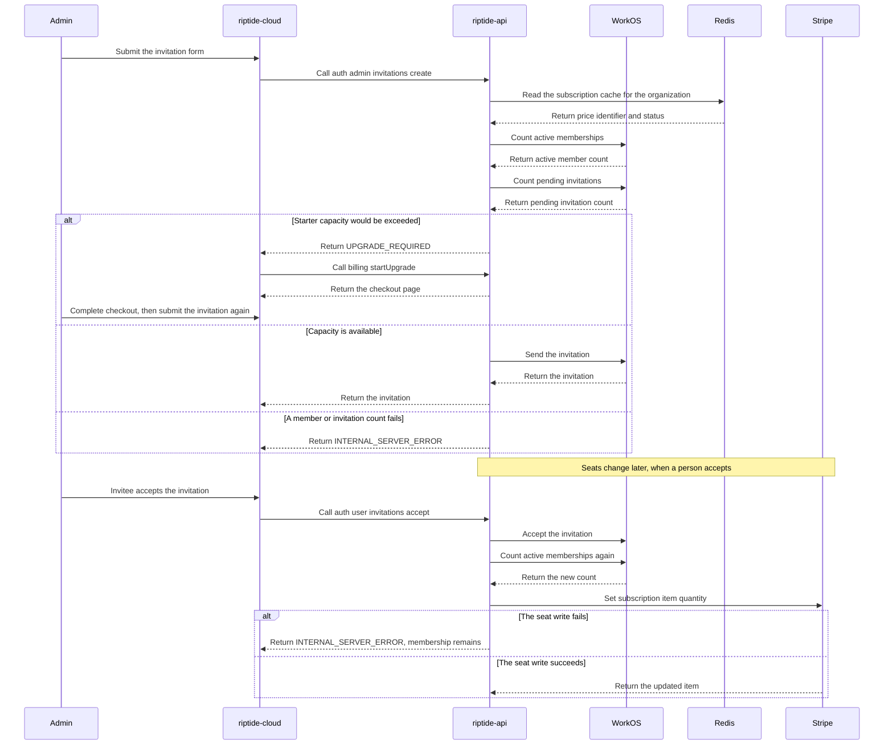
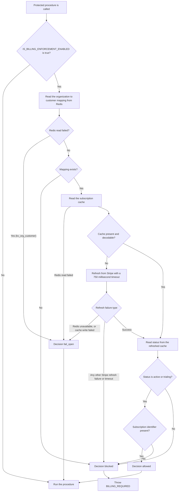
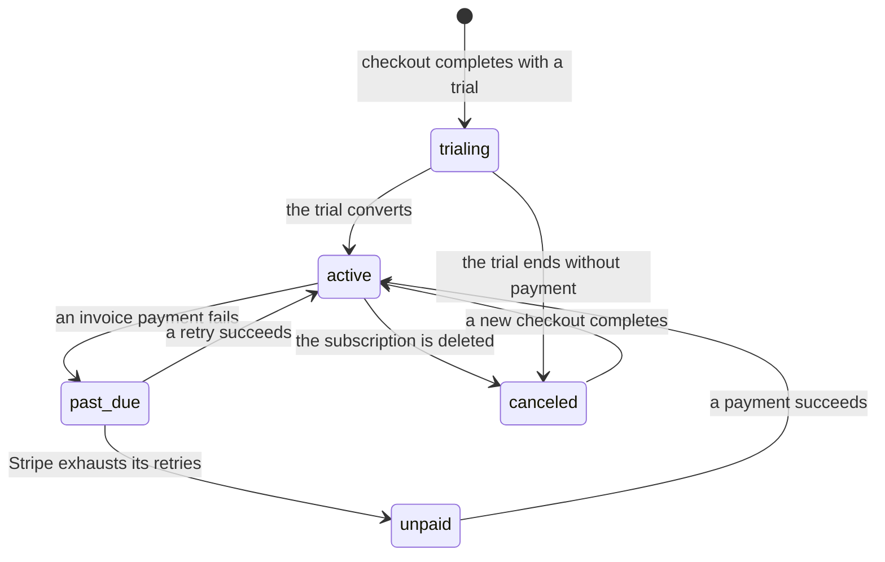

# Cloud, billing, and administration

HumanLayer sells seats, not usage. A separate browser application, `riptide-cloud`, owns organizations, invitations, settings, and the install page. The main working application, `riptide-ui`, owns tasks and sessions. The Application Programming Interface (API) answers one commercial question on every protected write: is this organization allowed to act now? The answer comes from a cached Stripe subscription. The decision refreshes the cache from Stripe only when it is missing or malformed. The interesting part is what happens when that check cannot run. A Redis failure opens the gate, a Stripe failure closes it, and an unexpected exception becomes a `503`. This document explains the routes, the WorkOS identity layer, the billing decision, the seat synchronisation, and the parts that are deliberately absent.

## Two applications, two jobs

The repository builds two React applications from one API contract. The split is not cosmetic. A task's real page, with sessions, the composer, and the working view, lives in `riptide-ui`. The cloud application hosts a layout route at `/tasks/$taskId`. Its only child is `/artifacts`. A task link inside the cloud application therefore lands on an artifact table, not on the task. The source says this directly.

```tsx
// apps/riptide-cloud/src/lib/app-links.ts:3-15
/**
 * Links from this app (riptide-cloud) to the riptide-ui web app.
 *
 * A task's real page — sessions, the composer, the whole working view — lives
 * in riptide-ui, not here. What riptide-cloud hosts at `/tasks/$taskId` is a
 * LAYOUT route whose only child is `/artifacts`, so linking there lands a
 * reader on an artifact table rather than on the task.
 *
 * Deliberately NOT the `/deep/tasks/$taskId` route: that one fires the desktop
 * protocol, shows an "Opening in HumanLayer…" card for two seconds, and then
 * falls back to the artifacts page anyway. That is the right behaviour for a
 * link pasted into Slack and the wrong one for a click inside a web app.
 */
```

The consequence for an operator is simple. When a link must open the working product, the code builds an absolute Uniform Resource Locator (URL) from `VITE_PUBLIC_APP_ORIGIN`. When that origin is absent, the code returns `null` and keeps the reader in the cloud application. The function rejects a scheme-less value such as `localhost:3000`. A browser would resolve that value relative to the current page and produce a silently wrong link (`apps/riptide-cloud/src/lib/app-links.ts:21-40`).

The two applications also live on different hosts in production. The migration guide gives the full table (`apps/docs/guide/beta-to-prod-migration.md:94-101`).

| Surface | Beta host | Production host |
|---|---|---|
| Working web application | `app.codelayer.cloud` | `app.humanlayer.com` |
| Cloud console | `cloud.codelayer.cloud` | `cloud.humanlayer.com` |
| Install page | `cloud.codelayer.cloud/install` | `cloud.humanlayer.com/install` |
| Direct macOS download | `update.codelayer.cloud/download/darwin-arm64` | `update.humanlayer.com/download/darwin-arm64` |
| Homebrew cask | `humanlayer/humanlayer/humanlayer-beta` | `humanlayer/humanlayer/humanlayer` |

In local development, `apps/devstack` gives each worktree its own stack and its own hostnames. The cloud application listens on port 5174 by default, with a strict-port setting so a second worktree cannot silently share it (`apps/riptide-cloud/vite.config.ts:58-62`). The full local topology appears in [Infrastructure and the development stack](14-infrastructure-and-devstack.md).

## The cloud application's routes and administration surfaces

The file tree under `apps/riptide-cloud/src/routes` is the route list. TanStack Router turns each file into a route object. The table below groups them by job.

| Route | Purpose | Gate |
|---|---|---|
| `/` | Landing page after sign-in | Signed-in user |
| `/artifacts`, `/artifacts/$artifactId` | Artifact index and detail | Signed-in user |
| `/tasks`, `/tasks/$taskId/artifacts` | Task index and artifact child route | Signed-in user |
| `/shared/artifacts/$artifactId` | Legacy redirect to the working application, with an optional `key` query parameter | Public |
| `/deep/sessions/$sessionId`, `/deep/tasks/$taskId` | Deep links that try the desktop protocol | A session or task identifier in the path |
| `/install` | Download and install instructions | Public |
| `/connect/$provider` | Result page for a Linear or Jira OAuth connection attempt | Public |
| `/metrics` | Usage and activity metrics | Signed-in user |
| `/settings` | Organization settings, domains, experiments, billing | Admin only |
| `/admin/invitations` | Invitations and access requests | Admin only |
| `/admin/users` | Member list and role actions | Admin only |
| `/admin/advanced-metrics` | Metrics available to Pro and Enterprise | Advanced Metrics entitlement, and admin or organization-wide sharing |
| `/organizations/create`, `/organizations/join`, `/organizations/select` | Organization onboarding and switching | Signed-in user |
| `/auth/signin`, `/auth/callback` | WorkOS sign-in and redirect handling | Public |

The settings page is a good example of the gate. It calls `useAuth` and reads `role` and `roles`. `role` is the active organization role, and `roles` is the full list for the person. When the roles do not include `admin`, the page renders a short message and nothing else.

```tsx
// apps/riptide-cloud/src/routes/settings.tsx:61-76
function SettingsPage() {
	const { billing, billing_error: billingError } = Route.useSearch()
	const { isLoading, user, organizationId, role, roles } = useAuth()
	const navigate = useNavigate()
	const { queryClient: api } = useRiptideApi()
	const queryClient = useQueryClient()
	const billingVisible = useBillingVisible()

	if (isLoading || !user || !organizationId || !role || !roles) return null
	if (!roles?.includes('admin')) {
		return (
			<div className="flex h-full items-center justify-center p-6">
				<p className="text-sm text-muted-foreground">Organization settings are available to admins only.</p>
			</div>
		)
	}
```

The invitation page applies the same rule, and redirects a non-admin to `/artifacts` instead of showing a message (`apps/riptide-cloud/src/routes/admin/invitations.tsx:31-34`). These client-side checks are user experience, not security. The API repeats the check on every administrative procedure. A reader who wants the server-side pattern should read [The API and the contracts](07-api-and-contracts.md).

The install page is public and version-aware. It maps each environment to a cask name, an application name, and a download URL.

```tsx
// apps/riptide-cloud/src/routes/install.tsx:21-40
const PRODUCTION_INSTALL_TARGET: InstallTarget = {
	cask: 'humanlayer',
	appName: 'HumanLayer',
	downloadUrl: 'https://update.humanlayer.com/download/darwin-arm64',
}

const INSTALL_TARGETS: Record<PublicEnvironment, InstallTarget> = {
	prod: PRODUCTION_INSTALL_TARGET,
	beta: {
		cask: 'humanlayer-beta',
		appName: 'HumanLayer-Beta',
		downloadUrl: 'https://update.codelayer.cloud/download/darwin-arm64',
	},
	dev: {
		cask: 'humanlayer-dev',
		appName: 'HumanLayer-Dev',
		downloadUrl: 'https://update.dev.codelayer.gg/download/darwin-arm64',
	},
	local: PRODUCTION_INSTALL_TARGET,
}
```

Notice that the `local` entry points at production. A developer who opens the local install page gets the production download, not a local build. That is a deliberate fallback, because a local stack has no signed installer.

## How the cloud application authenticates

Authentication is WorkOS AuthKit. The provider receives a public client identifier and a redirect Uniform Resource Identifier (URI). It also sets `devMode` to `true` unconditionally, with a comment that the value should return to `import.meta.env.DEV` when a WorkOS custom domain exists.

```tsx
// apps/riptide-cloud/src/providers/AuthProvider.tsx:72-80
export const AuthProvider: FC<PropsWithChildren> = ({ children }) => {
	const navigate = useNavigate()

	return (
		<AuthKitProvider
			clientId={env.VITE_PUBLIC_WORKOS_CLIENT_ID}
			redirectUri={`${window.location.origin}/auth/callback`}
			// TODO: set devMode back to `import.meta.env.DEV` once we have a WorkOS custom domain set up
			devMode={true}
```

**Aha:** `devMode` is hard-coded to `true` in the shipped source at this commit. The comment shows the intended value was the build's development flag, and the team was waiting for a WorkOS custom domain. The literal value remains in the source, so every build of this application sends the same flag.

The repository does not define what `devMode` changes in WorkOS AuthKit. It gives no type documentation and no comment for the option. The only guarantee in this tree is that every build passes `true`. An operator must read the WorkOS documentation for the effect. This document does not claim a behaviour that the source does not state.

Every API call carries the WorkOS access token as a bearer credential. The client builds one `OpenAPILink` against the typed contract and resolves the token lazily on each request.

```tsx
// apps/riptide-cloud/src/api/client.ts:22-30
	const link = new OpenAPILink(RiptideApiContract, {
		url: `${env.VITE_PUBLIC_RIPTIDE_API_ORIGIN}/rpc/api/v1`,
		headers: async () => {
			if (getAccessToken) {
				const token = await getAccessToken().catch(() => null)
				if (token) return { Authorization: `Bearer ${token}` }
			}
			return {}
		},
```

The token is a JavaScript Object Notation (JSON) Web Token (JWT). The API verifies the signature against WorkOS public keys, which a cache refreshes every five minutes (`apps/riptide-api/src/auth/jwks-cache.ts:12-17`). The validator rejects anything that is not three dot-separated parts before it touches cryptography (`apps/riptide-api/src/auth/jwt-validator.ts:33-40`). Claims are parsed with a shared schema, so the API and the client agree on the shape of the identity (`apps/riptide-api/src/auth/jwt-validator.ts:1`).

After validation, most procedures pass through `requireOrganization`. That middleware rejects a token without a local organization identifier and a WorkOS organization identifier, and narrows the type for every downstream handler (`apps/riptide-api/src/orpc/base.ts:82-90`). The local identifier arrives in the `internal_org_id` claim, and the WorkOS identifier arrives in the `org_id` claim (`apps/riptide-api/src/auth/jwt-validator.ts:84-95`). The two identifiers matter because WorkOS owns membership and the local database owns billing rows. A key refresh failure keeps the previous keys, and an unknown key identifier forces one refresh before the validator rejects the token (`apps/riptide-api/src/auth/jwks-cache.ts:24-58`; `apps/riptide-api/src/auth/jwt-validator.ts:56-66`).

Administrative procedures use a stricter base. `apiBaseForOrganizationAdmin` adds the role check on the server. The client hides the buttons; the server refuses the call. This is the same defence-in-depth pattern that the invitation flow uses.

## The invitation path

An invitation touches five systems: the cloud application, the API, WorkOS, Redis, and Stripe. The sequence below shows the happy path for a Starter organization near its free limit.



The diagram shows the two count calls in sequence. The code runs them in parallel with `Effect.all` (`apps/riptide-api/src/orpc/api/auth/admin/invitations-create.ts:62-65`). A failure in either count produces the same error path.

The Starter capacity rule is small and strict. Active members, pending invitations, and requested invitations all count against a limit of three. `requestedInvitations` means the number in the current request, which is always one. The check runs only when the cached price identifier matches `STRIPE_PRICE_STARTER` (`apps/riptide-api/src/orpc/api/auth/admin/invitations-create.ts:59-61`). An organization with no cached price skips the check. Such an organization has no tier from the price mapping, because `billingTierForPriceId` returns null for a missing price (`apps/riptide-api/src/effects/services/billing/billing-tier.ts:12-20`). The invitation rule is therefore unbounded for that organization until a price is cached. The code does not treat it as Starter or Pro.

```ts
// apps/riptide-api/src/lib/free-capacity.ts:1-11
export const STARTER_FREE_CAPACITY = 3

export type StarterCapacityInput = {
	activeMembers: number
	pendingInvitations: number
	requestedInvitations: number
}

export function wouldExceedStarterCapacity(input: StarterCapacityInput): boolean {
	return input.activeMembers + input.pendingInvitations + input.requestedInvitations > STARTER_FREE_CAPACITY
}
```

The invitation handler reads the cached price identifier to learn whether the organization is on Starter. It then counts memberships and pending invitations in parallel. A failure in either count is logged and reported to Sentry, and the call returns `INTERNAL_SERVER_ERROR`. When the count succeeds and the new invitation would cross the limit, the handler returns `UPGRADE_REQUIRED` with enough data for the client to open an upgrade flow.

```ts
// apps/riptide-api/src/orpc/api/auth/admin/invitations-create.ts:83-92
			const [activeMembers, pendingInvitations] = capacityResult.success

			if (wouldExceedStarterCapacity({ activeMembers, pendingInvitations, requestedInvitations: 1 })) {
				return yield* Effect.fail(
					errors.UPGRADE_REQUIRED({
						data: buildUpgradeRequiredData({ activeMembers, pendingInvitations }),
					}),
				)
			}
		}
```

**Aha:** the capacity check counts pending invitations, but Stripe quantity counts only accepted memberships. An invitation therefore reserves a place in the Starter limit without adding a billable seat. An invitation that is never accepted never costs money, and the next invitation is blocked until a place frees. Because the rule is keyed to the Starter price, a Pro or Enterprise organization has no invitation limit.

The invitation is sent after the capacity check. The handler builds the access-request resolution as an Effect value before the send, but it runs that value only after a successful send (`apps/riptide-api/src/orpc/api/auth/admin/invitations-create.ts:94-154`). An access request is a person's request to join the organization. Resolution marks the matching request as handled. Resolution failures are logged and captured, and they never fail the invitation response. The invitation call does not change the Stripe quantity. Pending invitations are not seats.

Acceptance is where the seat count moves. The handler accepts the invitation in WorkOS, resolves the local organization identifier from the WorkOS identifier, and calls the seat synchroniser.

```ts
// apps/riptide-api/src/orpc/api/auth/user/invitations-accept.ts:70-83
			case 'pending':
				// Accept the invitation
				try {
					const workosOrganizationId = invitation.organizationId
					if (!workosOrganizationId) {
						throw new Error('Invitation is missing organizationId')
					}
					await workos.userManagement.acceptInvitation(invitation.id)
					const organizationId = await getLocalOrganizationId(db, workosOrganizationId)
					await syncOrganizationSeatQuantity(
						{ organizationId, reason: 'first_party_membership_mutation' },
						{ workosService: workos, stripeService: stripe, db },
					)
					return { organizationId: workosOrganizationId }
```

The browser flow at `/organizations/join` lists pending invitations from `auth.user.invitations.list` and calls `auth.user.invitations.accept` with the invitation token (`apps/riptide-cloud/src/routes/organizations/join.tsx:27-41`). A failure shows an error toast and a Sentry event, and the reader stays on the page.

Two failure modes deserve a note. If the WorkOS acceptance succeeds but the seat synchronisation throws, the handler returns `INTERNAL_SERVER_ERROR`. The person is now a member, and the Stripe quantity lags. When the organization has a Stripe customer and an active subscription item, a later WorkOS webhook or a manual resynchronisation repairs the number. For an organization that has never checked out, neither path can succeed until a checkout links the customer. If the local organization row is missing, `getLocalOrganizationId` fails and the same error returns, while the membership remains. Both cases favour eventual repair over rollback, because rolling back a WorkOS membership is harder than retrying a Stripe update.

## The billing model

Stripe holds the truth about money. The API never treats a local row as the source of subscription state. Three Redis key-value (KV) keys form the bridge (`packages/billing/src/keys.ts:1-5`). The first is `stripe:org:<organizationId>`. The second is `stripe:customer:<customerId>`. The third is `stripe:customer:<customerId>:org`.

The first key maps a local organization identifier to a Stripe customer identifier. The second holds a serialised subscription cache. The third is the reverse mapping from a Stripe customer identifier to a local organization identifier. The billing sync writes the third key when it resolves a customer to an organization (`apps/riptide-api/src/effects/services/stripe/stripe-billing-sync.ts:49`). The cache schema stores the fields that the decision and the user interface need. It holds the customer identifier, the organization identifier, and the subscription identifier. It also holds the status, the price identifier, the current period end, the paid-invoice flag, the payment-method flag, the past-due time, and the sync time (`packages/billing/src/billing-kv/billing-kv.schemas.ts:16-27`). Seat quantity and the cancel-at-period-end flag are not in the cache. The decision refreshes an entry only when it is missing or malformed. Webhooks, checkout completion, and the resynchronisation route also write it. No time-to-live is set (`packages/billing/src/billing-kv/billing-kv.service.ts:89-94`). A lost webhook therefore leaves a stale status until another event or a manual resynchronisation overwrites the entry.

**Aha:** PostgreSQL is not on the cache-hit path. A comment in the service contract gives PostgreSQL a narrow role. It is a dependency of the Stripe refresh only (`apps/riptide-api/src/effects/services/billing/billing-access.service.ts:13-22`). The refresh reads the `organizations` row to resolve the customer to an organization (`apps/riptide-api/src/effects/services/stripe/stripe-billing-sync.ts:67-81`). A cache hit therefore needs Redis only. A cache miss also needs Stripe and, for the reverse mapping, one PostgreSQL query.

The packages under `packages/billing` provide the key builders, the cache schemas, the Redis client, the tier types, and the price-identifier mapping. They contain no HTTP handlers and no React code. That keeps the API and any future worker on one definition of the cache.

## The access decision

The decision is a small state machine with three outputs: `allowed`, `blocked`, and `fail_open`. The flow starts at the enforcement middleware and ends at a boolean question about the cached status.



A Redis failure at the first read is the `kv_org_customer` step failure, so it fails open. A Redis failure at the subscription-cache read is the `kv_subscription_cache` step failure, and it also fails open (`apps/riptide-api/src/effects/services/billing/billing-access-service-live.ts:80-102`; `apps/riptide-api/src/effects/services/billing/billing-access-decision.ts:14-16`). A null result is a missing mapping, so it blocks (`apps/riptide-api/src/effects/services/billing/billing-access-service-live.ts:74-78`). The subscription identifier test is part of `decideFromCache`, not a separate Stripe call (`apps/riptide-api/src/effects/services/billing/billing-access-decision.ts:28-50`).

The failure mapping is the most consequential function in the billing code. A failure in any step other than the Stripe refresh fails open. A failure during the refresh fails open only when Redis is unavailable or the cache write failed. Every other refresh failure blocks.

```ts
// apps/riptide-api/src/effects/services/billing/billing-access-decision.ts:10-26
export const decisionForFailure = (
	failure: BillingStepFailure,
	input: BillingAccessInput,
): Effect.Effect<BillingAccessDecision> => {
	if (failure.step !== 'stripe_refresh') {
		return Effect.succeed('fail_open')
	}

	const error = failure.error
	const kvRefreshFailure =
		Predicate.isTagged(error, 'BillingKvUnavailableError') ||
		(Predicate.isTagged(error, 'StripeBillingSyncError') && error.dependency === 'cache')

	return kvRefreshFailure
		? captureFailOpen(input, 'kv_refresh_error', error).pipe(Effect.as('fail_open' as const))
		: captureBlocked(input, { reason: 'subscription_refresh_failed', error }).pipe(Effect.as('blocked' as const))
}
```

The decision workflow itself is readable as five steps. Read the customer mapping. Block when it is missing. Read the cache. Refresh when the cache is absent. Decide from the cache.

```ts
// apps/riptide-api/src/effects/services/billing/billing-access-service-live.ts:105-122
	const decideForOperation = (input: BillingAccessInput): Effect.Effect<BillingAccessDecision> =>
		Effect.gen(function* () {
			const customerId = yield* readOrgCustomerId(input)
			if (!customerId) {
				yield* captureBlocked(input, { reason: 'missing_customer_mapping' })
				return 'blocked'
			}

			let cache: ReadableStripeSubscriptionCache | null = yield* readSubscriptionCache(customerId, input)
			if (!cache) {
				cache = yield* runDependencyStep(refreshCache(customerId), 'stripe_refresh', input)
			}

			return yield* decideFromCache(cache, input)
		}).pipe(
			Effect.catchTag('BillingStepFailure', (failure) => decisionForFailure(failure, input)),
			Effect.withSpan('billing_access.decide_for_operation'),
		)
```

A Redis error at the first read is not a missing mapping. It is a dependency step failure named `kv_org_customer`, so it fails open (`apps/riptide-api/src/effects/services/billing/billing-access-service-live.ts:77-78`; `apps/riptide-api/src/effects/services/billing/billing-access-decision.ts:14-16`). A null result is a missing mapping, and it blocks. The organization row in PostgreSQL can restore the mapping, but the decision never reads it.

Only a path that starts from the Stripe customer identifier can rebuild the mapping. `synchronizeStripeCustomerBillingCache` reads the organizations row by `stripe_customer_id`, then writes both mappings and the subscription cache (`apps/riptide-api/src/effects/services/stripe/stripe-billing-sync.ts:20-65`, `:67-84`). Three paths call it: the Stripe webhook, checkout finalisation, and checkout resynchronisation (`apps/riptide-api/src/effects/services/stripe/stripe-service-live.ts:60`; `apps/riptide-api/src/effects/services/billing-checkout-completion/billing-checkout-completion.live.ts:90`, `:102`). No route rebuilds the mapping from the organization identifier alone. Until one of these paths runs, every billing-gated request from that organization blocks with `missing_customer_mapping`.

Every dependency step has a 750 millisecond timeout and one retry (`apps/riptide-api/src/effects/services/billing/billing-access-service-live.ts:20`, `:40-45`). A slow Stripe call therefore costs about 1.5 seconds before the request is blocked. A slow Redis call costs the same before it fails open. The retry is not a circuit breaker. There is no backoff and no shared failure counter.

The status test is a two-element set. `active` and `trialing` pass; everything else blocks. The same set appears in the plan helper. That helper also requires a subscription identifier, so an organization with a status but no subscription cannot pass (`apps/riptide-api/src/effects/services/billing/billing-plan.ts:19-23`).

**Aha:** the decision uses `active` and `trialing` only. Stripe has more statuses, including `past_due`, `unpaid`, `incomplete`, `incomplete_expired`, `paused`, and `canceled`. All of them block every billing-gated write. There is no grace period during payment retries, because Stripe keeps the subscription in `past_due` while it retries the invoice. This is a strong choice. A customer with a failed card loses write access on the first failed invoice, not after the final retry.

The malformed-cache path is gentler. A decode error is converted into a synthetic "missing" cache, which triggers a refresh from Stripe (`apps/riptide-api/src/effects/services/billing/billing-access-service-live.ts:80-103`). A schema change in the cache therefore self-heals on the next request instead of blocking everyone.

## The five enforcement points

The same decision function is called from several middleware families. The table lists them and the identity each one uses.

| Middleware | Source | Identity source | Applies to |
|---|---|---|---|
| `requiresBillingMiddleware` | `apps/riptide-api/src/orpc/base.ts:99` | WorkOS JSON Web Token | Classic `apiBase` procedures |
| `requiresDaemonBillingMiddleware` | `apps/riptide-api/src/orpc/base.ts:348` | Daemon token claims | Daemon write procedures |
| `requiresLaunchTokenBillingMiddleware` | `apps/riptide-api/src/orpc/base.ts:395` | Launch token | Daemon token exchange and launch routes |
| `requiresBillingEffectMiddleware` | `apps/riptide-api/src/orpc/effect-base.ts:276` | WorkOS JSON Web Token | Effect-based procedures |
| `requiresDaemonBillingEffectMiddleware` | `apps/riptide-api/src/orpc/effect-base.ts:380` | Daemon token claims | Effect-based daemon procedures |

A daemon token is a long-lived signed credential bound to a host. A launch token is a 24-hour signed credential scoped to one user and one organization, with no host identifier (`apps/riptide-api/src/auth/daemon-token-core.ts:110-121`). The classic procedures use the `apiBase*` builders. The Effect-based procedures use the `effectOrpcBase*` builders. oRPC is the typed Remote Procedure Call (RPC) library that builds both. The two Effect-based variants run the same decision inside the Effect procedure base, so they share the failure mapping.

The WorkOS variant is the most common. It short-circuits when enforcement is disabled, runs the decision, and maps the result to either `next`, a warning plus `next`, or `BILLING_REQUIRED`.

```ts
// apps/riptide-api/src/orpc/base.ts:99-117
export const requiresBillingMiddleware = os.middleware<{ auth: AuthContext; services: Services }, unknown>(
	async ({ context, next, errors, path }) => {
		const billingContext = context as { auth: AuthContext; services: Services }
		if (!isBillingEnforcementEnabled()) return next({ context: billingContext })

		const procedureName = path.join('.')
		try {
			const decision = await billingContext.services.effectRuntime.runPromise(
				decideBillingAccess({ organizationId: billingContext.auth.organizationId, operation: procedureName }),
			)

			if (decision === 'fail_open') {
				logger.warn({ procedureName }, 'Billing enforcement failed open for billing-required operation')
				Sentry.captureMessage('Billing enforcement failed open for billing-required operation', {
					level: 'warning',
					tags: { error_type: 'billing_enforcement_fail_open', procedure: procedureName },
				})
				return next({ context: billingContext })
			}
```

The flowchart covers the decision only. The final `catch` in the middleware covers everything else. A declared error from the oRPC contract is re-thrown unchanged. Anything else is logged, captured in Sentry, and converted to `SERVICE_UNAVAILABLE` (`apps/riptide-api/src/orpc/base.ts:126-133`). That is a separate outcome from the three decision values: an unexpected defect does not fail open, and it does not claim the customer owes money. It reports a server fault. A defect inside a dependency step is different, because the step wrapper turns it into a `BillingStepFailure` before the outer catch sees it.

The daemon variant re-runs the decision on every write, even though a daemon token is long-lived. The comment explains why: billing state can change while a token stays valid (`apps/riptide-api/src/orpc/base.ts:341-347`). A daemon on a laptop cannot cache an old "allowed" answer.

Enforcement is disabled by one environment variable. The helper requires the variable to be present and compares it to the string `true` (`apps/riptide-api/src/lib/environment.ts:55-56`). A missing variable throws during the call. The diagram shows only the true and false cases; the missing-variable throw reaches the caller as a server fault. An operator who removes the variable disables nothing; the API fails loudly instead. That is a safer default than an implicit "off".

## Stripe webhooks and checkout completion

Stripe notifies the API through one route. The handler requires the `stripe-signature` header and rejects a request without it before reading the body (`apps/riptide-api/src/webhooks/stripe.ts:16-22`).

```ts
// apps/riptide-api/src/webhooks/stripe.ts:16-22
	app.post('/webhooks/stripe', async (c) => {
		const requestId = c.req.header('x-request-id') ?? c.req.header('x-correlation-id')
		const signature = c.req.header('stripe-signature')
		if (!signature) {
			logger.warn({ requestId }, 'Missing Stripe-Signature header on Stripe webhook request')
			return c.json({ error: 'Missing Stripe-Signature header' }, 400)
		}
```

The service verifies the signature, parses the event, and ignores any event type outside a fixed list. The list is a schema literal with eighteen entries, covering checkout completion, subscription lifecycle, invoices, and payment intents.

```ts
// apps/riptide-api/src/effects/services/stripe/stripe-webhook.ts:13-32
export const StripeBillingWebhookEventTypeSchema = Schema.Literals([
	'checkout.session.completed',
	'customer.subscription.created',
	'customer.subscription.updated',
	'customer.subscription.deleted',
	'customer.subscription.paused',
	'customer.subscription.resumed',
	'customer.subscription.pending_update_applied',
	'customer.subscription.pending_update_expired',
	'customer.subscription.trial_will_end',
	'invoice.paid',
	'invoice.payment_failed',
	'invoice.payment_action_required',
	'invoice.upcoming',
	'invoice.marked_uncollectible',
	'invoice.payment_succeeded',
	'payment_intent.succeeded',
	'payment_intent.payment_failed',
	'payment_intent.canceled',
])
```

For a tracked event, the service reads the customer identifier and calls `syncCustomerBillingToKv`. That service method decodes the input and runs `synchronizeStripeCustomerBillingCache`, so the webhook and the checkout routes share one rebuild function (`apps/riptide-api/src/effects/services/stripe/stripe-service-live.ts:254-263`; `apps/riptide-api/src/effects/services/stripe/stripe-billing-sync.ts:20-65`). An untracked event returns `{ received: true }` without a cache write. The route classifies failures. A missing or invalid signature and an invalid payload return `400`. A cache write failure or any other processing error returns `500`, and Stripe retries it (`apps/riptide-api/src/webhooks/stripe.ts:32-51`). The `400` responses are deliberate. Retrying a payload that the parser rejects would repeat the failure, so the API stops the retry loop. A duplicate tracked event repeats the read and the write. The write is an absolute snapshot, so a duplicate is harmless.

The webhook is one of several registered in `app.ts`, alongside WorkOS, Resend, GitHub, Jira, Linear, and Slack OAuth and Slack interactions (`apps/riptide-api/src/app.ts:123-137`). Checkout completion also has two browser-facing routes. One route finalises a Starter-to-Pro upgrade (`apps/riptide-api/src/routes/billing-checkout-completion.ts:7-16`). The other route, `/billing/checkout/resync`, re-reads the checkout session and repairs the cache when a browser returns before the webhook arrives (`apps/riptide-api/src/routes/billing-checkout-completion.ts:18-26`). Both routes retrieve the checkout session from Stripe. They require a session with status `complete`, mode `subscription`, and payment status `paid`. They also require both a customer identifier and a subscription identifier. They resolve the organization from the customer identifier, so a session that belongs to another organization fails to resolve (`apps/riptide-api/src/effects/services/billing-checkout-completion/billing-checkout-completion.operations.ts:110-149`). Both routes redirect back to the cloud application with a `billing` or `billing_error` search parameter, which the settings page renders as a result banner (`apps/riptide-cloud/src/routes/settings.tsx:80-94`).

Checkout creation provisions a Stripe customer when the organization has none. It reads the acting user's email from WorkOS and creates the customer. It stores the identifier on the organization row. Only then does it create the checkout session (`apps/riptide-api/src/orpc/api/billing/create-checkout-session.ts:42-60`). The client sends a `checkoutAttemptId` and the literal `client: 'cloud'` (`apps/riptide-cloud/src/components/BillingBannerRail.tsx:45-48`). The client field names the application that started the checkout. The server builds the Stripe idempotency key from the organization identifier and `checkoutAttemptId` (`apps/riptide-api/src/lib/stripe-service.ts:232`). A retry of the same attempt reuses the session. A second click generates a new identifier, so it can still open a second session.

The contract exposes eight billing procedures. They create a checkout session, create a portal session, start an upgrade, and finalize an upgrade. They also apply a promotion code, synchronise a checkout session, resynchronise seats, and downgrade to Starter (`apps/riptide-api/src/orpc/api/billing/`). Each is small. The complexity sits in the services behind them.

## Seats

A seat is an active WorkOS membership. The synchroniser counts active memberships for the WorkOS organization and writes the number to the Stripe subscription item. Starter and Pro pay per seat; every other price pays a quantity of one.

```ts
// apps/riptide-api/src/lib/seat-sync.ts:74-86
	const seatCount = await deps.workosService.countActiveOrganizationMemberships(
		parsedOrganization.data.workos_organization_id,
	)
	const targetQuantity =
		subscriptionItem.priceId === deps.stripeService.prices.starter ||
		subscriptionItem.priceId === deps.stripeService.prices.pro
			? seatCount
			: 1
	const updatedSubscriptionItem = await deps.stripeService.updateSubscriptionItemQuantity({
		subscriptionItemId: subscriptionItem.subscriptionItemId,
		quantity: targetQuantity,
		prorationBehavior: input.prorationBehavior ?? 'create_prorations',
	})
```

Proration defaults to `create_prorations`, so an added seat produces a prorated charge instead of a full-period charge. No call site overrides the default in this snapshot. The downgrade procedure is separate. It is allowed only when a Pro organization's active members plus pending invitations fit the Starter capacity. It cancels the Pro subscription and creates a Starter subscription with the active member count as the quantity (`apps/riptide-api/src/orpc/api/billing/downgrade-to-starter.ts:54-107`).

The synchroniser throws when the organization has no Stripe customer identifier or no active subscription item (`apps/riptide-api/src/lib/seat-sync.ts:65-72`). The invitation path does not call it. Acceptance does, and it runs after the WorkOS membership exists (`apps/riptide-api/src/orpc/api/auth/user/invitations-accept.ts:77-82`). An organization that has never checked out has no Stripe customer. A person who accepts an invitation to that organization therefore becomes a member, and the API returns `INTERNAL_SERVER_ERROR` because the seat write cannot start. A later checkout links the customer. Until then, no repair path can write a seat quantity: the WorkOS membership webhook and the manual resynchronisation throw on the same missing customer (`apps/riptide-api/src/lib/seat-sync.ts:65-72`). After checkout, a later membership event or a manual resynchronisation repairs the quantity. The handler keeps the member and does not roll the membership back (`apps/riptide-api/src/orpc/api/auth/user/invitations-accept.ts:70-91`).

The call sites show the intended repair surface. Seats synchronise when a person accepts an invitation. They also synchronise when an admin removes, deactivates, reactivates, or changes the role of a user. The WorkOS membership webhook is the backstop. The exact call sites are:

- Invitation acceptance: `apps/riptide-api/src/orpc/api/auth/user/invitations-accept.ts:79`.
- Member removal: `apps/riptide-api/src/orpc/api/auth/admin/users-remove.ts:58`.
- Deactivation: `apps/riptide-api/src/orpc/api/auth/admin/users-deactivate.ts:60`.
- Reactivation: `apps/riptide-api/src/orpc/api/auth/admin/users-reactivate.ts:70`.
- Role change: `apps/riptide-api/src/orpc/api/auth/admin/users-update-role.ts:50`.
- WorkOS membership webhook: `apps/riptide-api/src/webhooks/workos.ts:88-91`.
- Manual resynchronisation: `apps/riptide-api/src/orpc/api/billing/resync-seats.ts:13`. The webhook is the backstop. If the first-party path fails after the WorkOS mutation, the webhook observes the same membership event and retries the count. The WorkOS route verifies the `workos-signature` header, ignores non-membership events, and resolves the local organization from the WorkOS identifier (`apps/riptide-api/src/webhooks/workos.ts:28-91`). A duplicate membership event repeats an absolute write, not an increment.

**Aha:** seat synchronisation is idempotent by construction. It always computes the target from the current WorkOS membership count and writes that absolute number, never an increment. A duplicated webhook therefore costs one redundant Stripe call, not an extra seat. The risk is ordering, not duplication: a webhook that arrives before a local transaction commits can write a stale count, and the next event corrects it.

## Billing states and their effects

The cache status drives both access and the user interface. The table combines the access rule with the visible signal. `isInGoodStanding` means the status is `active` or `trialing` and the subscription identifier is not null (`apps/riptide-api/src/effects/services/billing/billing-plan.ts:19-23`). The decision uses the same status set, and it also requires the subscription identifier (`apps/riptide-api/src/effects/services/billing/billing-access-decision.ts:28-50`).

| Stripe status | `isInGoodStanding` | Billing-gated writes | Cloud user interface |
|---|---|---|---|
| `active` | Yes | Allowed | No banner |
| `trialing` | Yes | Allowed | Trial banner, dismissible |
| `past_due` | No | Blocked | Past-due banner with a portal link |
| `unpaid` | No | Blocked | Unpaid banner with a portal link |
| `incomplete` | No | Blocked | No dedicated banner |
| `incomplete_expired` | No | Blocked | No dedicated banner |
| `paused` | No | Blocked | No dedicated banner |
| `canceled` | No | Blocked | Recovery banner with a checkout action |
| No customer mapping | Not applicable | Blocked | Billing section may still render |
| Redis unavailable | Not reached | Allowed (`fail_open`) | No banner |
| Malformed cache | Not reached | Refresh, then decide | No banner |
| Stripe refresh failure that is not a cache fault | Not reached | Blocked | No banner until a state is cached |
| Unexpected exception | Not reached | `503 SERVICE_UNAVAILABLE` | Error toast from the client |

The visible banners cover four conditions. The component checks for `trialing`, `past_due`, and `unpaid`, and it also shows a recovery banner when `recoveryRequired` returns true (`apps/riptide-cloud/src/components/BillingBannerRail.tsx:82-85`). Three rollout display states exist (`packages/billing/src/types.ts:10`). `not_linked` means the organization has no Stripe customer identifier. `billing_linked` means it has a customer identifier but no cached subscription status, which the visibility model reports as `none`. `billing_enrolled` means it has any other cached status (`packages/billing/src/visibility.ts:14-27`). `recoveryRequired` returns false for `not_linked`. It returns true for `billing_linked`, or when the status is `none` or `canceled` (`packages/ui/src/lib/billing-recovery.ts:3-12`). In this example, an organization completes customer creation but not checkout. It has a customer identifier and status `none`, so its rollout state is `billing_linked` and the recovery banner shows. After checkout caches `active`, its rollout state is `billing_enrolled` and the banner does not show. Each banner can be dismissed by the user. The dismissed state is local to the browser. A blocked organization with a status of `paused`, `incomplete`, or `incomplete_expired` sees no banner, so the first signal of the problem is a failed write.

Billing surfaces are also hidden in builds without enforcement. The visibility helper returns true when `VITE_PUBLIC_BILLING_ENFORCEMENT_ENABLED` is `true`, or when a user turns on the local preview toggle (`apps/riptide-cloud/src/env.ts:39`, `apps/riptide-cloud/src/lib/billing-visibility.ts:11-23`). This client flag is separate from the server's `IS_BILLING_ENFORCEMENT_ENABLED`. The client hides or shows billing surfaces, and the server alone decides whether a write is allowed. A mismatch shows a payment screen that cannot change access, or hides a screen that the server still enforces.



The diagram shows the common trial and payment paths, not every Stripe status. A canceled organization returns to `active` through a new checkout, which creates a new subscription.

Advanced metrics are the only feature entitlement in the code. `advancedMetrics` belongs to Pro and Enterprise. The check fails open when the lookup fails, because it runs inside the bootstrap call that every client makes (`apps/riptide-api/src/effects/services/billing/entitlements.service.ts:10-12`, `:55-76`). A metrics page that briefly opens for a Starter organization is preferable to an application that cannot start.

## What does not exist

**Aha:** there is no token metering module. The billing package contains key builders, cache schemas, a Redis client, and tier types. A search for `meter` across `packages/billing` and the billing services finds only an unrelated TypeScript compiler option. Stripe receives a seat quantity and nothing else. The product does not charge for model tokens.

The API does store token usage for internal analytics. `session_usage_events` holds one immutable row per usage report and model, with `cost_usd` (`packages/db/src/tables/session-usage-events.ts:15-32`). Advanced Metrics reads that table through the read replica (`apps/riptide-api/src/effects/services/metrics/person-spend-analytics.service.ts:118-141`). This is internal analytics only. No Stripe invoice reads the table.

Two related gaps follow from that. First, no billing invoice line is built from the usage table. Second, there is no reconciliation job comparing model usage with charges, because no charge depends on it.

The billing cache also has no encryption layer of its own. It stores status and price identifiers in Redis, which the deployment must protect. A reader who wants the trust boundaries should read [Security and self-hosting](18-security-and-self-hosting.md).

The cloud application has no audit log for administrative actions. Invitations, role changes, and deactivations are sent to Sentry when they fail, and the API logs successful actions. There is no durable admin event stream in the database at this commit. That is a real gap for a team product, and it is the kind of thing a buyer asks about during procurement.

Finally, the cloud application does not own task data. Deletion, export, and retention are features of the working application and the database. A reader who expects the admin console to be a full back office will not find one.

## Next

Read [Infrastructure and the development stack](14-infrastructure-and-devstack.md) for the local services that back these flows, including Redis, Postgres, and the Caddy proxy. Read [The API and the contracts](07-api-and-contracts.md) for the middleware chain around the billing gate. Read [Database and schemas](08-database-and-schemas.md) for the `organizations` row that anchors the Stripe customer mapping. Read [Security and self-hosting](18-security-and-self-hosting.md) for what a self-hoster must supply in place of WorkOS and Stripe.
