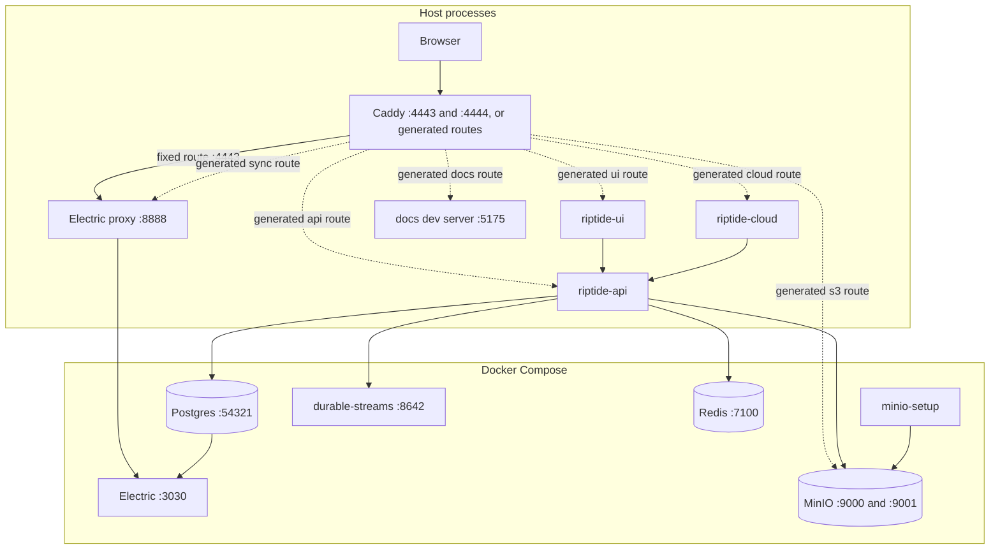
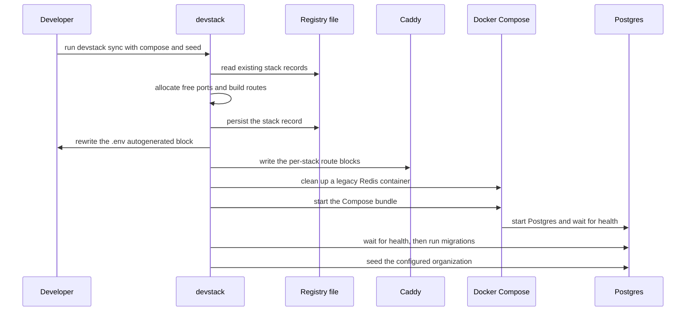

# Infrastructure, the local stack, and the background jobs

The repository keeps almost all of its infrastructure in two shapes. The first shape is a Docker Compose file that a developer runs on a laptop. The second shape is four small Amazon Web Services (AWS) Lambda handlers that run in the hosted product. A Lambda handler is a function that AWS runs on demand. A third shape is missing. There is no Pulumi program in the tree, and there is no Lambda definition file. Pulumi is an infrastructure-as-code tool that declares cloud resources in a general-purpose language. The cloud account, the networking, the buckets, and the function configuration all live outside this snapshot. This document explains what is present and what each local service does. It shows how `apps/devstack` gives every worktree its own isolated stack. It also shows how the environment block is generated rather than checked in, and how a commit triggers a release in an external repository.

## The local stack in one picture

`docker-compose.yaml` defines six services and four named volumes. The default project name is `electric_quickstart`, which is a legacy of the project's first prototype (`docker-compose.yaml:1`). Every port can be overridden by an environment variable, and every variable has a default that works on a fresh machine. Caddy is the reverse proxy. A reverse proxy is a server that receives a request and forwards it to the service that serves it.



The generated configuration writes one block for each of the eight route names: `ui`, `cloud`, `api`, `sync`, `docs`, `adminApi`, `adminUi`, and `s3` (`apps/devstack/src/lib/caddy.ts:25-34`, `:145-161`). The fixed routes cover the proxy on port 4443 and a second local service on port 5537. The diagram shows only the proxy route. The repository does not name the port 5537 service. A dotted arrow from Caddy is a generated route, and a solid arrow from Caddy is a fixed route. The diagram is simplified: it merges `adminApi` and `adminUi` into the cloud arrow. The generated configuration has a separate block for each of them, with its own upstream port (`apps/devstack/src/lib/ports.ts:5-24`).

The table gives the exact image and purpose of each Compose service. All values come from the service definitions in `docker-compose.yaml`.

| Service | Image | Host port | Purpose |
|---|---|---|---|
| `postgres` | `docker.io/postgres:18` | `54321` | Primary database, with logical write-ahead logging enabled for Electric |
| `electric` | `docker.io/electricsql/electric:1.7.12` | `3030` | Change-data-capture server that exposes Structured Query Language (SQL) shapes over Hypertext Transfer Protocol (HTTP) |
| `minio` | `docker.io/minio/minio:latest` | `9000`, `9001` | Amazon Simple Storage Service (S3)-compatible object store for artifacts |
| `minio-setup` | `docker.io/minio/mc:latest` | none | One-shot job that creates the artifacts bucket and exits |
| `durable-streams` | `humanlayer/durable-streams-server:0.3.0-cebb50e` | `8642` | Append-only stream server for session events |
| `redis` | `docker.io/redis:7-alpine` | `7100` | Billing cache and general key-value store, with append-only persistence |

Postgres is the anchor. It runs with `listen_addresses=*` and `wal_level=logical`, because Electric needs logical replication to see row changes (`docker-compose.yaml:17-21`). Electric waits for the Postgres health check, and `minio-setup` waits for the MinIO health check.

| Volume | Owner service | Default name |
|---|---|---|
| `postgresql_data` | `postgres` | `electric_quickstart_postgresql_data` |
| `minio_data` | `minio` | `electric_quickstart_minio_data` |
| `durable-streams-data` | `durable-streams` | `electric_quickstart_durable-streams-data` |
| `redis-data` | `redis` | `electric_quickstart_redis` |

Each name takes an override from a `DEVSTACK_*_VOLUME` variable (`docker-compose.yaml:110-118`).

```yaml
# docker-compose.yaml:8-28
services:
  postgres:
    image: docker.io/postgres:18
    environment:
      POSTGRES_DB: electric
      POSTGRES_USER: postgres
      POSTGRES_PASSWORD: ${DEVSTACK_POSTGRES_PASSWORD:-password}
    ports:
      - "${DEVSTACK_POSTGRES_PORT:-54321}:5432"
    command:
      - -c
      - listen_addresses=*
      - -c
      - wal_level=logical
    healthcheck:
      test: ["CMD-SHELL", "pg_isready -U postgres"]
      interval: 5s
      timeout: 5s
      retries: 5
    volumes:
      - postgresql_data:/var/lib/postgresql
```

The durable stream server is the most constrained service. It keeps data in files, limits total memory to 187,904,819,200 bytes, limits a single stream to 104,857,600 bytes, and exposes a readiness endpoint. The memory ceiling is a practical no-limit sentinel. A client that writes a stream larger than 104,857,600 bytes receives an error rather than consuming the disk.

```yaml
# docker-compose.yaml:72-95
  durable-streams:
    image: humanlayer/durable-streams-server:0.3.0-cebb50e
    build:
      context: ./docker/durable-streams-server
      args:
        DURABLE_STREAMS_SOURCE_COMMIT: cebb50e49c62c534dd714ef84a8a4572e66724b2
    ports:
      # Keep using the already-allocated Durable Streams port in existing manifests.
      - "${DEVSTACK_DURABLE_STREAMS_PORT:-8642}:4437"
    environment:
      DS_SERVER__BIND_ADDRESS: 0.0.0.0:4437
      DS_STORAGE__MODE: file-fast
      DS_STORAGE__DATA_DIR: /var/lib/durable-streams
      DS_LIMITS__MAX_MEMORY_BYTES: "187904819200"
      DS_LIMITS__MAX_STREAM_BYTES: "104857600"
      DS_LIMITS__MAX_STREAM_NAME_SEGMENTS: "256"
      DS_HTTP__ALLOW_WILDCARD_CORS: "true"
    volumes:
      - durable-streams-data:/var/lib/durable-streams
    healthcheck:
      test: ["CMD", "curl", "--fail", "--silent", "http://localhost:4437/readyz"]
      interval: 5s
      timeout: 5s
      retries: 20
```

MinIO is an S3 emulator. `minio-setup` waits for MinIO to become healthy, sets an alias, creates the `${S3_ARTIFACTS_BUCKET:-riptide-artifacts}` bucket when it is absent, and exits with status zero (`docker-compose.yaml:60-70`). The entrypoint always exits zero, so a failed bucket creation does not fail the container. That would leave artifact uploads broken while every other service looked healthy. The root user and password default to `minioadmin`, so the local object store has no real protection (`docker-compose.yaml:45-47`).

Redis runs with `--appendonly yes` (`docker-compose.yaml:103`). The Compose volume key is `redis-data`, but its default external name is `electric_quickstart_redis` (`docker-compose.yaml:117-118`). That matters for billing, because the subscription cache lives there. A restart without persistence would empty the cache and the customer mapping. The next request blocks with `missing_customer_mapping`, because the decision cannot reach Stripe without a customer identifier. The mapping returns only after a Stripe-first path rebuilds it. `synchronizeStripeCustomerBillingCache` starts from the customer identifier, reads the organizations row, and writes both mappings (`apps/riptide-api/src/effects/services/stripe/stripe-billing-sync.ts:20-65`, `:67-84`). No path rebuilds the mapping from the organization identifier alone, so requests block until a Stripe event or checkout path runs. The service sets no password. Devstack writes the Redis address into `.env` as `KV_URL` (`apps/devstack/src/lib/env-block.ts:200`), and the API reads that variable (`apps/riptide-api/src/lib/environment.ts:36`). A host that exposes port 7100 exposes the billing cache.

## The Caddy reverse proxy

`Caddyfile` is short. It terminates Transport Layer Security (TLS) on two local ports and forwards each to a plain HTTP development server. Streaming responses are not buffered, and cache headers are disabled so a browser or proxy cannot replay stale development assets.

```caddyfile
# Caddyfile:7-25
https://localhost:4443 {
	reverse_proxy localhost:8888 {
		flush_interval -1
	}
	header {
		Cache-Control "no-cache, no-transform"
		X-Accel-Buffering "no"
	}
}

https://localhost:4444 {
	reverse_proxy localhost:5537 {
		flush_interval -1
	}
	header {
		Cache-Control "no-cache, no-transform"
		X-Accel-Buffering "no"
	}
}
```

The first block forwards to port 8888, which is the default port of the Electric proxy (`apps/riptide-electric-proxy/src/server-port.ts:4`). The second block forwards to port 5537. No application in this snapshot declares 5537 as a default, and the documentation development server uses 5175 (`apps/docs/package.json:7`). The second block therefore has no verified consumer in this tree. It may be a legacy route. A reader should not assume it serves the docs site.

**Aha:** the root `Caddyfile` is only used by the legacy path. `scripts/ensure-devstack-caddy.ts` checks for `.devstack.json` in the working directory. When the file is absent, the script runs `caddy run --config Caddyfile` in the foreground (`scripts/ensure-devstack-caddy.ts:7-23`). When the file is present, devstack owns Caddy and writes a generated configuration with one block per stack. `regenerateCaddyConfig` performs that write (`apps/devstack/src/lib/caddy.ts:173-197`). A worktree can therefore use either the two fixed routes or the many per-stack hostnames, never both.

## `apps/devstack`: one stack per worktree

`apps/devstack` is a command-line application that reconciles a worktree's local environment. Two checkouts of the same repository would otherwise share ports, database names, Caddy routes, and a Redis instance, and they would corrupt each other's data. Devstack gives each worktree a stack identifier and an isolated set of resources. Compose takes its project name from `DEVSTACK_COMPOSE_PROJECT`, which devstack writes into the generated environment block (`docker-compose.yaml:1`; `apps/devstack/src/lib/env-block.ts:143`). That name prefixes the containers, volumes, and networks, so two worktrees do not share them.

The identifier is derived from the worktree name, or from an explicit `--stack` value. It is lower-cased, restricted to letters, digits, and hyphens, and truncated to 63 characters (`apps/devstack/src/lib/stack-id.ts:10-21`). Docker names receive a `devstk-` prefix, and the Tauri application receives a suffix with underscores (`apps/devstack/src/lib/stack-id.ts:23-31`). Tauri is a desktop application framework that uses the operating system web view. The suffix keeps two native builds from overwriting each other in the application folder.

The `sync`, `down`, `reallocate`, `status`, and `set-local-org` commands accept the four common options `--stack`, `--global-stacks`, `--repo-root`, and `--json` (`apps/devstack/src/cli.ts:75-81`, `:329-365`). The `--global-stacks` value is the path of the machine-wide registry file, and it defaults to a per-user location (`apps/devstack/src/cli.ts:78-87`). The option name is plural, but its value is one path. In the table below, "none" in the options column means no command-specific option beyond those four.

| Command | What it does | Important flags |
|---|---|---|
| `sync` | Reconciles the worktree stack and rewrites its environment block | `--compose`, `--seed`, `--dry-run` |
| `down` | Tears down the stack and its containers, and removes the environment block | `--dry-run`, `--force` |
| `reallocate` | Probes and stores a fresh set of ports, without converging anything | none |
| `status` | Prints one stack, or a summary of every registered stack | `--json` |
| `set-local-org` | Stores the organization used when seeding | `--workos-org-id`, `--name`, `--organization-id` |
| `help` | Prints the command list | none |

The registry is a JavaScript Object Notation (JSON) file at `~/.humanlayer/dev/default.json` by default (`apps/devstack/src/cli.ts:55-57`). It holds a version number, a record per stack, and optional organization defaults (`apps/devstack/src/lib/registry.ts:18-46`). Each stack record stores its worktree path, compose project, ports, routes, and per-service manifests. The file is the single source of truth for "which stack owns which port". `down` removes the record under a lock, so two simultaneous teardowns cannot both claim the same container.

The eight route hostnames are fixed. Only the stack identifier changes.

```ts
// apps/devstack/src/lib/routes.ts:1-19
export const ROUTE_NAMES = ['ui', 'cloud', 'api', 'sync', 'docs', 'adminApi', 'adminUi', 's3'] as const
export type StackRouteName = (typeof ROUTE_NAMES)[number]
export type StackRoutes = Record<StackRouteName, string>

const ROUTE_HOSTS: Record<StackRouteName, string> = {
	ui: 'app',
	cloud: 'cloud',
	api: 'api',
	sync: 'sync',
	docs: 'docs',
	adminApi: 'admin-api',
	adminUi: 'admin-ui',
	s3: 's3',
}

export function createStackRoutes(stackId: string): StackRoutes {
	return Object.fromEntries(
		ROUTE_NAMES.map((name) => [name, `https://${ROUTE_HOSTS[name]}.${stackId}.localhost`]),
	) as StackRoutes
```

A route such as `https://app.feature-one.localhost` resolves to the loopback address on modern systems. Caddy presents a certificate from its local certificate authority. The browser accepts that certificate only after the local root is trusted. The repository defines no command that installs this trust. A search of `apps/devstack` finds no trust call. Trust is a manual host step outside this tree. Until the operator completes it, the browser rejects the generated route with a certificate warning. A trusted route gives the desktop shells and the clipboard API a secure origin.

Ports are allocated by probing, not by a fixed table. Eighteen names cover the application ports: `ui`, `cloud`, `api`, `electricProxy`, `docs`, `adminApi`, `adminUi`, `postgres`, `electric`, `rivetEngine`, `rivetServices`, `minioApi`, `minioConsole`, `tanstackDevtools`, `testPostgres`, `testElectric`, `testRivetEngine`, and `testRivetServices` (`apps/devstack/src/lib/ports.ts:5-24`). The names cover the application, the data services, the TanStack developer tools, and the four test-stack services. `reallocate` exists for the case where a port is taken after allocation, for example by a container that started later. It stores new ports and does not touch containers. A running Compose project keeps its published ports, because `sync` skips `start-compose` when the project is running (`apps/devstack/src/sync/stack-sync-plan.ts:184`). An operator must stop the project and run `sync --compose` again, or recreate the affected containers by hand. `status` reports the environment block as stale until the next sync.

The `sync` command does not mutate anything during a dry run. It builds an ordered plan, prints it, and stops. The apply step performs these actions in order. It persists the registry record and installs the workspace projection. The workspace projection is the set of files in the worktree root that point the checkout at one stack. It holds the generated `.env` block, the native configuration, and the workspace configuration (`apps/devstack/src/environment/sync-apply-environment.ts:82-96`). It installs the Caddy routes, cleans up a legacy Redis container, and starts Compose. It then sets up Postgres and optionally seeds an organization.

```ts
// apps/devstack/src/sync/stack-sync-plan.ts:180-195
	const routesChange = change(existing?.routes ?? null, desired.routes)
	if (routesChange) actions.push({ type: 'install-caddy-routes', change: routesChange })
	if (intent.compose) {
		actions.push({ type: 'cleanup-legacy-redis', stack: desired })
		if (!observation.composeRunning) actions.push({ type: 'start-compose', stack: desired })
		actions.push({ type: 'setup-postgres', stack: desired })
	}
	if (intent.seed) {
		const organization = observation.registry.defaults?.organization
		if (!organization) {
			throw new StackPlanningError({
				reason: 'No local organization is configured; run devstack set-local-org before using --seed',
			})
		}
		actions.push({ type: 'seed-organization', organization })
	}
```

`setup-postgres` waits for Postgres and runs `drizzle-kit migrate` in `packages/db` with the stack's database Uniform Resource Locator (URL) (`apps/devstack/src/environment/sync-apply-environment.ts:214-223`). A migration failure stops the action list before seeding, and the stack remains registered.

Three details are easy to miss. First, `start-compose` is skipped when Compose is already running, so a second `sync` does not restart healthy containers. Second, `--seed` without a configured organization throws before any mutation, which prevents a half-seeded database. Third, `cleanup-legacy-redis` runs on every Compose sync, because an older version started a Redis container outside the current project layout.

The startup sequence shows the order a developer observes.



`status` is the diagnostic command. It reports whether the generated environment block is fresh and whether the API answers a health probe (`apps/devstack/src/lib/status.ts:51-85`). It does not inspect the Compose project. Fresh means the text between the two markers equals the lines that devstack would render now (`apps/devstack/src/lib/env-block.ts:6-17`). A stale block means `.env` points at old ports or origins, and `sync` repairs it. The health probe is an HTTP GET to the stack's API route plus `/health` (`apps/devstack/src/lib/status.ts:69-84`). `down` reverses the projection. It removes the worktree's autogenerated environment block, deletes the native configuration, and removes the registry entry. The `--force` flag lets the command continue when the stack is not registered (`apps/devstack/src/lib/down.ts:105-115`).

## The generated environment block

Devstack does not rely on a checked-in environment file. It writes an autogenerated block into the worktree's `.env`, between two marker lines, and replaces that block on every sync. The markers are `# <devstack-autogenerated>` and `# </devstack-autogenerated>`, and a warning line follows the opening marker (`apps/devstack/src/lib/env-block.ts:1-3`). The write is atomic. Devstack writes a temporary file with mode `0600`, then renames it over the old file (`apps/devstack/src/environment/sync-apply-environment.ts:88-95`).

```ts
// apps/devstack/src/environment/sync-apply-environment.ts:88-95
	const envPath = join(repoRoot, '.env')
	const existing = await readEnv(envPath)
	const updated = replaceDevstackEnvBlock(existing, renderStackEnvLines(stack, registryPath, organization?.id))
	const temporaryPath = `${envPath}.${process.pid}.${crypto.randomUUID()}.tmp`
	await writeFile(temporaryPath, updated, { mode: 0o600 })
	await rename(temporaryPath, envPath)
	await writeNativeStackConfig(repoRoot, stack)
	await writeWorkspaceConfig(repoRoot, stack.id)
```

The replacement function refuses to touch a malformed or duplicated block. It throws instead of guessing (`apps/devstack/src/lib/env-block.ts:28-33`). A developer who edits inside the markers loses the edit on the next sync, and the warning line says so. A developer who needs a permanent override places it outside the markers, where the function preserves it. The exception is `RIPTIDE_DAEMON_ORGANIZATION_ID`, which devstack removes outside the block so its own value wins (`apps/devstack/src/lib/env-block.ts:4`, `:36-50`). A refused block needs manual repair: fix or remove the two marker lines, then run `sync` again.

```ts
// apps/devstack/src/lib/env-block.ts:139-168
	const lines: string[] = [
		`DEVSTACK_ID=${stack.id}`,
		`DEVSTACK_REGISTRY_PATH=${registryPath}`,
		`LOG_BASE=${stackLogDirectory(stack.id)}`,
		`DEVSTACK_COMPOSE_PROJECT=${stack.composeProject}`,
		`DEVSTACK_POSTGRES_PORT=${stack.postgres.postgresPort}`,
		`DEVSTACK_POSTGRES_PASSWORD=${stack.postgres.postgresPassword}`,
		`DEVSTACK_POSTGRES_VOLUME=${stack.postgres.postgresVolume}`,
		`DATABASE_URL=${stack.postgres.databaseUrl}`,
		`READ_REPLICA_DATABASE_URL=${stack.postgres.readReplicaDatabaseUrl}`,
		`RIPTIDE_API_PORT=${apiPort}`,
		`VITE_PUBLIC_RIPTIDE_API_ORIGIN=${apiRoute}`,
		`RIPTIDE_API_ORIGIN=${apiRoute}`,
		`RIPTIDE_UI_PORT=${stack.ports.ui}`,
		`RIPTIDE_CLOUD_PORT=${stack.ports.cloud}`,
		`RIPTIDE_UI_TANSTACK_DEVTOOLS_PORT=${stack.ports.tanstackDevtools}`,
		`VITE_PUBLIC_DEEP_LINK_SCHEME=riptide-local-${stack.id.slice(0, 40)}`,
		`VITE_PUBLIC_CLOUD_ORIGIN=https://cloud.${stack.id}.localhost`,
		`CLOUD_ORIGIN=https://cloud.${stack.id}.localhost`,
		`VITE_ADMIN_API_ORIGIN=${adminApiRoute}`,
		`APP_ORIGIN=${uiRoute}`,
		`RIPTIDE_ELECTRON_RENDERER_URL=${uiRoute}`,
		`DEVSTACK_ELECTRIC_PORT=${stack.electric?.electricPort ?? stack.ports.electric}`,
		`DEVSTACK_ELECTRIC_SECRET=${stack.electric?.electricSecret ?? ''}`,
		`DEVSTACK_ELECTRIC_REPLICATION_STREAM_ID=${stack.electric?.electricReplicationStreamId ?? stack.id}`,
		`RIPTIDE_ELECTRIC_PROXY_PORT=${stack.electric?.electricProxyPort ?? stack.ports.electricProxy}`,
		`ELECTRIC_SHAPE_URL=${stack.electric?.shapeUrl ?? `http://127.0.0.1:${stack.ports.electric}/v1/shape`}`,
		`ELECTRIC_SECRET=${stack.electric?.electricSecret ?? ''}`,
		`VITE_PUBLIC_SYNC_ORIGIN=${syncRoute}`,
		`RIPTIDE_SYNC_ORIGIN=${syncRoute}`,
```

The full function continues with daemon origins, durable-stream ports, MinIO endpoints, Redis variables, and the test-service block (`apps/devstack/src/lib/env-block.ts:176-235`). The MinIO endpoint deliberately uses the Caddy route, not the direct HTTP port. The comment explains why: the native application's WebKit webview blocks a plain HTTP presigned upload from an HTTPS page as mixed content (`apps/devstack/src/lib/env-block.ts:188-190`).

**Aha:** the repository has no `.env.example`. The first-run instructions in `README.md:31` and `CONTRIBUTING.md:11` tell a reader to copy that file, and `README.md:38` says it lists the observability and authentication variables. The file is absent from this commit, and `git log --all -- .env.example` returns no history. The ignore rule `.env*` at `.gitignore:100` has no negation for the example file, so a new example file would be ignored unless the rule changed. In practice, devstack writes the variables a local stack needs, and a person who does not use devstack must create `.env` by hand.

The environment inventory is large, but it falls into six groups. The table lists representative variables and where each is read.

| Group | Variables | Read by |
|---|---|---|
| Database | `DATABASE_URL`, `READ_REPLICA_DATABASE_URL`, `DATABASE_URL_SECRET_ARN` | API, migrator, sweeper, maintenance function |
| Sync | `ELECTRIC_SHAPE_URL`, `ELECTRIC_SECRET`, `RIPTIDE_SYNC_ORIGIN`, `VITE_PUBLIC_SYNC_ORIGIN` | Electric proxy, sync client, daemon |
| Authentication | `WORKOS_API_KEY`, `WORKOS_CLIENT_ID`, `WORKOS_REDIRECT_URI`, `WORKOS_WEBHOOK_SECRET`, `VITE_PUBLIC_WORKOS_CLIENT_ID` | API, cloud application |
| Storage | `S3_ARTIFACTS_ENDPOINT`, `S3_ARTIFACTS_BUCKET`, `S3_ACCESS_KEY_ID`, `S3_SECRET_ACCESS_KEY`, `BUCKET_NAME`, `MANIFEST_PREFIX` | API, updater server |
| Billing | `STRIPE_SECRET_KEY`, `STRIPE_WEBHOOK_SECRET`, `STRIPE_PRICE_STARTER`, `STRIPE_PRICE_PRO`, `IS_BILLING_ENFORCEMENT_ENABLED`, `KV_URL` | API, billing services |
| Observability | `SENTRY_DSN`, `SENTRY_ENVIRONMENT`, `SENTRY_RELEASE`, `VITE_PUBLIC_POSTHOG_KEY`, `VITE_PUBLIC_BUILD_VERSION` | API, browser applications, Lambda handlers |

Most variables are read through helpers that throw when a value is missing (`apps/riptide-api/src/lib/environment.ts:7-13`). The WorkOS helpers are lazy, so a unit test that imports the Application Programming Interface module does not need every credential at module load (`apps/riptide-api/src/lib/workos.ts:5-31`). Sentry is the exception. When `SENTRY_DSN` is unset, the integration stays off rather than failing (`apps/riptide-api/src/instrument.ts:145-148`).

**Aha:** the local Compose file uses default passwords and no TLS. The project warns about this directly in `README.md:45`. That warning matters for self-hosting, because the same file is the suggested starting point. A reader who copies it to a server without changing `DEVSTACK_POSTGRES_PASSWORD`, the MinIO credentials, and the missing Redis password exposes data to anyone who can reach the host.

## The four Lambda handlers

Four applications are written as AWS Lambda handlers. Each has a small `package.json` and a handler entry point. Three also have tests; `riptide-migrator` has none. None has a deployment definition in this repository.

| Handler | Trigger (inferred from code) | What it does | Failure behaviour |
|---|---|---|---|
| `riptide-migrator` | Not defined here; a deploy step or a manual call | Applies Drizzle Structured Query Language (SQL) migrations from `drizzle/` | Returns a result object with status `500` and reports to Sentry |
| `updater-server` | HTTP request from a Function URL or API Gateway | Serves the download redirect and the version manifest | Returns a `500` response |
| `stale-daemon-sweeper` | Schedule | Reconciles stale daemons, lost sessions, and expired hosts | A thrown pass skips the later passes; the next run retries |
| `database-maintenance-function` | Schedule | Deletes old agent-state snapshots in bounded batches | Stops before the invocation timeout and leaves the remainder for the next run |

The migrator resolves its database Uniform Resource Locator (URL) from `DATABASE_URL` when present, or from AWS Secrets Manager when only `DATABASE_URL_SECRET_ARN` is present (`apps/riptide-migrator/index.js:20-40`). It uses a single connection, reads migrations relative to `process.cwd()`, and logs the SQL files it finds before running them (`apps/riptide-migrator/index.js:49-63`).

```js
// apps/riptide-migrator/index.js:20-40
async function getDatabaseUrl() {
	// Check if we have a direct DATABASE_URL (for local testing)
	if (process.env.DATABASE_URL) {
		return process.env.DATABASE_URL
	}

	// Otherwise fetch from Secrets Manager using the ARN
	const secretArn = process.env.DATABASE_URL_SECRET_ARN
	if (!secretArn) {
		throw new Error('Missing DATABASE_URL_SECRET_ARN environment variable')
	}

	const command = new GetSecretValueCommand({ SecretId: secretArn })
	const response = await secretsManager.send(command)

	if (!response.SecretString) {
		throw new Error('Secret has no string value')
	}

	return response.SecretString
}
```

The updater server is a two-mode handler. The download path returns a `302` redirect to a stored Apple Disk Image (DMG) file. Every other path is an update check of the form `/{variant}/{target}-{arch}/{current_version}`. The variant is the first path segment, and it names the manifest folder in the bucket. The target is the operating system name, and the arch is the processor architecture. The manifest lists each combined target and arch value, such as `darwin-aarch64` (`apps/updater-server/index.js:82-104`). The handler reads `<variant>/latest.json` (`apps/updater-server/index.js:80-90`). The handler compares versions and returns the manifest only when a newer version exists (`apps/updater-server/index.js:64-118`).

A missing `BUCKET_NAME` breaks both paths with a `500`. A missing `MANIFEST_PREFIX` breaks only the download path, because the update path builds its key from the variant name. A missing `DMG_FILENAME` breaks only the download path. A missing `latest.json` returns `204` to an update check and `500` to a download. A newer version returns `200`; no newer version, no platform entry, or no manifest returns `204`; a short path returns `400` (`apps/updater-server/index.js:64-125`).

```js
// apps/updater-server/index.js:64-78
export async function handler(event) {
	try {
		const path = event.rawPath || event.requestContext?.http?.path || ''
		if (path === DOWNLOAD_PATH) {
			if (!MANIFEST_PREFIX) {
				throw new Error('MANIFEST_PREFIX is not configured')
			}

			const latestJson = await loadManifest(`${MANIFEST_PREFIX}/latest.json`)
			return {
				statusCode: 302,
				headers: { Location: getDmgUrl(latestJson) },
				body: '',
			}
		}
```

The redirect target is not taken directly from the manifest. The handler parses the artifact Uniform Resource Locator. It checks that the URL points at the expected GitHub release path, and it rejects query strings, fragments, and extra path segments. It then rebuilds the URL with the configured DMG filename (`apps/updater-server/index.js:25-51`). That validation prevents a corrupted manifest from turning the updater into an open redirect.

The sweeper runs four passes in one invocation. It computes three cutoffs from the invocation time. Stale daemons expire after 120 seconds (`apps/stale-daemon-sweeper/stale-daemons.ts:7`), ephemeral hosts after 10 minutes, and offline hosts after 90 days (`apps/stale-daemon-sweeper/expired-hosts.ts:8-9`). The lost-session pass uses a separate threshold for each status. A running session is lost after 10 minutes without an event. A launching session is lost after 2 minutes, a resuming session after 1 minute, and an interrupt request after 30 seconds (`apps/stale-daemon-sweeper/lost-sessions.ts:22-47`).

A running session can escape the lost state while a slow tool call is still open. An unresolved Bash call exempts the session until its declared timeout. An unresolved Model Context Protocol (MCP) call exempts the session for 20 minutes (`apps/stale-daemon-sweeper/lost-sessions.ts:138-156`). Without that rule, a long build would look like a dead daemon.

```ts
// apps/stale-daemon-sweeper/index.ts:96-119
export async function runStaleDaemonSweep(options: SweepOptions = {}): Promise<SweepResult> {
	const invocationTime = BigInt((options.now ?? Date.now)())
	const staleDaemonCutoff = invocationTime - BigInt(STALE_DAEMON_AFTER_MS)
	const ephemeralHostCutoff = invocationTime - BigInt(EPHEMERAL_HOST_AFTER_MS)
	const offlineHostCutoff = invocationTime - BigInt(OFFLINE_HOST_AFTER_MS)
	const loadDatabaseUrl = options.loadDatabaseUrl ?? getDatabaseUrl
	const connect = options.createDatabaseConnection ?? createDatabaseConnection
	const runDaemonPass = options.reconcileStaleDaemons ?? reconcileStaleDaemons
	const runLostPass = options.reconcileLostSessions ?? reconcileLostSessions
	const runEphemeralPass = options.reconcileExpiredEphemeralHosts ?? reconcileExpiredEphemeralHosts
	const runOfflinePass = options.reconcileExpiredOfflineHosts ?? reconcileExpiredOfflineHosts
	const captureException = options.captureException ?? Sentry.captureException
	const flushSentry = options.flushSentry ?? (() => Sentry.flush(SENTRY_FLUSH_TIMEOUT_MS))
	const logSummary =
		options.logSummary ?? ((result) => console.log({ event: 'session_reconciliation_completed', ...result }))
	let connection: DatabaseConnection | undefined

	try {
		const databaseUrl = await loadDatabaseUrl()
		connection = await connect(databaseUrl)
		const staleDaemons = await runDaemonPass(connection.db, staleDaemonCutoff)
		const lostSessions = await runLostPass(connection.db, invocationTime)
		const expiredEphemeralHosts = await runEphemeralPass(connection.db, ephemeralHostCutoff)
		const expiredOfflineHosts = await runOfflinePass(connection.db, offlineHostCutoff)
```

The handler accepts a clock, a connection factory, a database-Uniform-Resource-Locator loader, four pass functions, a Sentry capture function, a Sentry flush function, and a logger. That design allows a unit test to run the whole sweep without a database. It also means the production wiring lives in one small place at the bottom of the file, and a missing injection would be visible as a default value.

All four passes run inside one `try` block. If the daemon pass throws, the lost, ephemeral, and offline passes never run in that invocation. The `catch` sends the error to Sentry and rethrows it, and the `finally` flushes Sentry and closes the connection (`apps/stale-daemon-sweeper/index.ts:113-142`). Each pass commits its work in batches, so a later run continues from the rows that remain. A fault that always throws at the start therefore stops all cleanup, not only one pass.

The maintenance function tombstones old rows in `codelayer_agent_state_snapshots`. It sets `state = NULL`, `tombstoned_at`, and `tombstone_reason = 'retention_expired'`, so the rows remain (`apps/database-maintenance-function/index.ts:124-149`). It keeps 90 days of history. It processes at most 250 rows per batch and 25 batches per invocation, and it sleeps 250 milliseconds between batches. It stops when less than 15 seconds remain in the invocation (`apps/database-maintenance-function/index.ts:20-26`).

```ts
// apps/database-maintenance-function/index.ts:20-26
const SNAPSHOT_RETENTION_BATCH_SIZE = 250
const SNAPSHOT_RETENTION_MAX_BATCHES = 25
const SNAPSHOT_RETENTION_SLEEP_MS = 250
const SNAPSHOT_RETENTION_MIN_REMAINING_MS = 15_000
const SNAPSHOT_RETENTION_AGE_MS = 90 * 24 * 60 * 60 * 1000
const STATEMENT_TIMEOUT_MS = 30_000
const LOCK_TIMEOUT_MS = 5_000
```

The batch ceiling is a deliberate trade. A single invocation tombstones at most 6,250 rows. A backlog larger than that needs several scheduled runs. The alternative, one unbounded update, would hold locks and risk a timeout that rolls back the whole transaction. The statement timeout of 30 seconds and the lock timeout of 5 seconds make contention fail fast rather than block every reader.

## What is missing from the infrastructure

The documentation and the package list imply a deployment program that is not in the tree. `apps/docs/README.md:4` says the documentation site is served "via the Pulumi program in `pulumi.ts`". The same file describes `pulumi up --stack dev` and `pulumi up --stack prod`, and it names a CloudFront function called `docs-url-rewrite` that lives in that program (`apps/docs/README.md:11-31`). The root `package.json:154-159` pins the Pulumi packages, including the Amazon Web Services (AWS) provider. `packages/pulumi-helpers` contains three helper modules for S3, CloudFront, and static-site assets, but no program that uses them. A `find` for any path matching `*pulumi*` returns only `packages/pulumi-helpers`. There is no `pulumi.ts` and no `Pulumi.yaml` in this checkout.

The four Lambda handlers have the same gap. A `find` for `serverless*`, `template.yaml`, `cdk.json`, `sst.config.*`, `samconfig.toml`, or `*.tf` returns nothing. No file name contains "lambda". There is no AWS Cloud Development Kit (CDK) file and no Terraform file. These are negative results from this checkout, not proof that no deployment code exists in another repository. The function names, memory sizes, timeouts, schedules, environment variables, and IAM (Identity and Access Management) roles are all configured elsewhere. A reader cannot verify from this repository how a handler is deployed, how often the sweeper runs, or which secret the migrator reads.

**Aha:** the repository contains the code that runs in the cloud but not the code that creates the cloud. This is a common split for a small team, because the deployment program may live in a private repository, but it has three consequences. A self-hoster cannot reproduce the hosted environment from this tree. A security reviewer cannot audit the IAM policy. A new engineer cannot see which environment variables the Lambda functions actually receive.

A third gap is the release repository. `notify-release.yml` dispatches a workflow in another repository, `humanlayer/homebrew-humanlayer`, and passes the commit, the public repository name, and a dry-run flag (`.github/workflows/notify-release.yml:14-35`). The build, signing, notarisation, and publication steps happen there. This tree can verify the trigger and the expected artifacts, not the signing identity.

```yaml
# .github/workflows/notify-release.yml:14-35
jobs:
  notify:
    # head_branch alone would also match a fork PR from a branch named main
    if: >-
      github.event.workflow_run.conclusion == 'success' &&
      github.event.workflow_run.event == 'push' &&
      github.event.workflow_run.head_repository.full_name == github.repository &&
      vars.RELEASE_REPO != ''
    runs-on: ubuntu-latest
    steps:
      - name: Dispatch the release repo's main workflow
        env:
          GH_TOKEN: ${{ secrets.RELEASE_DISPATCH_PAT }}
          RELEASE_REPO: ${{ vars.RELEASE_REPO }}
          RELEASE_REF: ${{ vars.RELEASE_REF || 'main' }}
          DRY_RUN: ${{ vars.RELEASE_DRY_RUN || 'false' }}
          SHA: ${{ github.event.workflow_run.head_sha }}
          PUBLIC_REPO: ${{ github.repository }}
        run: |
          gh workflow run main.yml --repo "$RELEASE_REPO" --ref "$RELEASE_REF" \
            -f sha="$SHA" -f public_repo="$PUBLIC_REPO" -f dry_run="$DRY_RUN"
          echo "Dispatched $RELEASE_REPO main.yml on $RELEASE_REF for $PUBLIC_REPO@$SHA (dry_run=$DRY_RUN)"
```

The `if` condition is careful. It requires a successful run, a push event rather than a pull request, a head repository equal to this repository, and a configured release repository. The head-repository check prevents a fork pull request from a branch named `main` from triggering a release. Forks without the variable skip the job entirely.

## Continuous integration and the test stack

`.github/workflows/ci.yml` runs on pull requests, pushes to `main`, and manual dispatch. It has eight jobs. The `typecheck` job runs the type check, the Zod version alignment check, and the quality checks. The `quality` job is a stub that preserves the required status check name without repeating the work. The `rust-inputs` and `rust-check` jobs decide whether the Rust crate must be checked on macOS. The `build`, `test-unit`, and `test-services` jobs run in parallel with `typecheck`, and the aggregate `test` job reports their result. The build and test jobs use Bun 1.4.2 and Node.js 24, and they install with a frozen lockfile (`.github/workflows/ci.yml:20-242`).

The service tests need real services. `package.json:58` starts a Compose project, waits for readiness, and tears it down on exit for the local run. It runs the billing, API, fixtures, Electric proxy, and sweeper test suites with a concurrency of three. The CI job runs `bun run test:ci:services` (`.github/workflows/ci.yml:242`). That script starts the real Compose stack: it builds images, pulls missing images, starts containers, waits for readiness, runs the suites, and stops the stack (`package.json:61`; `scripts/test-services-up.ts:39-46`). The job also sets placeholder `DATABASE_URL` and `READ_REPLICA_DATABASE_URL` values. These are dummy strings for code that reads a database URL at import time. The service tests get their real connections from the `HUMANLAYER_TEST_POSTGRES_*` and `HUMANLAYER_TEST_ELECTRIC_*` values, which point at the Compose services on ports 55432 and 13030 (`.github/workflows/ci.yml:180-186`; `packages/test-fixtures/src/external-test-services.ts:57-61`). Both the local and CI service scripts pass `--env-file=.env` to Bun (`package.json:58`; `scripts/test-services-run.ts:3`). The service suites do not need a Stripe or WorkOS credential, and the CI job sets none. The test Compose file is a smaller copy of the development stack. It contains Postgres, Electric, durable-streams, and Redis, and it raises Postgres `max_connections` to 500 so parallel test databases can coexist (`docker-compose.test.yml:3-18`).

| Test script | Purpose |
|---|---|
| `test:ci:unit` | Runs every package test except the five service-backed packages |
| `test:local:services` | Starts the test Compose stack, runs the service-backed packages, stops the stack |
| `test:services:up`, `:wait`, `:down` | Manual control of the test stack |
| `scripts/test-services-run.ts` | Creates per-worker databases and runs the suites |

The split is deliberate. A unit test run needs no Docker. The service run is slower and runs fewer packages, but it exercises the real Postgres, Electric, and Redis behaviour that mocks would hide. A pull request from a fork gets the full run, because the workflow uses no secrets and only GitHub-hosted runners (`.github/workflows/ci.yml:1-2`).

## The release and update path

Versions are derived, not committed. A version file holds a base such as `0.1.0`. The released version is the base with its patch number increased by the count of first-parent commits since that base was introduced. The count comes from `git rev-list --count --first-parent <base-commit>..HEAD`. When the caller supplies `countPaths`, only commits that touch those paths count. When the caller supplies none, every first-parent commit counts, including documentation changes (`ci-scripts/derive-version.ts:71-85`). The derivation refuses a shallow clone, because a shallow history would produce a smaller number and collide with an older release.

```ts
// ci-scripts/derive-version.ts:42-69
export function deriveVersion({ versionFile, countPaths }: DeriveVersionOptions): string {
  const base = JSON.parse(readFileSync(resolve(versionFile), 'utf-8')).version
  const match = typeof base === 'string' ? base.match(/^(\d+)\.(\d+)\.(\d+)$/) : null
  if (!match) {
    throw new Error(`version in ${versionFile} must be plain x.y.z to derive from (got '${base}')`)
  }

  if (git('rev-parse', '--is-shallow-repository') === 'true') {
    throw new Error('cannot derive a version from a shallow clone — check out with fetch-depth: 0')
  }

  // Walk first-parent commits that touched the version file, newest first.
  // The oldest one still carrying the current base version is the commit that
  // introduced it; edits to other fields keep the count running.
  const history = git('log', '--first-parent', '--format=%H', '--', versionFile)
    .split('\n')
    .filter(Boolean)
  let introducedBy: string | null = null
  for (const sha of history) {
    if (versionAtCommit(sha, versionFile) === base) {
      introducedBy = sha
    } else {
      break
    }
  }
  if (!introducedBy) {
    throw new Error(`no commit in history carries version ${base} — is ${versionFile} modified but not committed?`)
  }
```

The loop sets `introducedBy` to the oldest first-parent commit that still carries the current base version. The script then counts first-parent commits from `introducedBy` to `HEAD`. It adds the count to the patch number (`ci-scripts/derive-version.ts:71-85`).

```ts
// ci-scripts/derive-version.ts:71-85
  const countArgs = ['rev-list', '--count', '--first-parent', `${introducedBy}..HEAD`]
  if (countPaths && countPaths.length > 0) {
    // A typo'd or renamed path would count 0 commits and silently re-derive
    // an already-released version (npm then skips the publish) — fail loudly.
    for (const path of countPaths) {
      if (!existsSync(resolve(path))) {
        throw new Error(`countPaths entry '${path}' does not exist in the working tree`)
      }
    }
    countArgs.push('--', ...countPaths)
  }
  const commitsSinceBase = Number(git(...countArgs))

  const [, major, minor, patch] = match
  return `${major}.${minor}.${Number(patch) + commitsSinceBase}`
```

The number is then stamped into build files in the continuous integration workspace, never committed (`ci-scripts/stamp-version.ts`). The desktop application derives from `apps/riptide-native/tauri.conf.json`, and every merge to `main` counts as a new dev build (`ci-scripts/generate-version.ts:31-38`). The command-line daemon derives from `apps/cli/package.json`, counting only changes under the CLI, the daemon, the API contract, and the Photon WebAssembly (WASM) build script, `scripts/bun-build-plugins/embed-photon-wasm.ts` (`ci-scripts/derive-daemon-version.ts:26-33`). That narrower list means a docs change does not publish a new CLI version.

The updater manifest is a small JSON document for the Tauri version 2 updater. It requires a version, a release tag, an artifact name, a signature file, and an output path. The artifact URL always points at the release repository.

```ts
// ci-scripts/generate-updater-manifest.ts:19-42
function main() {
	const version = process.env.VERSION
	const releaseTag = process.env.RELEASE_TAG
	const artifactName = process.env.ARTIFACT_NAME
	const signatureFile = process.env.SIGNATURE_FILE
	const notes = process.env.NOTES || ''
	const urgency = process.env.URGENCY || 'normal'
	const outputPath = process.env.OUTPUT_PATH

	const missing: string[] = []
	if (!version) missing.push('VERSION')
	if (!releaseTag) missing.push('RELEASE_TAG')
	if (!artifactName) missing.push('ARTIFACT_NAME')
	if (!signatureFile) missing.push('SIGNATURE_FILE')
	if (!outputPath) missing.push('OUTPUT_PATH')

	if (missing.length > 0) {
		console.error(`ERROR: Missing required environment variables: ${missing.join(', ')}`)
		process.exit(1)
	}

	const signature = readFileSync(signatureFile!, 'utf-8').trim()
	const artifactUrl = `https://github.com/humanlayer/homebrew-humanlayer/releases/download/${releaseTag}/${artifactName}`

```

Two manifests exist. The Tauri manifest supports the `darwin-aarch64` platform entry. The Electron manifest follows the `electron-updater` format. Electron is a desktop application framework that bundles a browser engine. The Homebrew generator emits two casks per release. One is the legacy `riptide-variant` cask, and the other is the new `humanlayer-variant` cask. The variant is the release type: `dev`, `beta`, or `prod` (`ci-scripts/generate-homebrew-cask.ts:72-86`). The generator marks the two casks as conflicting, because both install the same application and daemon binary (`ci-scripts/generate-homebrew-cask.ts:6-17`).

`ci-scripts` holds twenty-eight files, including tests. The table below lists the most important scripts.

| Script | Role |
|---|---|
| `derive-version.ts` | Shared version derivation from first-parent history |
| `generate-version.ts` | Selects the release type and emits build variables |
| `stamp-version.ts` | Writes the derived version into build files |
| `stamp-plugin-versions.ts` | Aligns plugin package versions |
| `generate-updater-manifest.ts` | Builds the Tauri `latest.json` |
| `generate-electron-updater-manifest.ts` | Builds the Electron update metadata |
| `generate-homebrew-cask.ts` | Emits the Tauri casks |
| `generate-electron-homebrew-cask.ts` | Emits the Electron casks |
| `verify-binaries.ts` | Checks the built artefacts |
| `local-update-server.ts` | Serves a fake update feed for end-to-end tests |
| `rust-check-inputs.mjs` | Defaults to a full Rust check unless every changed path is a known non-Rust file |

**Aha:** the derived-version scheme makes the commit graph part of the release contract. A rebase, a squash, or a force-push on `main` changes the first-parent count and therefore changes the next version. The script refuses shallow clones and refuses an uncommitted version base, so the failure is loud. The scheme also means a release is not reproducible from a source archive without the full Git history.

## Failure modes an operator should know

The local stack fails in a few predictable ways. A port collision after allocation needs a new set of ports from `devstack reallocate`, which stores the ports without touching containers; the operator must then recreate the affected containers so they publish the new ports. A second Caddy process on the shared listeners is detected and reported with process identifiers, and the launch stops instead of fighting for the port (`scripts/ensure-devstack-caddy.ts:28-35`). A malformed environment block is refused rather than overwritten (`apps/devstack/src/lib/env-block.ts:28-33`). A stack whose Compose project is gone is reported by `status`, and `down` removes the stale registry record.

The hosted stack fails in different ways. The migrator returns a `500` and leaves a partial migration, so a failed deploy must be inspected before a retry. The updater returns a `500` when `BUCKET_NAME` is unset, so both downloads and update checks fail. A missing `MANIFEST_PREFIX` or `DMG_FILENAME` breaks downloads while update checks still work. The sweeper aborts the remaining passes when an early pass throws, so a persistent fault at the start lets stale sessions accumulate. The maintenance function stops early by design, so a large backlog drains over several runs rather than one.

The release path fails closed. A shallow clone stops version derivation. A missing signature file stops manifest generation. A fork without the release variable skips the dispatch. The one soft spot is the external release repository: this tree cannot verify that a dispatched build was signed with the expected identity.

## Next

Read [Cloud, billing, and administration](13-cloud-billing-and-admin.md) for the Redis cache and the WorkOS identity layer that the API depends on. Read [The sync engine](05-sync-engine.md) and [The Electric proxy](06-electric-proxy.md) for what the Electric service and the proxy on port 8888 actually do. Read [Database and schemas](08-database-and-schemas.md) for the migrations the migrator applies. Read [Desktop shells](11-desktop-shells.md) for the applications that consume the updater manifests. Read [Security and self-hosting](18-security-and-self-hosting.md) for the trust boundaries a self-hoster must rebuild without the missing deployment program.
