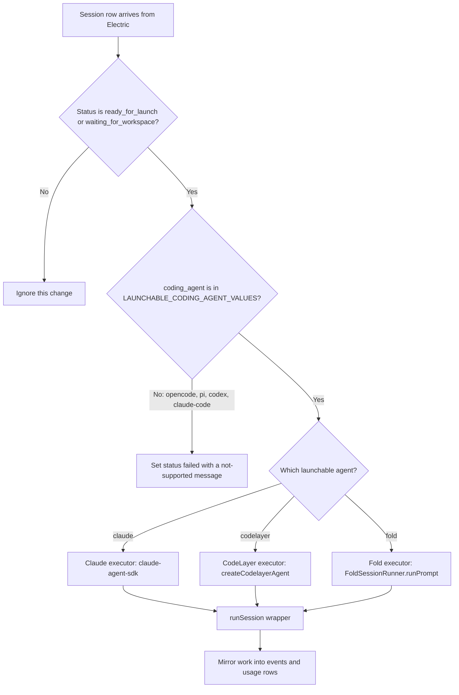
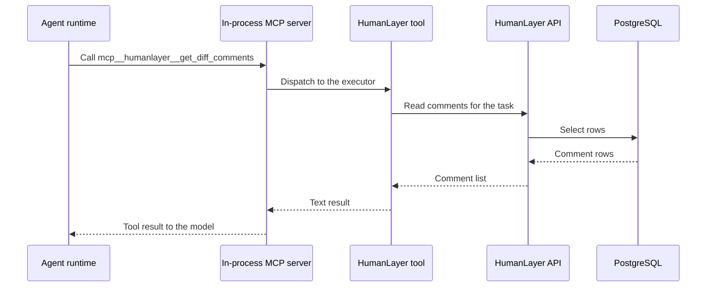
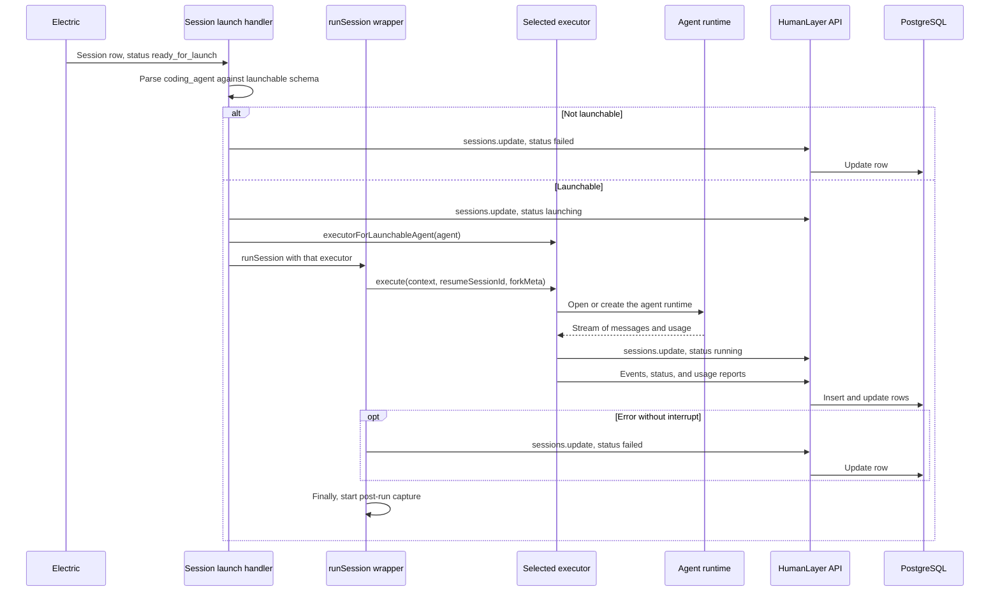

# Agent integration: executors, model access, and what is mirrored

HumanLayer names seven coding agents, but the daemon can start only three of them. The other four are not launchable by the daemon. Three of those four — `opencode`, `pi`, and `claude-code` — have a mirroring plugin in this repository. `codex` is declared mirror-only in the schema comment, but this snapshot holds no Codex plugin, so no sender implements that mirror here. This document explains that split. It gives the exact list, the code that enforces it, the three executors and their failure paths, the model providers, the token accounting fields, the Artificial Intelligence (AI) package, and the Model Context Protocol (MCP) mirroring path.

## The seven coding-agent values

The enumeration lives in one file and drives every schema, launcher, and database column. It has seven values. The values are `claude`, `opencode`, `codelayer`, `fold`, `pi`, `codex`, and `claude-code`.

The file also declares a strict subset. The subset holds the agents that the daemon can launch and continue today. The subset has three values: `claude`, `codelayer`, and `fold`.

```ts
// packages/schemas/coding-agent/coding-agent.ts:14-32
/**
 * The coding agents the daemon can launch and continue today, and the only options the task
 * launchers offer. This list grows as agents become supported (opencode, pi, …); anything
 * absent is rejected by the daemon session handlers and hidden from the launcher. It is a strict
 * subset of CODING_AGENT_VALUES, enforced by `satisfies`.
 *
 * `fold` is exposed in launchers only while the default-off Fold experiment is enabled. The
 * daemon dispatches it to the Fold executor, while the default CodeLayer path remains Codex-only.
 */
export const LAUNCHABLE_CODING_AGENT_VALUES = ['claude', 'codelayer', 'fold'] as const satisfies readonly CodingAgent[]

/**
 * Whether the daemon runs this agent's sessions. A session it doesn't run (pi, opencode, codex) is
 * mirrored from the user's own terminal, which never reads model, effort or fast mode changes made
 * in the app.
 */
export function isLaunchableCodingAgent(agent: string | null | undefined): agent is LaunchableCodingAgent {
	return LAUNCHABLE_CODING_AGENT_VALUES.some((value) => value === agent)
}
```

The comment states four rules. The launchable list is a strict subset, and `satisfies` makes the compiler enforce it. An agent outside the list is rejected by the handlers and hidden from the launchers. A mirrored agent never reads model, effort, or fast-mode changes that a person makes in the application. The cloud can show the session, but it cannot steer it.

The guard `isLaunchableCodingAgent` takes a string, a null, or an undefined value. It returns true only for the three launchable values. The tests confirm the behavior. `packages/schemas/test/coding-agent.test.ts:52-53` asserts that `claude`, `codelayer`, and `fold` are launchable. The same test covers `pi`, `opencode`, `codex`, null, and undefined. It does not test `claude-code`.

| Coding-agent value | Launchable | Evidence |
|--------------------|------------|----------|
| `claude` | Yes | In `LAUNCHABLE_CODING_AGENT_VALUES` at `packages/schemas/coding-agent/coding-agent.ts:23`; executor branch at `apps/riptide-daemon/src/handlers/sessions/on-session-launch.ts:37` |
| `codelayer` | Yes | In the same list; executor branch at `apps/riptide-daemon/src/handlers/sessions/on-session-launch.ts:38` |
| `fold` | Yes | In the same list; executor branch at `apps/riptide-daemon/src/handlers/sessions/on-session-launch.ts:39`; behind a default-off experiment per the comment at `packages/schemas/coding-agent/coding-agent.ts:20-21` |
| `pi` | No | Absent from the list; named as mirrored in `packages/schemas/coding-agent/coding-agent.ts:26`; extension sets its own host identity in `apps/riptide-pi-extension/src/capture.ts` |
| `opencode` | No | Absent from the list; named as mirrored at `packages/schemas/coding-agent/coding-agent.ts:26`; plugin runs inside the OpenCode server in `apps/riptide-opencode-plugin/src/index.ts` |
| `codex` | No | Absent from the list; named as mirrored at `packages/schemas/coding-agent/coding-agent.ts:26`; no executor branch exists |
| `claude-code` | No | Absent from the list; the Claude Code plugin writes `CODING_AGENT = 'claude-code'` with a "not launchable" comment at `apps/riptide-claude-code-plugin/src/config.ts:88` |

**Aha:** The word "launchable" is a compile-time contract, not a runtime convention. The `satisfies readonly CodingAgent[]` clause stops a typo or a removed value. The `Match.exhaustive` call in the handler stops a missing executor branch. A new value in the launchable list breaks the build until a person writes its branch. This is why `fold` could not silently fall through to Claude.

## Which agents the daemon can launch

The decision is small. A session launch is accepted only if the session status is `ready_for_launch` or `waiting_for_workspace`. The handler then parses the `coding_agent` column against the launchable schema. A failure sets the status to `failed` with a clear message. A success selects the executor and starts it.



## The executor map and the dispatch

An executor is a function that runs one coding agent for one session. The daemon builds one services record at start. The record holds the three executors under exact keys. The keys match the three launchable values. The start function builds `claudeExecutor` and `foldExecutor` by calling the two factories at `apps/riptide-daemon/src/start.ts:192-193`.

```ts
// apps/riptide-daemon/src/start.ts:209-213
			executors: {
				claude: claudeExecutor,
				codelayer: executeCodelayer,
				fold: foldExecutor,
			},
```

The handler uses a `Match` expression from Effect. Effect is a TypeScript library for typed effects. An Effect value describes work and runs only when a runner such as `Effect.runPromise` executes it. Each branch returns the function for one value. The final `Match.exhaustive` call makes the compiler demand a branch for every launchable value. If a person adds a fourth value to the launchable list, this expression stops type-checking.

```ts
// apps/riptide-daemon/src/handlers/sessions/on-session-launch.ts:27-41
/**
 * Select the executor for a launchable agent. Exhaustive by design: `Match.exhaustive` stops
 * type-checking the moment a value is added to LAUNCHABLE_CODING_AGENT_VALUES without a branch here,
 * which is what keeps `fold` (and every future agent) from silently falling through to Claude.
 */
const executorForLaunchableAgent = (
	agent: LaunchableCodingAgent,
	executors: DaemonServices['executors'],
): SessionExecutor =>
	Match.value(agent).pipe(
		Match.when('claude', () => executors.claude),
		Match.when('codelayer', () => executors.codelayer),
		Match.when('fold', () => executors.fold),
		Match.exhaustive,
	)
```

The rejection path parses the stored string with the launchable Zod schema. If the parse fails, the handler logs one line, then calls `sessions.update` with status `failed` and the message `The <agent> coding agent is not currently supported.` It returns without a throw, so the daemon keeps running and the row shows the reason.

```ts
// apps/riptide-daemon/src/handlers/sessions/on-session-launch.ts:124-138
	// Parse the agent against the set the daemon can actually run. Anything outside it — opencode
	// today — is rejected here until its execution path lands. See
	// .humanlayer/tasks/putting-fold-in-humanlayer/06-structure-outline-fold-agent-platform.md.
	const launchableAgent = LaunchableCodingAgentZodSchema.safeParse(session.coding_agent)
	if (!launchableAgent.success) {
		logger.error(
			`Coding agent ${session.coding_agent} is not supported for launching sessions yet (session ${session.id})`,
		)
		await services.orpc.sessions.update({
			sessionId: session.id,
			status: 'failed',
			errorMessage: `The ${session.coding_agent} coding agent is not currently supported.`,
		})
		return
	}
```

This is defense in depth. The launcher hides the mirror-only agents, and the type system excludes them. A plugin can still write a row with `opencode`, `pi`, `codex`, or `claude-code`. The handler must refuse it, because no executor can run it.

## The shared session wrapper

All three executors go through `runSession`. The wrapper owns the lifecycle work that is the same for every agent. It registers a completion promise for shutdown. It creates an interrupt state. It runs the agent-specific callback. It marks the session `failed` on an error, unless the error was an interrupt. It always starts the post-run capture in the `finally` block.

Post-run capture is the detached work in the `finally` block. It resolves the shutdown completion promise and reports the session repositories. It does not record commits; the continuous commit watcher owns commit capture (`apps/riptide-daemon/src/agents/shared/run-session.ts:92-105`, `:149-163`). `repositoryObserver` is a daemon service that probes each session checkout. It reads the Git root, the branch, and the `origin` Uniform Resource Locator (URL), then reports up to 50 repositories to `sessions/repositories/report` (`apps/riptide-daemon/src/lib/git/repository-observer.ts:14-33`, `:110-145`). It runs at session start and end, and every 30 seconds (`:13`, `:80-83`).

```ts
// apps/riptide-daemon/src/agents/shared/run-session.ts:122-150
export async function runSession(opts: RunSessionOptions): Promise<void> {
	const { session, services, resumeSessionId, forkMeta, execute, continuationKind = 'ordinary' } = opts
	const sessionId = session.id

	// Register completion promise for shutdown coordination
	// This MUST be resolved before the function returns (in finally block)
	services.shutdown.registerSessionCompletion(sessionId)

	const interruptState = await createInterruptState()

	void services.repositoryObserver?.observeSession(sessionId)

	try {
		await execute({ session, services, interruptState, continuationKind }, resumeSessionId, forkMeta)
		logger.info(`Session ${sessionId} completed`)
	} catch (error) {
		const wasInterrupted = await Effect.runPromise(interruptState.wasInterrupted)
		if (!wasInterrupted) {
			logger.error({ sessionId, error }, 'Session failed')
			// Extract error message, handling Effect's error wrapping
			const errorMessage = extractErrorMessage(error)
			await services.orpc.sessions.update({
				sessionId,
				status: 'failed',
				errorMessage,
			})
		}
		throw error
	} finally {
```

`SessionExecutor` takes a session context, an optional resume identifier, and optional fork metadata. The context holds the session row, the services record, the interrupt state, and an optional continuation kind. The kind is `ordinary` when omitted, and `lost-resume` when a lost session resumes (`apps/riptide-daemon/src/agents/shared/run-session.ts:52-58`). The wrapper passes one context shape to every executor. A resume continues an existing agent session. A fork copies a session into a new one. The `finally` block starts the detached post-run capture and resolves the completion promise at `apps/riptide-daemon/src/agents/shared/run-session.ts:151-152`.

An interrupt is a user action, not a failure. The wrapper checks `wasInterrupted` before it writes `failed`. On an interrupt, it rethrows the error and leaves the status alone.

## The three executors

Four names recur below. CodeLayer is the private agent runtime in `@humanlayer/codelayer`, version 0.0.89 (root `package.json:162`). AgentLayer is the provider and core runtime under CodeLayer, in `@humanlayer/agentlayer-core` and the provider packages, also version 0.0.89 (`package.json:163-167`). Fold is a second executor and product path, in `@humanlayer/fold-agent`, `@humanlayer/fold-codex`, `@humanlayer/fold-core`, and `@humanlayer/fold-xai`, version 0.1.32 (`apps/riptide-daemon/package.json:63-66`). Codex is the OpenAI Codex model family and its wire protocol. The comment that calls the default CodeLayer path "Codex-only" names that protocol, not a provider limit (`packages/schemas/coding-agent/coding-agent.ts:14-32`).

### Claude

The Claude executor is a thin adapter over the `ClaudeSessions` service. It builds an input record with the context and a setup callback for artifact paths. It also builds hooks, which are callbacks that run on agent events such as a tool call. It calls `sessions.executeClaudeSession` inside an Effect. It wraps the work in a Sentry trace named `claude.session_execution`. It treats a success and an interrupt-only cause as a normal end. `ClaudeSessions` prepares the run, `ClaudeSdk` owns the process, and the adapter joins them. For any other cause, it records the cause for diagnostics and rethrows its squashed form.

```ts
// apps/riptide-daemon/src/effects/services/claude-sessions/claude-session-executor.ts:11-34
export function createClaudeSessionExecutor(daemonRuntime: DaemonRuntime): SessionExecutor {
	return async (context, resumeSessionId, forkMeta) => {
		const input = {
			context,
			setupArtifactPaths: (cwd: string, taskId: string, taskSlug: string) =>
				setupArtifactPaths(cwd, taskId, taskSlug, daemonRuntime),
			resumeSessionId,
			forkMeta,
		}
		const program = Effect.gen(function* () {
			const sessions = yield* ClaudeSessions
			yield* sessions.executeClaudeSession(input)
		}).pipe(
			Effect.annotateLogs({ 'claude.executor': 'effect', sessionId: context.session.id }),
			Effect.withSpan('claude.session_execution', {
				attributes: { 'claude.executor': 'effect', session_id: context.session.id },
			}),
		)
		const exit = await Sentry.startNewTrace(() => daemonRuntime.runPromiseExit(program))
		if (Exit.isSuccess(exit) || Cause.hasInterruptsOnly(exit.cause)) return
		captureClaudeTerminalCause(exit.cause, input)
		throw Cause.squash(exit.cause)
	}
}
```

The preparation step imports the `@anthropic-ai/claude-agent-sdk` package, builds the hooks, and attaches the MCP server. `ClaudeSdk` then opens a session that exposes an output stream, `sendMessage`, `close`, `interrupt`, `setModel`, `setPermissionMode`, and `readUsage`. The executor drives this object; it does not call the model directly.

This design explains two behaviors. A resumed session works because the Software Development Kit (SDK) session carries the resume identifier. A fork works because the wrapper passes fork metadata to the preparation.

### CodeLayer

The CodeLayer executor is a plain async function, not an Effect wrapper. It reads the session, normalizes the working directory, and resolves the provider and the model. The default provider is `anthropic`. The default model comes from `RIPTIDE_DEFAULT_MODELS[provider]`. It creates the agent with `createCodelayerAgent`. It sets the status to `running` only after the agent exists. It then loads, resumes, or forks the agent state. Agent state is the resumable CodeLayer conversation state. The daemon keeps a current row in `codelayer_agent_state`, keyed by session, and snapshots in `codelayer_agent_state_snapshots` (`packages/db/src/tables/codelayer-agent-state.ts:10-40`; `packages/db/src/tables/codelayer-agent-state-snapshots.ts:12-20`).

```ts
// apps/riptide-daemon/src/agents/codelayer/execute-codelayer.ts:159-165
export async function executeCodelayer(
	ctx: SessionContext,
	resumeSessionId?: string,
	forkMeta?: ForkMeta,
): Promise<void> {
	const { session, services, interruptState } = ctx
	const cwd = normalizePath(session.working_directory)
```

The CodeLayer executor accepts any selectable provider: `anthropic`, `copilot`, `codex`, `firepass`, or `xai`. The comment in the schema calls the default CodeLayer path "Codex-only"; that phrase names the agent protocol that CodeLayer wraps, not the model provider list. The provider and the model are session columns, so the application can change them for a new session. The executor reads them at start time. A change to a running session does not reach the agent, because the agent already holds its model.

A throw from `createCodelayerAgent` or the run loop goes to `runSession`, which writes `failed` with the extracted message. A supplied resume identifier or fork metadata selects the existing state instead of a fresh run.

### Fold

The Fold executor decodes its input with an Effect schema, then calls the process-scoped runner. The input holds the session identifier, the prompt, and an admission policy. The policy is `recover-lost` for a lost resume and `serialize` for every other kind. The default kind is `ordinary`. `Serialize` means one run at a time. `Recover-lost` lets a run replace a lost one. The Fold signature reads only the context, so it ignores the resume identifier and the fork metadata.

```ts
// apps/riptide-daemon/src/effects/services/fold-sessions/fold-session-executor.ts:14-32
export function createFoldSessionExecutor(daemonRuntime: DaemonRuntime): SessionExecutor {
	return async (context) => {
		const input = await Schema.decodeUnknownPromise(RunFoldPromptInput)({
			sessionId: context.session.id,
			prompt: context.session.prompt,
			admissionPolicy: foldAdmissionPolicyFor(context.continuationKind),
		})
		const program = Effect.gen(function* () {
			const runner = yield* FoldSessionRunner
			yield* runner.runPrompt(input)
		}).pipe(
			Effect.annotateLogs({ 'fold.executor': 'effect', sessionId: context.session.id }),
			Effect.withSpan('fold.session_execution', { attributes: { session_id: context.session.id } }),
		)
		const exit = await Sentry.startNewTrace(() => daemonRuntime.runPromiseExit(program))
		if (Exit.isSuccess(exit) || Cause.hasInterruptsOnly(exit.cause)) return
		throw Cause.squash(exit.cause)
	}
}
```

`FoldSessionRunner.runPrompt` returns an Effect with three errors. `FoldSessionsShuttingDownError` means the daemon is stopping. `FoldPromptTakeoverError` means another run claimed the session. `FoldPromptRunError` is any other run failure. The executor converts a failed exit into a thrown cause, and the shared wrapper records it. A decode failure throws before the trace starts, but the shared wrapper still records the session as failed.

The Fold provider set is smaller: only `codex` and `xai`.

## Mirror-only adapters: OpenCode, Pi, and Claude Code

A mirror-only adapter is absent from the launchable list, so the handler refuses it, and it has no executor branch. Most important, the daemon does not own the runtime state: the agent started in a terminal, and its process and model session belong to that program.

The OpenCode plugin runs inside the OpenCode version 2 background server and keeps its own session map. The pi extension runs inside pi and mirrors the session entry stream. The Claude Code plugin runs as a hooks module plus an MCP server and tracks a byte cursor for each transcript file.

None of the three exposes a resume handle that the daemon could use. A cloud "continue" would need the original process, model session, and permission state. The daemon has none of them. The mirror is one-way by design. Here, mirror means copying session state, not exposing tools.

**Aha:** The split is not a missing feature. It is a consequence of process ownership. A launchable agent is one whose runtime the daemon can construct from a database row. A mirrored agent is one whose runtime already exists in another process. The seven values encode which case applies to each agent.

## Declarations with no launch path: codex and claude-code

Two values need a separate explanation, because they look like they should be launchable.

`codex` is both a coding-agent value and a model provider. As a provider, it appears in the selectable list and the Fold list. As a coding agent, it is not launchable, because no executor branch exists. CodeLayer can use the Codex provider while the coding agent stays `codelayer`. The comment at `packages/schemas/coding-agent/coding-agent.ts:26` names `codex` as mirrored.

`claude-code` is the identity that the Claude Code plugin uses for mirrored sessions. The plugin sets it at `apps/riptide-claude-code-plugin/src/config.ts:88` and states that it is not launchable. A session with this value shows the mirror, and the application never offers fork or continue. The value is separate from `claude`, which is the daemon-launched agent.

## Model provider configuration

The provider enumeration has five values. The Fold subset has two. Both the CodeLayer executor and the Fold session opener read `session.provider` (`apps/riptide-daemon/src/agents/codelayer/execute-codelayer.ts:168`; `apps/riptide-daemon/src/effects/services/fold-sessions/fold-session-opener.layer.ts:141-153`). The Claude path always uses `anthropic`. The Fold path decodes the column against its own two-value subset.

```ts
// packages/schemas/model-provider/model-provider.ts:1-14
import * as Schema from 'effect/Schema'
import z from 'zod/v4'

export const SELECTABLE_MODEL_PROVIDER_VALUES = ['anthropic', 'copilot', 'codex', 'firepass', 'xai'] as const

export const SelectableModelProvider = Schema.Literals(SELECTABLE_MODEL_PROVIDER_VALUES)
export type SelectableModelProvider = typeof SelectableModelProvider.Type
export const SelectableModelProviderZodSchema = z.enum(SELECTABLE_MODEL_PROVIDER_VALUES)

export const FOLD_MODEL_PROVIDER_VALUES = ['codex', 'xai'] as const satisfies readonly SelectableModelProvider[]

export const FoldModelProvider = Schema.Literals(FOLD_MODEL_PROVIDER_VALUES)
export type FoldModelProvider = typeof FoldModelProvider.Type
export const FoldModelProviderZodSchema = z.enum(FOLD_MODEL_PROVIDER_VALUES)
```

The `satisfies readonly SelectableModelProvider[]` clause does the same job as the coding-agent subset. A Fold provider that is not selectable cannot compile.

| Provider | Selectable | Fold | How it is reached |
|----------|------------|------|-------------------|
| `anthropic` | Yes | No | Claude executor default; CodeLayer default |
| `copilot` | Yes | No | CodeLayer provider choice |
| `codex` | Yes | Yes | CodeLayer provider choice; Fold provider choice |
| `firepass` | Yes | No | CodeLayer provider choice |
| `xai` | Yes | Yes | Fold provider choice |

The five names are provider identifiers. `copilot` is the GitHub Copilot provider package. `xai` is xAI. `firepass` sends requests to the Fireworks inference gateway through an OpenAI-compatible client (`apps/riptide-daemon/src/agents/codelayer/execute-codelayer.ts:139-149`; root `package.json:166-167`). The repository gives no further definition for these names.

The host model catalog is the model list that the local host reports to the picker. It is narrower. `HOST_MODEL_CATALOG_PROVIDERS` contains only `anthropic` and `codex` (`packages/schemas/src/zod/model-catalog.ts:3`). An entry carries the provider, the value, the resolved model, a label, a description, the default and hidden flags, the effort levels, the default effort, and capability flags for fast mode, automatic mode, and the context window. The application uses this catalog to draw the model picker. The fast-mode and automatic-mode flags say whether the model offers those modes; the catalog does not define their behaviour. A session can still carry a provider that the catalog does not list; the CodeLayer executor accepts all five selectable values.

The picker is incomplete by design. A session gets a provider outside it through four paths. The Application Programming Interface (API) contracts accept any string provider for create and launch (`contracts/riptide-api-contract/src/api/sessions/create.ts:16`, `v2/create.ts:17`, `launch.ts:31`). The CLI `automation run` command has `--provider` (`apps/cli/src/index.ts:77`). The generated `api` command tree can call the create routes. A fork copies the source session provider (`apps/riptide-api/src/orpc/api/sessions/fork.ts:293`).

The context window sizes are not stored in the catalog for every model. `packages/schemas/src/effect/model-context.ts` holds overrides for Codex at 258,400 tokens and xAI at 500,000 tokens. The generic Claude fallback is 968,000; Haiku and Opus 4.6 use 168,000; `gpt-5` uses 1,050,000. `getContextWindowUsagePercentage` subtracts a Codex baseline of 12,000 tokens from both the used count and the limit before it computes the share (`packages/schemas/src/effect/model-context.ts:27`, `:82-96`). The baseline is a fixed constant. The repository does not define what overhead it represents, and it does not derive the value from a model property. The stored `context_window_limit` is the full window, so it includes the baseline. The subtraction happens only in the percentage helper.

Effort levels come from `packages/ai/src/config/index.ts`. Claude accepts `low`, `medium`, `high`, `xhigh`, and `max`. The base Codex list is `low`, `medium`, `high`, and `xhigh`; the larger list adds `max` (`:106-108`). `ultra` is a declared Codex level, but no model entry enables it (`:8`, `:107`). A comment says that the `gpt-5.6` models advertise `ultra`, but it depends on Codex command-line interface spawn-agent tools that this product does not expose (`:107-109`). Spawn-agent tools let a Codex run start and control child agents. This product does not provide them, so it does not enable `ultra`. The file maps supported levels per Claude model, so the picker hides a level that the model rejects.

## Model usage and token accounting

Every session holds a live summary of its usage. The columns are `context_window_tokens`, `context_window_limit`, `is_compacting`, `total_cost_usd`, `model_usage`, and `applied_usage_report_keys`. These hold the latest occupancy, the effective limit, the compaction flag, the cumulative cost in United States Dollars (USD), the per-model map, and a bounded list of applied report keys (at most 20). The code block below is an excerpt; `applied_usage_report_keys` is declared at `packages/db/src/tables/sessions.ts:158`.

```ts
// packages/db/src/tables/sessions.ts:126-149
		/**
		 * Current context window usage (input + output tokens of latest message)
		 */
		context_window_tokens: integer().default(0),

		/**
		 * Effective context window limit for this session's model
		 */
		context_window_limit: integer().default(168000),

		is_compacting: boolean().notNull().default(false),

		/**
		 * Total cost in USD for this session (cumulative across all API calls)
		 * Updated from result event's total_cost_usd field
		 */
		total_cost_usd: real(),

		/**
		 * Cumulative model usage breakdown by model name
		 * Format: { [modelName: string]: { input_tokens, output_tokens, cache_read_input_tokens, cache_creation_input_tokens } }
		 * Updated from result event's modelUsage field
		 */
		model_usage: jsonb().$type<SessionModelUsage>(),
```

The per-model shape is a schema, not free-form JavaScript Object Notation (JSON). It has token counts for input and output, and optional counts for cache reads and writes. Two helpers combine them. `totalPromptTokens` adds the input and both cache counts. `contextOccupancyTokens` adds the output. The helpers compute totals; they do not write the columns.

```ts
// packages/schemas/src/effect/model-usage.ts:1-22
import * as Schema from 'effect/Schema'

export const TokenCount = Schema.Int.check(Schema.isGreaterThanOrEqualTo(0))

export const ModelTokenUsage = Schema.Struct({
	input_tokens: TokenCount,
	output_tokens: TokenCount,
	cache_read_input_tokens: Schema.optionalKey(TokenCount),
	cache_creation_input_tokens: Schema.optionalKey(TokenCount),
})
export interface ModelTokenUsage extends Schema.Schema.Type<typeof ModelTokenUsage> {}

export const SessionModelUsage = Schema.Record(Schema.String, ModelTokenUsage)
export type SessionModelUsage = Schema.Schema.Type<typeof SessionModelUsage>

export function totalPromptTokens(usage: ModelTokenUsage): number {
	return usage.input_tokens + (usage.cache_read_input_tokens ?? 0) + (usage.cache_creation_input_tokens ?? 0)
}

export function contextOccupancyTokens(usage: ModelTokenUsage): number {
	return totalPromptTokens(usage) + usage.output_tokens
}
```

The append-only event table is the detailed record. Each row is one usage report for one model. The rows are immutable, and the cost is frozen at ingest. The table carries the same four conventional counters, plus an open JSON Binary (JSONB) map, plus hoisted integer columns for cheap Structured Query Language (SQL) sums.

```ts
// packages/db/src/tables/session-usage-events.ts:15-32
/**
 * Append-only token usage events: one immutable row per (usage report, model).
 *
 * A "report" is one run's usage, keyed by the same usageReportKey that
 * sessions.update uses to merge snapshots (result-event uuid for claude,
 * run-minted uuid for codelayer, 'backfill:<session_id>' for backfill).
 * Counters are cumulative PER RUN (reset on resume), so rows sum across runs.
 *
 * TOKEN SEMANTICS: `tokens` stores RAW provider fields (Anthropic semantics):
 * `input_tokens` EXCLUDES cache_read/cache_creation (separate, additive keys).
 * This differs from conversation_events.input_tokens (COMBINED total).
 * Conventional keys: input_tokens, output_tokens, cache_read_input_tokens,
 * cache_creation_input_tokens; open map so new categories need no migration.
 * Hoisted int columns mirror the four conventional keys for cheap SQL.
 *
 * cost_usd is frozen at ingest (SDK-reported per-model cost); never repriced.
 * Rows are immutable — never UPDATE; rollups are derived projections.
 */
```

The token semantics differ between two tables, and the difference is deliberate. The conversation event column holds a combined input total. The usage event column holds the raw provider field, where input excludes the cache counters. The two conventions differ. AgentLayer, the runtime under CodeLayer, counts cached tokens inside its input number, like the OpenAI convention. The storage convention keeps them separate. The daemon subtracts the cache counters before it writes a usage event. A negative, fractional, or non-finite result is clamped to a non-negative integer.

**Aha:** The same request produces two totals that do not match, and both are correct. The conversation event answers "how large was this message." The usage event answers "what did the provider bill." The first includes cache tokens in the input. The second lists them as separate additive keys. Any report that mixes the two tables must pick one convention.

The `usageReportKey` makes a retry safe. The key is the SDK result identifier for Claude, a daemon-generated identifier for CodeLayer, and a backfill key for imported history. The session keeps at most 20 applied keys (`apps/riptide-api/src/orpc/daemon/sessions/update.ts:36`). A new key is appended, and the oldest key is dropped, so eviction is first in, first out (`:142-143`). A delayed retry that arrives after a newer report is skipped while its key remains in the list. A retry that arrives after its key was evicted is applied again, so it can double count cost and usage. The code accepts that risk: the daemon client makes five attempts with a two-second delay (`apps/riptide-daemon/src/orpc/client.ts:14`, `:93`; `apps/riptide-api/src/orpc/daemon/sessions/update.ts:29-35`). The source comment says that 20 keys exceed the number of runs that can finish while one retry is pending, so eviction before a retry is unlikely. The usage event table has a unique constraint on the session, the report key, and the model.

## The AI package

`packages/ai` is a private package named `@humanlayer/ai`, version `0.0.1`. It holds eight small agents that support the product. None of these agents runs a coding session. They label, summarize, extract, and research.

| Agent entry point | Job |
|-------------------|-----|
| `classify-task-intent` | Decides what a person wants from a task message |
| `context-shards` | Splits context into retrievable pieces |
| `doc-researcher` | Answers a question from documentation (the evaluation script is `eval:doc-research`) |
| `design-doc-open-questions` | Lists the open questions in a design document |
| `extract-next-step` | Pulls the next action from a conversation |
| `generate-session-title` | Names a session from its first turn |
| `generate-task-summary` | Summarizes a task |
| `generate-learn-questions` | Produces questions for a learning flow |

The package exports one module per agent, plus `config`, `providers`, `reliable-language-model`, and an Effect entry point for `extract-next-step` (`packages/ai/package.json:6-19`). It depends on the Vercel AI SDK through `@ai-sdk/anthropic`, `@ai-sdk/openai`, and `@ai-sdk/provider`, plus the `ai` package, Effect, and Zod (`packages/ai/package.json:47-58`).

The model choice is an alias, not a raw identifier. There are two aliases: `sonnet` and `haiku`. The primary models are Claude Sonnet 5 and Claude Haiku 4.5. The fallback models are `gpt-5` and `gpt-5-mini`, and they exist only when `OPENAI_API_KEY` is set. The fallback object exists only when the key is set, because the OpenAI call would fail at first inference without a key.

```ts
// packages/ai/src/providers/models.ts:9-29
export type ModelAlias = 'sonnet' | 'haiku'

const PRIMARY: Record<ModelAlias, LanguageModelV3> = {
	sonnet: anthropic('claude-sonnet-5'),
	haiku: anthropic('claude-haiku-4-5'),
}

const isFallbackEnabled = Boolean(process.env.OPENAI_API_KEY?.trim())

if (!isFallbackEnabled) {
	logger.warn({ event: 'ai_fallback_disabled' }, 'OPENAI_API_KEY not set — AI fallback disabled; primary-only mode')
}

// Construct the OpenAI fallback models lazily so `openai('gpt-5')` is never invoked
// when the key is missing (which would otherwise fail at first inference call).
const FALLBACK: Record<ModelAlias, LanguageModelV3> | null = isFallbackEnabled
	? {
			sonnet: openai('gpt-5'),
			haiku: openai('gpt-5-mini'),
		}
	: null
```

`resolveModel` returns the primary model when the fallback is off. It returns a reliable wrapper when the fallback is on. The wrapper tries the primary provider first. If that call still fails after its retries, it calls the fallback (`packages/ai/src/reliable-language-model/handle-retries.ts:6-17`). The wrapper does not classify the primary error; any failure reaches the fallback. The caller sees a single `LanguageModelV3` and does not handle the switch. If both paths fail, the fallback error goes to the failure service and to the caller.

The package also holds evaluation projects. The scripts are `eval`, `eval:context-shards`, `eval:classify-task-intent`, `eval:extract-next-step`, `eval:design-doc-open-questions`, `eval:doc-research`, `eval:generate-session-title`, `eval:generate-task-summary`, and `eval:generate-learn-questions`. Each project runs a set of cases and reports a score. This is how a prompt change is tested before release.

## The MCP mirroring path

The MCP path serves two audiences, and they meet at one tool list. Both write through the HumanLayer API.

For a daemon-launched session, the daemon builds an in-process MCP server. The server registers at most seven tools with `createSdkMcpServer` and `tool` from the Claude Agent SDK (`apps/riptide-daemon/src/agents/claudecode/mcp/humanlayer-server.ts:117-182`). Each tool wraps an executor and returns `isError: true` on a failure. `library_researcher` is always defined, but the caller can disable it. The six comment tools exist only when the session has a task. When no tool is available, the factory returns `null` and registers no server. The maximum set is `get_artifact_comments`, `update_artifact_comments`, `reply_to_artifact_comment`, `get_diff_comments`, `reply_to_diff_comment`, `update_diff_comments`, and `library_researcher`.

For a mirrored session, the host plugin must supply the same tool list itself. The shared package `@humanlayer/session-sdk-tools` holds the neutral specifications. The names, descriptions, and output text copy the daemon versions on purpose, so a skill carries over between a launched session and a mirrored one.

```ts
// packages/session-sdk-tools/src/tools.ts:1-5
// The HumanLayer tools riptide-daemon gives its agents, as specs any agent integration can
// register. Names, descriptions and output text copy riptide-daemon's
// src/agents/shared/humanlayer-tools/{schemas,executors}.ts, so skills and habits carry over.
// Parameters use a small neutral shape: toJsonSchema() turns them into JSON Schema, and an
// integration whose agent wants another schema library converts them itself.
```

The three host paths differ in transport. OpenCode and pi register the specifications directly, so their model sees ordinary tools. Claude Code does not take the tool list from its MCP server, so the plugin uses a different trick. The Claude Code hooks module, called the mod, intercepts a tool call whose name starts with `mcp__humanlayer__`. It forwards the call over the Unix socket to the plugin server, and the server runs the executor. The MCP server itself lists no tools, because the mod is the real tool surface. The mod registers the tools on the `session.start` hook event. It calls the server `/hello` route and reads the `tools` field of the reply (`apps/riptide-claude-code-plugin/hooks/mod.ts:175-188`; `src/protocol.ts:27-33`). It calls `$.tool.register` for each item, so the hook engine supplies the names. The model can therefore call them without a `tools/list` result. This is why the plugin table in [The command-line interface and the agent plugins](12-cli-and-agent-plugins.md) says the plugin "adds the seven HumanLayer tools", although its MCP server returns an empty list.



## One executor start, end to end

The sequence below combines the pieces above. It starts with a row that Electric delivered and ends with a failed status written back through the API. The success path differs only at the last step.



The start order makes the status meaningful: `launching` means the handler accepted the row but the agent does not exist yet, and `running` means the agent is live. Each of the three executors writes `running` after its agent runtime exists (`apps/riptide-daemon/src/effects/services/claude-sessions/claude-sessions.live.ts:267`; `apps/riptide-daemon/src/agents/codelayer/execute-codelayer.ts:582`; `apps/riptide-daemon/src/effects/services/fold-sessions/fold-session-runner.layer.ts:319`).

## Next

Read [The command-line interface and the agent plugins](12-cli-and-agent-plugins.md) for the sender side of the mirror, the plugin manifests, and the outbox rules. Read [Session lifecycle and state machine](03-session-lifecycle-and-state-machine.md) for the status values and the full launch path. Read [Session SDK and durable streams](04-session-sdk-and-durable-streams.md) for the event schemas that a mirror writes. Read [Database and schemas](08-database-and-schemas.md) for the table model behind the usage fields.
