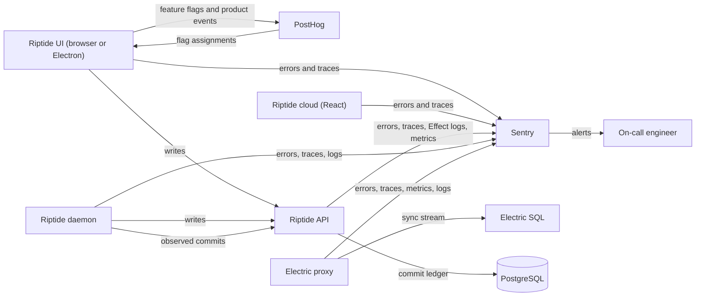
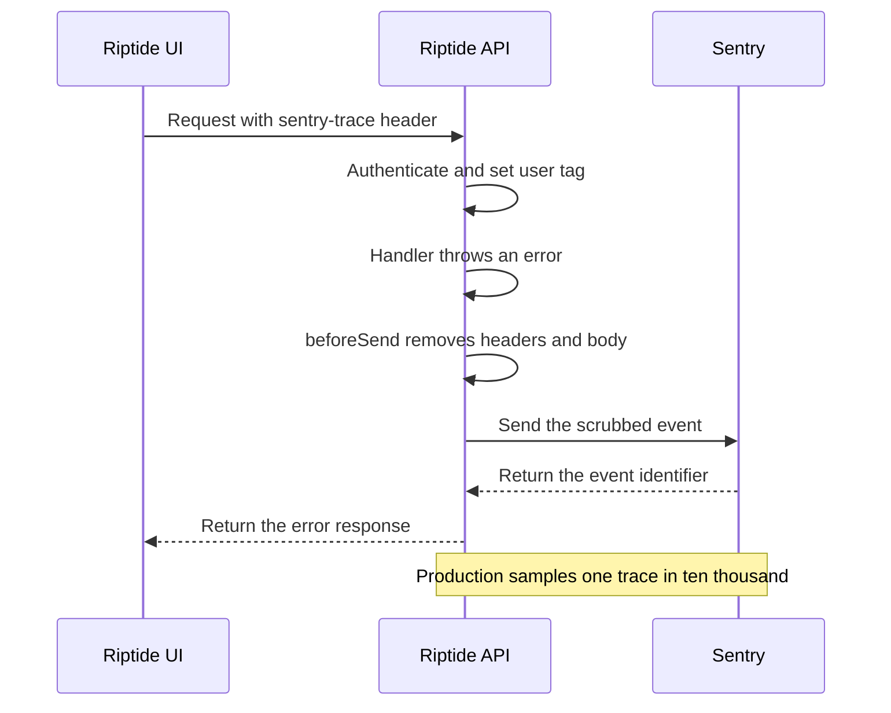

# Observability: errors, metrics, and git attribution

The HumanLayer project treats observability as a privacy boundary, not only as a reporting feature. Every reporter has an explicit on-off switch. The Sentry reporters scrub event data before they send it. The attribution ledger separates evidence from guesswork. This document explains the four reporting systems, the code that implements them, and the rules that decide when a commit counts as agent work.

HumanLayer is a product family. The Riptide Application Programming Interface (API) serves requests and owns the database. The Riptide daemon runs coding agents on a user machine. The Riptide User Interface (UI) is a React application in a browser or in Electron. A separate cloud application shows metrics. The Electric proxy sits between clients and Electric SQL, the sync engine that streams database changes.

The four reporting systems are:

1. Sentry, a hosted error and trace collector.
2. PostHog, a hosted product analytics and feature-flag service.
3. The `@humanlayer/logger` package, which writes structured logs.
4. The `@humanlayer/git-attribution` package, which builds a commit and pull request ledger.

Sentry and PostHog receive data outside the deployment. The logger and the attribution package run inside it. Callers can forward output to the API or Sentry.

## Error reporting in the API

The API initializes Sentry in `apps/riptide-api/src/instrument.ts`. A hot reload can import the module twice, so a global flag stops a second registration at `apps/riptide-api/src/instrument.ts:151`.

The API disables default personally identifiable information (PII) capture at `apps/riptide-api/src/instrument.ts:157`. The Data Source Name (DSN) is the upload address and key for one Sentry project. The client is off without a DSN, and off in local unless a force flag is set.

### Sampling

The sampler honors a parent decision first. The parent started the trace and sends its decision in a trace header, so a distributed trace stays whole. Health, readiness, and root status URLs return zero; the rest depends on the environment.

```ts
// apps/riptide-api/src/instrument.ts:160-175
		tracesSampler: (samplingContext) => {
			// Always honor parent sampling decision for distributed traces
			if (samplingContext.parentSampled !== undefined) {
				return samplingContext.parentSampled ? 1 : 0
			}
			const rawUrl = samplingContext.attributes?.['http.url']
			const url = typeof rawUrl === 'string' ? rawUrl : ''
			// Drop health checks and root status endpoint
			if (url.endsWith('/health') || url.endsWith('/ready') || /^https?:\/\/[^/]+\/?$/.test(url)) {
				return 0
			}
			if (env === 'local') return 1.0
			if (env === 'devcloud') return 0.001
			if (env === 'beta') return 0.0001
			return 0.0001 // prod
		},
```

Production samples one trace in ten thousand requests. The local rate is 1.0, but the local client is off unless forced. The environment is `local`, `devcloud` (shared development cloud), `beta` (pre-release), or `prod`. This rate controls traces only. The block sets no error sample rate, so error events are not sampled by this value (`apps/riptide-api/src/instrument.ts:160-175`).

### User and organization tags

The API attaches identity in two places. The HTTP middleware sets a user identifier and an organization tag after authentication at `apps/riptide-api/src/app.ts:150-153`. The oRPC base adds the authentication type and the organization identifier from WorkOS, the identity provider, at `apps/riptide-api/src/orpc/effect-base.ts:122-127`. oRPC is a typed remote procedure call library.

An error report can then name the organization, not the request body.

### Redaction

Every event passes through `scrubSensitiveData`. It removes the `state` context, redacts credentials in the request Uniform Resource Locator (URL), removes authentication headers, and deletes the body. The `query` parameter is sensitive because it can hold user search text.

```ts
// apps/riptide-api/src/instrument.ts:77-83
	// Scrub request data
	if (event.request?.url) {
		event.request.url = event.request.url
			.replace(/api_key=[^&]+/g, 'api_key=REDACTED')
			.replace(/token=[^&]+/g, 'token=REDACTED')
			.replace(/query=[^&]+/g, 'query=REDACTED')
	}
```

It also deletes the `Authorization`, `X-API-Key`, and `Cookie` headers at `apps/riptide-api/src/instrument.ts:85-92`. The body is always removed; it can contain user prompts.

The `beforeSend` hook drops one expected class first. An expired JSON Web Token (JWT) is normal authentication noise. The hook checks the stable code and message at `apps/riptide-api/src/instrument.ts:181-194`.

```ts
// apps/riptide-api/src/instrument.ts:181-194
		beforeSend(event, hint) {
			// Drop expected auth noise: an expired JWT ("exp" in the past). Tokens are
			// meant to expire and clients then re-auth/refresh, so these are never worth
			// reporting (they otherwise dominate volume, e.g. RIPTIDE-API-D9). jose sets a
			// stable `.code` that survives minification, unlike the renamed class name.
			const err = hint?.originalException as { code?: unknown; message?: unknown } | undefined
			if (
				err?.code === 'ERR_JWT_EXPIRED' ||
				(typeof err?.message === 'string' && err.message.includes('"exp" claim timestamp check failed'))
			) {
				return null
			}
			return scrubSensitiveData(event)
		},
```

The hook also removes console breadcrumbs at `apps/riptide-api/src/instrument.ts:196-202`. A breadcrumb is a record of an event before an error, such as a console message or fetch. A console message can hold user data, so the API sends none.

### Metrics services in the API

Business metrics live in `apps/riptide-api/src/effects/services/metrics/`; proxy metrics cover transport health only. Three services show the pattern:

- `metrics-audience.ts` decides who may read the Advanced Metrics page, an internal spend report.
- `person-spend-analytics.service.ts` answers spend questions. Spend is cost in United States dollars (USD) of model token use. The service sums `cost_usd` from `session_usage_events` through the read replica (`apps/riptide-api/src/effects/services/metrics/person-spend-analytics.service.ts:118-141`). This is internal analytics, not billing. No Stripe invoice uses this number.
- `stage-attribution.ts` maps session labels to a research, plan, and implement stage.

The audience check fails closed. A database failure goes to Sentry and returns false at `apps/riptide-api/src/effects/services/metrics/metrics-audience.ts:40-70`. A failure must never give every member access to per-person spend.

The person spend service captures the rich database error, then narrows it to a domain error, a typed failure. `captureThenReportUnavailable` logs, reports, and returns a retryable failure at `apps/riptide-api/src/effects/services/metrics/person-spend-analytics.service.ts:88-93`.

The stage file defines the order at `apps/riptide-api/src/effects/services/metrics/stage-attribution.ts:10-22`. A session can carry several labels. The structured query language (SQL) subquery ranks them and takes the most progressed. `DESC NULLS LAST` at `apps/riptide-api/src/effects/services/metrics/stage-attribution.ts:50` puts a NULL stage last, so a known label wins.

## Error reporting in the daemon

The daemon runs on Bun, so it uses the Sentry client for Bun, not the Node client. It initializes at `apps/riptide-daemon/src/instrument.ts:143`. The daemon enables Sentry only when a DSN is present and the environment is not local (`apps/riptide-daemon/src/instrument.ts:143-145`). Unlike the API, it has no force flag. `SENTRY_ENVIRONMENT` sets the environment value, and the DSN presence is also required. `BUILD_TYPE` sets the sample rate.

The daemon rule is coarser: it uses the build type, not the request URL. Local, development, and beta builds sample at 1.0; other builds at 0.0001 at `apps/riptide-daemon/src/instrument.ts:140-141`.

```ts
// apps/riptide-daemon/src/instrument.ts:140-158
const isLocal = (SENTRY_ENVIRONMENT ?? 'local') === 'local'
const tracesSampleRate = ['local', 'dev', 'beta'].includes(BUILD_TYPE ?? 'local') ? 1 : 0.0001

Sentry.init({
	dsn: SENTRY_DSN,
	enabled: SENTRY_DSN !== undefined && !isLocal,
	enableLogs: true,
	ignoreErrors: [
		/certificate/i,
		'ERR_TLS_CERT_ALTNAME_INVALID',
		'self signed certificate',
		'unable to verify the first certificate',
		'unknown certificate verification error',
		'socket connection was closed unexpectedly',
	],
	// SENTRY_ENVIRONMENT is set at build time (prod/devcloud), falls back to 'local' for dev mode
	environment: SENTRY_ENVIRONMENT ?? 'local',
	release: BUILD_VERSION,
	tracesSampleRate,
```

The daemon ignores certificate errors and one closed-socket error at `apps/riptide-daemon/src/instrument.ts:147-154`. These come from user networks, not product defects.

The daemon redaction list is wider than the API list, because a daemon runs user code. It covers `stdin`, `stdout`, `stderr`, prompts, messages, and file content at `apps/riptide-daemon/src/instrument.ts:8-31`.

The daemon wraps Sentry in an Effect layer. Effect is a TypeScript library for typed effects and dependency layers. `apps/riptide-daemon/src/effects/sentry-effect.ts` merges the Sentry tracer with the Sentry metrics layer, so Effect spans and metrics share one exporter.

## Error reporting in the Electric proxy

The Electric proxy uses a Sentry Effect layer at `apps/riptide-electric-proxy/src/lib/effect/sentry.service.ts:167-220`. The layer initializes the client and exports traces and metrics.

A shape is a filtered stream of one database table. The client names the filter in the shape URL, often with a `where` parameter. That parameter can contain an organization identifier.

The proxy has the strongest redaction rule for sync data. Its sensitive key list is the shared list plus `where` and `shape_id` at `apps/riptide-electric-proxy/src/lib/effect/sentry.service.ts:34-59`.

**Aha:** The proxy keeps the shape URL, but removes the filter that makes the shape specific. The comment at `apps/riptide-electric-proxy/src/lib/effect/sentry.service.ts:145-146` says the field-level scrub keeps the shape URL. The URL replacer removes `where=` at `apps/riptide-electric-proxy/src/lib/effect/sentry.service.ts:95-101`, because a filter can contain an organization identifier.

```ts
// apps/riptide-electric-proxy/src/lib/effect/sentry.service.ts:95-101
	if (event.request?.url) {
		event.request.url = event.request.url
			.replace(/api_key=[^&]+/g, 'api_key=REDACTED')
			.replace(/token=[^&]+/g, 'token=REDACTED')
			.replace(/query=[^&]+/g, 'query=REDACTED')
			.replace(/where=[^&]+/g, 'where=REDACTED')
	}
```

The context scrubber is recursive. It walks an error object to a depth of four and drops values whose field names match the sensitive list at `apps/riptide-electric-proxy/src/lib/effect/sentry.service.ts:68-88`. It removes fields such as `shape_id` from extra data, while the URL can still identify the shape path.

The proxy sampler follows the same parent-first rule as the API. It also drops health, readiness, and root URLs. Its production rate is 0.0001 at `apps/riptide-electric-proxy/src/lib/effect/sentry.service.ts:180-193`.

The proxy `beforeSend` drops one recovered socket error at `apps/riptide-electric-proxy/src/lib/effect/sentry.service.ts:194-197`. A recovered socket error is a closed connection that the client retried. It then applies the same scrubber.

### Proxy metric export

The proxy sends Effect metrics to Sentry. The hook removes internal fiber metrics, then adds the Amazon Elastic Container Service (ECS) task identifier and service name to every metric at `apps/riptide-electric-proxy/src/lib/effect/sentry.service.ts:198-209`. An Effect fiber is a lightweight task; its metrics are internal.

```ts
// apps/riptide-electric-proxy/src/lib/effect/sentry.service.ts:198-209
		beforeSendMetric(metric) {
			if (metric.name.startsWith('effect_fiber_')) {
				return null
			}

			metric.attributes = {
				...metric.attributes,
				ecs_task_id: taskId,
				ecs_service: ecsService,
			}
			return metric
		},
```

## Error reporting in the user interface

The UI initializes Sentry in `apps/riptide-ui/src/integrations/sentry/sentry.ts`. Initialization is skipped in a development build unless an operator forces it. It is also skipped when the build has no DSN.

```ts
// apps/riptide-ui/src/integrations/sentry/sentry.ts:49-62
export function initializeSentry(router: AnyRouter): void {
	const forceEnable = import.meta.env.VITE_PUBLIC_SENTRY_FORCE_ENABLE_IN_LOCAL_ENV === 'true'

	if (import.meta.env.DEV && !forceEnable) {
		logger.info('Sentry initialization skipped (local development)')
		return
	}

	// Builds from source have no DSN, so they report nowhere.
	const dsn = import.meta.env.VITE_PUBLIC_SENTRY_DSN
	if (!dsn) {
		logger.info('Sentry initialization skipped (no VITE_PUBLIC_SENTRY_DSN)')
		return
	}
```

The UI sampler returns 1.0 in local and development cloud builds, and 0.0001 in beta and production at `apps/riptide-ui/src/integrations/sentry/sentry.ts:78-87`. Session replay is disabled; both replay rates are zero at `apps/riptide-ui/src/integrations/sentry/sentry.ts:92-93`.

The UI keeps more context: it sets the user identifier, electronic mail address, organization name, roles, and feature flags at `apps/riptide-ui/src/integrations/workos/AuthProvider.tsx:42-50`. It also sets an organization context. The Electron renderer forwards the same identity to the main process.

The scrubber then rebuilds the user object from an allowlist. It keeps the identifier, electronic mail address, organization identifier, organization name, role, roles, and feature flags at `apps/riptide-ui/src/integrations/sentry/sentry.ts:232-245`. Any other user field is dropped.

The UI also has a separate identifier allowlist at `apps/riptide-ui/src/integrations/sentry/sentry.ts:37-47`. These values pass the extra-data filter and the context scrubber, so an event can name a session without carrying its content (`:191`, `:275`). Tags have no such allowlist path. `captureException` sends the tag map to Sentry without a filter, while `extra` goes through `scrubSensitiveData` (`apps/riptide-ui/src/integrations/sentry/sentry.ts:306-313`). A caller must therefore keep free text out of a tag.

```ts
// apps/riptide-ui/src/integrations/sentry/sentry.ts:37-47
const IDENTIFIER_ALLOWLIST = [
	'sessionid',
	'taskid',
	'artifactid',
	'action',
	'transactionid',
	'conversationeventid',
	'blocksessionid',
	'messageseq',
	'blockseq',
]
```

The React error boundary reports the error and the component stack. It never reports component properties or state at `apps/riptide-ui/src/integrations/sentry/SentryErrorBoundary.tsx:44-57`. This is deliberate, because properties can contain conversation content.

The cloud application, a separate React application for metrics, has a parallel integration in `apps/riptide-cloud/src/integrations/sentry/sentry.ts`. It tags events with the cloud platform and uses the same production rate. The Electron main process reads `RIPTIDE_ELECTRON_SENTRY_DSN`, samples at 0.01 outside local builds, and uses a no-op object outside Electron.

### Sentry configuration summary

The table compares clients. The force flag is `VITE_PUBLIC_SENTRY_FORCE_ENABLE_IN_LOCAL_ENV` in the UI. Its backend equivalent is `SENTRY_FORCE_ENABLE_IN_LOCAL_ENV` in the API and the Electric proxy (`apps/riptide-api/src/instrument.ts:146`; `apps/riptide-electric-proxy/src/lib/effect/sentry.service.ts:160`).

| Component | Client package | Enabled when | Production sample rate | Notable filter |
|-----------|----------------|--------------|------------------------|----------------|
| API | `@sentry/node` | DSN present, and either the environment is not local or the force flag is set | 0.0001 | Drops expired JSON Web Token errors and console breadcrumbs |
| Daemon | `@sentry/bun` | DSN present and environment not local | 0.0001 | Ignores certificate errors and a closed-socket error |
| Electric proxy | `@sentry/effect/server` | DSN present, and either the environment is not local or the force flag is set | 0.0001 | Drops a recovered socket error and redacts the `where` filter |
| UI | `@sentry/react` | Not a development build, with a DSN; the force flag overrides the build check | 0.0001 | Drops session and conversation request breadcrumbs |
| Cloud application | `@sentry/react` | Not a development build, with a DSN | 0.0001 | Tags the platform as `cloud` |
| Electron main process | `@sentry/electron/main` | Electron DSN present | 0.01 outside local builds | Uses a no-op client outside Electron |

The UI breadcrumb filter removes a fetch or XML Http Request breadcrumb when the URL contains `/api/v1/sessions` or `/conversation` at `apps/riptide-ui/src/integrations/sentry/sentry.ts:105-115`. It also replaces the `query` and `token` parameters in the remaining URLs at `apps/riptide-ui/src/integrations/sentry/sentry.ts:116-119`.

## PostHog in the UI

PostHog is optional. The client starts only when `VITE_PUBLIC_POSTHOG_KEY` is present. The initialization configuration disables most automatic capture at `apps/riptide-ui/src/integrations/posthog/posthog.ts:22-32`.

```ts
// apps/riptide-ui/src/integrations/posthog/posthog.ts:22-32
export const POSTHOG_INIT_CONFIG = {
	api_host: POSTHOG_HOST,
	person_profiles: 'identified_only',
	autocapture: false,
	capture_pageview: false,
	capture_pageleave: false,
	disable_session_recording: true,
	disable_surveys: true,
	disable_web_experiments: true,
	disable_external_dependency_loading: true,
} satisfies NonNullable<Parameters<typeof posthog.init>[1]>
```

The UI uses PostHog for two feature flags. The workflow selector flag chooses how a user describes a task. It maps to a `task-size` or `named` variant at `apps/riptide-ui/src/integrations/posthog/posthog.ts:91-93`. The Projects V2 flag chooses the project data model and maps to `v1` or `v2` at `apps/riptide-ui/src/integrations/posthog/posthog.ts:110-113`.

A missing flag never changes the product. The selector falls back to `named`, and the Projects V2 resolver returns undefined, which keeps the existing version (`apps/riptide-ui/src/integrations/posthog/posthog.ts:91-93`, `:110-113`). The callback for a loaded flag also ignores a response for a different user identifier at `apps/riptide-ui/src/integrations/posthog/posthog.ts:122-130`. An identify call tells PostHog which user is active; a group is an organization-level entity. The check stops an early response from assigning a group before identify finishes.

The only product events are artifact sharing events: dialog open, public access change, and link copy at `apps/riptide-ui/src/components/artifact-sharing/artifact-sharing-analytics.ts`. These are explicit calls, not autocapture.

## Metrics in the Electric proxy

The proxy tracks requests with Effect metrics. A gauge is an instantaneous value, a timer records a duration, and a counter only increases. The service `ConnectionMetrics` defines metric names for Electric connections, durable streams, concurrent requests, request duration, the HTTP pool, and process file descriptors at `apps/riptide-electric-proxy/src/lib/effect/connection-metrics.service.ts:75-104`.

The `http.pool.*` family describes the Hypertext Transfer Protocol (HTTP) connection pool. The request middleware wraps every request in `metrics.trackRequest` at `apps/riptide-electric-proxy/src/server.ts:40-47`, and the method increments the concurrent gauge and records the duration at `apps/riptide-electric-proxy/src/lib/effect/connection-metrics.service.ts:154-155`.

The pool metrics come from a poller. It records a snapshot every 30 seconds at `apps/riptide-electric-proxy/src/lib/effect/http-pool-metrics.service.ts:81`.

The file descriptor metrics come from Linux process files. The service reads `/proc/self/fd` and `/proc/self/limits` at `apps/riptide-electric-proxy/src/lib/effect/process-resource-metrics.service.ts:38-41`. It records a snapshot every 30 seconds at `apps/riptide-electric-proxy/src/lib/effect/process-resource-metrics.service.ts:73`.

The proxy also counts connection lifecycle events, protocol-level events, and request errors with tagged counters at `apps/riptide-electric-proxy/src/lib/effect/connection-metrics.service.ts:177-205`. These separate a slow client from a saturated proxy.

## The logger package

The `@humanlayer/logger` package is a small structured logger with no runtime dependency on Sentry. It has a core entry point and two runtime entry points. The browser entry point adds `ConsoleTransport`. The Node entry point adds `FileTransport` and `StandardStreamTransport`.

The levels are numeric. A lower number is more verbose. The package defines seven levels from `silly` at 10 to `fatal` at 60 at `packages/logger/src/logger/types.ts:1-9`.

```ts
// packages/logger/src/logger/types.ts:1-9
export const logLevels = {
	silly: 10,
	debug: 20,
	http: 25,
	info: 30,
	warn: 40,
	error: 50,
	fatal: 60,
} as const
```

The `Logger` class sends a record to every configured transport. It keeps a set of pending sends so `flush` can wait. It exposes `shutdown`, which flushes and then shuts down each transport at `packages/logger/src/logger/logger.ts:75-78`.

A child logger shares transports and state with its parent. It adds a name and fixed properties to every record at `packages/logger/src/logger/logger.ts:87-96`. This is how a request identifier follows all messages for one request.

The transports are small and separate. `ConsoleTransport` writes to the browser console, `FileTransport` writes to a file and can buffer, and `StandardStreamTransport` writes to standard output or standard error.

The API, daemon, proxy, UI, cloud application, and the `@humanlayer/ai` package each create a logger from this package. The `@humanlayer/sync` package imports logger types only. The sync engine therefore does not choose a transport.

## Git attribution

The `@humanlayer/git-attribution` package answers which agent session produced a commit or pull request. An agent session is one run of a coding agent. A harness runs the agent and records tool calls; the daemon is the harness here. A journal is an append-only record of the lines the agent edited. Attribution uses evidence with explicit confidence, not the author name.

### The three commit tiers

The commit sequencer defines the methods and their tiers at `packages/git-attribution/src/attribute-commit.ts:28-36`. There are two methods and three tiers. A commit that no method claims gets the fallback tier `human`.

```ts
// packages/git-attribution/src/attribute-commit.ts:28-36
export const ATTRIBUTION_METHODS: ReadonlyArray<{
	readonly enabled: boolean
	readonly method: AttributionMethod
	/** What a claim from this method books as — the meaning of the evidence, owned HERE. */
	readonly tier: AttributionTier
}> = [
	{ enabled: true, method: trailerMethod, tier: 'confirmed' }, // the message names the committing session
	{ enabled: true, method: journalOverlapMethod, tier: 'inferred' }, // added lines match a session's journal
]
```

The tiers are:

| Tier | Evidence | Confidence | Meaning |
|------|----------|------------|---------|
| `confirmed` | A `HumanLayer-Session` trailer in the commit message | 1.0 | The commit itself names the session |
| `inferred` | Added line hashes overlap a session journal and pass a gate | Overlap fraction | The content matches agent work, but the commit does not say so |
| `human` | No method claims the commit | 0.0 | The commit is not agent work |

A trailer is a key-value line at the end of a commit message, such as `HumanLayer-Session: <id>`. The trailer method claims every normalized line at `packages/git-attribution/src/evidence/trailer/method.ts:1-34`. Normalization collapses whitespace and drops empty lines. Environment variables and a Git hook carry the identity; the hook stamps the trailer.

The journal method compares hashes of added lines with the hashes recorded for each candidate session. Each line hashes with Secure Hash Algorithm 1 (SHA-1). It claims a commit when the commit matches at least 10 lines, or at least 3 lines with a fraction of at least 0.25, at `packages/git-attribution/src/evidence/journal-overlap/method.ts:36-38`.

Confidence is matched lines divided by distinct added lines. The gate has two branches, and each controls false positives in a different case. The absolute branch needs at least 10 matched lines; at that floor the measured false-positive rate is about 24 percent (`packages/git-attribution/src/evidence/journal-overlap/method.ts:20-31`). The proportional branch keeps small commits detectable: it needs at least 3 matched lines and a matched fraction of at least 0.25. A four-line agent fix that a person commits verbatim can score 1.0, while one shared `}` in a fifty-line commit scores 0.02 and fails.

An exact tie resolves by session identifier at `packages/git-attribution/src/evidence/journal-overlap/method.ts:52-58`.

The sequencer runs the methods in order. The first claim wins; no claim gives the `human` tier at `packages/git-attribution/src/attribute-commit.ts:65-74`.

```ts
// packages/git-attribution/src/attribute-commit.ts:65-75
export function attributeCommit(
	commit: CommitForAttribution,
	options?: { readonly disabledMethods?: ReadonlyArray<AttributionMethodName> },
): AttributionResult {
	for (const { enabled, method, tier } of ATTRIBUTION_METHODS) {
		if (!enabled || options?.disabledMethods?.includes(method.name)) continue
		const claim = method.claim(commit)
		if (claim) return { ...claim, tier }
	}
	return { tier: 'human', confidence: 0, aiAttributedLines: 0 }
}
```

The algorithm version is stored per row; the current version is 2 at `packages/git-attribution/src/attribute-commit.ts:46`. An old row keeps its version, so trend charts stay stable.

### How a commit gets attributed

The daemon watches each relevant repository. A watermark is the last processed commit. The watcher reads new commits since the watermark at `apps/riptide-daemon/src/lib/git/commit-watcher.ts:188-190`, attributes them, redacts human ones, records the batch, then advances the watermark at `apps/riptide-daemon/src/lib/git/commit-watcher.ts:241-277`.

The watch is a reflog watcher, not a reference watch. A reference watch asks the operating system to report changes to one named reference, such as `HEAD`. A reflog watcher reads the reference log file instead. It watches `.git/logs/HEAD` with `fs.watch`, the append-only log of reference updates, and it treats each event as a trigger (`apps/riptide-daemon/src/lib/git/commit-watcher.ts:2`, `:115-121`, `:317-321`). It reconciles on a timer. The debounce is 5 seconds at `apps/riptide-daemon/src/lib/git/commit-watcher.ts:32`. The reconcile interval is 30 seconds at `apps/riptide-daemon/src/lib/git/commit-watcher.ts:34`. The journal sweep is 30 minutes at `apps/riptide-daemon/src/lib/git/commit-watcher.ts:36`. A missed event costs no data, because the reconcile poll rescans every watched repository.

A session is relevant while its status is one of six non-terminal values: `launching`, `running`, `waiting_for_usage_limit`, `needs_approval`, `interrupt_requested`, and `resuming`. It is also relevant when its last agent edit is within the watch retention period, or its `updated_at` is within that period (`apps/riptide-daemon/src/lib/git/commit-watcher.ts:47-54`, `:72-80`). The agent-edit signal is independent of the session row.

The session writes the evidence at session start. `armSessionAttribution` builds environment variables for the session identifier, URL, and expiry time at `packages/git-attribution/src/session-attribution.ts:97-114`. It also installs Git hooks. Each agent tool call records the added line hashes in the session journal at `packages/git-attribution/src/session-attribution.ts:182-201`.

The gate has two inputs. The organization setting `commit_tracking_enabled` is the opt-in. The per-user flag `metrics_advanced_enabled` is a member-level opt-out that defaults on (`apps/riptide-api/src/orpc/daemon/settings/get.effect.ts:89-96`; `packages/db/src/tables/user-settings.ts:84`). Tracking is on only when the organization setting is on and the user flag is on. The daemon reads that effective answer on every call (`apps/riptide-daemon/src/lib/git/commit-attribution.ts:43-45`, `:103-116`). When the answer is on, the daemon installs the Git hooks and passes session environment variables to the agent process tree (`packages/git-attribution/src/session-attribution.ts:97-114`). The trailer stamper reads those session variables, not a separate enable variable (`packages/git-attribution/src/evidence/trailer/hook-scripts.ts:70-90`).

`HUMANLAYER_COMMIT_TRACKING` is intended plumbing for a launcher that cannot query the API. In this revision the repository defines the constant and documents that intent, but no code reads the variable (`packages/git-attribution/src/gate.ts:1-24`). A hand-set value therefore changes nothing in this revision.

| Organization setting | User flag | Daemon arms hooks and session environment | Trailer stamping | Journal and ledger | API reports on |
|---|---|---|---|---|---|
| off | any | No | No | No | No |
| on | off | No | No | No | No |
| on | on | Yes | Yes, while the session variables are present and unexpired | Yes | Yes |

The API records the observed commit. It builds the session map from a query filtered by organization, creating user, and host identifier (`apps/riptide-api/src/orpc/daemon/commits/record-observed.effect.ts:102-126`). A session that passes those filters keeps its tier and confidence. A session that does not resolve is downgraded to `human` at `apps/riptide-api/src/orpc/daemon/commits/record-observed.effect.ts:33-59`. This rule prevents a public fork from injecting another organization's session identifier into the ledger.

```ts
// apps/riptide-api/src/orpc/daemon/commits/record-observed.effect.ts:33-59
function attributionColumns(
	commit: ObservedCommit,
	sessionsById: Map<string, AttributionSession>,
	daemonUserId: string,
) {
	const session = commit.attributedSessionId !== undefined ? sessionsById.get(commit.attributedSessionId) : undefined
	if (session === undefined) {
		return {
			session_id: null,
			task_id: null,
			resource_owner_user_id: daemonUserId,
			coding_agent: null,
			attribution_method: 'human' as const,
			ai_confidence: 0,
			ai_attributed_lines: 0,
		}
	}
	return {
		session_id: session.id,
		task_id: session.task_id,
		resource_owner_user_id: session.resource_owner_user_id,
		coding_agent: session.coding_agent,
		attribution_method: commit.attributionMethod,
		ai_confidence: commit.aiConfidence,
		ai_attributed_lines: commit.aiAttributedLines,
	}
}
```

### Privacy for human commits

A human commit is somebody else's work, and the product has no claim on it. The redaction function keeps only counting fields and empties the subject, the first line of the commit message, at `packages/git-attribution/src/redact-human-commit.ts:27-34`.

The counting fields at `contracts/riptide-api-contract/src/daemon/sessions/commits/record.ts:52-75` are commit and parent SHAs (Secure Hash Algorithm identifiers), repository coordinates, times, line and file counts, and a few bit flags. The repository coordinates are the remote URL, the full repository name, and the local directory. The bit flags are `isPrimaryBranch`, `authorMatchesDaemonUser`, and `coAuthoredByAgent` (`contracts/riptide-api-contract/src/daemon/sessions/commits/record.ts:52-75`).

The function is an allowlist. A new commit field stays on the machine until a caller adds it to the counting fields. The daemon applies the redaction before transmission, so the message, author identity, per-file paths, and branch name never leave the machine.

### Observed versus committed pull requests

Pull requests use a second sequencer with two tiers at `packages/git-attribution/src/attribute-pull-request.ts:37-43`. `committed` means the ledger holds a session commit on the pull request branch, and only that tier counts. `observed` means the session had the branch checked out but no session commit is in the ledger, so it is shown but not counted.

An observation is valid for 30 days at `packages/git-attribution/src/attribute-pull-request.ts:29`. Branch names are reused, so an older observation is treated as coincidence.

The link service writes one row per pull request and session. The tier only advances: `strongerTier` and `onConflictDoUpdate` at `apps/riptide-api/src/effects/services/github/pull-requests/attribution/link-sessions.ts:56-66` make a repeat idempotent, and the upsert keeps the stronger tier.

### Where the data is stored

Commit attribution is stored in the `commits` table. The attribution columns are `attribution_method`, `ai_confidence`, `ai_attributed_lines`, and `attribution_algorithm_version` at `packages/db/src/tables/commits.ts:135-138`.

The column name `attribution_method` is misleading. It stores the tier, not the method name. The type is `'confirmed' | 'inferred' | 'human'` at `packages/db/src/tables/commits.ts:135`. The method that produced the tier (the trailer method or the journal-overlap method) is not stored as a value; the algorithm version records the rule set that ran. A unique index on organization and commit SHA at `packages/db/src/tables/commits.ts:147` makes a repeated observation idempotent.

Rows are insert-only. The table comment says there is no update time and no reconciliation in the first version at `packages/db/src/tables/commits.ts:144`.

The `authored_commits` view filters out merge commits. It keeps rows with one parent, or with no parent array at `packages/db/src/tables/commits.ts:181-186`; a merge commit has more than one parent.

Pull request attribution is stored in `pull_request_sessions`. Each row holds the pull request, session, task, resource owner, and tier at `packages/db/src/tables/pull-request-sessions.ts:16-41`. The resource owner is the user who owns the session. The tier only advances at `packages/db/src/tables/pull-request-sessions.ts:36`.

### Where the data is shown

The main display is the "Agent commits by repository" card in the cloud metrics application. The API query counts only `confirmed` and `inferred` at `apps/riptide-api/src/orpc/api/metrics/agentCommitsByRepo.ts:15-22`. It excludes `human` rows, legacy rows where `attribution_method` is null, and rows with no repository name.

The card draws a stacked bar chart with one segment per counted tier at `apps/riptide-cloud/src/components/metrics/AgentCommitsByRepoCard.tsx:35-42`. It shows absolute counts, not a share of all commits. It separates `inferred`, because the heuristic has a measured false-positive rate of about 24 percent.

The session UI does not draw the ledger. The trailer points from the commit to the session, because its Uniform Resource Locator holds the session address (`packages/git-attribution/src/session-attribution.ts:91-95`). The UI therefore reads the commit message to link the other way.

## Telemetry flow

The diagram below shows each component and its collector.



A local build reports nowhere by default. The API and proxy stay disabled in local unless an operator forces them; when forced, they sample every trace. The daemon needs a DSN and a non-local environment. The UI needs a production build or a force flag, plus a DSN. PostHog needs a public key.

## An error report in sequence

The next diagram shows one API error from request to collector.



The UI starts the trace and sends a `sentry-trace` header. The API honors the parent decision. If the UI trace is unsampled, the API returns 0 and stores no span. The sampler checks `parentSampled` before the environment rate. Sentry returns an event identifier, which an error message can show.

## Turning telemetry off

The table below lists each system, what it captures, and the control that turns it off.

| System | What it captures | Control |
|--------|------------------|---------|
| Sentry in the API | Errors, traces, Effect logs, some metrics | Unset the Sentry DSN, or set the environment to `local` without the force flag |
| Sentry in the daemon | Errors, traces, logs | Unset the Sentry DSN, or set the environment to `local` |
| Sentry in the proxy | Errors, traces, Effect metrics, logs | Unset the Sentry DSN, or set the environment to `local` without the force flag |
| Sentry in the UI | Errors, traces, breadcrumbs | Use a development build, or build without the public Sentry DSN |
| Sentry in the cloud application | Errors, traces | Build without the cloud Sentry DSN |
| Sentry in Electron | Errors, traces | Build without the Electron Sentry DSN |
| PostHog | Feature flags and three artifact sharing events | Build without the public PostHog key |
| Local logger | Structured records | Set the transport level to a higher-priority value than the record's level, or configure no transport |
| Git attribution | Commit and pull request tiers | Turn off `commit_tracking_enabled` for the organization, or turn off the member's `metrics_advanced_enabled` flag |

The Sentry DSN is the main switch. A build from source has no DSN and reports nowhere, a safe default.

**Aha:** The redaction design mixes two approaches. The UI and the Git package use allowlists, so a new field stays private. The proxy uses a denylist of sensitive keys and preserves the shape URL on purpose. The allowlists give the stronger default.

## What this tells us about the project

The code shows one consistent rule: a collector is useful only when the product can name what leaves the machine. The API and proxy scrub URLs and bodies. The UI rebuilds a small user allowlist. For a human commit, the Git package sends only counting fields.

The attribution system also separates evidence from policy. The package interprets evidence. The daemon decides when to watch. The API decides organization membership. The metrics layer decides which tiers count.

For more context, read [the overview](00-overview.md), [the daemon and session runtime](02-daemon-and-session-runtime.md), [the sync engine](05-sync-engine.md), and [the API and contracts](07-api-and-contracts.md).

## Next

Continue with [the invariants document](17-invariants-and-golden-documents.md). It compares the rules in the `golden/` folder with the code that enforces them, and it names the places where the two disagree.
