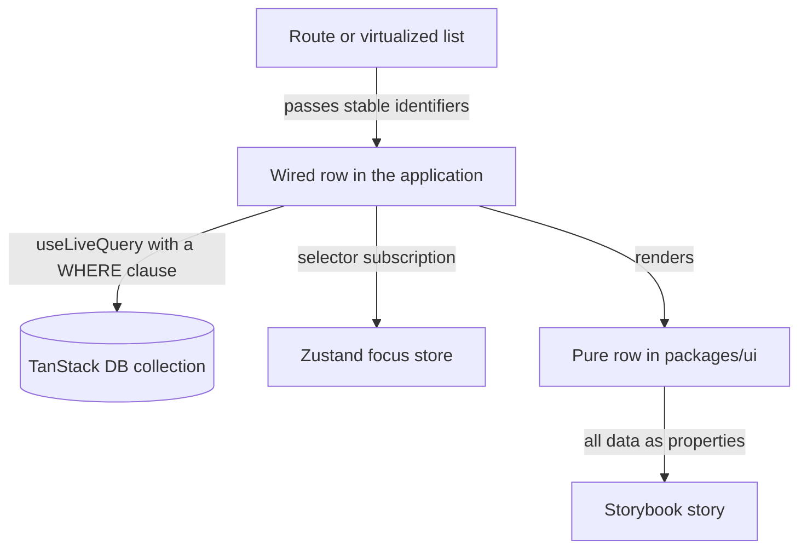
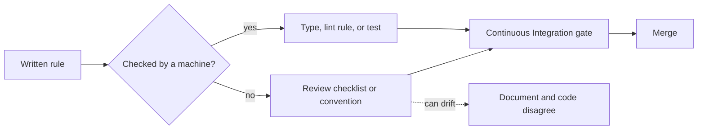

# Invariants: the rules the project writes down for itself

The HumanLayer repository contains a hand-written `golden/` folder with four rule documents. They cover session lifecycle, React rendering, synchronization, and Application Programming Interface (API) testing. "Golden" means a trusted reference, not generated output. It also has a contributor guide and custom lint rules. This document reads each rule against the code.

The product family is Riptide. A session is one run of a coding agent that the Riptide daemon starts and tracks. The Riptide API owns the database and business rules. The Riptide User Interface (UI) shows sessions. Shared packages hold the schema, contracts, and synchronization code.

An invariant is a rule that must stay true in every valid state. This document treats each written rule as an invariant claim, then asks whether a machine checks it.

The thesis is that these documents are mostly descriptive, not executable. A few rules are enforced by TypeScript types, lint rules, or the Continuous Integration (CI) workflow. Many are conventions that survive by review. A reader who trusts the documents without checking the code will find stale file names, two missing statuses, and a test helper that does not exist.

## The written rules

The written rules are:

- `golden/session_state_machine.md` describes 11 session statuses and their transitions.
- `golden/de-purification-patterns.md` describes five React patterns that move data access down the tree.
- `golden/sync_architecture.md` describes the synchronization path through Electric SQL. Electric SQL streams database changes to clients.
- `golden/api-testing-guidelines.md` describes the test database, mocks, access control, and cascade checks.
- `CONTRIBUTING.md` describes the setup, checks, and pull request rules.
- `tools/oxlint/` contains two local lint plugins with 14 rules. A local plugin is a rule module that lives in this repository, not in a published package.

The sections below treat each one as a claim and compare it with the implementation.

## Rule set 1: the session state machine

The session status is a closed set. The code defines the set once in `packages/schemas/src/effect/session/session-status.ts:7-21`. The daemon and the API both import this type.

```ts
// packages/schemas/src/effect/session/session-status.ts:7-21
export const SESSION_STATUSES = [
	'ready_for_launch',
	'waiting_for_workspace',
	'draft',
	'launching',
	'running',
	'failed',
	'ready_for_input',
	'needs_approval',
	'waiting_for_usage_limit',
	'interrupt_requested',
	'interrupted',
	'resuming',
	'lost',
] as const
```

The Zod mirror lists the same 13 values at `packages/schemas/src/zod/session/session-status.ts:4-19`. A parity test keeps the two lists equal. The golden document lists 11 statuses at `golden/session_state_machine.md:7-19`. The code has 13. The missing ones are `waiting_for_workspace` and `lost`. A workspace is the directory that the daemon prepares for an agent. A heartbeat is a periodic signal from a running daemon.

The table below compares the two lists.

| Status | In the golden document? | What the code does |
|--------|-------------------------|--------------------|
| `draft` | Yes | Session not launched |
| `ready_for_launch` | Yes | Initial launch queue |
| `waiting_for_workspace` | No | Waits for workspace setup |
| `launching` | Yes | Daemon starts the agent |
| `running` | Yes | Agent is processing |
| `ready_for_input` | Yes | Agent waits for the user |
| `resuming` | Yes | User input; daemon resumes |
| `failed` | Yes | Failed; can be retried |
| `needs_approval` | Yes | Tool call needs approval |
| `waiting_for_usage_limit` | Yes | Account hit a usage limit |
| `interrupt_requested` | Yes | User asked to stop |
| `interrupted` | Yes | Agent stopped; can resume |
| `lost` | No | The stale-daemon sweeper writes it after a missed heartbeat |

`waiting_for_workspace` is not decorative. The launch predicate accepts it as a launchable state at `apps/riptide-daemon/src/handlers/sessions/on-session-launch.ts:79-85`.

```ts
// apps/riptide-daemon/src/handlers/sessions/on-session-launch.ts:79-85
export function shouldLaunchSession(change: SessionLaunchChange): boolean {
	const session = change.value
	return (
		(change.type === 'update' || change.type === 'insert') &&
		(session.status === 'ready_for_launch' || session.status === 'waiting_for_workspace')
	)
}
```

`lost` is written by the stale-daemon sweeper application. It updates a candidate row to `lost` when `last_activity_at` is older than the rule threshold (`apps/stale-daemon-sweeper/lost-sessions.ts:295-320`). The daemon contract excludes `lost` from updates, because a daemon never reports its own missing heartbeat at `contracts/riptide-api-contract/src/daemon/sessions/update.ts:23-24`. The contract comment calls this "derived by the API", but the writer lives in the sweeper application.

```ts
// contracts/riptide-api-contract/src/daemon/sessions/update.ts:18-24
export const UpdateSessionInputSchema = z.object({
	sessionId: z.uuid(),

	// Optional fields that can be updated
	codingAgentSessionId: z.string().optional(),
	// `lost` is derived by the API from missed heartbeats; a daemon never reports it.
	status: SessionStatusSchema.exclude(['lost']).optional(),
```

**Aha:** The golden document calls itself the description of the state machine, but the code has two more statuses. A switch built from the document will miss `waiting_for_workspace` and `lost`. The launch path already handles the first.

### Disagreement: the source reference

The golden document points to `packages/db/src/tables/sessions.ts:7-18` as the type definition at `golden/session_state_machine.md:79`. Those lines are imports; the type comes from the schemas package at `packages/db/src/tables/sessions.ts:4`. The real definition is in `packages/schemas/src/effect/session/session-status.ts`.

This is a stale reference. The type moved, and the document did not follow it.

### The transition table

The table defines rows such as `draft` to `ready_for_launch`, `ready_for_launch` to `launching`, `running` to `ready_for_input`, and `running` to `needs_approval` at `golden/session_state_machine.md:42-65`. Most rows name a handler that exists in the code:

- `api.sessions.create` and `api.sessions.launch` exist in `apps/riptide-api/src/orpc/api/sessions/`.
- `handleLaunchSession` and `handleContinueSession` are imported and called in `apps/riptide-daemon/src/subscriptions.ts:25-26`.
- `processClaudeEvents` exists at `apps/riptide-daemon/src/effects/services/claude-sessions/workflows/process-events.ts:444`.
- The continue procedure sets `resuming` at `apps/riptide-api/src/orpc/api/sessions/continue.ts:101`.
- The interrupt procedure sets `interrupt_requested` at `apps/riptide-api/src/orpc/api/sessions/interrupt.ts:111`.
- The approval handler sets `needs_approval` at `apps/riptide-api/src/orpc/daemon/approvals/create.ts:85-89`.
- The Claude event workflow sets `waiting_for_usage_limit` at `apps/riptide-daemon/src/effects/services/claude-sessions/workflows/process-events.ts:677`.

Each item above names a symbol that exists. The state write at each site is the proof of the transition.

One handler name does not match. The golden document names `handleInterrupt` at `golden/session_state_machine.md:68`. The daemon exports `handleInterruptOutcome` at `apps/riptide-daemon/src/agents/claudecode/interrupts.ts:87`. The name `handleInterrupt` does exist in the UI, as a send-control callback (`apps/riptide-ui/src/hooks/useSessionHotkeys.ts:112`), but no daemon function uses it.

### Disagreement: the resumption invariant

The golden document lists three invariants at `golden/session_state_machine.md:73-75`: initial launch only, resumption identity, and multiple entry points to `resuming`.

The resumption invariant says a session always requires a `coding_agent_session_id` at `golden/session_state_machine.md:74`. The identifier is the provider's name for the agent conversation. The code is more permissive. It checks the identifier only for agents other than `codelayer` and `fold` at `apps/riptide-daemon/src/handlers/sessions/on-session-continue.ts:56-66`. Claude, the default agent, uses it. CodeLayer and Fold keep their own state.

```ts
// apps/riptide-daemon/src/handlers/sessions/on-session-continue.ts:56-66
	// Claude resumes through its provider session ID. CodeLayer and Fold resume from Riptide-owned state.
	if (launchableAgent.data !== 'codelayer' && launchableAgent.data !== 'fold' && !session.coding_agent_session_id) {
		logger.error(`Unable to continue session ${session.id} - no coding_agent_session_id is available`)
		await services.orpc.sessions.update({
			sessionId: session.id,
			status: 'failed',
			errorMessage: 'Unable to locate coding agent session ID.',
			errorReason: 'start_failed',
		})
		return
	}
```

The invariant holds for Claude only. CodeLayer and Fold keep their own state, as the comment says.

The third invariant is correct. A session can enter `resuming` from `ready_for_input`, `interrupted`, `failed`, or `lost` (`apps/riptide-api/src/orpc/api/sessions/continue.ts:57`). The API continue procedure accepts those states.

The first invariant, initial launch only, has no direct test. The launch procedure writes `ready_for_launch` only when it moves a draft into the launch queue at `apps/riptide-api/src/orpc/api/sessions/launch.ts:136-139`.

### What enforces the state machine?

TypeScript enforces the status set, because the status column uses `SessionStatusSchema` and the database column uses the same type. No database constraint prevents an invalid transition. The predicates and handlers enforce each transition.

## Rule set 2: de-purification

The document describes a React pattern. "Purification" keeps presentation components in `packages/ui` free of data access. A pure component receives data as properties. "De-purification" adds data access in `apps/riptide-ui` wrappers and leaves the leaf unchanged.

A wrapper reads data from TanStack DB and Zustand stores. TanStack DB is a client-side collection library; a collection holds rows. Zustand is a small React state store. The wrapper is the "wired" component.

The document states five patterns:

1. A wired wrapper around a pure leaf component.
2. Data fetching at the lowest component level.
3. Memoization by array length for append-only data.
4. Shared state in Zustand stores with selector subscriptions.
5. Re-render isolation with `React.memo`.

Pattern 3 uses the append-only shape. New events go at the end, so the identifier array only grows. Its length tells a memoized consumer that new data exists. The document uses `[eventIds?.length, sessionId]` at `golden/de-purification-patterns.md:92-95`.

A virtualized list renders only the rows that are visible. It passes identifiers, not full objects, so each row can query its own data.

The diagram below shows the pattern.



### The pattern is live

The current code follows the pattern. `WiredConversationEventRow` is a memoized component. It receives an event identifier and a session identifier, then queries its own event, tool result, and approval rows at `apps/riptide-ui/src/components/conversation-stream/WiredConversationEventRow.tsx:67-99`. The component header is at `apps/riptide-ui/src/components/conversation-stream/WiredConversationEventRow.tsx:34-48`.

```tsx
// apps/riptide-ui/src/components/conversation-stream/WiredConversationEventRow.tsx:34-48
/**
 * Wired event row. The virtualized parent passes stable IDs and layout flags;
 * this leaf queries its event/result/approval and reads session actions from the
 * existing SessionDetailProvider.
 */
export const WiredConversationEventRow = memo(
	function WiredConversationEventRow({
		eventId,
		sessionId,
		isGroupItem = false,
		canForkFromMessage = true,
		presentation = 'stream',
		onPinnedUserMessageClick,
		showGitHubPushCard = false,
	}: WiredConversationEventRowProps) {
```

The query reads the event row by identifier, then the tool result and approval rows by tool call identifier at `apps/riptide-ui/src/components/conversation-stream/WiredConversationEventRow.tsx:64-91`. `SessionDetailProvider` supplies session actions.

The pure component remains pure. `ConversationEventRow` receives the event and the tool result as properties at `packages/ui/src/components/conversation-stream/conversation-event-row.tsx:101-110`.

The selector pattern is also live. `CompactedHistoryRow` subscribes to two derived booleans, not the whole store, at `apps/riptide-ui/src/components/conversation-stream/CompactedHistoryRow.tsx:22`.

```tsx
// apps/riptide-ui/src/components/conversation-stream/CompactedHistoryRow.tsx:20-24
	isExpanded: boolean
}> = ({ id, eventCount, revealedCount, isExpanded }) => {
	const isFocused = useFocusStore((s) => s.focusedEventId === id)
	const isEditorFocused = useFocusStore((s) => s.isEditorFocused)
	const isTruncated = isExpanded && revealedCount < eventCount
```

### Disagreement: the reference file names

The document names three "Connected" files as the reference implementation at `golden/de-purification-patterns.md:232-234`. ENG-2678 is the internal pull request that introduced the pattern.

```md
# golden/de-purification-patterns.md:228-237
## Reference Implementation

See the following files from the ENG-2678 PR:

- `apps/riptide-ui/src/components/conversation-stream/ConnectedConversationEventRow.tsx`
- `apps/riptide-ui/src/components/conversation-stream/ConnectedTaskGroupEventRow.tsx`
- `apps/riptide-ui/src/components/conversation-stream/ConnectedConversationStream.tsx`
- `apps/riptide-ui/src/hooks/stores/focusStore.ts`
- `apps/riptide-ui/src/hooks/stores/approvalStore.ts`
- `apps/riptide-ui/src/hooks/stores/expansionStore.ts`
```

The actual files are named `WiredConversationEventRow.tsx`, `WiredConversationStream.tsx`, and `WiredAgentGroupEventRow.tsx`. The three Zustand stores exist with the names in the document. A reader who searches for `ConnectedConversationEventRow.tsx` finds no file.

The document is internally inconsistent. It says "Connected or Wired" at `golden/de-purification-patterns.md:17`, then later names only `Connected` files. The implementation chose `Wired` and did not update the reference list.

The safety net is a verification checklist at `golden/de-purification-patterns.md:217-226`. It asks for `bun run typecheck`, `bun run quality`, Storybook rendering, and React DevTools observation. Storybook renders one component with fixed properties. React DevTools shows which components re-render. Only the first two are machine checks.

### What enforces de-purification?

No lint rule enforces the pattern. Lint excludes `packages/ui/src/**/*.ts*` at `.oxlintrc.jsonc:29`. The wired code in `apps/riptide-ui` is checked, but no rule targets the pattern. The project uses review and the checklist.

`React.memo` is manual too. `ConversationEventRow` has no memo wrapper at `packages/ui/src/components/conversation-stream/conversation-event-row.tsx:101`; the wired wrapper is memoized. The wrapper owns isolation, so this is consistent, but no rule checks it.

## Rule set 3: sync architecture

The sync document states five key integration points at `golden/sync_architecture.md:322-326`:

1. The API returns a Postgres transaction identifier.
2. The UI applies optimistic updates and reverts on error. An optimistic update writes the local collection before the API confirms it.
3. The daemon subscribes to changes.
4. The Electric proxy applies `WHERE` clauses from the authentication context.
5. The API has dual contracts for the UI and the daemon.

The Electric proxy sits between clients and Electric SQL and adds an organization filter to each shape request. A shape is a filtered stream of one table. A contract is a typed procedure description; the API has one hierarchy for the UI and one for the daemon.

The daemon subscribes to session changes in `apps/riptide-daemon/src/subscriptions.ts`, which is how it sees a new launch or resume request.

### The transaction identifier

The collection cache keeps one client-side collection per user and organization. It does not carry the transaction identifier. The key is the user identifier and the organization identifier at `packages/sync/src/collection-cache.ts:29-35`. The cache also deletes an entry when the collection reaches the `cleaned-up` state at `packages/sync/src/collection-cache.ts:41-45`.

```ts
// packages/sync/src/collection-cache.ts:31-48
		 * @param cacheKey - Cache key (e.g. `${userId}:${organizationId}`)
		 * @param deps - Dependencies passed to createFn when creating a new instance
		 * @param opts.skipCache - If true, creates but does not cache (used during auth loading for electric collections)
		 */
		get(cacheKey: string, deps: TDeps, opts?: { skipCache?: boolean }): TCollection {
			const existing = cache.get(cacheKey)
			if (existing) return existing

			const collection = createFn(deps)

			collection.on('status:change', ({ status }) => {
				if (status === 'cleaned-up') {
					cache.delete(cacheKey)
				}
			})

			if (!opts?.skipCache) {
				cache.set(cacheKey, collection)
```

The UI waits for the transaction to sync. `confirmTx` calls `awaitTxId` for each Electric collection at `apps/riptide-ui/src/components/providers/SyncProvider.tsx:927-1024`. `awaitTxId` waits until Electric has applied the transaction with that identifier. `AWAIT_TX_TIMEOUT` bounds the wait at 10,000 milliseconds (`packages/sync/src/constants.ts:17`). In query mode the collection reads through the API instead of Electric, so the code refetches and does not wait for a transaction identifier.

```ts
// apps/riptide-ui/src/components/providers/SyncProvider.tsx:927-935
	const confirmTx = useMemo(
		() => ({
			sessions: async (txId: string | number): Promise<void> => {
				if (modes.sessions === 'query' && sessionsQueryRef.current) {
					await sessionsQueryRef.current.utils.refetch()
				} else {
					await sessionsElectric.utils.awaitTxId(Number(txId), AWAIT_TX_TIMEOUT)
				}
			},
```

The action layer passes the identifier to the confirm function at `apps/riptide-ui/src/actions/sessions.ts:129`. The cache key rule is also correct: a shared collection across organizations would mix rows. The comment gives `${userId}:${organizationId}` at `packages/sync/src/collection-cache.ts:29-35`.

### The dual contracts

The document says the contract package defines two hierarchies. The folders are `contracts/riptide-api-contract/src/api` for the UI and `contracts/riptide-api-contract/src/daemon` for the daemon. Both feed the same API server through different routers. The document sometimes writes the short name `riptide-api-contract` at `golden/sync_architecture.md:47`. That is a path shorthand, not a code error. The package exists at the full path.

### Disagreement: the state diagram

The sync document draws a state diagram with `approval_needed` at `golden/sync_architecture.md:293`. The real status is `needs_approval` at `packages/schemas/src/effect/session/session-status.ts:15`. A reader who copies the diagram into code will create an invalid status.

### What enforces sync invariants?

The transaction identifier flow is enforced by the API return types and by the collection code. It is not enforced at every call site. A caller can forget to call `confirmTx`, and no lint rule detects it.

The proxy `WHERE` filter is enforced by the proxy code, not by a shared type. The document says the filter uses the authentication context. The proxy implementation is the only place that builds it. A shared type cannot prove that a filter contains the organization identifier.

The dual contract is structural. Two routers and two contract sets exist, so a procedure must be added to one hierarchy. This is stronger than a convention but weaker than a test that proves the two never mix. No such test exists.

## Rule set 4: API testing guidelines

The testing document is the longest golden file. It covers the test database, the remote procedure call pattern, mocks, access control, cascade checks, six security gaps at `golden/api-testing-guidelines.md:401-454`, and five anti-patterns at `golden/api-testing-guidelines.md:456-527`.

The API uses oRPC, a typed remote procedure call library. A procedure test calls the procedure in process with a mock authentication context, without a network socket.

### Disagreement: the Docker helper

The document says tests use `startPostgres18Docker` and `shutdownContainer` from `apps/riptide-api/test/utils/docker.ts` at `golden/api-testing-guidelines.md:66-68`.

```md
# golden/api-testing-guidelines.md:66-69
**Key utilities:**
- `apps/riptide-api/test/utils/docker.ts` - `startPostgres18Docker()`, `shutdownContainer()`
- `apps/riptide-api/test/utils/postgres.ts` - `migrationsFolder` path

```

The file `apps/riptide-api/test/utils/docker.ts` does not exist, and no `startPostgres18Docker` function exists anywhere. The name `shutdownContainer` does exist, but as a private helper in `packages/test-fixtures/src/docker.ts:217`; the exported wrapper is `shutdownContainers` (`:261`, `:275-276`).

The real database helper is `createTestDb`. It reads the external test service configuration, verifies the services, creates a database from a template, and runs migrations only when no template exists at `apps/riptide-api/test/utils/test-db.ts:22-45`.

```ts
// apps/riptide-api/test/utils/test-db.ts:23-32
	scope = 'riptide_api',
	options?: { migrationsFolder?: string; logger?: Logger },
): Promise<TestDb> {
	const config = getExternalTestServicesConfig()
	const templateDatabase = options?.migrationsFolder ? undefined : process.env.RIPTIDE_API_TEST_TEMPLATE_DATABASE
	if (!templateDatabase) {
		await verifyExternalTestServices(config)
	}

	const databaseName = createDatabaseName(scope)
```

The instruction to assign a unique Docker port per test file is obsolete. The design uses one external service and a database per test scope. A template database is a migrated database that Postgres clones; when it exists, migrations are skipped. A scope is a name such as `riptide_api` that keeps parallel groups apart. Parallel tests get separate databases, not containers.

This is the strongest disagreement. The named helpers cannot be imported.

### The three-actor pattern

The three-actor rule is stated in the document at `golden/api-testing-guidelines.md:245-251`, and the code repeats it in a test file comment at `apps/riptide-api/test/procedures/access-control.test.ts:30-40`. An Access Control List (ACL) is the per-resource list of users who may read or write. The owner is `resource_owner_user_id`; the stranger has no entry, and the ACL-holder has an entry but is not the owner.

```ts
// apps/riptide-api/test/procedures/access-control.test.ts:30-40
/**
 * Access Control Tests - Three-Actor Pattern
 *
 * Every access control test MUST include three actors:
 * 1. Owner - The resource owner (resource_owner_user_id)
 * 2. Stranger - User with no access (different user, no ACL)
 * 3. ACL-holder - User with ACL access but not ownership
 *
 * Tests verify:
 * - Positive cases: Owner and ACL-holder can access
 * - Negative cases: Stranger cannot access
```

The pattern is real: the files `inheritance-chain.test.ts`, `user-sharing.test.ts`, and `sub-resource-inheritance.test.ts` also exist, and the code repeats the rule.

No lint rule checks for three actors. The test file comment is documentation inside a test, not an assertion. A new access control test can omit the stranger case and still pass CI.

### Mock patterns

The document says tests use only pre-approved mocks from `test/mocks/` at `golden/api-testing-guidelines.md:557`. A pre-approved mock is a shared factory in that folder. The folder contains `auth-context.mock.ts`, `workos-service.mock.ts`, billing, Jira and Linear (issue trackers), Amazon Simple Storage Service (S3; file storage), and Stripe (billing) mocks. `createMockApiAuth`, `createMockApiAuthNoOrg`, and `createMockDaemonAuth` are real exports at `apps/riptide-api/test/mocks/auth-context.mock.ts:65-120`.

The "only pre-approved mocks" rule is a convention. No import restriction blocks an ad-hoc mock in a test file.

### Cascade checks

A cascade is a copy of an ownership change from a parent resource to its child rows. An inherited field is a field that the child receives from the parent, such as `resource_owner_user_id`. The document requires cascade tests to verify every inherited field at `golden/api-testing-guidelines.md:345-355`. The suite contains cascade tests. The rule is not machine-checked. A test can check one field and still pass.

### What enforces the testing rules?

The test runner enforces that tests pass, not the shape of a test. The type system is the strongest check, because a wrong mock fails to compile. The three rules above are review conventions.

## Rule set 5: CONTRIBUTING

`CONTRIBUTING.md` states the setup and the merge checks. The setup needs Bun and Docker at `CONTRIBUTING.md:7`. The package manager rule says to use Bun for everything and never npm, pnpm, or yarn at `CONTRIBUTING.md:14`.

The checks match the scripts:

- `bun run typecheck` is `package.json:65`.
- `bun run quality` runs `oxlint` and `oxfmt` at `package.json:48`. `oxlint` is the linter and `oxfmt` is the code formatter.
- `bun run test` runs the local test suite at `package.json:56`.
- `bun run test:local:services` starts the service stack at `package.json:58`.

The CI workflow runs type checking, quality checks, unit tests, and service tests. It runs on every pull request and uses no secrets at `.github/workflows/ci.yml:1-3`. A fork cannot read repository secrets, so a workflow that needed one would fail there. This one gets the full run on forks.

The migration rule says to edit `packages/db/src/tables` and run `bun run db:migrations:generate` at `CONTRIBUTING.md:32`. The script calls `drizzle-kit generate` at `package.json:66`. The tool diffs the table schema against the last migration.

The user-visible string rule points to `.claude/skills/ui-copy/SKILL.md` at `CONTRIBUTING.md:33`. The file exists and holds the product voice and capitalisation rules for interface text.

Another rule with no enforcement is the package manager rule. No script blocks npm or pnpm. A developer can run `npm install` and nothing fails until the lockfile or the workspace links disagree.

## The custom lint rules

The `tools/oxlint` folder contains two plugins. They are the most concrete enforcement in the repository.

The `anti-slop` plugin has eight rules at `tools/oxlint/anti-slop/index.ts:12-24`.

```ts
// tools/oxlint/anti-slop/index.ts:12-24
const antiSlopPlugin = eslintCompatPlugin({
	meta: { name: 'anti-slop' },
	rules: {
		'max-ternary-depth': maxTernaryDepthRule,
		'no-chained-type-assertions': noChainedTypeAssertionsRule,
		'no-conditional-spread': noConditionalSpreadRule,
		'no-known-value-widening': noKnownValueWideningRule,
		'no-object-parameters': noObjectParametersRule,
		'no-reprovide-ambient-service': noReprovideAmbientServiceRule,
		'no-unknown-type-aliases': noUnknownTypeAliasesRule,
		'no-widen-then-assert': noWidenThenAssertRule,
	},
})
```

The rules are errors in `.oxlintrc.jsonc:76-83`. The `max-ternary-depth` rule allows a depth of two. The `no-object-parameters` rule rejects the broad `object` type as a parameter and asks for a named owner type at `tools/oxlint/anti-slop/rules/no-object-parameters.ts:29-40`. The other six block chained type assertions, conditional spreads, widened literals, ambient service re-provision, unknown type aliases, and widen-then-assert.

The `automation` plugin has six rules at `tools/oxlint/automation/index.ts:12-19`. The names are `no-cascading-layer-provide`, `no-manual-effect-error-tag`, `no-manual-tag-comparison`, `no-manual-tagged-construction`, `no-nested-layer-provide`, and `prefer-use-mount-effect`. They are errors in `.oxlintrc.jsonc:35-40`. Effect is a TypeScript library for typed effects, dependency layers, and tagged errors; a tag identifies a service or error at runtime. The rules prevent hand-built or hand-compared tags.

The test override is important. All eight `anti-slop` rules are turned off under `**/test/**`, and two of the six `automation` rules are off there: `no-cascading-layer-provide` and `no-nested-layer-provide` (`.oxlintrc.jsonc:192-201`). This is deliberate, because a test often needs broad types and fixed tag values. The consequence is that the test conventions in the golden folder have little lint support.

The lint configuration also ignores `packages/ui/src/**/*.ts*` at `.oxlintrc.jsonc:29`. The pure components are outside the lint gate; the wired code is checked, but no rule targets the de-purification pattern.

## The disagreements in one place

The table below collects each mismatch between a written rule and the code.

| Golden claim | Code fact | Evidence |
|--------------|-----------|----------|
| The state machine has 11 statuses | The code has 13 statuses | `golden/session_state_machine.md:7-19` and `packages/schemas/src/effect/session/session-status.ts:7-21` |
| The status type is in the sessions table | The table imports the type from the schemas package | `golden/session_state_machine.md:79` and `packages/db/src/tables/sessions.ts:4` |
| Resumption always needs a provider session identifier | CodeLayer and Fold resume without one | `golden/session_state_machine.md:74` and `apps/riptide-daemon/src/handlers/sessions/on-session-continue.ts:56-57` |
| The interrupt handler is `handleInterrupt` | The export is `handleInterruptOutcome` | `golden/session_state_machine.md:68` and `apps/riptide-daemon/src/agents/claudecode/interrupts.ts:87` |
| The reference wrappers are named `Connected*` | The files are named `Wired*` | `golden/de-purification-patterns.md:232-234` and `apps/riptide-ui/src/components/conversation-stream/WiredConversationEventRow.tsx:39` |
| Tests start Postgres with `startPostgres18Docker` | Tests use `createTestDb` and external services | `golden/api-testing-guidelines.md:67` and `apps/riptide-api/test/utils/test-db.ts:22-45` |
| Each test file needs a unique Docker port | Each test scope gets its own database | `golden/api-testing-guidelines.md:40` and `apps/riptide-api/test/utils/test-db.ts:22-45` |
| The approval status is `approval_needed` | The status is `needs_approval` | `golden/sync_architecture.md:293` and `packages/schemas/src/effect/session/session-status.ts:15` |

The wrapper name is drift; it still points to the right concept. The Docker helper and the wrapper name are naming and path errors: the concept exists under another name, so a reader who searches for it can still find it. The other entries change behaviour: a reader would use a status value that does not exist, or call a function whose name is different, and the code would reject the call or store the wrong value.

## Enforcement map

The table below maps each written rule to its enforcement. Strong means a machine check fails when the rule breaks. Partial means code enforces the rule on one path, but a caller can bypass it. None means the rule survives by review or habit.

| Written rule | Enforcing code | Strength |
|--------------|----------------|----------|
| The session status is a closed set | `SESSION_STATUSES` and `SessionStatusSchema` | Strong |
| A daemon never reports `lost` | Contract schema excludes it | Strong |
| `ready_for_launch` is for initial launch only | Launch predicate and the draft launch write | Partial |
| Resumption needs a provider session identifier | Handler check, except CodeLayer and Fold | Partial |
| Sessions can enter `resuming` from four states | Continue procedures | Partial |
| Wired wrapper around a pure leaf | File convention and review | None |
| Fetch data at the lowest level | `useLiveQuery` calls in the wired row | None |
| Memoize append-only arrays by length | Manual code | None |
| Use Zustand selector subscriptions | Manual code | None |
| Wrap connected components in `React.memo` | Manual code | None |
| Return a transaction identifier | API return type and `confirmTx` | Partial |
| Apply `WHERE` filters in the proxy | Proxy implementation | Partial |
| Keep dual contracts | Separate routers and contract files | Partial |
| Access control tests use three actors | Test comment and review checklist | None |
| Tests use only pre-approved mocks | Folder convention | None |
| Cascade tests check every field | Test names and review | None |
| Use Bun for everything | No check | None |
| Type checking and lint pass | CI workflow | Strong |
| CI uses no secrets | CI workflow | Strong |
| Generate migrations with the script | Developer action, no check | None |
| User-visible strings follow the copy skill | Review | None |
| `anti-slop` rules | `oxlint` at error level, with all eight off in tests | Strong |
| `automation` rules | `oxlint` at error level, with two of six off in tests | Strong |

The pattern is clear. Rules about types and the build are strong. Rules about React structure and test shape are weak. The project knows this, because the de-purification document ends with a manual checklist.

## What the gaps mean

The gaps cluster in two areas.

The first is naming and paths. A file moves or a component is renamed, and a document keeps the old name. The de-purification list and the Docker helper are examples. These gaps cost time but do not change behavior.

The second is conventions a machine cannot check easily. A three-actor test and a selector subscription are structural. A lint rule could check some, but the team has not written those rules and uses review.

**Aha:** Treat a golden file's code blocks as claims. The code's wired row, transaction identifier, and lint rules match. The status set does not: the document draws 11 values and the code declares 13. The Docker helper, `Connected` names, `approval_needed` status, and `handleInterrupt` name also do not match. A name check finds the boundary quickly.

The enforcement diagram below shows where a rule can drift.



A rule that reaches a machine check is tested on every run. A rule in review can drift. The folder mixes both kinds and does not mark which is which.

## How to use the golden folder

A reader should use the folder in three passes.

First, read the rule as intent. The state machine, wired component, transaction identifier, and three-actor test are real design choices. The stale names and missing statuses are document errors, not design errors.

Second, check every file name and status name against the tree. The repository moves quickly, and the documents are not generated.

Third, look for the enforcing code. If no code enforces the rule, treat it as a convention. A convention is still useful, but it is not a guarantee.

This document is one of a series about the repository. For more context, read [the overview](00-overview.md), [the daemon and session runtime](02-daemon-and-session-runtime.md), [the sync engine](05-sync-engine.md), [the API and contracts](07-api-and-contracts.md), and [the observability document](16-observability-and-attribution.md).

## Next

Continue with [the glossary](20-glossary.md). It collects the terms that these documents use, including session status, session, daemon, and collection.
