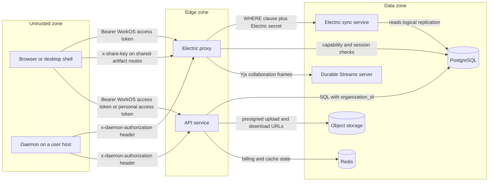

# Security and self-hosting: trust boundaries and what you must supply

HumanLayer's security rests on one fact: tenancy lives in application Structured Query Language (SQL) predicates, not in database row-level security. HumanLayer is the product; the code names it Riptide. It runs coding agents on a user's machine and lets a team steer them from one place. A daemon is a long-running local process that starts those agents. It has no inbound listener. A shape is a query subscription: a client names a table and a predicate, and Electric streams the matching rows. The Electric proxy injects the Electric secret into every upstream shape request, and Electric validates it.

Five kinds of authority exist. WorkOS is the identity provider. A user access token names a person and an organization. A personal access token names a person through a WorkOS user Application Programming Interface (API) key and resolves an organization on each request. A daemon token names one host inside one organization. A launch token expires in 24 hours. It lets a client trade the token for a daemon token that names a user and an organization. The client supplies the host identifier at the exchange. A public share capability pairs an artifact identifier with a share key; neither alone is enough. The cloud application is the administration application in `apps/riptide-cloud`. The working application is the user interface in `apps/riptide-ui`. Both are browser clients. They hold the same user token, and neither grants extra authority; the administrative screens only hide controls that the API enforces. This document lists every trust boundary and every credential that authenticates a request at commit `2f66a45b186d88488fa356862be0117db1ccae9f`.

A trust boundary is a place where a credential or a filter decides who may read or write. Tenancy means one organization's rows must never appear in another organization's view. No database row-level security policy exists; that is a rule that filters rows per user. The proxy builds a `WHERE` clause per request, and the API repeats the same predicate in Drizzle. One forgotten filter is a cross-tenant read. Library and product names are defined in [the glossary](20-glossary.md).

## The trust boundaries at a glance

Three zones exist. The untrusted zone holds clients and the daemon. The edge zone holds the Electric proxy and the API. The data zone holds PostgreSQL, Electric, object storage, Redis, and the Durable Streams server. Among the application services, only the proxy holds the Electric secret; Electric itself holds the same secret, because Electric is the component that validates it. Only the API and the proxy hold the PostgreSQL credentials that serve application queries; Electric holds its own database connection for logical replication, which the Compose file (the local service definition) sets separately (`docker-compose.yaml:30-41`). The Durable Streams server carries live session output. Yjs is the shared-document library that the proxy relays for response-editor collaboration (`apps/riptide-electric-proxy/src/routes/response-editor-collaboration.ts:18-24`).



For user and daemon requests, the proxy accepts two credentials only. It accepts a WorkOS access token in the `Authorization` header, or a daemon token in `x-daemon-authorization` (`apps/riptide-electric-proxy/src/middleware.ts:75-90`). It has no personal-access-token path. A personal access token reaches the API only. The shared-artifact routes are separate: they require a share key and do not require a user or daemon credential.

The daemon has no inbound listener. A search of `apps/riptide-daemon/src` finds no `Bun.serve`, no `createServer`, and no `listen` call outside a test. The daemon opens outbound calls only. Its API client sends the token in the `x-daemon-authorization` header (`apps/riptide-daemon/src/orpc/client.ts:31-34`).

```ts
// apps/riptide-daemon/src/orpc/client.ts:46-70
						if (status === 401 || status === 403) {
							if (authFailureTriggered) {
								// Already handling auth failure - gracefulShutdown's sendShutdown()
								// will also hit this path, so we just bail out silently
								return
							}
							authFailureTriggered = true

							const code = 'code' in error ? (error as { code: string }).code : 'UNKNOWN'
							logger.fatal(
								{ err: error, status, code },
								'Daemon auth failed on oRPC call. Triggering graceful shutdown.',
							)
							console.error(
								encodeDaemonProcessEvent({
									type: 'auth_failure',
									message: `Authentication failed (${status}). Please sign in again.`,
								}),
							)
							// Set non-zero exit code before triggering graceful shutdown
							setShutdownExitCode(1)
							// Trigger graceful shutdown via SIGTERM so daemon.ts's gracefulShutdown()
							// handles session cleanup, API notification, and Sentry flush
							process.kill(process.pid, 'SIGTERM')
						}
```

A 401 or 403 is fatal for the daemon. It logs the event, sets exit code 1, and sends itself SIGTERM so that shutdown can clean up sessions.

This makes a laptop behind a home router usable. It is also why the daemon polls and subscribes for instructions, as [the daemon document](02-daemon-and-session-runtime.md) explains.

## The credential inventory

The table below groups the credentials by the boundary they protect. Each row states where the value is read, what it protects, and what happens when it is absent or invalid. The table covers every credential that authenticates a request or protects a tenant read. The self-hosting section lists every deployment secret, including `STRIPE_SECRET_KEY`, `RESEND_API_KEY`, `RESEND_WEBHOOK_SECRET`, and `WORKOS_API_KEY`.

| Credential | Read at | Protects | Absent or invalid |
|---|---|---|---|
| WorkOS access token | Proxy `apps/riptide-electric-proxy/src/auth/effect/jwt-validator.service.ts:91-120`; API `apps/riptide-api/src/auth/jwt-validator.ts:33-105` | A person, an organization, roles, and an authentication session | 401 from the middleware; no upstream request |
| Personal access token | API `apps/riptide-api/src/auth/personal-access-tokens.ts:89-123` | One user through a WorkOS user API key | `null`, then 401 |
| `WORKOS_API_KEY` | API `apps/riptide-api/src/auth/personal-access-tokens.ts:89-112` | Personal access token validation and its organization lookup | Validation fails; the request gets 401 |
| Daemon token | Proxy `apps/riptide-electric-proxy/src/auth/daemon-tokens.ts:33-41`; API `apps/riptide-api/src/auth/daemon-tokens.ts:70-85` | One host in one organization | 401; the daemon shuts down on 401 or 403 |
| Launch token | API `apps/riptide-api/src/orpc/base.ts:302-319`; exchange `apps/riptide-api/src/orpc/api/auth/daemon/token-exchange.ts:4-17` | The trade of a launch token for a daemon token for a user and an organization | Rejected by the launch-token middleware; no daemon token is issued |
| `RIPTIDE_DAEMON_TOKEN_PRIVATE_KEY` | API `apps/riptide-api/src/auth/daemon-tokens.ts:24-43` | Every daemon and launch token signature | Daemon and launch token creation fail |
| `RIPTIDE_DAEMON_TOKEN_PUBLIC_KEY` | API `apps/riptide-api/src/auth/daemon-tokens.ts:31-50`; proxy `apps/riptide-electric-proxy/src/auth/daemon-tokens.ts:14-25` | Every daemon and launch token verification | Verification returns `null`; the request gets 401 |
| Electric secret | Proxy `apps/riptide-electric-proxy/src/routes/electric-origin.ts:15` | Every shape on the Electric service | Start-up failure in production; Electric runs without a secret in development |
| `DATABASE_URL` | API `apps/riptide-api/src/db/db.ts:28`; proxy `apps/riptide-electric-proxy/src/lib/db.ts:28` | All tenant rows | Process throws at import |
| `READ_REPLICA_DATABASE_URL` | API `apps/riptide-api/src/db/db.ts:35` | Read-only metrics queries | Process throws at import; no fallback exists |
| `S3_ARTIFACTS_BUCKET` | API `apps/riptide-api/src/app.ts:60` | Artifact bodies | API throws at start-up |
| `S3_ACCESS_KEY_ID`, `S3_SECRET_ACCESS_KEY` | API `apps/riptide-api/src/app.ts:63-65` | Signed object access | Falls back to the default Amazon Web Services (AWS) credential chain, the ordered credential sources that the AWS Software Development Kit (SDK) tries |
| `STRIPE_WEBHOOK_SECRET` | API `apps/riptide-api/src/lib/environment.ts:19-21` | Stripe billing event authenticity | Process throws at start-up |
| `WORKOS_WEBHOOK_SECRET` | API `apps/riptide-api/src/workos.ts:10` | Membership event authenticity | Verification throws; the route returns 400 |
| Artifact share key | Proxy `apps/riptide-electric-proxy/src/routes/v1.ts:51-61` | One artifact and its comments | 401 when missing; 404 when wrong or disabled |

### WorkOS access tokens

WorkOS is the identity provider. The API and the proxy parse the same claim set through one Effect schema (`packages/schemas/src/effect/workos-access-token.ts:3-15`). The proxy requires `internal_org_id`, because every proxy filter needs the internal organization identifier. The API treats that claim as optional (`packages/schemas/src/effect/workos-access-token.ts:9`). Some routes run before an organization is selected, and those routes do not build an organization predicate. Organization creation is one such route (`apps/riptide-api/src/orpc/api/auth/user/organizations-create.ts:146-152`).

```ts
// apps/riptide-electric-proxy/src/auth/effect/jwt-validator.service.ts:68-83
const claimsToAuthContext = (claims: WorkOsAccessTokenClaims) => {
	if (!claims.internal_org_id) {
		return Effect.fail(new JWTMissingInternalOrgIdError({ workosOrganizationId: claims.org_id }))
	}

	return Effect.succeed({
		userId: claims.sub,
		organizationId: claims.internal_org_id,
		workosOrganizationId: claims.org_id ?? '',
		roles: claims.roles ?? [],
		permissions: claims.permissions ?? [],
		entitlements: claims.entitlements ?? [],
		sessionId: claims.sid,
		actingUser: claims.act?.sub,
	})
}
```

The claim names matter:

| Claim | Meaning | Used for access |
|---|---|---|
| `iss` | Issuer | Passed to `jwtVerify` as the expected issuer |
| `sub` | Subject, the user identifier | Every ownership check |
| `org_id` | WorkOS organization identifier | WorkOS API calls and organization switching |
| `internal_org_id` | Local organization identifier | Every SQL predicate |
| `sid` | Authentication session identifier | Stored in the auth context; not used as a filter |
| `act.sub` | Acting user | Stored as `actingUser`; not used as a filter |
| `role`, `roles` | Role names | Admin checks only |
| `permissions` | Permission names | Parsed and never read |
| `entitlements` | Entitlement names | Parsed and never read |

`sid` is the WorkOS authentication session. It is not the coding-agent session row in PostgreSQL. The two use the word "session" for different objects.

A search of the API and proxy source finds `permissions` in the two token validators and in the personal-access-token context, which sets it to an empty array (`apps/riptide-api/src/auth/personal-access-tokens.ts:120`). Feature gating uses `hasFeature`, which reads the Stripe plan and not the token (`apps/riptide-api/src/effects/services/billing/entitlements.service.ts:29-44`). A self-hoster cannot grant a capability by editing a WorkOS role. The API ignores the permission claim.

The issuer check is weaker than it looks. Both validators take `iss` from the unverified token payload, then pass that value back to `jwtVerify` (`apps/riptide-api/src/auth/jwt-validator.ts:68-80`, `apps/riptide-electric-proxy/src/auth/effect/jwt-validator.service.ts:57-66`). The signature must still match a WorkOS key from the JSON Web Key Set (JWKS). So a forged token fails.

A token that WorkOS signs for a different issuer would pass the issuer check, because the expected value came from the token itself. The repository does not name such a token. The configured JWKS must also contain a key that verifies it. The `internal_org_id` claim is the only tenant gate. A token without that claim reaches no tenant read: the proxy rejects it (`apps/riptide-electric-proxy/src/auth/effect/jwt-validator.service.ts:68-83`), and the API rejects it on every route built on the organization-required base `apiBaseOrgRequired`, a middleware chain that requires an organization. A token that carries the claim is accepted, because the code does not compare the issuer to the organization. A route that runs before organization selection can accept it without the claim, because the API treats `internal_org_id` as optional and that route performs no tenant read (`packages/schemas/src/effect/workos-access-token.ts:9`, `apps/riptide-api/src/orpc/api/auth/user/organizations-create.ts:146-152`).

The JWKS cache fetches keys from the Uniform Resource Locator (URL) that the WorkOS client builds (`apps/riptide-api/src/lib/workos.ts:43-48`, `apps/riptide-api/src/auth/jwks-cache.ts:24-37`). The API refreshes every five minutes (`apps/riptide-api/src/auth/jwks-cache.ts:12-17`). A token with no key identifier (`kid`) fails at once. An unknown `kid` triggers one forced refresh (`apps/riptide-api/src/auth/jwt-validator.ts:52-68`).

### Personal access tokens

A personal access token is a WorkOS user API key, not a JSON Web Token (JWT). The API decides which validator to use by attempting `decodeJwt`.

```ts
// apps/riptide-api/src/auth/context.ts:11-30
export const resolveUserAuthContext = Effect.fn('auth.resolve_user_auth_context')(function* (input: {
	authorizationHeader: string | null
}) {
	const match = input.authorizationHeader?.match(/^Bearer (.+)$/)
	if (!match?.[1]) return null
	const credential = match[1]
	if (isJwtCredential(credential)) {
		return yield* Effect.promise(() => validateJWT(credential))
	}
	return yield* authenticatePersonalAccessToken({ value: credential })
})

function isJwtCredential(credential: string): boolean {
	try {
		decodeJwt(credential)
		return true
	} catch {
		return false
	}
}
```

The token path sets `role: 'member'`, an empty `permissions` array, and an empty `entitlements` array (`apps/riptide-api/src/auth/personal-access-tokens.ts:114-122`). A personal access token therefore cannot reach an admin route. It also cannot carry a permission that the API does not read anyway.

Organization resolution uses the WorkOS API key owner. The API calls `workos.validateApiKey`. It accepts only an owner of type `user`. It reads that owner's WorkOS organization identifier and finds the local `organizations` row with the same `workos_organization_id` (`apps/riptide-api/src/auth/personal-access-tokens.ts:89-112`). If the owner is not a user, or the local row is absent, the function returns `null` and the request gets 401. The token does not carry a local organization identifier. The API derives the local organization on every request.

Expiry is chosen at creation time from a closed set: 7, 14, 30, 60, or 90 days (`apps/riptide-api/src/auth/personal-access-tokens.ts:12`). Revocation deletes the WorkOS key. A deleted key fails validation and yields 401.

### Daemon tokens

Daemon tokens use RS256. RS256 means Rivest-Shamir-Adleman Signature with Secure Hash Algorithm 256. The claims are `userId`, `organizationId`, `hostId`, and `createdAt`. The header carries the signing algorithm only. One configured public key verifies every token, so the header needs no key identifier (`kid`) (`apps/riptide-api/src/auth/daemon-tokens.ts:63`, `:70-74`). The WorkOS validators require a key identifier; this validator does not. The public key is Privacy-Enhanced Mail (PEM) text that holds a Subject Public Key Info (SPKI) structure. The proxy imports it with `importSPKI` (`apps/riptide-electric-proxy/src/auth/daemon-tokens.ts:21-24`).

The proxy is deliberately verify-only. Its core module states the rule in a comment.

```ts
// apps/riptide-electric-proxy/src/auth/daemon-token-core.ts:67-83
/**
 * Verify and decode a daemon token using the provided public key PEM.
 * This is a pure function - no side effects, no env var access.
 * Returns null if token is invalid or claims are malformed.
 *
 * Note: This module intentionally does NOT include signing functions.
 * The electric proxy should only be able to validate tokens, not create them.
 */
export async function verifyDaemonToken(publicKeyPem: string, token: string): Promise<DaemonTokenClaims | null> {
	try {
		const publicKey = await importSPKI(publicKeyPem, ALG)
		const { payload } = await jwtVerify(token, publicKey)
		return parseDaemonTokenClaims(payload)
	} catch {
		return null
	}
}
```

The API is the issuer. It holds the private key and signs tokens for a host.

```ts
// apps/riptide-api/src/auth/daemon-tokens.ts:52-64
/**
 * Create a signed daemon token using env-configured private key.
 * Key is imported once and cached for subsequent calls.
 */
export async function createSignedDaemonToken(
	userId: string,
	organizationId: string,
	hostId: string,
	createdAt: number = Date.now(),
): Promise<string> {
	const key = await getPrivateKey()
	return await new SignJWT({ userId, organizationId, hostId, createdAt }).setProtectedHeader({ alg: ALG }).sign(key)
}
```

The API mints a daemon token on two routes. A signed-in client calls `auth.daemon.token.create` with a host identifier and a WorkOS access token (`apps/riptide-api/src/orpc/api/auth/daemon/token-create.ts:5-10`; input `hostId` at `contracts/riptide-api-contract/src/api/auth/daemon/token-create.ts:5-12`). A headless client calls `auth.daemon.launchToken.create`, then exchanges the launch token at `auth.daemon.token.exchange` with a host identifier (`apps/riptide-api/src/orpc/api/auth/daemon/launch-token-create.ts:5-16`, `apps/riptide-api/src/orpc/api/auth/daemon/token-exchange.ts:4-17`). The `humanlayer automation run` command is one such client (`apps/cli/src/commands/automation-run.ts:89-95`). The desktop shell writes the returned string into the environment variable `DAEMON_IDENTITY` before it starts the daemon (`apps/riptide-electron/src/daemon/daemon-environment.ts:54-62`, `apps/riptide-native/src/daemon.rs:286-290`). The launch token is separate because it is short-lived and portable. The daemon token is host-bound and has no expiry.

Two more facts matter. First, the token has no `exp` claim. A launch token is a second token that expires in 24 hours and is scoped to a user and an organization (`apps/riptide-api/src/auth/daemon-tokens.ts:87-97`). A daemon token stays valid until the signing key changes. Second, the daemon can self-sign only in development. It reads `RIPTIDE_DAEMON_TOKEN_PRIVATE_KEY` only when `RIPTIDE_DAEMON_LOAD_CREDS` is set (`apps/riptide-daemon/src/lib/auth.ts:147-168`). In that mode the daemon bypasses the API and signs with the shared private key. In production the desktop shell injects `DAEMON_IDENTITY` (`apps/riptide-daemon/src/lib/auth.ts:171-172`).

The daemon does not verify its own token. It decodes the payload into `{userId, organizationId, hostId}` and trusts the claims (`packages/schemas/src/effect/daemon/identity.ts:5-9`, `apps/riptide-daemon/src/lib/auth.ts:41-54`). The identity schema drops `createdAt`, so the daemon ignores the claim. It uses `hostId` to scope its shape subscriptions. The API and proxy verify the token on every call. A forged `DAEMON_IDENTITY` value therefore changes the local host identifier only until the first rejected call. A stolen valid token is different: it carries a real signature, so it works until the signing key changes.

The repository defines no rotation or revocation procedure. A token stays valid until the signing key changes. A new key pair invalidates every daemon token. A search finds no revocation list. A 401 or 403 stops the daemon (`apps/riptide-daemon/src/orpc/client.ts:46-75`). The user must sign in again and mint a new token.

### The Electric secret

Electric reads the PostgreSQL replication stream. It has no per-user model. The secret is the only gate on the whole shape endpoint.

```ts
// apps/riptide-electric-proxy/src/index.ts:30-37
if (ELECTRIC_SECRET) {
	logger.info('Successfully loaded ELECTRIC_SECRET from environment')
} else if (process.env.NODE_ENV === 'production') {
	logger.error('ELECTRIC_SECRET not found in process environment in production!')
	throw new Error('ELECTRIC_SECRET not found in process environment in production mode.')
} else {
	logger.warn('ELECTRIC_SECRET not found in process environment, this is ok in non-production.')
}
```

The proxy appends the secret to every upstream request as a query parameter (`apps/riptide-electric-proxy/src/routes/electric-origin.ts:15`). A client never sees it. If the secret leaks, every row in every tenant is readable directly from Electric. If it is absent in production, the proxy refuses to start. If it is absent in development, Electric runs open, and the proxy still filters.

### Database credentials

Both services require a database connection at module load. The API reads `DATABASE_URL` and `READ_REPLICA_DATABASE_URL` with `requireEnvironment`, so a missing value throws at import (`apps/riptide-api/src/db/db.ts:26-38`).

The proxy has a second client in `apps/riptide-electric-proxy/src/lib/db.ts:28-31`. It uses the same `DATABASE_URL`.

At runtime, a database error fails closed for authorization. To fail closed means to deny on error; to fail open means to allow on error. The shared-artifact check returns `false` on any error (`apps/riptide-electric-proxy/src/lib/queries.ts:139-145`). The session capability check returns `no_access` on any error (`apps/riptide-electric-proxy/src/lib/queries.ts:211-217`).

The read replica is required even when metrics are unused. A self-hoster must set it to the primary connection string. The comment at `apps/riptide-api/src/db/db.ts:33-34` says so.

### Storage credentials

Object storage holds binary artifacts. The store is Amazon Simple Storage Service (S3) or a compatible server such as MinIO. Markdown artifacts live in PostgreSQL instead. The API constructs the storage client at start-up (`apps/riptide-api/src/app.ts:59-66`).

The bucket is mandatory. The region defaults to `us-east-1`. The endpoint is optional, and the presence of an endpoint enables path-style addressing for MinIO. Path-style addressing puts the bucket name in the URL path, such as `https://host/bucket/key`, instead of the host name. MinIO commonly requires it (`apps/riptide-api/src/lib/s3-service.ts:31-34`). The key pair is optional, and its absence selects the default AWS credential chain. That is the correct behavior on an AWS instance with an instance role. It is the wrong behavior on a MinIO host that expects static keys.

A presigned URL is a signed object-store link that grants temporary access with no credential. Presigned upload URLs last 15 minutes. Presigned download URLs default to 10,080 minutes, which is 7 days (`apps/riptide-api/src/lib/s3-service.ts:39-51`). A shared-artifact download URL is therefore a long-lived capability once issued.

The public viewer path has two steps. First, the browser loads `/shared/artifacts/<identifier>?key=<shareKey>`. The user interface sends the key to the proxy as `x-share-key`. The proxy checks the key before any authentication middleware and streams the public artifact shape (`apps/riptide-electric-proxy/src/routes/v1.ts:51-71`, `:95`). Second, for a binary artifact, the viewer asks the public API route `public.artifacts.downloadUrl` for a presigned URL. The API queries the artifact by identifier and share key, recomputes the effective permission (the share setting after the organization policy), and returns `NOT_FOUND` when sharing is off (`apps/riptide-api/src/orpc/api/public/artifacts/download-url.ts:19-53`). Only then does it call `s3.getPresignedDownloadUrl`. The share-key check therefore precedes the presign. The returned URL is a direct object-storage capability for 7 days. Anyone who holds it bypasses the proxy and the share key. Markdown artifacts skip this step because their content syncs through the shape.

### Stripe and WorkOS webhook secrets

Both webhook routes verify a signature before any database work. Stripe uses the official SDK method `constructEventAsync` with the endpoint secret (`apps/riptide-api/src/lib/stripe-service.ts:194-197`). WorkOS uses the SDK method `constructEvent` with the webhook secret (`apps/riptide-api/src/lib/workos-service.ts:112-121`).

A missing Stripe secret stops start-up, because the service is constructed at module load (`apps/riptide-api/src/app.ts:70-74`). A missing WorkOS secret does not stop start-up, because the adapter accepts `undefined`. It fails at request time instead, and the route returns 400 (`apps/riptide-api/src/webhooks/workos.ts:38-50`).

### Public artifact share keys

A share key is neither a symmetric nor an asymmetric key. It is a random version 4 Universally Unique Identifier (UUID), produced by `crypto.randomUUID()` the first time a user shares an artifact (`apps/riptide-api/src/orpc/api/sharing/artifact/update.effect.ts:85`). It is stored in plaintext in a unique column (`packages/db/src/tables/artifacts.ts:56`). Validation is a string equality test inside the SQL predicate.

```ts
// apps/riptide-electric-proxy/src/routes/v1.ts:51-61
	app.all('/shared/artifacts/:artifactId', async (c) => {
		const shareKey = c.req.header('x-share-key')
		if (!shareKey) return c.newResponse(null, StatusCodes.UNAUTHORIZED)

		const artifactId = c.req.param('artifactId')
		if (!isUuid(artifactId)) {
			return c.json({ error: 'Invalid artifactId format' }, StatusCodes.BAD_REQUEST)
		}

		const accessible = await isSharedArtifactAccessible(config.db, artifactId, shareKey)
		if (!accessible) return c.newResponse(null, StatusCodes.NOT_FOUND)
```

The check loads the row and resolves the effective permission. The organization policy can veto the row.

```ts
// packages/db/src/artifact-public-permission.ts:15-30
/**
 * Resolves sharing state while legacy clients still write share_enabled.
 * A legacy enabled write can only grant view access; only an aligned new-client
 * write can grant comment access.
 *
 * The org policy is required so every reader denies public access while the org
 * has public links turned off, even if an artifact row still says it is shared.
 */
export function effectivePublicPermission(
	row: ArtifactPublicPermissionCompatibilityRow,
	org: ArtifactPublicPermissionOrgPolicy,
): ArtifactPublicPermission {
	if (!org.publicLinksAllowed) return 'off'
	if (!row.share_enabled) return 'off'
	return row.public_permission === 'comment' ? 'comment' : 'view'
}
```

Three permissions exist: `off`, `view`, and `comment` (`packages/db/src/artifact-public-permission.ts:1`). The proxy route for comments requires the stronger `comment` level (`apps/riptide-electric-proxy/src/lib/queries.ts:149-156`). The public link carries the key in the query string as `?key=` (`apps/riptide-ui/src/utils/artifact-links.ts:21-24`). The user interface reads that parameter in the route search schema and passes it to the shared-artifact view, which sends it to the proxy as the `x-share-key` header (`apps/riptide-ui/src/routes/shared/artifacts/$artifactId.tsx:7-29`, `apps/riptide-ui/src/hooks/shared-artifact/useSharedArtifactCollection.ts:29`). The key therefore appears in browser history, referrer headers, and access logs.

**Aha:** the shared-artifact routes are registered before the authentication middleware in the same Hono application (`apps/riptide-electric-proxy/src/routes/v1.ts:51-95`). Mount order is the capability boundary. The share key is the only credential on those paths, and the capability check is the middleware. A shared route added after line 95 would require a WorkOS token instead.

## Tenancy enforcement without row-level security

The repository contains 144 migrations. Exactly one line mentions row-level security, and it disables it (`packages/db/drizzle/0121_orange_silver_fox.sql:15`).

A search for `CREATE POLICY` returns nothing. Tenancy is therefore an application obligation. The proxy meets it by generating a predicate with Drizzle's `QueryBuilder` and parameter placeholders. For the sessions shape, version 2 sets the table name and applies only the organization filter (`apps/riptide-electric-proxy/src/routes/v2.ts:56-61`).

Version 1 of the same route adds Access Control List (ACL) subqueries, which are lists of users allowed to see a row (`apps/riptide-electric-proxy/src/routes/v1.ts:98-104`).

Version 2 removed the ACL filter for sessions, tasks, events, approvals, artifacts, and comments. Any member can therefore sync every session row in the organization. The API still checks task permissions on writes; read scope is wider than write scope, as [the sync engine document](05-sync-engine.md) and [the Electric proxy document](06-electric-proxy.md) describe.

The API repeats the same rule in Drizzle. Every task lookup includes `eq(tasks.organization_id, organizationId)` (`apps/riptide-api/src/db/task-auth.ts:74-81`). Every ACL subquery repeats the organization predicate. The duplication is deliberate: the API must work even when the proxy is bypassed.

The identifier handling is careful. Column names pass through `sql.identifier()`, and values pass as bound parameters. That blocks injection. The proxy serializes the fragment into Electric's `where` parameter; Electric applies it to its own query. A malformed fragment fails at Electric, not at the proxy.

## The daemon host check

A daemon token names one host. The API checks that name on every daemon write. The check appears in heartbeat (`apps/riptide-api/src/orpc/daemon/hosts/heartbeat.effect.ts:35-37`), shutdown (`apps/riptide-api/src/orpc/daemon/hosts/shutdown.effect.ts:20-22`), daemon sync (`apps/riptide-api/src/orpc/daemon/sync/sessions.ts:30-33`, called an Insecure Direct Object Reference (IDOR) guard), agent-command report (`apps/riptide-api/src/orpc/daemon/agent-commands/report.effect.ts:23-25`), and session update (`apps/riptide-api/src/orpc/daemon/sessions/update.ts:78-81`, which also checks `created_by`).

The proxy applies the same rule to the host-scoped session shape.

```ts
// apps/riptide-electric-proxy/src/routes/v1.ts:231-238
		const { userId, organizationId, hostId: authHostId } = c.var.authContext

		if (authHostId && authHostId !== hostId) {
			return c.json(
				{ error: 'hostId mismatch: URL parameter does not match daemon token' },
				StatusCodes.FORBIDDEN,
			)
		}
```

Two refinements matter. First, a missing `hostId` claim is not a mismatch. A user token can read the host route. Second, when the caller is a daemon, the proxy also adds `created_by = userId` (`apps/riptide-electric-proxy/src/routes/v1.ts:245-246`). The sessions table stores `working_directory`, which is the local checkout path on that host (`packages/db/src/tables/sessions.ts:76`). The host-scoped session shape returns that column. A task access-control list can grant another HumanLayer user visibility to a session on the same host. The host shape applies that list. Without the predicate, the daemon of one operating-system user could read the working directory of another person's session. The predicate limits the shape to sessions that the daemon's own user created.

## The shared-artifact capability model

The model has five parts. The first four decide access:

1. The capability is the pair of artifact identifier and share key.
2. The row must have `share_enabled = true`.
3. The organization must allow public links.
4. The requested operation must be within the granted level.

The fifth is column projection. A public shape never returns tenant identifiers, task identifiers, storage keys, or the share key itself. The hidden-column map is subtractive.

```ts
// packages/db/src/tables/artifacts.ts:91-107
export const artifactColumnsHiddenFromPublic = {
	task_id: true,
	task_slug: true,
	resource_owner_user_id: true,
	organization_id: true,
	content_hash: true,
	frontmatter: true,
	created_by: true,
	share_key: true,
	shared_by: true,
	share_enabled: true,
	public_permission: true,
	is_deleted: true,
	s3_key: true,
	content_type: true,
	file_size_bytes: true,
} as const
```

**Aha:** this is a hidden-column list, which is a blocklist, not an allow-list. The map names the columns to remove; every column that the map does not name is public. The comment above the map (`packages/db/src/tables/artifacts.ts:87-90`) states the rule: every other column is public. That rule is convenient and is the single riskiest line in the sharing model. A future migration that adds a sensitive column to `artifacts` publishes it to every share link unless the author remembers this map. The codebase has no test that compares the table definition to this list.

## Input validation and transport posture

Path parameters are validated as UUIDs before query construction. The regular expression accepts versions 1 through 7 and the nil UUID (`apps/riptide-electric-proxy/src/lib/validation.ts:13`). A bad value returns 400, not a database error. The proxy applies it to task, host, session, organization, and artifact identifiers.

Null bytes get special handling. PostgreSQL rejects the code point U+0000 in `text` and `jsonb`, and coding agents produce it when they discuss null bytes in source code.

```ts
// apps/riptide-api/src/lib/strip-null-bytes.ts:16-27
const NULL_BYTE = '\0'

export function stripNullBytesFromString(value: string): string {
	return value.includes(NULL_BYTE) ? value.replaceAll(NULL_BYTE, '') : value
}

/**
 * `JSON.stringify` replacer for callers that serialize once and hand the text straight to
 * Postgres (`::jsonb`), so they do not pay for a parse round trip on large payloads.
 */
export const nullByteReplacer = (_key: string, value: unknown): unknown =>
	typeof value === 'string' ? stripNullBytesFromString(value) : value
```

The second form is a `JSON.stringify` replacer for callers that serialize once and avoid a parse round trip (`apps/riptide-api/src/lib/strip-null-bytes.ts:22-27`).

Request body size is capped globally. The API uses a 10-megabyte limit by default and a 50-megabyte limit for the codelayer state upsert path (`apps/riptide-api/src/lib/request-body-limit.ts:8-19`). The codelayer state upsert path is the daemon procedure `/rpc/daemon/v1/codelayerState/upsert`. It stores the CodeLayer editor state for one session (`apps/riptide-api/src/lib/request-body-limit.ts:6`, `apps/riptide-api/src/orpc/daemon/codelayer-state/upsert.effect.ts:17-23`). That path carries a whole editor document, so the larger cap is justified. Every other route, including daemon report routes, stays at 10 megabytes.

The proxy has its own flat 10-megabyte limit, installed before every other middleware (`apps/riptide-electric-proxy/src/server.ts:29-33`). Its purpose is stated in a comment: to prevent out-of-memory failure from large payloads.

Cross-Origin Resource Sharing (CORS) is permissive. Both applications call `cors()` with no arguments (`apps/riptide-electric-proxy/src/server.ts:39`, `apps/riptide-api/src/app.ts:99`). The repository supplies no origin allow-list, no allowed-header list, and no credentials flag. Authentication still requires a bearer token, a daemon header, or a share key, so a hostile page cannot read responses without stealing one. The wide policy does allow any page to send requests and to observe timing and status codes.

## A rejected request, step by step

The sequence below shows an expired access token. The proxy decodes the header, finds a cached key, fails verification, and returns 401. No request reaches Electric.

```mermaid
sequenceDiagram
    participant U as User client
    participant P as Electric proxy
    participant C as JWKS cache
    participant E as Electric
    U->>P: GET /v2/sessions with expired Bearer token
    P->>P: decode header, require kid and iss
    P->>C: getKey(kid)
    C-->>P: cached public key
    P->>P: jwtVerify with issuer from the token
    P-->>U: 401 with an empty body
    Note over P,E: No upstream call and no SQL predicate are made
    Note over C,P: This token used a cached key; an unknown kid forces one JWKS refresh, and a missing kid is rejected
```

## Self-hosting checklist

The repository supports a self-hosted stack, but it does not ship a complete deployment. The checklist below contains what the code, the Compose file, and the Caddyfile require.

### Services you must run

| Service | Why the repository needs it | Evidence |
|---|---|---|
| PostgreSQL 18 with `wal_level=logical` | Source of truth and Electric replication | `docker-compose.yaml:9-28` |
| Electric 1.7.12 | Shape sync | `docker-compose.yaml:30-41` |
| S3 or MinIO | Binary artifact bodies | `docker-compose.yaml:43-70` |
| Redis 7 | Billing and cache state; required only when billing runs | `docker-compose.yaml:97-108` |
| Durable Streams server 0.3.0 | Live session event streams and Yjs shared-document collaboration | `docker-compose.yaml:73` |
| API service | Writes, typed contracts, webhooks | `apps/riptide-api` |
| Electric proxy | Authentication, tenancy filters, streams | `apps/riptide-electric-proxy` |
| Web UI static build | Human interface | `apps/riptide-ui` |
| Transport Layer Security (TLS) terminator (Caddy reverse proxy) | The Compose file does not terminate TLS | `Caddyfile:1-25` |

The `wal_level=logical` setting makes PostgreSQL record every change in a form Electric can read. The Durable Streams server carries live output; PostgreSQL keeps the same events as rows.

The admin application (`apps/riptide-cloud`) is optional for a single organization. The four AWS Lambda jobs (migrations, stale daemon sweep, database maintenance, and update server) are useful but not required to serve traffic.

### Variables to set

| Variable | Required | Consequence when unset |
|---|---|---|
| `DATABASE_URL` | Yes | API and proxy throw at import |
| `READ_REPLICA_DATABASE_URL` | Yes | API throws at import |
| `ELECTRIC_SHAPE_URL` | Yes | Proxy throws at start-up |
| `DURABLE_STREAMS_ORIGIN` | Yes | Proxy throws at start-up |
| `ELECTRIC_SECRET` | Yes in production | Proxy throws in production |
| `RIPTIDE_DAEMON_TOKEN_PRIVATE_KEY` | Yes for the API; a development daemon may also sign | Daemon and launch token creation fail |
| `RIPTIDE_DAEMON_TOKEN_PUBLIC_KEY` | Yes, API and proxy | Daemon and launch token validation returns `null` |
| `RIPTIDE_DAEMON_LOAD_CREDS` | No; development only | The daemon does not read the local user identifier, organization identifier, or private key (`apps/riptide-daemon/src/lib/auth.ts:129-168`) |
| `DAEMON_IDENTITY` | Yes at runtime; the packaged shell or the command-line interface (CLI) supplies it | The daemon throws at start-up (`apps/riptide-daemon/src/lib/auth.ts:171-176`) |
| `WORKOS_API_KEY` | Yes | API and proxy fail on their first call to WorkOS |
| `WORKOS_CLIENT_ID` | Yes | JWKS URL cannot be built |
| `WORKOS_REDIRECT_URI` | Yes | Login redirect cannot be built |
| `WORKOS_WEBHOOK_SECRET` | Recommended | Webhook verification returns 400 |
| `S3_ARTIFACTS_BUCKET` | Yes | API throws at start-up |
| `S3_ARTIFACTS_REGION` | No, defaults to `us-east-1` | Wrong region for non-AWS stores |
| `S3_ARTIFACTS_ENDPOINT` | For MinIO | AWS endpoints are used |
| `S3_ACCESS_KEY_ID`, `S3_SECRET_ACCESS_KEY` | For MinIO | Default AWS credential chain |
| `STRIPE_SECRET_KEY` | Yes at start-up | API throws, even with billing disabled |
| `STRIPE_WEBHOOK_SECRET` | Yes at start-up | API throws |
| `STRIPE_PRICE_STARTER`, `STRIPE_PRICE_PRO` | Yes | Start-up validation rejects empty plan price identifiers |
| `IS_BILLING_ENFORCEMENT_ENABLED` | Yes | The environment reader `requireEnvironment` throws |
| `RESEND_API_KEY`, `RESEND_WEBHOOK_SECRET` (Resend email service) | Yes at start-up | API throws |
| `KV_URL` (Key-Value store URL) | When billing runs | The Redis client cannot be built, so the cache is absent |
| `VITE_PUBLIC_WORKOS_CLIENT_ID` | Yes, UI build | Login cannot start |
| `VITE_PUBLIC_RIPTIDE_API_ORIGIN` | Yes, UI build | The UI calls the wrong origin |

`ELECTRIC_SHAPE_URL` is the complete shape endpoint, not only the host. The proxy builds each upstream shape URL from it (`apps/riptide-electric-proxy/src/runtime-environment.ts:8-9`). The development stack renders a value such as `http://127.0.0.1:<port>/v1/shape` (`apps/devstack/src/lib/env-block.ts:165`). `KV_URL` is the Key-Value store URL for Redis.

The Stripe and Resend requirements are easy to miss. Both services are constructed at module load (`apps/riptide-api/src/app.ts:70-76`). A self-hoster who disables billing still needs a syntactically valid Stripe key and a Resend email-service key to boot the API.

### What degrades when optional values are unset

| Unset value | Behavior |
|---|---|
| Sentry Data Source Name (DSN) | Telemetry stays off; the README states this |
| PostHog key | Product analytics stays off |
| `S3_ACCESS_KEY_ID` | The AWS default credential chain is used |
| `ELECTRIC_SECRET` in development | Electric is open; the proxy still filters |
| `WORKOS_WEBHOOK_SECRET` | Membership webhooks return 400; seats stop syncing |
| `KV_URL` | The cache is absent, so billing state cannot persist and billing decisions fail open |

### The warning in the README

The README is explicit about the Compose file.

```markdown
# README.md:36-45
`bun --bun run devstack help` explains how to run the whole stack locally. [CONTRIBUTING.md](CONTRIBUTING.md) lists every check a pull request must pass.

A build from source sends nothing to us: Sentry, PostHog, and the WorkOS client ID come from env, and stay off when unset. `.env.example` lists them.

## Self-hosting

HumanLayer Cloud runs this code. Guides for running it yourself are in progress.


⚠️ note - If you use the Docker Compose file as a starter for self hosting, please note that it uses default/simple passwords that should be updated before you deploy.
```

The warning is accurate. The Compose file defaults the PostgreSQL password to `password` (`docker-compose.yaml:14`), the MinIO root user and password to `minioadmin` (`docker-compose.yaml:46-47`), and the durable-streams policy to wildcard CORS (`docker-compose.yaml:88`).

Two more gaps matter for a self-hoster. First, the README tells the reader to run `cp .env.example .env` (`README.md:31`). No `.env.example` exists. The file is ignored by `.gitignore:100` (`.env*`) and absent from all history. The working path is `bun --bun run devstack`, which renders an environment block (`apps/devstack/src/lib/env-block.ts:147-166`).

Second, the repository contains no Pulumi program and no Lambda deployment definition. It has Pulumi dependencies (`package.json:154-159`), three helper modules under `packages/pulumi-helpers/src`, and four Lambda handler functions. But there is no `Pulumi.yaml` and no `pulumi.ts`. `apps/docs/README.md:3-4` still points to one. A self-hoster must write the deployment layer.

## Next

Read [the API and contracts document](07-api-and-contracts.md) for the middleware chain that consumes these credentials. Read [the database document](08-database-and-schemas.md) for the table model behind the tenancy predicates. Read [the infrastructure document](14-infrastructure-and-devstack.md) for the Compose stack and `devstack`. Read [the comparisons document](19-comparisons-and-critical-assessment.md) for the risks that remain after this inventory.
