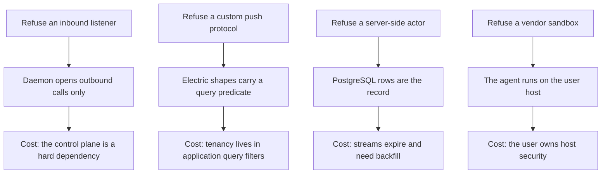
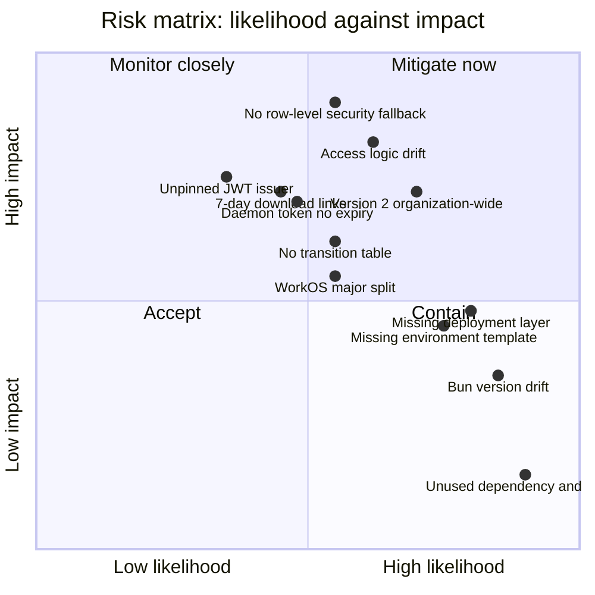

# Comparisons and critical assessment

HumanLayer is easiest to judge as four refusals. It refuses an inbound listener on the host. It refuses a custom push protocol. It refuses a server-side actor that owns session state. It refuses a vendor sandbox. Each refusal buys a property that the alternatives lack in combination. Each refusal also imposes a cost that the code shows plainly. This document compares the design against six alternatives, grouped in four comparisons, then ranks its strengths and weaknesses with citations from the repository at commit `2f66a45b186d88488fa356862be0117db1ccae9f`.

The product name is HumanLayer; the code names it Riptide. It runs coding agents on a user's machine and lets a team steer them from one place. A daemon is a long-running local process on that machine. It starts agents and has no inbound listener. The control plane is the Application Programming Interface (API) and the daemon: processes that accept intent or report state through the API. The sync plane is PostgreSQL, its write-ahead log, Electric, and the Electric proxy. A write-ahead log is the change record that PostgreSQL writes before it applies a change. Electric is the read-sync service over PostgreSQL. These components deliver read-only shapes. The client plane is the web user interface, the desktop shells, the command-line interface, and the plugins. The host is an actor, not a plane. Here the word actor means a participant. A shape is a query subscription: a client names a table and a predicate, and Electric streams the matching rows. The Electric proxy is the HyperText Transfer Protocol (HTTP) front that injects tenancy filters and hides the Electric secret. A session is one coding-agent run, stored as a database row. An artifact is a file or document that a user shares. A tenant is one organization.

The product claim is narrow and testable: "HumanLayer runs coding agents ... on your machines and lets your team steer them from one place" (`README.md:3`). Every comparison below starts from a property the source demonstrates, not from a marketing category.

## The four refusals and what they buy



The daemon side is the cleanest refusal. The daemon has no `Bun.serve`, no `createServer`, and no `listen` call outside one test file. It reaches the API over an authenticated outbound link (`apps/riptide-daemon/src/orpc/client.ts:28-46`).

That property is what makes a laptop behind a home router work without a tunnel, a port forward, or a certificate. [The daemon document](02-daemon-and-session-runtime.md) covers the polling and subscription machinery that replaces the missing listener.

The second refusal is the sync protocol. The proxy does not push rows itself. It builds a `WHERE` fragment and sends it to Electric.

```ts
// apps/riptide-electric-proxy/src/routes/v1.ts:98-104
	app.all('/sessions', async (c) => {
		const { organizationId, userId } = c.var.authContext
		c.var.electricOriginUrl.searchParams.set('table', getTableName(sessions))
		const { fragment, params } = buildWhereFragmentWithAcl(sessions, { organizationId, userId })
		applyWhereToUrl(c.var.electricOriginUrl, fragment, params)
		return proxyElectricResponseWithRuntime(config, c.var.electricOriginUrl, undefined, c.req)
	})
```

The third refusal is state placement. Session status, events, tasks, and approvals live in PostgreSQL. The stream is a fast path with a one-hour lifetime (`packages/streams/src/config.ts:1-4`), not the record.

The fourth refusal is execution. The daemon spawns processes on the host, for example when it detects a binary (`apps/riptide-daemon/src/lib/binary-detection.ts:128`).

## Against local agents with no control plane

A developer can run Codex, OpenCode, or another agent in a terminal today. That setup needs no service, no account, and no network. HumanLayer keeps the local execution but adds a control plane. The comparison is therefore about what the control plane buys and what it costs.

What it buys is shared state. A session is a database row with an owner, a host, and a status. The owner is the `created_by` field (`packages/db/src/tables/sessions.ts:66`). Teammates read the same row through Electric, and [the session lifecycle document](03-session-lifecycle-and-state-machine.md) explains the state machine around it. A local-only setup has no shared row, so steering another person's run means screen sharing or copying a transcript.

What it costs is a hard dependency. The daemon talks to the API for every write (`apps/riptide-daemon/src/orpc/client.ts:28-39`). If the API is down, the agent process can still run, but the team cannot see it and approvals cannot flow. There is no peer-to-peer mode in the repository.

The second cost is operational. A local-only setup has one process. HumanLayer requires PostgreSQL, Electric, the proxy, the API, object storage, and a Durable Streams server. The Durable Streams server carries live session output. It also uses Redis when billing runs (`docker-compose.yaml:97-108`). The Compose file (the local service definition) supplies PostgreSQL, Electric, MinIO (a local object store), Redis, and the Durable Streams server (`docker-compose.yaml:9-108`). The proxy and the API run as local processes. [The infrastructure document](14-infrastructure-and-devstack.md) lists the full stack.

The comparison verdict is clear. Local-only wins on simplicity and offline use. HumanLayer wins on team visibility and approvals. The repository chooses the second without hiding the first.

## Against cloud agent platforms that run the agent in a vendor sandbox

A cloud agent platform runs the coding agent inside a sandbox that the vendor owns. The user sends a task, the vendor starts a virtual machine or container, and the code never touches the user's laptop.

HumanLayer inverts that boundary. The agent runs on a host that the user owns. The database records which host ran which session. The API enforces that binding by comparing the session host and creator with the daemon token (`apps/riptide-api/src/orpc/daemon/sessions/update.ts:78-81`).

The property that follows is credential locality. A repository credential, a Secure Shell (SSH) key, or a cloud profile stays on the user's machine. The platform never receives it. That is a real security advantage for regulated code and for repositories with production secrets in the developer environment.

The cost is that the user owns host security. There is no sandbox boundary between the agent and the rest of the laptop. The daemon runs as the user and spawns processes, as binary detection shows (`apps/riptide-daemon/src/lib/binary-detection.ts:128`). A vendor platform can promise isolation because it controls the kernel boundary. HumanLayer cannot, because it deliberately does not run the workload.

A second cost is availability. A closed laptop stops the session. There is no server-side continuation. The status model has `lost` and `interrupted` states (`packages/schemas/src/effect/session/session-status.ts:7-21`).

A third cost is multi-tenant isolation of the host fleet. The vendor platform isolates tenants by account and network. HumanLayer isolates tenants in Structured Query Language (SQL), and the repository contains no row-level security policy.

## Against sync engines: Electric directly or a custom push layer

Electric alone cannot serve this product. Its secret grants read access to the whole database (`apps/riptide-electric-proxy/src/index.ts:30-37`).

A browser that holds the secret can request any table with any filter. The proxy exists to keep the secret server-side and to attach the tenancy predicate. This is why [the Electric proxy document](06-electric-proxy.md) treats the proxy as a security boundary, not a convenience.

The alternative is a custom WebSocket push layer. The server would read changes and decide which client receives which row. That design repeats what Electric already provides: offset tracking, reconnection, and snapshot plus delta. It also moves authorization into a bespoke push loop.

HumanLayer's choice is a hybrid. Electric performs the sync, and the proxy performs authorization by shaping the query. The price is that authorization must be expressible as SQL. Version 1 shows both the power and the cost.

The version 1 sessions route applies Access Control List (ACL) subqueries (`apps/riptide-electric-proxy/src/routes/v1.ts:98-104`). Version 2 applies only the organization identifier.

```ts
// apps/riptide-electric-proxy/src/routes/v2.ts:56-61
	app.all('/sessions', async (c) => {
		c.var.electricOriginUrl.searchParams.set('table', getTableName(sessions))
		const { fragment, params } = buildWhereFragmentForOrgScopedRows(sessions, c.var.authContext)
		applyWhereToUrl(c.var.electricOriginUrl, fragment, params)
		return proxyElectricResponseWithRuntime(config, c.var.electricOriginUrl, undefined, c.req)
	})
```

The fragment carries the organization identifier and no user list. Version 2 is therefore organization-wide. Every member can sync every session row in the organization. Writes remain permission-checked. Reads do not. This is weakness 4 in the ranked table below.

That is a defensible product decision for a team workspace. It is not a defensible security claim for a tenant that expects per-user read isolation. [The sync engine document](05-sync-engine.md) documents the health tracker and fallback behavior that sit above this choice.

## Against durable stream and actor systems

A durable stream system offers an append-only log with offsets, retention, and replay. An actor platform is a durable-execution service that keeps state inside an actor and replays work after a failure. Rivet is the actor platform that this repository used earlier. HumanLayer uses neither as the system of record.

The Durable Streams server is real but bounded. The configuration sets a 3,600-second Time To Live (TTL).

```ts
// packages/streams/src/config.ts:1-4
export const STREAM_CONFIG = {
	contentType: 'application/json',
	ttlSeconds: 3600,
} as const
```

The server is an external Rust project pinned to one commit.

```bash
# docker/durable-streams-server/Dockerfile:1-10
FROM docker.io/rust:1.89-bookworm AS builder

ARG DURABLE_STREAMS_SOURCE_REPOSITORY=https://github.com/thesampaton/durable-streams-rust.git
ARG DURABLE_STREAMS_SOURCE_COMMIT=cebb50e49c62c534dd714ef84a8a4572e66724b2

RUN git clone "${DURABLE_STREAMS_SOURCE_REPOSITORY}" /src \
    && git -C /src checkout --detach "${DURABLE_STREAMS_SOURCE_COMMIT}" \
    && test "$(git -C /src rev-parse HEAD)" = "${DURABLE_STREAMS_SOURCE_COMMIT}"

WORKDIR /src
```

The pinning is careful. The build verifies the checked-out commit against the argument. The rest of the Dockerfile builds the server from that source. The repository treats the server as a dependency it does not own.

Rivet was the earlier actor platform. Its name survives in the development stack as `rivetEnginePort`, `rivetServicesPort`, and `rivetEngineVolume` (`apps/devstack/src/lib/env-block.ts:121-123`). The Dockerfile mentions the former service when it fixes volume ownership (`docker/durable-streams-server/Dockerfile:24`). A manifest comment warns against reusing the former Rivet volume (`apps/devstack/src/lib/manifest.ts:112`). The repository does not define Rivet's role or the reason for its replacement. Only residual names and comments remain.

The important difference from an actor platform is what happens after a stream expires. The conversation events are persisted rows in PostgreSQL (`packages/db/src/tables/conversation-events.ts:13`). A late reader backfills from the API and the sync plane, not from the stream. The repository states no delivery guarantee for the stream.

The comparison verdict is that HumanLayer uses a durable stream as a latency optimization. An actor platform would use it as the truth. The first design is simpler to reason about. The second design survives a longer client disconnect without a database read.

**Aha:** the split is deliberate at the field level. A stream event carries `conversation_event_id` and calls it the "ID of the persisted conversation_events row" (`packages/streams/src/events.ts:12`). A text-block start carries the "ID that will be used when this block persists to Electric" (`packages/streams/src/events.ts:45`). The wording is loose: the block persists to PostgreSQL, and Electric then syncs the row. The stream is a preview of rows that will exist. That is a genuinely good layering choice: the fast path can lose data without losing truth.

The persistence path makes the same point. The insert is idempotent because the daemon does retry.

```ts
// apps/riptide-api/src/orpc/daemon/sessions/events/create.ts:202-218
				// Insert the event.
				//
				// CORE-1634: the daemon can re-send an insert with an `id` it already
				// persisted — the recovered-thinking replay re-inserts a streamed
				// thinking-block id, and the oRPC client's retry plugin can re-send a
				// write that already committed. Both hit `conversation_events_pkey`. Left
				// as a raw insert that raises a 500, the daemon turns it into a
				// session-fatal `status='failed'` (RIPTIDE-DAEMON-9A: 239 occ / 37 users).
				//
				// A pkey collision means "this exact event is already saved" (the replay
				// carries byte-identical content), so we make the insert idempotent:
				// ON CONFLICT (id) DO NOTHING, then short-circuit below. Note `id` defaults
				// to a fresh uuidv7 when the daemon sends none, so non-id-bearing inserts
				// never collide and are unaffected.
				const [event] = await tx
					.insert(conversationEvents)
					.values({
```

The insert ends with `.onConflictDoNothing({ target: conversationEvents.id })` (`apps/riptide-api/src/orpc/daemon/sessions/events/create.ts:239`). When no row returns, the code returns the existing identifier and skips the follow-up writes (`apps/riptide-api/src/orpc/daemon/sessions/events/create.ts:246-249`). The comment records the production evidence: 239 occurrences across 37 users. The fix is a data-model guarantee, not a retry change. [The write paths document](09-write-paths-and-idempotency.md) traces the whole path.

## The comparison table

| Property | HumanLayer | Local agent only | Vendor sandbox | Electric directly | Custom push layer | Durable stream system | Actor platform |
|---|---|---|---|---|---|---|---|
| Where the agent runs | User host | User host | Vendor sandbox | User host | User host | Not applicable | Vendor or user host |
| Who owns the machine | User | User | Vendor | User | User | Not applicable | Varies |
| Authoritative state | PostgreSQL rows | Local files | Vendor store | PostgreSQL | PostgreSQL | Stream log | Actor state |
| Tenancy enforcement | Application SQL in the proxy and API | None needed | Vendor account boundary | None | Custom push logic | None defined | Actor identity |
| Inbound network needed | No | No | No | No | No | Yes, server | Usually yes |
| Team steering | Yes | No | Yes | Yes | Yes | No | Yes |
| Stream durability | 1 hour, then backfill | Not applicable | Vendor-defined | Computed from PostgreSQL | Custom | Configurable retention | Actor-defined |
| Deployment burden | High | None | Low for the user | Medium | Medium | Medium | Medium |

The ratings are qualitative and follow the sections above. A durable stream system is a protocol, so agent-related rows read "Not applicable".

## Strengths, ranked

| Rank | Strength | Property shown | Evidence |
|---|---|---|---|
| 1 | Outbound-only daemon | Works behind any router without a tunnel | `apps/riptide-daemon/src/orpc/client.ts:28-39` |
| 2 | Fail-closed authorization | Database errors deny access | `apps/riptide-electric-proxy/src/lib/queries.ts:139-145` |
| 3 | Idempotent event persistence | A replayed event ID cannot double-write | `apps/riptide-api/src/orpc/daemon/sessions/events/create.ts:202-218` |
| 4 | One status definition | Effect and Zod schemas share thirteen values | `packages/schemas/src/effect/session/session-status.ts:7-21` |
| 5 | Capability with an organization kill switch | A share link dies when the organization disables them | `packages/db/src/artifact-public-permission.ts:20-30` |
| 6 | No silent replica fallback | A missing read replica stops start-up | `apps/riptide-api/src/db/db.ts:33-35` |
| 7 | Explicit mount order as security | Shared routes sit before authentication on purpose | `apps/riptide-electric-proxy/src/routes/v1.ts:51-95` |

The first strength is the one that shapes the product. The daemon never accepts a connection, so a user needs no public address. The cost is that every command must be pulled or pushed outbound.

The second strength is the failure direction. An access check that cannot reach the database denies the request (`apps/riptide-electric-proxy/src/lib/queries.ts:139-145`). A system that fails open here would be much easier to attack. [The security document](18-security-and-self-hosting.md) lists every check with the same posture.

The third strength is the best-engineered detail in the repository. The comment names the bug, the frequency, the affected users, and the structural fix. The insert uses a primary-key conflict to detect a replay. That is a better answer than a retry counter.

The fourth strength is consistency. The status names have one source of truth, the Effect schema. A hand-written Zod twin mirrors it for contracts and Drizzle schemas (`packages/schemas/src/zod/session/session-status.ts:4`). A parity test compares the two arrays and fails if they differ. The test prevents silent drift, but it does not generate the twin, so a new status must be added to both layers.

The fifth strength is the veto rule. The effective permission is computed from the row and the organization, and the organization wins (`packages/db/src/artifact-public-permission.ts:20-30`). A stale shared row cannot outlive a policy change.

The sixth strength is workload isolation. The API requires a read replica even when metrics are unused (`apps/riptide-api/src/db/db.ts:33-35`). Advanced metrics scan whole-organization ranges of `session_usage_events`. On the primary, that scan would queue interactive requests behind it. The replica keeps that workload away from the primary. Replica lag is the accepted cost; the design does not use the replica for a write-time access check or a post-write read (`apps/riptide-api/src/effects/services/postgres/postgres-read-replica.service.ts:6-17`).

The seventh strength is mount order. The shared-artifact routes sit before authentication because a share key replaces a user token (`apps/riptide-electric-proxy/src/routes/v1.ts:51-95`). The position is a security decision, not an accident.

## Weaknesses and risks, ranked

| Rank | Weakness | Consequence | Evidence |
|---|---|---|---|
| 1 | Duplicated access rules | Proxy and API can drift | `apps/riptide-electric-proxy/src/lib/queries.ts:74-78` |
| 2 | No declared transition table | Any status can be written | `apps/riptide-api/src/orpc/daemon/sessions/update.ts:89-99` |
| 3 | No database row-level security | One missing filter is a cross-tenant read | `packages/db/drizzle/0121_orange_silver_fox.sql:15` |
| 4 | Version 2 sync is organization-wide | Every member reads every session row | `apps/riptide-electric-proxy/src/routes/v2.ts:56-61` |
| 5 | No deployment program | Self-hosting requires writing the infrastructure | `apps/docs/README.md:4` |
| 6 | Toolchain version drift | Local and Continuous Integration (CI) toolchains differ | `package.json:27`, `.github/workflows/ci.yml:30` |
| 7 | WorkOS major split | Two verification paths, three majors apart | `apps/riptide-api/package.json:61`, `apps/riptide-electric-proxy/package.json:29` |
| 8 | Missing environment template | The documented setup step fails | `README.md:31`, `.gitignore:100` |
| 9 | Unused dependency and helper | Maintenance noise and false signals | `packages/db/package.json:21`, `apps/riptide-electric-proxy/src/middleware.ts:37` |
| 10 | Long-lived daemon tokens | A stolen token has no expiry | `apps/riptide-api/src/auth/daemon-tokens.ts:52-64` |
| 11 | Long-lived download links | A leaked link outlives most incident response | `apps/riptide-api/src/lib/s3-service.ts:47` |

### Duplicated access logic

The proxy says it out loud.

```ts
// apps/riptide-electric-proxy/src/lib/queries.ts:74-78
/**
 * Duplicates the canonical authorization rules in
 * apps/riptide-api/src/lib/session-multiplayer-prompting-auth.ts.
 * Keep both implementations synchronized when session access rules change.
 */
```

This is the highest structural risk. The read path and the write path must agree. A change to session visibility in the API does not automatically change the proxy. The comment is honest, and honesty is not enforcement. [The Electric proxy document](06-electric-proxy.md) shows the two implementations side by side.

### No declared transition table

The status list has thirteen values.

```ts
// packages/schemas/src/effect/session/session-status.ts:7-21
export const SESSION_STATUSES = [
	'ready_for_launch',
	'waiting_for_workspace',
	'draft',
	'launching',
	'running',
	'failed',
	'ready_for_input',
	'needs_approval',
	'waiting_for_usage_limit',
	'interrupt_requested',
	'interrupted',
	'resuming',
	'lost',
] as const
```

The update procedure writes whatever status the daemon sends. The names describe stages, but the repository does not define which transitions are legal.

```ts
// apps/riptide-api/src/orpc/daemon/sessions/update.ts:89-99
				// Build update object with only provided fields
				const updateFields: Record<string, unknown> = {}
				if (input.codingAgentSessionId !== undefined) {
					updateFields.coding_agent_session_id = input.codingAgentSessionId
				}
				if (input.status !== undefined) {
					updateFields.status = input.status
					if (input.status === 'launching' || input.status === 'running') {
						updateFields.last_activity_at = BigInt(Date.now())
					}
				}
```

There is no `transitions` map from a current status to an allowed next status. The only code list named `transitions` holds Research-Plan-Implement (RPI) workflow steps (`apps/riptide-api/src/orpc/daemon/sessions/check-auto-advance.ts:17-34`). Each entry maps a task boolean flag to a skill name, a launch title, and a deduplication label. For example, `auto_advance_questions_to_research` starts the `rpi:create-research` skill. The list decides which session to launch next. It does not constrain the `status` column, and it has no current-status or next-status field. A buggy daemon can move a session from `draft` to `lost` in one write. [The session lifecycle document](03-session-lifecycle-and-state-machine.md) records the intended graph, but the graph is documentation, not code.

### Tenancy without a database backstop

The repository has 144 migrations. Exactly one line mentions row-level security, and it disables it (`packages/db/drizzle/0121_orange_silver_fox.sql:15`).

A search for `CREATE POLICY` returns nothing. If a future route forgets the organization predicate, the database will not stop it. The proxy is careful with identifiers and bound parameters, so injection is not the risk. Omission is the risk.

### Version drift

The root manifest pins Bun 1.3.14.

```json
// package.json:24-27
  "engines": {
    "node": ">=24"
  },
  "packageManager": "bun@1.3.14",
```

CI installs Bun 1.4.2.

```yaml
# .github/workflows/ci.yml:27-30
      - name: Install bun
        uses: oven-sh/setup-bun@v2
        with:
          bun-version: 1.4.2
```

The WorkOS split is larger. WorkOS is the identity provider. The API pins the current major.

```json
// apps/riptide-api/package.json:58-64
    "@sentry/core": "catalog:",
    "@sentry/effect": "catalog:",
    "@sentry/node": "catalog:",
    "@workos-inc/node": "10.11.0",
    "buffer": "6.0.3",
    "drizzle-orm": "catalog:",
    "effect": "catalog:",
```

The proxy stays on 7.x, three majors behind.

```json
// apps/riptide-electric-proxy/package.json:25-33
    "@humanlayer/y-durable-streams": "workspace:*",
    "@sentry/core": "catalog:",
    "@sentry/effect": "catalog:",
    "@sentry/node": "catalog:",
    "@workos-inc/node": "^7.77.0",
    "buffer": "6.0.3",
    "drizzle-orm": "catalog:",
    "effect": "catalog:",
    "hono": "^4.10.7",
```

The lockfile resolves the proxy to 7.82.0 (`bun.lock:5826`). The `catalog:` and `workspace:*` protocols are Bun workspace references; they do not affect the split. This is not a bug today. It is two JSON Web Token (JWT) verification paths on different library generations: the proxy verifies WorkOS tokens at `apps/riptide-electric-proxy/src/auth/effect/jwt-validator.service.ts:106-107`, and the API verifies them at `apps/riptide-api/src/auth/jwt-validator.ts:78`. It doubles the upgrade work.

### Missing deployment layer

Pulumi is an infrastructure-as-code tool. The repository contains no Pulumi program. There is no `Pulumi.yaml` and no `pulumi.ts` anywhere in the tree. The documentation still points at one (`apps/docs/README.md:4`).

The root manifest declares Pulumi packages (`package.json:154-159`). Three helpers exist under `packages/pulumi-helpers/src`. No program uses them in this snapshot.

The same gap applies to the scheduled jobs. A Lambda is a managed function service. Four Lambda handler files exist: `apps/updater-server/index.js:64`, `apps/riptide-migrator/index.js:42`, `apps/stale-daemon-sweeper/index.ts:145`, and `apps/database-maintenance-function/index.ts:258`. No deployment definition, runtime template, or trigger exists. A self-hoster must write all of it. [The infrastructure document](14-infrastructure-and-devstack.md) separates what runs locally from what is absent.

### The missing environment template

The README instructs the reader to copy a file that does not exist (`README.md:31`).

The file is absent from the snapshot. It is also ignored by `.gitignore:100` (`.env*`) and absent from all history. The working path is `bun --bun run devstack`, which renders variables from `apps/devstack/src/lib/env-block.ts:147-166`. The documented first step fails, and the alternative is undocumented at that point.

### Unused dependency and helper

The database package depends on a random identifier library that nothing imports (`packages/db/package.json:21`).

A search for `@paralleldrive/cuid2` across all TypeScript files returns no import. The code uses `uuidv7` instead.

The proxy has a similar leftover. `withTableAndOrganizationFilter` is a complete middleware with a type-safe predicate builder.

```ts
// apps/riptide-electric-proxy/src/middleware.ts:32-54
/**
 * This is a generic middleware that sets the table and organization ID filter for a shape stream
 * @param table
 * @returns
 */
export const withTableAndOrganizationFilter = (table: OrganizationFilterableTable) =>
	createMiddleware(async (c, next) => {
		// Set the table query param to the name of the table

		// Build type-safe where expression using the internal organization UUID
		const whereExpression = sql`${sql.identifier(table.organization_id.name)} = ${c.var.authContext.organizationId}`
		const queryBuilder = new QueryBuilder()
		const { sql: query, params } = queryBuilder.select().from(table).where(whereExpression).toSQL()
		const fragment = query.replace(/^SELECT .* FROM .* WHERE\s+/i, '')

		params.forEach((value, index) => {
			c.var.electricOriginUrl.searchParams.set(`params[${index + 1}]`, String(value))
		})
		c.var.electricOriginUrl.searchParams.set('where', fragment)
		c.var.electricOriginUrl.searchParams.set('table', getTableName(table))

		await next()
	})
```

No route calls it. A reader can mistake it for the live path. That is a documentation bug inside the code.

### Token lifetime and claim handling

Daemon tokens are signed without an expiration claim (`apps/riptide-api/src/auth/daemon-tokens.ts:52-64`). A second token type, the launch token, sets 24 hours (`apps/riptide-api/src/auth/daemon-tokens.ts:91-97`). A daemon token is valid until the key rotates.

The issuer check is self-referential. The API reads `iss` (the issuer claim) from the unverified payload and passes it back to verification (`apps/riptide-api/src/auth/jwt-validator.ts:68-80`). The proxy does the same (`apps/riptide-electric-proxy/src/auth/effect/jwt-validator.service.ts:57-66`). The signature still must match a WorkOS key, so forgery fails. A token signed by WorkOS for a different issuer would pass the issuer check only if a key in the configured JWKS verifies it. The proxy rejects such a token when it has no `internal_org_id` (the local organization identifier) (`apps/riptide-electric-proxy/src/auth/effect/jwt-validator.service.ts:68-83`). A token that carries the claim is accepted, because the code does not compare the issuer to the organization. The API rejects it on every organization-required route; a route that runs before organization selection performs no tenant read and can accept it.

The permission claims are decorative. Both validators parse `permissions` and `entitlements` (`apps/riptide-electric-proxy/src/auth/effect/jwt-validator.service.ts:68-83`). No route reads either field for authorization. Admin checks use `role` and `roles` only.

### Transport and link lifetime

Both applications call `cors()` with no arguments (`apps/riptide-electric-proxy/src/server.ts:39`, `apps/riptide-api/src/app.ts:99`). Any origin may call them. Bearer authentication limits the damage, but a permissive Cross-Origin Resource Sharing (CORS) policy is unnecessary for a product with known client origins.

A presigned download link is a signed object-store link that grants temporary access with no credential. The default lifetime is 7 days (`apps/riptide-api/src/lib/s3-service.ts:47`). A leaked artifact link outlives most incident response. The share key travels in a query parameter (`apps/riptide-ui/src/utils/artifact-links.ts:21-24`), so it reaches browser history and access logs. The two mechanisms are separate. The share key gates the proxy. The API issues a presigned link only after it checks the share key and the effective permission (the share setting after the organization policy) (`apps/riptide-api/src/orpc/api/public/artifacts/download-url.ts:19-53`). The link is a direct object-storage capability, so a leaked link bypasses the share key for its 7-day life.

## The risk matrix



The coordinates are a judgement on a scale from 0 to 1, derived from the sections above. The matrix draws from the whole document, not only the ranked table. Each label is a short form of a weakness named in the ranked table, except the unpinned issuer risk from the token section.

The upper-right quadrant holds the issues worth fixing first. Access logic drift is likely because two files must change together. Its impact is a cross-tenant read. The missing row-level security fallback makes that impact worse.

The upper-left quadrant holds high-impact issues with lower likelihood: the unpinned issuer, the seven-day download link, and the daemon token with no expiry. Each needs a precondition. The unpinned issuer risk needs a validly signed token from a different issuer. The seven-day download risk needs a leaked link. The daemon-token risk needs a stolen token. The issuer risk and the download risk keep high impact.

The lower-right quadrant holds lower-impact issues that are more likely. Most are maintenance costs, not data loss. A self-hoster feels the deployment gap and the missing environment template most. No weakness sits in the lower-left quadrant.

## Verdict

HumanLayer is a well-shaped distributed system with an unfinished operational story. Its best decisions are structural: the outbound-only daemon, the fail-closed checks, the idempotent event insert, and the split between a one-hour stream and a permanent row. Its weakest decisions are also structural: two copies of the access rules, no transition table, and no database tenancy backstop.

The comparison to vendor sandboxes is the most favorable for HumanLayer. HumanLayer keeps credentials local and lets a team share state. The comparison to a local terminal is the least favorable on simplicity. The comparison to Electric directly is not close, because the secret cannot reach a browser. The comparison to an actor platform favors HumanLayer on operational clarity and favors the actor platform on long-disconnect durability.

A reader deciding whether to adopt it should answer two questions. Does the team need shared steering, and is the user willing to own host security? A yes to both makes the design coherent. No shared steering favors a local agent; unwillingness to own host security favors a vendor sandbox.

## Next

Read [the overview](00-overview.md) for the three-plane model, and [the invariants document](17-invariants-and-golden-documents.md) for the rules the project writes for itself. Read [the database document](08-database-and-schemas.md) for the schema that carries the tenancy predicates, and [the API and contracts document](07-api-and-contracts.md) for the middleware chain. Read [the security document](18-security-and-self-hosting.md) for the credential inventory behind these risks.
