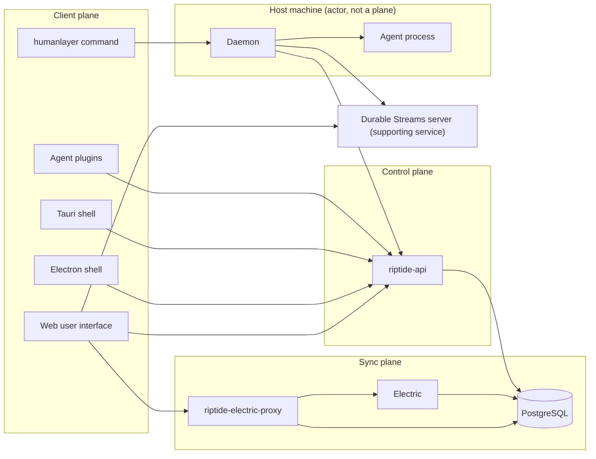
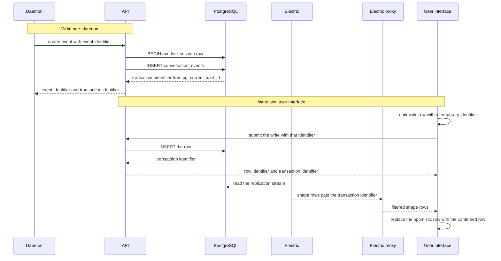

# Glossary

This glossary defines every term that the exploration uses. Each entry gives
the meaning in this codebase, not a general meaning. Where a term names a code
element, the entry gives the file. Read the entry, then follow the link to the
document that explains the mechanism.

Some term groups follow a plane, and the host machine has a group of its own. Three planes exist. The
control plane is the Application Programming Interface (API) and the daemon:
processes that accept intent or report state through the API. The sync plane is
PostgreSQL, its write-ahead log (WAL), Electric, and the Electric proxy. These
components deliver read-only shapes. The client plane is the web user interface, the
desktop shells, the command-line interface (CLI), and the plugins. The daemon
runs on a user host. The host is an actor (a participant), not a plane. The daemon also appends
to the durable stream (the append-only live event log), which is a supporting service. Some terms appear in more
than one group, because one word carries different work in different places. The
abbreviation table below expands every abbreviation that the documents use.

The diagram places the daemon in the host group by location. By function it belongs to the control plane: it accepts intent and reports state through the API. Here the word actor means a participant, not a software platform. The proxy reads PostgreSQL to run the capability and session checks on shared-artifact and session routes (`apps/riptide-electric-proxy/src/lib/queries.ts:139-156`, `:211-217`). The user interface reads the durable stream directly for live session output and Yjs document collaboration (`apps/riptide-ui/src/hooks/useStreamDB.ts:1`).

## The product and its actors

| Term | Meaning in this codebase | Where it lives |
|------|--------------------------|----------------|
| **HumanLayer** | The product. It runs coding agents on user machines and lets a team steer them from one place. The repository holds all of it. | `README.md:3-5` |
| **Riptide** | The internal name that most application folders use. `riptide-api`, `riptide-ui`, `riptide-daemon`, and the other `riptide-*` folders are the parts of the product. | `apps/` |
| **Host** | One machine that runs a daemon. A host has an identifier, a user, and an organization. Sessions carry a `host_id`. | `packages/db/src/tables/sessions.ts` |
| **Daemon** | The long-running process on a host that starts, watches, and stops agent sessions. It has no inbound network listener. | `apps/riptide-daemon/src` |
| **Agent** | A coding agent program that the daemon starts or mirrors. The values are `claude`, `codelayer`, `fold`, `opencode`, `pi`, `codex`, and `claude-code`. | `packages/schemas/coding-agent/coding-agent.ts:4` |
| **Coding agent** | The enumeration that names every supported agent value. | `packages/schemas/coding-agent/coding-agent.ts:4` |
| **Executor** | The adapter that starts and controls one agent family. Three executors exist: `claude`, `codelayer`, and `fold`. | `apps/riptide-daemon/src` |
| **Launchable** | An agent value that the daemon can start. The set is `claude`, `codelayer`, and `fold`. The guards that test this set are in the coding-agent schema. | `packages/schemas/coding-agent/coding-agent.ts:14-38` |
| **Mirror-only** | An agent that the daemon cannot start. A plugin on the agent host reports its activity instead. The four values are `opencode`, `pi`, `codex`, and `claude-code`. This snapshot holds a mirroring plugin for `opencode`, `pi`, and `claude-code`; it holds no Codex plugin, so `codex` is declared mirror-only but no plugin sends its activity here. | `apps/riptide-daemon/src`, `apps/riptide-opencode-plugin`, `apps/riptide-pi-extension`, `apps/riptide-claude-code-plugin` |
| **Plugin** | A package that runs inside an agent host and mirrors sessions, or adds skills. Five plugin families exist. | `apps/riptide-*-plugin`, `apps/riptide-pi-extension` |
| **Workspace** | The prepared checkout that a session works in: one Git worktree for each repository in the task, plus copied configuration files and an optional setup command. The daemon prepares it before launch. | `apps/riptide-daemon/src/handlers/workspace`, `packages/schemas/src/effect` |
| **Provider login** | The flow that authenticates an agent family to its model provider. The user interface refetches provider login requests every 2 seconds in query fallback mode (`packages/sync/src/constants.ts:40-53`). In Electric mode the collection reads live rows. | `packages/sync/src/constants.ts` |
| **Session (coding-agent session)** | The unit of work. A session belongs to one organization, one user, and usually one task. It has a status, an agent, a host, and a conversation. | `packages/db/src/tables/sessions.ts` |
| **Authentication session (`sid`)** | The WorkOS login session identifier. It is stored in the auth context and is not a coding-agent session row. | `packages/schemas/src/effect/workos-access-token.ts:6`, `apps/riptide-electric-proxy/src/auth/effect/jwt-validator.service.ts:68-83` |
| **Task** | A unit of intent that groups sessions. A session can exist with no task. | `packages/db/src/tables/tasks.ts` |
| **Organization** | The tenant. Every row that the sync plane sends carries an internal organization identifier. | `packages/db/src/tables/organizations.ts:10-13` |
| **Seat** | A billable member position in an organization. Seats are synchronized from the billing provider. | `apps/riptide-api/src/effects/services/billing` |
| **Artifact** | A file or document that a session produces and that a person can read, share, or comment on. | `packages/db/src/tables/artifacts.ts` |
| **Share key** | The opaque capability that lets a person read one shared artifact with no account. A public link carries it as the `?key=` query parameter. The route passes it to the shared-artifact collection as `shareKey`, and that code sends it to the proxy as the `x-share-key` header, which the shared-artifact routes require (`apps/riptide-ui/src/hooks/shared-artifact/useSharedArtifactCollection.ts:22-29`). | `apps/riptide-ui/src/routes/shared/artifacts/$artifactId.tsx:7-29`, `apps/riptide-electric-proxy/src/routes/v1.ts:48-70` |

The product names in the README differ from the schema values. This table maps
them.

| Product name | Schema value | Daemon launches it? | Source |
|---|---|---|---|
| Claude Code, started by the daemon | `claude` | Yes | `apps/riptide-daemon/src/handlers/sessions/on-session-launch.ts:32-41` |
| Claude Code, run in a terminal | `claude-code` | No, mirror-only | `apps/riptide-claude-code-plugin/src/config.ts:87-88` |
| CodeLayer | `codelayer` | Yes | `apps/riptide-daemon/src/handlers/sessions/on-session-launch.ts:32-41` |
| Fold | `fold` | Yes, when the default-off Fold experiment is enabled; the source does not name the switch | `apps/riptide-daemon/src/handlers/sessions/on-session-launch.ts:32-41` |
| OpenCode | `opencode` | No, mirror-only | `apps/riptide-opencode-plugin/src/mirror.ts:293-295` |
| Pi | `pi` | No, mirror-only | `apps/riptide-pi-extension/src/config.ts:93-96` |
| Codex | `codex` | No, mirror-only; no plugin sends its activity in this snapshot | `packages/schemas/coding-agent/coding-agent.ts:4-7` |

Five plugin families exist.

| Plugin family | Package or manifest | What it mirrors or adds |
|---|---|---|
| `apps/riptide-claude-code-plugin` | `@humanlayer/claude-code-humanlayer` | Mirrors Claude Code terminal sessions; adds hooks and a tool server (`apps/riptide-claude-code-plugin/package.json:2-5`) |
| `apps/riptide-opencode-plugin` | `@humanlayer/opencode-humanlayer` | Mirrors OpenCode sessions; adds a server and a terminal interface (`apps/riptide-opencode-plugin/package.json:2-5`) |
| `apps/riptide-pi-extension` | `@humanlayer/pi-humanlayer` | Mirrors Pi sessions, artifacts, and diffs (`apps/riptide-pi-extension/package.json:2-5`) |
| `apps/riptide-humanlayer-claude-plugin` | `hl` | Adds built-in HumanLayer skills; does not mirror sessions (`apps/riptide-humanlayer-claude-plugin/.claude-plugin/plugin.json:2-4`) |
| `apps/riptide-rpi-claude-plugin` | `rpi` | Adds Research-Plan-Implement workflow skills and a marketplace entry; does not mirror sessions (`apps/riptide-rpi-claude-plugin/.claude-plugin/plugin.json:2-4`) |

## The session lifecycle

The status list is declared once, in
`packages/schemas/src/effect/session/session-status.ts:7-21`. The file comment
calls the list the single source of truth (`:3-6`). The transitions are code in
the handlers, not a declared table, so the repository does not define a
legal-transition map.

| Status | Meaning |
|--------|---------|
| `draft` | A session that exists but is not prepared for a host. |
| `waiting_for_workspace` | The host has the session, and the daemon has not finished preparing the workspace. |
| `ready_for_launch` | The workspace is ready, and the daemon can start the agent process. |
| `launching` | The daemon is starting the agent process. |
| `running` | The agent process is active. |
| `ready_for_input` | The agent is not working, and it waits for a person or a queued message. |
| `needs_approval` | The agent asks for permission to run a tool, and it waits for an answer. |
| `waiting_for_usage_limit` | The agent provider's usage limit blocks progress, and the session waits. |
| `interrupt_requested` | A person asked to stop, and the daemon has not yet acknowledged. |
| `interrupted` | The agent process stopped because of the request. |
| `resuming` | The daemon is restoring a session that was ready for input, interrupted, failed, or lost. |
| `failed` | The session ended with an error. |
| `lost` | The control plane cannot find a live daemon for the session. |

The golden document `golden/session_state_machine.md` describes the intended
graph. Document [03](03-session-lifecycle-and-state-machine.md) compares the
document with the code.

**Aha:** The status list is the only shared vocabulary between the schema
packages, the daemon, and the user interface. The transitions are not part of
that vocabulary. The schema file declares 13 values, and the golden document
draws a graph with 11 of them. The missing two, `waiting_for_workspace` and
`lost`, exist only in code. This is why the state machine cannot be generated
from a declaration: the declaration names the states, but the edges live in
handlers.

## The control plane

| Term | Meaning in this codebase | Where it lives |
|------|--------------------------|----------------|
| **Control plane** | The API and the daemon. These processes accept intent or report state through the API. The daemon holds no listener. PostgreSQL is not in this plane; it is in the sync plane. | `apps/riptide-daemon/src/orpc/client.ts:28-77` |
| **oRPC** | The procedure-call library that carries both directions. One API contract describes every procedure, and both sides import it. | `contracts/riptide-api-contract/src` |
| **Contract** | The typed description of inputs, outputs, and errors for a set of procedures. The API contract holds two routers, `api` and `daemon`. A second contract describes the Electron desktop procedure calls. | `contracts/` |
| **Base** | A middleware chain that a procedure is built on. Bases carry authentication, organization requirement, administration requirement, and billing policy. | `apps/riptide-api/src/orpc/base.ts` |
| **Billing gate** | The middleware that enforces the billing policy. It continues when the decision is `fail_open`, and it throws `BILLING_REQUIRED` when the decision is `blocked`. An unexpected exception returns `SERVICE_UNAVAILABLE`. | `apps/riptide-api/src/orpc/base.ts:99-134` |
| **Daemon token** | A signed token that identifies a host, a user, and an organization. The API signs it, and the API and the proxy verify it with a public key. The proxy never signs. | `apps/riptide-api/src/auth/daemon-tokens.ts:52-64` |
| **Launch token** | A short-lived signed token with claims `type=launch`, `userId`, and `organizationId`. The API issues it to a signed-in user. The user exchanges it for a daemon token and supplies a host identifier. It expires after 24 hours and carries no host identifier. | `apps/riptide-api/src/auth/daemon-tokens.ts:87-97`, `apps/riptide-api/src/orpc/api/auth/daemon/token-exchange.ts:4-17` |
| **Daemon authorization header** | The header `x-daemon-authorization`. Every daemon request to the API carries it. | `apps/riptide-api/src/auth/context.ts:55-81` |
| **Personal access token** | A user credential in place of a browser token. The API decides which kind it received by attempting to decode a JSON Web Token. | `apps/riptide-api/src/auth/context.ts:11-30` |
| **Heartbeat** | The daemon's periodic registration call. The interval is 15 seconds, the timeout is 10 seconds, and the control plane treats a host as stale after 120 seconds (`apps/stale-daemon-sweeper/stale-daemons.ts:7`). | `apps/riptide-daemon/src/lib/heartbeat.ts:16-20` |
| **Stale host** | A host that stopped sending heartbeats. The `stale-daemon-sweeper` job finds these hosts. | `apps/stale-daemon-sweeper` |

## The sync plane

| Term | Meaning in this codebase | Where it lives |
|------|--------------------------|----------------|
| **Sync plane** | The read direction. PostgreSQL, its write-ahead log, Electric, and the Electric proxy deliver read-only shapes. The Durable Streams server is a supporting service, not a plane. | `apps/riptide-electric-proxy/src`, `packages/streams/src` |
| **Write-ahead log (WAL)** | The change record that PostgreSQL writes before it applies a change. Electric reads it through logical replication. | `docker-compose.yaml:9-41` |
| **Sync** | The copy of database rows to clients. The package is `packages/sync`. | `packages/sync/src/index.ts` |
| **Shape** | One Electric stream of rows for one table and one filter. A shape has a Uniform Resource Locator (URL) that encodes the table and the filter. | `apps/riptide-electric-proxy/src/routes` |
| **Subset** | An Electric request for part of a shape, usually a filter for one visible region. The sync package sends subsets with HyperText Transfer Protocol (HTTP) `POST`. | `packages/sync/src/electric-collection.ts:44` |
| **Collection** | A TanStack DB object that holds rows for one table and one key. The user interface reads collections with live queries. | `apps/riptide-ui/src/collections/electric` |
| **Health tracker** | The object that counts consecutive Electric errors and successes per collection. Three errors degrade a collection to query mode. Three successes recover it. | `packages/sync/src/health-tracker.ts:110-169` |
| **Query mode** | The fallback transport. A collection in query mode calls the API sync procedure instead of Electric. | `packages/sync/src/query-collection.ts:38-71` |
| **Offline** | The state where both Electric and the query path fail for one collection. The user interface shows a banner only in this state. | `packages/sync/src/health-tracker.ts:224-227` |
| **Keep-alive** | A no-op Electric subscription that the sync package holds while a collection is in query mode, so the shape stream can recover. | `packages/sync/src/electric-keep-alive.ts:84-105` |
| **Access control list (ACL)** | A grant of `read`, `edit`, or `comment` on a task to one user or one organization. Two tables hold these grants. | `packages/db/src/tables/task-user-acl.ts`, `packages/db/src/tables/task-organization-acl.ts` |
| **Access rule** | The Structured Query Language condition that the proxy writes into a shape URL. Version 1 uses the ACL rule (`where-builder.ts:63-101`). Version 2 uses the organization rule in a separate file. | `apps/riptide-electric-proxy/src/lib/where-builder.ts`, `apps/riptide-electric-proxy/src/lib/v2-where-builder.ts` |
| **Transaction identifier** | The text form of the PostgreSQL transaction identifier, produced by `pg_current_xact_id()::text`. The client uses it to wait for Electric to pass the write. | `apps/riptide-api/src/db/get-tx-id.ts:4-7` |
| **Confirmation wait** | The client step that waits for the transaction identifier to appear in the shape. The timeout is 10,000 milliseconds, set by `AWAIT_TX_TIMEOUT` (`packages/sync/src/constants.ts:17`). | `apps/riptide-ui/src/components/providers/SyncProvider.tsx:927-1024` |

## The data model

| Term | Meaning in this codebase | Where it lives |
|------|--------------------------|----------------|
| **Drizzle** | The TypeScript database toolkit that describes tables and builds queries. | `packages/db/drizzle.config.ts` |
| **Select schema** | The Zod schema that `drizzle-zod` builds from a table. The same schema serves the API contract output and the user interface collection. | `packages/db/src/tables/sessions.ts:204-216` |
| **UUIDv7** | The Universally Unique Identifier (UUID) format that sorts by time. Every primary entity uses it. The database default is the native `uuidv7()`, and the application fallback is the `uuidv7` package. | `packages/db/src/tables/sessions.ts:50-53` |
| **Millisecond timestamp** | The timestamp format. Every timestamp column is a `bigint` of milliseconds since the Unix epoch, set by a database default and by `Date.now()`. | `packages/db/src/tables/sessions.ts:102-122` |
| **Conversation event** | One row in the conversation. It holds a type, a role, content, and optional tool-call, tool-result, approval, and token-count fields. | `packages/db/src/tables/conversation-events.ts:37-77` |
| **Migration** | One numbered SQL file in the migration folder. The snapshot holds 144 files. | `packages/db/drizzle` |
| **Schema pair** | The Effect schema and the Zod schema that describe the same value. Parity tests keep the pair aligned. | `packages/schemas/src` |
| **De-purification** | The project rule that keeps a leaf component pure and moves data access into a wired wrapper around it, so the leaf can be rendered and tested with fixed data. | `golden/de-purification-patterns.md` |

## The client plane

| Term | Meaning in this codebase | Where it lives |
|------|--------------------------|----------------|
| **User interface (UI)** | The React application in `apps/riptide-ui`. It runs in a browser and inside both desktop shells. | `apps/riptide-ui/src` |
| **Live query** | A TanStack DB query that re-runs when the collection changes. It replaces most manual refresh logic. | `apps/riptide-ui/src/hooks` |
| **Store** | A Zustand store that holds interface-only state, such as open panels, drafts, and selection. Server rows do not live in stores. | `apps/riptide-ui/src` |
| **Electron shell** | The desktop container that uses Chromium and Node.js. The renderer is sandboxed, and a preload script exposes a narrow bridge. | `apps/riptide-electron` |
| **Tauri shell** | The desktop container that uses a system web view and a Rust process. It bundles the daemon as a sidecar. | `apps/riptide-native` |
| **Sidecar** | A program that a Tauri application starts and controls. The Tauri shell ships `riptided` as a sidecar. | `apps/riptide-native/tauri.conf.json` |
| **Message port** | The Electron channel that carries the desktop procedure calls between the renderer and the main process. | `apps/riptide-electron/src/rpc/message-port-server.ts` |
| **Command-line interface (CLI)** | The `humanlayer` command in `apps/cli`. It imports the daemon library and starts a managed daemon (`apps/cli/src/commands/daemon-launch.ts:119-129`). | `apps/cli/src/commands/daemon-launch.ts` |
| **Managed daemon** | A daemon that the CLI starts inside its own process tree, rather than as a separate installed binary. | `apps/cli/src/commands/daemon-launch.ts:56-88` |
| **Development stack** | The `devstack` application. It runs one complete local stack for each worktree. | `apps/devstack` |
| **Cloud application** | The administration application in `apps/riptide-cloud`. It manages organizations, invitations, settings, and seats. | `apps/riptide-cloud/src` |
| **Working application** | The user interface build in `apps/riptide-ui`. It runs in a browser or inside both desktop shells. It is distinct from the cloud administration application. | `apps/riptide-ui/src` |

## Streams and documents

| Term | Meaning in this codebase | Where it lives |
|------|--------------------------|----------------|
| **Durable stream** | An append-only log with a stable address. The conversation stream has the path `/streams/sessions/${sessionId}`. | `apps/riptide-daemon/src/effects/services/stream-producer/durable-stream-writer.ts:64-65` |
| **Idempotent producer** | The writer that suppresses duplicates within one producer session. The daemon sets `maxInFlight` to 1 and batches appends with a 50-millisecond linger. | `apps/riptide-daemon/src/effects/services/stream-producer/durable-stream-writer.ts:130-163` |
| **Hydration** | The repair step that rebuilds a stream from database rows when the stream is missing or behind. | `packages/streams` |
| **Yjs** | The shared-document library that carries multi-person document state. The package `y-durable-streams` connects it to the durable stream server. | `packages/y-durable-streams/src/yjs-provider.ts` |
| **Time To Live (TTL)** | The retention period for stream data. The stream configuration sets 3,600 seconds. | `packages/streams/src/config.ts:1-26` |
| **Golden document** | A human-readable design specification in the `golden/` directory. Code and tests must match it. It is a trusted reference, not generated output and not a test fixture. The directory holds `session_state_machine.md`, `sync_architecture.md`, `de-purification-patterns.md`, and `api-testing-guidelines.md`. | `golden/`, `17-invariants-and-golden-documents.md:6` |

## Git attribution

| Term | Meaning in this codebase | Where it lives |
|------|--------------------------|----------------|
| **Worktree** | A second checkout of one Git repository that shares the object database with the main checkout. The daemon prepares one for each repository in a task. | `apps/riptide-daemon/src/handlers/workspace` |
| **Journal** | An append-only record of the line hashes that an agent edited. The daemon writes it for each session, and the attribution code reads it as evidence. | `packages/git-attribution/src/evidence/journal-overlap/method.ts:1-38` |
| **Watermark** | The last commit that the ledger recorded for one repository. The next scan starts after it. PostgreSQL holds it, not the daemon. | `apps/riptide-daemon/src/lib/git/commit-watcher.ts:188-190` |
| **Trailer** | A key-value line at the end of a commit message, such as `HumanLayer-Session: <id>`. A Git hook stamps it when the committing process carries a live session identity. | `packages/git-attribution/src/evidence/trailer/method.ts:1-12` |
| **Attribution** | The assignment of a commit or pull request to a session, with a tier that states the confidence: `confirmed`, `inferred`, or `human`. | `packages/git-attribution/src/attribute-commit.ts:28-36` |

## Protocols, libraries, and infrastructure

| Term | Meaning in this codebase | Where it lives |
|------|--------------------------|----------------|
| **Effect** | The TypeScript library that the code uses for typed errors, dependency injection, and managed resources. Many services are Effect services. | `packages/schemas/src/effect` |
| **Hono** | The small web framework that serves the API and the proxy. | `apps/riptide-api/src/app.ts`, `apps/riptide-electric-proxy/src/server.ts` |
| **Electric** | The sync engine that turns PostgreSQL changes into shapes. The JavaScript client package `@electric-sql/client` is version 1.5.28 (`package.json:128`). The Docker image `electricsql/electric` is version 1.7.12 (`docker-compose.yaml:31`). The client speaks the Electric shape protocol over HTTP; it does not embed the server. The two version numbers are independent. The proxy targets server 1.7.12 (`apps/riptide-electric-proxy/src/lib/effect/electric-proxy.service.ts:32`). | `package.json:128`, `docker-compose.yaml:31` |
| **WorkOS** | The identity provider. It issues the access tokens that the API and the proxy validate. | `packages/schemas/src/effect/workos-access-token.ts` |
| **JSON Web Token (JWT)** | The signed token format for user and daemon credentials. | `apps/riptide-api/src/auth/jwt-validator.ts` |
| **JSON Web Key Set (JWKS)** | The published key set that verifies a JWT signature. Both the API and the proxy cache it and refresh it when a key identifier is unknown. | `apps/riptide-api/src/auth`, `apps/riptide-electric-proxy/src/auth/effect/jwks-cache.service.ts` |
| **Model Context Protocol (MCP)** | The protocol that connects an agent to tools and context. The Claude Code plugin runs a hooks module and an MCP server; the hooks module is the mirroring surface, and the MCP server exposes the tool list. | `apps/riptide-claude-code-plugin` |
| **Stripe** | The billing provider. Webhooks update subscription state, and seats derive from it. | `apps/riptide-api/src/effects/services/billing` |
| **Sentry** | The error-reporting service. The API, the proxy, the daemon, the user interface, and the cloud application report to it. The logger package defines the transport interface but has no runtime dependency on Sentry. | `apps/riptide-api/src`, `apps/riptide-electric-proxy/src`, `apps/riptide-daemon/src`, `apps/riptide-ui/src` |
| **PostHog** | The product-analytics service that the user interface uses. | `apps/riptide-ui/src` |
| **TanStack Router** | The routing library. Routes are files, and a generator writes the route tree. | `apps/riptide-ui/src/routes` |
| **TanStack DB** | The client store that holds collections and runs live queries. | `packages/sync/src` |
| **TanStack Query** | The request cache that the query-mode collections and API calls use. | `apps/riptide-ui/src` |
| **Zustand** | The small state store that holds interface-only state. | `apps/riptide-ui/src` |
| **Vite** | The development server and build tool for the user interface. | `apps/riptide-ui` |
| **Bun** | The package manager and runtime. The root manifest declares version 1.3.14, and the continuous integration workflow uses 1.4.2. | `package.json`, `.github/workflows` |
| **Turborepo** | The task runner for the monorepo. The configuration uses a `tasks` object. | `turbo.json` |
| **Docker Compose** | The local service definition. It runs PostgreSQL, Electric, MinIO, the durable stream server, and Redis. | `docker-compose.yaml` |
| **Caddy** | The local reverse proxy. It listens on ports 4443 and 4444 and forwards to the user interface on 8888 and the sync plane on 5537. | `Caddyfile` |
| **MinIO** | The local object store that replaces the cloud object store. | `docker-compose.yaml` |
| **Redis** | The local billing cache and general key-value store. The repository does not use it as a queue. | `docker-compose.yaml` |
| **AWS Lambda** | The serverless compute service that runs the four background handler applications. The repository holds the handlers but not their deployment definitions. | `apps/riptide-migrator`, `apps/updater-server`, `apps/stale-daemon-sweeper`, `apps/database-maintenance-function` |
| **Pulumi** | The infrastructure-as-code tool that `packages/pulumi-helpers` refers to. No Pulumi program is present in this snapshot. | `packages/pulumi-helpers` |
| **Actor platform** | A durable-execution service that keeps state inside an actor and replays work after a failure. The repository uses no actor platform as its record; it uses PostgreSQL rows. | `packages/db/src/tables/sessions.ts` |
| **Rivet** | The name of an actor platform that the project used earlier. Only development-stack variable names and comments remain. The source does not define its role or the reason for its replacement. | `apps/devstack/src/lib/env-block.ts:121-123`, `apps/devstack/src/lib/manifest.ts:110-113` |
| **Row-level security (RLS)** | The PostgreSQL feature that would enforce tenancy inside the database. The inspected table definitions do not use it, so tenancy is enforced in application code. | `packages/db/src/tables` |

## Abbreviations, expanded

| Short form | Expansion |
|------------|-----------|
| ACL | Access Control List |
| AI | Artificial Intelligence |
| API | Application Programming Interface |
| AWS | Amazon Web Services |
| CDN | Content Delivery Network |
| CI | Continuous Integration |
| CLI | Command-Line Interface |
| CORS | Cross-Origin Resource Sharing |
| CRUD | Create, Read, Update, Delete |
| DB | Database |
| DOM | Document Object Model |
| DSN | Data Source Name |
| GUI | Graphical User Interface |
| HTML | HyperText Markup Language |
| HTTP | HyperText Transfer Protocol |
| HTTPS | HyperText Transfer Protocol Secure |
| IDOR | Insecure Direct Object Reference |
| IPC | Inter-Process Communication |
| JSON | JavaScript Object Notation |
| JWT | JSON Web Token |
| JWKS | JSON Web Key Set |
| KID | Key Identifier |
| KV | Key-Value |
| LLM | Large Language Model |
| MCP | Model Context Protocol |
| NAPI | Node-API (Native Application Programming Interface) |
| ORM | Object-Relational Mapper |
| oRPC | The procedure-call library name; it is not an abbreviation |
| PEM | Privacy-Enhanced Mail |
| PR | Pull Request |
| RLS | Row-Level Security |
| RSA | Rivest-Shamir-Adleman |
| RS256 | Rivest-Shamir-Adleman Signature with Secure Hash Algorithm 256 |
| RPC | Remote Procedure Call |
| S3 | Simple Storage Service |
| SDK | Software Development Kit |
| SHA | Secure Hash Algorithm |
| SPKI | Subject Public Key Info |
| SQL | Structured Query Language |
| SSE | Server-Sent Events |
| SSH | Secure Shell |
| TLS | Transport Layer Security |
| TTL | Time To Live |
| UI | User Interface |
| URL | Uniform Resource Locator |
| UUID | Universally Unique Identifier |
| WAL | Write-Ahead Log |
| YAML | YAML Ain't Markup Language |

## Identifiers, in one picture

Four identifiers appear often. They are easy to confuse, so this diagram
separates them.

The diagram shows two writers: the daemon for conversation events, and the user
interface for its own rows. The user interface submits the write with a
client-generated identifier. The API inserts the row and returns the transaction
identifier. The interface replaces the optimistic row when the shape delivers the
confirmed row. The temporary identifier is a client-side placeholder, not one of
the four server identifiers in the table below.

| Identifier | Created by | Used for |
|------------|------------|----------|
| Session identifier | `uuidv7()` in the database or in the application | Addresses the session row, the stream path, and the Electric filter |
| Event identifier | The daemon, or the database when the daemon omits it | Makes the insert idempotent |
| Transaction identifier | PostgreSQL, through `pg_current_xact_id()` | Lets the client wait for Electric to pass the write |
| Share key | The API, when a person shares an artifact | Grants read access with no account |

## Next

Return to the [index](README.md), or start with the
[overview](00-overview.md) if you have not read it.
