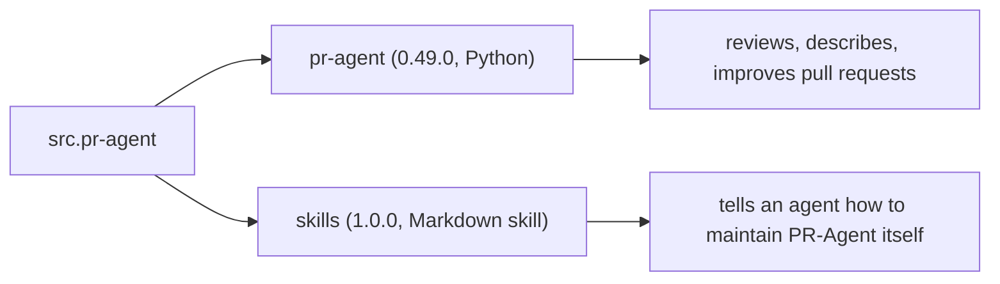

# Project Exploration: PR-Agent

## Overview

This group documents the `src.pr-agent` source directory, which holds two related repositories from The-PR-Agent organization:

1. **`pr-agent`** — the open-source, AI-powered code review agent (version 0.49.0, MIT). It reviews pull requests, writes descriptions, suggests code improvements, answers questions, and more, across ten git providers and eleven webhook servers.
2. **`skills`** — a companion repository holding one skill, `pr-agent-maintainer`, for an agent that helps maintainers triage, verify, and merge work on PR-Agent itself.

The two are related but distinct: `pr-agent` is the product; `skills` is the procedure for maintaining the product with an agent's help.

## The two subprojects

| Subproject | Repository | Commit | Content |
|------------|-----------|--------|---------|
| [pr-agent](pr-agent/exploration.md) | The-PR-Agent/pr-agent | `b32a021` | 120 Python files: core agent, AI handlers, 10 git providers, 12 tools, 11 servers, Mosaico A2A layer, telemetry |
| [skills](skills/exploration.md) | The-PR-Agent/skills | `0cab892` | One `SKILL.md`: the pr-agent-maintainer procedure |

## How to read this group

Start with the [pr-agent exploration](pr-agent/exploration.md) for the product, then the [skills exploration](skills/exploration.md) for the maintenance procedure. Each subproject has its own `markdown/` and `html/` documentation.

## Grandfather review

Both subprojects were verified against their sources. `pr-agent` at commit `b32a021` (counts: 120 package Python files, 24 settings TOML files, 10 git providers, 12 tools, 11 servers); `skills` at commit `0cab892` (one `SKILL.md` read verbatim). Nothing was executed; both repositories were treated as untrusted.
