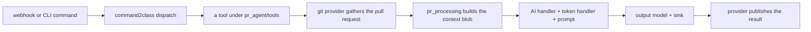
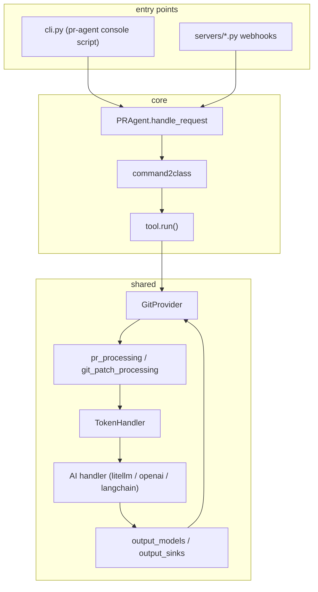

# Project Exploration: PR-Agent

## Overview

PR-Agent is an open-source, artificial-intelligence (AI) powered code review agent. It is the original open-source pull request reviewer, now a community-maintained legacy project of Qodo. Given a pull request, it produces reviews, descriptions, code suggestions, answers, documentation, changelog updates, labels, and compliance checks — across GitHub, GitLab, Bitbucket (cloud and server), Azure DevOps, Gitea, Gerrit, AWS CodeCommit, local checkouts, and plain diffs.

The one idea: a pull request is not read by a human first, but turned into a structured context blob — the diff, file list, language map, and repository context — which is passed through a prompt template to a model handler, which returns output that is published back to the provider. Every step (provider, tool, prompt, token handling, model routing, output) is a separate, configurable layer. See [Overview](markdown/00-overview.md).



## Repository

- **Location:** `/Users/darkvoid/GitSources/src.pr-agent/pr-agent`
- **Remote:** `git@github.com:The-PR-Agent/pr-agent.git` (commit `b32a021`)
- **Primary Language:** Python (package `pr_agent`, 120 Python files)
- **Version:** 0.49.0
- **License:** MIT
- **Author:** QodoAI

## Directory Structure

```
pr-agent/
├── pr_agent/
│   ├── agent/            (3 py)  the PRAgent orchestration + request policy
│   ├── algo/            (33 py)  shared algorithms, AI handlers, token/prompt, types
│   ├── tools/           (15 py)  12 tools (review, describe, improve, ask, ...)
│   ├── git_providers/   (16 py)  GitHub, GitLab, Bitbucket, Azure DevOps, ...
│   ├── identity_providers/ (3 py)
│   ├── secret_providers/  (4 py) AWS Secrets Manager, Google Cloud Storage
│   ├── servers/         (17 py)  webhook and service entrypoints
│   ├── mosaico/         (11 py)  the agent-to-agent (A2A) executor layer
│   ├── telemetry/        (9 py)  Prometheus + OpenTelemetry tracing
│   ├── settings/        (24 toml) configuration.toml + prompt templates
│   ├── cli.py / cli_pip.py / config_loader.py / config_security.py / doctor.py
├── tests/              (405 files) unittest, e2e, health, packaging
├── docs/               (43 files) Docusaurus site
├── docker/              (8 files) service build targets
├── github_action/ , scripts/ , .github/workflows/ (9 workflows)
└── pyproject.toml, uv.lock, .pr_agent.toml, action.yaml
```

## Architecture at a glance

The dispatch flow is `pr_agent/agent/pr_agent.py` → `command2class` → a tool class under `pr_agent/tools/`. A tool obtains the git provider, gathers pull-request context, prepares prompt variables and templates, calls the configured model handler, and publishes or stores the result through the provider.

Three layers carry the whole system:

| Layer | Where | Role |
|-------|-------|------|
| Provider | `git_providers/`, `identity_providers/`, `secret_providers/` | Read the pull request and write the result back |
| Brain | `algo/` (AI handlers, token handler, model routing) | Turn text into a model call within budget |
| Tools | `tools/` | Each command's specific behavior and prompt |



## The tool surface

PR-Agent exposes its capabilities as commands, each mapped to a tool class. The main ones: `review` (the reviewer), `describe` (the pull request description), `improve` (code suggestions), `ask` (free questions), plus `add_docs`, `update_changelog`, `similar_issue`, `generate_labels`, `config`, and `help`. The exact command list and mapping are documented in [CLI and config](markdown/10-cli-and-config.md) and the tool deep-dives in [Tools](markdown/12-tools-review-and-describe.md).

## Concepts explained for a reader who does not know the stack

| Concept | Where |
|---------|-------|
| The request flow and package layers | [Architecture](markdown/01-architecture.md) |
| The core agent and command dispatch | [The core agent](markdown/02-the-core-agent.md) |
| AI handlers and model routing | [AI handlers and model routing](markdown/03-ai-handlers-and-model-routing.md) |
| Token handling, budget, and prompt fragments | [Token handling and prompts](markdown/04-token-handling-and-prompts.md) |
| Turning a diff into context | [PR and patch processing](markdown/05-pr-and-patch-processing.md) |
| Review merge, findings, inline dedup | [Review pipeline](markdown/06-review-pipeline.md) |
| Output models and sinks | [Output models and sinks](markdown/07-output-models-and-sinks.md) |
| The ten git providers | [Git providers](markdown/08-git-providers.md) |
| Identity and secret providers | [Identity and secret providers](markdown/09-identity-and-secret-providers.md) |
| CLI, config loading, security | [CLI and config](markdown/10-cli-and-config.md) |
| The webhook servers | [Servers and deployment](markdown/11-servers-and-deployment.md) |
| Reviewer and description tools | [Tools: review and describe](markdown/12-tools-review-and-describe.md) |
| Code suggestions and questions tools | [Tools: suggestions and questions](markdown/13-tools-code-suggestions-and-questions.md) |
| Docs, labels, changelog, help tools | [Tools: docs, labels, help](markdown/14-tools-docs-labels-and-help.md) |
| The Mosaico A2A layer | [Mosaico A2A](markdown/15-mosaico-a2a.md) |
| Telemetry and observability | [Telemetry](markdown/16-telemetry-and-observability.md) |
| Packaging, CI, and tests | [Packaging, CI, tests](markdown/17-packaging-ci-and-tests.md) |

## Document map

| Topic | Document |
|-------|----------|
| Overview | [00](markdown/00-overview.md) |
| Architecture | [01](markdown/01-architecture.md) |
| The core agent | [02](markdown/02-the-core-agent.md) |
| AI handlers and model routing | [03](markdown/03-ai-handlers-and-model-routing.md) |
| Token handling and prompts | [04](markdown/04-token-handling-and-prompts.md) |
| PR and patch processing | [05](markdown/05-pr-and-patch-processing.md) |
| Review pipeline | [06](markdown/06-review-pipeline.md) |
| Output models and sinks | [07](markdown/07-output-models-and-sinks.md) |
| Git providers | [08](markdown/08-git-providers.md) |
| Identity and secret providers | [09](markdown/09-identity-and-secret-providers.md) |
| CLI and config | [10](markdown/10-cli-and-config.md) |
| Servers and deployment | [11](markdown/11-servers-and-deployment.md) |
| Tools: review and describe | [12](markdown/12-tools-review-and-describe.md) |
| Tools: suggestions and questions | [13](markdown/13-tools-code-suggestions-and-questions.md) |
| Tools: docs, labels, help | [14](markdown/14-tools-docs-labels-and-help.md) |
| Mosaico A2A | [15](markdown/15-mosaico-a2a.md) |
| Telemetry | [16](markdown/16-telemetry-and-observability.md) |
| Packaging, CI, tests | [17](markdown/17-packaging-ci-and-tests.md) |
| Glossary | [18](markdown/18-glossary.md) |

## The five most important ideas

1. **One shared pipeline, many commands.** Every tool funnels through the same provider → context → prompt → token-handler → model-handler → output path. The tools differ in their prompt and their output, not their plumbing.
2. **The provider is an interface with capability checks.** `GitProvider.is_supported("feature")` gates behavior per provider instead of concrete type checks, so a provider can stub or override one capability without forking the flow.
3. **Prompts are data, not code.** System and user prompts live as TOML under `pr_agent/settings/`, rendered with Jinja2 and `StrictUndefined`, so a missing variable fails loudly rather than rendering empty.
4. **Configuration is request-scoped Dynaconf.** `get_settings()` returns the request-scoped object from `starlette_context` when present, otherwise the module-level object, and repository overrides are filtered by `config_security.py`.
5. **Model handling is abstracted behind one interface.** LiteLLM, OpenAI, and LangChain handlers implement the same base, so swapping a provider or adding a fallback is a config change, not a code change.

## Verdict

A mature, heavily-integrated, production-shaped codebase with real depth: 12 tools, 10 git providers, 11 servers, a token-budget system, model routing, telemetry, and a newer agent-to-agent layer (Mosaico). The costs are the breadth of the integration surface and the fact that it is a legacy, community-maintained project with its direction explicitly capped until version 1. **Aha: the code's credibility comes from the fact that the prompts and configuration are data files loaded at runtime — the system is a shell whose behavior is defined by TOML, which is why the same binary serves twelve tools and ten providers without twelve code paths.**

## Grandfather review

To be completed after chapters 00 to 18 are written: every name, number, flow, and public surface will be checked against the source at commit `b32a021`.
